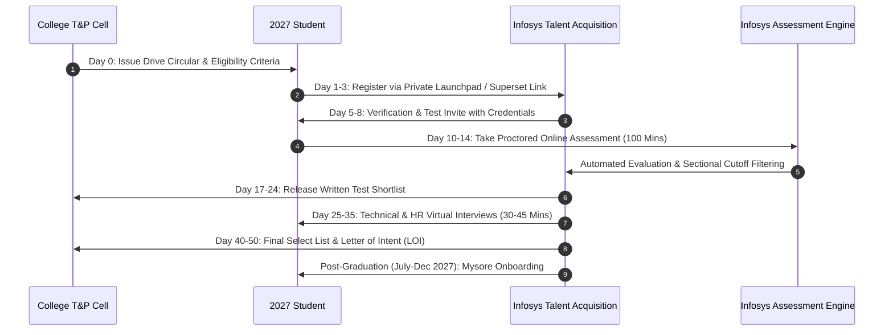

# Campus Drive Dates & Hiring Timeline

**Candidate Cohort:** 2023–2027 Graduating Batch  
**Primary Target:** Systems Engineer (SE) — ₹3.60 LPA  
**Corporate Hiring Target:** ~20,000 Freshers across FY27  

---

## 1. Where Does the 2023–2027 Batch Stand?
Engineering students admitted in 2023 for a 4-year degree (B.Tech / B.E.) will graduate in **mid-2027**.
In late 2026, you are in your **7th Semester (Final Year) / 6th Semester (Pre-Final Year)**.
In Indian university placement schedules, **August to November 2026** represents the peak **Day 1 / Slot 1 Placement Season**.

---

## 2. Is Infosys Visiting Colleges Right Now?
**YES.** Infosys has officially mobilized its entry-level recruitment drives targeting college campuses for the 2026–2027 academic cycle. The recruitment follows three structured phases:

```
[ Phase 1: August – November 2026 ] (CURRENT ACTIVE WINDOW)
  ├── Tier 1 / Tier 2 Engineering Colleges (Autonomous & University Campuses)
  ├── Day-1 Slot Visits (CS/IT + Circuit + Core Branches)
  └── Early Selection & Elevated Drives (SE, DSE, SP)

[ Phase 2: January – April 2027 ]
  ├── Tier 3 Engineering Colleges & State University Affiliated Colleges
  ├── Pooled Campus Drives (Zonal Nodal Hubs hosting 15–30 regional colleges)
  └── Second-Chance Assessment Drives

[ Phase 3: May – August 2027 ]
  ├── National Off-Campus Qualifier Drives on career.infosys.com
  └── Final mop-up rounds before Mysore onboarding
```

---

## 3. Sequence of a Campus Drive



---

## 4. "Small-to-Small" Operational Milestones Breakdown

| Milestone | Timing Window | What Happens | Action You Must Take |
| :--- | :--- | :--- | :--- |
| **1. TPO Circular** | **Day 0 to Day 3** | College TPO releases the official placement circular with eligibility rules. | Check that your 10th, 12th, and all semester marks exceed 60.0% / 6.0 CGPA. Confirm 0 active backlogs. |
| **2. Infosys Form Registration** | **Day 1 to Day 4** (Strict 48–72h window) | A college-specific registration link is opened on Infosys Launchpad / Superset. | Fill in personal and academic data. Upload a 1-page ATS-compliant PDF resume. Do not round off marks. |
| **3. Scrutiny & Hall Ticket** | **Day 5 to Day 8** | Infosys algorithms verify academic percentages against college records. | Watch your registered email (including Spam/Junk) for credentials and test link from `@infosys.com`. |
| **4. Hardware Pre-Check** | **24–48h before exam** | Mandatory system readiness check. | Run `https://rec-test.infosys.com/precheck`. Verify webcam, mic, browser version, and 2 Mbps internet speed. |
| **5. Online Assessment Day** | **Day 10 to Day 14** (Fixed weekend/day slot) | Proctored 5-section exam (54 Qs, 100 minutes) under locked browser mode. | Clear every single section cutoff. Do not switch tabs. |
| **6. Shortlist Announcement** | **Day 17 to Day 24** (7–14 days post-test) | Infosys sends the list of qualified students to your college TPO. | Review shortlist on college notice board/portal. Begin intensive interview drills. |
| **7. Technical & HR Interview** | **Day 25 to Day 35** | Virtual 30–45 minute panel interview via MS Teams or Infosys Interview Platform. | Deep dive into resume project, 4 OOP pillars, live SQL queries, and non-negotiable HR relocation responses. |
| **8. Final Results & LOI** | **Day 40 to Day 50** | Selection list published. Formal Letter of Intent (LOI) sent to selected students. | Accept the LOI within the stipulated deadline (usually 7 days). |
| **9. Background Verification (BGV)** | **April – June 2027** | Third-party background verification agencies collect transcripts. | Submit final semester consolidated marksheets, Provisional Degree Certificate (PDC), and government IDs. |
| **10. Date of Joining (DOJ) & Mysore Call** | **July – December 2027** | Formal Offer Letter issued with Date of Joining and reporting batch. | Travel to the Infosys Global Education Center (GEC) in Mysuru for training. |

---

## 5. College Visit Patterns: How Other Colleges Are Scheduled
- **Tier 1 & Top Tier 2 Campuses (VIT, SRM, Thapar, KIIT, Amity, Manipal, etc.):** Drives take place between **August and October 2026**. Many students receive elevated interview offers for DSE (₹6.25 LPA) and SP (₹9.5 LPA).
- **State University Affiliated Colleges (VTU, Anna University, AKTU, JNTU, Mumbai Univ):** Often grouped into regional clusters or nodal campuses. Scheduled between **October 2026 and February 2027**.
- **Tier 3 / Rural Engineering Colleges:** Primarily covered under **Phase 2 Pooled Drives (January – April 2027)**, where one central college hosts the drive for 15–30 surrounding institutions.

---

## 6. Post-Selection Wait & Staggered Onboarding
- **Phased Waves:** Infosys onboards selected freshers in waves (Batch A, B, C, D) throughout the fiscal year because the Mysore campus can train around 10,000–14,000 trainees at a time.
- **"Decision Pending" Status:** After selection, candidate portals often display "Decision Pending" or "In Process" for several months until your specific training wave is finalized. This is standard corporate procedure and does not mean your offer is in danger.

---

## Next Steps & Phase Navigation
- Step 2: Ensure your resume is ATS compliant and avoid portal traps $\rightarrow$ **[03_resume.md](file:///c:/Users/Rose/.gemini/antigravity-ide/brain/c94c898d-a265-48e6-96c4-82b81795f2d9/01_apply/03_resume.md)**
- Step 3: Check exact percentage and backlog cutoffs $\rightarrow$ **[04_criteria.md](file:///c:/Users/Rose/.gemini/antigravity-ide/brain/c94c898d-a265-48e6-96c4-82b81795f2d9/01_apply/04_criteria.md)**
- Step 4: Master the online assessment sections & AI proctoring rules $\rightarrow$ **[05_pattern.md](file:///c:/Users/Rose/.gemini/antigravity-ide/brain/c94c898d-a265-48e6-96c4-82b81795f2d9/02_exam/syllabus/05_pattern.md)**

