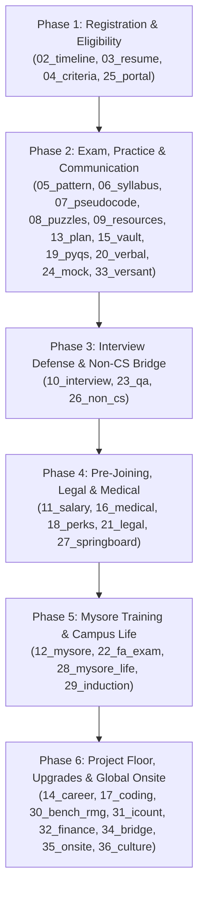

# Infosys Systems Engineer (SE) Recruitment Kit: Master Index

**Target Cohort:** 2023–2027 Graduating Batch  
**Primary Role:** Systems Engineer (SE) — ₹3.60 LPA  
**Upgrade Tracks:** Digital Specialist Engineer (DSE) — ₹6.25 LPA | Specialist Programmer (SP) — ₹9.50 LPA  

---

## The Complete 360° Systems Engineer Master Kit (01 to 36)

Sabhi files ke naam ultra-short, crisp aur sequential (`01_` se `36_`) rakhe gaye hain taaki aapke IDE file explorer mein bina kisi truncation (`...`) ke ek line mein saaf-saaf dikhein:

| Step / Module | File Link | Core Content & Scope |
| :---: | :--- | :--- |
| **01** | **[01_index.md](file:///c:/Users/Rose/.gemini/antigravity-ide/brain/c94c898d-a265-48e6-96c4-82b81795f2d9/01_index.md)** | **Master Index & Hub:** 36 modules ka master navigation directory, SE vs DSE vs SP comparison table, aur 6-phase lifecycle roadmap. |
| **02** | **[02_timeline.md](file:///c:/Users/Rose/.gemini/antigravity-ide/brain/c94c898d-a265-48e6-96c4-82b81795f2d9/01_apply/02_timeline.md)** | **Drive Dates & College Phases:** 2023–2027 lifecycle, Phase 1 (Aug–Nov 2026) vs Phase 2 (Jan–Apr 2027), Day 0 to Day 50 schedule. |
| **03** | **[03_resume.md](file:///c:/Users/Rose/.gemini/antigravity-ide/brain/c94c898d-a265-48e6-96c4-82b81795f2d9/01_apply/03_resume.md)** | **Registration & ATS Resume:** Portal form guidelines, 1-page single-column ATS format, high-match keywords, aur hardware pre-check setup. |
| **04** | **[04_criteria.md](file:///c:/Users/Rose/.gemini/antigravity-ide/brain/c94c898d-a265-48e6-96c4-82b81795f2d9/01_apply/04_criteria.md)** | **Eligibility Criteria:** Strict 60.0% / 6.0 CGPA rule (59.99% reject), eligible branches, 0 active backlogs, gap rules, aur cooling-off. |
| **05** | **[05_pattern.md](file:///c:/Users/Rose/.gemini/antigravity-ide/brain/c94c898d-a265-48e6-96c4-82b81795f2d9/02_exam/syllabus/05_pattern.md)** | **Exam Pattern & AI Proctoring:** 5 sections, 54 Qs, 100 mins matrix, zero backward navigation, webcam/mic lockdown, aur 2 alt-tab termination. |
| **06** | **[06_syllabus.md](file:///c:/Users/Rose/.gemini/antigravity-ide/brain/c94c898d-a265-48e6-96c4-82b81795f2d9/02_exam/syllabus/06_syllabus.md)** | **Micro-Syllabus:** Quantitative formulas (TSD, Work, P&C, Probability, DI), 2-circle Venn Syllogisms, seating rules, aur core grammar blueprints. |
| **07** | **[07_pseudocode.md](file:///c:/Users/Rose/.gemini/antigravity-ide/brain/c94c898d-a265-48e6-96c4-82b81795f2d9/02_exam/syllabus/07_pseudocode.md)** | **Pseudocode Secrets & Tracing:** Variable-Trace Table technique, bitwise identity formulas (`&`, `|`, `^`, `<<`, `>>`), aur 4 step-by-step solved trace examples. |
| **08** | **[08_puzzles.md](file:///c:/Users/Rose/.gemini/antigravity-ide/brain/c94c898d-a265-48e6-96c4-82b81795f2d9/02_exam/syllabus/08_puzzles.md)** | **Puzzle Solving Mastery:** 5 archetypes: $3 \times 3$ grid logic, balance scale coin formula ($3^k \ge N$), 2 burning ropes for 45 min, aur operator insertion. |
| **09** | **[09_resources.md](file:///c:/Users/Rose/.gemini/antigravity-ide/brain/c94c898d-a265-48e6-96c4-82b81795f2d9/02_exam/strategy/09_resources.md)** | **Curated YouTube Directory:** Exact search queries, video-by-video playlist breakdowns (OnlineStudy4u, CampusMonk, Gate Smashers, Love Babbar, Striver), free practice platforms, aur 3-hour daily routine. |
| **10** | **[10_interview.md](file:///c:/Users/Rose/.gemini/antigravity-ide/brain/c94c898d-a265-48e6-96c4-82b81795f2d9/03_interview/core/10_interview.md)** | **Technical & HR Interview Guide:** Interview flowchart, resume project architecture grilling, 4 OOP pillars, ACID properties, live SQL queries, aur 4 HR traps. |
| **11** | **[11_salary.md](file:///c:/Users/Rose/.gemini/antigravity-ide/brain/c94c898d-a265-48e6-96c4-82b81795f2d9/04_onboard/legal/11_salary.md)** | **Compensation & Service Bond:** ₹3.60 LPA line-by-line audit, monthly in-hand payslip (~₹24,500–₹25,500), Mysore stipend, 1-year bond, aur Bridge to DSE/SP upgrade. |
| **12** | **[12_mysore.md](file:///c:/Users/Rose/.gemini/antigravity-ide/brain/c94c898d-a265-48e6-96c4-82b81795f2d9/05_mysore/academics/12_mysore.md)** | **Mysore Training & Survival:** 14–18 week training phases (FP generic vs stream), FA1/FA2/FA3 exams, 65% benchmark, single retest rule, termination policy, aur RMG/bench. |
| **13** | **[13_plan.md](file:///c:/Users/Rose/.gemini/antigravity-ide/brain/c94c898d-a265-48e6-96c4-82b81795f2d9/02_exam/strategy/13_plan.md)** | **28-Day Actionable Study Plan:** Week-by-week aur day-by-day exact study schedule speed math, reasoning, verbal, pseudocode, 2 full mock tests, aur interview rehearsal. |
| **14** | **[14_career.md](file:///c:/Users/Rose/.gemini/antigravity-ide/brain/c94c898d-a265-48e6-96c4-82b81795f2d9/06_career/growth/14_career.md)** | **Day-in-the-Life, Appraisals & Career:** Daily work tasks (Dev vs Support vs QA), 9.15h biometric tracking, hybrid policy, CR/EE/ME appraisal ratings, JL2 to JL8 ladder, onsite visa rules, strictly 90-day notice period, aur university CGPA conversion formulas. |
| **15** | **[15_vault.md](file:///c:/Users/Rose/.gemini/antigravity-ide/brain/c94c898d-a265-48e6-96c4-82b81795f2d9/02_exam/strategy/15_vault.md)** | **The Master War Chest (Paid & Underground):** PrepInsta Prime vs Talent Battle vs FACE Prep vs Testbook vs Coding Ninjas audit & coupons; Google Dorks for public GDrive/Scribd folders; GitHub PYQ repositories; Telegram channel analysis & scam warnings; Reddit r/developersIndia forensics; George Summers & Shakuntala Devi books; Discord & WhatsApp communities. |
| **16** | **[16_medical.md](file:///c:/Users/Rose/.gemini/antigravity-ide/brain/c94c898d-a265-48e6-96c4-82b81795f2d9/04_onboard/legal/16_medical.md)** | **Medical Tests, Bond Notary & Packing:** 6 mandatory PEMC tests (HBsAg, X-ray, Typhoid, Urine, Blood, Stool), ₹200 e-stamp surety requirements, GEC Mysore packing list (electronics ban, dress code, ECC hostels), aur Delivery Units (FS, RTL, MFG, CIS). |
| **17** | **[17_coding.md](file:///c:/Users/Rose/.gemini/antigravity-ide/brain/c94c898d-a265-48e6-96c4-82b81795f2d9/06_career/growth/17_coding.md)** | **Elevated Coding Track (DSE / SP):** 3-problem, 3-hour HackerEarth assessment architecture, Easy/Medium/Hard score matrix, top 10 LeetCode archetypes with full code (Sliding window, Greedy intervals, Coin Change DP, Number of Islands BFS). |
| **18** | **[18_perks.md](file:///c:/Users/Rose/.gemini/antigravity-ide/brain/c94c898d-a265-48e6-96c4-82b81795f2d9/04_onboard/preparation/18_perks.md)** | **Perks, Shift Allowances & Policies:** Night shift allowance (₹350–₹400/night), Mediclaim insurance, BITS Pilani WILP M.Tech reimbursement, leave rules (15 days EL), internal enterprise software (Sparsh, Lex, Compass, InfyMe), and zero-tolerance moonlighting enforcement. |
| **19** | **[19_pyqs.md](file:///c:/Users/Rose/.gemini/antigravity-ide/brain/c94c898d-a265-48e6-96c4-82b81795f2d9/02_exam/practice/19_pyqs.md)** | **Real Exam Math, Logic & Pseudocode Dump:** 10 Real Math questions with step-by-step algebraic derivations, Real Syllogisms & Seating questions, and 5 Real Pseudocode tracing questions with exact answers. |
| **20** | **[20_verbal.md](file:///c:/Users/Rose/.gemini/antigravity-ide/brain/c94c898d-a265-48e6-96c4-82b81795f2d9/02_exam/practice/20_verbal.md)** | **Verbal Ability & Critical Reasoning Dump:** Reading Comprehension passage with 5 questions, grammar rules (dangling modifiers, subject-verb agreement), 4-sentence Para Jumbles, and Critical Reasoning assumption/weakening solutions. |
| **21** | **[21_legal.md](file:///c:/Users/Rose/.gemini/antigravity-ide/brain/c94c898d-a265-48e6-96c4-82b81795f2d9/04_onboard/legal/21_legal.md)** | **BGV Screening, NSR ITPIN & Legal Forensics:** First Advantage / HireRight screening, discrepancy fixes (affidavits), NSR ITPIN step-by-step registration on nsr.biz, and Section 27 / Section 74 legal analysis of the ₹1.25L bond and non-compete clause. |
| **22** | **[22_fa_exam.md](file:///c:/Users/Rose/.gemini/antigravity-ide/brain/c94c898d-a265-48e6-96c4-82b81795f2d9/05_mysore/academics/22_fa_exam.md)** | **Mysore FA Exam Codebank:** FA1 Python OOPs class with custom exceptions and rate calculation, FA2 complex SQL analytical queries (DENSE_RANK, conditional UPDATE), FA3 transactional Python-DB integration, and termination retest avoidance rules. |
| **23** | **[23_qa.md](file:///c:/Users/Rose/.gemini/antigravity-ide/brain/c94c898d-a265-48e6-96c4-82b81795f2d9/03_interview/transcripts/23_qa.md)** | **Live Candidate Transcripts & Panel Defense:** 5 real interview transcripts: CSE microservices defense, Non-CS mechanical-to-software bridge, handling academic gaps / low CGPA, answering unknown questions professionally, and 4 fatal HR traps with model scripts. |
| **24** | **[24_mock.md](file:///c:/Users/Rose/.gemini/antigravity-ide/brain/c94c898d-a265-48e6-96c4-82b81795f2d9/02_exam/practice/24_mock.md)** | **Full-Length 100-Minute Timed Mock Exam:** Complete simulated test matching the exact 5-section Infosys pattern (54 questions: Math, Reasoning, Verbal, Pseudocode, Puzzles) with master answer key and step-by-step explanations. |
| **25** | **[25_portal.md](file:///c:/Users/Rose/.gemini/antigravity-ide/brain/c94c898d-a265-48e6-96c4-82b81795f2d9/01_apply/25_portal.md)** | **Test Platform Mechanics & AI Proctor Glitches:** Screen layout, NO virtual calculator warning, rough paper protocol, 5 false-positive triggers (wall posters, ambient fans, gaze tracking), power-cut recovery, aur registration precision checklist. |
| **26** | **[26_non_cs.md](file:///c:/Users/Rose/.gemini/antigravity-ide/brain/c94c898d-a265-48e6-96c4-82b81795f2d9/03_interview/core/26_non_cs.md)** | **Non-CS Engineering Branch Transition Guide:** Defense scripts for ECE, EEE, Mech, Civil, Biotech; how to build a software telemetry bridge for core mechanical/electrical final-year projects; aur 5 core CS concepts non-CS students must know. |
| **27** | **[27_springboard.md](file:///c:/Users/Rose/.gemini/antigravity-ide/brain/c94c898d-a265-48e6-96c4-82b81795f2d9/04_onboard/preparation/27_springboard.md)** | **Pre-Joining Waiting Period & Springboard Modules:** 6–10 months wait dynamics, Batch A/B/C/D wave prioritization, Infosys Springboard pre-training modules (Python, SQL, OOPs), fast-track Mysore exam bypass, aur document delay solutions. |
| **28** | **[28_mysore_life.md](file:///c:/Users/Rose/.gemini/antigravity-ide/brain/c94c898d-a265-48e6-96c4-82b81795f2d9/05_mysore/campus/28_mysore_life.md)** | **Mysore GEC Campus Life, Hostels & Survival:** Typical daily schedule (8:30 AM to 5:30 PM, biometric tracking), ECC twin-sharing rooms, FC1/FC2/FC3/Fiesta dining costs, stipend breakdown (~₹19.5k gross, ₹8k-₹10k net savings), dress code, curfew, aur weekend outstation passes. |
| **29** | **[29_induction.md](file:///c:/Users/Rose/.gemini/antigravity-ide/brain/c94c898d-a265-48e6-96c4-82b81795f2d9/05_mysore/campus/29_induction.md)** | **Mysore Day 1 Induction & Onboarding Protocol:** Arrival transit, security gate screening, contraband confiscation, 5-day administrative schedule, thin-client workstation provisioning, aur ICICI/Axis corporate salary account setup. |
| **30** | **[30_bench_rmg.md](file:///c:/Users/Rose/.gemini/antigravity-ide/brain/c94c898d-a265-48e6-96c4-82b81795f2d9/06_career/growth/30_bench_rmg.md)** | **The Bench, RMG Dynamics & Client Account Interviews:** Post-Mysore allocation, daily bench requirements (9.15h biometric + Lex badges), internal client technical screens (e.g. Bank of America, Apple), aur avoiding forced L1 support deployment. |
| **31** | **[31_icount.md](file:///c:/Users/Rose/.gemini/antigravity-ide/brain/c94c898d-a265-48e6-96c4-82b81795f2d9/06_career/operations/31_icount.md)** | **Appraisal Framework: The iCount System & Hikes:** CR/EE/ME/BE bell curve quotas, salary increments (15% to 22% for CR), 4 core KPIs, brag document maintenance, aur promotion to Senior Systems Engineer in 2 years. |
| **32** | **[32_finance.md](file:///c:/Users/Rose/.gemini/antigravity-ide/brain/c94c898d-a265-48e6-96c4-82b81795f2d9/06_career/operations/32_finance.md)** | **Tax, EPF, Form 16 & Gratuity Optimization:** Monthly payslip line-by-line audit, why you pay ₹0 income tax under New Tax Regime, EPF/UAN activation, Gratuity 5-year calculation formula, aur Form 16 ITR-1 filing. |
| **33** | **[33_versant.md](file:///c:/Users/Rose/.gemini/antigravity-ide/brain/c94c898d-a265-48e6-96c4-82b81795f2d9/02_exam/syllabus/33_versant.md)** | **Automated Communication Assessment (Versant/SVAR):** AI voice evaluation parameters (fluency, pronunciation, sentence mastery), Part A-F task breakdown, headset calibration, and 40s extempore templates. |
| **34** | **[34_bridge.md](file:///c:/Users/Rose/.gemini/antigravity-ide/brain/c94c898d-a265-48e6-96c4-82b81795f2d9/06_career/growth/34_bridge.md)** | **Internal Bridge to DSE (₹6.25L) & SP (₹9.5L):** Fast-track salary doubling on Lex, 3-problem HackerEarth pattern (Easy/Medium/Hard), score thresholds, project & DSA interview defense. |
| **35** | **[35_onsite.md](file:///c:/Users/Rose/.gemini/antigravity-ide/brain/c94c898d-a265-48e6-96c4-82b81795f2d9/06_career/operations/35_onsite.md)** | **Global Onsite Opportunities & Visa Protocol:** B1 vs L1 vs H-1B tracks, per diem rates ($70–$100/day), internal visa workflow, and consular interview defense against 221(g) administrative traps. |
| **36** | **[36_culture.md](file:///c:/Users/Rose/.gemini/antigravity-ide/brain/c94c898d-a265-48e6-96c4-82b81795f2d9/06_career/operations/36_culture.md)** | **Corporate Culture, Transfers & Grievance Systems:** Internal city transfers to home state via Compass, recognition awards (Insta, Infy Stars, Infy Gold), sports infrastructure, and POSH/Whistleblower protections. |
| **37** | **[37_video.md](file:///c:/Users/Rose/.gemini/antigravity-ide/brain/c94c898d-a265-48e6-96c4-82b81795f2d9/02_exam/strategy/37_video.md)** | **CampusMonk Video Forensics & Secret Links:** Active 2027 WhatsApp group link, admin phone numbers, 3 direct Classplus CDN PDFs (Puzzles, Tech/OS, Seating), 60 Qs/120 min pattern, and exact video solutions. |
| **38** | **[38_courses.md](file:///c:/Users/Rose/.gemini/antigravity-ide/brain/c94c898d-a265-48e6-96c4-82b81795f2d9/02_exam/strategy/38_courses.md)** | **Campusmonk Course Catalog Audit & Buying Decision:** Deep comparison of Infosys SE/DSE/SP, AARAMBH 1.0, Sankalp 9.0, Mock Test Series with exact folder contents, video counts, coupons, and best ROI choice. |
| **39** | **[39_quant_mastery.md](file:///c:/Users/Rose/.gemini/antigravity-ide/brain/c94c898d-a265-48e6-96c4-82b81795f2d9/02_exam/syllabus/39_quant_mastery.md)** | **Quantitative Aptitude & Technical Ability Master Compendium:** Complete theory, formulas & shortcuts for Pie/Radar/Missing DI, Arithmetic, SI/CI, TSD, Work, P&C, Probability, and 5 Solved Infosys PYQs. |
| **40** | **[40_logical_mastery.md](file:///c:/Users/Rose/.gemini/antigravity-ide/brain/c94c898d-a265-48e6-96c4-82b81795f2d9/02_exam/syllabus/40_logical_mastery.md)** | **Reasoning Ability & Analytical Thinking Master Compendium:** Exhaustive frameworks for Linear/Circular/Square Seating, "Only a few" Syllogisms, Data Sufficiency decision trees, Blood Relations, and Direction shadow physics. |
| **41** | **[41_pseudocode_mastery.md](file:///c:/Users/Rose/.gemini/antigravity-ide/brain/c94c898d-a265-48e6-96c4-82b81795f2d9/02_exam/syllabus/41_pseudocode_mastery.md)** | **Pseudocode & Technical MCQ Master Compendium:** Full operator precedence hierarchy, bitwise identities, Variable-Trace Table methodology, recursion trees, and 4 solved real Infosys exam pseudocode problems. |
| **42** | **[42_verbal_mastery.md](file:///c:/Users/Rose/.gemini/antigravity-ide/brain/c94c898d-a265-48e6-96c4-82b81795f2d9/02_exam/syllabus/42_verbal_mastery.md)** | **Verbal Ability & English Grammar Master Compendium:** The 12 Golden Rules of Error Detection (SVA, Dangling Modifiers, Parallelism, Conditionals), 3-minute RC skimming architecture, and Para Jumble pair detection. |
| **43** | **[43_puzzles_cryptarithmetic.md](file:///c:/Users/Rose/.gemini/antigravity-ide/brain/c94c898d-a265-48e6-96c4-82b81795f2d9/02_exam/syllabus/43_puzzles_cryptarithmetic.md)** | **Puzzle Solving & Cryptarithmetic Master Vault:** 6 universal alphametic invariants, step-by-step $SEND+MORE=MONEY$ derivation, 4x4 matrix logic formulas, and the 6 classic Infosys lateral thinking riddles. |
| **44** | **[44_dse_sp_coding_vault.md](file:///c:/Users/Rose/.gemini/antigravity-ide/brain/c94c898d-a265-48e6-96c4-82b81795f2d9/02_exam/syllabus/44_dse_sp_coding_vault.md)** | **Infosys DSE (₹6.25L) & SP (₹9.5L) Coding Master Vault:** 13 production LeetCode PYQs (DP, Binary Trees, BST, Graphs, Sliding Window, Two Pointers) with complete C++, Java, and Python implementations. |

---

## Folder & Subfolder Directory Architecture

```
01_index.md (Master Hub)
├── 01_apply/
│   ├── 02_timeline.md      (Drive Timeline & 2023-2027 Batches)
│   ├── 03_resume.md        (ATS 1-Page Resume Template)
│   ├── 04_criteria.md      (60% Criteria, Backlogs & Gaps)
│   └── 25_portal.md        (InfyTQ & Launchpad Setup)
├── 02_exam/
│   ├── syllabus/
│   │   ├── 05_pattern.md   (100-Min Pattern & AI Proctoring)
│   │   ├── 06_syllabus.md  (Complete Sectional Micro-Syllabus)
│   │   ├── 07_pseudocode.md(Pseudocode Tracing & Bitwise Logic)
│   │   ├── 08_puzzles.md   (Puzzles & Cryptarithmetic Mastery)
│   │   ├── 33_versant.md   (Versant / SVAR Communication)
│   │   ├── 39_quant_mastery.md (Complete Quantitative Mastery & Shortcuts)
│   │   ├── 40_logical_mastery.md (Reasoning Ability & Analytical Logic)
│   │   ├── 41_pseudocode_mastery.md (Pseudocode Engine & Variable-Trace)
│   │   ├── 42_verbal_mastery.md (12 Golden Rules & RC Architecture)
│   │   ├── 43_puzzles_cryptarithmetic.md (Alphametics & 4x4 Matrix Vault)
│   │   └── 44_dse_sp_coding_vault.md (13 DSE/SP LeetCode Production PYQs)
│   ├── practice/
│   │   ├── 19_pyqs.md      (10 Real Infosys PYQs Solved)
│   │   ├── 20_verbal.md    (Verbal RC & Error Spotting Dump)
│   │   └── 24_mock.md      (Full 100-Min Timed Mock Exam)
│   └── strategy/
│       ├── 09_resources.md (Curated Free & Paid Resource Index)
│       ├── 13_plan.md      (30-Day Day-by-Day Study Plan)
│       ├── 15_vault.md     (Underground Question Vault & Dorks)
│       ├── 37_video.md     (CampusMonk Video Forensics & Links)
│       └── 38_courses.md   (Course Catalog Forensic Audit & Buying Guide)
├── 03_interview/
│   ├── core/
│   │   ├── 10_interview.md (Technical OOP/SQL & HR STAR Questions)
│   │   └── 26_non_cs.md    (Non-CS Branch Transition Scripts)
│   └── transcripts/
│       └── 23_qa.md        (3 Real Transcripts & Panel Defense)
├── 04_onboard/
│   ├── legal/
│   │   ├── 11_salary.md    (₹3.60 LPA vs In-Hand Payslip Audit)
│   │   ├── 16_medical.md   (PEMC Medical Certificate & Tests)
│   │   └── 21_legal.md     (₹1L Service Bond, BGV & NSR ITPIN)
│   └── preparation/
│       ├── 18_perks.md     (Shift Allowances, Insurance & Perks)
│       └── 27_springboard.md(Springboard Pre-Joining Certifications)
├── 05_mysore/
│   ├── academics/
│   │   ├── 12_mysore.md    (14-18 Week Training Architecture)
│   │   └── 22_fa_exam.md   (FA1/FA2/FA3 Exam Bank & 65% Benchmark)
│   └── campus/
│       ├── 28_mysore_life.md(Campus Amenities, ECC Hostels & Rules)
│       └── 29_induction.md (Day 1 Verification & Registration)
└── 06_career/
    ├── growth/
    │   ├── 14_career.md    (JL2 to JL8 Promotion Ladder)
    │   ├── 17_coding.md    (DSE/SP Internal Coding Upskilling)
    │   ├── 30_bench_rmg.md (RMG Bench Allocation & Survival)
    │   └── 34_bridge.md    (Internal Bridge to DSE ₹6.25L & SP ₹9.5L)
    └── operations/
        ├── 31_icount.md    (iCount 9.15h Attendance & Appraisals)
        ├── 32_finance.md   (Tax Optimization & EPF/Gratuity)
        ├── 35_onsite.md    (Global Onsite L1/H1B Deputation)
        └── 36_culture.md   (Corporate Culture, Compass & POSH)
```

---

## Role Comparison: Infosys Engineering Tracks

| Feature | Systems Engineer (SE) | Digital Specialist Engineer (DSE) | Specialist Programmer (SP) |
| :--- | :--- | :--- | :--- |
| **Level** | JL2 (Trainee) $\rightarrow$ JL3 | JL3 (Digital Specialist) | JL3 (Specialist) |
| **CTC** | **₹3.60 LPA** | **₹6.25 LPA** | **₹9.50 LPA** (Up to ₹21 LPA for L3 tracks) |
| **Take-Home** | ~₹24,500 – ₹25,500 / mo | ~₹44,000 – ₹47,000 / mo | ~₹68,000 – ₹73,000 / mo |
| **Online Test** | 5-Section Aptitude + Pseudocode | Advanced Coding (3 DSA Problems) | Advanced Coding (DP, Graphs, Trees) |
| **Day-to-Day** | Development, Maintenance, QA, ERP, Cloud Support | Full-Stack, Cloud Microservices, AI/ML | Distributed Systems, Low-Latency Architecture |

---

## 6-Phase Complete Lifecycle Roadmap



---

## Complete Category Recap & Quick Highlights

| Category | Modules | Key Highlights & Direct Links |
| :--- | :---: | :--- |
| **1. Application & Eligibility** | `02`–`04`, `25` | [02_timeline.md](file:///c:/Users/Rose/.gemini/antigravity-ide/brain/c94c898d-a265-48e6-96c4-82b81795f2d9/01_apply/02_timeline.md), [03_resume.md](file:///c:/Users/Rose/.gemini/antigravity-ide/brain/c94c898d-a265-48e6-96c4-82b81795f2d9/01_apply/03_resume.md), [04_criteria.md](file:///c:/Users/Rose/.gemini/antigravity-ide/brain/c94c898d-a265-48e6-96c4-82b81795f2d9/01_apply/04_criteria.md), [25_portal.md](file:///c:/Users/Rose/.gemini/antigravity-ide/brain/c94c898d-a265-48e6-96c4-82b81795f2d9/01_apply/25_portal.md) — 2023–2027 Timeline, 1-Page ATS Resume, 60% Criteria, InfyTQ & Launchpad Setup. |
| **2. Exam, Syllabus & Practice** | `05`–`09`, `13`, `15`, `19`, `20`, `24`, `33`, `37`–`44` | [05_pattern.md](file:///c:/Users/Rose/.gemini/antigravity-ide/brain/c94c898d-a265-48e6-96c4-82b81795f2d9/02_exam/syllabus/05_pattern.md), [06_syllabus.md](file:///c:/Users/Rose/.gemini/antigravity-ide/brain/c94c898d-a265-48e6-96c4-82b81795f2d9/02_exam/syllabus/06_syllabus.md), [07_pseudocode.md](file:///c:/Users/Rose/.gemini/antigravity-ide/brain/c94c898d-a265-48e6-96c4-82b81795f2d9/02_exam/syllabus/07_pseudocode.md), [08_puzzles.md](file:///c:/Users/Rose/.gemini/antigravity-ide/brain/c94c898d-a265-48e6-96c4-82b81795f2d9/02_exam/syllabus/08_puzzles.md), [33_versant.md](file:///c:/Users/Rose/.gemini/antigravity-ide/brain/c94c898d-a265-48e6-96c4-82b81795f2d9/02_exam/syllabus/33_versant.md), [39_quant_mastery.md](file:///c:/Users/Rose/.gemini/antigravity-ide/brain/c94c898d-a265-48e6-96c4-82b81795f2d9/02_exam/syllabus/39_quant_mastery.md), [40_logical_mastery.md](file:///c:/Users/Rose/.gemini/antigravity-ide/brain/c94c898d-a265-48e6-96c4-82b81795f2d9/02_exam/syllabus/40_logical_mastery.md), [41_pseudocode_mastery.md](file:///c:/Users/Rose/.gemini/antigravity-ide/brain/c94c898d-a265-48e6-96c4-82b81795f2d9/02_exam/syllabus/41_pseudocode_mastery.md), [42_verbal_mastery.md](file:///c:/Users/Rose/.gemini/antigravity-ide/brain/c94c898d-a265-48e6-96c4-82b81795f2d9/02_exam/syllabus/42_verbal_mastery.md), [43_puzzles_cryptarithmetic.md](file:///c:/Users/Rose/.gemini/antigravity-ide/brain/c94c898d-a265-48e6-96c4-82b81795f2d9/02_exam/syllabus/43_puzzles_cryptarithmetic.md), [44_dse_sp_coding_vault.md](file:///c:/Users/Rose/.gemini/antigravity-ide/brain/c94c898d-a265-48e6-96c4-82b81795f2d9/02_exam/syllabus/44_dse_sp_coding_vault.md), [19_pyqs.md](file:///c:/Users/Rose/.gemini/antigravity-ide/brain/c94c898d-a265-48e6-96c4-82b81795f2d9/02_exam/practice/19_pyqs.md), [20_verbal.md](file:///c:/Users/Rose/.gemini/antigravity-ide/brain/c94c898d-a265-48e6-96c4-82b81795f2d9/02_exam/practice/20_verbal.md), [24_mock.md](file:///c:/Users/Rose/.gemini/antigravity-ide/brain/c94c898d-a265-48e6-96c4-82b81795f2d9/02_exam/practice/24_mock.md), [09_resources.md](file:///c:/Users/Rose/.gemini/antigravity-ide/brain/c94c898d-a265-48e6-96c4-82b81795f2d9/02_exam/strategy/09_resources.md), [13_plan.md](file:///c:/Users/Rose/.gemini/antigravity-ide/brain/c94c898d-a265-48e6-96c4-82b81795f2d9/02_exam/strategy/13_plan.md), [15_vault.md](file:///c:/Users/Rose/.gemini/antigravity-ide/brain/c94c898d-a265-48e6-96c4-82b81795f2d9/02_exam/strategy/15_vault.md), [37_video.md](file:///c:/Users/Rose/.gemini/antigravity-ide/brain/c94c898d-a265-48e6-96c4-82b81795f2d9/02_exam/strategy/37_video.md), [38_courses.md](file:///c:/Users/Rose/.gemini/antigravity-ide/brain/c94c898d-a265-48e6-96c4-82b81795f2d9/02_exam/strategy/38_courses.md) — 100-Min Pattern, 288-Line Micro-Syllabus, Pseudocode Variable-Trace, 6 Puzzles + Cryptarithmetic, Versant/SVAR, PYQs, Mock Test, Video Forensics, Course Catalog Audit, Quant/Logical/Verbal/Pseudocode Deep-Dives, and 13 DSE/SP Production Coding PYQs. |
| **3. Interview Preparation** | `10`, `23`, `26` | [10_interview.md](file:///c:/Users/Rose/.gemini/antigravity-ide/brain/c94c898d-a265-48e6-96c4-82b81795f2d9/03_interview/core/10_interview.md), [26_non_cs.md](file:///c:/Users/Rose/.gemini/antigravity-ide/brain/c94c898d-a265-48e6-96c4-82b81795f2d9/03_interview/core/26_non_cs.md), [23_qa.md](file:///c:/Users/Rose/.gemini/antigravity-ide/brain/c94c898d-a265-48e6-96c4-82b81795f2d9/03_interview/transcripts/23_qa.md) — Technical OOP/DBMS/SQL, Non-CS to IT Bridge Scripts, Real Candidate Transcripts with panel critique, HR STAR questions. |
| **4. Legal & Onboarding** | `11`, `16`, `18`, `21`, `27` | [11_salary.md](file:///c:/Users/Rose/.gemini/antigravity-ide/brain/c94c898d-a265-48e6-96c4-82b81795f2d9/04_onboard/legal/11_salary.md), [16_medical.md](file:///c:/Users/Rose/.gemini/antigravity-ide/brain/c94c898d-a265-48e6-96c4-82b81795f2d9/04_onboard/legal/16_medical.md), [21_legal.md](file:///c:/Users/Rose/.gemini/antigravity-ide/brain/c94c898d-a265-48e6-96c4-82b81795f2d9/04_onboard/legal/21_legal.md), [18_perks.md](file:///c:/Users/Rose/.gemini/antigravity-ide/brain/c94c898d-a265-48e6-96c4-82b81795f2d9/04_onboard/preparation/18_perks.md), [27_springboard.md](file:///c:/Users/Rose/.gemini/antigravity-ide/brain/c94c898d-a265-48e6-96c4-82b81795f2d9/04_onboard/preparation/27_springboard.md) — ₹3.60 LPA Payslip Audit, ₹1L Bond & BGV, Medical Certificate Tests, Perks, Infosys Springboard courses. |
| **5. Mysore Training Campus** | `12`, `22`, `28`, `29` | [12_mysore.md](file:///c:/Users/Rose/.gemini/antigravity-ide/brain/c94c898d-a265-48e6-96c4-82b81795f2d9/05_mysore/academics/12_mysore.md), [22_fa_exam.md](file:///c:/Users/Rose/.gemini/antigravity-ide/brain/c94c898d-a265-48e6-96c4-82b81795f2d9/05_mysore/academics/22_fa_exam.md), [28_mysore_life.md](file:///c:/Users/Rose/.gemini/antigravity-ide/brain/c94c898d-a265-48e6-96c4-82b81795f2d9/05_mysore/campus/28_mysore_life.md), [29_induction.md](file:///c:/Users/Rose/.gemini/antigravity-ide/brain/c94c898d-a265-48e6-96c4-82b81795f2d9/05_mysore/campus/29_induction.md) — Day 1 Induction, ECC Hostel Life, FA1/FA2/FA3 Exam Bank (65% cutoff & retest rules). |
| **6. Career Growth & Operations** | `14`, `17`, `30`–`32`, `34`–`36` | [14_career.md](file:///c:/Users/Rose/.gemini/antigravity-ide/brain/c94c898d-a265-48e6-96c4-82b81795f2d9/06_career/growth/14_career.md), [17_coding.md](file:///c:/Users/Rose/.gemini/antigravity-ide/brain/c94c898d-a265-48e6-96c4-82b81795f2d9/06_career/growth/17_coding.md), [30_bench_rmg.md](file:///c:/Users/Rose/.gemini/antigravity-ide/brain/c94c898d-a265-48e6-96c4-82b81795f2d9/06_career/growth/30_bench_rmg.md), [34_bridge.md](file:///c:/Users/Rose/.gemini/antigravity-ide/brain/c94c898d-a265-48e6-96c4-82b81795f2d9/06_career/growth/34_bridge.md), [31_icount.md](file:///c:/Users/Rose/.gemini/antigravity-ide/brain/c94c898d-a265-48e6-96c4-82b81795f2d9/06_career/operations/31_icount.md), [32_finance.md](file:///c:/Users/Rose/.gemini/antigravity-ide/brain/c94c898d-a265-48e6-96c4-82b81795f2d9/06_career/operations/32_finance.md), [35_onsite.md](file:///c:/Users/Rose/.gemini/antigravity-ide/brain/c94c898d-a265-48e6-96c4-82b81795f2d9/06_career/operations/35_onsite.md), [36_culture.md](file:///c:/Users/Rose/.gemini/antigravity-ide/brain/c94c898d-a265-48e6-96c4-82b81795f2d9/06_career/operations/36_culture.md) — Bench & RMG Allocation, iCount 9.15h Attendance, Bridge to DSE (₹6.25L) & SP (₹9.5L), Onsite Visas, Personal Finance. |

---

## Immediate Action Steps (Start Today)

1. **Step 1:** Review your foundational calendar in **[02_timeline.md](file:///c:/Users/Rose/.gemini/antigravity-ide/brain/c94c898d-a265-48e6-96c4-82b81795f2d9/01_apply/02_timeline.md)** and build your ATS resume using **[03_resume.md](file:///c:/Users/Rose/.gemini/antigravity-ide/brain/c94c898d-a265-48e6-96c4-82b81795f2d9/01_apply/03_resume.md)**.
2. **Step 2:** Follow the 30-day day-by-day preparation roadmap in **[13_plan.md](file:///c:/Users/Rose/.gemini/antigravity-ide/brain/c94c898d-a265-48e6-96c4-82b81795f2d9/02_exam/strategy/13_plan.md)** for daily quantitative, logical, and verbal practice.
3. **Step 3:** Master the #1 elimination sections first:
   - **[07_pseudocode.md](file:///c:/Users/Rose/.gemini/antigravity-ide/brain/c94c898d-a265-48e6-96c4-82b81795f2d9/02_exam/syllabus/07_pseudocode.md)** (Variable-Trace Table & Bitwise Identities).
   - **[08_puzzles.md](file:///c:/Users/Rose/.gemini/antigravity-ide/brain/c94c898d-a265-48e6-96c4-82b81795f2d9/02_exam/syllabus/08_puzzles.md)** (6 Puzzle Archetypes including Cryptarithmetic).
4. **Step 4:** Validate your test readiness under actual exam conditions using the full **[24_mock.md](file:///c:/Users/Rose/.gemini/antigravity-ide/brain/c94c898d-a265-48e6-96c4-82b81795f2d9/02_exam/practice/24_mock.md)** test.

