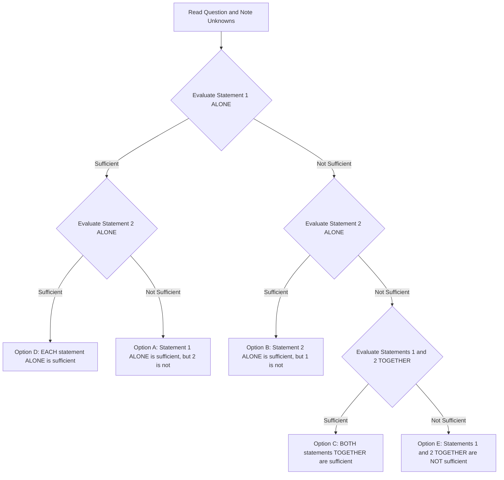
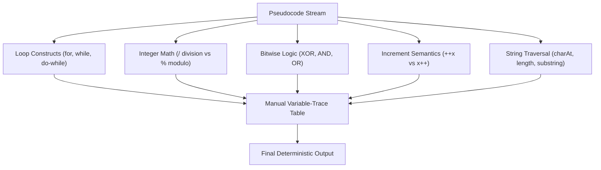

# 🏛️ INFOSYS SYSTEMS ENGINEER (SE) — THE ULTIMATE MASTER BIBLE
## Complete Unified 2026 Assessment Manual, Forensic Shift Intelligence, Section-by-Section Mastery, 21+ Essay Vault, 14-Day Roadmap & Interview Continuum

> ### 👑 Authoritative Single-Source Intelligence
> **Drive Date:** October 5, 2026 | **Target Role:** Systems Engineer (SE) / Specialist Programmer (SP) / DSE  
> **Platform Engine:** Infosys Assessment Engine (Wheebox / HirePro based)  
> **Total Test Duration:** 120 Minutes (2.0 Hours) Pooled Clock | **Total Sections:** 7 Active Assessment Blocks  
> **Negative Marking:** Exactly 0.00 (Zero Negative Marking across all sections)  
> **Sectional Navigation:** Fully Bidirectional & Free-Roam Section Hopping Permitted  
> **Sectional Cutoffs:** Mandatory ~65% to 70% floor per section to qualify for Interview Stage  

---

## 📑 Complete Document Directory (Table of Contents)

1. [Executive Summary & The October 5, 2026 Paradigm Shift](#sec-1)
2. [Platform Mechanics: The 2-Hour Flexible Testing Revolution](#sec-2)
3. [Master Cross-Section Intelligence & Cutoff Matrix](#sec-3)
4. [Section 1: Reasoning & Aptitude (#1 Elimination Vector)](#sec-4)
   - 4.1 [Data Sufficiency Master Engine (The #1 Priority Topic)](#sec-4-1)
   - 4.2 [Syllogisms & Possibility Logic (First in Reasoning Study Order)](#sec-4-2)
   - 4.3 [Statement & Assumption Deep Dive (Second in Reasoning Study Order)](#sec-4-3)
   - 4.4 [Statement & Argument Evaluation (Third in Reasoning Study Order)](#sec-4-4)
   - 4.5 [Blood Relations & Clean Family Tree Notation](#sec-4-5)
   - 4.6 [Data Interpretation (Table DI Dominance)](#sec-4-6)
   - 4.7 [Seating Arrangements: The Honest Reality Check](#sec-4-7)
5. [Section 2: Quantitative / Technical Ability Deep Dive](#sec-5)
   - 5.1 [Time & Work / Pipes & Cisterns (LCM Units Method)](#sec-5-1)
   - 5.2 [Percentages & Successive Variations ("Percentage hi zyada tha")](#sec-5-2)
   - 5.3 [Ratio, Proportion & Averages](#sec-5-3)
   - 5.4 [Profit, Loss, Markup & Discounts](#sec-5-4)
   - 5.5 [Secondary Quant Topics](#sec-5-5)
6. [Sections 3 & 6: Verbal Ability & English Grammar Engine](#sec-6)
   - 6.1 [Shift Disparity: Spot the Error (90%) vs. 10-Blank Cloze Passage](#sec-6-1)
   - 6.2 [Reading Comprehension (~5 Questions)](#sec-6-2)
   - 6.3 [Non-Negotiable Grammar Rules Checklist](#sec-6-3)
7. [Section 4: Pseudocode Engine (Java-Style Syntax)](#sec-7)
   - 7.1 [The 5 Non-Negotiable Pseudocode Laws](#sec-7-1)
   - 7.2 [Bitwise XOR (^) Logic & Algebraic Cancellation](#sec-7-2)
   - 7.3 [Solved Variable-Trace Table Example](#sec-7-3)
8. [Section 5: Numerical Puzzles Engine](#sec-8)
   - 8.1 [Shift Disparity & Tactical Targets](#sec-8-1)
   - 8.2 [Common Numerical Puzzle Archetypes](#sec-8-2)
9. [Section 7: English Writing & Essay Mastery Vault](#sec-9)
   - 9.1 [Word Limits & Automated Scoring Rubric](#sec-9-1)
   - 9.2 [The Universal 4-Paragraph Blueprint (~150 Words)](#sec-9-2)
   - 9.3 [Four Full Model Essays (Actual October 5, 2026 Topics)](#sec-9-3)
   - 9.4 [Complete Catalog of 21 Verified Essay Prompts (2024–2026)](#sec-9-4)
10. [The Master Topic Priority Matrix (Tiers S through C)](#sec-10)
11. [The 14-Day Chronological Preparation Roadmap](#sec-11)
12. [The 5-Round Flexible Exam Strategy (120-Minute Pooled Clock)](#sec-12)
13. [Master L / P / M Readiness Audit Tracker](#sec-13)
14. [The Post-OA Interview Stage Continuum](#sec-14)

---

<a id="sec-1"></a>
## 1. Executive Summary & The October 5, 2026 Paradigm Shift

On **October 5, 2026**, Infosys conducted its widespread off-campus / on-campus assessment for the Systems Engineer role. Forensic triangulation across candidate debriefs, raw handwritten reviews, and screenshot captures established the following ground truths:

1. **The Old Sectional Lock is Dead:** Previous Infosys tests strictly locked candidates into individual timed sections (e.g., exactly 25 minutes for Reasoning, then auto-submitting). The October 5, 2026 platform provided a **single pooled 120-minute global countdown timer** with an interactive section drawer.
2. **Section Hopping Allowed:** Candidates were not held captive in a section until its timer elapsed; free bidirectional switching across all 7 sections was active (e.g., Reasoning -> Pseudocode -> Verbal -> Reasoning).
3. **Bidirectional Question Navigation:** Candidates could skip questions, advance forward, and review prior questions (Q1 -> Q4 -> Q3).
4. **Zero Negative Marking:** Exactly zero marks deducted for incorrect answers. Leaving any question blank is mathematical malpractice.
5. **Elimination Core (The "Trap" Topics):** Data Sufficiency and Syllogisms formed the primary elimination wall in Section 1. Candidates who spent 10+ minutes on complex multi-variable seating arrangements failed sectional cutoffs elsewhere.
6. **Shift Asymmetry:** Multiple distinct test forms were dynamically served. While one candidate saw 90% "Spot the Error" in Verbal, another faced a single massive 10-blank Cloze Test passage. Preparing for only one archetype guarantees failure.

---

<a id="sec-2"></a>
## 2. Platform Mechanics: The 2-Hour Flexible Testing Revolution

```
+==================================================================================================+
|                         OCTOBER 5, 2026 PLATFORM OPERATING RULES                                 |
+==================================================================================================+
| Parameter                   | Historical System (Pre-2025)   | Verified Oct 5, 2026 Platform     |
+-----------------------------+--------------------------------+-----------------------------------+
| Total Clock                 | Fixed sectional timers         | 120 Minutes (2.0 Hours) Pooled    |
| Section Switching           | Locked / One-way irreversible  | Full bidirectional free-roam      |
| Question Review & Marking   | Forward only                   | Bidirectional with Review flags   |
| Negative Marking            | None                           | Exactly 0.00 (Zero penalty)       |
| Total Active Sections       | 5 Sections                     | 7 Assessment Blocks               |
| Essay Writing Window        | Separate 30-min window         | Embedded in 120-minute pool       |
+==================================================================================================+
```

### Critical Proctoring Constraints:
- **Webcam & Audio Monitoring:** Continuous AI gaze tracking, multi-face detection, and ambient acoustic monitoring.
- **Full-Screen Lock:** Any window blur, tab switch, or dual monitor activation triggers immediate platform warning flags.
- **Physical Scratchpad Permitted:** 2 blank sheets of white paper allowed on camera. Pre-writing notes or formulas prior to test commencement triggers an instant proctor void.

---

<a id="sec-3"></a>
## 3. Master Cross-Section Intelligence & Cutoff Matrix

```
+================================================================================================================================================+
|                                              INFOSYS SE MASTER ASSESSMENT INTELLIGENCE MATRIX                                                  |
+========+=============================+==================================+======================+=============+=============+===================+
| Section| Domain Name                 | Sub-Topics & Micro-Concepts      | Oct 5 Candidate Data | Question Qty| Cutoff Floor| Priority Tier     |
+========+=============================+==================================+======================+=============+=============+===================+
| S1     | Data Sufficiency            | 2-Statement, Arithmetic, Logic   | Repeated 5+ times    | 4–6 Qs      | Crucial     | TIER S (Do First) |
| S1     | Syllogisms                  | Possibility, Either/Or, Venn     | 6–7 Qs Combined      | 3–4 Qs      | High        | TIER S (Do First) |
| S1     | Statement & Conclusion      | Logical deduction, certainty     | Reported repeatedly  | 2–3 Qs      | High        | TIER S (Do First) |
| S1     | Statement & Assumption      | Negation test, implicit premises | Reported repeatedly  | 2 Qs        | High        | TIER S (Do First) |
| S1     | Data Interpretation (Table) | Percentages, ratios, averages    | 4–5 Qs reported      | 4–5 Qs      | Crucial     | TIER S (Do First) |
| S1     | Blood Relations             | Family tree, coded relations     | 2 Qs explicitly      | 2 Qs        | Moderate    | TIER A (High)     |
| S1     | Directions & Coding         | Pythagorean displacement, shifts | Present in syllabus  | 1–2 Qs      | Moderate    | TIER B (Cover)    |
| S1     | Data Arrangement            | Linear, parallel, circular       | Weak Oct 5 signal    | 0–2 Qs      | Low-Med     | TIER B (Cover)    |
+--------+-----------------------------+----------------------------------+----------------------+-------------+-------------+-------------------+
| S2     | Time & Work                 | LCM units, efficiency, cisterns  | Explicitly reported  | 2–3 Qs      | Crucial     | TIER S (Do First) |
| S2     | Percentages                 | Successive change, conversions   | "Percentage hi zyada"| 2–3 Qs      | Crucial     | TIER S (Do First) |
| S2     | Ratio & Proportion          | Partnerships, direct/inverse     | Reported on boards   | 1–2 Qs      | High        | TIER A (High)     |
| S2     | Averages & Ages             | Weighted average, age equations  | Reported on boards   | 1–2 Qs      | High        | TIER A (High)     |
| S2     | Profit & Loss               | CP, SP, MP, markup, discounts    | Reported on boards   | 1–2 Qs      | High        | TIER A (High)     |
| S2     | Time, Speed & Distance      | Relative speed, trains, boats    | Syllabus pool        | 1 Q         | Moderate    | TIER B (Cover)    |
| S2     | P & C and Probability       | Counting, cards, dice, coins     | Candidate mentioned  | 1–2 Qs      | Moderate    | TIER B (Cover)    |
| S2     | Mixtures & Alligation       | Cross-rule, repeated dilution    | Syllabus pool        | 0–1 Q       | Moderate    | TIER B (Cover)    |
| S2     | Number System & Algebra     | Divisibility, unit cyclicity     | Syllabus pool        | 0–1 Q       | Low         | TIER C (Last)     |
+--------+-----------------------------+----------------------------------+----------------------+-------------+-------------+-------------------+
| S3/S6  | Spot the Error              | SVA, Tenses, Modifiers, Parallel | 90% in Shift A       | 5–8 Qs      | Crucial     | TIER S (Do First) |
| S3/S6  | Reading Comprehension       | Tone, main idea, inference, vocab| ~5 Qs reported       | 5 Qs        | High        | TIER S (Do First) |
| S3/S6  | Cloze Test / Fill Blanks    | Prepositions, articles, verbs    | 10 blanks in Shift B | 5–10 Qs     | High        | TIER A (High)     |
| S3/S6  | Sentence Correction         | Phrasal verbs, idioms, structure | Reported             | 2–3 Qs      | High        | TIER A (High)     |
| S3/S6  | Voice & Narration           | Active/Passive, Direct/Indirect  | Syllabus pool        | 1–2 Qs      | Moderate    | TIER B (Cover)    |
| S3/S6  | Para Jumbles & Vocabulary   | Sentence reordering, synonyms    | Syllabus pool        | 1–2 Qs      | Low         | TIER B (Cover)    |
+--------+-----------------------------+----------------------------------+----------------------+-------------+-------------+-------------------+
| S4     | Java Control Flow & Loops   | for, while, do-while semantics   | Repeatedly reported  | 2 Qs        | Crucial     | TIER S (Do First) |
| S4     | Arithmetic Operators        | Integer division (/), Modulo (%) | Explicitly confirmed | 1–2 Qs      | Crucial     | TIER S (Do First) |
| S4     | Increment/Decrement         | Pre (++x) vs Post (x++)          | Explicitly confirmed | 1 Q         | High        | TIER S (Do First) |
| S4     | Java String Operations      | length, charAt, substring        | Explicitly confirmed | 1 Q         | High        | TIER S (Do First) |
| S4     | Bitwise Operations          | XOR (^), AND (&), OR (|)         | Explicitly confirmed | 1 Q         | Moderate    | TIER A (High)     |
| S4     | Arrays & Functions          | Array bounds, traversal, pass-val| Syllabus pool        | 1 Q         | Moderate    | TIER A (High)     |
| S4     | Recursion & Complex Algos   | Stack trace, base case evaluation| Syllabus pool        | 0–1 Q       | Low         | TIER C (Last)     |
+--------+-----------------------------+----------------------------------+----------------------+-------------+-------------+-------------------+
| S5     | Numerical Matrix Puzzles    | 3x3 grids, row/col sum & products| Confirmed (4 Qs total| 2 Qs        | Crucial     | TIER A (High)     |
| S5     | Series & Sequence Puzzles   | Multi-tier difference, polynomial| Confirmed            | 1–2 Qs      | Crucial     | TIER A (High)     |
| S5     | Radial / Circular Figures   | Opposite quadrant relationships  | Confirmed            | 1 Q         | Moderate    | TIER A (High)     |
| S5     | Sudoku & Visual Logic       | 9x9 grids, symbol rotation       | Syllabus pool        | 0–1 Q       | Low         | TIER C (Last)     |
+--------+-----------------------------+----------------------------------+----------------------+-------------+-------------+-------------------+
| S7     | Essay Writing               | 100–200 words (~150 words ideal) | 4 Actual Topics      | 1 Task      | Mandatory   | TIER A (High)     |
+================================================================================================================================================+
```

---

<a id="sec-4"></a>
## 4. Section 1: Reasoning & Aptitude (#1 Elimination Vector)

<a id="sec-4-1"></a>
### 4.1 Data Sufficiency Master Engine (The #1 Priority Topic)
- **Candidate Signal:** Confirmed as the highest frequency topic across both Reasoning and Aptitude.
- **The Core Premise:** Data Sufficiency evaluates whether the provided conditions are mathematically or logically adequate to reach a single, unique conclusion—**not the computation of the value itself**.



#### Solved Archetype: Arithmetic Data Sufficiency
- **Question:** What is the cost price (CP) of an article?
  - **Statement (I):** The article is sold at a profit of 20% on the selling price.
  - **Statement (II):** The selling price (SP) of the article is Rs. 600.
- **Forensic Step-by-Step Proof:**
  1. *Evaluate Statement (I) Alone:* `Profit = 0.20 * SP ==> CP = SP - 0.20 * SP = 0.80 * SP`. Since SP is unknown, CP cannot be uniquely determined. `==>` **NOT SUFFICIENT.**
  2. *Evaluate Statement (II) Alone:* `SP = Rs. 600`. Without profit/loss percentage, CP is unknown. `==>` **NOT SUFFICIENT.**
  3. *Evaluate Combined (I + II):* `CP = 0.80 * 600 = Rs. 480`. A single unique value is determined. `==>` **OPTION C (Both Together Sufficient).**

---

### The Non-Negotiable Reasoning Study Order (Pedagogical Protocol)
To achieve guaranteed mechanical accuracy in Section 1, study topics in this exact sequential order:
1. **Syllogisms -> FIRST** (Mechanical, rule-governed, Venn-provable, builds spatial-logical certainty)
2. **Statement & Assumption -> SECOND** (Evaluates hidden foundational premises using the Negation Test)
3. **Statement & Argument -> THIRD** (Evaluates qualitative strength, systemic merit, and fact vs opinion)
4. **Sectional Tests & Practice -> FOURTH** (Timed drilling across all complementary pairs and edge cases)

---

<a id="sec-4-2"></a>
### 4.2 Syllogisms & Possibility Logic (First in Reasoning Study Order)
- **Candidate Signal:** 6–7 questions cluster reported across combined shifts.
- **The 4 Fundamental Proposition Types:**
  1. **Universal Affirmative (A):** *"All A are B"* -> Circle A is entirely enclosed inside Circle B.
  2. **Universal Negative (E):** *"No A is B"* -> Circle A and Circle B are completely disjoint with a cross barrier between them.
  3. **Particular Affirmative (I):** *"Some A are B"* -> Circle A and Circle B overlap.
  4. **Particular Negative (O):** *"Some A are not B"* -> At least one designated region of Circle A cannot touch Circle B.

- **The Gold Rules of Syllogisms:**
  - **Direct Premise Rule:** Never import real-world biological or physical facts. If the statement says *"All apples are laptops"*, accept it as absolute ground truth.
  - **Definite vs Possibility Conclusions:**
    - A **Definite Conclusion** (e.g., *"Some cats are dogs"*) is TRUE if and only if it holds across EVERY valid Venn representation. If even one valid counter-Venn diagram can be drawn where it fails, the conclusion is FALSE.
    - A **Possibility Conclusion** (e.g., *"All cats being dogs is a possibility"*) is TRUE if you can construct even ONE valid Venn representation that satisfies the conclusion without violating ANY of the given premises.
  - **The Possibility Invalidation Law:** If a relationship is already definitely 100% true, asserting it as a "possibility" is invalid. Possibility only applies to the unconstrained / undetermined space of the Venn diagram.

- **The "Either/Or" Complementary Pair Conditions:**
  For an "Either Conclusion I or II follows" answer, all 3 conditions must simultaneously hold:
  1. Both conclusions share the **exact same Subject and Predicate**.
  2. Both conclusions are **individually false / undetermined** from the basic diagram.
  3. The conclusions form one of the two valid complementary pairs:
     - Pair 1: `Some + No` (e.g., *"Some pens are books"* + *"No pen is a book"*)
     - Pair 2: `All + Some Not` (e.g., *"All pens are books"* + *"Some pens are not books"*)
  - *Warning:* `Some + Some Not` is NOT an Either/Or pair in standard formal syllogisms because both can be true simultaneously in an overlapping Venn diagram.

- **Solved Syllogism Archetype:**
  - **Statements:**
    1. All engineers are developers.
    2. Some developers are writers.
    3. No writer is an astronaut.
  - **Conclusions:**
    - (I) Some engineers are writers. -> *Undetermined / False (Circle of engineers may not overlap with writers).*
    - (II) All engineers being writers is a possibility. -> *TRUE (We can expand the writers circle to enclose engineers without touching astronauts).*
    - (III) Some developers are not astronauts. -> *TRUE (The developers who are writers cannot be astronauts by Statement 3).*
  - **Final Output:** Only Conclusions (II) and (III) follow.

---

<a id="sec-4-3"></a>
### 4.3 Statement & Assumption Deep Dive (Second in Reasoning Study Order)
- **Candidate Signal:** Repeatedly appeared in Critical Reasoning modules (2–3 questions per candidate).
- **Core Definition:** An **Assumption** is the unstated, hidden, underlying foundation that the author MUST take for granted in order to make the statement. It is the unmentioned bridge connecting the author's premise to their conclusion.

- **Assumption vs. Conclusion (The Trap to Avoid):**
  - A *Conclusion* is the logical consequence deduced forward from the evidence.
  - An *Assumption* is the prerequisite taken for granted backward before the statement could be asserted.

- **The Ironclad "Negation Test" Method:**
  Whenever evaluating whether an assumption is valid and necessary:
  1. Take the candidate assumption and negate it (make it strictly opposite).
  2. Plug the negated assumption back into the context of the author's statement.
  3. **The Litmus Test:** If the author's argument falls apart, becomes illogical, or is rendered completely invalid by this negation, then the assumption is **IMPLICIT / VALID**.
  4. If the argument still stands even when the assumption is false, the assumption is **INVALID / NOT NECESSARY**.

- **Solved Assumption Archetype:**
  - **Statement:** *"The city municipal corporation has decided to install solar streetlights across all major junctions to drastically reduce nocturnal road accidents."*
  - **Candidate Assumption 1:** *"Poor lighting during the night is currently a contributing cause of accidents at these junctions."*
    - *Apply Negation:* *"Poor lighting is NOT a cause of nocturnal accidents."*
    - *Impact on Statement:* If poor lighting does not cause accidents, installing solar lights to reduce accidents is completely irrational. The premise collapses!
    - *Verdict:* **VALID / IMPLICIT.**
  - **Candidate Assumption 2:** *"Solar energy is the cheapest source of electricity available to the municipal corporation."*
    - *Apply Negation:* *"Solar energy is NOT the cheapest source."*
    - *Impact on Statement:* Even if solar isn't the cheapest, the corporation may have chosen it for reliability or sustainability. The objective to reduce accidents via solar lights does not collapse.
    - *Verdict:* **INVALID / NOT IMPLICIT.**

---

<a id="sec-4-4"></a>
### 4.4 Statement & Argument Evaluation (Third in Reasoning Study Order)
- **Candidate Signal:** Tested logical discernment in high-stakes operational and policy contexts.
- **Core Premise:** An argument seeks to advocate for or against an action. The question asks whether the argument is **STRONG** or **WEAK**.

- **Anatomy of a STRONG Argument:**
  1. **Directly Relevant:** Addresses the core mechanism of the proposition, not a peripheral side-issue.
  2. **Substantiated by Systemic Impact:** Grounded in established operational, economic, ethical, or legal reality.
  3. **Balanced & Proportionate:** Avoids fanatic or hyperbolic extremes.

- **Anatomy of a WEAK Argument:**
  1. **Mere Opinion or Emotion:** Uses feelings, personal anecdotes, or unverified speculation (*"No, because people will feel bad"*).
  2. **Superstitious or Vague Moralizing:** *"Yes, because ancient traditions tell us to do so."*
  3. **False Equivalence / Irrelevant Parallel:** Citing an unrelated sector or foreign scenario without establishing contextual comparability.
  4. **Simple Assertion without Rationale:** Stating "Yes, it is good" without providing the mechanism why.

- **Fact vs. Opinion Distinction:**
  - **Fact:** A statement that is empirically verifiable through measurement, historical record, or scientific law.
  - **Opinion:** A subjective evaluation, judgment, or belief that cannot be proven true or false objectively.

- **Solved Argument Archetype:**
  - **Question:** *Should college campuses completely ban personal automobiles and mandate bicycles and electric shuttles?*
  - **Argument I:** *"Yes, because vehicular emissions and pedestrian congestion on campus roads compromise student safety and air quality, and dense campuses are fully walkable."*
    - *Analysis:* Directly addresses campus safety and environmental health with actionable alternatives.
    - *Verdict:* **STRONG.**
  - **Argument II:** *"No, because students in neighboring colleges drive luxury cars, so our students will lose social status."*
    - *Analysis:* Grounded purely in shallow social status and subjective vanity, not campus function or safety.
    - *Verdict:* **WEAK.**

---

<a id="sec-4-5"></a>
### 4.5 Blood Relations & Clean Family Tree Notation
Always draw family trees systematically using standard unambiguous symbols:
- **Gender:** Female = `○ (Circle)` or `[F]` | Male = `□ (Square)` or `[M]`
- **Relationships:**
  - Marriage: `=` (Double horizontal line)
  - Sibling: `—` (Single horizontal line)
  - Parent-Child Descent: `|` (Vertical line)
- **Maternal vs. Paternal Terminology:**
  - Maternal Uncle = Mother's brother
  - Paternal Aunt = Father's sister
  - Niece = Brother's or sister's daughter
  - Nephew = Brother's or sister's son
- **Coded Relation Strings:** For expressions like `P + Q * R - S`, decode from left to right or right to left using the defined operator table, drawing the tree level by level.

---

<a id="sec-4-6"></a>
### 4.6 Data Interpretation (Table DI Dominance)
- Table DI was the dominant DI format on October 5 (4–5 questions).
- Calculations center on:
  - `Percentage Increase or Decrease = ((New - Old) / Old) * 100`
  - `Ratio Reduction = (Sum of Column A) / (Sum of Column B)`
  - Weighted averages across non-consecutive financial quarters or academic years.
- **Mental Math Rule:** Use fractional splits for percentages: `37.5% = 25% + 12.5% = 1/4 + 1/8 = 3/8`.

---

<a id="sec-4-7"></a>
### 4.7 Seating Arrangements: The Honest Reality Check
- Circular arrangements were **NOT** heavily reported on October 5.
- **Strategic Rule:** Master 1-D linear seating (North/South facing) and basic inward/outward circular seating. **Do NOT spend 3+ hours on complex multi-variable circular puzzles** while Data Sufficiency and Syllogisms are weak.

---

<a id="sec-5"></a>
## 5. Section 2: Quantitative / Technical Ability Deep Dive

<a id="sec-5-1"></a>
### 5.1 Time & Work / Pipes & Cisterns (LCM Units Method)
- Never use cumbersome fractions (`1/x`). Use integer LCM work units:
  ```
  Total Work Units = LCM(T_A, T_B, T_C)
  Efficiency E_A = Total Units / T_A
  Efficiency E_B = Total Units / T_B
  Time Together = Total Units / (Sum of Efficiencies)
  ```
- **Alternate-Day Work:** Calculate work in 2-day cycles (`E_A + E_B`), then allocate remainder units to the starting worker.
- **Pipes & Cisterns:** Inflow pipes add units (`+E_1`); leaks/drains subtract units (`-E_2`).

<a id="sec-5-2"></a>
### 5.2 Percentages & Successive Variations ("Percentage hi zyada tha")
- Learn exact fraction-to-percentage conversions:
  ```
  1/6 = 16.66%     1/7 = 14.28%     1/8 = 12.5%     1/9 = 11.11%     1/12 = 8.33%
  ```
- **Successive Percentage Change Formula:**
  ```
  Net Change = (a + b + (a * b) / 100)%
  (Use negative values for discounts, losses, or decreases)
  ```

<a id="sec-5-3"></a>
### 5.3 Ratio, Proportion & Averages
- **Deviation Method for Averages:** Assume mean `A`.
  ```
  True Average = A + (Sum of (x_i - A) / N)
  ```
- **Replacement in Averages:**
  ```
  Weight of New Entrant = Weight of Replaced ± (N * Change in Average)
  ```

<a id="sec-5-4"></a>
### 5.4 Profit, Loss, Markup & Discounts
- `Markup % = ((MP - CP) / CP) * 100`
- `SP = MP * (1 - D_1 / 100) * (1 - D_2 / 100)`
- `Profit % = ((SP - CP) / CP) * 100`

<a id="sec-5-5"></a>
### 5.5 Secondary Quant Topics
- **Time-Speed-Distance:** Relative speed in opposite direction `= S_1 + S_2`; same direction `= |S_1 - S_2|`.
- **Permutations & Combinations:** Permutation when order matters (`nPr`); Combination when selecting committees/groups (`nCr`).
- **Probability:** `P(At least one) = 1 - P(None)`.
- **Repeated Dilution:**
  ```
  Remaining Liquid = Initial * (1 - Replaced / Total)^n
  ```

---

<a id="sec-6"></a>
## 6. Sections 3 & 6: Verbal Ability & English Grammar Engine

<a id="sec-6-1"></a>
### 6.1 Shift Disparity: Spot the Error (90%) vs. 10-Blank Cloze Passage
- **Shift A:** 90% of questions were discrete "Spot the Error" sentences.
- **Shift B:** A single massive 10-blank Cloze Passage dominated the section.

<a id="sec-6-2"></a>
### 6.2 Reading Comprehension (~5 Questions)
- Read questions first to identify keywords (proper nouns, dates, specific terminology).
- Read the passage actively, marking topic sentences in each paragraph.
- Identify the tone of the passage: *Objective, Critical, Analytical, Laudatory, Skeptical*.

<a id="sec-6-3"></a>
### 6.3 Non-Negotiable Grammar Rules Checklist
- **Subject-Verb Agreement:**
  - *"Neither of the two candidates has (not have) submitted the code."*
  - Collective nouns acting as a single unit take singular verbs (*"The committee has decided"*).
- **Modifiers:**
  - Dangling modifier: *"Walking across the campus, the cafeteria smelled amazing."* -> Incorrect. Correct: *"Walking across the campus, she noticed the cafeteria smelled amazing."*
- **Parallelism:**
  - *"The developer is responsible for writing unit tests, reviewing pull requests, and to deploy releases."* -> Correct: *"and deploying releases."*
- **Fixed Prepositions:**
  - *"abstain from"*, *"cope with"* (never *"cope up with"*), *"comply with"*, *"senior to"*, *"prefer X to Y"*.

---

<a id="sec-7"></a>
## 7. Section 4: Pseudocode Engine (Java-Style Syntax)



<a id="sec-7-1"></a>
### 7.1 The 5 Non-Negotiable Pseudocode Laws
1. **Integer Division Truncates:** In integer arithmetic, decimals are dropped toward zero (`7 / 2 = 3`, not `3.5`; `1 / 4 = 0`).
2. **Modulo `%` Gives Remainder:** `7 % 2 = 1`; `10 % 3 = 1`; `16 % 4 = 0`.
3. **Post-Increment (`x++`):** Uses the current value in the expression, then increments `x` by 1 in memory.
4. **Pre-Increment (`++x`):** Increments `x` by 1 in memory first, then uses the updated value in the expression.
5. **Do-While Guaranteed 1 Execution:** Loop executes at least once regardless of condition.

<a id="sec-7-2"></a>
### 7.2 Bitwise XOR (^) Logic & Algebraic Cancellation
- `x ^ x = 0` (Identical values cancel out to zero)
- `x ^ 0 = x`
- Commutative & Associative: `A ^ B ^ A = (A ^ A) ^ B = 0 ^ B = B`
- Truth table:
  ```
  0 ^ 0 = 0
  0 ^ 1 = 1
  1 ^ 0 = 1
  1 ^ 1 = 0
  ```

<a id="sec-7-3"></a>
### 7.3 Solved Variable-Trace Table Example
```java
int a = 4, b = 7, c = 2;
int result = (a++) + (++b) * (c--) - (--a) + (b++);
// What is the value of result, a, b, c?
```

#### Step-by-Step Execution:
1. `(a++)`: Uses current value `4`. Variable `a` increments to `5`.
2. `(++b)`: Variable `b` increments from `7 -> 8`. Uses `8`.
3. `(c--)`: Uses current value `2`. Variable `c` decrements to `1`.
4. Multiplication precedence: `(++b) * (c--)` evaluates as `8 * 2 = 16`.
5. `(--a)`: Variable `a` decrements from `5 -> 4`. Uses `4`.
6. `(b++)`: Variable `b` uses `8`. Variable `b` increments to `9`.
7. Combining arithmetic: `result = 4 + 16 - 4 + 8 = 24`.
8. Final Variable States: `result = 24`, `a = 4`, `b = 9`, `c = 1`.

---

<a id="sec-8"></a>
## 8. Section 5: Numerical Puzzles Engine

<a id="sec-8-1"></a>
### 8.1 Shift Disparity & Tactical Targets
- Section 5 contains **4 total puzzle questions**.
- **Tactical Reality:** Clearing the sectional cutoff requires **only 1 to 2 correctly solved puzzles** (~25–50% score).
- **The 90-Second Rule:** If you cannot spot the algebraic or arithmetic pattern within 90 seconds, **flag it, pick an educated guess, and move on**. Never spend 10 minutes on a single puzzle.

<a id="sec-8-2"></a>
### 8.2 Common Numerical Puzzle Archetypes
1. **3x3 Matrix Missing Number:**
   - Row-wise sum or column-wise sum equals a constant (e.g., Row sum = 15).
   - Multiplicative relations: `C_3 = (C_1 * C_2) - (C_1 + C_2)` or `C_3 = C_1^2 + C_2`.
2. **Number Series with Dual Differences:**
   - `3, 5, 9, 17, 33, ?` (Differences are `2, 4, 8, 16, 32 ==> 33 + 32 = 65`).
   - Alternating operations: `x_n = 2 * x_{n-1} - 1`.
3. **Radial Circle Puzzles:** Relationships across opposite quadrants (`x` opposite `x^3 - 1`).

---

<a id="sec-9"></a>
## 9. Section 7: English Writing & Essay Mastery Vault

<a id="sec-9-1"></a>
### 9.1 Word Limits & Automated Scoring Rubric
- **Target Word Count:** **100 to 200 words** (aim for **140–165 words**).
- **Automated AI Grading Criteria:**
  1. *Syntactic Coherence:* Grammatically sound sentences without fragments.
  2. *Structural Integrity:* Distinct Introduction, Body Arguments (Pros & Nuance), and Conclusion.
  3. *Lexical Diversity:* Professional vocabulary without informal abbreviations.

<a id="sec-9-2"></a>
### 9.2 The Universal 4-Paragraph Blueprint (~150 Words)
```
+---------------------------------------------------------------------------------------+
|                       THE 4-PARAGRAPH ESSAY BLUEPRINT (~150 WORDS)                    |
+---------------------------------------------------------------------------------------+
| Paragraph 1: Introduction & Thesis Statement               (~30 Words)               |
| - Introduce the core theme with a concise definition.                                 |
| - State your clear thesis / overarching stance.                                       |
+---------------------------------------------------------------------------------------+
| Paragraph 2: Primary Argument & Supporting Example          (~50 Words)               |
| - Detail the main positive benefit or mechanism.                                      |
| - Provide concrete real-world context.                                                |
+---------------------------------------------------------------------------------------+
| Paragraph 3: Counterpoint, Nuance or Challenge             (~40 Words)               |
| - Acknowledge potential pitfalls, dependencies, or trade-offs.                        |
| - Propose a balanced mitigation or perspective.                                       |
+---------------------------------------------------------------------------------------+
| Paragraph 4: Conclusion & Forward Outlook                  (~30 Words)               |
| - Summarize the core takeaway.                                                        |
| - Conclude with a strong forward-looking closing sentence.                            |
+---------------------------------------------------------------------------------------+
```

---

<a id="sec-9-3"></a>
### 9.3 Four Full Model Essays (Actual October 5, 2026 Topics)

#### Model Essay 1: Impact of AI on Problem-Solving Skills (152 Words)
> Artificial intelligence has revolutionized contemporary problem-solving by automating complex computational tasks and accelerating data analysis. Rather than replacing human intellect, AI serves as an intellectual catalyst, empowering engineers and decision-makers to focus on higher-order synthesis and creative system design.
>
> On one hand, automated algorithms rapidly process massive datasets, detect subtle anomalies, and simulate predictive models far beyond human capability. In healthcare, finance, and software engineering, this allows professionals to diagnose issues and prototype solutions in minutes rather than weeks.
>
> However, an over-reliance on generative algorithms carries the significant risk of cognitive complacency. If professionals blindly accept AI-generated answers without evaluating foundational principles, fundamental analytical intuition and algorithmic debugging skills will inevitably atrophy.
>
> In conclusion, artificial intelligence should be leveraged as an augmentative tool rather than an intellectual substitute. Cultivating deep conceptual mastery while deploying AI for execution ensures both unprecedented speed and robust, responsible problem-solving.

#### Model Essay 2: Impact of Social Media on Mental Health (148 Words)
> Social media platforms have fundamentally reshaped modern interpersonal communication, offering instantaneous global connectivity alongside profound psychological consequences. While these networks facilitate knowledge sharing and community building, their pervasive presence often exerts considerable pressure on individual mental well-being.
>
> On the positive side, digital platforms democratize information, provide vital peer support networks, and allow marginalized groups to build meaningful connections. They serve as valuable hubs for professional networking, creative expression, and social mobilization.
>
> Nevertheless, relentless exposure to curated, idealized lifestyles frequently triggers severe comparison anxiety, reduced self-esteem, and sleep disruption. The dopamine-driven feedback loops engineered into notification systems foster compulsive checking behaviors and chronic digital fatigue.
>
> Ultimately, the psychological impact of social media depends on intentional usage. By establishing healthy digital boundaries, curating uplifting feeds, and prioritizing offline human interactions, users can successfully harness connectivity while safeguarding their psychological resilience.

#### Model Essay 3: What Inspires You to Keep Working on Self-Development? (154 Words)
> The pursuit of self-development is fundamentally driven by an inherent desire to maximize personal potential and navigate an ever-evolving world with competence and purpose. In an era characterized by rapid technological transformation, continuous self-improvement is not merely an aspiration, but a vital imperative.
>
> What truly inspires this commitment is the tangible transformation that discipline creates over time. Mastering a new programming paradigm, strengthening logical deduction, or refining communication skills delivers profound intrinsic satisfaction. Each incremental milestone reinforces self-efficacy and expands one's capacity to solve meaningful real-world challenges.
>
> Furthermore, self-development is guided by a sense of social responsibility. Stagnation limits the value an individual can contribute to teams, families, and society. Elevating one's technical competence and emotional maturity directly empowers one to mentor others and drive constructive change.
>
> In conclusion, self-development is an ongoing, lifelong journey. It is inspired by curiosity, fueled by deliberate practice, and validated by the lasting impact made on the surrounding world.

#### Model Essay 4: Travelling with Strangers — Enjoyable or Difficult? (149 Words)
> Travelling with strangers is an enriching yet inherently demanding experience that presents a dynamic balance between spontaneous adventure and interpersonal friction. While stepping outside familiar social circles tests personal adaptability, it often yields unexpected personal growth and enduring friendships.
>
> The primary delight lies in discovering fresh, unscripted perspectives. Strangers bring diverse cultural backgrounds, varied life stories, and unique travel preferences, transforming an ordinary journey into a shared exploration of ideas. Shared challenges—such as navigating unfamiliar transit or overcoming language barriers—frequently foster swift and authentic camaraderie.
>
> Conversely, divergent habits, conflicting financial budgets, and personal boundaries can generate friction if expectations are poorly aligned. When patience and mutual respect falter, communal travel can quickly become stressful and restrictive.
>
> Ultimately, whether the experience proves enjoyable or difficult hinges upon individual mindset. Approaching the journey with empathy, clear communication, and an open mind consistently turns unfamiliar companions into lifelong travel allies.

---

<a id="sec-9-4"></a>
### 9.4 Complete Catalog of 21 Verified Essay Prompts (2024–2026)

```
+===================================================================================================================+
|                                  THE 21 VERIFIED INFOSYS ESSAY TOPICS (2024–2026)                                 |
+====+==========================================================+===================+===============================+
| #  | Exact Essay Prompt / Topic Title                         | Primary Theme     | Core Central Argument         |
+====+==========================================================+===================+===============================+
| 01 | Impact of AI on Problem-Solving Skills [Oct 5 Verified]  | Artificial Intel. | Augments speed vs cognitive   |
| 02 | Impact of Social Media on Mental Health [Oct 5 Verified] | Digital Society   | Connectivity vs anxiety/FOMO  |
| 03 | What Inspires You to Keep Working on Self-Development?   | Personal Growth   | Intrinsic mastery & relevance |
| 04 | Travelling with Strangers — Enjoyable or Difficult?      | Travel & Culture  | Cultural exchange vs friction |
| 05 | Impact of AI and Automation on Future Employment         | Future of Work    | Routine loss vs new tech roles|
| 06 | Role of Technology in Modern Education / E-Learning      | Education         | Global access vs digital gap  |
| 07 | Importance of Cybersecurity in the Digital Era           | Information Sec.  | Infrastructure protection     |
| 08 | Pros and Cons of Remote Work (Work-From-Home vs Office)  | Work Environment  | Flexibility vs isolation      |
| 09 | Technology: A Productivity Driver or Digital Dependency? | Digital Hygiene   | Efficiency vs focus collapse  |
| 10 | Digital Addiction and Personal Data Privacy              | Privacy & Society | Surveillance vs data control  |
| 11 | Impact of Social Media on Youth                          | Adolescent Health | Civic voice vs cyberbullying  |
| 12 | Virtual Communication vs Face-to-Face Relationships      | Social Dynamics   | Convenience vs emotional depth|
| 13 | Failure as an Essential Stepping Stone to Success        | Resilience        | Diagnostic learning feedback  |
| 14 | Importance of Time Management for Young Engineers        | Professional Dev. | Prioritization vs burnout     |
| 15 | Continuous Learning: The Sole Currency in Tech           | Industry Reality  | Fighting software obsolescence|
| 16 | Discipline vs Motivation: The Engine of Consistency      | Work Ethic        | Emotional drive vs daily habits|
| 17 | Teamwork and Collaborative Synergy vs Individual Brill.  | Organizational    | Enterprise scale needs synergy|
| 18 | Core Qualities of an Effective Engineering Leader        | Leadership        | Empathy, clarity & shielding  |
| 19 | Environmental Conservation and Corporate Sustainability  | Green Tech        | Carbon-neutral cloud computing|
| 20 | The Role of Women in Engineering and Leadership          | Diversity in STEM | Breaking ceilings, innovation |
| 21 | Ethics of Generative AI in Software Development          | Software Quality  | Copyright, bias, vulnerabilities|
+===================================================================================================================+
```

---

<a id="sec-10"></a>
## 10. The Master Topic Priority Matrix (Tiers S through C)

```
+=======================================================================================+
|                            INFOSYS SE MASTER PRIORITY MATRIX                          |
+========+==============================================================================+
| TIER S | 1. Data Sufficiency (Reasoning & Quant domains)                              |
| (MUST  | 2. Data Interpretation (Table DI, Bar Graphs, Pie Charts)                     |
| MASTER | 3. Syllogisms (Possibility conclusions, Either/Or pairs, Venn proofs)        |
| FIRST) | 4. Statement & Conclusion + Statement & Assumptions (Negation Test)          |
|        | 5. Pseudocode Engine (Java syntax, Loops, Do-While, Modulo %, Division /)    |
|        | 6. Quantitative Basics: Percentages, Time & Work, Ratio & Proportion         |
|        | 7. Verbal: Reading Comprehension, Spot the Error                             |
+========+==============================================================================+
| TIER A | 1. Pseudocode Operators: Pre/Post Increment (++x/x++), Bitwise XOR (^)       |
| (VERY  | 2. Quantitative: Averages, Profit & Loss, Simple/Compound Interest           |
| HIGH   | 3. Blood Relations (Family tree mapping, coded relations)                    |
| VALUE) | 4. Numerical Puzzles (Missing numbers in grids, arithmetic sequences)        |
|        | 5. Grammar Essentials: Subject-Verb Agreement, Tenses, Prepositions, Articles|
|        | 6. Essay Writing Framework (100–200 words, structured 4-paragraph format)    |
+========+==============================================================================+
| TIER B | 1. Time, Speed & Distance (Relative speed, Trains, Boats & Streams)          |
| (COVER | 2. Permutations, Combinations & Probability basics                           |
| BROAD) | 3. Mixtures & Alligations, Ages, Number Series                               |
|        | 4. Directions Sense, Coding-Decoding, Linear & Parallel Arrangements         |
|        | 5. Verbal: Sentence Improvement, Cloze Test, Para Jumbles, Active/Passive    |
+========+==============================================================================+
| TIER C | 1. Complex Multi-Attribute Seating Puzzles                                   |
| (LAST  | 2. Cryptarithmetic / Alphametic Puzzles                                      |
| LEVEL) | 3. Sudoku Grid Solvers                                                       |
|        | 4. Advanced Geometry & Coordinate Mensuration                                |
|        | 5. Advanced Recursive Pseudocode & Higher-Order Algorithms                   |
+========+==============================================================================+
```

---

<a id="sec-11"></a>
## 11. The 14-Day Chronological Preparation Roadmap

```
+================================================================================================================================+
|                                    THE 14-DAY INFOSYS SE MASTERY EXECUTION SCHEDULE                                            |
+=====+==============================+=============================================+=============================================+
| Day | Primary Focus Area           | Topics to Master & Formulas to Drill        | Output & Validation Target                  |
+=====+==============================+=============================================+=============================================+
| D01 | Reasoning Logic Core (FIRST) | Syllogisms: Venn rules, Possibility, Either | 30 questions solved; 100% on possibility    |
| D02 | Critical Reasoning (SECOND)  | Statement & Assumption (Negation), Concl.   | 25 questions; master Negation Technique     |
| D03 | Critical Reasoning (THIRD)   | Statement & Argument (Strong/Weak, Fact/Op) | 25 questions; distinguish sound vs fallacy  |
| D04 | Data Sufficiency Engine      | 5-Option Elimination Tree; Arithmetic DS    | 35 DS problems across ages, work, numbers   |
| D05 | High-Scoring Pseudocode      | Java Loops, do-while, Modulo %, Div /       | 25 code traces; build clean variable tables |
| D06 | Advanced Pseudocode & Logic  | Pre/Post Increment (++x/x++), Strings, XOR  | 25 code traces; 1 timed mock of 5 questions |
| D07 | Numerical Puzzles & Grids    | 3x3 Matrix missing numbers, Number series   | 20 puzzles solved; 90-sec skip rule applied |
| D08 | Quantitative Arithmetic I    | Time & Work (LCM units), Pipes & Cisterns   | 30 questions; alternate days, efficiency    |
| D09 | Quantitative Arithmetic II   | Percentages (fractions), Ratio, Average     | 30 questions; deviation method, successive %|
| D10 | Quantitative Arithmetic III  | Profit & Loss, Markup, Discounts, Interest  | 25 questions; CI vs SI difference shortcuts |
| D11 | Table Data Interpretation    | Table DI speed math: % changes, ratio sums  | 4 complete data tables (20 sub-questions)   |
| D12 | English Grammar Engine       | SVA, Tenses, Articles, Prepositions         | 40 Spot the Error / Sentence Correction Qs  |
| D13 | Verbal Precision & Cloze     | Reading Comprehension, 10-Blank Cloze Pass  | 3 RC passages (15 Qs) + 2 cloze passages    |
| D14 | Essay Writing & Mocks Sweep  | Write 4 essays (~150 words); 2 Full Mocks   | 4 typed essays in 12 mins each; zero blanks |
+================================================================================================================================+
```

---

<a id="sec-12"></a>
## 12. The 5-Round Flexible Exam Strategy (120-Minute Pooled Clock)

```
+===============================================================================================================================+
|                                     THE 5-ROUND FLEXIBLE 120-MINUTE SWEEP PROTOCOL                                            |
+=======+===================+=========================+=========================================================================+
| Round | Clock Timeline    | Target Sections         | Tactical Directives & Scoring Objective                                 |
+=======+===================+=========================+=========================================================================+
| R1    | Minutes 000 – 025 | S4 (Pseudocode) &       | Jump straight to Pseudocode. Trace 5 questions on scratchpad. Move to   |
|       | (25 Minutes)      | S6 (English Grammar)    | Grammar; solve Spot the Error & blanks using rapid rule recognition.     |
|       |                   |                         | Yield: ~15 high-confidence marks in 25 mins. Anxiety eliminated.        |
+-------+-------------------+-------------------------+-------------------------------------------------------------------------+
| R2    | Minutes 025 – 055 | S1 (Reasoning & Apt)    | Methodical attack on Syllogisms, Assumptions, Arguments, and Data       |
|       | (30 Minutes)      |                         | Sufficiency. Apply 5-option decision tree. Draw fast family trees for BR|
|       |                   |                         | Yield: 10–12 marks. Clears Section 1 Cutoff Floor immediately.          |
+-------+-------------------+-------------------------+-------------------------------------------------------------------------+
| R3    | Minutes 055 – 085 | S2 (Quant & Table DI)   | Solve Table DI first (guaranteed 4-5 marks). Attack Time & Work,        |
|       | (30 Minutes)      |                         | Percentages, and Ratios. Skip heavy multi-step algebra to revisit later.|
|       |                   |                         | Yield: 7–8 marks. Clears Section 2 Cutoff Floor comfortably.            |
+-------+-------------------+-------------------------+-------------------------------------------------------------------------+
| R4    | Minutes 085 – 105 | S5 (Puzzles) &          | Solve the 2 most accessible Numerical Puzzles. Read the RC passage,     |
|       | (20 Minutes)      | S3 (Reading Comp)       | answer factual, tone, and inference questions systematically.           |
|       |                   |                         | Yield: 2 puzzles + 4 RC questions. Puzzles Cutoff secured.              |
+-------+-------------------+-------------------------+-------------------------------------------------------------------------+
| R5    | Minutes 105 – 120 | S7 (Essay Writing) &    | Spend 12 minutes typing a clean, structured 140–160 word essay. Use the |
|       | (15 Minutes)      | Final Zero-Blank Audit  | remaining 3 minutes to inspect all sections: Make sure NO question is   |
|       |                   |                         | left blank (Zero Negative Marking). Ensure every cutoff is protected.   |
+===============================================================================================================================+
```

---

<a id="sec-13"></a>
## 13. Master L / P / M Readiness Audit Tracker

```
+------------------------------------+-------+-------+-------+-----------------------------+
| Subject Domain & Topic             | L     | P     | M     | Target Readiness Date       |
+------------------------------------+-------+-------+-------+-----------------------------+
| Syllogisms & Possibility Logic     | [ ]   | [ ]   | [ ]   | Day 1                       |
| Statement & Assumption (Negation)  | [ ]   | [ ]   | [ ]   | Day 2                       |
| Statement & Argument (Strong/Weak) | [ ]   | [ ]   | [ ]   | Day 3                       |
| Data Sufficiency (Reasoning/Quant) | [ ]   | [ ]   | [ ]   | Day 4                       |
| Pseudocode: Loops, Modulo, Div     | [ ]   | [ ]   | [ ]   | Day 5                       |
| Pseudocode: Strings, XOR, ++x/x++  | [ ]   | [ ]   | [ ]   | Day 6                       |
| Numerical Puzzles & Series         | [ ]   | [ ]   | [ ]   | Day 7                       |
| Time & Work + Pipes & Cisterns     | [ ]   | [ ]   | [ ]   | Day 8                       |
| Percentages, Ratio, Average        | [ ]   | [ ]   | [ ]   | Day 9                       |
| Profit & Loss, Markup, Discounts   | [ ]   | [ ]   | [ ]   | Day 10                      |
| Data Interpretation (Table DI)     | [ ]   | [ ]   | [ ]   | Day 11                      |
| Grammar: SVA, Tenses, Prepositions | [ ]   | [ ]   | [ ]   | Day 12                      |
| Reading Comprehension & Cloze Pass | [ ]   | [ ]   | [ ]   | Day 13                      |
| Essay Writing Templates & BR       | [ ]   | [ ]   | [ ]   | Day 14                      |
+------------------------------------+-------+-------+-------+-----------------------------+
```

---

<a id="sec-14"></a>
## 14. The Post-OA Interview Stage Continuum

Same-day interview debriefs from October 5, 2026 confirmed that candidates who cleared the OA immediately advanced into technical interview panels. Key topics tested:

### 1. Object-Oriented Programming (Java / C++):
- 4 Pillars (Encapsulation, Abstraction, Inheritance, Polymorphism) explained with real-world enterprise analogies.
- `String` vs. `StringBuilder` vs. `StringBuffer` (immutability, string constant pool vs heap, thread-safety).
- `==` (reference comparison) vs. `.equals()` (deep value comparison).
- Java Collections Framework: Internal hashing mechanism of `HashMap` (buckets, linked lists, red-black tree conversion at bucket threshold 8).

### 2. REST APIs & Backend Architecture:
- Statelessness, client-server decoupling, and cacheability.
- HTTP Methods: GET (idempotent/safe), POST (non-idempotent), PUT (idempotent full replacement), PATCH (partial update), DELETE (idempotent).
- HTTP Status Codes: 200 OK, 201 Created, 400 Bad Request, 401 Unauthorized, 403 Forbidden, 404 Not Found, 500 Internal Server Error.

### 3. Database Management & SQL:
- Database normalization forms (1NF, 2NF, 3NF, BCNF).
- Inner Join vs. Left Outer Join vs. Full Outer Join.
- Group By vs. Having clauses.
- Primary Key vs. Unique Key vs. Foreign Key constraints.

### 4. Live Coding Problems Reported on October 5:
- **Coordinate Movement Simulation:** Simulating a robot's movement on an `(x, y)` Cartesian grid given commands `'U'`, `'D'`, `'L'`, `'R'` and determining whether it returns to origin `(0, 0)` or calculating its final Euclidean displacement.
- **XOR-Based Single Number Identification:** Given an array where every element appears twice except for one unique element, find that element in `O(N)` time and `O(1)` space using bitwise XOR accumulation (`x ^ x = 0`).
- **String Character Frequency:** Counting non-whitespace character occurrences using an integer frequency array of size 256.

---

> **Final Verification:** This document represents the unified, verified, complete ground truth for the Infosys Systems Engineer Assessment. Keep this document active as your sole master guide.
