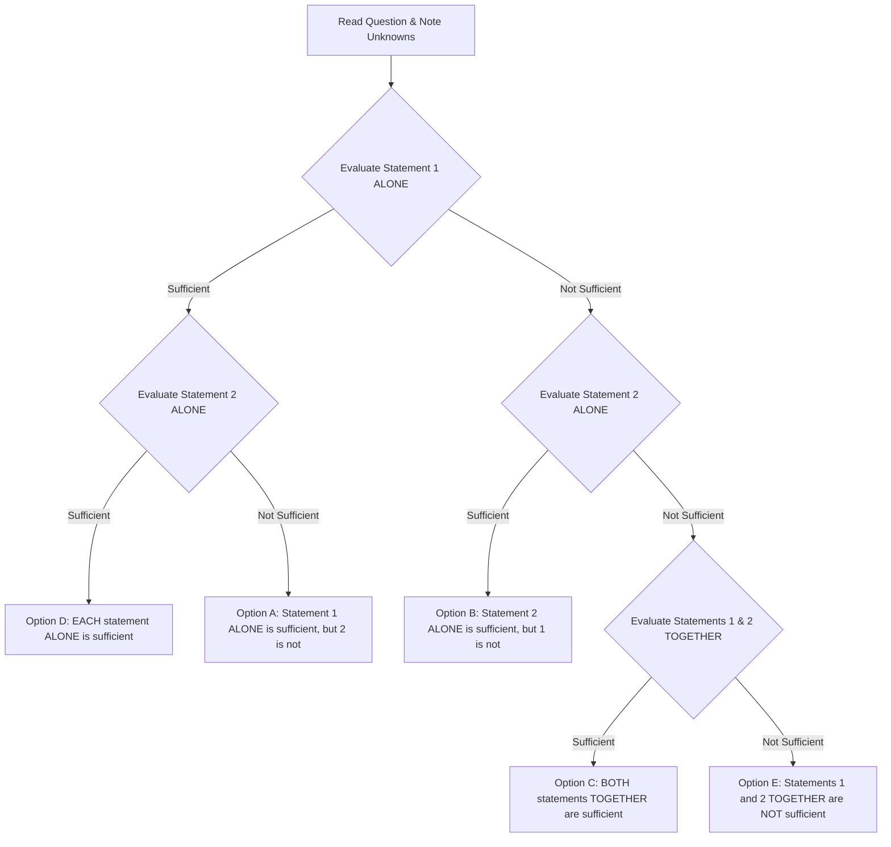

# INFOSYS SE 2026: DATA SUFFICIENCY MASTER CLASS
## The #1 Priority Topic of the October 5, 2026 Drive — Systematic Decision Tree, Core Traps & Solved Archetypes

---

## 1. The Data Sufficiency Paradigm

In the October 5, 2026 Infosys SE exam, candidates repeatedly cited **Data Sufficiency (DS)** as the dominant question type across both Reasoning and Aptitude. 

> **Crucial Mindset:** Data Sufficiency does NOT ask: *"What is the numerical answer?"*  
> It asks: *"Do the given statements provide SUFFICIENT information to determine a SINGLE, UNIQUE answer?"*  
> If Statement 1 yields two different possible values (e.g., `x = 3` or `x = -3`), it is **NOT SUFFICIENT**.

---

## 2. The 5 Standard Options & Decision Algorithm

### The 12-Second Rule for Options:
- **(A)** 1 alone is sufficient, 2 alone is NOT.
- **(B)** 2 alone is sufficient, 1 alone is NOT.
- **(C)** Both together are sufficient, neither alone is sufficient.
- **(D)** Each alone is sufficient.
- **(E)** Neither alone nor together is sufficient.

---

## 3. High-Yield Solved DS Problem Archetypes

### Archetype 1: Arithmetic & Percentages
**Question:** What is the cost price of an article?  
- **Statement (I):** The article is sold at a profit of 20% on the selling price.  
- **Statement (II):** The selling price of the article is ₹600.

#### Forensic Analysis:
1. **Analyze Statement (I) Alone:**
   - Profit `= 20\%  of SP} = 0.20 \times SP}`.
   - We know `SP} - CP} = 0.20 \times SP} \implies CP} = 0.80 \times SP}`.
   - Can we find CP? No, because SP is unknown. Multiple values of CP are possible.
   - ⟹ **Statement (I) ALONE is NOT SUFFICIENT.**
2. **Analyze Statement (II) Alone:**
   - `SP} = ₹600`.
   - Does this give CP? No profit or loss percentage is provided.
   - ⟹ **Statement (II) ALONE is NOT SUFFICIENT.**
3. **Analyze Statements (I) & (II) Combined:**
   - From (I), `CP} = 0.80 \times SP}`.
   - From (II), `SP} = ₹600`.
   - `\implies CP} = 0.80 \times 600 = ₹480`.
   - A unique single value is obtained!
- **Conclusion:** **Option (C)** (BOTH statements TOGETHER are sufficient).

---

### Archetype 2: Time & Work
**Question:** In how many days can workers A and B together complete a construction job?  
- **Statement (I):** Worker A alone can complete the job in 12 days.  
- **Statement (II):** Worker B is 50% more efficient than Worker A.

#### Forensic Analysis:
1. **Analyze Statement (I) Alone:**
   - Gives `T_A = 12` days. No information about B's speed or capacity.
   - ⟹ **Statement (I) ALONE is NOT SUFFICIENT.**
2. **Analyze Statement (II) Alone:**
   - Efficiency ratio: `E_B = 1.5 \times E_A`.
   - Without any actual baseline time or work quantity, we cannot determine the absolute number of days.
   - ⟹ **Statement (II) ALONE is NOT SUFFICIENT.**
3. **Analyze Combined:**
   - From (I), A's daily work `= \frac{1}{12}`.
   - From (II), B's daily work `= 1.5 \times \frac{1}{12} = \frac{1}{8}`.
   - Combined rate `= \frac{1}{12} + \frac{1}{8} = \frac{2 + 3}{24} = \frac{5}{24}` of work per day.
   - Total time `= \frac{24}{5} = 4.8` days. A single, unique value is found.
- **Conclusion:** **Option (C)**.

---

### Archetype 3: Number Properties & Even/Odd Integers
**Question:** Is integer n odd?  
- **Statement (I):** `n^2 - 1` is divisible by 8.  
- **Statement (II):** `3n + 2` is an odd integer.

#### Forensic Analysis:
1. **Analyze Statement (I) Alone:**
   - For any odd integer `n = 2k + 1`, `n^2 - 1 = (2k+1)^2 - 1 = 4k(k+1)`, which is always a multiple of 8 (since `k(k+1)` is always even, `4 \times even} = 8m`).
   - Can an even integer satisfy this? If n is even, `n^2` is even, so `n^2 - 1` is odd. An odd number can NEVER be divisible by 8.
   - Therefore, n MUST be odd. This answers the question with a definitive "YES".
   - ⟹ **Statement (I) ALONE is SUFFICIENT.**
2. **Analyze Statement (II) Alone:**
   - `3n + 2` is odd `\implies 3n = odd} - even} = odd}`.
   - Since 3 is odd, n MUST be odd (odd `\times` odd = odd).
   - This answers the question with a definitive "YES".
   - ⟹ **Statement (II) ALONE is SUFFICIENT.**
- **Conclusion:** **Option (D)** (EACH statement ALONE is sufficient).

---

### Archetype 4: Logical Arrangement / Seating
**Question:** Among five friends `P, Q, R, S, T` seated in a straight row facing North, who sits at the extreme left end?  
- **Statement (I):** Q sits second to the left of T, and P sits immediately to the right of Q.  
- **Statement (II):** S sits at the extreme right end, and R is not adjacent to Q.

#### Forensic Analysis:
1. **Statement (I) Alone:**
   - Relative arrangement: `Q, P, \_, T`.
   - This 4-element block can occupy positions `(1, 2, 3, 4)` or `(2, 3, 4, 5)` in a 5-seat row.
   - If at `(1, 2, 3, 4)`, Q is at the left end. If at `(2, 3, 4, 5)`, someone else is at position 1. Ambiguous.
   - ⟹ **Statement (I) ALONE is NOT SUFFICIENT.**
2. **Statement (II) Alone:**
   - Row: `\_, \_, \_, \_, S`.
   - Left end could be `P, Q, R,` or T.
   - ⟹ **Statement (II) ALONE is NOT SUFFICIENT.**
3. **Combined:**
   - From (II), position 5 is S. Positions are `1, 2, 3, 4, 5`.
   - The block from (I) is `Q, P, blank}, T`. Since position 5 is occupied by S, this 4-element block MUST occupy positions `1, 2, 3, 4`:
     $`Pos 1: } Q, \quad Pos 2: } P, \quad Pos 3: } R, \quad Pos 4: } T, \quad Pos 5: } S`$
   - Check condition: Is R adjacent to Q? R is at Pos 3, Q is at Pos 1 (not adjacent, condition satisfied).
   - Who is at the extreme left end? Q. Determined uniquely!
- **Conclusion:** **Option (C)**.
