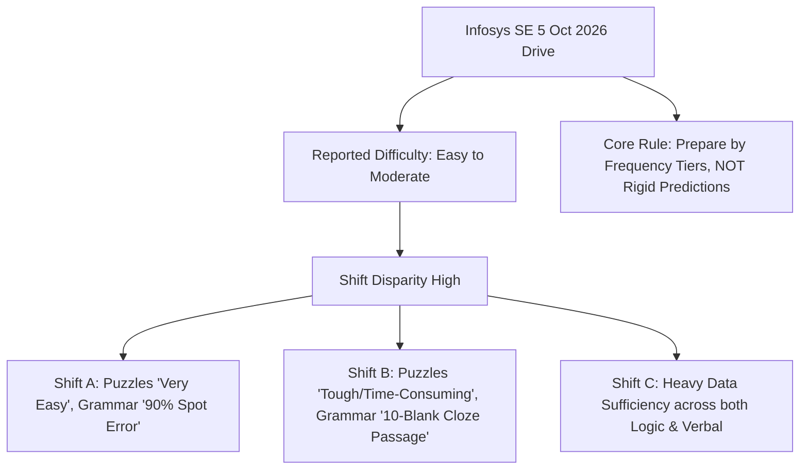

# INFOSYS SYSTEMS ENGINEER (SE) — 5 OCTOBER 2026 RECRUITMENT DRIVE
## Comprehensive Forensic Exam Analysis, Candidate Debriefs, Section-by-Section Topic Breakdown, Master Priority Matrix & Strategic Blueprint

---

## Executive Summary & Forensic Context

On **October 5, 2026**, Infosys conducted an extensive campus and off-campus recruitment drive for the **Systems Engineer (SE)** role (Job Level 3 - JL3). A deep forensic synthesis of candidate reviews, direct examination screenshots, post-shift debriefs, and same-day interview transcripts revealed a **critical operational paradigm shift** in how the Infosys Assessment Engine administers the test.

Historically, candidates prepared for a rigid, 5-section, 100-minute examination characterized by hard sectional locks and irreversible single-direction navigation. **The October 5, 2026 drive systematically dismantled several of these historical constraints:**
1. **Pooled Time Window:** Total examination time was extended to **~2 Hours (120 Minutes)** across a unified clock.
2. **Sectional Switching Enabled:** Candidates reported the freedom to navigate across sections bidirectionally (e.g., jumping from *Reasoning* → *Pseudocode* → *Verbal* → *Reasoning*).
3. **Question-Level Bidirectional Navigation:** Candidates were permitted to skip difficult questions, advance ahead, and return to earlier questions (e.g., `Q1 \to Q4 \to Q3`).
4. **7-Section Operational Architecture:** Rather than a compressed 5-section layout, the test expanded into a 7-section evaluation footprint comprising:
   - S1: Reasoning & Aptitude
   - S2: Quantitative / Technical Ability
   - S3: Verbal Ability
   - S4: Pseudocode
   - S5: Numerical Puzzles
   - S6: English Grammar
   - S7: English Writing / Essay (100–200 words)
5. **Mandatory Sectional Cutoffs Maintained:** Despite the flexible 2-hour pooled clock, **sectional qualification remains non-negotiable**. Candidates who score zero or fall below the percentile floor in any single section (such as Puzzles or Pseudocode) are disqualified regardless of 100% scores in other sections.
6. **High Shift-to-Shift Variance:** The paper showed significant variation between morning, afternoon, and evening shifts. Fixed topic predictions (e.g., "exactly 2 circular seating questions") failed; success was dictated by mastering high-confidence recurring core topics (**Data Sufficiency**, **Java Pseudocode**, **Time & Work**, **Syllogisms**, **Table DI**).

---

## 1. The Big Picture: Difficulty, Unpredictability & Shift Disparity



### 1.1 The Shift Variance Phenomenon
Candidate feedback across October 5 demonstrated that Infosys does not rely on a monolithic question paper. The platform dynamically samples from parameterized item pools:
- **Candidate Alpha (Morning Shift):** Reported Numerical Puzzles were *"very very easy, solved all 4 in under 5 minutes"*; Grammar was ~90% *Spot the Error*; Quant was dominated by *Percentages* and *Data Interpretation*.
- **Candidate Beta (Afternoon Shift):** Reported Numerical Puzzles had multi-layer arithmetic progressions requiring heavy scratchpad iteration; Grammar had *1 long 300-word reading passage with 10 inline dropdown blanks*; Quant was dominated by *Time & Work* and *Ratio-Proportion*.
- **Candidate Gamma (Evening Shift):** Emphasized heavy concentration of **Data Sufficiency** appearing in both *Reasoning Ability* and *Verbal/Critical Reasoning*.

### 1.2 The Strategic Golden Rule
> **Golden Principle:** Never plan your exam around rigid statements like *"There will be exactly 3 questions on Boats and Streams."* Master the **high-confidence recurring core (Tier S & Tier A)**, maintain wide conceptual awareness across the master syllabus, and leverage the 2-hour pooled interface to maximize net scoring efficiency.

---

## 2. Platform Mechanics & Examination Rules: The 2-Hour Evolution

| Dimension | Historic Legacy Model | October 5, 2026 Verified Model | Tactical Strategic Impact |
| :--- | :--- | :--- | :--- |
| **Total Test Duration** | 100 Minutes (sum of sectional locks) | **~120 Minutes (2.0 Hours pooled)** | +20 Minutes extra testing runway; stamina and pacing matter |
| **Sectional Timers** | Hard locks (e.g., Math 35m, Logic 25m) | **No forced sectional timers** | Candidates control section-wise time distribution |
| **Section Navigation** | Linear, strictly forward-only | **Free Bidirectional Section Switching** | Candidates can complete high-ROI sections first (e.g., Pseudocode/Grammar) |
| **Question Navigation** | Forward-only, irreversible submit | **Free Question Navigation (`Q1 \leftrightarrow Q4`)** | Low-confidence questions can be flagged and revisited |
| **Negative Marking** | 0 marks deducted for incorrect answers | **0 marks deducted (Zero Negative Marking)** | Every question must have an answer selected prior to final submission |
| **Sectional Cutoffs** | Mandatory (~65–70% per section) | **Mandatory Sectional Cutoffs** | Cannot abandon any section to pad score in another |
| **Proctoring Engine** | AI Face & Gaze Tracking, Full-Screen Lock | **Dual AI Proctoring (Audio + Visual)** | 2 Alt-Tab events trigger automatic termination |

---

## 3. The 7-Section Architecture & Cutoff Thresholds

```
+=======================================================================================+
|               INFOSYS SYSTEMS ENGINEER (SE) 7-SECTION OPERATIONAL MODEL               |
+===+===========================+================+==============+=======================+
| # | Section Name              | Question Pool  | Ideal Time   | Minimum Cutoff Target |
+===+===========================+================+==============+=======================+
| 1 | Reasoning & Aptitude      | ~15 Questions  | 25–30 Mins   | 10–11 Correct (70%)   |
| 2 | Quant / Technical Ability | ~10 Questions  | 25–30 Mins   | 7 Correct (70%)       |
| 3 | Verbal Ability            | ~15 Questions  | 15–20 Mins   | 10–11 Correct (65%)   |
| 4 | Pseudocode Tracing        | ~5 Questions   | 10–12 Mins   | 4 Correct (80%)       |
| 5 | Numerical Puzzles         | ~4 Questions   | 10–12 Mins   | 2–3 Correct (50–75%)  |
| 6 | English Grammar           | ~5–10 Questions| 10 Mins      | 70% Accuracy          |
| 7 | English Writing / Essay   | 1 Topic        | 12–15 Mins   | Coherence & Structure |
+===+===========================+================+==============+=======================+
|   | TOTAL ASSESSMENT          | ~55–60 Items   | 120 Minutes  | ALL SECTIONS PASS     |
+=======================================================================================+
```

---

## 4. Deep Forensic Breakdown: Section-by-Section Analysis

---

### Section 1: Reasoning & Aptitude (#1 Elimination Vector)

The October 5 candidate logs establish Reasoning & Aptitude as the most crucial section of the entire assessment. The question cluster centered on **Analytical Logic**, **Critical Reasoning**, and **Data Sufficiency**.

#### 1. Data Sufficiency (The #1 Master Topic)
Candidates reported Data Sufficiency appearing across both Logical Reasoning and Quant modules.
* **The Core Premise:** Data Sufficiency evaluates whether the provided conditions are mathematically or logically adequate to reach a unique determination—**not** the mechanical calculation of the final value.
* **Standard Answer Options:**
  - **Option A:** Statement (I) ALONE is sufficient to answer the question, but Statement (II) alone is not sufficient.
  - **Option B:** Statement (II) ALONE is sufficient to answer the question, but Statement (I) alone is not sufficient.
  - **Option C:** BOTH statements (I) and (II) TOGETHER are sufficient, but NEITHER statement alone is sufficient.
  - **Option D:** EACH statement ALONE is sufficient.
  - **Option E:** Statements (I) and (II) TOGETHER are NOT sufficient to answer the question.
* **Core Domains Tested via Data Sufficiency:**
  1. *Ages & Averages:* (e.g., Finding the age of the youngest sibling given average ages and ratio offsets).
  2. *Time & Work:* (e.g., Determining if Person A and Person B can complete the work in `<10` days given individual work rates or alternating day conditions).
  3. *Number Properties:* (e.g., Is x an even integer? Statement 1: `x^2 + 2x` is even; Statement 2: `x/2` is an integer).
  4. *Blood Relations & Seating:* (e.g., Who sits immediately to the left of P? Statement 1: P is between Q and R; Statement 2: S sits second to the right of Q).

#### 2. Syllogisms & Deductive Logic (6–7 Questions Cluster)
Multiple candidate reviews confirmed 6–7 questions distributed among Syllogisms, Statement & Conclusion, and Statement & Assumptions.
* **Syllogism Categories Tested:**
  - *Standard Quantifiers:* "All A are B", "Some A are B", "No A is B", "Some A are not B".
  - *Possibility-Based Conclusions:* "All A being C is a possibility", "Some B not being A is a possibility". (Remember: A possibility conclusion is TRUE if at least one valid Venn diagram configuration satisfies it without violating any given premise).
  - *Either/Or Complementary Pairs:* Requires (1) Same subject and predicate, (2) Both individual conclusions invalid, (3) One affirmative and one negative pair ("Some + No" or "All + Some Not").

#### 3. Statement & Conclusion vs. Statement & Assumption
* **Statement & Conclusion:** Requires direct logical deduction. A conclusion MUST follow with 100% certainty solely from the boundaries of the statement. Extrapolations or external real-world assumptions are strictly invalid.
* **Statement & Assumption:** Evaluates the unstated presupposition made by the speaker.
  - *The Negation Technique:* To verify if Assumption A is valid, negate A. If the statement or premise collapses upon negation, A is an absolute **necessary assumption**.

#### 4. Blood Relations (2 Questions)
Candidates reported 2 questions requiring immediate family tree reconstruction:
- Family tree symbols: Circle (○ (Circle)) for Female, Square (□ (Square)) for Male, Horizontal double line (`=`) for Spouse, Vertical line (|) for Parent-Child descent, Horizontal single line (`-`) for Siblings.
- Focus: Maternal vs. Paternal uncles/aunts, in-laws (brother-in-law, mother-in-law), and coded relation strings (e.g., `P + Q \times R - S`).

#### 5. Data Interpretation (Table DI Dominant — 4–5 Questions)
- 4 to 5 questions based on structured data sets.
- **Table DI was the single most reported format on October 5**, featuring sales metrics, student pass percentages, or company production outputs over consecutive quarters.
- Calculation types: Percentage change (`\frac{New} - Old}}{Old}} \times 100`), Ratio of sums, Weighted averages, and absolute difference comparisons.

---

### Section 2: Quantitative / Technical Ability

Candidate feedback indicated that while the Quant section did not follow a rigid template, questions clustered heavily around fundamental commercial arithmetic:

```
+---------------------------------------------------------------------------------------+
|                         QUANTITATIVE TOPIC PRIORITY CLUSTER                           |
+-------------------+----------------+--------------------------------------------------+
| Topic             | Frequency Tier | Essential Concepts & Mental Math Shortcuts       |
+-------------------+----------------+--------------------------------------------------+
| Percentage        | Tier S         | Fraction-to-% tables (1/6 = 16.66%, 1/8 = 12.5%) |
| Data Interpretation| Tier S        | Table analysis, dual pie-charts, ratio reductions |
| Time & Work       | Tier S         | LCM total work units, efficiency, alternate days |
| Ratio & Proportion| Tier A         | Compounded ratio, direct/inverse proportion      |
| Average           | Tier A         | Deviation method, weighted average balance       |
| Profit & Loss     | Tier A         | CP/SP formulas, markup, successive discounts     |
| Time-Speed-Dist.  | Tier B         | Relative speed (same/opp direction), trains      |
| P & C             | Tier B         | Fundamental principle of counting, arrangement  |
| Probability       | Tier B         | Dice, cards, balls, mutually exclusive events    |
| Mixtures & Allig. | Tier B         | Alligation cross-rule, replacement formula       |
| Number System     | Tier C         | Divisibility rules, unit digit calculation       |
+-------------------+----------------+--------------------------------------------------+
```

#### Detailed Formula Toolkit for October 5 High-Yield Topics:
1. **Time & Work (LCM Unit Method):**
   $`Total Work} = LCM of individual times } (T_A, T_B, T_C)`$
   $`Efficiency } E_A = \frac{Total Work}}{T_A}`$
   $`Combined Time } T_{together}} = \frac{Total Work}}{\sum E_i}`$
2. **Successive Percentage Changes:**
   $`Net Change} = \left(a + b + \frac{a \times b}{100}\right)\%`$
3. **Profit, Loss & Markup:**
   $`Markup } \% = \frac{MP} - CP}}{CP}} \times 100`$
   $`SP} = MP} \times \left(1 - \frac{Discount } \%}{100}\right)`$
   $`Profit } \% = \frac{SP} - CP}}{CP}} \times 100`$
4. **Mixture Replacement Formula:**
   $`Final Volume of Pure Liquid} = Initial Volume} \times \left(1 - \frac{Replaced Volume}}{Total Volume}}\right)^n`$

---

### Section 3: Verbal Ability

Verbal Ability on October 5 presented two distinct profiles across test slots:
- **Profile A:** Reading Comprehension (~5 questions) + Sentence Correction / Spot the Error (~10 questions).
- **Profile B:** 1 Long Narrative Paragraph with 10 contextual cloze dropdown blanks testing verb tenses, prepositions, and articles.

#### 1. Reading Comprehension (~5 Questions)
- Passage length: ~250–350 words.
- Question taxonomy:
  - *Direct Fact Retrieval:* Straightforward extraction from the text.
  - *Author's Tone & Attitude:* Objective, critical, skeptical, analytical, or optimistic.
  - *Inference Questions:* "What can be logically inferred from paragraph 2?" (Must not state what is directly written, but what is necessarily implied).
  - *Vocabulary-in-Context:* Determining the specific meaning of a polysemous word within the passage.

#### 2. Spot the Error & Sentence Correction (High Concentration)
One candidate reported that ~90% of their grammatical evaluation consisted of Spot the Error. The recurring error vectors tested include:
1. **Subject-Verb Agreement (SVA):**
   - Inverted sentences: *"Near the lake stands (not stand) an ancient oak tree."*
   - Intervening prepositional phrases: *"The bouquet of yellow roses smells (not smell) fragrant."*
   - Indefinite pronouns: *"Each of the candidates has (not have) submitted their portfolio."*
   - Correlative conjunctions: *"Neither the manager nor the developers were (verb agrees with closest subject) available."*
2. **Tense Consistency & Conditionals:**
   - Type 3 Conditional: *"If he had studied (Past Perfect), he would have passed (would have + V3)."* (Never *"If he would have studied"*).
   - Past time markers: Past specific dates (e.g., *"in 2024"*, *"yesterday"*) demand Simple Past, not Present Perfect.
3. **Modifiers & Parallelism:**
   - Dangling modifiers: *"Walking down the road, a brick fell on his head."* → Incorrect (the brick wasn't walking). Correct: *"While he was walking down the road, a brick fell on his head."*
   - Parallel structure: *"She enjoys reading books, writing code, and to design UI."* → Correct: *"and designing UI."*

---

### Section 4: Pseudocode Engine (Java-Style Syntax)

The pseudocode section was universally confirmed across all candidate reports as having the **highest degree of conceptual convergence**. The syntax closely mimics Java / C++, and questions demand tracing variables through iterative control flow.

```mermaid
graph TD
    A[Pseudocode Input Stream] --> B[Loop Constructs: for, while, do-while]
    A --> C[Integer Math: / division vs % modulo]
    A --> D[Bitwise Logic (XOR, AND, OR)]
    A --> E[Increment Semantics: ++x vs x++]
    A --> F[String Traversal: charAt, length, substring]
    B & C & D & E & F --> G[Manual Variable-Trace Table]
    G --> H[Final Deterministic Output]
```

#### 1. Integer Division vs. Modulo Operator
- Integer division in Java/C truncates toward zero:
  $`7 / 2 = 3 \quad (not } 3.5)`$
  $`1 / 4 = 0`$
  $`-7 / 2 = -3`$
- Modulo operator yields the arithmetic remainder:
  $`7 \% 2 = 1`$
  $`10 \% 3 = 1`$
  $`15 \% 5 = 0`$

#### 2. Pre-Increment (`++x`) vs. Post-Increment (`x++`)
- **Post-Increment (`x++`):** Fetch the current value of x for the containing expression, then increment x by 1 in memory.
- **Pre-Increment (`++x`):** Increment x by 1 immediately, then evaluate the newly incremented value in the expression.

```java
int a = 5;
int b = a++; // b = 5, a becomes 6
int c = ++a; // a becomes 7, c = 7
int result = (a++) + (++b) + (c--);
// Evaluation:
// a++ uses 7 (a becomes 8)
// ++b increments b to 6, uses 6
// c-- uses 7 (c becomes 6)
// result = 7 + 6 + 7 = 20
```

#### 3. Do-While Loop Semantics
The `do-while` loop executes its body **at least once**, regardless of whether the loop continuation condition evaluates to `false` at the initial evaluation:

```java
int x = 10;
do {
    x += 5;
} while (x < 10);
// Output of x is 15! Even though 15 < 10 is false, the loop ran once.
```

#### 4. Bitwise XOR Logic (`^`)
- Properties of XOR:
  - `x ^ 0 = x`
  - `x ^ x = 0`
  - Commutative & Associative: `A ^ B ^ A = (A ^ A) ^ B = 0 ^ B = B`
  - Truth table: `0 ^ 0 = 0`, `0 ^ 1 = 1`, `1 ^ 0 = 1`, `1 ^ 1 = 0` (Identical bits yield 0, differing bits yield 1).

#### 5. Java String Manipulation Pseudocode
Candidates reported questions involving iterative string loops:
- `string.length()` checks.
- Zero-indexed character retrieval (`string.charAt(i)`).
- Substring slicing and palindrome/reversal checking.
- Concatenation within loops.

---

### Section 5: Numerical Puzzles

The puzzle-solving module consisted of **4 questions**. Difficulty varied significantly by shift:
- Shift 1: Very easy, basic arithmetic progressions and square/cube series.
- Shift 2: Multi-step missing numbers in circular or tabular grids.

#### Typical Puzzle Paradigms Tested:
1. **Missing Number in Matrix / Grid:**
   ```
\begin{matrix}
   4 & 9 & 2 \\
   3 & 5 & 7 \\
   8 & 1 & ?
   \end{matrix}
```
   - Row-wise or column-wise summation check: Row 1 sum `= 15`, Row 2 sum `= 15`, Row 3 sum `= 8 + 1 + ? = 15 \implies ? = 6`.
2. **Alternating Series & Multi-Step Differences:**
   $`3, 5, 9, 17, 33, ?`$
   - Differences: `2, 4, 8, 16, 32 \implies 33 + 32 = 65`.
   - Alternating operation: `x_{n} = 2x_{n-1} - 1`.
3. **Visual / Figure-Based Puzzles:** Segmented circles with radial relationships between opposite quadrants (e.g., x opposite `x^3 - 1`).

---

### Section 6: English Grammar

Grammar was evaluated either through discrete multiple-choice items or a combined 10-blank cloze passage.

#### The Non-Negotiable Grammar Checklist:
* **Tenses:** Perfect Continuous vs. Simple Past; using *"since"* (point in time) vs. *"for"* (duration).
* **Subject-Verb Agreement:** Rule of compound subjects connected by *"as well as"*, *"along with"*, *"in addition to"* (verb agrees with the FIRST subject).
* **Articles:** Proper usage of *"a"* vs. *"an"* based on initial phonetic vowel sound (e.g., *"a university"*, *"an honest man"*, *"an MBA graduate"*).
* **Prepositions:** Fixed preposition combinations (*"prohibit from"*, *"abstain from"*, *"interested in"*, *"capable of"*, *"congratulate on"*).
* **Active vs. Passive Voice:** Identifying agent displacement and ensuring auxiliary verb alignment (`is/am/are + V3`, `was/were + V3`).

---

### Section 7: English Writing / Essay Section

Infosys mandates a short-form written composition module to evaluate written English clarity, coherence, and professional communication.
* **Word Count Constraint:** **100 to 200 words** (strictly enforced; target **~150 words**).
* **Evaluation Criteria:**
  - Logical structure and coherent idea progression.
  - Grammatical precision and sentence variety.
  - Correct spelling and punctuation.
  - Zero colloquialisms, slang, or SMS abbreviations.

#### The 4 Actual Topics Reported on October 5, 2026:
1. **Topic 1:** *Impact of AI on Problem-Solving Skills*
2. **Topic 2:** *Impact of Social Media on Mental Health*
3. **Topic 3:** *What inspires you to keep working on self-development?*
4. **Topic 4:** *Travelling with strangers — enjoyable or difficult?*

#### The Universal 4-Paragraph ~150-Word Essay Blueprint:
```
+---------------------------------------------------------------------------------------+
|                       THE 4-PARAGRAPH ESSAY BLUEPRINT (~150 WORDS)                    |
+---------------------------------------------------------------------------------------+
| Paragraph 1: Introduction & Thesis Statement               (~30 Words)               |
| - Introduce the core theme with a concise definition.                                 |
| - State your clear thesis / overarching stance.                                       |
+---------------------------------------------------------------------------------------+
| Paragraph 2: Primary Argument & Supporting Example          (~50 Words)               |
| - Detail the main positive benefit or mechanism.                                      |
| - Provide concrete real-world context.                                                |
+---------------------------------------------------------------------------------------+
| Paragraph 3: Counterpoint, Nuance or Challenge             (~40 Words)               |
| - Acknowledge potential pitfalls, dependencies, or trade-offs.                        |
| - Propose a balanced mitigation or perspective.                                       |
+---------------------------------------------------------------------------------------+
| Paragraph 4: Conclusion & Forward Outlook                  (~30 Words)               |
| - Summarize the core takeaway.                                                        |
| - Conclude with a strong forward-looking closing sentence.                            |
+---------------------------------------------------------------------------------------+
```

---

## 5. The Seating & Data Arrangement Reality Check

A frequent point of debate among candidates is whether to invest hours mastering complex circular or multi-row seating puzzles.

```
+---------------------------------------------------------------------------------------+
|                         SEATING ARRANGEMENT PRIORITY AUDIT                            |
+------------------------------+--------------------+-----------------------------------+
| Arrangement Category         | Priority Tier      | Actionable Recommendation         |
+------------------------------+--------------------+-----------------------------------+
| Linear Single-Row (1-D)      | Tier B (Moderate)  | Master North/South facing basics  |
| Parallel Two-Row (Facing)    | Tier B (Moderate)  | Practice 6–8 person configurations|
| Circular Arrangement (Basic) | Tier B (Moderate)  | Inward/Outward facing basics only |
| Complex Multi-Attribute Grid | Tier C (Low)       | DE-PRIORITIZE; focus on DS & DI   |
+------------------------------+--------------------+-----------------------------------+
```

> **Forensic Conclusion:** The October 5 candidate logs did **not** show heavy concentrations of multi-variable circular arrangement sets. Instead, the logical evaluation was dominated by **Data Sufficiency**, **Syllogisms**, and **Statement/Conclusion**. Do not sacrifice Data Sufficiency practice to drill labyrinthine seating arrangements.

---

## 6. The Master Topic Priority Matrix (Tiers S through C)

```
+=======================================================================================+
|                            INFOSYS SE MASTER PRIORITY MATRIX                          |
+========+==============================================================================+
| TIER S | 1. Data Sufficiency (Reasoning & Quant domains)                              |
| (MUST  | 2. Data Interpretation (Table DI, Bar Graphs, Pie Charts)                     |
| MASTER | 3. Syllogisms (Possibility conclusions, Either/Or pairs, Venn proofs)        |
| FIRST) | 4. Statement & Conclusion + Statement & Assumptions                          |
|        | 5. Pseudocode Engine (Java syntax, Loops, Do-While, Modulo %, Division /)    |
|        | 6. Quantitative Basics: Percentages, Time & Work, Ratio & Proportion         |
|        | 7. Verbal: Reading Comprehension, Spot the Error                             |
+========+==============================================================================+
| TIER A | 1. Pseudocode Operators: Pre/Post Increment (++x/x++), Bitwise XOR (^)       |
| (VERY  | 2. Quantitative: Averages, Profit & Loss, Simple/Compound Interest           |
| HIGH   | 3. Blood Relations (Family tree mapping, coded relations)                    |
| VALUE) | 4. Numerical Puzzles (Missing numbers in grids, arithmetic sequences)        |
|        | 5. Grammar Essentials: Subject-Verb Agreement, Tenses, Prepositions, Articles|
|        | 6. Essay Writing Framework (100–200 words, structured 4-paragraph format)    |
+========+==============================================================================+
| TIER B | 1. Time, Speed & Distance (Relative speed, Trains, Boats & Streams)          |
| (COVER | 2. Permutations, Combinations & Probability basics                           |
| BROAD) | 3. Mixtures & Alligations, Ages, Number Series                               |
|        | 4. Directions Sense, Coding-Decoding, Linear & Parallel Arrangements         |
|        | 5. Verbal: Sentence Improvement, Cloze Test, Para Jumbles, Active/Passive    |
+========+==============================================================================+
| TIER C | 1. Complex Multi-Attribute Seating Puzzles                                   |
| (LAST  | 2. Cryptarithmetic / Alphametic Puzzles                                      |
| LEVEL) | 3. Sudoku Grid Solvers                                                       |
|        | 4. Advanced Geometry & Coordinate Mensuration                                |
|        | 5. Advanced Recursive Pseudocode & Higher-Order Algorithms                   |
+========+==============================================================================+
```

---

## 7. The Optimal 2-Hour Flexible Examination Strategy: The 5-Round Sweep

With the removal of forced sectional timers and the enablement of bidirectional section switching, adhering to a rigid linear approach is sub-optimal. The recommended strategy is the **5-Round Sweep Protocol**:

```mermaid
sequenceDiagram
    participant C as Candidate
    participant S as Assessment Interface
    C->>S: 00:00 - 00:25 | Round 1: Fast Elimination Sweep (Pseudocode + Grammar + Direct Vocab)
    Note over C,S: Bank ~15-18 quick high-accuracy marks immediately
    C->>S: 00:25 - 00:55 | Round 2: Core Analytical Anchor (Reasoning, Syllogisms, DS)
    Note over C,S: Methodical Venn diagrams & Data Sufficiency verification
    C->>S: 00:55 - 01:25 | Round 3: High-Yield Quant & Table DI
    Note over C,S: Time & Work, Percentages, Ratio calculations from Table DI
    C->>S: 01:25 - 01:45 | Round 4: Numerical Puzzles & Reading Comprehension
    Note over C,S: Solve 2-3 accessible puzzles; read RC passage with focused scanning
    C->>S: 01:45 - 02:00 | Round 5: Essay Writing & Cutoff Buffer Review
    Note over C,S: Type clean 150-word essay, ensure NO section is below qualifying cutoff
```

### Round-by-Round Execution:
1. **Round 1 (Minutes 0–25) — The Low-Hanging Fruit Sweep:**
   - Immediately open **Section 4 (Pseudocode)**: Trace the 5 questions using a clean variable table.
   - Jump to **Section 6 (English Grammar)**: Resolve Spot the Error and Fill-in-the-Blanks questions rapidly using rule-based recognition.
   - *Yield:* ~15 quick, high-confidence marks in the bank, alleviating anxiety.
2. **Round 2 (Minutes 25–55) — Analytical Core (Section 1 Reasoning):**
   - Address **Syllogisms**, **Statement & Conclusion**, and **Statement & Assumption**.
   - Tackle **Data Sufficiency** systematically. Check Statement 1, then Statement 2, then combination.
   - Resolve **Blood Relations** using family tree diagrams.
3. **Round 3 (Minutes 55–85) — Quantitative Anchor (Section 2 Quant & DI):**
   - Solve **Table Data Interpretation** questions first (high scoring density).
   - Solve **Time & Work**, **Percentage**, and **Ratio** arithmetic problems.
   - Skip computationally heavy or convoluted questions to revisit later.
4. **Round 4 (Minutes 85–105) — Puzzles & Reading Comprehension (Sections 3 & 5):**
   - Attempt the 4 **Numerical Puzzles**. Target at least 2–3 confirmed solutions.
   - Read the **Reading Comprehension** passage, answer main idea, inference, and direct fact questions.
5. **Round 5 (Minutes 105–120) — Essay Writing & Final Audit (Section 7 + Review):**
   - Dedicate 12 minutes to write the **Essay (100–200 words)** following the 4-paragraph architecture.
   - Use the final 3 minutes to inspect all 7 sections: Ensure **every single unanswered question has a calculated guess selected** (Zero Negative Marking).

---

## 8. Systematic Preparation Tracking: The L / P / M Protocol

To track preparation rigorously, use the **L / P / M Framework**:
- **L (Learned):** You have understood the underlying theory, formulas, syntax rules, and edge cases.
- **P (Practiced):** You have solved at least 25–30 non-trivial questions untimed to build pattern recognition.
- **M (Mocked):** You have successfully solved questions under active countdown timer conditions with `\ge 80\%` accuracy.

```
+------------------------------------+-------+-------+-------+--------------------------+
| Subject Domain & Topic             | L     | P     | M     | Target Readiness Date    |
+------------------------------------+-------+-------+-------+--------------------------+
| Data Sufficiency (Reasoning/Quant) | [ ]   | [ ]   | [ ]   | Week 1, Day 2            |
| Syllogisms & Possibility Logic     | [ ]   | [ ]   | [ ]   | Week 1, Day 3            |
| Statement, Conclusion & Assumption | [ ]   | [ ]   | [ ]   | Week 1, Day 4            |
| Data Interpretation (Table/Bar)    | [ ]   | [ ]   | [ ]   | Week 1, Day 5            |
| Time & Work + Pipes & Cisterns     | [ ]   | [ ]   | [ ]   | Week 1, Day 6            |
| Percentages, Ratio, Average        | [ ]   | [ ]   | [ ]   | Week 1, Day 7            |
| Pseudocode: Loops, Modulo, Div     | [ ]   | [ ]   | [ ]   | Week 2, Day 1            |
| Pseudocode: Strings, XOR, ++x/x++  | [ ]   | [ ]   | [ ]   | Week 2, Day 2            |
| Numerical Puzzles & Series         | [ ]   | [ ]   | [ ]   | Week 2, Day 3            |
| Grammar: SVA, Tenses, Prepositions | [ ]   | [ ]   | [ ]   | Week 2, Day 4            |
| Reading Comprehension              | [ ]   | [ ]   | [ ]   | Week 2, Day 5            |
| Essay Writing Templates            | [ ]   | [ ]   | [ ]   | Week 2, Day 6            |
| Full 2-Hour 7-Section Mocks        | [ ]   | [ ]   | [ ]   | Week 2, Day 7            |
+------------------------------------+-------+-------+-------+--------------------------+
```

---

## 9. Post-OA Interview Stage Continuum (Same-Day October 5 Insights)

Candidate interview logs from October 5, 2026 demonstrate that clearing the Online Assessment seamlessly transitions into technical and architectural interview rounds. Preparation must not pause at the written test.

### 9.1 High-Frequency Interview Focus Areas
1. **Object-Oriented Programming (Java / C++ / Python):**
   - Deep explanation of the 4 Pillars (Encapsulation, Abstraction, Inheritance, Polymorphism) with real-world enterprise analogies.
   - Method Overloading vs. Overriding; dynamic method dispatch.
   - `String` vs. `StringBuilder` vs. `StringBuffer` (immutability, memory heap, thread safety).
   - `==` operator (reference equality) vs. `.equals()` method (semantic value equality).
   - Java Collections Framework: Internal hashing mechanism of `HashMap` (buckets, linked lists, red-black tree conversion at bucket threshold 8).
2. **REST APIs & Backend Architecture:**
   - What defines a RESTful service? (Statelessness, client-server decoupling, cacheability, uniform interface).
   - HTTP Methods: GET (idempotent/safe), POST (non-idempotent), PUT (idempotent replace), PATCH (partial update), DELETE (idempotent).
   - HTTP Status Code Families: 2xx (Success: 200, 201), 3xx (Redirection), 4xx (Client Error: 400 Bad Request, 401 Unauthorized, 403 Forbidden, 404 Not Found), 5xx (Server Error: 500 Internal Server Error, 502 Bad Gateway).
3. **Database Management & SQL:**
   - Normalization forms (`1NF, 2NF, 3NF, BCNF`).
   - Inner Join vs. Left Outer Join vs. Full Outer Join.
   - Group By vs. Having clauses.
   - Primary Key vs. Unique Key vs. Foreign Key constraints.
4. **Live Coding Problems Reported on October 5:**
   - *Problem A:* **Coordinate Movement Simulation:** Simulating a robot's path on an `(x, y)` Cartesian grid given a command string containing `'U'`, `'D'`, `'L'`, `'R'` and detecting whether it returns to origin `(0, 0)` or identifying its final Euclidean distance.
   - *Problem B:* **XOR-Based Single Number Identification:** Given an array where every element appears twice except for one unique element, find that element in `O(N)` time and `O(1)` space using bitwise XOR accumulation (`x ^ x = 0`).
   - *Problem C:* **String Character Frequency:** Counting non-whitespace character occurrences using a frequency map or integer array of size 256.

---

## 10. Conclusion & Final Preparation Directives

The October 5, 2026 Infosys Systems Engineer recruitment drive reinforces one paramount reality: **Infosys rewards structured, versatile problem-solvers over narrow memorizers.**

By internalizing:
1. The **flexible 2-hour examination dynamics** (no forced sectional locks, bidirectional navigation),
2. The absolute necessity of passing **sectional qualifying cutoffs**,
3. The unmatched importance of **Data Sufficiency**, **Java Pseudocode**, **Syllogisms**, **Table DI**, and **Time & Work**,
4. The structured **4-paragraph essay methodology**, and
5. The direct technical continuum from the OA into **OOP, REST APIs, and core coding**,

your preparation is fully aligned with the exact ground truth of the latest recruitment cycle.
