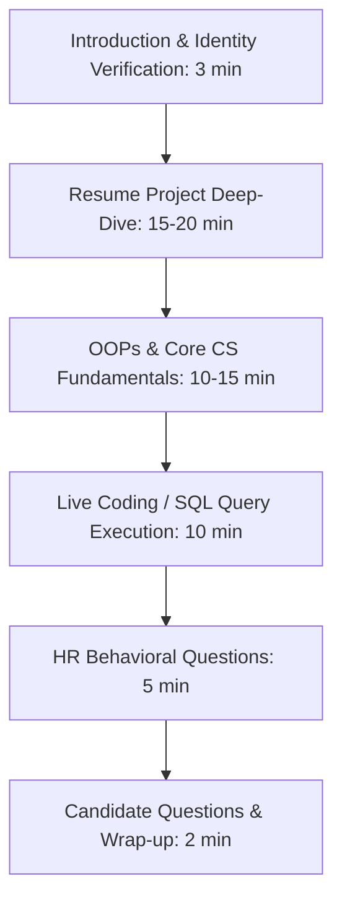

# Technical & HR Interview Master Guide

**Duration:** 30–45 Minutes | **Mode:** Virtual (Infosys Interview Platform / MS Teams)  
**Panel:** Senior Technical Lead / Manager (JL5/JL6)  

---

## 1. Interview Flow Architecture



---

## 2. Technical Evaluation Pillars (85% Weight)

### Pillar 1: Academic Project Deep-Dive (40% Weight)
Interviewers spend the largest portion of the interview scrutinizing your final-year or major academic project.
- **The Architecture Explanation:** You will be asked to walk through the complete data flow from the client/frontend through backend APIs to the database tables.
- **Key Questions to Prepare:**
  - *"Why did you select MongoDB over MySQL (or vice versa) for this project?"*
    - *Ideal Answer:* Emphasize data structure tradeoffs (e.g., *"We chose PostgreSQL because our application required strict relational integrity and transactional ACID consistency for payments, which NoSQL does not guarantee by default"*).
  - *"What was the single most difficult bug you encountered, and how did you diagnose and fix it?"*
    - *Ideal Answer:* Walk through symptoms $\rightarrow$ log inspection / debugger $\rightarrow$ root cause $\rightarrow$ verified fix.
  - *"What was your individual contribution vs the group contribution?"*
    - *Fatal Mistake:* Saying *"my teammate wrote the backend."* You must be able to explain the entire codebase.

---

### Pillar 2: Core Object-Oriented Programming (OOP) (25% Weight)
- **The 4 Pillars with Practical Examples (Avoid textbook car/animal analogies):**
  - *Abstraction:* Exposing essential features while hiding internal complexity (e.g., an ATM interface hides database queries and hardware mechanics).
  - *Encapsulation:* Restricting direct access to an object's components using private access modifiers with getter and setter methods to maintain data integrity.
  - *Inheritance:* Reusability and hierarchical classification (`class SavingsAccount extends BankAccount`).
  - *Polymorphism:*
    - *Compile-Time (Overloading):* Methods sharing the same name but differing in parameter count or types.
    - *Runtime (Overriding):* Subclass providing a specific implementation of a method defined in its superclass (dynamic method dispatch via virtual tables).
- **Interface vs Abstract Class:**
  - *Interface:* Complete contract definition (100% abstract, supports multiple inheritance in Java).
  - *Abstract Class:* Can contain both abstract methods and concrete implementations with state variables.
- **Memory Lifecycles:** Stack memory (local variables, function call frames) vs Heap memory (dynamically allocated objects, managed by Garbage Collector).

---

### Pillar 3: DBMS & Live SQL Queries (20% Weight)
- **ACID Properties (Demonstrated with a Banking Scenario):**
  - *Atomicity:* Either both the debit from Account A and the credit to Account B complete, or the entire transaction rolls back.
  - *Consistency:* Database constraints (e.g., account balance $\ge 0$) remain valid before and after execution.
  - *Isolation:* Concurrent transactions do not interfere with each other.
  - *Durability:* Once committed, data survives power failures and crashes.
- **Database Normalization:**
  - *1NF:* Atomic values (no multi-valued attributes).
  - *2NF:* In 1NF + no partial dependency (all non-key attributes fully dependent on candidate key).
  - *3NF:* In 2NF + no transitive dependency ($A \rightarrow B \rightarrow C$).
- **Mandatory SQL Queries You Must Be Able to Write Live:**

```sql
-- 1. Finding the 2nd (or Nth) Highest Salary using DENSE_RANK()
SELECT salary FROM (
    SELECT salary, DENSE_RANK() OVER (ORDER BY salary DESC) as ranking 
    FROM Employees
) WHERE ranking = 2;

-- 2. Finding the 2nd Highest Salary using a Subquery
SELECT MAX(salary) FROM Employees 
WHERE salary < (SELECT MAX(salary) FROM Employees);

-- 3. Inner Join vs Left Outer Join
-- Inner Join: Returns only matching rows from both tables
SELECT E.name, D.dept_name 
FROM Employees E 
INNER JOIN Departments D ON E.dept_id = D.dept_id;

-- Left Join: Returns all rows from left table, with NULLs for non-matches
SELECT E.name, D.dept_name 
FROM Employees E 
LEFT JOIN Departments D ON E.dept_id = D.dept_id;
```

---

### Pillar 4: Live Fundamental Coding (In Notepad / Screen Share) (15% Weight)
The interviewer will ask you to share your screen and write code in basic Notepad (without IDE autocomplete or error-checking).
1. **Reverse a String In-Place:**
   ```java
   public static String reverse(String str) {
       char[] ch = str.toCharArray();
       int i = 0, j = ch.length - 1;
       while (i < j) {
           char temp = ch[i];
           ch[i] = ch[j];
           ch[j] = temp;
           i++; j--;
       }
       return new String(ch);
   }
   ```
2. **Check for Palindrome (Number or String without converting to string).**
3. **Fibonacci Sequence:** Explain the difference between the iterative approach ($O(N)$ time, $O(1)$ space) and the naive recursive approach ($O(2^N)$ time, $O(N)$ space stack).
4. **Anagram Verification:** Count character frequencies using an ASCII array of size 26 or a HashMap in $O(N)$ time.
5. **Find Duplicates in an Array in $O(N)$ Time using HashSets.**

---

## 3. HR & Behavioral Evaluation (15% Weight)

The HR evaluation verifies your cultural fit, trainability, and willingness to comply with enterprise policies.

### The 4 Non-Negotiable HR Traps

| Question | Fatal Answer (Instant Disqualification) | Ideal Response |
| :--- | :--- | :--- |
| **"Are you willing to relocate to ANY Infosys DC (Bangalore, Pune, Hyderabad, etc.)?"** | *"I prefer my home state due to family commitments."* | *"Yes, absolutely. I am 100% flexible and excited to relocate to any development center based on business requirements."* |
| **"Are you open to rotational shifts, night shifts, and weekend support?"** | *"I only want standard 9 AM to 5 PM daytime hours."* | *"Yes, I understand enterprise systems require 24/7 delivery and shift rotations. I am fully available."* |
| **"Do you have plans for higher studies (M.Tech, MS, MBA)?"** | *"I am preparing for GATE/CAT and might join next year if I get a good college."* | *"No, my complete focus is on building a long-term corporate software engineering career at Infosys."* |
| **"Why Infosys over other IT companies?"** | *"I just need a job to start my career."* | Focus on the Mysore Global Education Center, continuous upskilling via Lex, and opportunities to work on large-scale enterprise clients. |

---

## Next Steps & Interview Defense Playbooks
- Read 5 real candidate interview transcripts & word-by-word defense $\rightarrow$ **[23_qa.md](file:///c:/Users/Rose/.gemini/antigravity-ide/brain/c94c898d-a265-48e6-96c4-82b81795f2d9/03_interview/transcripts/23_qa.md)**
- Review the Mysore FA technical question bank & live SQL scripts $\rightarrow$ **[22_fa_exam.md](file:///c:/Users/Rose/.gemini/antigravity-ide/brain/c94c898d-a265-48e6-96c4-82b81795f2d9/05_mysore/academics/22_fa_exam.md)**
- Review the ₹3.60 LPA compensation breakdown & 1-year service bond $\rightarrow$ **[11_salary.md](file:///c:/Users/Rose/.gemini/antigravity-ide/brain/c94c898d-a265-48e6-96c4-82b81795f2d9/04_onboard/legal/11_salary.md)**

