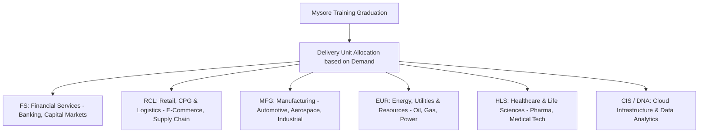

# Onboarding, Medical Checkup, Bond Notary & Mysore Logistics

**Role:** Systems Engineer (SE) | **Company:** Infosys Limited | **Hostel Hub:** GEC Mysuru

---

## 1. Pre-Employment Medical Examination (Mandatory)

Before your formal onboarding date, you must complete a Pre-Employment Medical Checkup (PEMC) and upload the certificate to the Infosys onboarding portal.

### The 6 Mandatory Diagnostic Tests
1. **HBsAg (Hepatitis B Surface Antigen):** SPOT / ELISA method.
2. **Chest X-Ray (PA View):** Verifies absence of pulmonary infections.
3. **Typhoid Test (Widal Test):** Screen for active salmonella infection.
4. **Urine Routine & Bile Pigments:** Checks for kidney function and metabolic markers.
5. **Blood Grouping & Rh Typing:** Formal verification of blood category.
6. **Stool Routine Examination:** Screens for parasites and gastrointestinal infections.

### Medical Rules & Verification
- **Hospital Network:** Infosys provides a list of authorized diagnostic centers / NIC network hospitals. If using a local government or private hospital, the doctor must be at least an **MBBS graduate** registered with the Medical Council of India (MCI/NMC).
- **Certificate Format:** The medical fitness certificate must be issued on the hospital's official letterhead, stamped with the doctor's registration number, and declare you **"Physically and mentally fit to perform corporate duties."**
- **Originals:** Carry the original test reports and certificate in your physical folder when reporting to Mysuru.

---

## 2. Service Agreement (Bond) Notarization & Surety Formalities

### Stamp Paper & Legal Execution
- **Stamp Duty Denomination:** **₹200** non-judicial stamp paper (can be a single ₹200 e-stamp paper or two ₹100 e-stamp papers).
- **Legal Green Sheets:** In certain states, printing on green legal sheets and getting them franked with ₹200 stamp duty at the sub-registrar office is accepted.
- **Content Formatting:** Agreement text must begin on the first page carrying the stamp header; blank stamp papers are rejected.
- **Page-by-Page Signatures:** Every page of the 12-month agreement must be signed at the bottom by:
  1. The **Engineer** (Candidate).
  2. The **Surety** (Guarantor).
  3. The **Company** (Signed on Day 1 at Mysore HR induction).

### The Surety (Guarantor) Criteria
- **Who Can Be a Surety?** Any earning adult citizen who files income tax returns (ITR) or possesses regular employment:
  - Parents (Father or Mother).
  - Working siblings or relatives.
  - Government or private sector employees.
- **Documents Required from the Surety:**
  - Self-attested copy of PAN Card and Aadhaar Card.
  - Proof of income: Latest Form 16 / ITR Acknowledgment or latest 3 months' salary slips.

### Notarization Rules
- The agreement must be notarized by an authorized **Notary Public** bearing their official red notary seal, serial register number, and signature.
- *Emergency Backup:* If you are unable to notarize the document in your hometown, Infosys maintains notary desks inside the Mysore campus during the first 3 days of induction (nominal fee of ~₹100–₹150).

---

## 3. Mysore Campus Logistics & Packing Protocol

The Global Education Center (GEC) in Mysuru operates like an ultra-modern university with strict enterprise discipline.

```
+---------------------------------------------------------------------------------+
|                        WHAT TO PACK & WHAT TO LEAVE BEHIND                      |
+------------------------------------+--------------------------------------------+
| Pack These (Mandatory & Essential) | DO NOT BRING (Strictly Prohibited)         |
+------------------------------------+--------------------------------------------+
| 1. Original Offer Letter (barcode) | 1. Personal Laptops / Tablets              |
| 2. All Semester Original Marksheets| 2. Pen Drives / External Hard Drives       |
| 3. Government IDs (PAN, Aadhaar)   | 3. Electric Irons, Kettles, Induction Stoves|
| 4. Formal Wear (Mon–Thu)           | 4. Cigarettes, Vapes, Alcohol, Narcotics   |
| 5. Sportswear & Shoes (Gym/Pool)   | 5. Knives or sharp contraband tools        |
| 6. Sturdy Umbrella (Mysore rains)  | 6. Non-prescribed narcotic medicines       |
+------------------------------------+--------------------------------------------+
```

### The Electronics Ban (Zero Tolerance)
- Personal laptops, external hard drives, and USB pen drives are **strictly barred** from the academic training area (GEC 1 and GEC 2 buildings).
- Infosys provides dedicated desktop workstations with multi-monitor configurations for every trainee.

### Dress Code Policy
- **Monday to Thursday (Business Formals / Smart Casuals):**
  - *Men:* Collared formal shirts, tailored trousers, and dark closed-toe formal shoes. (Ties are optional except on assessment/induction days). Slippers, flip-flops, and round-neck graphic T-shirts are barred from training classrooms.
  - *Women:* Formal salwar kameez, sarees, or formal western trousers with formal shirts/blouses.
- **Friday & Weekends:** Casual attire (jeans, polo shirts, sneakers) is permitted.

### Life in the Hostels (Employee Care Centers - ECC)
- Trainees are accommodated in modern residential suites (ECC 1 to ECC 96) in single or twin-sharing rooms.
- **Strict Gender Segregation:** Entering an ECC hostel block of the opposite gender is categorized as a Grade-A disciplinary violation, resulting in **immediate employment termination without notice**.
- **Housekeeping & Laundry:** Automated laundromats and dry-cleaning services are available on campus. Professional housekeeping cleans rooms weekly.
- **Food Courts:** 5+ world-class multi-cuisine food courts (Fiesta, Oasis, Magna, Green Park) serving North Indian, South Indian, Jain, and continental cuisines. A grocery supermarket (Loyal World) operates on campus for daily essentials.

---

## 4. Delivery Unit (DU) Ecosystem: Where Will You Work?

After graduating from Mysore, you are allocated to one of Infosys's global business verticals:



- **Financial Services (FS):** The largest unit in Infosys (~30% of revenue). Involves high-security banking software, mainframe migrations, and Spring Boot microservices for global investment banks.
- **Retail, CPG & Logistics (RCL):** High-speed e-commerce platforms, order management, and cloud retail applications.
- **Manufacturing (MFG):** Embedded IoT software, supply chain enterprise applications, and ERP integrations.
- **Cloud Infrastructure Services (CIS):** AWS/Azure/GCP management, containerization, and enterprise automation.
