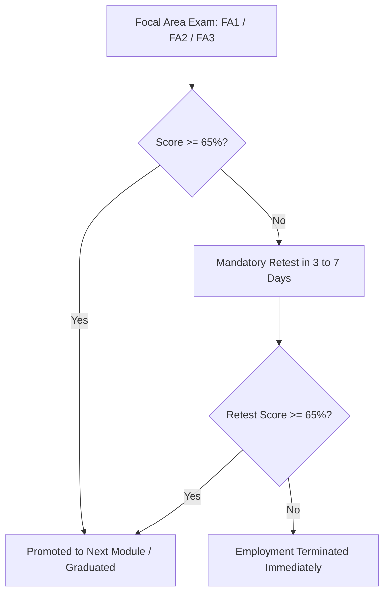

# Infosys Mysore Training & Survival Rules

**Location:** Infosys Global Education Center (GEC), Mysuru, Karnataka (350+ Acres)  
**Duration:** 14 to 18 Weeks (3.5 to 4.5 Months)  
**Role Status:** JL2 (Systems Engineer Trainee) $\rightarrow$ Promoted to JL3 (Systems Engineer) upon graduation  

---

## 1. The Two Training Phases

```
[ Phase 1: Generic Foundation Program (FP) - 5 to 6 Weeks ]
  ├── Common to ALL engineering branches (CS, IT, Mechanical, Civil, ECE, etc.)
  ├── Python / Java Programming Foundations, OOAD, and SQL (PostgreSQL/Oracle)
  ├── Software Engineering Methodologies, Git, and Agile/Scrum
  └── Assessment: Focus Area 1 (FA1) - Objective MCQs + Hands-on coding/SQL

[ Phase 2: Stream-Specific Training - 8 to 10 Weeks ]
  ├── Stream allocated based strictly on BUSINESS DEMAND (Trainees cannot choose!)
  ├── Streams: Java Full Stack, Python Data, .NET, Cloud/DevOps, Testing, Mainframe
  └── Assessments: FA2, FA3 / Comprehensive Exam & Capstone Team Project
```

---

## 2. Assessment Protocol & Strict Termination Policy



### The Passing Benchmarks
- **Aggregate Cutoff:** You must maintain a minimum **65% aggregate score** across all training assessments (some streams enforce a 60% minimum cutoff in each individual exam).
- **The Retest Rule:** If you score below 65% in an FA exam, you are granted **only ONE re-attempt (re-exam)**, scheduled within 3 to 7 days.
- **The Termination Clause:** If you fail the re-test, **your employment is terminated immediately**. You will be issued a separation letter and required to vacate the Mysore campus within 24 hours. There is no appeal, re-allocation, or stream transfer. Hundreds of candidates are terminated each cycle for taking the assessments lightly.

---

## 3. Technology Stream Allocation (Phase 2)
Stream allocation is handled by an automated algorithm matching client staffing requirements. Common streams include:
1. **Java Enterprise & Microservices:** Spring Boot, REST APIs, Hibernate, Angular/React.
2. **Python & Data Engineering:** Django/Flask, Pandas, Data pipelines, Cloud ETL.
3. **Microsoft Stack:** C#, ASP.NET Core, SQL Server, Azure Cloud fundamentals.
4. **Cloud & DevOps:** AWS/GCP architecture, Docker, Kubernetes, CI/CD automation.
5. **Mainframe Technologies:** COBOL, JCL, DB2, CICS (legacy banking systems).
6. **Enterprise ERP/CRM:** SAP ABAP/HANA, Salesforce Apex, ServiceNow.
7. **Quality Engineering / Testing:** Selenium, Cucumber, API testing, automated QA frameworks.

---

## 4. Production Allocation, The "Bench" & RMG Dynamics

Upon successfully graduating from Mysuru:
- **Base Development Center (DC) Allocation:** Candidates are deployed to their assigned office location (Bengaluru, Pune, Hyderabad, Chennai, Bhubaneswar, Chandigarh, Indore, Nagpur, or Trivandrum) based on project vacancies.
- **Relocation Benefits:** Infosys provides a settling-in allowance (~₹10,000 to ₹15,000) and up to 10–14 days of complimentary guest house/hotel accommodation.
- **The Resource Management Group (RMG) & The "Bench":**
  - If a billable project matching your stream is immediately available, you join the client delivery team.
  - If no project is immediately ready, you are placed on the **Bench** (unallocated talent pool).
  - *Salary on Bench:* You receive **100% of your fixed salary** while on bench.
  - *Daily Requirements:* You must complete 9.15 hours per day in the office, take mandatory skill certifications on **Lex**, and attend internal project interviews.
  - *Bench Risk:* Remaining unallocated for $>60-90$ days can negatively impact your annual appraisal rating. Proactively reach out to Project Managers (PMs) to secure project allocation.

---

## 5. Mysore Campus Amenities & Code of Conduct
- **World-Class Amenities:** 350-acre green campus, multiplex cinema showing weekend movies, Olympic-size swimming pool, bowling alley, gym, food courts, and campus bicycles.
- **Strict Disciplinary Rules:**
  - Mandatory biometric attendance tracking (minimum 9.15 working hours daily).
  - Formal business attire (Monday to Thursday); business casual on Friday.
  - Zero tolerance policy for alcohol, drugs, or harassment—leads to immediate police handover and termination.
  - Campus curfew hours are strictly monitored at hostel gates.

---

## Next Steps & Mysore Essentials
- Check the 6 mandatory pre-employment medical diagnostic tests $\rightarrow$ **[16_medical.md](file:///c:/Users/Rose/.gemini/antigravity-ide/brain/c94c898d-a265-48e6-96c4-82b81795f2d9/04_onboard/legal/16_medical.md)**
- Master the FA1 Python OOPs and FA2 SQL exam question codebank $\rightarrow$ **[22_fa_exam.md](file:///c:/Users/Rose/.gemini/antigravity-ide/brain/c94c898d-a265-48e6-96c4-82b81795f2d9/05_mysore/academics/22_fa_exam.md)**
- Read the day-in-the-life, appraisals (CR/EE/ME) & 10-year career ladder $\rightarrow$ **[14_career.md](file:///c:/Users/Rose/.gemini/antigravity-ide/brain/c94c898d-a265-48e6-96c4-82b81795f2d9/06_career/growth/14_career.md)**

