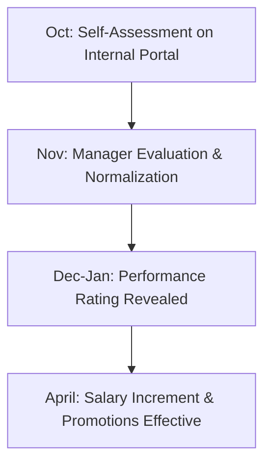

# Day-in-the-Life, Appraisals, Hybrid Policy & Long-Term Career

**Role:** Systems Engineer (SE) | **Company:** Infosys Limited | **Job Level:** JL3

---

## 1. What Does a Systems Engineer Actually Do Day-to-Day?

Many freshers assume Systems Engineers only write code from scratch. In enterprise IT services, day-to-day responsibilities depend heavily on your assigned project and Delivery Unit (DU):

```
+---------------------------------------------------------------------------------+
|                       SYSTEMS ENGINEER WORK DISTRIBUTION                        |
+-------------------+-------------------------------------------------------------+
| Work Category     | Typical Daily Tasks & Responsibilities                      |
+-------------------+-------------------------------------------------------------+
| 1. Development    | Writing backend APIs (Java Spring Boot / Python / .NET),     |
|    & Enhancement  | building UI components (React / Angular), writing SQL       |
|    (~35% of roles)| queries, bug fixing, and developing new business features.  |
+-------------------+-------------------------------------------------------------+
| 2. Production     | L2/L3 application support, monitoring live server health,   |
|    Support (AMS)  | debugging customer incidents, resolving tickets in          |
|    (~35% of roles)| ServiceNow or Jira, and performing system maintenance.      |
+-------------------+-------------------------------------------------------------+
| 3. Quality        | Manual testing, writing test automation scripts (Selenium,  |
|    Assurance (QA) | Cucumber, Postman for API testing), regression validation,  |
|    (~20% of roles)| and logging defect reports.                                 |
+-------------------+-------------------------------------------------------------+
| 4. Cloud / ERP /  | Managing AWS/Azure cloud deployments, CI/CD pipeline runs,  |
|    Infrastructure | or configuring enterprise platforms (SAP ABAP, Salesforce,  |
|    (~10% of roles)| ServiceNow modules).                                        |
+-------------------+-------------------------------------------------------------+
```

---

## 2. Daily Work Hours & Hybrid Office Policy

- **Daily Working Hours:** **9 hours 15 minutes per day** (45 hours per week).
- **Punch-In Tracking:** Enforced via biometric card swipes at entry turnstiles. Your monthly working hours are audited; falling below 9.15 hours/day can lead to HR queries or leave deductions.
- **Hybrid Work Mandate:** Infosys enforces an in-office attendance requirement:
  - Typically **10 days per month** or **3 days per week** working physically from your base Development Center (DC).
  - Certain critical banking/financial client projects may require **100% in-office working** due to client security compliance.
- **Shifts & Cabs:** If assigned to US/UK client support shifts (e.g., 2:00 PM – 11:00 PM or 6:00 PM – 3:00 AM), Infosys provides complimentary doorstep pickup and drop cab services for employee safety.

---

## 3. Annual Performance Appraisals & Rating System

Infosys conducts an annual performance review cycle covering **October to September**:



### The 4 Performance Rating Bands
- **CR (Consistently Exceeds Requirements / Outstanding):** Top 10–15% performers. Receives the highest salary hike (8–12%), maximum variable pay bonus, and fast-track promotion eligibility.
- **EE (Exceeds Expectations):** Next 25–30% performers. Receives solid salary hikes (6–9%) and standard promotion velocity.
- **ME (Meets Expectations):** Average 45–50% performers. Receives standard cost-of-living increment (3–5%).
- **BE (Below Expectations / Needs Improvement):** Bottom 5–10%. Zero increment; placed on a Performance Improvement Plan (PIP) or reassigned to the bench.

---

## 4. Complete Long-Term Career Ladder (JL2 to JL8)

```
Level      Designation                      Experience       Typical Annual Compensation
────────────────────────────────────────────────────────────────────────────────────────
JL2        Systems Engineer Trainee         Months 0–4       Stipend: ~INR 2.40 LPA
JL3        Systems Engineer (SE)            Years 1–2.5      INR 3.60 LPA
JL3B/JL4   Senior Systems Engineer (SSE)    Years 2.5–4.5    INR 5.50 – 7.50 LPA
JL4        Technology Analyst (TA)          Years 4.5–7      INR 9.00 – 12.00 LPA
JL5        Technology Lead (TL)             Years 7–10       INR 14.00 – 18.00 LPA
JL6        Tech Architect / Project Manager Years 10–14      INR 20.00 – 28.00 LPA
JL7        Senior PM / Delivery Manager     Years 14–18      INR 30.00 – 45.00 LPA
JL8+       AVP / Associate Vice President   Years 18+        INR 50.00+ LPA
```

---

## 5. Onsite Opportunities (Traveling to US, UK, Europe, Australia)

- **When Can You Travel Onsite?**
  - Freshers at JL3 (Systems Engineer) rarely travel onsite immediately.
  - Onsite deputations typically become viable at **JL4 (Technology Analyst / Senior Systems Engineer)** after **3 to 5 years of tenure**, contingent on client project requirements.
- **Visa Types Sponsored by Infosys:**
  - **H-1B / L-1 Visas:** For US client projects (subject to lottery and specialized knowledge criteria).
  - **B-1 Visas:** For short-term (2 to 8 weeks) business trips, client workshops, and requirement gathering.
  - **UK Tier 2 / European Work Permits:** For European client engagements.
- **Onsite Compensation:** Employees traveling onsite receive local country living allowances (e.g., $65,000–$85,000 in the US, or £45,000–£55,000 in the UK) in addition to their Indian base structure.

---

## 6. Resignation, Notice Period & Exit Formalities

- **Notice Period Duration:**
  - **During Probation / Mysore Training:** **30 Days**.
  - **Once Confirmed as JL3 Systems Engineer:** Strictly **90 Days (3 Months)**.
- **Notice Period Buyout:** Infosys policies generally **do not permit buyout** of the notice period. You are expected to serve the full 90 days and complete proper knowledge transfer (KT) to a replacement engineer.
- **Exit Documents Issued:** Upon completion of notice and clearance of all company assets (laptop, ID card):
  1. *Relieving Letter*
  2. *Service & Experience Certificate*
  3. *Final Settlement (F&F) Payslip* within 30–45 days.

---

## 7. Critical BGV Pitfall: Official CGPA-to-Percentage Formulas

One of the most common reasons candidates fail Background Verification (BGV) is **incorrectly calculating their percentage from their CGPA**.

> [!CAUTION]
> You **cannot** simply multiply your CGPA by 10 unless your university officially mandates that formula. Third-party BGV teams (First Advantage / HireRight) verify your declared percentage against your university's official conversion chart.

### Common Official Conversion Formulas
- **CBSE Standard:** $\text{Percentage} = \text{CGPA} \times 9.5$
- **VTU (Visvesvaraya Technological University):** $\text{Percentage} = (\text{CGPA} - 0.75) \times 10$  
  *(Example: 7.0 CGPA on VTU is $(7.0 - 0.75) \times 10 = \mathbf{62.5\%}$, NOT 70%).*
- **AKTU (Dr. A.P.J. Abdul Kalam Technical University):** $\text{Percentage} = \text{CGPA} \times 10$
- **Anna University:** $\text{Percentage} = \text{CGPA} \times 10$
- **JNTU (Jawaharlal Nehru Technological University):** $\text{Percentage} = (\text{CGPA} - 0.5) \times 10$  
  *(Example: 6.5 CGPA is $(6.5 - 0.5) \times 10 = \mathbf{60.0\%}$).*
- **Action Required:** Always obtain your college's official conversion certificate from your registrar's office before entering percentages on the Infosys application portal.
