# Mirror Imge - Solutions

**Total Questions:** 15

---

### Question 1

<strong>Looking into a mirror, the clock shows 9 : 30 as the time. The actual time is ________&nbsp;</strong>

&nbsp;

**Options:**

- **(A)** **[CORRECT]** 
2:30

- **(B)** 
3:30

- **(C)** 
4:30

- **(D)** 
5:30

**Explanation:**

Answer:&nbsp;Option&nbsp;A

&nbsp;

Explanation:

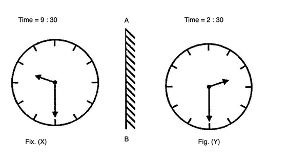

It is clear from Fig. (X) that if seen through a mirror, the time indicated by clock is 9 : 30. When the mirror is placed vertically at AB, its mirror&nbsp;<em>i.e.,&nbsp;</em>Fix. (Y) shows the actual time in the clock&nbsp;<em>i.e.,&nbsp;</em>2 : 30.

---

### Question 2

<strong>When seen through a mirror, a clock shows 8 : 30. The correct time is ________</strong>

**Options:**

- **(A)** 
2:30

- **(B)** **[CORRECT]** 
3:30

- **(C)** 
4:30

- **(D)** 
5:30

**Explanation:**

Answer:&nbsp;Option&nbsp;B

Explanation:

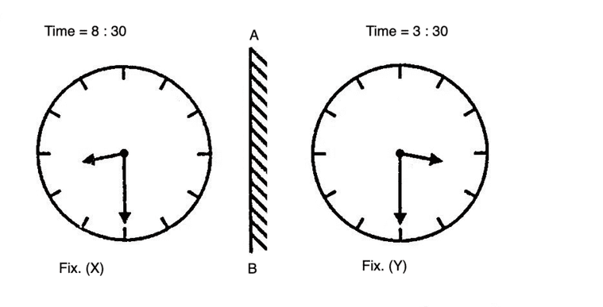

It is clear from Fig. (X) that if seen through a mirror, the time indicated by clock is 8 : 30. When the mirror is placed vertically at AB, its mirror&nbsp;<em>i.e.,&nbsp;</em>Fix. (Y) shows the actual time in the clock&nbsp;<em>i.e.,</em>&nbsp;3 : 30.

---

### Question 3

<strong>By looking in a mirror, it appears that it is 6 : 30 in the clock. What is the real time?</strong>

**Options:**

- **(A)** 
6:30

- **(B)** **[CORRECT]** 
5:30

- **(C)** 
4:30

- **(D)** 
3:30

**Explanation:**

Answer:&nbsp;Option&nbsp;B

Explanation:

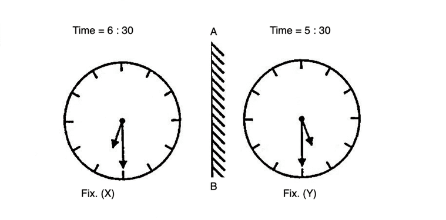

It is clear from Fig. (X) that if seen through a mirror, the time indicated by clock is 6 : 30. When the mirror is placed vertically at AB, its mirror&nbsp;<em>i.e.,&nbsp;</em>Fix. (Y) shows the actual time in the clock&nbsp;<em>i.e.,&nbsp;</em>5 : 30.

---

### Question 4

<strong>When seen through a mirror, a watch shows 12 : 15. The correct time is</strong>

**Options:**

- **(A)** 
12 : 30

- **(B)** 
1 : 15

- **(C)** 
12 : 45

- **(D)** **[CORRECT]** 
11 : 45

**Explanation:**

Answer:&nbsp;Option&nbsp;D

Explanation:

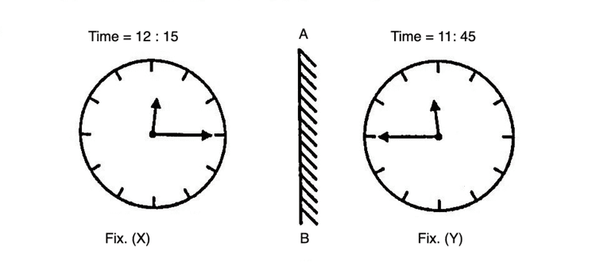

It is clear from Fig. (X) that if seen through a mirror, the time indicated by clock is 12 : 15. When the mirror is placed vertically at AB, its mirror&nbsp;<em>i.e.,&nbsp;</em>Fix. (Y) shows the actual time in the clock&nbsp;<em>i.e.,&nbsp;</em>11 : 45

---

### Question 5

&nbsp;

<table class="frenzy-tbl-container" style="border-spacing: 0px; border-collapse: collapse; color: #666666; font-family: 'Open Sans', sans-serif; font-size: 13px;" border="0" width="100%" cellspacing="0" cellpadding="0">
<tbody>
<tr>
<td class="frenzy-td-qtxt" style="padding: 0px; font-family: Verdana, Arial, Tahoma; font-size: 14px;" valign="top">

<strong>Which of the answer figure is exactly the mirror image of the given figure, when mirror is placed on the line AB?</strong>

<strong>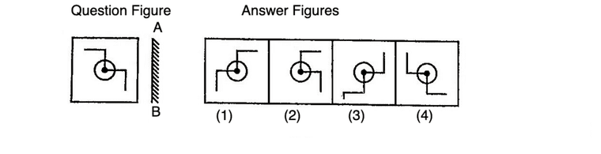</strong></td>
</tr>
</tbody>
</table>

**Options:**

- **(A)** **[CORRECT]** 
1

- **(B)** 
2

- **(C)** 
3

- **(D)** 
4

**Explanation:**

Answer:&nbsp;Option&nbsp;A

Explanation:

Here, the mirror is placed vertically at AB on the RHS of the question figure. Hence, only the figure given in answer figure (1) would be obtained as the correct mirror image.

---

### Question 6

&nbsp;

<table class="frenzy-tbl-container" style="border-spacing: 0px; border-collapse: collapse; color: #666666; font-family: 'Open Sans', sans-serif; font-size: 13px;" border="0" width="100%" cellspacing="0" cellpadding="0">
<tbody>
<tr>
<td class="frenzy-td-qtxt" style="padding: 0px; font-family: Verdana, Arial, Tahoma; font-size: 14px;" valign="top">

<strong>Which of the answer figure is exactly the mirror image of the given figure, when mirror is placed on the line AB?</strong>

<strong>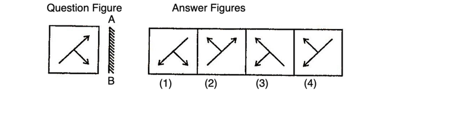</strong></td>
</tr>
</tbody>
</table>

**Options:**

- **(A)** 
1

- **(B)** 
2

- **(C)** **[CORRECT]** 
3

- **(D)** 
4

**Explanation:**

Answer:&nbsp;Option&nbsp;C

Explanation:

Here, the mirror is placed vertically at AB on the RHS of the question figure. Hence, only the figure given in answer figure (3) would be obtained as the correct mirror image.

---

### Question 7

<strong>Which of the answer figure is exactly the mirror image of the given figure, when mirror is placed on the line AB?</strong>

<strong>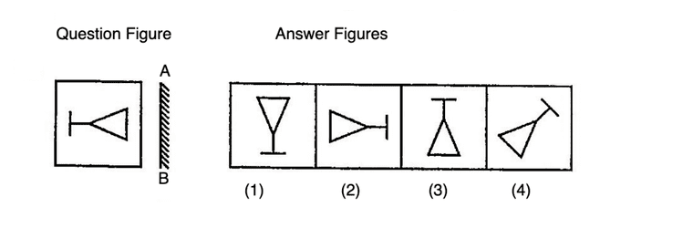</strong>

**Options:**

- **(A)** 
1

- **(B)** **[CORRECT]** 
2

- **(C)** 
3

- **(D)** 
4

**Explanation:**

Answer:&nbsp;Option&nbsp;B

Explanation:

Here, the mirror is placed vertically at AB on the RHS of the question figure. Hence, only the figure given in answer figure (2) would be obtained as the correct mirror image.

---

### Question 8

&nbsp;

<table class="frenzy-tbl-container" style="border-spacing: 0px; border-collapse: collapse; color: #666666; font-family: 'Open Sans', sans-serif; font-size: 13px;" border="0" width="100%" cellspacing="0" cellpadding="0">
<tbody>
<tr>
<td class="frenzy-td-qtxt" style="padding: 0px; font-family: Verdana, Arial, Tahoma; font-size: 14px;" valign="top">

<strong>Which of the answer figure is exactly the mirror image of the given figure, when mirror is placed on the line AB?</strong>

<strong>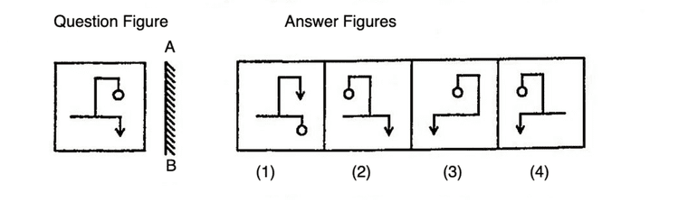</strong></td>
</tr>
</tbody>
</table>

**Options:**

- **(A)** 
1

- **(B)** 
2

- **(C)** 
3

- **(D)** **[CORRECT]** 
4

**Explanation:**

Answer:&nbsp;Option&nbsp;D

Explanation:

Here, the mirror is placed vertically at AB on the RHS of the question figure. Hence, only the figure given in answer figure (4) would be obtained as the correct mirror image.

---

### Question 9

<strong>Which of the answer figure is exactly the mirror image of the given figure, when mirror is placed on the line AB?</strong>

<strong>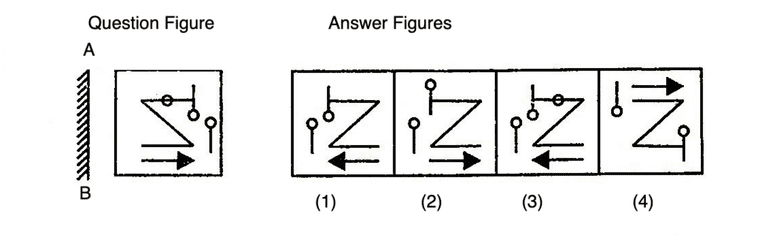</strong>

**Options:**

- **(A)** 
1

- **(B)** 
2

- **(C)** **[CORRECT]** 
3

- **(D)** 
4

**Explanation:**

Answer:&nbsp;Option&nbsp;C

Explanation:

Here, the mirror is placed vertically at AB on the LHS of the question figure. Hence, only the figure given in answer figure (3) would be obtained as the correct mirror image.

---

### Question 10

<strong>Which of the answer figures is exactly the mirror image of the given question figure when the mirror is held at XY?</strong>

&nbsp;

**Options:**

- **(A)** 
2

- **(B)** **[CORRECT]** 
4

- **(C)** 
3

- **(D)** 
1

**Explanation:**

<h5 class="text-center" style="font-family: Verdana, Geneva, Tahoma, Arial, Helvetica, sans-serif; font-weight: inherit; line-height: inherit; color: #ffcc00; margin: 0px; padding: 9px 0px 0px; font-variant-numeric: inherit; font-variant-east-asian: inherit; font-stretch: inherit; letter-spacing: 1px; font-size: 14px !important;">Answer:&nbsp;Option B</h5>

&nbsp;

Explanation

&nbsp;

&nbsp;

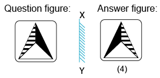

&nbsp;

In the mirror image, &bull; The right side of the object becomes the left side &bull; The left side of the object becomes the right side &bull; The top and bottom sides of the object remain unchanged

---

### Question 11

<strong>Choose the alternative which is closely resembles the mirror image of the given combination.</strong>

<strong>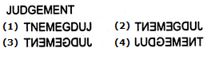</strong>

**Options:**

- **(A)** 
1

- **(B)** 
2

- **(C)** **[CORRECT]** 
3

- **(D)** 
4

**Explanation:**

Answer:&nbsp;Option&nbsp;C

Explanation:

The correct mirror image will be (3).

---

### Question 12

<strong>Choose the alternative which is closely resembles the mirror image of the given combination.</strong>

<strong>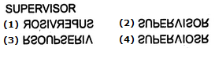</strong>

**Options:**

- **(A)** **[CORRECT]** 
1

- **(B)** 
2

- **(C)** 
3

- **(D)** 
4

**Explanation:**

Answer:&nbsp;Option&nbsp;A

Explanation:

The correct mirror image will be (1).

---

### Question 13

<strong>Choose the alternative which is closely resembles the mirror image of the given combination.</strong>

<strong>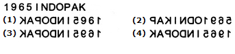</strong>

**Options:**

- **(A)** 
1

- **(B)** 
2

- **(C)** 
3

- **(D)** **[CORRECT]** 
4

**Explanation:**

Answer:&nbsp;Option&nbsp;D

Explanation:

The correct mirror image will be (4).

---

### Question 14

<strong>Choose the alternative which is closely resembles the mirror image of the given combination.</strong>

<strong>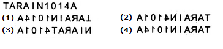</strong>

**Options:**

- **(A)** 
1

- **(B)** 
2

- **(C)** 
3

- **(D)** **[CORRECT]** 
4

**Explanation:**

Answer:&nbsp;Option&nbsp;D

Explanation:

The correct mirror image will be (4).

---

### Question 15

<strong>Choose the alternative which is closely resembles the mirror image of the given combination.</strong>

<strong>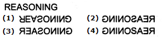</strong>

**Options:**

- **(A)** 
1

- **(B)** **[CORRECT]** 
2

- **(C)** 
3

- **(D)** 
4

**Explanation:**

Answer:&nbsp;Option&nbsp;B

Explanation:

The correct mirror image will be (2).

---

