# Water Image - Question Paper

**Total Questions:** 15

---

### Question 1

<strong>Choose the correct water image of the question figure, from the given answer figures (assume that water is along XY)</strong>

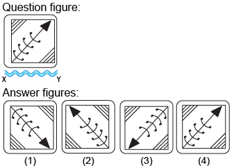

**Options:**

- **(A)** 
1

- **(B)** 
2

- **(C)** 
4

- **(D)** 
4

---

### Question 2

&nbsp;

<strong>Choose the correct water image of the question figure, from the given answer figures (assume that water is along XY)</strong>

<strong>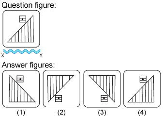</strong>

**Options:**

- **(A)** 
1

- **(B)** 
2

- **(C)** 
3

- **(D)** 
4

---

### Question 3

<strong>Choose the correct water image of the question figure, from the given answer figures (assume that water is along XY)</strong>

<strong>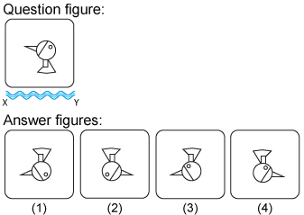</strong>

**Options:**

- **(A)** 
1

- **(B)** 
2

- **(C)** 
3

- **(D)** 
4

---

### Question 4

<strong>Choose the correct water image of the question figure, from the given answer figures (assume that water is along XY)</strong>

&nbsp;

<strong>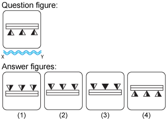</strong>

**Options:**

- **(A)** 
1

- **(B)** 
2

- **(C)** 
&nbsp;3

- **(D)** 
4

---

### Question 5

<strong>Choose the correct water image of the question figure, from the given answer figures (assume that water is along XY)</strong>

<strong>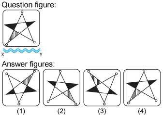</strong>

**Options:**

- **(A)** 
1

- **(B)** 
2

- **(C)** 
3

- **(D)** 
4

---

### Question 6

<strong>Choose the correct water image of the question figure, from the given answer figures (assume that water is along XY)</strong>

<strong>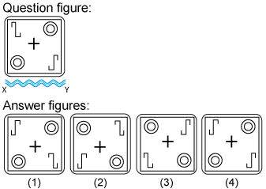</strong>

**Options:**

- **(A)** 
1

- **(B)** 
2

- **(C)** 
3

- **(D)** 
4

---

### Question 7

<strong>Choose the correct water image of the question figure, from the given answer figures (assume that water is along XY)</strong>

<strong>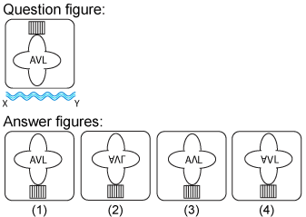</strong>

**Options:**

- **(A)** 
1

- **(B)** 
2

- **(C)** 
3

- **(D)** 
4

---

### Question 8

<strong>Choose the correct water image of the question figure, from the given answer figures (assume that water is along XY)</strong>

&nbsp;

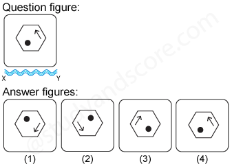

**Options:**

- **(A)** 
1

- **(B)** 
&nbsp;2

- **(C)** 
3

- **(D)** 
4

---

### Question 9

<strong>Choose the correct water image of the fig. (x) from the given four figures.</strong>

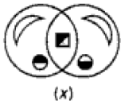

<strong>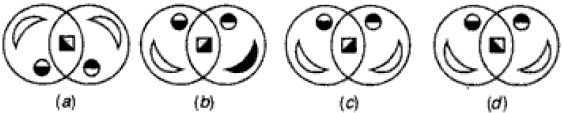</strong>

**Options:**

- **(A)** 
a

- **(B)** 
b

- **(C)** 
c

- **(D)** 
d

---

### Question 10

<strong>Choose the correct water image of the question figure, from the given answer figures (assume that water is along XY)</strong>

<strong>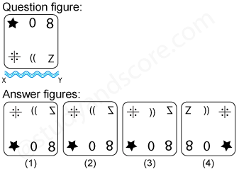</strong>

**Options:**

- **(A)** 
1

- **(B)** 
2

- **(C)** 
3

- **(D)** 
4

---

### Question 11

<strong>Choose the correct water image of the question figure, from the given answer figures (assume that water is along XY)</strong>

<strong>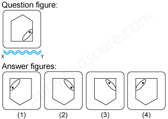</strong>

**Options:**

- **(A)** 
1

- **(B)** 
2

- **(C)** 
3

- **(D)** 
4

---

### Question 12

<strong>Choose the correct water image of the question figure, from the given answer figures (assume that water is along XY)</strong>

<strong>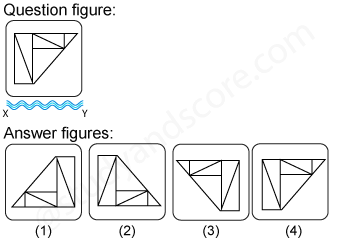</strong>

**Options:**

- **(A)** 
1

- **(B)** 
2

- **(C)** 
3

- **(D)** 
4

---

### Question 13

<strong>Choose the correct water image of the question figure, from the given answer figures (assume that water is along XY)</strong>

<strong>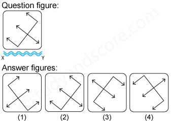</strong>

**Options:**

- **(A)** 
1

- **(B)** 
2

- **(C)** 
3

- **(D)** 
4

---

### Question 14

<strong>Choose the correct water image of the question figure, from the given answer figures (assume that water is along XY)</strong>

<strong>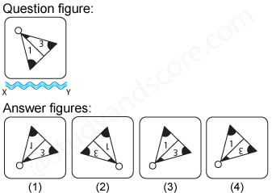</strong>

**Options:**

- **(A)** 
1

- **(B)** 
2

- **(C)** 
3

- **(D)** 
4

---

### Question 15

<strong>Choose the correct water image of the question figure, from the given answer figures (assume that water is along XY)</strong>

<strong>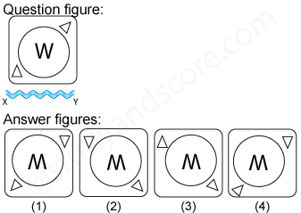</strong>

**Options:**

- **(A)** 
1

- **(B)** 
2

- **(C)** 
3

- **(D)** 
4

---

