# Water Image - Solutions

**Total Questions:** 15

---

### Question 1

<strong>Choose the correct water image of the question figure, from the given answer figures (assume that water is along XY)</strong>

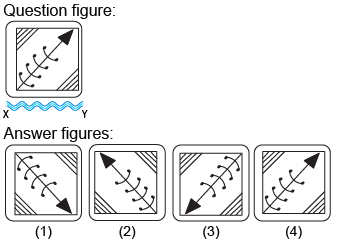

**Options:**

- **(A)** **[CORRECT]** 
1

- **(B)** 
2

- **(C)** 
4

- **(D)** 
4

**Explanation:**

Answer:&nbsp;Option A

Explanation

&nbsp;

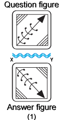

In the water image,

<ul style="box-sizing: border-box; padding: 0px; font: inherit; list-style: disc; text-align: justify; margin: 0px 0px 0px 19px !important;">
<li style="box-sizing: border-box; margin: 0px; padding: 0px; font: inherit; list-style: disc;">The top side of the object becomes the bottom</li>
<li style="box-sizing: border-box; margin: 0px; padding: 0px; font: inherit; list-style: disc;">The bottom side of the object becomes the top</li>
<li style="box-sizing: border-box; margin: 0px; padding: 0px; font: inherit; list-style: disc;">The left and right sides of the object remain unchanged</li>
</ul>

---

### Question 2

&nbsp;

<strong>Choose the correct water image of the question figure, from the given answer figures (assume that water is along XY)</strong>

<strong>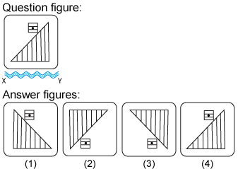</strong>

**Options:**

- **(A)** 
1

- **(B)** 
2

- **(C)** **[CORRECT]** 
3

- **(D)** 
4

**Explanation:**

<h5 class="text-center" style="font-family: Verdana, Geneva, Tahoma, Arial, Helvetica, sans-serif; font-weight: inherit; line-height: inherit; color: #ffcc00; margin: 0px; padding: 9px 0px 0px; font-variant-numeric: inherit; font-variant-east-asian: inherit; font-stretch: inherit; letter-spacing: 1px; font-size: 14px !important;">Answer:&nbsp;Option C</h5>

Explanation

&nbsp;

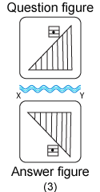

In the water image,

<ul style="padding: 0px; font-variant-numeric: inherit; font-variant-east-asian: inherit; font-stretch: inherit; line-height: inherit; font-family: Verdana, Geneva, Tahoma, Arial, Helvetica, sans-serif; list-style-position: initial; list-style-image: initial; color: #050002; letter-spacing: 1px; text-align: justify; margin: 0px 0px 0px 19px !important;">
<li style="margin: 0px; padding: 0px; font: inherit; list-style: disc;">The top side of the object becomes the bottom</li>
<li style="margin: 0px; padding: 0px; font: inherit; list-style: disc;">The bottom side of the object becomes the top</li>
<li style="margin: 0px; padding: 0px; font: inherit; list-style: disc;">The left and right sides of the object remain unchanged</li>
</ul>

---

### Question 3

<strong>Choose the correct water image of the question figure, from the given answer figures (assume that water is along XY)</strong>

<strong>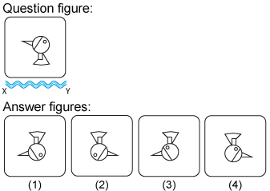</strong>

**Options:**

- **(A)** **[CORRECT]** 
1

- **(B)** 
2

- **(C)** 
3

- **(D)** 
4

**Explanation:**

<h5 class="text-center" style="font-family: Verdana, Geneva, Tahoma, Arial, Helvetica, sans-serif; font-weight: inherit; line-height: inherit; color: #ffcc00; margin: 0px; padding: 9px 0px 0px; font-variant-numeric: inherit; font-variant-east-asian: inherit; font-stretch: inherit; letter-spacing: 1px; font-size: 14px !important;">Answer:&nbsp;Option A</h5>

Explanation

&nbsp;

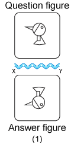

In the water image,

<ul style="padding: 0px; font-variant-numeric: inherit; font-variant-east-asian: inherit; font-stretch: inherit; line-height: inherit; font-family: Verdana, Geneva, Tahoma, Arial, Helvetica, sans-serif; list-style-position: initial; list-style-image: initial; color: #050002; letter-spacing: 1px; text-align: justify; margin: 0px 0px 0px 19px !important;">
<li style="margin: 0px; padding: 0px; font: inherit; list-style: disc;">The top side of the object becomes the bottom</li>
<li style="margin: 0px; padding: 0px; font: inherit; list-style: disc;">The bottom side of the object becomes the top</li>
<li style="margin: 0px; padding: 0px; font: inherit; list-style: disc;">The left and right sides of the object remain unchanged</li>
</ul>

---

### Question 4

<strong>Choose the correct water image of the question figure, from the given answer figures (assume that water is along XY)</strong>

&nbsp;

<strong>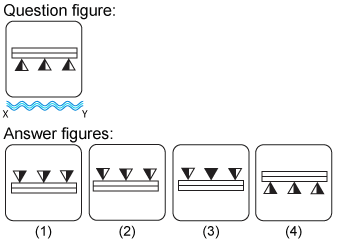</strong>

**Options:**

- **(A)** 
1

- **(B)** **[CORRECT]** 
2

- **(C)** 
&nbsp;3

- **(D)** 
4

**Explanation:**

<h5 class="text-center" style="box-sizing: border-box; font-family: inherit; font-weight: inherit; line-height: inherit; color: #ffcc00; margin: 0px; font-size: 14px !important; padding: 9px 0px 0px; font-style: inherit; font-variant: inherit; font-stretch: inherit; text-align: left !important;">Answer:&nbsp;Option B</h5>

Explanation

&nbsp;

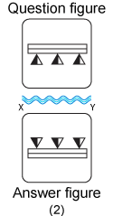

In the water image,

<ul style="box-sizing: border-box; padding: 0px; font: inherit; list-style: disc; text-align: justify; margin: 0px 0px 0px 19px !important;">
<li style="box-sizing: border-box; margin: 0px; padding: 0px; font: inherit; list-style: disc;">The top side of the object becomes the bottom</li>
<li style="box-sizing: border-box; margin: 0px; padding: 0px; font: inherit; list-style: disc;">The bottom side of the object becomes the top</li>
<li style="box-sizing: border-box; margin: 0px; padding: 0px; font: inherit; list-style: disc;">The left and right sides of the object remain unchanged</li>
</ul>

---

### Question 5

<strong>Choose the correct water image of the question figure, from the given answer figures (assume that water is along XY)</strong>

<strong>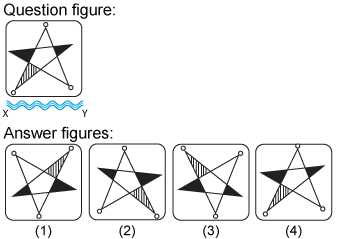</strong>

**Options:**

- **(A)** 
1

- **(B)** 
2

- **(C)** **[CORRECT]** 
3

- **(D)** 
4

**Explanation:**

<h5 class="text-center" style="font-family: Verdana, Geneva, Tahoma, Arial, Helvetica, sans-serif; font-weight: inherit; line-height: inherit; color: #ffcc00; margin: 0px; padding: 9px 0px 0px; font-variant-numeric: inherit; font-variant-east-asian: inherit; font-stretch: inherit; letter-spacing: 1px; font-size: 14px !important;">Answer:&nbsp;Option C</h5>

Explanation

&nbsp;

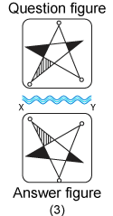

In the water image,

<ul style="padding: 0px; font-variant-numeric: inherit; font-variant-east-asian: inherit; font-stretch: inherit; line-height: inherit; font-family: Verdana, Geneva, Tahoma, Arial, Helvetica, sans-serif; list-style-position: initial; list-style-image: initial; color: #050002; letter-spacing: 1px; text-align: justify; margin: 0px 0px 0px 19px !important;">
<li style="margin: 0px; padding: 0px; font: inherit; list-style: disc;">The top side of the object becomes the bottom</li>
<li style="margin: 0px; padding: 0px; font: inherit; list-style: disc;">The bottom side of the object becomes the top</li>
<li style="margin: 0px; padding: 0px; font: inherit; list-style: disc;">The left and right sides of the object remain unchanged</li>
</ul>

---

### Question 6

<strong>Choose the correct water image of the question figure, from the given answer figures (assume that water is along XY)</strong>

<strong>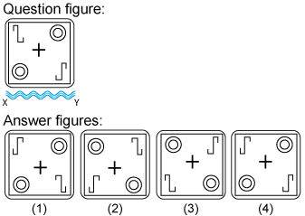</strong>

**Options:**

- **(A)** 
1

- **(B)** **[CORRECT]** 
2

- **(C)** 
3

- **(D)** 
4

**Explanation:**

<h5 class="text-center" style="box-sizing: border-box; font-family: inherit; font-weight: inherit; line-height: inherit; color: #ffcc00; margin: 0px; font-size: 14px !important; padding: 9px 0px 0px; font-style: inherit; font-variant: inherit; font-stretch: inherit; text-align: left !important;">Answer:&nbsp;Option B</h5>

Explanation

&nbsp;

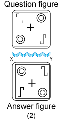

In the water image,

<ul style="box-sizing: border-box; padding: 0px; font: inherit; list-style: disc; text-align: justify; margin: 0px 0px 0px 19px !important;">
<li style="box-sizing: border-box; margin: 0px; padding: 0px; font: inherit; list-style: disc;">The top side of the object becomes the bottom</li>
<li style="box-sizing: border-box; margin: 0px; padding: 0px; font: inherit; list-style: disc;">The bottom side of the object becomes the top</li>
<li style="box-sizing: border-box; margin: 0px; padding: 0px; font: inherit; list-style: disc;">The left and right sides of the object remain unchanged</li>
</ul>

---

### Question 7

<strong>Choose the correct water image of the question figure, from the given answer figures (assume that water is along XY)</strong>

<strong>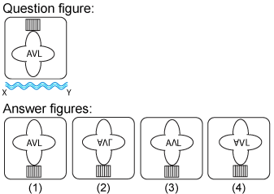</strong>

**Options:**

- **(A)** 
1

- **(B)** **[CORRECT]** 
2

- **(C)** 
3

- **(D)** 
4

**Explanation:**

<h5 class="text-center" style="font-family: Verdana, Geneva, Tahoma, Arial, Helvetica, sans-serif; font-weight: inherit; line-height: inherit; color: #ffcc00; margin: 0px; padding: 9px 0px 0px; font-variant-numeric: inherit; font-variant-east-asian: inherit; font-stretch: inherit; letter-spacing: 1px; font-size: 14px !important;">Answer:&nbsp;Option B</h5>

Explanation

&nbsp;

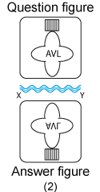

In the water image,

<ul style="padding: 0px; font-variant-numeric: inherit; font-variant-east-asian: inherit; font-stretch: inherit; line-height: inherit; font-family: Verdana, Geneva, Tahoma, Arial, Helvetica, sans-serif; list-style-position: initial; list-style-image: initial; color: #050002; letter-spacing: 1px; text-align: justify; margin: 0px 0px 0px 19px !important;">
<li style="margin: 0px; padding: 0px; font: inherit; list-style: disc;">The top side of the object becomes the bottom</li>
<li style="margin: 0px; padding: 0px; font: inherit; list-style: disc;">The bottom side of the object becomes the top</li>
<li style="margin: 0px; padding: 0px; font: inherit; list-style: disc;">The left and right sides of the object remain unchanged</li>
</ul>

---

### Question 8

<strong>Choose the correct water image of the question figure, from the given answer figures (assume that water is along XY)</strong>

&nbsp;

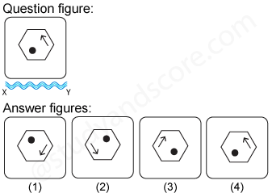

**Options:**

- **(A)** **[CORRECT]** 
1

- **(B)** 
&nbsp;2

- **(C)** 
3

- **(D)** 
4

**Explanation:**

<h5 class="text-center" style="font-family: Verdana, Geneva, Tahoma, Arial, Helvetica, sans-serif; font-weight: inherit; line-height: inherit; color: #ffcc00; margin: 0px; padding: 9px 0px 0px; font-variant-numeric: inherit; font-variant-east-asian: inherit; font-stretch: inherit; letter-spacing: 1px; font-size: 14px !important;">Answer:&nbsp;Option A</h5>

&nbsp;

Explanation

&nbsp;

&nbsp;

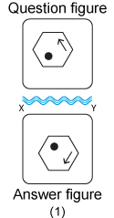

&nbsp;

In the water image,

<ul style="padding: 0px; font-variant-numeric: inherit; font-variant-east-asian: inherit; font-stretch: inherit; line-height: inherit; font-family: Verdana, Geneva, Tahoma, Arial, Helvetica, sans-serif; list-style-position: initial; list-style-image: initial; color: #050002; letter-spacing: 1px; text-align: justify; margin: 0px 0px 0px 19px !important;">
<li style="margin: 0px; padding: 0px; font: inherit; list-style: disc;">The top side of the object becomes the bottom</li>
<li style="margin: 0px; padding: 0px; font: inherit; list-style: disc;">The bottom side of the object becomes the top</li>
<li style="margin: 0px; padding: 0px; font: inherit; list-style: disc;">The left and right sides of the object remain unchanged</li>
</ul>

---

### Question 9

<strong>Choose the correct water image of the fig. (x) from the given four figures.</strong>

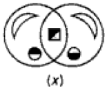

<strong>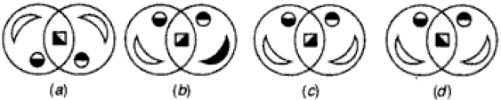</strong>

**Options:**

- **(A)** 
a

- **(B)** 
b

- **(C)** 
c

- **(D)** **[CORRECT]** 
d

**Explanation:**

<h5 class="text-center" style="font-family: Verdana, Geneva, Tahoma, Arial, Helvetica, sans-serif; font-weight: inherit; line-height: inherit; color: #ffcc00; margin: 0px; padding: 9px 0px 0px; font-variant-numeric: inherit; font-variant-east-asian: inherit; font-stretch: inherit; letter-spacing: 1px; font-size: 14px !important;">Answer - D</h5>

---

### Question 10

<strong>Choose the correct water image of the question figure, from the given answer figures (assume that water is along XY)</strong>

<strong>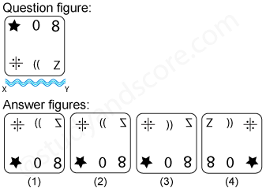</strong>

**Options:**

- **(A)** 
1

- **(B)** **[CORRECT]** 
2

- **(C)** 
3

- **(D)** 
4

**Explanation:**

<h5 class="text-center" style="font-family: Verdana, Geneva, Tahoma, Arial, Helvetica, sans-serif; font-weight: inherit; line-height: inherit; color: #ffcc00; margin: 0px; padding: 9px 0px 0px; font-variant-numeric: inherit; font-variant-east-asian: inherit; font-stretch: inherit; letter-spacing: 1px; font-size: 14px !important;">Answer:&nbsp;Option B</h5>

Explanation

&nbsp;

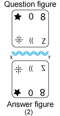

In the water image,

<ul style="padding: 0px; font-variant-numeric: inherit; font-variant-east-asian: inherit; font-stretch: inherit; line-height: inherit; font-family: Verdana, Geneva, Tahoma, Arial, Helvetica, sans-serif; list-style-position: initial; list-style-image: initial; color: #050002; letter-spacing: 1px; text-align: justify; margin: 0px 0px 0px 19px !important;">
<li style="margin: 0px; padding: 0px; font: inherit; list-style: disc;">The top side of the object becomes the bottom</li>
<li style="margin: 0px; padding: 0px; font: inherit; list-style: disc;">The bottom side of the object becomes the top</li>
<li style="margin: 0px; padding: 0px; font: inherit; list-style: disc;">The left and right sides of the object remain unchanged</li>
</ul>

---

### Question 11

<strong>Choose the correct water image of the question figure, from the given answer figures (assume that water is along XY)</strong>

<strong>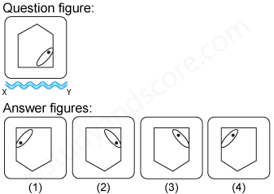</strong>

**Options:**

- **(A)** 
1

- **(B)** **[CORRECT]** 
2

- **(C)** 
3

- **(D)** 
4

**Explanation:**

<h5 class="text-center" style="font-family: Verdana, Geneva, Tahoma, Arial, Helvetica, sans-serif; font-weight: inherit; line-height: inherit; color: #ffcc00; margin: 0px; padding: 9px 0px 0px; font-variant-numeric: inherit; font-variant-east-asian: inherit; font-stretch: inherit; letter-spacing: 1px; font-size: 14px !important;">Answer:&nbsp;Option B</h5>

Explanation

&nbsp;

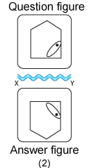

In the water image,

<ul style="padding: 0px; font-variant-numeric: inherit; font-variant-east-asian: inherit; font-stretch: inherit; line-height: inherit; font-family: Verdana, Geneva, Tahoma, Arial, Helvetica, sans-serif; list-style-position: initial; list-style-image: initial; color: #050002; letter-spacing: 1px; text-align: justify; margin: 0px 0px 0px 19px !important;">
<li style="margin: 0px; padding: 0px; font: inherit; list-style: disc;">The top side of the object becomes the bottom</li>
<li style="margin: 0px; padding: 0px; font: inherit; list-style: disc;">The bottom side of the object becomes the top</li>
<li style="margin: 0px; padding: 0px; font: inherit; list-style: disc;">The left and right sides of the object remain unchanged</li>
</ul>

---

### Question 12

<strong>Choose the correct water image of the question figure, from the given answer figures (assume that water is along XY)</strong>

<strong>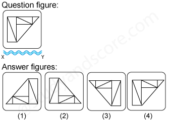</strong>

**Options:**

- **(A)** 
1

- **(B)** **[CORRECT]** 
2

- **(C)** 
3

- **(D)** 
4

**Explanation:**

<h5 class="text-center" style="font-family: Verdana, Geneva, Tahoma, Arial, Helvetica, sans-serif; font-weight: inherit; line-height: inherit; color: #ffcc00; margin: 0px; padding: 9px 0px 0px; font-variant-numeric: inherit; font-variant-east-asian: inherit; font-stretch: inherit; letter-spacing: 1px; font-size: 14px !important;">Answer:&nbsp;Option B</h5>

Explanation

&nbsp;

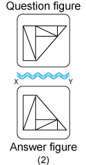

In the water image,

<ul style="padding: 0px; font-variant-numeric: inherit; font-variant-east-asian: inherit; font-stretch: inherit; line-height: inherit; font-family: Verdana, Geneva, Tahoma, Arial, Helvetica, sans-serif; list-style-position: initial; list-style-image: initial; color: #050002; letter-spacing: 1px; text-align: justify; margin: 0px 0px 0px 19px !important;">
<li style="margin: 0px; padding: 0px; font: inherit; list-style: disc;">The top side of the object becomes the bottom</li>
<li style="margin: 0px; padding: 0px; font: inherit; list-style: disc;">The bottom side of the object becomes the top</li>
<li style="margin: 0px; padding: 0px; font: inherit; list-style: disc;">The left and right sides of the object remain unchanged</li>
</ul>

---

### Question 13

<strong>Choose the correct water image of the question figure, from the given answer figures (assume that water is along XY)</strong>

<strong>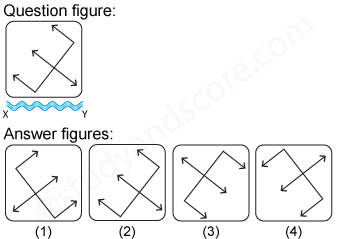</strong>

**Options:**

- **(A)** 
1

- **(B)** 
2

- **(C)** 
3

- **(D)** **[CORRECT]** 
4

**Explanation:**

<h5 class="text-center" style="font-family: Verdana, Geneva, Tahoma, Arial, Helvetica, sans-serif; font-weight: inherit; line-height: inherit; color: #ffcc00; margin: 0px; padding: 9px 0px 0px; font-variant-numeric: inherit; font-variant-east-asian: inherit; font-stretch: inherit; letter-spacing: 1px; font-size: 14px !important;">Answer:&nbsp;Option D</h5>

Explanation

&nbsp;

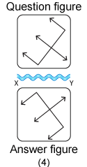

In the water image,

<ul style="padding: 0px; font-variant-numeric: inherit; font-variant-east-asian: inherit; font-stretch: inherit; line-height: inherit; font-family: Verdana, Geneva, Tahoma, Arial, Helvetica, sans-serif; list-style-position: initial; list-style-image: initial; color: #050002; letter-spacing: 1px; text-align: justify; margin: 0px 0px 0px 19px !important;">
<li style="margin: 0px; padding: 0px; font: inherit; list-style: disc;">The top side of the object becomes the bottom</li>
<li style="margin: 0px; padding: 0px; font: inherit; list-style: disc;">The bottom side of the object becomes the top</li>
<li style="margin: 0px; padding: 0px; font: inherit; list-style: disc;">The left and right sides of the object remain unchanged</li>
</ul>

---

### Question 14

<strong>Choose the correct water image of the question figure, from the given answer figures (assume that water is along XY)</strong>

<strong>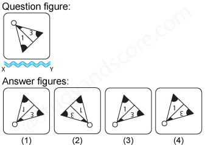</strong>

**Options:**

- **(A)** **[CORRECT]** 
1

- **(B)** 
2

- **(C)** 
3

- **(D)** 
4

**Explanation:**

<h5 class="text-center" style="font-family: Verdana, Geneva, Tahoma, Arial, Helvetica, sans-serif; font-weight: inherit; line-height: inherit; color: #ffcc00; margin: 0px; padding: 9px 0px 0px; font-variant-numeric: inherit; font-variant-east-asian: inherit; font-stretch: inherit; letter-spacing: 1px; font-size: 14px !important;">Answer:&nbsp;Option A</h5>

Explanation

&nbsp;

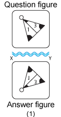

In the water image,

<ul style="padding: 0px; font-variant-numeric: inherit; font-variant-east-asian: inherit; font-stretch: inherit; line-height: inherit; font-family: Verdana, Geneva, Tahoma, Arial, Helvetica, sans-serif; list-style-position: initial; list-style-image: initial; color: #050002; letter-spacing: 1px; text-align: justify; margin: 0px 0px 0px 19px !important;">
<li style="margin: 0px; padding: 0px; font: inherit; list-style: disc;">The top side of the object becomes the bottom</li>
<li style="margin: 0px; padding: 0px; font: inherit; list-style: disc;">The bottom side of the object becomes the top</li>
<li style="margin: 0px; padding: 0px; font: inherit; list-style: disc;">The left and right sides of the object remain unchanged</li>
</ul>

---

### Question 15

<strong>Choose the correct water image of the question figure, from the given answer figures (assume that water is along XY)</strong>

<strong>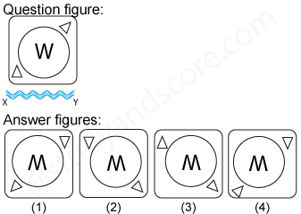</strong>

**Options:**

- **(A)** 
1

- **(B)** **[CORRECT]** 
2

- **(C)** 
3

- **(D)** 
4

**Explanation:**

<h5 class="text-center" style="font-family: Verdana, Geneva, Tahoma, Arial, Helvetica, sans-serif; font-weight: inherit; line-height: inherit; color: #ffcc00; margin: 0px; padding: 9px 0px 0px; font-variant-numeric: inherit; font-variant-east-asian: inherit; font-stretch: inherit; letter-spacing: 1px; font-size: 14px !important;">Answer:&nbsp;Option B</h5>

Explanation

&nbsp;

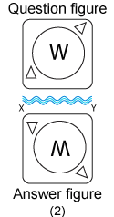

In the water image,

<ul style="padding: 0px; font-variant-numeric: inherit; font-variant-east-asian: inherit; font-stretch: inherit; line-height: inherit; font-family: Verdana, Geneva, Tahoma, Arial, Helvetica, sans-serif; list-style-position: initial; list-style-image: initial; color: #050002; letter-spacing: 1px; text-align: justify; margin: 0px 0px 0px 19px !important;">
<li style="margin: 0px; padding: 0px; font: inherit; list-style: disc;">The top side of the object becomes the bottom</li>
<li style="margin: 0px; padding: 0px; font: inherit; list-style: disc;">The bottom side of the object becomes the top</li>
<li style="margin: 0px; padding: 0px; font: inherit; list-style: disc;">The left and right sides of the object remain unchanged</li>
</ul>

---

