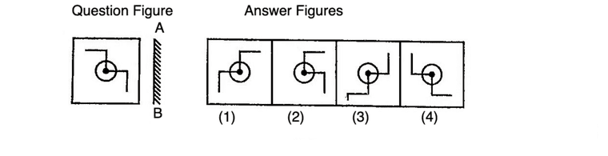
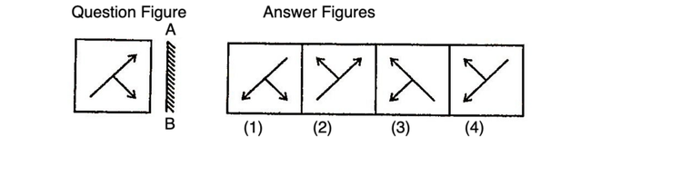
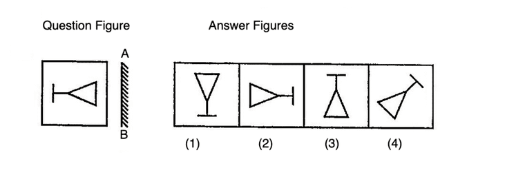
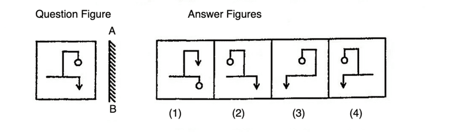
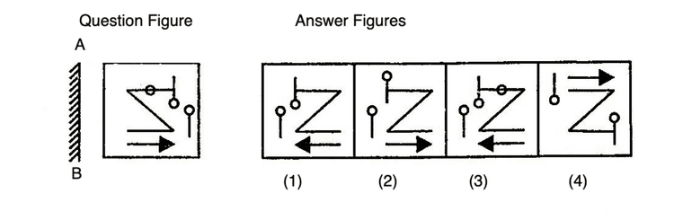
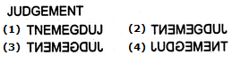
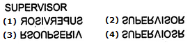
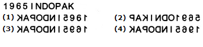
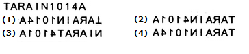
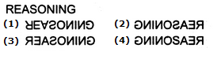

# Mirror Imge - Question Paper

**Total Questions:** 15

---

### Question 1

Looking into a mirror, the clock shows 9 : 30 as the time. The actual time is ________

**Native Clock Mirror Schematic:**
```
       Clock Image in Mirror (9:30)        Actual Clock Face (2:30)
                 12                                  12
             11  ▲   1                           11  ▲   1
           10    │    2                        10    │    2
          9 ◄────┼───── 3                    9 ──────┼────► 3
           8     │    4                        8     │    4
             7   ▼   5                           7   ▼   5
                 6                                   6
                   ║ Mirror Plane: Reflection across Vertical Axis ║
                   Formula: Actual Time = 11:60 - Mirror Time
                           = 11:60 - 9:30 = 2:30.
``` 

**Options:**

- **(A)** 2:30
- **(B)** 3:30
- **(C)** 4:30
- **(D)** 5:30

---

### Question 2

When seen through a mirror, a clock shows 8 : 30. The correct time is ________

**Options:**

- **(A)** 2:30
- **(B)** 3:30
- **(C)** 4:30
- **(D)** 5:30

---

### Question 3

By looking in a mirror, it appears that it is 6 : 30 in the clock. What is the real time?

**Options:**

- **(A)** 6:30
- **(B)** 5:30
- **(C)** 4:30
- **(D)** 3:30

---

### Question 4

When seen through a mirror, a watch shows 12 : 15. The correct time is

**Options:**

- **(A)** 12 : 30
- **(B)** 1 : 15
- **(C)** 12 : 45
- **(D)** 11 : 45

---

### Question 5

Which of the answer figure is exactly the mirror image of the given figure, when mirror is placed on the line AB?


**Options:**

- **(A)** 1
- **(B)** 2
- **(C)** 3
- **(D)** 4

---

### Question 6

Which of the answer figure is exactly the mirror image of the given figure, when mirror is placed on the line AB?


**Options:**

- **(A)** 1
- **(B)** 2
- **(C)** 3
- **(D)** 4

---

### Question 7

Which of the answer figure is exactly the mirror image of the given figure, when mirror is placed on the line AB?


**Options:**

- **(A)** 1
- **(B)** 2
- **(C)** 3
- **(D)** 4

---

### Question 8

Which of the answer figure is exactly the mirror image of the given figure, when mirror is placed on the line AB?


**Options:**

- **(A)** 1
- **(B)** 2
- **(C)** 3
- **(D)** 4

---

### Question 9

Which of the answer figure is exactly the mirror image of the given figure, when mirror is placed on the line AB?


**Options:**

- **(A)** 1
- **(B)** 2
- **(C)** 3
- **(D)** 4

---

### Question 10

Which of the answer figures is exactly the mirror image of the given question figure when the mirror is held at XY?
 


**Options:**

- **(A)** 2
- **(B)** 4
- **(C)** 3
- **(D)** 1

---

### Question 11

Choose the alternative which is closely resembles the mirror image of the given combination.


**Options:**

- **(A)** 1
- **(B)** 2
- **(C)** 3
- **(D)** 4

---

### Question 12

Choose the alternative which is closely resembles the mirror image of the given combination.


**Options:**

- **(A)** 1
- **(B)** 2
- **(C)** 3
- **(D)** 4

---

### Question 13

Choose the alternative which is closely resembles the mirror image of the given combination.


**Options:**

- **(A)** 1
- **(B)** 2
- **(C)** 3
- **(D)** 4

---

### Question 14

Choose the alternative which is closely resembles the mirror image of the given combination.


**Options:**

- **(A)** 1
- **(B)** 2
- **(C)** 3
- **(D)** 4

---

### Question 15

Choose the alternative which is closely resembles the mirror image of the given combination.


**Options:**

- **(A)** 1
- **(B)** 2
- **(C)** 3
- **(D)** 4

---

