# Water Image - Question Paper

**Total Questions:** 15

---

### Question 1

Choose the correct water image of the question figure, from the given answer figures (assume that water is along XY)
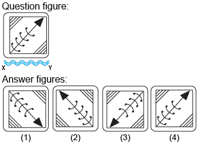

**Options:**

- **(A)** 1
- **(B)** 2
- **(C)** 4
- **(D)** 4

---

### Question 2

Choose the correct water image of the question figure, from the given answer figures (assume that water is along XY)
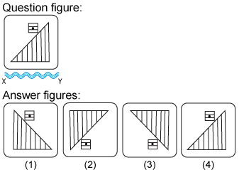

**Options:**

- **(A)** 1
- **(B)** 2
- **(C)** 3
- **(D)** 4

---

### Question 3

Choose the correct water image of the question figure, from the given answer figures (assume that water is along XY)
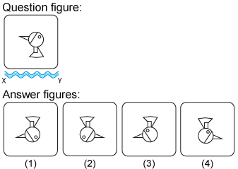

**Options:**

- **(A)** 1
- **(B)** 2
- **(C)** 3
- **(D)** 4

---

### Question 4

Choose the correct water image of the question figure, from the given answer figures (assume that water is along XY)
 
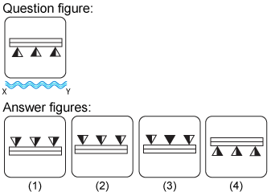

**Options:**

- **(A)** 1
- **(B)** 2
- **(C)**  3
- **(D)** 4

---

### Question 5

Choose the correct water image of the question figure, from the given answer figures (assume that water is along XY)
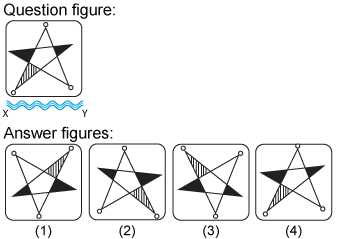

**Options:**

- **(A)** 1
- **(B)** 2
- **(C)** 3
- **(D)** 4

---

### Question 6

Choose the correct water image of the question figure, from the given answer figures (assume that water is along XY)
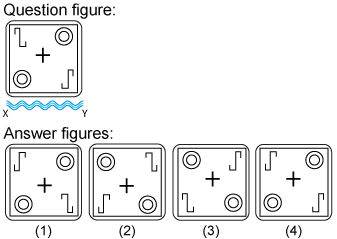

**Options:**

- **(A)** 1
- **(B)** 2
- **(C)** 3
- **(D)** 4

---

### Question 7

Choose the correct water image of the question figure, from the given answer figures (assume that water is along XY)
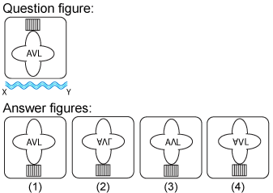

**Options:**

- **(A)** 1
- **(B)** 2
- **(C)** 3
- **(D)** 4

---

### Question 8

Choose the correct water image of the question figure, from the given answer figures (assume that water is along XY)
 
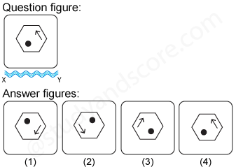

**Options:**

- **(A)** 1
- **(B)**  2
- **(C)** 3
- **(D)** 4

---

### Question 9

Choose the correct water image of the fig. (x) from the given four figures.
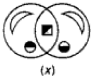
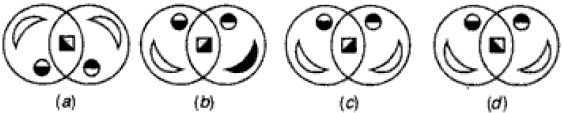

**Options:**

- **(A)** a
- **(B)** b
- **(C)** c
- **(D)** d

---

### Question 10

Choose the correct water image of the question figure, from the given answer figures (assume that water is along XY)
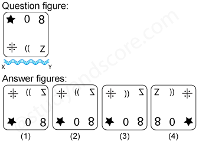

**Options:**

- **(A)** 1
- **(B)** 2
- **(C)** 3
- **(D)** 4

---

### Question 11

Choose the correct water image of the question figure, from the given answer figures (assume that water is along XY)
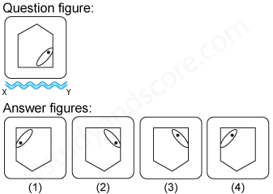

**Options:**

- **(A)** 1
- **(B)** 2
- **(C)** 3
- **(D)** 4

---

### Question 12

Choose the correct water image of the question figure, from the given answer figures (assume that water is along XY)
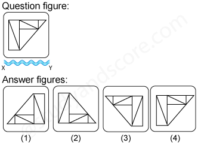

**Options:**

- **(A)** 1
- **(B)** 2
- **(C)** 3
- **(D)** 4

---

### Question 13

Choose the correct water image of the question figure, from the given answer figures (assume that water is along XY)
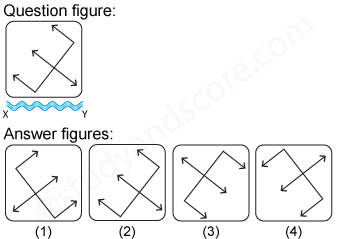

**Options:**

- **(A)** 1
- **(B)** 2
- **(C)** 3
- **(D)** 4

---

### Question 14

Choose the correct water image of the question figure, from the given answer figures (assume that water is along XY)
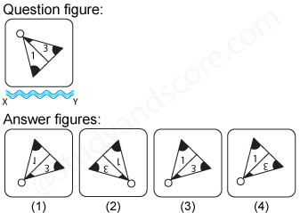

**Options:**

- **(A)** 1
- **(B)** 2
- **(C)** 3
- **(D)** 4

---

### Question 15

Choose the correct water image of the question figure, from the given answer figures (assume that water is along XY)
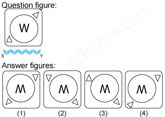

**Options:**

- **(A)** 1
- **(B)** 2
- **(C)** 3
- **(D)** 4

---

