# Water Image - Solutions

**Total Questions:** 15

---

### Question 1

Choose the correct water image of the question figure, from the given answer figures (assume that water is along XY)
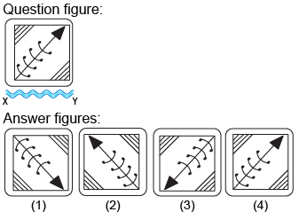

**Options:**

- **(A)** **[CORRECT]** 1
- **(B)** 2
- **(C)** 4
- **(D)** 4

**Explanation:**

Answer: Option A

Explanation
 
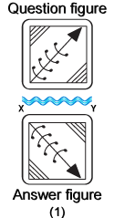
In the water image,

The top side of the object becomes the bottom
The bottom side of the object becomes the top
The left and right sides of the object remain unchanged

---

### Question 2

Choose the correct water image of the question figure, from the given answer figures (assume that water is along XY)
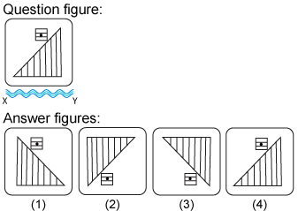

**Options:**

- **(A)** 1
- **(B)** 2
- **(C)** **[CORRECT]** 3
- **(D)** 4

**Explanation:**

Answer: Option C
Explanation
 
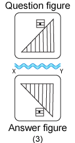
In the water image,

The top side of the object becomes the bottom
The bottom side of the object becomes the top
The left and right sides of the object remain unchanged

---

### Question 3

Choose the correct water image of the question figure, from the given answer figures (assume that water is along XY)
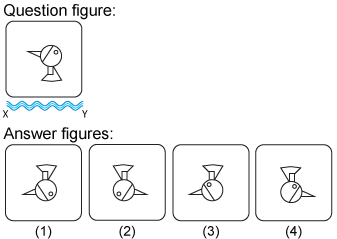

**Options:**

- **(A)** **[CORRECT]** 1
- **(B)** 2
- **(C)** 3
- **(D)** 4

**Explanation:**

Answer: Option A
Explanation
 
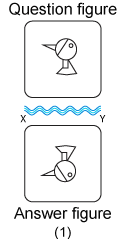
In the water image,

The top side of the object becomes the bottom
The bottom side of the object becomes the top
The left and right sides of the object remain unchanged

---

### Question 4

Choose the correct water image of the question figure, from the given answer figures (assume that water is along XY)
 
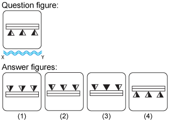

**Options:**

- **(A)** 1
- **(B)** **[CORRECT]** 2
- **(C)**  3
- **(D)** 4

**Explanation:**

Answer: Option B
Explanation
 
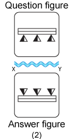
In the water image,

The top side of the object becomes the bottom
The bottom side of the object becomes the top
The left and right sides of the object remain unchanged

---

### Question 5

Choose the correct water image of the question figure, from the given answer figures (assume that water is along XY)
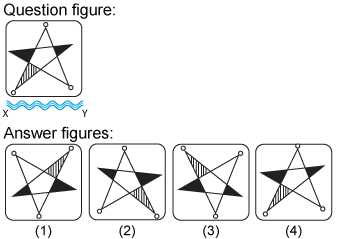

**Options:**

- **(A)** 1
- **(B)** 2
- **(C)** **[CORRECT]** 3
- **(D)** 4

**Explanation:**

Answer: Option C
Explanation
 
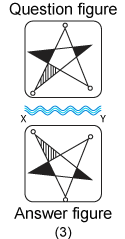
In the water image,

The top side of the object becomes the bottom
The bottom side of the object becomes the top
The left and right sides of the object remain unchanged

---

### Question 6

Choose the correct water image of the question figure, from the given answer figures (assume that water is along XY)
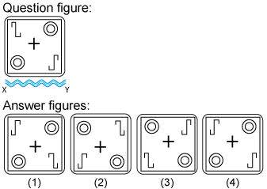

**Options:**

- **(A)** 1
- **(B)** **[CORRECT]** 2
- **(C)** 3
- **(D)** 4

**Explanation:**

Answer: Option B
Explanation
 
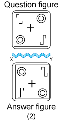
In the water image,

The top side of the object becomes the bottom
The bottom side of the object becomes the top
The left and right sides of the object remain unchanged

---

### Question 7

Choose the correct water image of the question figure, from the given answer figures (assume that water is along XY)
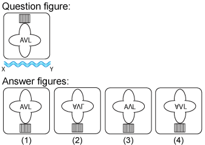

**Options:**

- **(A)** 1
- **(B)** **[CORRECT]** 2
- **(C)** 3
- **(D)** 4

**Explanation:**

Answer: Option B
Explanation
 
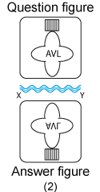
In the water image,

The top side of the object becomes the bottom
The bottom side of the object becomes the top
The left and right sides of the object remain unchanged

---

### Question 8

Choose the correct water image of the question figure, from the given answer figures (assume that water is along XY)
 
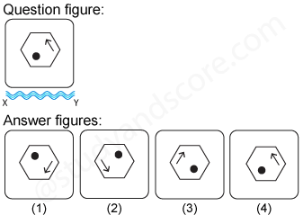

**Options:**

- **(A)** **[CORRECT]** 1
- **(B)**  2
- **(C)** 3
- **(D)** 4

**Explanation:**

Answer: Option A
 
Explanation

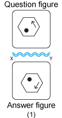
 
In the water image,

The top side of the object becomes the bottom
The bottom side of the object becomes the top
The left and right sides of the object remain unchanged

---

### Question 9

Choose the correct water image of the fig. (x) from the given four figures.
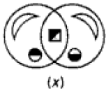
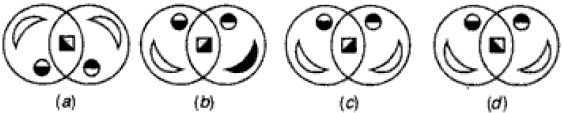

**Options:**

- **(A)** a
- **(B)** b
- **(C)** c
- **(D)** **[CORRECT]** d

**Explanation:**

Answer - D

---

### Question 10

Choose the correct water image of the question figure, from the given answer figures (assume that water is along XY)
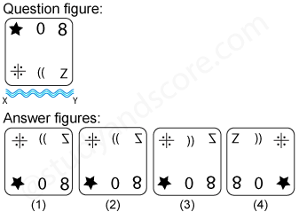

**Options:**

- **(A)** 1
- **(B)** **[CORRECT]** 2
- **(C)** 3
- **(D)** 4

**Explanation:**

Answer: Option B
Explanation
 
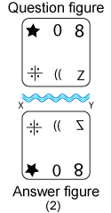
In the water image,

The top side of the object becomes the bottom
The bottom side of the object becomes the top
The left and right sides of the object remain unchanged

---

### Question 11

Choose the correct water image of the question figure, from the given answer figures (assume that water is along XY)
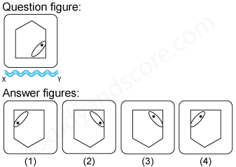

**Options:**

- **(A)** 1
- **(B)** **[CORRECT]** 2
- **(C)** 3
- **(D)** 4

**Explanation:**

Answer: Option B
Explanation
 
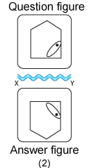
In the water image,

The top side of the object becomes the bottom
The bottom side of the object becomes the top
The left and right sides of the object remain unchanged

---

### Question 12

Choose the correct water image of the question figure, from the given answer figures (assume that water is along XY)
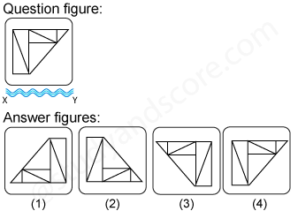

**Options:**

- **(A)** 1
- **(B)** **[CORRECT]** 2
- **(C)** 3
- **(D)** 4

**Explanation:**

Answer: Option B
Explanation
 
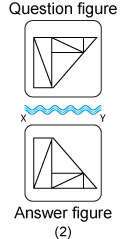
In the water image,

The top side of the object becomes the bottom
The bottom side of the object becomes the top
The left and right sides of the object remain unchanged

---

### Question 13

Choose the correct water image of the question figure, from the given answer figures (assume that water is along XY)
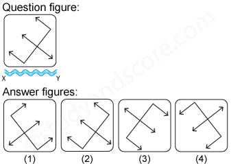

**Options:**

- **(A)** 1
- **(B)** 2
- **(C)** 3
- **(D)** **[CORRECT]** 4

**Explanation:**

Answer: Option D
Explanation
 
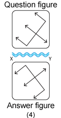
In the water image,

The top side of the object becomes the bottom
The bottom side of the object becomes the top
The left and right sides of the object remain unchanged

---

### Question 14

Choose the correct water image of the question figure, from the given answer figures (assume that water is along XY)
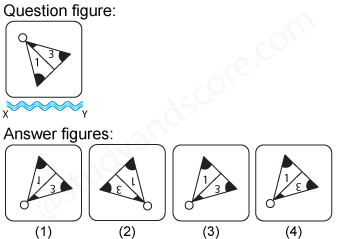

**Options:**

- **(A)** **[CORRECT]** 1
- **(B)** 2
- **(C)** 3
- **(D)** 4

**Explanation:**

Answer: Option A
Explanation
 
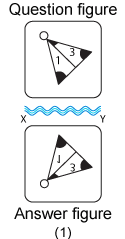
In the water image,

The top side of the object becomes the bottom
The bottom side of the object becomes the top
The left and right sides of the object remain unchanged

---

### Question 15

Choose the correct water image of the question figure, from the given answer figures (assume that water is along XY)
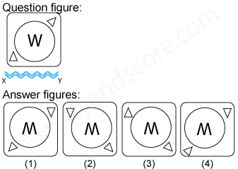

**Options:**

- **(A)** 1
- **(B)** **[CORRECT]** 2
- **(C)** 3
- **(D)** 4

**Explanation:**

Answer: Option B
Explanation
 
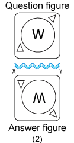
In the water image,

The top side of the object becomes the bottom
The bottom side of the object becomes the top
The left and right sides of the object remain unchanged

---

