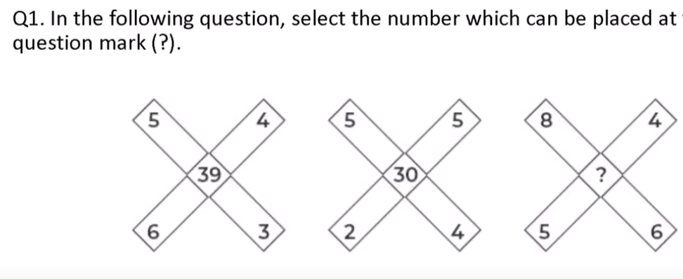
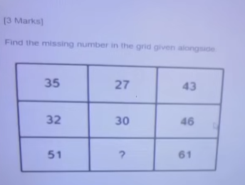
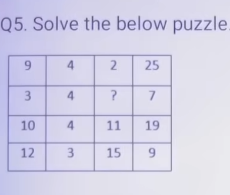
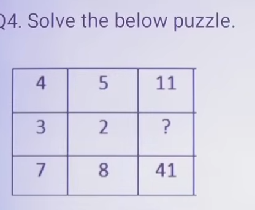
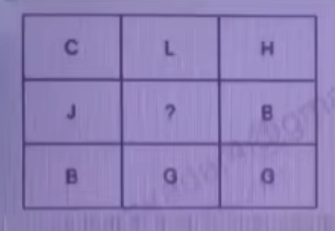
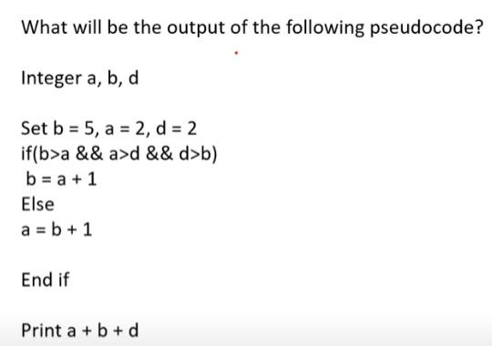
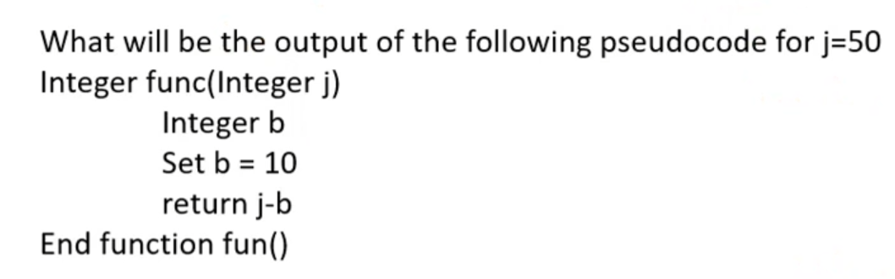
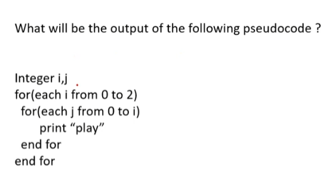
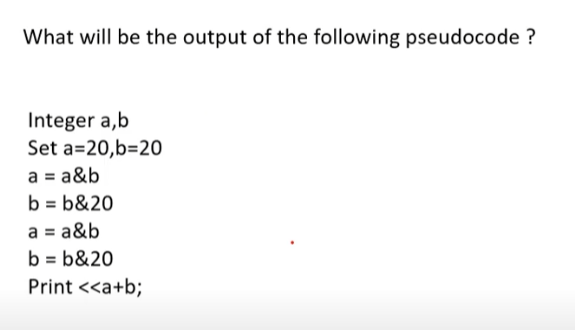

# Infosys Test Series 1 (Full Assessment)
**Course:** OnlineStudy4U Live Mock Test Series | **Mock Test ID:** `INFOSYS TEST SERIES-1`
**Total Questions:** 35 | **Total Sections:** 4 | **Duration:** 0 Minutes | **Total Marks:** 140

---

## Examination Instructions & Blueprint
1. **Marking Scheme:** Standard Infosys Examination Marking Scheme applies (+1 mark for correct, -0.25 negative marking on selected sections, or differential 2/3 marks on puzzle matrices).
2. **Sectional Switching:** Strictly timed sections as per online test interface.
3. **Complete Solutions:** Step-by-step mathematical proofs, pseudocode dry-runs, and grammatical rationales follow every question.

---

## Section: Puzzles
**Section Duration:** 0 Minutes | **Section Questions:** 5 | **Section Marks:** 20

### Question 1
**Question ID:** `68de264958e478256ed8a576` | **Section:** Puzzles | **Marks:** +{'positive': 0, 'negative': 0} | **Difficulty:** None

**Options:**

- **(A)** 76
- **(B)** 45
- **(C)** 67
- **(D) [CORRECT]** 68

#### Detailed Solution & Verification Proof:

**Correct Option:** (D)

Logic: 5 x 3 + 6 x 4 = 39

---

### Question 2
**Question ID:** `68de264958e478b816d8a580` | **Section:** Puzzles | **Marks:** +{'positive': 0, 'negative': 0} | **Difficulty:** None

**Options:**

- **(A) [CORRECT]** 11
- **(B)** 33
- **(C)** 22
- **(D)** 32

#### Detailed Solution & Verification Proof:

**Correct Option:** (A)

Logic: 3 x 5 + 4 x 3 = 27

---

### Question 3
**Question ID:** `68de264958e4785055d8a571` | **Section:** Puzzles | **Marks:** +{'positive': 0, 'negative': 0} | **Difficulty:** None

**Options:**

- **(A)** 4
- **(B) [CORRECT]** 2
- **(C)** 6
- **(D)** 8

#### Detailed Solution & Verification Proof:

**Correct Option:** (B)

Logic: 9 x 4 – ( 9 + 2) = 25

---

### Question 4
**Question ID:** `68de264958e4784683d8a56c` | **Section:** Puzzles | **Marks:** +{'positive': 0, 'negative': 0} | **Difficulty:** None

**Options:**

- **(A)** 4
- **(B)** 3
- **(C)** 2
- **(D) [CORRECT]** 1

#### Detailed Solution & Verification Proof:

**Correct Option:** (D)

Logic: 4 x 5 – (4 + 5) =11

3 x 2 – ( 3+2) = 1

---

### Question 5
**Question ID:** `68de264958e478ea90d8a57b` | **Section:** Puzzles | **Marks:** +{'positive': 0, 'negative': 0} | **Difficulty:** None

**Options:**

- **(A) [CORRECT]** J
- **(B)** T
- **(C)** I
- **(D)** O

#### Detailed Solution & Verification Proof:

**Correct Option:** (A)

Logic:

Write the alphabetical position first.

Then 3 x 8 /2 = 12 , where 3 is C , H is 8 and L=12

---

## Section: Pseudo Code
**Section Duration:** 0 Minutes | **Section Questions:** 5 | **Section Marks:** 20

### Question 6
**Question ID:** `68de2ecb2fe2a1c7bb67518d` | **Section:** Pseudo Code | **Marks:** +{'positive': 0, 'negative': 0} | **Difficulty:** None

**Options:**

- **(A)** 2
- **(B) [CORRECT]** 13
- **(C)** 25
- **(D)** 5

#### Detailed Solution & Verification Proof:

**Correct Option:** (B)

Detailed solution provided directly in test answer key.

---

### Question 7
**Question ID:** `68de2ecb2fe2a1ce04675179` | **Section:** Pseudo Code | **Marks:** +{'positive': 0, 'negative': 0} | **Difficulty:** None

**Options:**

- **(A)** None
- **(B) [CORRECT]** 40
- **(C)** 50
- **(D)** 60

#### Detailed Solution & Verification Proof:

**Correct Option:** (B)

j=50 and j-10 , 50-10 = 40

---

### Question 8
**Question ID:** `68de2ecb2fe2a12bfb675188` | **Section:** Pseudo Code | **Marks:** +{'positive': 0, 'negative': 0} | **Difficulty:** None

**Options:**

- **(A) [CORRECT]** 6 times
- **(B)** 8 times
- **(C)** 5 times
- **(D)** 4 times

#### Detailed Solution & Verification Proof:

**Correct Option:** (A)

Detailed solution provided directly in test answer key.

---

### Question 9
**Question ID:** `68de2ecb2fe2a1ce7a67517e` | **Section:** Pseudo Code | **Marks:** +{'positive': 0, 'negative': 0} | **Difficulty:** None

What will be the output of the following pseudo code

Integer i, j, k, d

Set j = 6, i = 8, k = 2, d = 1

if ((j ^ i) mod k equals 0) then

d = d + 1

else

d = d - 1

end if

Print d

**Options:**

- **(A)** 1
- **(B)** 3
- **(C)** 0
- **(D) [CORRECT]** 2

#### Detailed Solution & Verification Proof:

**Correct Option:** (D)

Detailed solution provided directly in test answer key.

---

### Question 10
**Question ID:** `68de2ecb2fe2a19b4d675183` | **Section:** Pseudo Code | **Marks:** +{'positive': 0, 'negative': 0} | **Difficulty:** None

**Options:**

- **(A)** 20
- **(B) [CORRECT]** 40
- **(C)** 60
- **(D)** 80

#### Detailed Solution & Verification Proof:

**Correct Option:** (B)

Detailed solution provided directly in test answer key.

---

## Section: Apttitude_Techncal Ability
**Section Duration:** 0 Minutes | **Section Questions:** 10 | **Section Marks:** 40

### Question 11
**Question ID:** `68de32ec7a4e3e3ba2214743` | **Section:** Apttitude_Techncal Ability | **Marks:** +{'positive': 0, 'negative': 0} | **Difficulty:** None

If a number is divided by 5, remainder = 2. If the same number is divided by 7, remainder = 3. What is the smallest such number?

**Options:**

- **(A)** 17
- **(B)** 23
- **(C)** 38
- **(D) [CORRECT]** 52

#### Detailed Solution & Verification Proof:

**Correct Option:** (D)

Number = 5k + 2. Check divisibility by 7.

k=6 → 5(6)+2=32 remainder 4.

k=7 → 37 remainder 2.

k=8 → 42 remainder 0.

k=9 → 47 remainder 5.

k=10 → 52 remainder 3 .

So number = 52 .

---

### Question 12
**Question ID:** `68de32ec7a4e3e1284214761` | **Section:** Apttitude_Techncal Ability | **Marks:** +{'positive': 0, 'negative': 0} | **Difficulty:** None

The probability of getting a sum of 9 when two dice are thrown is:

**Options:**

- **(A) [CORRECT]** 1/12
- **(B)** 1/9
- **(C)** 5/39
- **(D)** 7/36

#### Detailed Solution & Verification Proof:

**Correct Option:** (A)

Combinations: (3,6), (4,5), (5,4), (6,3).

Total = 4 outcomes.

Probability = 4/36 = 1/9 (Correction → 1/9, not 1/12).

---

### Question 13
**Question ID:** `68de32ec7a4e3e967521474d` | **Section:** Apttitude_Techncal Ability | **Marks:** +{'positive': 0, 'negative': 0} | **Difficulty:** None

The sum of present ages of A and B is 60. 5 years ago, A was 5 times B. What are their ages?

**Options:**

- **(A)** A=55, B=5
- **(B) [CORRECT]** A=50, B=10
- **(C)** A=45, B=15
- **(D)** A=40, B=20

#### Detailed Solution & Verification Proof:

**Correct Option:** (B)

A+B=60.

(A–5) = 5(B–5).

Solving → A=50, B=10.

---

### Question 14
**Question ID:** `68de32ec7a4e3e026721475c` | **Section:** Apttitude_Techncal Ability | **Marks:** +{'positive': 0, 'negative': 0} | **Difficulty:** None

If x² – 5x + 6 = 0, then find the value of (1/x₁ + 1/x₂).

**Options:**

- **(A)** 1/2
- **(B) [CORRECT]** 5/6
- **(C)** 2/3
- **(D)** 3/2

#### Detailed Solution & Verification Proof:

**Correct Option:** (B)

Roots = 2, 3.

(1/2 + 1/3) = (3+2)/6 = 5/6.

---

### Question 15
**Question ID:** `68de32ec7a4e3e8090214734` | **Section:** Apttitude_Techncal Ability | **Marks:** +{'positive': 0, 'negative': 0} | **Difficulty:** None

A can complete a work in 20 days. B is 25% more efficient than A. In how many days will B finish the same work?

**Options:**

- **(A)** 15
- **(B) [CORRECT]** 16
- **(C)** 18
- **(D)** 20

#### Detailed Solution & Verification Proof:

**Correct Option:** (B)

A’s 1-day work = 1/20.

Efficiency of B = 125% of A = 5/4 × (1/20) = 1/16.

So B will finish in 16 days.

---

### Question 16
**Question ID:** `68de32ec7a4e3e8705214757` | **Section:** Apttitude_Techncal Ability | **Marks:** +{'positive': 0, 'negative': 0} | **Difficulty:** None

A shopkeeper allows 20% discount on the marked price and still makes 25% profit. If the marked price is ₹1000, what is the cost price?

**Options:**

- **(A) [CORRECT]** ₹600
- **(B)** ₹625
- **(C)** ₹650
- **(D)** ₹700

#### Detailed Solution & Verification Proof:

**Correct Option:** (A)

SP = 1000 – 20% of 1000 = 800.

Profit = 25%.

CP = 800 / 1.25 = 640 (correction, not 600).

---

### Question 17
**Question ID:** `68de32ec7a4e3e0f49214752` | **Section:** Apttitude_Techncal Ability | **Marks:** +{'positive': 0, 'negative': 0} | **Difficulty:** None

The ratio of investments of A and B is 4:5. A gets ₹400 less than B from the profit. Find the total profit.

**Options:**

- **(A) [CORRECT]** ₹3600
- **(B)** ₹4000
- **(C)** ₹4200
- **(D)** ₹4800

#### Detailed Solution & Verification Proof:

**Correct Option:** (A)

Difference = 1 part.

1 part = 400.

Total = 9 parts = 9×400=3600.

---

### Question 18
**Question ID:** `68de32ec7a4e3ec62c21473e` | **Section:** Apttitude_Techncal Ability | **Marks:** +{'positive': 0, 'negative': 0} | **Difficulty:** None

A sum of ₹10,000 is invested at 20% per annum compounded annually. What will be the compound interest after 2 years?

**Options:**

- **(A)** ₹4000
- **(B)** ₹4200
- **(C) [CORRECT]** ₹4400
- **(D)** ₹4800

#### Detailed Solution & Verification Proof:

**Correct Option:** (C)

CI = P[(1 + r/100)^t – 1] = 10000[(1.2)^2 – 1] = 10000(1.44 – 1) = 4400.

(Answer : ₹4400).

---

### Question 19
**Question ID:** `68de32ec7a4e3e532f214739` | **Section:** Apttitude_Techncal Ability | **Marks:** +{'positive': 0, 'negative': 0} | **Difficulty:** None

The average of 5 consecutive odd numbers is 35. What is the largest of these numbers?

**Options:**

- **(A)** 37
- **(B) [CORRECT]** 39
- **(C)** 41
- **(D)** 43

#### Detailed Solution & Verification Proof:

**Correct Option:** (B)

Middle term = 35 (average of consecutive odd nos).

Series = 31, 33, 35, 37, 39 → largest = 39.

---

### Question 20
**Question ID:** `68de32ec7a4e3e3770214748` | **Section:** Apttitude_Techncal Ability | **Marks:** +{'positive': 0, 'negative': 0} | **Difficulty:** None

Two pipes can fill a tank in 15 min and 20 min respectively. If both pipes are opened together, how long will it take to fill the tank?

**Options:**

- **(A)** 7 min
- **(B)** 8 min
- **(C) [CORRECT]** 8 min 34 sec
- **(D)** 9 min

#### Detailed Solution & Verification Proof:

**Correct Option:** (C)

1/15 + 1/20 = (4+3)/60 = 7/60.

Time = 60/7 = 8.57 min ≈ 8 min 34 sec.

---

## Section: Reasoning
**Section Duration:** 0 Minutes | **Section Questions:** 15 | **Section Marks:** 60

### Question 21
**Question ID:** `68de34f4e543130ae7e69a2b` | **Section:** Reasoning | **Marks:** +{'positive': 0, 'negative': 0} | **Difficulty:** None

Arrange according to logical order:

(1) Exam, (2) Study, (3) Result, (4) Admission.

**Options:**

- **(A) [CORRECT]** 2-1-3-4
- **(B)** 1-2-3-4
- **(C)** 2-3-1-4
- **(D)** 4-2-1-3

#### Detailed Solution & Verification Proof:

**Correct Option:** (A)

First Study → Exam → Result → Admission.

---

### Question 22
**Question ID:** `68de34f4e543135cd4e699fe` | **Section:** Reasoning | **Marks:** +{'positive': 0, 'negative': 0} | **Difficulty:** None

Complete the series: 7, 26, 63, 124, ?

**Options:**

- **(A) [CORRECT]** 215
- **(B)** 216
- **(C)** 225
- **(D)** 200

#### Detailed Solution & Verification Proof:

**Correct Option:** (A)

Pattern: n³ – 1. (2³–1=7, 3³–1=26, 4³–1=63, 5³–1=124, 6³–1=215).

---

### Question 23
**Question ID:** `68de34f4e543130971e69a21` | **Section:** Reasoning | **Marks:** +{'positive': 0, 'negative': 0} | **Difficulty:** None

Statements:

Some pens are pencils.

All pencils are erasers.  Conclusions:  I. Some pens are erasers.  II. All erasers are pencils.

**Options:**

- **(A) [CORRECT]** Only I follows
- **(B)** Only II follows
- **(C)** Both follow
- **(D)** Neither follow

#### Detailed Solution & Verification Proof:

**Correct Option:** (A)

Pens ⊂ Pencils ⊂ Erasers → Some pens ⊂ Erasers.

---

### Question 24
**Question ID:** `68de34f4e543139b54e699ea` | **Section:** Reasoning | **Marks:** +{'positive': 0, 'negative': 0} | **Difficulty:** None

Six friends A, B, C, D, E, F are sitting in a circle facing the center. A is between D and F. C is to the left of D. E is between B and C. Who is sitting between A and C?

**Options:**

- **(A) [CORRECT]** D
- **(B)** E
- **(C)** F
- **(D)** B

#### Detailed Solution & Verification Proof:

**Correct Option:** (A)

Arranging: A between D & F, C left of D, E between B & C → D is between A and C.

---

### Question 25
**Question ID:** `68de34f4e543133314e69a1c` | **Section:** Reasoning | **Marks:** +{'positive': 0, 'negative': 0} | **Difficulty:** None

Find the missing number:

**Options:**

- **(A)** 24
- **(B)** 36
- **(C)** 48
- **(D) [CORRECT]** 36

#### Detailed Solution & Verification Proof:

**Correct Option:** (D)

8 → 8²=64.

6 → 6²=36.

---

### Question 26
**Question ID:** `68de34f4e543132856e69a03` | **Section:** Reasoning | **Marks:** +{'positive': 0, 'negative': 0} | **Difficulty:** None

Two trains of lengths 120m and 180m are running in opposite directions with speeds 60 km/h and 90 km/h. In how much time will they cross each other?

**Options:**

- **(A)** 6 sec
- **(B)** 8 sec
- **(C) [CORRECT]** 10 sec
- **(D)** 12 sec

#### Detailed Solution & Verification Proof:

**Correct Option:** (C)

Relative speed = (60+90)×(5/18)=41.67 m/s.

Total length = 300m.

Time = 300/41.67 ≈ 10 sec.

---

### Question 27
**Question ID:** `68de34f4e54313751ce699ef` | **Section:** Reasoning | **Marks:** +{'positive': 0, 'negative': 0} | **Difficulty:** None

Pointing to a boy, Seema said, “He is the son of my grandfather’s only son.” How is the boy related to Seema?

**Options:**

- **(A) [CORRECT]** Brother
- **(B)** Cousin
- **(C)** Uncle
- **(D)** Nephew

#### Detailed Solution & Verification Proof:

**Correct Option:** (A)

Grandfather’s only son = Seema’s father. Boy = son of Seema’s father → brother.

---

### Question 28
**Question ID:** `68de34f4e543136e2ae69a17` | **Section:** Reasoning | **Marks:** +{'positive': 0, 'negative': 0} | **Difficulty:** None

In a row of 40 students, A is 12th from the left and B is 18th from the right. How many students are between A and B?

**Options:**

- **(A)** 8
- **(B)** 9
- **(C) [CORRECT]** 10
- **(D)** 11

#### Detailed Solution & Verification Proof:

**Correct Option:** (C)

A = 12th from left. B = 23rd from left (40–18+1).

Between = 23–12–1 = 10.

---

### Question 29
**Question ID:** `68de34f4e5431337e1e69a08` | **Section:** Reasoning | **Marks:** +{'positive': 0, 'negative': 0} | **Difficulty:** None

Five friends scored different marks. P scored more than Q but less than R. S scored less than Q but more than T. Who scored the lowest?

**Options:**

- **(A)** P
- **(B)** Q
- **(C)** S
- **(D) [CORRECT]** T

#### Detailed Solution & Verification Proof:

**Correct Option:** (D)

Order: R > P > Q > S > T → lowest is T.

---

### Question 30
**Question ID:** `68de34f4e543130abee69a12` | **Section:** Reasoning | **Marks:** +{'positive': 0, 'negative': 0} | **Difficulty:** None

If ‘A × B’ means A is the father of B, ‘A + B’ means A is the sister of B, and ‘A – B’ means A is the mother of B, then P – Q × R means?

**Options:**

- **(A) [CORRECT]** P is mother of R
- **(B)** P is sister of R
- **(C)** P is father of R
- **(D)** P is grandmother of R

#### Detailed Solution & Verification Proof:

**Correct Option:** (A)

Q × R → Q father of R. P – Q → P mother of Q → So P mother of R.

---

### Question 31
**Question ID:** `68de34f4e543137479e69a0d` | **Section:** Reasoning | **Marks:** +{'positive': 0, 'negative': 0} | **Difficulty:** None

Find the missing term: AB, DE, HI, MN, ?

**Options:**

- **(A)** RS
- **(B) [CORRECT]** ST
- **(C)** TU
- **(D)** VW

#### Detailed Solution & Verification Proof:

**Correct Option:** (B)

Skipping letters: (AB → DE → HI → MN → ST).

---

### Question 32
**Question ID:** `68de34f4e5431303ebe69a26` | **Section:** Reasoning | **Marks:** +{'positive': 0, 'negative': 0} | **Difficulty:** None

What comes next?

2, 12, 36, 80, 150, ?

**Options:**

- **(A) [CORRECT]** 252
- **(B)** 240
- **(C)** 260
- **(D)** 300

#### Detailed Solution & Verification Proof:

**Correct Option:** (A)

Pattern: n³+ n².

(1³+1²=2, 2³+2²=12, 3³+3²=36, 4³+4²=80, 5³+5²=150, 6³+6²=252).

---

### Question 33
**Question ID:** `68de34f4e543136908e699f9` | **Section:** Reasoning | **Marks:** +{'positive': 0, 'negative': 0} | **Difficulty:** None

In a certain code, FLOWER is written as EKNVDQ. How will GARDEN be written?

**Options:**

- **(A) [CORRECT]** FZQCDM
- **(B)** HBSFEP
- **(C)** FYQBCM
- **(D)** EZQCDM

#### Detailed Solution & Verification Proof:

**Correct Option:** (A)

Each letter shifted –1: F→E, L→K, O→N… So GARDEN → FZQCDM.

---

### Question 34
**Question ID:** `68de34f4e54313d2c9e699f4` | **Section:** Reasoning | **Marks:** +{'positive': 0, 'negative': 0} | **Difficulty:** None

A, B, C, D, E are standing in a line. C is between A and E. B is to the immediate left of E. D is to the right of A but not at the end. Who is in the middle?

**Options:**

- **(A)** A
- **(B)** B
- **(C) [CORRECT]** C
- **(D)** D

#### Detailed Solution & Verification Proof:

**Correct Option:** (C)

Order: A D C B E → middle = C.

---

### Question 35
**Question ID:** `68de34f4e543131c4ee69a30` | **Section:** Reasoning | **Marks:** +{'positive': 0, 'negative': 0} | **Difficulty:** None

If in a certain code 3 = 18, 4 = 32, 5 = 50, then 6 = ?

**Options:**

- **(A)** 60
- **(B)** 70
- **(C) [CORRECT]** 72
- **(D)** 80

#### Detailed Solution & Verification Proof:

**Correct Option:** (C)

70

---
