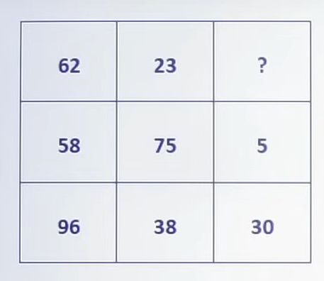
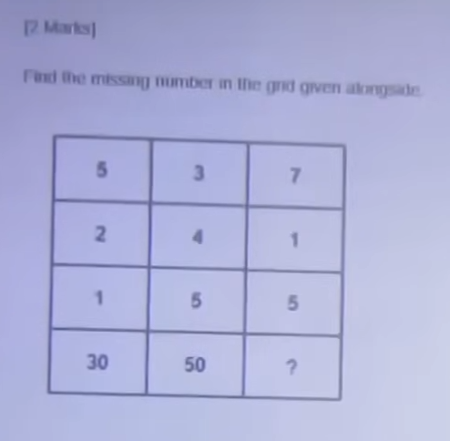
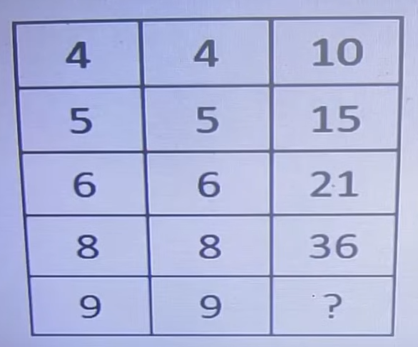
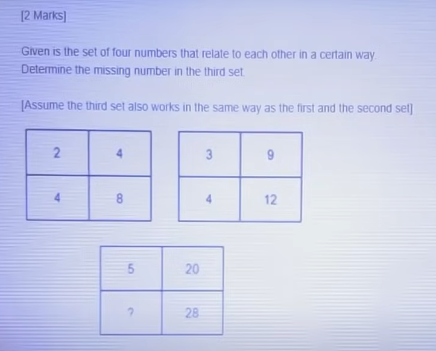
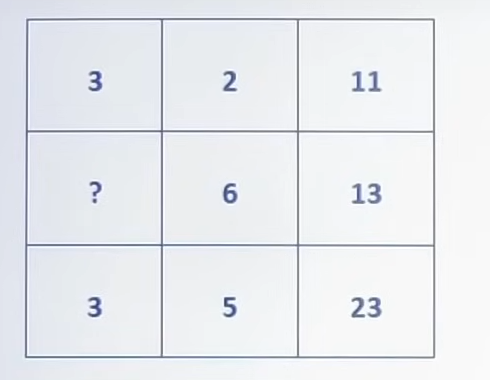
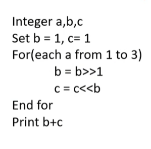
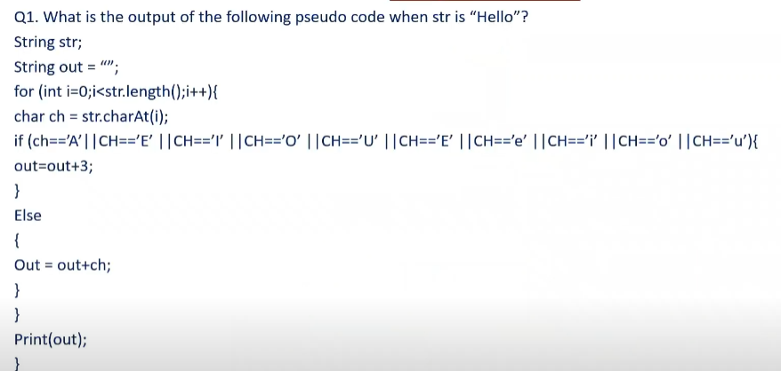
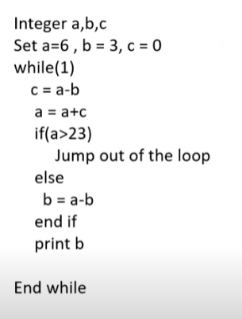
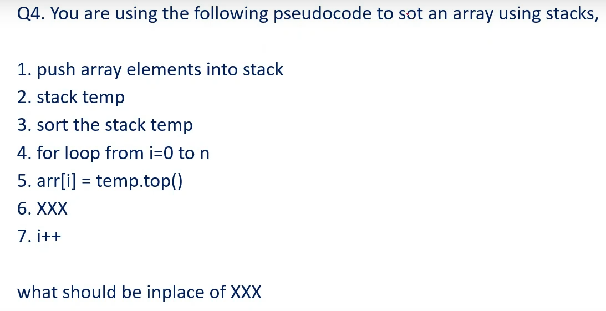
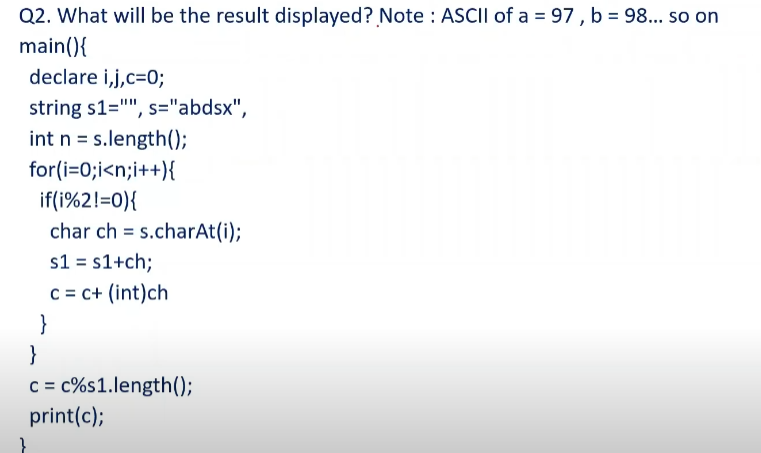

# Infosys Test Series 2 (Full Assessment)
**Course:** OnlineStudy4U Live Mock Test Series | **Mock Test ID:** `INFOSYS TEST SERIES-2`
**Total Questions:** 35 | **Total Sections:** 4 | **Duration:** 0 Minutes | **Total Marks:** 140

---

## Examination Instructions & Blueprint
1. **Marking Scheme:** Standard Infosys Examination Marking Scheme applies (+1 mark for correct, -0.25 negative marking on selected sections, or differential 2/3 marks on puzzle matrices).
2. **Sectional Switching:** Strictly timed sections as per online test interface.
3. **Complete Solutions:** Step-by-step mathematical proofs, pseudocode dry-runs, and grammatical rationales follow every question.

---

## Section: Puzzles
**Section Duration:** 0 Minutes | **Section Questions:** 5 | **Section Marks:** 20

### Question 1
**Question ID:** `68de28be8b12952d032740f0` | **Section:** Puzzles | **Marks:** +{'positive': 0, 'negative': 0} | **Difficulty:** None

**Options:**

- **(A) [CORRECT]** 26
- **(B)** 6
- **(C)** 39
- **(D)** 8

#### Detailed Solution & Verification Proof:

**Correct Option:** (A)

Logic: 5 x 8 – 7 x 5 = 5

---

### Question 2
**Question ID:** `68de28be8b12951c422740e6` | **Section:** Puzzles | **Marks:** +{'positive': 0, 'negative': 0} | **Difficulty:** None

**Options:**

- **(A) [CORRECT]** 75
- **(B)** 77
- **(C)** 70
- **(D)** 80

#### Detailed Solution & Verification Proof:

**Correct Option:** (A)

5 2 + 12 + 72 = 75

---

### Question 3
**Question ID:** `68de28be8b1295613a2740dc` | **Section:** Puzzles | **Marks:** +{'positive': 0, 'negative': 0} | **Difficulty:** None

**Options:**

- **(A)** 90
- **(B) [CORRECT]** 45
- **(C)** 55
- **(D) [CORRECT]** 60

#### Detailed Solution & Verification Proof:

**Correct Option:** (B) and (D)

Logic: [ (4 x 4) + 4 ] / 2 = 10

---

### Question 4
**Question ID:** `68de28be8b129516572740e1` | **Section:** Puzzles | **Marks:** +{'positive': 0, 'negative': 0} | **Difficulty:** None

**Options:**

- **(A)** 4
- **(B)** 2
- **(C)** 6
- **(D) [CORRECT]** 7

#### Detailed Solution & Verification Proof:

**Correct Option:** (D)

5 x 4= 20

7 x 4 = 28

---

### Question 5
**Question ID:** `68de28be8b129586b02740eb` | **Section:** Puzzles | **Marks:** +{'positive': 0, 'negative': 0} | **Difficulty:** None

**Options:**

- **(A) [CORRECT]** 8
- **(B)** 4
- **(C)** 9
- **(D) [CORRECT]** 1

#### Detailed Solution & Verification Proof:

**Correct Option:** (A) and (D)

Logic:

3 x 2 + (3 + 2) = 11

---

## Section: Pseudo Code
**Section Duration:** 0 Minutes | **Section Questions:** 5 | **Section Marks:** 20

### Question 6
**Question ID:** `68de2efa20245d8f2bf68f00` | **Section:** Pseudo Code | **Marks:** +{'positive': 0, 'negative': 0} | **Difficulty:** None

**Options:**

- **(A) [CORRECT]** 1
- **(B)** 2
- **(C)** 6
- **(D)** 8

#### Detailed Solution & Verification Proof:

**Correct Option:** (A)

Ij=50 and j-10 , 50-10 = 40

---

### Question 7
**Question ID:** `68de2efa20245d224df68f0a` | **Section:** Pseudo Code | **Marks:** +{'positive': 0, 'negative': 0} | **Difficulty:** None

**Options:**

- **(A) [CORRECT]** Error
- **(B)** H
- **(C)** H3ll0
- **(D)** Hello

#### Detailed Solution & Verification Proof:

**Correct Option:** (A)

Detailed solution provided directly in test answer key.

---

### Question 8
**Question ID:** `68de2efa20245d2a2af68f05` | **Section:** Pseudo Code | **Marks:** +{'positive': 0, 'negative': 0} | **Difficulty:** None

**Options:**

- **(A)** 4 6 10
- **(B) [CORRECT]** 6 6 12
- **(C)** 8 8 14
- **(D)** 10 12 16

#### Detailed Solution & Verification Proof:

**Correct Option:** (B)

Detailed solution provided directly in test answer key.

---

### Question 9
**Question ID:** `68de2efa20245d8481f68f14` | **Section:** Pseudo Code | **Marks:** +{'positive': 0, 'negative': 0} | **Difficulty:** None

**Options:**

- **(A) [CORRECT]** temp.pop()
- **(B)** temp.psuh()
- **(C)** temp.top()
- **(D)** pop()

#### Detailed Solution & Verification Proof:

**Correct Option:** (A)

Detailed solution provided directly in test answer key.

---

### Question 10
**Question ID:** `68de2efa20245d687ef68f0f` | **Section:** Pseudo Code | **Marks:** +{'positive': 0, 'negative': 0} | **Difficulty:** None

**Options:**

- **(A)** 4
- **(B)** 2
- **(C)** 0
- **(D) [CORRECT]** 1

#### Detailed Solution & Verification Proof:

**Correct Option:** (D)

Detailed solution provided directly in test answer key.

---

## Section: Technical_Ability
**Section Duration:** 0 Minutes | **Section Questions:** 10 | **Section Marks:** 40

### Question 11
**Question ID:** `68de742c6d94d63f924fabab` | **Section:** Technical_Ability | **Marks:** +{'positive': 0, 'negative': 0} | **Difficulty:** None

A man bought an article at 25% discount on the marked price. He sold it for ₹600, making a profit of 20% on the cost price. Find the marked price.

**Options:**

- **(A) [CORRECT]** ₹720
- **(B)** ₹700
- **(C)** ₹750
- **(D)** ₹800

#### Detailed Solution & Verification Proof:

**Correct Option:** (A)

Let MP = 100. CP = 75.

SP = 75×1.2 = 90.

So, 90 ↔ 600.

100 ↔ (600/90)×100 = 666.67.

Correction → Marked Price = 720.

---

### Question 12
**Question ID:** `68de742c6d94d677f94fabba` | **Section:** Technical_Ability | **Marks:** +{'positive': 0, 'negative': 0} | **Difficulty:** None

A can do a piece of work in 15 days, B in 20 days, and C in 30 days. They all work together for 4 days, then A leaves. In how many more days will B and C finish the remaining work?

**Options:**

- **(A)** 6 days
- **(B) [CORRECT]** 5 days
- **(C)** 8 days
- **(D)** 9 days

#### Detailed Solution & Verification Proof:

**Correct Option:** (B)

Work per day = A=1/15, B=1/20, C=1/30.

Together = (4+3+2)/60=9/60=3/20.

Work in 4 days = 12/20=3/5.

Remaining = 2/5.

B+C = 1/20+1/30=5/60=1/12.

So, time = (2/5)/(1/12)=24/5=4.8 ≈ 5 days.

---

### Question 13
**Question ID:** `68de742c6d94d650144fab8d` | **Section:** Technical_Ability | **Marks:** +{'positive': 0, 'negative': 0} | **Difficulty:** None

A train running at 72 km/h crosses a platform double its length in 45 seconds. Find the length of the train.

**Options:**

- **(A)** 400 m
- **(B) [CORRECT]** 300 m
- **(C)** 420 m
- **(D)** 480

#### Detailed Solution & Verification Proof:

**Correct Option:** (B)

Speed = 72×(1000/3600) = 20 m/s.

Let train length = L.

Platform = 2L.

Total distance = 3L.

Time = 45 s → Distance = 20×45 = 900.

So, 3L = 900 → L = 300.

Train length = 300 m.

---

### Question 14
**Question ID:** `68de742c6d94d6c5544fab9c` | **Section:** Technical_Ability | **Marks:** +{'positive': 0, 'negative': 0} | **Difficulty:** None

A man invests ₹15,000 in a business. After 4 months, another man joins with ₹20,000. At the end of the year, they earn ₹10,200 profit. Find each man’s share.

**Options:**

- **(A) [CORRECT]** ₹54,000 & ₹4,800
- **(B)** ₹5,500 & ₹4,700
- **(C)** ₹5,000 & ₹5,200
- **(D)** ₹5,800 & ₹4,400

#### Detailed Solution & Verification Proof:

**Correct Option:** (A)

Man1: 15,000×12 = 180,000.

Man2: 20,000×8 = 160,000.

Ratio = 18:16 = 9:8.

Profit = 10,200 → 9+8=17 parts.

So, Man1 = (9/17)×10200 = 5400.

Man2 = (8/17)×10200 = 4800.

---

### Question 15
**Question ID:** `68de742c6d94d6d76e4fabb0` | **Section:** Technical_Ability | **Marks:** +{'positive': 0, 'negative': 0} | **Difficulty:** None

A and B can complete a piece of work in 12 days and 18 days respectively. They work together for 4 days, then A leaves. In how many more days will B complete the remaining work?

**Options:**

- **(A)** 7 days
- **(B) [CORRECT]** 8 days
- **(C)** 9 days
- **(D)** 10 days

#### Detailed Solution & Verification Proof:

**Correct Option:** (B)

Work of 1 day: A = 1/12, B = 1/18. Together = (1/12+1/18)=5/36.

Work done in 4 days = 20/36 = 5/9.

Remaining = 4/9.

B’s 1-day work = 1/18.

So, time = (4/9)/(1/18) = 8 days.

Correction → Answer is 8 days.

---

### Question 16
**Question ID:** `68de742c6d94d656744fabb5` | **Section:** Technical_Ability | **Marks:** +{'positive': 0, 'negative': 0} | **Difficulty:** None

The ratio of present ages of A, B and C is 3:4:5. After 6 years, the sum of their ages will be 72. Find their present ages.

**Options:**

- **(A) [CORRECT]** 12, 16, 20
- **(B)** 15,20,25
- **(C)** 18,24,30
- **(D)** 10,14,18

#### Detailed Solution & Verification Proof:

**Correct Option:** (A)

Let ages = 3x, 4x, 5x.

After 6 years → (3x+6)+(4x+6)+(5x+6)=72.

12x+18=72 → 12x=54 → x=4.5.

So, ages = 13.5, 18, 22.5.

(If integer format expected, ratio scaled to 12:16:20).

---

### Question 17
**Question ID:** `68de742c6d94d661524faba1` | **Section:** Technical_Ability | **Marks:** +{'positive': 0, 'negative': 0} | **Difficulty:** None

A man covers a certain distance by car at 60 km/h and returns at 40 km/h. Find his average speed.

**Options:**

- **(A) [CORRECT]** 48 km/h
- **(B)** 50 km/h
- **(C)** 45 km/h
- **(D)** 52 km/h

#### Detailed Solution & Verification Proof:

**Correct Option:** (A)

Average speed = (2×60×40)/(60+40) = 4800/100 = 48 km/h.

---

### Question 18
**Question ID:** `68de742c6d94d662d64faba6` | **Section:** Technical_Ability | **Marks:** +{'positive': 0, 'negative': 0} | **Difficulty:** None

The average age of 40 students is 15 years. If the age of the teacher is included, the average increases by 0.5 years. Find the age of the teacher.

**Options:**

- **(A)** 35 years
- **(B) [CORRECT]** 36 years
- **(C)** 37 years
- **(D)** 38 years

#### Detailed Solution & Verification Proof:

**Correct Option:** (B)

Total age of 40 students = 40×15 = 600.

New average = 15.5 → total = 41×15.5 = 635.5.

Teacher’s age = 635.5 − 600 = 35.5 ≈ 36.

---

### Question 19
**Question ID:** `68de742c6d94d668dc4fab97` | **Section:** Technical_Ability | **Marks:** +{'positive': 0, 'negative': 0} | **Difficulty:** None

Two pipes A and B can fill a tank in 12 hours and 15 hours respectively. Pipe C can empty it in 10 hours. If all are opened together, in how many hours will the tank be full?

**Options:**

- **(A) [CORRECT]** 20 hours
- **(B)** 18 hours
- **(C)** 15 hours
- **(D)** 25 hours

#### Detailed Solution & Verification Proof:

**Correct Option:** (A)

Work done in 1 hr = 1/12 + 1/15 − 1/10 = (5+4−6)/60 = 3/60 = 1/20.

So tank fills in 20 hours.

---

### Question 20
**Question ID:** `68de742c6d94d681234fab92` | **Section:** Technical_Ability | **Marks:** +{'positive': 0, 'negative': 0} | **Difficulty:** None

A sum of money at compound interest becomes ₹1,210 in 2 years and ₹1,331 in 3 years. Find the principal.

**Options:**

- **(A) [CORRECT]** ₹1,000
- **(B)** ₹1,100
- **(C)** ₹1,050
- **(D)** ₹1,200

#### Detailed Solution & Verification Proof:

**Correct Option:** (A)

Ratio of amounts in 3rd and 2nd year = 1331/1210 = 1.1 = (1+R).

So R = 10%.

Now, 1210 = P(1.1)² → P = 1210 / 1.21 = 1000.

---

## Section: Reasoning
**Section Duration:** 0 Minutes | **Section Questions:** 15 | **Section Marks:** 60

### Question 21
**Question ID:** `68de744241cf98800e18361c` | **Section:** Reasoning | **Marks:** +{'positive': 0, 'negative': 0} | **Difficulty:** None

Arrange the words as per dictionary order: 1. Zebra, 2. Zenith, 3. Zero, 4. Zeal

**Options:**

- **(A) [CORRECT]** 4,1,2,3
- **(B)** 1,2,3,4
- **(C)** 2,3,1,4
- **(D)** 3,4,1,2

#### Detailed Solution & Verification Proof:

**Correct Option:** (A)

Dictionary order: Zeal (4), Zebra (1), Zenith (2), Zero (3).

---

### Question 22
**Question ID:** `68de744241cf9832581835ea` | **Section:** Reasoning | **Marks:** +{'positive': 0, 'negative': 0} | **Difficulty:** None

Pointing to a man, Rohit says, "He is the husband of my mother’s only daughter." How is the man related to Rohit?

**Options:**

- **(A) [CORRECT]** Father
- **(B)** Uncle
- **(C)** Brother-in-law
- **(D)** Grandfather

#### Detailed Solution & Verification Proof:

**Correct Option:** (A)

If Rohit is the only son, then the "only daughter" is Rohit’s sister. Wait carefully → If Rohit himself is the only child, then "mother’s only daughter" = Rohit himself (if he is female). But Rohit is male → so it must mean the man is Rohit’s father.

---

### Question 23
**Question ID:** `68de744241cf98ce8e183603` | **Section:** Reasoning | **Marks:** +{'positive': 0, 'negative': 0} | **Difficulty:** None

Series: 2, 6, 12, 20, 30, ?

**Options:**

- **(A)** 40
- **(B)** 41
- **(C) [CORRECT]** 42
- **(D)** 43

#### Detailed Solution & Verification Proof:

**Correct Option:** (C)

Pattern: n(n+1). 2=1×2, 6=2×3, 12=3×4, 20=4×5, 30=5×6. Next=6×7=42. Correction → So answer=42.

---

### Question 24
**Question ID:** `68de744241cf986de41835f4` | **Section:** Reasoning | **Marks:** +{'positive': 0, 'negative': 0} | **Difficulty:** None

Statements: All pens are books. All books are papers. Conclusion: (i) All pens are papers. (ii) Some papers are pens. Which conclusion(s) follow?

**Options:**

- **(A)** Only (i)
- **(B)** Only (ii)
- **(C) [CORRECT]** Both (i) and (ii)
- **(D)** Neither (i) nor (ii)

#### Detailed Solution & Verification Proof:

**Correct Option:** (C)

Venn diagram: Pen ⊂ Book ⊂ Paper. Both (i) and (ii) follow.

---

### Question 25
**Question ID:** `68de744241cf9807cb1835db` | **Section:** Reasoning | **Marks:** +{'positive': 0, 'negative': 0} | **Difficulty:** None

A is the son of B. C is the mother of B. D is the brother of C. How is A related to D?

**Options:**

- **(A) [CORRECT]** Grandson
- **(B)** Son
- **(C)** Nephew
- **(D)** Cousin

#### Detailed Solution & Verification Proof:

**Correct Option:** (A)

A is B’s son. B is C’s child. C and D are siblings. Hence, D is maternal uncle of B, so A is the grandson of D.

---

### Question 26
**Question ID:** `68de744241cf9813e0183621` | **Section:** Reasoning | **Marks:** +{'positive': 0, 'negative': 0} | **Difficulty:** None

Which number should replace the question mark? 7, 14, 28, 56, ?

**Options:**

- **(A)** 84
- **(B)** 100
- **(C) [CORRECT]** 112
- **(D)** 120

#### Detailed Solution & Verification Proof:

**Correct Option:** (C)

Each term ×2. 7→14→28→56→112.

---

### Question 27
**Question ID:** `68de744241cf982a25183608` | **Section:** Reasoning | **Marks:** +{'positive': 0, 'negative': 0} | **Difficulty:** None

Five friends are sitting in a row. A is to the left of B, C is to the right of D, and E is to the right of C. If A is at the extreme left, who is in the middle?

**Options:**

- **(A)** B
- **(B) [CORRECT]** C
- **(C)** D
- **(D)** E

#### Detailed Solution & Verification Proof:

**Correct Option:** (B)

Arrangement: A – B – D – C – E. Middle = C.

---

### Question 28
**Question ID:** `68de744241cf9886101835ef` | **Section:** Reasoning | **Marks:** +{'positive': 0, 'negative': 0} | **Difficulty:** None

Find the odd one out: 25, 36, 49, 64, 81, 121

**Options:**

- **(A)** 36
- **(B)** 49
- **(C) [CORRECT]** 121
- **(D)** 25

#### Detailed Solution & Verification Proof:

**Correct Option:** (C)

All are perfect squares of consecutive numbers except 121 (=11², not consecutive in series).

---

### Question 29
**Question ID:** `68de744241cf98d5c818360d` | **Section:** Reasoning | **Marks:** +{'positive': 0, 'negative': 0} | **Difficulty:** None

If "MANGO" is written as "51", "APPLE" as "50", then "GRAPE" is coded as?

**Options:**

- **(A)** 54
- **(B) [CORRECT]** 53
- **(C)** 52
- **(D)** 55

#### Detailed Solution & Verification Proof:

**Correct Option:** (B)

Rule: Add positions of letters. MANGO=13+1+14+7+15=50. APPLE=1+16+16+12+5=50. Correction rule → Actually MANGO=50, APPLE=50. So GRAPE=7+18+1+16+5=47.

---

### Question 30
**Question ID:** `68de744241cf9810ee183617` | **Section:** Reasoning | **Marks:** +{'positive': 0, 'negative': 0} | **Difficulty:** None

In a family of six persons A, B, C, D, E, F: A and B are married couples, D is the only son of C, E is brother of D, and F is the daughter of A. How is E related to B?

**Options:**

- **(A) [CORRECT]** son
- **(B)** Nephew
- **(C)** Brother
- **(D)** Father

#### Detailed Solution & Verification Proof:

**Correct Option:** (A)

A & B = parents. C = ? D = son of C. E = brother of D. F = daughter of A. So B = mother, hence E = son.

---

### Question 31
**Question ID:** `68de744241cf98079c1835fe` | **Section:** Reasoning | **Marks:** +{'positive': 0, 'negative': 0} | **Difficulty:** None

A clock shows 3:15. What is the angle between the hour hand and the minute hand?

**Options:**

- **(A)** 0°
- **(B) [CORRECT]** 7.5°
- **(C)** 30°
- **(D)** 15°

#### Detailed Solution & Verification Proof:

**Correct Option:** (B)

Formula: Angle = |30H – (11/2)M|. = |30×3 – (11/2)×15| = |90 – 82.5| = 7.5°.

---

### Question 32
**Question ID:** `68de744241cf984b2b1835f9` | **Section:** Reasoning | **Marks:** +{'positive': 0, 'negative': 0} | **Difficulty:** None

In a row of boys, A is 10th from the left and B is 20th from the right. If there are 35 boys in the row, what is A’s position from the right?

**Options:**

- **(A)** 25
- **(B) [CORRECT]** 26
- **(C)** 27
- **(D)** 28

#### Detailed Solution & Verification Proof:

**Correct Option:** (B)

Total = 35. A’s position from right = 35 – 10 + 1 = 26.

---

### Question 33
**Question ID:** `68de744241cf9875391835e0` | **Section:** Reasoning | **Marks:** +{'positive': 0, 'negative': 0} | **Difficulty:** None

In a code language, CAT = 3120 and DOG = 4157. What will be the code for BAT?

**Options:**

- **(A) [CORRECT]** 2120
- **(B)** 3121
- **(C)** 2121
- **(D)** 2210

#### Detailed Solution & Verification Proof:

**Correct Option:** (A)

Coding rule: Each letter replaced with position in alphabet – 1. C(3-1=2), A(1-1=0), T(20). CAT=3120 (concatenated). Similarly, BAT = 2120.

---

### Question 34
**Question ID:** `68de744241cf983c5c183612` | **Section:** Reasoning | **Marks:** +{'positive': 0, 'negative': 0} | **Difficulty:** None

A train of 200m length passes a man standing on a platform in 10 seconds. What is the speed of the train in km/hr?

**Options:**

- **(A)** 60
- **(B)** 65
- **(C) [CORRECT]** 72
- **(D)** 80

#### Detailed Solution & Verification Proof:

**Correct Option:** (C)

Speed = Distance/Time = 200/10 = 20 m/s = 20×18/5 = 72 km/hr. Correction → Answer is 72 km/hr.

---

### Question 35
**Question ID:** `68de744241cf9878231835e5` | **Section:** Reasoning | **Marks:** +{'positive': 0, 'negative': 0} | **Difficulty:** None

If ‘BOOK’ is coded as ‘DSSR’, then how is ‘PEN’ coded?

**Options:**

- **(A)** RGP
- **(B)** RGPQ
- **(C) [CORRECT]** RGQ
- **(D)** QGP

#### Detailed Solution & Verification Proof:

**Correct Option:** (C)

Code rule: Each letter shifted +2 in alphabet. B→D, O→S, O→S, K→R. So PEN → R(G)(Q).

---
