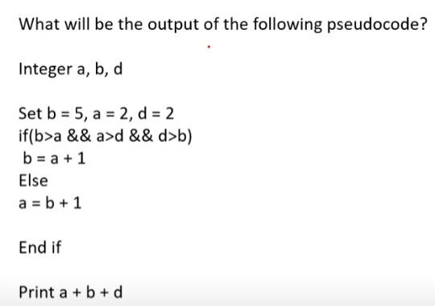
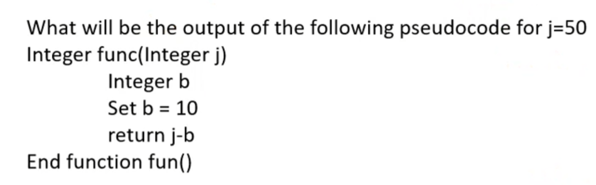
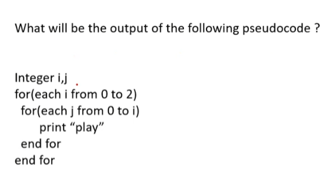
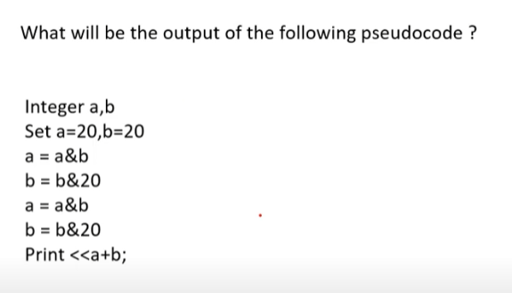
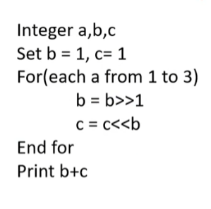
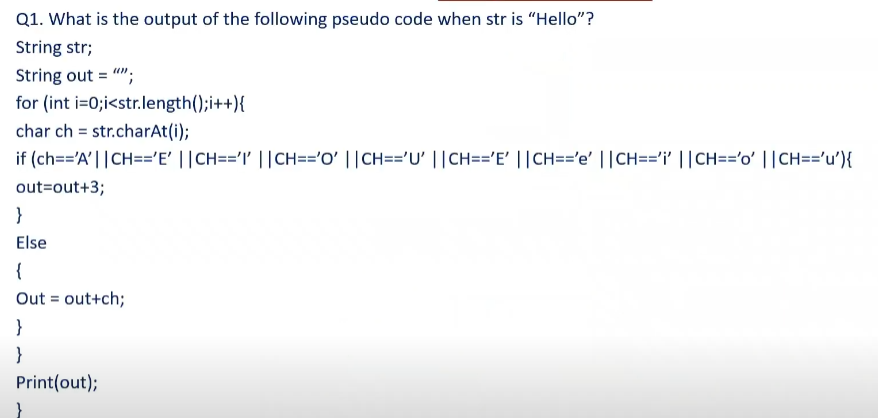
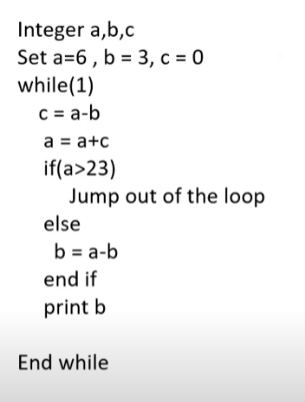
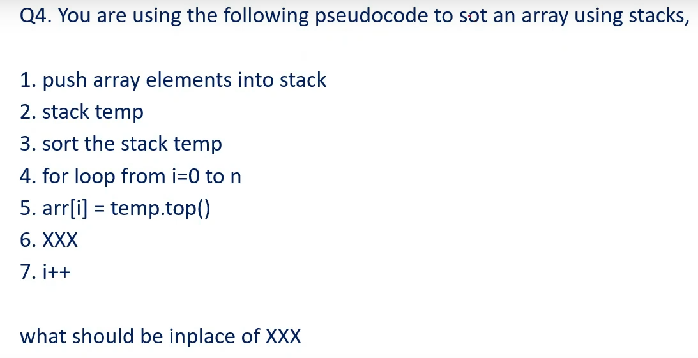
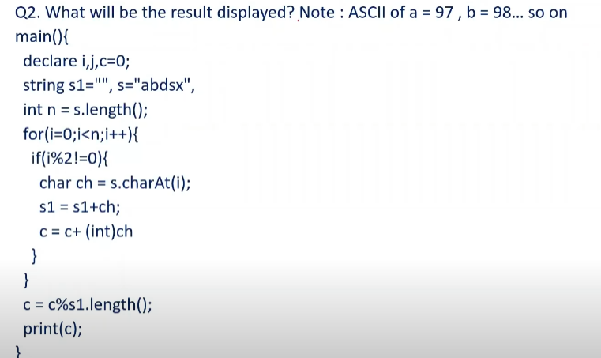

# Topic 04: Technical Pseudocode & Output Master Collection
**Course:** OnlineStudy4U Live Mock Test Series | **Module:** Canonical Topic Collection
**Total Questions in this Topic:** 60

---

## Overview & Module Scope
Every single assessment pseudocode problem across all 12 tests with syntax-highlighted code blocks, variable dry-run trace tables, bitwise calculations, and output verifications.

---

### Question 1 (From Infosys Test Series 1 (Full Assessment))
**Source Test:** `INFOSYS TEST SERIES-1` | **Question ID:** `68de2ecb2fe2a1c7bb67518d` | **Marks:** +{'positive': 0, 'negative': 0} | **Difficulty:** None





**Options:**

- **(A)** 2
- **(B) [CORRECT]** 13
- **(C)** 25
- **(D)** 5


#### Detailed Solution & Verification Proof:

**Correct Option:** (B)

Detailed solution provided directly in test answer key.


---

### Question 2 (From Infosys Test Series 1 (Full Assessment))
**Source Test:** `INFOSYS TEST SERIES-1` | **Question ID:** `68de2ecb2fe2a1ce04675179` | **Marks:** +{'positive': 0, 'negative': 0} | **Difficulty:** None





**Options:**

- **(A)** None
- **(B) [CORRECT]** 40
- **(C)** 50
- **(D)** 60


#### Detailed Solution & Verification Proof:

**Correct Option:** (B)

j=50 and j-10 , 50-10 = 40


---

### Question 3 (From Infosys Test Series 1 (Full Assessment))
**Source Test:** `INFOSYS TEST SERIES-1` | **Question ID:** `68de2ecb2fe2a12bfb675188` | **Marks:** +{'positive': 0, 'negative': 0} | **Difficulty:** None





**Options:**

- **(A) [CORRECT]** 6 times
- **(B)** 8 times
- **(C)** 5 times
- **(D)** 4 times


#### Detailed Solution & Verification Proof:

**Correct Option:** (A)

Detailed solution provided directly in test answer key.


---

### Question 4 (From Infosys Test Series 1 (Full Assessment))
**Source Test:** `INFOSYS TEST SERIES-1` | **Question ID:** `68de2ecb2fe2a1ce7a67517e` | **Marks:** +{'positive': 0, 'negative': 0} | **Difficulty:** None


What will be the output of the following pseudo code

Integer i, j, k, d

Set j = 6, i = 8, k = 2, d = 1

if ((j ^ i) mod k equals 0) then

d = d + 1

else

d = d - 1

end if

Print d


**Options:**

- **(A)** 1
- **(B)** 3
- **(C)** 0
- **(D) [CORRECT]** 2


#### Detailed Solution & Verification Proof:

**Correct Option:** (D)

Detailed solution provided directly in test answer key.


---

### Question 5 (From Infosys Test Series 1 (Full Assessment))
**Source Test:** `INFOSYS TEST SERIES-1` | **Question ID:** `68de2ecb2fe2a19b4d675183` | **Marks:** +{'positive': 0, 'negative': 0} | **Difficulty:** None





**Options:**

- **(A)** 20
- **(B) [CORRECT]** 40
- **(C)** 60
- **(D)** 80


#### Detailed Solution & Verification Proof:

**Correct Option:** (B)

Detailed solution provided directly in test answer key.


---

### Question 6 (From Infosys Test Series 2 (Full Assessment))
**Source Test:** `INFOSYS TEST SERIES-2` | **Question ID:** `68de2efa20245d8f2bf68f00` | **Marks:** +{'positive': 0, 'negative': 0} | **Difficulty:** None





**Options:**

- **(A) [CORRECT]** 1
- **(B)** 2
- **(C)** 6
- **(D)** 8


#### Detailed Solution & Verification Proof:

**Correct Option:** (A)

Ij=50 and j-10 , 50-10 = 40


---

### Question 7 (From Infosys Test Series 2 (Full Assessment))
**Source Test:** `INFOSYS TEST SERIES-2` | **Question ID:** `68de2efa20245d224df68f0a` | **Marks:** +{'positive': 0, 'negative': 0} | **Difficulty:** None





**Options:**

- **(A) [CORRECT]** Error
- **(B)** H
- **(C)** H3ll0
- **(D)** Hello


#### Detailed Solution & Verification Proof:

**Correct Option:** (A)

Detailed solution provided directly in test answer key.


---

### Question 8 (From Infosys Test Series 2 (Full Assessment))
**Source Test:** `INFOSYS TEST SERIES-2` | **Question ID:** `68de2efa20245d2a2af68f05` | **Marks:** +{'positive': 0, 'negative': 0} | **Difficulty:** None





**Options:**

- **(A)** 4 6 10
- **(B) [CORRECT]** 6 6 12
- **(C)** 8 8 14
- **(D)** 10 12 16


#### Detailed Solution & Verification Proof:

**Correct Option:** (B)

Detailed solution provided directly in test answer key.


---

### Question 9 (From Infosys Test Series 2 (Full Assessment))
**Source Test:** `INFOSYS TEST SERIES-2` | **Question ID:** `68de2efa20245d8481f68f14` | **Marks:** +{'positive': 0, 'negative': 0} | **Difficulty:** None





**Options:**

- **(A) [CORRECT]** temp.pop()
- **(B)** temp.psuh()
- **(C)** temp.top()
- **(D)** pop()


#### Detailed Solution & Verification Proof:

**Correct Option:** (A)

Detailed solution provided directly in test answer key.


---

### Question 10 (From Infosys Test Series 2 (Full Assessment))
**Source Test:** `INFOSYS TEST SERIES-2` | **Question ID:** `68de2efa20245d687ef68f0f` | **Marks:** +{'positive': 0, 'negative': 0} | **Difficulty:** None





**Options:**

- **(A)** 4
- **(B)** 2
- **(C)** 0
- **(D) [CORRECT]** 1


#### Detailed Solution & Verification Proof:

**Correct Option:** (D)

Detailed solution provided directly in test answer key.


---

### Question 11 (From Infosys Full Length Mock Test 1)
**Source Test:** `Infosys Full Length Mock Test-1` | **Question ID:** `6aaf7d68f76f856c85198a1c` | **Marks:** +{'positive': 0, 'negative': 0} | **Difficulty:** None


What is the output of the following Pseudo Code?

```pseudocode
Integer x, i
Set x = 0
for i = 1 to 6 do
if i % 2 == 0 then
continue
end if
x = x + i
end for
Print x
```


**Options:**

- **(A) [CORRECT]** 9
- **(B)** 12
- **(C)** 16
- **(D)** 21


#### Detailed Solution & Verification Proof:

**Correct Option:** (A)

continue skips even values of i. The loop runs i = 1 to 6, so only the odd values 1, 3 and 5 are added. x = 1 + 3 + 5 = 9.


---

### Question 12 (From Infosys Full Length Mock Test 1)
**Source Test:** `Infosys Full Length Mock Test-1` | **Question ID:** `6aaf7d68f76f85ee4a198a2b` | **Marks:** +{'positive': 0, 'negative': 0} | **Difficulty:** None


How many times does the loop body run, and what is printed?

```pseudocode
Integer i, count
Set i = 1, count = 0
while i < 20 do
i = i * 2
count = count + 1
end while
Print count
```


**Options:**

- **(A)** 3
- **(B)** 4
- **(C) [CORRECT]** 5
- **(D)** 6


#### Detailed Solution & Verification Proof:

**Correct Option:** (C)

Trace i and count: start i=1. Pass 1: i=2, count=1. Pass 2: i=4, count=2. Pass 3: i=8, count=3. Pass 4: i=16, count=4. Pass 5: i=32, count=5. Now i=32 is not less than 20, so the loop stops. Printed value is 5.


---

### Question 13 (From Infosys Full Length Mock Test 1)
**Source Test:** `Infosys Full Length Mock Test-1` | **Question ID:** `6aaf7d68f76f85f968198a21` | **Marks:** +{'positive': 0, 'negative': 0} | **Difficulty:** None


What value is printed by the following Pseudo Code?

```pseudocode
Function Mystery(n)
if n <= 1 then
return 1
end if
return n * Mystery(n - 1)
End Function
Print Mystery(5)
```


**Options:**

- **(A)** 15
- **(B)** 24
- **(C) [CORRECT]** 120
- **(D)** 125


#### Detailed Solution & Verification Proof:

**Correct Option:** (C)

Mystery(n) computes n!. Mystery(5) = 5 × 4 × 3 × 2 × 1 = 120.


---

### Question 14 (From Infosys Full Length Mock Test 1)
**Source Test:** `Infosys Full Length Mock Test-1` | **Question ID:** `6aaf7d68f76f855cf9198a17` | **Marks:** +{'positive': 0, 'negative': 0} | **Difficulty:** None


What is the output of the following Pseudo Code? Integer division is used.

```pseudocode
Integer a, b
Set a = 17, b = 5
Print (a / b) + (a % b)
```


**Options:**

- **(A)** 3
- **(B)** 4
- **(C) [CORRECT]** 5
- **(D)** 7


#### Detailed Solution & Verification Proof:

**Correct Option:** (C)

Integer division: 17 / 5 = 3. Remainder: 17 % 5 = 2. Printed value = 3 + 2 = 5.


---

### Question 15 (From Infosys Full Length Mock Test 1)
**Source Test:** `Infosys Full Length Mock Test-1` | **Question ID:** `6aaf7d68f76f8543e2198a26` | **Marks:** +{'positive': 0, 'negative': 0} | **Difficulty:** None


What is printed after the following Pseudo Code runs?

```pseudocode
Integer a, b
Set a = 12, b = 8
a = a + b
b = a - b
a = a - b
Print a, b
```


**Options:**

- **(A)** 12 8
- **(B) [CORRECT]** 8 12
- **(C)** 20 8
- **(D)** 20 12


#### Detailed Solution & Verification Proof:

**Correct Option:** (B)

This swaps the two values without a third variable. a = 12+8 = 20, b = 20-8 = 12, a = 20-12 = 8. Output: 8 12.


---

### Question 16 (From Infosys Full Length Mock Test 2)
**Source Test:** `Infosys Full Length Mock Test- 2` | **Question ID:** `6aafffe858b8cb5fc6b4b016` | **Marks:** +{'positive': 0, 'negative': 0} | **Difficulty:** None


What is printed by the following Pseudo Code?

```pseudocode
Integer i, j, count
Set count = 0
for i = 1 to 4 do
for j = 1 to i do
count = count + 1
end for
end for
Print count
```


**Options:**

- **(A)** 4
- **(B)** 8
- **(C) [CORRECT]** 10
- **(D)** 16


#### Detailed Solution & Verification Proof:

**Correct Option:** (C)

The inner loop runs i times for each i from 1 to 4. Total iterations = 1+2+3+4 = 10. So count prints 10.


---

### Question 17 (From Infosys Full Length Mock Test 2)
**Source Test:** `Infosys Full Length Mock Test- 2` | **Question ID:** `6aafffe858b8cb35a9b4b011` | **Marks:** +{'positive': 0, 'negative': 0} | **Difficulty:** None


What is the output of the following Pseudo Code?

```pseudocode
Integer a, b
Set a = 9, b = 5
Print a ^ b
```


**Options:**

- **(A)** 4
- **(B) [CORRECT]** 12
- **(C)** 13
- **(D)** 14


#### Detailed Solution & Verification Proof:

**Correct Option:** (B)

9 in binary is 1001 and 5 is 0101. XOR sets a bit where the bits differ: 1100, which is 12.


---

### Question 18 (From Infosys Full Length Mock Test 2)
**Source Test:** `Infosys Full Length Mock Test- 2` | **Question ID:** `6aafffe858b8cb1340b4b00c` | **Marks:** +{'positive': 0, 'negative': 0} | **Difficulty:** None


What value is printed by the following Pseudo Code?

```pseudocode
Function F(n)
if n == 0 then return 0
if n == 1 then return 1
return F(n - 1) + F(n - 2)
End Function
Print F(6)
```


**Options:**

- **(A)** 5
- **(B) [CORRECT]** 8
- **(C)** 13
- **(D)** 21


#### Detailed Solution & Verification Proof:

**Correct Option:** (B)

F is the Fibonacci sequence: F(0)=0, F(1)=1, F(2)=1, F(3)=2, F(4)=3, F(5)=5, F(6)=8. So the printed value is 8.


---

### Question 19 (From Infosys Full Length Mock Test 2)
**Source Test:** `Infosys Full Length Mock Test- 2` | **Question ID:** `6aafffe858b8cb6bb7b4b01b` | **Marks:** +{'positive': 0, 'negative': 0} | **Difficulty:** None


A queue follows FIFO. What is printed by the following Pseudo Code?

```pseudocode
Queue Q
enqueue(Q, 2)
enqueue(Q, 4)
enqueue(Q, 6)
dequeue(Q)
enqueue(Q, 8)
Print front(Q)
```


**Options:**

- **(A)** 2
- **(B) [CORRECT]** 4
- **(C)** 6
- **(D)** 8


#### Detailed Solution & Verification Proof:

**Correct Option:** (B)

After three enqueues the queue is [2, 4, 6] with 2 at the front. dequeue removes 2. enqueue 8 makes [4, 6, 8]. front returns 4.


---

### Question 20 (From Infosys Full Length Mock Test 2)
**Source Test:** `Infosys Full Length Mock Test- 2` | **Question ID:** `6aafffe858b8cbb106b4b007` | **Marks:** +{'positive': 0, 'negative': 0} | **Difficulty:** None


A stack follows LIFO. What is printed by the following Pseudo Code?

```pseudocode
Stack S
push(S, 5)
push(S, 8)
push(S, 3)
pop(S)
push(S, 7)
Print peek(S)
```


**Options:**

- **(A)** 3
- **(B)** 5
- **(C) [CORRECT]** 7
- **(D)** 8


#### Detailed Solution & Verification Proof:

**Correct Option:** (C)

Stack after the three pushes: [5, 8, 3] with 3 on top. pop removes 3. push 7 makes the stack [5, 8, 7]. peek returns the top element, which is 7.


---

### Question 21 (From Infosys Full Length Mock Test 3)
**Source Test:** `Infosys Full Length Mock Test- 3` | **Question ID:** `6ab15cb351951a2871456a67` | **Marks:** +{'positive': 0, 'negative': 0} | **Difficulty:** None


What is printed?

```pseudocode
Integer n, d
Set n = 48, d = 0
while n > 1 do
n = n / 2
d = d + 1
end while
Print d
```


**Options:**

- **(A)** 3
- **(B)** 4
- **(C) [CORRECT]** 5
- **(D)** 6


#### Detailed Solution & Verification Proof:

**Correct Option:** (C)

48→24→12→6→3→1. That is five divisions. d = 5. (Integer division: 3/2=1.)


---

### Question 22 (From Infosys Full Length Mock Test 3)
**Source Test:** `Infosys Full Length Mock Test- 3` | **Question ID:** `6ab15cb351951a4c6c456a58` | **Marks:** +{'positive': 0, 'negative': 0} | **Difficulty:** None


What is printed?

```pseudocode
Integer A[5] = {2, 4, 6, 8, 10}
Integer i, s
Set s = 0
for i = 0 to 4 do
if A[i] % 4 == 0 then s = s + A[i]
end for
Print s
```


**Options:**

- **(A) [CORRECT]** 12
- **(B)** 18
- **(C)** 24
- **(D)** 30


#### Detailed Solution & Verification Proof:

**Correct Option:** (A)

Values divisible by 4 are 4 and 8. s = 4 + 8 = 12.


---

### Question 23 (From Infosys Full Length Mock Test 3)
**Source Test:** `Infosys Full Length Mock Test- 3` | **Question ID:** `6ab15cb351951a7c25456a62` | **Marks:** +{'positive': 0, 'negative': 0} | **Difficulty:** None


What is printed?

```pseudocode
Integer x
Set x = 10
Print x & 3
```


**Options:**

- **(A)** 1
- **(B) [CORRECT]** 2
- **(C)** 3
- **(D)** 8


#### Detailed Solution & Verification Proof:

**Correct Option:** (B)

10 is 1010 and 3 is 0011. AND is 0010, which is 2.


---

### Question 24 (From Infosys Full Length Mock Test 3)
**Source Test:** `Infosys Full Length Mock Test- 3` | **Question ID:** `6ab15cb351951ab729456a6c` | **Marks:** +{'positive': 0, 'negative': 0} | **Difficulty:** None


What is printed?

```pseudocode
Stack S
push(S, 1)
push(S, 4)
push(S, 9)
pop(S)
pop(S)
Print peek(S)
```


**Options:**

- **(A) [CORRECT]** 1
- **(B)** 4
- **(C)** 9
- **(D)** Empty


#### Detailed Solution & Verification Proof:

**Correct Option:** (A)

After three pushes the top is 9. Two pops remove 9 then 4. peek returns 1.


---

### Question 25 (From Infosys Full Length Mock Test 3)
**Source Test:** `Infosys Full Length Mock Test- 3` | **Question ID:** `6ab15cb351951ad12a456a5d` | **Marks:** +{'positive': 0, 'negative': 0} | **Difficulty:** None


What does G(4) return?

```pseudocode
Function G(n)
if n <= 1 then return 1
return n * G(n - 1)
End Function
Print G(4)
```


**Options:**

- **(A)** 10
- **(B)** 16
- **(C) [CORRECT]** 24
- **(D)** 64


#### Detailed Solution & Verification Proof:

**Correct Option:** (C)

G is factorial. G(4)=4×3×2×1=24.


---

### Question 26 (From Infosys Full Length Mock Test 4)
**Source Test:** `Infosys Full Length Mock Test- 4` | **Question ID:** `6ab27058dcf12f9b5029e66d` | **Marks:** +{'positive': 0, 'negative': 0} | **Difficulty:** None


[Bitwise] What is printed?

```pseudocode
Integer a
Set a = 6
Print a | 3
```


**Options:**

- **(A) [CORRECT]** 7
- **(B)** 5
- **(C)** 2
- **(D)** 18


#### Detailed Solution & Verification Proof:

**Correct Option:** (A)

6 is 0110, 3 is 0011, OR is 0111 = 7.


---

### Question 27 (From Infosys Full Length Mock Test 4)
**Source Test:** `Infosys Full Length Mock Test- 4` | **Question ID:** `6ab27058dcf12fb28129e677` | **Marks:** +{'positive': 0, 'negative': 0} | **Difficulty:** None


[Queue] What is printed?

```pseudocode
Queue Q
enqueue(Q, 11)
enqueue(Q, 22)
enqueue(Q, 33)
dequeue(Q)
dequeue(Q)
Print front(Q)
```


**Options:**

- **(A)** 11
- **(B)** 22
- **(C) [CORRECT]** 33
- **(D)** Empty


#### Detailed Solution & Verification Proof:

**Correct Option:** (C)

Queue starts [11,22,33]. Two dequeues remove 11 then 22. Front is 33.


---

### Question 28 (From Infosys Full Length Mock Test 4)
**Source Test:** `Infosys Full Length Mock Test- 4` | **Question ID:** `6ab27058dcf12fe96d29e672` | **Marks:** +{'positive': 0, 'negative': 0} | **Difficulty:** None


[Loops] What is printed?

```pseudocode
Integer i, s
Set s = 0
for i = 1 to 10 do
if i % 2 == 1 then s = s + i
end for
Print s
```


**Options:**

- **(A) [CORRECT]** 25
- **(B)** 30
- **(C)** 45
- **(D)** 55


#### Detailed Solution & Verification Proof:

**Correct Option:** (A)

The loop adds the odd values 1+3+5+7+9 = 25.


---

### Question 29 (From Infosys Full Length Mock Test 4)
**Source Test:** `Infosys Full Length Mock Test- 4` | **Question ID:** `6ab27058dcf12f8a1829e668` | **Marks:** +{'positive': 0, 'negative': 0} | **Difficulty:** None


[Recursion] What does S(5) return?

```pseudocode
Function S(n)
if n == 0 then return 0
return n + S(n - 1)
End Function
Print S(5)
```


**Options:**

- **(A)** 10
- **(B) [CORRECT]** 15
- **(C)** 16
- **(D)** 25


#### Detailed Solution & Verification Proof:

**Correct Option:** (B)

S(n) is the sum 5+4+3+2+1+0 = 15.


---

### Question 30 (From Infosys Full Length Mock Test 4)
**Source Test:** `Infosys Full Length Mock Test- 4` | **Question ID:** `6ab27058dcf12fbec429e663` | **Marks:** +{'positive': 0, 'negative': 0} | **Difficulty:** None


[Arrays] What is printed?

```pseudocode
Integer A[4] = {3, 5, 7, 9}
Integer i, p
Set p = 1
for i = 0 to 3 do
p = p * A[i]
end for
Print p
```


**Options:**

- **(A)** 24
- **(B)** 315
- **(C) [CORRECT]** 945
- **(D)** 105


#### Detailed Solution & Verification Proof:

**Correct Option:** (C)

Product 3×5×7×9 = 945.


---

### Question 31 (From Infosys Full Length Mock Test 5)
**Source Test:** `Infosys Full Length Mock Test- 5` | **Question ID:** `6ab27cd4119dce29aff1f23c` | **Marks:** +{'positive': 0, 'negative': 0} | **Difficulty:** None


[Loops] What is printed?

```pseudocode
Integer i, p
Set p = 1
for i = 1 to 4 do
p = p * i
end for
Print p
```


**Options:**

- **(A)** 10
- **(B)** 16
- **(C) [CORRECT]** 24
- **(D)** 120


#### Detailed Solution & Verification Proof:

**Correct Option:** (C)

p multiplies 1×2×3×4 = 24.


---

### Question 32 (From Infosys Full Length Mock Test 5)
**Source Test:** `Infosys Full Length Mock Test- 5` | **Question ID:** `6ab27cd4119dcee9cdf1f22d` | **Marks:** +{'positive': 0, 'negative': 0} | **Difficulty:** None


[Data Structures] Queue Q receives 5, then 15, then 25. One dequeue runs. What is front(Q)?

```pseudocode
Queue Q
enqueue(Q, 5)
enqueue(Q, 15)
enqueue(Q, 25)
dequeue(Q)
Print front(Q)
```


**Options:**

- **(A)** 5
- **(B) [CORRECT]** 15
- **(C)** 25
- **(D)** Empty


#### Detailed Solution & Verification Proof:

**Correct Option:** (B)

FIFO: 5 leaves. Front is 15.


---

### Question 33 (From Infosys Full Length Mock Test 5)
**Source Test:** `Infosys Full Length Mock Test- 5` | **Question ID:** `6ab27cd4119dcec922f1f228` | **Marks:** +{'positive': 0, 'negative': 0} | **Difficulty:** None


[Data Structures] After the operations, what does peek return?

```pseudocode
Stack S
push(S, 10)
push(S, 20)
push(S, 30)
pop(S)
push(S, 40)
Print peek(S)
```


**Options:**

- **(A)** 10
- **(B)** 20
- **(C) [CORRECT]** 40
- **(D)** 30


#### Detailed Solution & Verification Proof:

**Correct Option:** (C)

Stack after pops/pushes: [10, 20, 40]. peek = 40.


---

### Question 34 (From Infosys Full Length Mock Test 5)
**Source Test:** `Infosys Full Length Mock Test- 5` | **Question ID:** `6ab27cd4119dce2094f1f237` | **Marks:** +{'positive': 0, 'negative': 0} | **Difficulty:** None


[Bitwise] What is printed?

```pseudocode
Integer a, b
Set a = 13, b = 6
Print a & b
```


**Options:**

- **(A) [CORRECT]** 4
- **(B)** 5
- **(C)** 7
- **(D)** 11


#### Detailed Solution & Verification Proof:

**Correct Option:** (A)

13 is 1101, 6 is 0110, AND is 0100 = 4.


---

### Question 35 (From Infosys Full Length Mock Test 5)
**Source Test:** `Infosys Full Length Mock Test- 5` | **Question ID:** `6ab27cd4119dce91f0f1f232` | **Marks:** +{'positive': 0, 'negative': 0} | **Difficulty:** None


[Recursion] What does P(4) return?

```pseudocode
Function P(n)
if n == 1 then return 2
return P(n - 1) * 2
End Function
Print P(4)
```


**Options:**

- **(A)** 8
- **(B)** 12
- **(C) [CORRECT]** 16
- **(D)** 24


#### Detailed Solution & Verification Proof:

**Correct Option:** (C)

P(1)=2, P(2)=4, P(3)=8, P(4)=16.


---

### Question 36 (From Infosys Full Length Mock Test 6)
**Source Test:** `Infosys Full Length Mock Test- 6` | **Question ID:** `6ab285f7644416c4b54c2037` | **Marks:** +{'positive': 0, 'negative': 0} | **Difficulty:** None


What does R(6) return?

```pseudocode
Function R(n)
if n < 3 then return n
return R(n - 1) + 2
End Function
Print R(6)
```


**Options:**

- **(A)** 6
- **(B)** 8
- **(C) [CORRECT]** 10
- **(D)** 12


#### Detailed Solution & Verification Proof:

**Correct Option:** (C)

R(2)=2. Each later call adds 2. R(6)=2 + 2×4 = 10.


---

### Question 37 (From Infosys Full Length Mock Test 6)
**Source Test:** `Infosys Full Length Mock Test- 6` | **Question ID:** `6ab285f7644416310f4c202d` | **Marks:** +{'positive': 0, 'negative': 0} | **Difficulty:** None


What is printed?

```pseudocode
Stack S
push(S, 3)
push(S, 6)
push(S, 9)
pop(S)
push(S, 12)
Print peek(S)
```


**Options:**

- **(A)** 3
- **(B)** 6
- **(C) [CORRECT]** 12
- **(D)** 9


#### Detailed Solution & Verification Proof:

**Correct Option:** (C)

After pop, 9 is gone. 12 is pushed. peek returns 12.


---

### Question 38 (From Infosys Full Length Mock Test 6)
**Source Test:** `Infosys Full Length Mock Test- 6` | **Question ID:** `6ab285f7644416559c4c2041` | **Marks:** +{'positive': 0, 'negative': 0} | **Difficulty:** None


What is printed?

```pseudocode
Integer i, c
Set c = 0
for i = 1 to 8 do
if i % 2 == 0 then c = c + i
end for
Print c
```


**Options:**

- **(A)** 16
- **(B)** 18
- **(C) [CORRECT]** 20
- **(D)** 36


#### Detailed Solution & Verification Proof:

**Correct Option:** (C)

Even values 2+4+6+8 = 20.


---

### Question 39 (From Infosys Full Length Mock Test 6)
**Source Test:** `Infosys Full Length Mock Test- 6` | **Question ID:** `6ab285f764441637b24c203c` | **Marks:** +{'positive': 0, 'negative': 0} | **Difficulty:** None


What is printed?

```pseudocode
Integer x
Set x = 11
Print x | 4
```


**Options:**

- **(A) [CORRECT]** 15
- **(B)** 7
- **(C)** 8
- **(D)** 44


#### Detailed Solution & Verification Proof:

**Correct Option:** (A)

11 is 1011, 4 is 0100, OR is 1111 = 15.


---

### Question 40 (From Infosys Full Length Mock Test 6)
**Source Test:** `Infosys Full Length Mock Test- 6` | **Question ID:** `6ab285f7644416a7014c2032` | **Marks:** +{'positive': 0, 'negative': 0} | **Difficulty:** None


What is printed?

```pseudocode
Queue Q
enqueue(Q, 7)
enqueue(Q, 14)
enqueue(Q, 21)
dequeue(Q)
enqueue(Q, 28)
Print front(Q)
```


**Options:**

- **(A)** 7
- **(B) [CORRECT]** 14
- **(C)** 21
- **(D)** 28


#### Detailed Solution & Verification Proof:

**Correct Option:** (B)

7 is removed first. The new front is 14.


---

### Question 41 (From Infosys Full Length Mock Test 7)
**Source Test:** `Infosys Full Length Mock Test- 7` | **Question ID:** `6ab28941d9c9a1399e0f99c6` | **Marks:** +{'positive': 0, 'negative': 0} | **Difficulty:** None


What value is printed by the following Pseudo Code?

```pseudocode
Function Mystery(n)
if n <= 1 then
return 1
end if
return n * Mystery(n - 1)
End Function
Print Mystery(5)
```


**Options:**

- **(A)** 15
- **(B)** 24
- **(C) [CORRECT]** 120
- **(D)** 125


#### Detailed Solution & Verification Proof:

**Correct Option:** (C)

Mystery(n) computes n!. Mystery(5) = 5 × 4 × 3 × 2 × 1 = 120.


---

### Question 42 (From Infosys Full Length Mock Test 7)
**Source Test:** `Infosys Full Length Mock Test- 7` | **Question ID:** `6ab28941d9c9a10ee80f99c2` | **Marks:** +{'positive': 0, 'negative': 0} | **Difficulty:** None


What is printed after the following Pseudo Code runs?

```pseudocode
Integer a, b
Set a = 12, b = 8
a = a + b
b = a - b
a = a - b
Print a, b
```


**Options:**

- **(A)** 12 8
- **(B) [CORRECT]** 8 12
- **(C)** 20 8
- **(D)** 20 12


#### Detailed Solution & Verification Proof:

**Correct Option:** (B)

This swaps the two values without a third variable. a = 12+8 = 20, b = 20-8 = 12, a = 20-12 = 8. Output: 8 12.


---

### Question 43 (From Infosys Full Length Mock Test 7)
**Source Test:** `Infosys Full Length Mock Test- 7` | **Question ID:** `6ab28941d9c9a140dc0f99c3` | **Marks:** +{'positive': 0, 'negative': 0} | **Difficulty:** None


What is the output of the following Pseudo Code? Integer division is used.

```pseudocode
Integer a, b
Set a = 17, b = 5
Print (a / b) + (a % b)
```


**Options:**

- **(A)** 3
- **(B)** 4
- **(C) [CORRECT]** 5
- **(D)** 7


#### Detailed Solution & Verification Proof:

**Correct Option:** (C)

Integer division: 17 / 5 = 3. Remainder: 17 % 5 = 2. Printed value = 3 + 2 = 5.


---

### Question 44 (From Infosys Full Length Mock Test 7)
**Source Test:** `Infosys Full Length Mock Test- 7` | **Question ID:** `6ab28941d9c9a132ed0f99c5` | **Marks:** +{'positive': 0, 'negative': 0} | **Difficulty:** None


How many times does the loop body run, and what is printed?

```pseudocode
Integer i, count
Set i = 1, count = 0
while i < 20 do
i = i * 2
count = count + 1
end while
Print count
```


**Options:**

- **(A)** 3
- **(B)** 4
- **(C) [CORRECT]** 5
- **(D)** 6


#### Detailed Solution & Verification Proof:

**Correct Option:** (C)

Trace i and count: start i=1. Pass 1: i=2, count=1. Pass 2: i=4, count=2. Pass 3: i=8, count=3. Pass 4: i=16, count=4. Pass 5: i=32, count=5. Now i=32 is not less than 20, so the loop stops. Printed value is 5.


---

### Question 45 (From Infosys Full Length Mock Test 7)
**Source Test:** `Infosys Full Length Mock Test- 7` | **Question ID:** `6ab28941d9c9a127bd0f99c4` | **Marks:** +{'positive': 0, 'negative': 0} | **Difficulty:** None


What is the output of the following Pseudo Code?

```pseudocode
Integer x, i
Set x = 0
for i = 1 to 6 do
if i % 2 == 0 then
continue
end if
x = x + i
end for
Print x
```


**Options:**

- **(A) [CORRECT]** 9
- **(B)** 12
- **(C)** 16
- **(D)** 21


#### Detailed Solution & Verification Proof:

**Correct Option:** (A)

continue skips even values of i. The loop runs i = 1 to 6, so only the odd values 1, 3 and 5 are added. x = 1 + 3 + 5 = 9.


---

### Question 46 (From Infosys Full Length Mock Test 8)
**Source Test:** `Infosys Full Length Mock Test- 8` | **Question ID:** `6ab298adaedf35844cc783c1` | **Marks:** +{'positive': 0, 'negative': 0} | **Difficulty:** None


What does U(4) return?

```pseudocode
Function U(n)
if n == 0 then return 1
return n + U(n - 1)
End Function
Print U(4)
```


**Options:**

- **(A)** 8
- **(B)** 9
- **(C) [CORRECT]** 11
- **(D)** 24


#### Detailed Solution & Verification Proof:

**Correct Option:** (C)

U(0)=1, then +1+2+3+4 = 11.


---

### Question 47 (From Infosys Full Length Mock Test 8)
**Source Test:** `Infosys Full Length Mock Test- 8` | **Question ID:** `6ab298adaedf3542eac783c6` | **Marks:** +{'positive': 0, 'negative': 0} | **Difficulty:** None


What is printed?

```pseudocode
Integer z
Set z = 14
Print z & 7
```


**Options:**

- **(A) [CORRECT]** 6
- **(B)** 7
- **(C)** 8
- **(D)** 21


#### Detailed Solution & Verification Proof:

**Correct Option:** (A)

14 is 1110, 7 is 0111, AND is 0110 = 6.


---

### Question 48 (From Infosys Full Length Mock Test 8)
**Source Test:** `Infosys Full Length Mock Test- 8` | **Question ID:** `6ab298adaedf355fbfc783cb` | **Marks:** +{'positive': 0, 'negative': 0} | **Difficulty:** None


What is printed?

```pseudocode
Integer i, n
Set n = 0
for i = 1 to 6 do
if i % 3 == 0 then n = n + i
end for
Print n
```


**Options:**

- **(A)** 6
- **(B) [CORRECT]** 9
- **(C)** 12
- **(D)** 21


#### Detailed Solution & Verification Proof:

**Correct Option:** (B)

Multiples of 3 from 1 to 6 are 3 and 6. Sum = 9.


---

### Question 49 (From Infosys Full Length Mock Test 8)
**Source Test:** `Infosys Full Length Mock Test- 8` | **Question ID:** `6ab298adaedf353d87c783bc` | **Marks:** +{'positive': 0, 'negative': 0} | **Difficulty:** None


What is printed?

```pseudocode
Queue Q
enqueue(Q, 4)
enqueue(Q, 8)
enqueue(Q, 12)
dequeue(Q)
Print front(Q)
```


**Options:**

- **(A)** 4
- **(B) [CORRECT]** 8
- **(C)** 12
- **(D)** Empty


#### Detailed Solution & Verification Proof:

**Correct Option:** (B)

4 leaves first. Front is 8.


---

### Question 50 (From Infosys Full Length Mock Test 8)
**Source Test:** `Infosys Full Length Mock Test- 8` | **Question ID:** `6ab298adaedf355c04c783b7` | **Marks:** +{'positive': 0, 'negative': 0} | **Difficulty:** None


What is printed?

```pseudocode
Stack S
push(S, 2)
push(S, 5)
push(S, 8)
pop(S)
push(S, 11)
Print peek(S)
```


**Options:**

- **(A)** 2
- **(B)** 5
- **(C) [CORRECT]** 11
- **(D)** 8


#### Detailed Solution & Verification Proof:

**Correct Option:** (C)

Pop removes 8. Push 11. peek returns 11.


---

### Question 51 (From Infosys Full Length Mock Test 9)
**Source Test:** `Infosys Full Length Mock Test- 9` | **Question ID:** `6ab29e1bcaaa6f1cc73acd80` | **Marks:** +{'positive': 0, 'negative': 0} | **Difficulty:** None


What is printed?

```pseudocode
Stack S
push(S, 6)
push(S, 9)
push(S, 15)
pop(S)
push(S, 21)
Print peek(S)
```


**Options:**

- **(A)** 6
- **(B)** 9
- **(C) [CORRECT]** 21
- **(D)** 15


#### Detailed Solution & Verification Proof:

**Correct Option:** (C)

Pop removes 15. Push 21. peek returns 21.


---

### Question 52 (From Infosys Full Length Mock Test 9)
**Source Test:** `Infosys Full Length Mock Test- 9` | **Question ID:** `6ab29e1bcaaa6f367d3acd8f` | **Marks:** +{'positive': 0, 'negative': 0} | **Difficulty:** None


What is printed?

```pseudocode
Integer k
Set k = 21
Print k >> 2
```


**Options:**

- **(A) [CORRECT]** 5
- **(B)** 6
- **(C)** 10
- **(D)** 84


#### Detailed Solution & Verification Proof:

**Correct Option:** (A)

21 is 10101. Right shift 2 gives 101 = 5.


---

### Question 53 (From Infosys Full Length Mock Test 9)
**Source Test:** `Infosys Full Length Mock Test- 9` | **Question ID:** `6ab29e1bcaaa6ffd9f3acd94` | **Marks:** +{'positive': 0, 'negative': 0} | **Difficulty:** None


What is printed?

```pseudocode
Integer i, t
Set t = 1
for i = 1 to 5 do
t = t * 2
end for
Print t
```


**Options:**

- **(A)** 10
- **(B)** 16
- **(C) [CORRECT]** 32
- **(D)** 64


#### Detailed Solution & Verification Proof:

**Correct Option:** (C)

Start 1, multiply by 2 five times: 32.


---

### Question 54 (From Infosys Full Length Mock Test 9)
**Source Test:** `Infosys Full Length Mock Test- 9` | **Question ID:** `6ab29e1bcaaa6f63c23acd85` | **Marks:** +{'positive': 0, 'negative': 0} | **Difficulty:** None


What is printed?

```pseudocode
Queue Q
enqueue(Q, 3)
enqueue(Q, 9)
enqueue(Q, 15)
dequeue(Q)
Print front(Q)
```


**Options:**

- **(A)** 3
- **(B) [CORRECT]** 9
- **(C)** 15
- **(D)** Empty


#### Detailed Solution & Verification Proof:

**Correct Option:** (B)

3 leaves. Front is 9.


---

### Question 55 (From Infosys Full Length Mock Test 9)
**Source Test:** `Infosys Full Length Mock Test- 9` | **Question ID:** `6ab29e1bcaaa6fdcc63acd8a` | **Marks:** +{'positive': 0, 'negative': 0} | **Difficulty:** None


What does W(5) return?

```pseudocode
Function W(n)
if n <= 1 then return 2
return W(n - 1) + 3
End Function
Print W(5)
```


**Options:**

- **(A)** 11
- **(B) [CORRECT]** 14
- **(C)** 15
- **(D)** 17


#### Detailed Solution & Verification Proof:

**Correct Option:** (B)

W(1)=2. Add 3 four times: 2+12=14.


---

### Question 56 (From Infosys Full Length Mock Test 10)
**Source Test:** `Infosys Full Length Mock Test- 10` | **Question ID:** `6ab29f43ec911022b8000caf` | **Marks:** +{'positive': 0, 'negative': 0} | **Difficulty:** None


How many times does the loop body run, and what is printed?

```pseudocode
Integer i, count
Set i = 1, count = 0
while i < 20 do
i = i * 2
count = count + 1
end while
Print count
```


**Options:**

- **(A)** 3
- **(B)** 4
- **(C) [CORRECT]** 5
- **(D)** 6


#### Detailed Solution & Verification Proof:

**Correct Option:** (C)

Trace i and count: start i=1. Pass 1: i=2, count=1. Pass 2: i=4, count=2. Pass 3: i=8, count=3. Pass 4: i=16, count=4. Pass 5: i=32, count=5. Now i=32 is not less than 20, so the loop stops. Printed value is 5.


---

### Question 57 (From Infosys Full Length Mock Test 10)
**Source Test:** `Infosys Full Length Mock Test- 10` | **Question ID:** `6ab29f43ec9110339e000cad` | **Marks:** +{'positive': 0, 'negative': 0} | **Difficulty:** None


What is the output of the following Pseudo Code? Integer division is used.

```pseudocode
Integer a, b
Set a = 17, b = 5
Print (a / b) + (a % b)
```


**Options:**

- **(A)** 3
- **(B)** 4
- **(C) [CORRECT]** 5
- **(D)** 7


#### Detailed Solution & Verification Proof:

**Correct Option:** (C)

Integer division: 17 / 5 = 3. Remainder: 17 % 5 = 2. Printed value = 3 + 2 = 5.


---

### Question 58 (From Infosys Full Length Mock Test 10)
**Source Test:** `Infosys Full Length Mock Test- 10` | **Question ID:** `6ab29f43ec91101472000cae` | **Marks:** +{'positive': 0, 'negative': 0} | **Difficulty:** None


What is the output of the following Pseudo Code?

```pseudocode
Integer x, i
Set x = 0
for i = 1 to 6 do
if i % 2 == 0 then
continue
end if
x = x + i
end for
Print x
```


**Options:**

- **(A) [CORRECT]** 9
- **(B)** 12
- **(C)** 16
- **(D)** 21


#### Detailed Solution & Verification Proof:

**Correct Option:** (A)

continue skips even values of i. The loop runs i = 1 to 6, so only the odd values 1, 3 and 5 are added. x = 1 + 3 + 5 = 9.


---

### Question 59 (From Infosys Full Length Mock Test 10)
**Source Test:** `Infosys Full Length Mock Test- 10` | **Question ID:** `6ab29f43ec9110e33d000cb0` | **Marks:** +{'positive': 0, 'negative': 0} | **Difficulty:** None


What value is printed by the following Pseudo Code?

```pseudocode
Function Mystery(n)
if n <= 1 then
return 1
end if
return n * Mystery(n - 1)
End Function
Print Mystery(5)
```


**Options:**

- **(A)** 15
- **(B)** 24
- **(C) [CORRECT]** 120
- **(D)** 125


#### Detailed Solution & Verification Proof:

**Correct Option:** (C)

Mystery(n) computes n!. Mystery(5) = 5 × 4 × 3 × 2 × 1 = 120.


---

### Question 60 (From Infosys Full Length Mock Test 10)
**Source Test:** `Infosys Full Length Mock Test- 10` | **Question ID:** `6ab29f43ec9110a5f1000cac` | **Marks:** +{'positive': 0, 'negative': 0} | **Difficulty:** None


What is printed after the following Pseudo Code runs?

```pseudocode
Integer a, b
Set a = 12, b = 8
a = a + b
b = a - b
a = a - b
Print a, b
```


**Options:**

- **(A)** 12 8
- **(B) [CORRECT]** 8 12
- **(C)** 20 8
- **(D)** 20 12


#### Detailed Solution & Verification Proof:

**Correct Option:** (B)

This swaps the two values without a third variable. a = 12+8 = 20, b = 20-8 = 12, a = 20-12 = 8. Output: 8 12.


---
