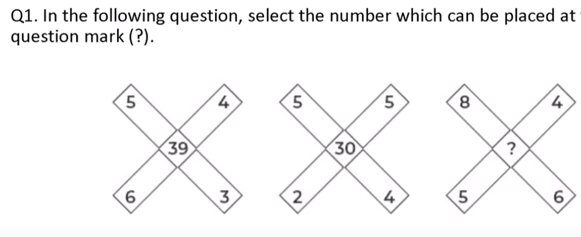
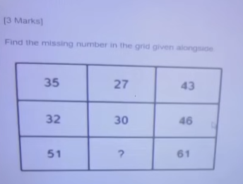
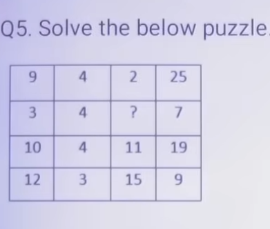
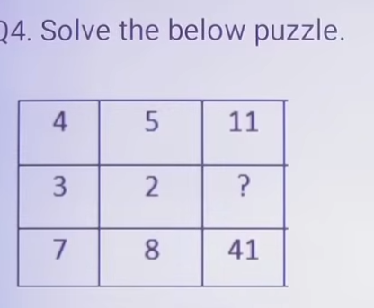
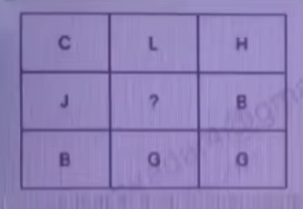
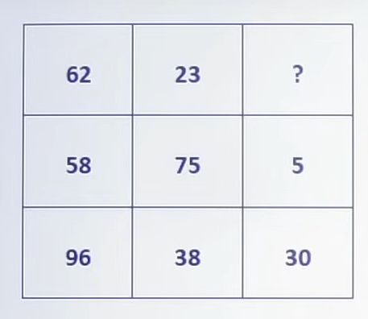
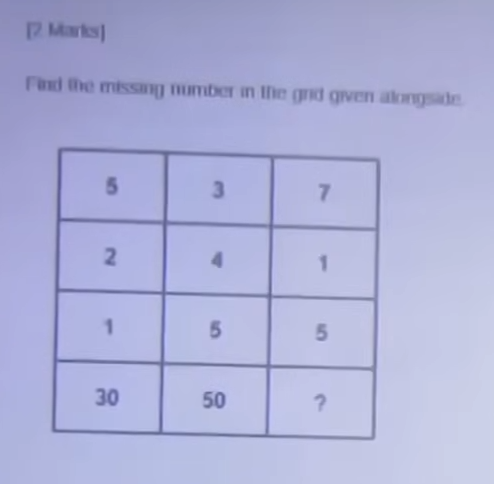
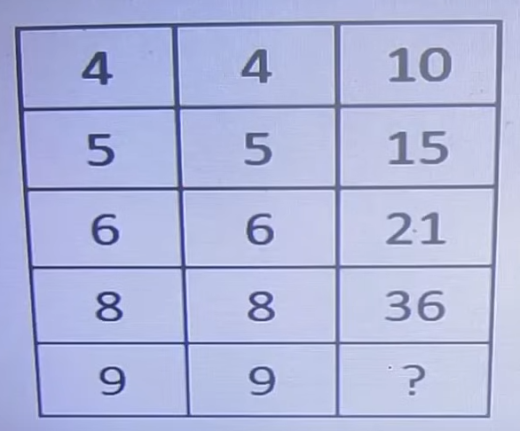
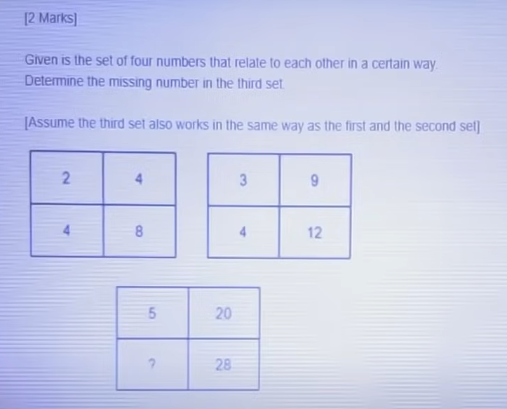
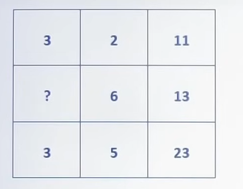

# Topic 05: Numerical Puzzles & Visual Reasoning Master Collection
**Course:** OnlineStudy4U Live Mock Test Series | **Module:** Canonical Topic Collection
**Total Questions in this Topic:** 57

---

## Overview & Module Scope
All 3x3 grids, 4x4 matrices, visual pattern puzzles, and geometric figures with embedded diagrams, markdown tables, and algebraic row/column relation formulas.

---

### Question 1 (From Infosys Test Series 1 (Full Assessment))
**Source Test:** `INFOSYS TEST SERIES-1` | **Question ID:** `68de264958e478256ed8a576` | **Marks:** +{'positive': 0, 'negative': 0} | **Difficulty:** None

**Options:**

- **(A)** 76
- **(B)** 45
- **(C)** 67
- **(D) [CORRECT]** 68

#### Detailed Solution & Verification Proof:

**Correct Option:** (D)

Logic: 5 x 3 + 6 x 4 = 39

---

### Question 2 (From Infosys Test Series 1 (Full Assessment))
**Source Test:** `INFOSYS TEST SERIES-1` | **Question ID:** `68de264958e478b816d8a580` | **Marks:** +{'positive': 0, 'negative': 0} | **Difficulty:** None

**Options:**

- **(A) [CORRECT]** 11
- **(B)** 33
- **(C)** 22
- **(D)** 32

#### Detailed Solution & Verification Proof:

**Correct Option:** (A)

Logic: 3 x 5 + 4 x 3 = 27

---

### Question 3 (From Infosys Test Series 1 (Full Assessment))
**Source Test:** `INFOSYS TEST SERIES-1` | **Question ID:** `68de264958e4785055d8a571` | **Marks:** +{'positive': 0, 'negative': 0} | **Difficulty:** None

**Options:**

- **(A)** 4
- **(B) [CORRECT]** 2
- **(C)** 6
- **(D)** 8

#### Detailed Solution & Verification Proof:

**Correct Option:** (B)

Logic: 9 x 4 – ( 9 + 2) = 25

---

### Question 4 (From Infosys Test Series 1 (Full Assessment))
**Source Test:** `INFOSYS TEST SERIES-1` | **Question ID:** `68de264958e4784683d8a56c` | **Marks:** +{'positive': 0, 'negative': 0} | **Difficulty:** None

**Options:**

- **(A)** 4
- **(B)** 3
- **(C)** 2
- **(D) [CORRECT]** 1

#### Detailed Solution & Verification Proof:

**Correct Option:** (D)

Logic: 4 x 5 – (4 + 5) =11

3 x 2 – ( 3+2) = 1

---

### Question 5 (From Infosys Test Series 1 (Full Assessment))
**Source Test:** `INFOSYS TEST SERIES-1` | **Question ID:** `68de264958e478ea90d8a57b` | **Marks:** +{'positive': 0, 'negative': 0} | **Difficulty:** None

**Options:**

- **(A) [CORRECT]** J
- **(B)** T
- **(C)** I
- **(D)** O

#### Detailed Solution & Verification Proof:

**Correct Option:** (A)

Logic:

Write the alphabetical position first.

Then 3 x 8 /2 = 12 , where 3 is C , H is 8 and L=12

---

### Question 6 (From Infosys Test Series 2 (Full Assessment))
**Source Test:** `INFOSYS TEST SERIES-2` | **Question ID:** `68de28be8b12952d032740f0` | **Marks:** +{'positive': 0, 'negative': 0} | **Difficulty:** None

**Options:**

- **(A) [CORRECT]** 26
- **(B)** 6
- **(C)** 39
- **(D)** 8

#### Detailed Solution & Verification Proof:

**Correct Option:** (A)

Logic: 5 x 8 – 7 x 5 = 5

---

### Question 7 (From Infosys Test Series 2 (Full Assessment))
**Source Test:** `INFOSYS TEST SERIES-2` | **Question ID:** `68de28be8b12951c422740e6` | **Marks:** +{'positive': 0, 'negative': 0} | **Difficulty:** None

**Options:**

- **(A) [CORRECT]** 75
- **(B)** 77
- **(C)** 70
- **(D)** 80

#### Detailed Solution & Verification Proof:

**Correct Option:** (A)

5 2 + 12 + 72 = 75

---

### Question 8 (From Infosys Test Series 2 (Full Assessment))
**Source Test:** `INFOSYS TEST SERIES-2` | **Question ID:** `68de28be8b1295613a2740dc` | **Marks:** +{'positive': 0, 'negative': 0} | **Difficulty:** None

**Options:**

- **(A)** 90
- **(B) [CORRECT]** 45
- **(C)** 55
- **(D) [CORRECT]** 60

#### Detailed Solution & Verification Proof:

**Correct Option:** (B) and (D)

Logic: [ (4 x 4) + 4 ] / 2 = 10

---

### Question 9 (From Infosys Test Series 2 (Full Assessment))
**Source Test:** `INFOSYS TEST SERIES-2` | **Question ID:** `68de28be8b129516572740e1` | **Marks:** +{'positive': 0, 'negative': 0} | **Difficulty:** None

**Options:**

- **(A)** 4
- **(B)** 2
- **(C)** 6
- **(D) [CORRECT]** 7

#### Detailed Solution & Verification Proof:

**Correct Option:** (D)

5 x 4= 20

7 x 4 = 28

---

### Question 10 (From Infosys Test Series 2 (Full Assessment))
**Source Test:** `INFOSYS TEST SERIES-2` | **Question ID:** `68de28be8b129586b02740eb` | **Marks:** +{'positive': 0, 'negative': 0} | **Difficulty:** None

**Options:**

- **(A) [CORRECT]** 8
- **(B)** 4
- **(C)** 9
- **(D) [CORRECT]** 1

#### Detailed Solution & Verification Proof:

**Correct Option:** (A) and (D)

Logic:

3 x 2 + (3 + 2) = 11

---

### Question 11 (From Infosys Full Length Mock Test 1)
**Source Test:** `Infosys Full Length Mock Test-1` | **Question ID:** `6aaf8c914382604bf1442ed6` | **Marks:** +{'positive': 0, 'negative': 0} | **Difficulty:** None

Find the missing number in the 3 × 3 grid.

**Options:**

- **(A)** 28
- **(B)** 30
- **(C) [CORRECT]** 34
- **(D)** 36

#### Detailed Solution & Verification Proof:

**Correct Option:** (C)

In each row, third = first × second + first + second, which is the same as (first + 1)(second + 1) − 1. Row 1: 2×5 + 2 + 5 = 17. Row 2: 4×3 + 4 + 3 = 19. Row 3: 6×4 + 6 + 4 = 34. Check: (6+1)(4+1) − 1 = 34.

---

### Question 12 (From Infosys Full Length Mock Test 1)
**Source Test:** `Infosys Full Length Mock Test-1` | **Question ID:** `6aaf8c914382607652442ecc` | **Marks:** +{'positive': 0, 'negative': 0} | **Difficulty:** None

Find the missing number in the last row of the grid.

**Options:**

- **(A)** 54
- **(B)** 56
- **(C) [CORRECT]** 57
- **(D)** 63

#### Detailed Solution & Verification Proof:

**Correct Option:** (C)

In every row, third = first × second + 1. Check: 2×3+1 = 7, 3×4+1 = 13, 4×5+1 = 21, 6×7+1 = 43. Therefore 7×8+1 = 57.

---

### Question 13 (From Infosys Full Length Mock Test 1)
**Source Test:** `Infosys Full Length Mock Test-1` | **Question ID:** `6aaf8c914382604c2c442ed1` | **Marks:** +{'positive': 0, 'negative': 0} | **Difficulty:** None

Given is the set of four numbers that relate to each other in a certain way. Determine the missing number in the third set. Assume the third set works in the same way as the first and the second set.

Set 1 Set 2 Set 3

**Options:**

- **(A) [CORRECT]** 2
- **(B)** 3
- **(C)** 4
- **(D)** 5

#### Detailed Solution & Verification Proof:

**Correct Option:** (A)

Within each set both rows use the same multiplier k, where right = left × k. Set 1: 5×2 = 10 and 3×2 = 6, so k = 2. Set 2: 4×4 = 16 and 2×4 = 8, so k = 4. Set 3: 3×5 = 15, so k = 5. Then ? × 5 = 10, hence ? = 2.

---

### Question 14 (From Infosys Full Length Mock Test 1)
**Source Test:** `Infosys Full Length Mock Test-1` | **Question ID:** `6aaf8c914382604c88442edb` | **Marks:** +{'positive': 0, 'negative': 0} | **Difficulty:** None

Find the missing number in the 3 × 3 grid.

**Options:**

- **(A)** 16
- **(B) [CORRECT]** 19
- **(C)** 21
- **(D)** 24

#### Detailed Solution & Verification Proof:

**Correct Option:** (B)

In each row, third number = (product of digits of the first number) − (product of digits of the second number). Row 2: 7×6 − 3×5 = 42 − 15 = 27. Row 3: 5×8 − 4×2 = 40 − 8 = 32. Row 1: 3×9 − 2×4 = 27 − 8 = 19. So the missing number is 19.

---

### Question 15 (From Infosys Full Length Mock Test 2)
**Source Test:** `Infosys Full Length Mock Test- 2` | **Question ID:** `6aaff98eb26d37a71160da61` | **Marks:** +{'positive': 0, 'negative': 0} | **Difficulty:** None

Find the missing number in the 3 × 3 matrix.

**Options:**

- **(A)** 47
- **(B) [CORRECT]** 49
- **(C)** 51
- **(D)** 54

#### Detailed Solution & Verification Proof:

**Correct Option:** (B)

Each row adds 5, then 8: 16+5 = 21, 21+8 = 29; 25+5 = 30, 30+8 = 38. So 36+5 = 41 and 41+8 = 49. The first column is also consecutive squares: 4², 5², 6².

---

### Question 16 (From Infosys Full Length Mock Test 2)
**Source Test:** `Infosys Full Length Mock Test- 2` | **Question ID:** `6aaff98eb26d3718b260da5c` | **Marks:** +{'positive': 0, 'negative': 0} | **Difficulty:** None

Find the next number in the pattern sequence.

**Options:**

- **(A)** 46
- **(B) [CORRECT]** 48
- **(C)** 49
- **(D)** 50

#### Detailed Solution & Verification Proof:

**Correct Option:** (B)

The gaps are consecutive odd numbers starting at 5: 8−3 = 5, 15−8 = 7, 24−15 = 9, 35−24 = 11. The next gap is 13, so 35 + 13 = 48. Equivalently, the terms are n(n+2) for n = 1, 2, 3, 4, 5, 6: 1×3=3, 2×4=8, 3×5=15, 4×6=24, 5×7=35, 6×8=48.

---

### Question 17 (From Infosys Full Length Mock Test 2)
**Source Test:** `Infosys Full Length Mock Test- 2` | **Question ID:** `6aaff98eb26d37041f60da57` | **Marks:** +{'positive': 0, 'negative': 0} | **Difficulty:** None

Find the missing number in the 3 × 3 matrix.

**Options:**

- **(A)** 28
- **(B)** 30
- **(C) [CORRECT]** 32
- **(D)** 36

#### Detailed Solution & Verification Proof:

**Correct Option:** (C)

In each row, third = first × (second + 1). Row 1: 2 × 6 = 12. Row 2: 3 × 7 = 21. Row 3: 4 × 8 = 32.

---

### Question 18 (From Infosys Full Length Mock Test 2)
**Source Test:** `Infosys Full Length Mock Test- 2` | **Question ID:** `6aaff98eb26d37d15460da52` | **Marks:** +{'positive': 0, 'negative': 0} | **Difficulty:** None

Each figure is a circular wheel: four numbers sit on the rim and one sits at the centre. The same rule applies to both wheels. Find the missing centre number.

Wheel A

Wheel B

**Options:**

- **(A)** 16
- **(B)** 18
- **(C) [CORRECT]** 20
- **(D)** 24

#### Detailed Solution & Verification Proof:

**Correct Option:** (C)

Opposite rim numbers add up to the centre. Wheel A: 6+12 = 18 and 8+10 = 18. Wheel B: 5+15 = 20 and 9+11 = 20. So the missing centre is 20.

---

### Question 19 (From Infosys Full Length Mock Test 3)
**Source Test:** `Infosys Full Length Mock Test- 3` | **Question ID:** `6ab15dfad57fc8559035ead8` | **Marks:** +{'positive': 0, 'negative': 0} | **Difficulty:** None

In each wheel the centre equals the sum of an opposite pair. Find the missing centre.

Wheel A

Wheel B

**Options:**

- **(A)** 8
- **(B) [CORRECT]** 9
- **(C)** 10
- **(D)** 12

#### Detailed Solution & Verification Proof:

**Correct Option:** (B)

Wheel A: 5+4=9 and 4+5=9. Wheel B: 7+2=9 and 6+3=9. The missing centre is 9.

---

### Question 20 (From Infosys Full Length Mock Test 3)
**Source Test:** `Infosys Full Length Mock Test- 3` | **Question ID:** `6ab15dfad57fc8299d35eae2` | **Marks:** +{'positive': 0, 'negative': 0} | **Difficulty:** None

Find the next number: 4, 9, 19, 39, 79, ?

**Options:**

- **(A)** 149
- **(B)** 157
- **(C) [CORRECT]** 159
- **(D)** 169

#### Detailed Solution & Verification Proof:

**Correct Option:** (C)

Each term = previous × 2 + 1: 4×2+1=9, 9×2+1=19, 19×2+1=39, 39×2+1=79, 79×2+1=159.

---

### Question 21 (From Infosys Full Length Mock Test 3)
**Source Test:** `Infosys Full Length Mock Test- 3` | **Question ID:** `6ab15dfad57fc86d7535eadd` | **Marks:** +{'positive': 0, 'negative': 0} | **Difficulty:** None

Find the missing number.

**Options:**

- **(A)** 22
- **(B) [CORRECT]** 24
- **(C)** 26
- **(D)** 30

#### Detailed Solution & Verification Proof:

**Correct Option:** (B)

Third = first × second + 2, then +3, then +4: 2×3+2=8, 3×4+3=15, 4×5+4=24. Equivalently first × (second + 1).

---

### Question 22 (From Infosys Full Length Mock Test 3)
**Source Test:** `Infosys Full Length Mock Test- 3` | **Question ID:** `6ab15dfad57fc8239c35eae7` | **Marks:** +{'positive': 0, 'negative': 0} | **Difficulty:** None

Find the missing number.

**Options:**

- **(A) [CORRECT]** 14
- **(B)** 13
- **(C)** 12
- **(D)** 10

#### Detailed Solution & Verification Proof:

**Correct Option:** (A)

Third = first − second: 11−6=5, 17−8=9, 23−9=14.

---

### Question 23 (From Infosys Full Length Mock Test 4)
**Source Test:** `Infosys Full Length Mock Test- 4` | **Question ID:** `6ab2716d3a618965c9d3be01` | **Marks:** +{'positive': 0, 'negative': 0} | **Difficulty:** None

[Pattern Sequence] Find the next number.

**Options:**

- **(A)** 900
- **(B)** 920
- **(C) [CORRECT]** 925
- **(D)** 945

#### Detailed Solution & Verification Proof:

**Correct Option:** (C)

×1+1=6, ×2+2=14, ×3+3=45, ×4+4=184, ×5+5=925.

---

### Question 24 (From Infosys Full Length Mock Test 4)
**Source Test:** `Infosys Full Length Mock Test- 4` | **Question ID:** `6ab2716d3a61893d47d3bdfc` | **Marks:** +{'positive': 0, 'negative': 0} | **Difficulty:** None

[Matrix Logic] Find the missing number.

**Options:**

- **(A)** 14
- **(B) [CORRECT]** 15
- **(C)** 16
- **(D)** 17

#### Detailed Solution & Verification Proof:

**Correct Option:** (B)

In each row, third = first + second + 2. So 7+6+2 = 15.

---

### Question 25 (From Infosys Full Length Mock Test 4)
**Source Test:** `Infosys Full Length Mock Test- 4` | **Question ID:** `6ab2716d3a6189f996d3be06` | **Marks:** +{'positive': 0, 'negative': 0} | **Difficulty:** None

[Matrix Logic] Find the missing number.

**Options:**

- **(A) [CORRECT]** 9
- **(B)** 8
- **(C)** 7
- **(D)** 6

#### Detailed Solution & Verification Proof:

**Correct Option:** (A)

Each row is consecutive squares: 3² 4² 5²; 2² 3² 4²; 1² 2² 3². Missing 9.

---

### Question 26 (From Infosys Full Length Mock Test 4)
**Source Test:** `Infosys Full Length Mock Test- 4` | **Question ID:** `6ab2716d3a61899c44d3bdf7` | **Marks:** +{'positive': 0, 'negative': 0} | **Difficulty:** None

[Circular Wheel] The centre is the product of any opposite pair. Find ?.

Wheel A

Wheel B

**Options:**

- **(A)** 8
- **(B)** 10
- **(C) [CORRECT]** 15
- **(D)** 30

#### Detailed Solution & Verification Proof:

**Correct Option:** (C)

Wheel A: 2×8=16. Wheel B: 3×5=15. The missing centre is 15.

---

### Question 27 (From Infosys Full Length Mock Test 5)
**Source Test:** `Infosys Full Length Mock Test- 5` | **Question ID:** `6ab27d8a51c2c8a246e78c98` | **Marks:** +{'positive': 0, 'negative': 0} | **Difficulty:** None

Centre = sum of each opposite pair. Find the missing centre.

Wheel A

Wheel B

**Options:**

- **(A)** 12
- **(B) [CORRECT]** 13
- **(C)** 15
- **(D)** 16

#### Detailed Solution & Verification Proof:

**Correct Option:** (B)

Wheel A: 8+3=11. Wheel B: 9+4=13 and 6+7=13. Missing centre = 13.

---

### Question 28 (From Infosys Full Length Mock Test 5)
**Source Test:** `Infosys Full Length Mock Test- 5` | **Question ID:** `6ab27d8a51c2c81de5e78ca2` | **Marks:** +{'positive': 0, 'negative': 0} | **Difficulty:** None

Find the next number.

**Options:**

- **(A)** 40
- **(B) [CORRECT]** 42
- **(C)** 44
- **(D)** 48

#### Detailed Solution & Verification Proof:

**Correct Option:** (B)

Gaps +4, +6, +8, +10, next +12. 30+12=42. Also n(n+1): 1×2, 2×3, 3×4, 4×5, 5×6, 6×7=42.

---

### Question 29 (From Infosys Full Length Mock Test 5)
**Source Test:** `Infosys Full Length Mock Test- 5` | **Question ID:** `6ab27d8a51c2c8d14ae78ca7` | **Marks:** +{'positive': 0, 'negative': 0} | **Difficulty:** None

Find the missing number.

**Options:**

- **(A) [CORRECT]** 17
- **(B)** 16
- **(C)** 15
- **(D)** 18

#### Detailed Solution & Verification Proof:

**Correct Option:** (A)

Third = first − second. 18−10=8, 25−13=12, 31−14=17.

---

### Question 30 (From Infosys Full Length Mock Test 5)
**Source Test:** `Infosys Full Length Mock Test- 5` | **Question ID:** `6ab27d8a51c2c83771e78c9d` | **Marks:** +{'positive': 0, 'negative': 0} | **Difficulty:** None

Find the missing number.

**Options:**

- **(A)** 54
- **(B)** 55
- **(C) [CORRECT]** 59
- **(D)** 63

#### Detailed Solution & Verification Proof:

**Correct Option:** (C)

Third = first × second + 3. 3×4+3=15, 5×6+3=33, 7×8+3=59.

---

### Question 31 (From Infosys Full Length Mock Test 6)
**Source Test:** `Infosys Full Length Mock Test- 6` | **Question ID:** `6ab286831da7e1fa2fe03981` | **Marks:** +{'positive': 0, 'negative': 0} | **Difficulty:** None

The centre equals the sum of each pair of opposite rim numbers. Find the missing centre.

Set 1

Set 2

**Options:**

- **(A)** 12
- **(B) [CORRECT]** 14
- **(C)** 15
- **(D)** 18

#### Detailed Solution & Verification Proof:

**Correct Option:** (B)

Set 1: 6+10=16. Set 2: 5+9=14 and 4+10=14. Missing centre = 14.

---

### Question 32 (From Infosys Full Length Mock Test 6)
**Source Test:** `Infosys Full Length Mock Test- 6` | **Question ID:** `6ab286831da7e16d1ee03986` | **Marks:** +{'positive': 0, 'negative': 0} | **Difficulty:** None

Find the missing number.

**Options:**

- **(A)** 26
- **(B)** 27
- **(C) [CORRECT]** 28
- **(D)** 30

#### Detailed Solution & Verification Proof:

**Correct Option:** (C)

Third = 5 × first − 2. Check: 5×4 − 2 = 18, 5×5 − 2 = 23, 5×6 − 2 = 28.

---

### Question 33 (From Infosys Full Length Mock Test 6)
**Source Test:** `Infosys Full Length Mock Test- 6` | **Question ID:** `6ab286831da7e160dae0398b` | **Marks:** +{'positive': 0, 'negative': 0} | **Difficulty:** None

Find the next number.

**Options:**

- **(A)** 200
- **(B)** 214
- **(C) [CORRECT]** 218
- **(D)** 226

#### Detailed Solution & Verification Proof:

**Correct Option:** (C)

Each term is n³ + 2: 1³+2=3, 2³+2=10, 3³+2=29, 4³+2=66, 5³+2=127, 6³+2=218.

---

### Question 34 (From Infosys Full Length Mock Test 6)
**Source Test:** `Infosys Full Length Mock Test- 6` | **Question ID:** `6ab286831da7e14b63e03990` | **Marks:** +{'positive': 0, 'negative': 0} | **Difficulty:** None

Find the missing number.

**Options:**

- **(A)** 19
- **(B) [CORRECT]** 21
- **(C)** 22
- **(D)** 24

#### Detailed Solution & Verification Proof:

**Correct Option:** (B)

In each row the third cell is the sum of the first two: 3+8=11, 6+10=16, 9+12=21.

---

### Question 35 (From Infosys Full Length Mock Test 7)
**Source Test:** `Infosys Full Length Mock Test- 7` | **Question ID:** `6ab28941d9c9a1359b0f99c8` | **Marks:** +{'positive': 0, 'negative': 0} | **Difficulty:** None

Given is the set of four numbers that relate to each other in a certain way. Determine the missing number in the third set. Assume the third set works in the same way as the first and the second set.

Set 1 Set 2 Set 3

**Options:**

- **(A) [CORRECT]** 2
- **(B)** 3
- **(C)** 4
- **(D)** 5

#### Detailed Solution & Verification Proof:

**Correct Option:** (A)

Within each set both rows use the same multiplier k, where right = left × k. Set 1: 5×2 = 10 and 3×2 = 6, so k = 2. Set 2: 4×4 = 16 and 2×4 = 8, so k = 4. Set 3: 3×5 = 15, so k = 5. Then ? × 5 = 10, hence ? = 2.

---

### Question 36 (From Infosys Full Length Mock Test 7)
**Source Test:** `Infosys Full Length Mock Test- 7` | **Question ID:** `6ab29143f551eb0dafe6293f` | **Marks:** +{'positive': 0, 'negative': 0} | **Difficulty:** None

Find the missing number.

**Options:**

- **(A)** 35
- **(B) [CORRECT]** 37
- **(C)** 39
- **(D)** 41

#### Detailed Solution & Verification Proof:

**Correct Option:** (B)

Third = first × second + 2. 5×3+2=17, 6×4+2=26, 7×5+2=37.

---

### Question 37 (From Infosys Full Length Mock Test 7)
**Source Test:** `Infosys Full Length Mock Test- 7` | **Question ID:** `6ab29143f551eb5bebe62944` | **Marks:** +{'positive': 0, 'negative': 0} | **Difficulty:** None

Find the next number.

**Options:**

- **(A) [CORRECT]** 100
- **(B)** 104
- **(C)** 108
- **(D)** 96

#### Detailed Solution & Verification Proof:

**Correct Option:** (A)

Each term = previous × 2 − 4. 7×2−4=10, 10×2−4=16, 16×2−4=28, 28×2−4=52, 52×2−4=100.

---

### Question 38 (From Infosys Full Length Mock Test 7)
**Source Test:** `Infosys Full Length Mock Test- 7` | **Question ID:** `6ab29143f551ebac7be6293a` | **Marks:** +{'positive': 0, 'negative': 0} | **Difficulty:** None

The centre is the product of each pair of opposite rim numbers. Find the missing centre.

Set 1

Set 2

**Options:**

- **(A)** 18
- **(B) [CORRECT]** 24
- **(C)** 28
- **(D)** 36

#### Detailed Solution & Verification Proof:

**Correct Option:** (B)

Set 1: 3×7=21. Set 2: 4×6=24.

---

### Question 39 (From Infosys Full Length Mock Test 7)
**Source Test:** `Infosys Full Length Mock Test- 7` | **Question ID:** `6ab28941d9c9a1f2800f99c7` | **Marks:** +{'positive': 0, 'negative': 0} | **Difficulty:** None

Find the missing number in the 3 × 3 grid.

**Options:**

- **(A)** 28
- **(B)** 30
- **(C) [CORRECT]** 34
- **(D)** 36

#### Detailed Solution & Verification Proof:

**Correct Option:** (C)

In each row, third = first × second + first + second, which is the same as (first + 1)(second + 1) − 1. Row 1: 2×5 + 2 + 5 = 17. Row 2: 4×3 + 4 + 3 = 19. Row 3: 6×4 + 6 + 4 = 34. Check: (6+1)(4+1) − 1 = 34.

---

### Question 40 (From Infosys Full Length Mock Test 7)
**Source Test:** `Infosys Full Length Mock Test- 7` | **Question ID:** `6ab28941d9c9a112860f99ca` | **Marks:** +{'positive': 0, 'negative': 0} | **Difficulty:** None

Find the missing number in the last row of the grid.

**Options:**

- **(A)** 54
- **(B)** 56
- **(C) [CORRECT]** 57
- **(D)** 63

#### Detailed Solution & Verification Proof:

**Correct Option:** (C)

In every row, third = first × second + 1. Check: 2×3+1 = 7, 3×4+1 = 13, 4×5+1 = 21, 6×7+1 = 43. Therefore 7×8+1 = 57.

---

### Question 41 (From Infosys Full Length Mock Test 7)
**Source Test:** `Infosys Full Length Mock Test- 7` | **Question ID:** `6ab29143f551eb10e0e62949` | **Marks:** +{'positive': 0, 'negative': 0} | **Difficulty:** None

Find the missing number.

**Options:**

- **(A)** 16
- **(B) [CORRECT]** 18
- **(C)** 20
- **(D)** 22

#### Detailed Solution & Verification Proof:

**Correct Option:** (B)

Third = first − second. 15−8=7, 22−9=13, 30−12=18.

---

### Question 42 (From Infosys Full Length Mock Test 7)
**Source Test:** `Infosys Full Length Mock Test- 7` | **Question ID:** `6ab28941d9c9a1531b0f99c9` | **Marks:** +{'positive': 0, 'negative': 0} | **Difficulty:** None

Find the missing number in the 3 × 3 grid.

**Options:**

- **(A)** 16
- **(B) [CORRECT]** 19
- **(C)** 21
- **(D)** 24

#### Detailed Solution & Verification Proof:

**Correct Option:** (B)

In each row, third number = (product of digits of the first number) − (product of digits of the second number). Row 2: 7×6 − 3×5 = 42 − 15 = 27. Row 3: 5×8 − 4×2 = 40 − 8 = 32. Row 1: 3×9 − 2×4 = 27 − 8 = 19. So the missing number is 19.

---

### Question 43 (From Infosys Full Length Mock Test 8)
**Source Test:** `Infosys Full Length Mock Test- 8` | **Question ID:** `6ab2992551df7a810a47040d` | **Marks:** +{'positive': 0, 'negative': 0} | **Difficulty:** None

Find the missing number.

**Options:**

- **(A)** 48
- **(B) [CORRECT]** 50
- **(C)** 52
- **(D)** 54

#### Detailed Solution & Verification Proof:

**Correct Option:** (B)

Third = first × second + 2. 6×4+2=26, 7×5+2=37, 8×6+2=50.

---

### Question 44 (From Infosys Full Length Mock Test 8)
**Source Test:** `Infosys Full Length Mock Test- 8` | **Question ID:** `6ab2992551df7af95f470417` | **Marks:** +{'positive': 0, 'negative': 0} | **Difficulty:** None

Find the missing number.

**Options:**

- **(A)** 32
- **(B)** 34
- **(C) [CORRECT]** 35
- **(D)** 42

#### Detailed Solution & Verification Proof:

**Correct Option:** (C)

Third = first + second. 10+15=25, 12+18=30, 14+21=35.

---

### Question 45 (From Infosys Full Length Mock Test 8)
**Source Test:** `Infosys Full Length Mock Test- 8` | **Question ID:** `6ab2992551df7aedf9470408` | **Marks:** +{'positive': 0, 'negative': 0} | **Difficulty:** None

The centre equals the difference of each pair of opposite rim numbers. Find the missing centre.

Set 1

Set 2

**Options:**

- **(A)** 6
- **(B) [CORRECT]** 8
- **(C)** 10
- **(D)** 16

#### Detailed Solution & Verification Proof:

**Correct Option:** (B)

Set 1: 18−11=7 and 11−4=7. Set 2: 21−13=8 and 13−5=8. Missing centre = 8.

---

### Question 46 (From Infosys Full Length Mock Test 8)
**Source Test:** `Infosys Full Length Mock Test- 8` | **Question ID:** `6ab2992551df7a131b470412` | **Marks:** +{'positive': 0, 'negative': 0} | **Difficulty:** None

Find the next number.

**Options:**

- **(A)** 96
- **(B) [CORRECT]** 98
- **(C)** 100
- **(D)** 102

#### Detailed Solution & Verification Proof:

**Correct Option:** (B)

Each term = previous × 2 − 2. 50 × 2 − 2 = 98.

---

### Question 47 (From Infosys Full Length Mock Test 9)
**Source Test:** `Infosys Full Length Mock Test- 9` | **Question ID:** `6ab29ec24fbbab3e564c437a` | **Marks:** +{'positive': 0, 'negative': 0} | **Difficulty:** None

The centre equals the sum of each pair of opposite rim numbers. Find the missing number.

**Options:**

- **(A)** 16
- **(B) [CORRECT]** 18
- **(C)** 21
- **(D)** 23

#### Detailed Solution & Verification Proof:

**Correct Option:** (B)

13 + 5 = 18 and 10 + 8 = 18. Missing centre = 18.

---

### Question 48 (From Infosys Full Length Mock Test 9)
**Source Test:** `Infosys Full Length Mock Test- 9` | **Question ID:** `6ab29ec24fbbab2e774c4389` | **Marks:** +{'positive': 0, 'negative': 0} | **Difficulty:** None

Find the missing number.

**Options:**

- **(A)** 19
- **(B) [CORRECT]** 21
- **(C)** 22
- **(D)** 24

#### Detailed Solution & Verification Proof:

**Correct Option:** (B)

Third = first − second. 16−9=7, 25−11=14, 36−15=21.

---

### Question 49 (From Infosys Full Length Mock Test 9)
**Source Test:** `Infosys Full Length Mock Test- 9` | **Question ID:** `6ab29ec24fbbab919b4c4384` | **Marks:** +{'positive': 0, 'negative': 0} | **Difficulty:** None

Find the next number.

**Options:**

- **(A) [CORRECT]** 159
- **(B)** 157
- **(C)** 161
- **(D)** 163

#### Detailed Solution & Verification Proof:

**Correct Option:** (A)

Each term = previous × 2 + 1. 4×2+1=9, 9×2+1=19, 19×2+1=39, 39×2+1=79, 79×2+1=159.

---

### Question 50 (From Infosys Full Length Mock Test 9)
**Source Test:** `Infosys Full Length Mock Test- 9` | **Question ID:** `6ab29ec24fbbabf9714c437f` | **Marks:** +{'positive': 0, 'negative': 0} | **Difficulty:** None

Find the missing number.

**Options:**

- **(A)** 24
- **(B) [CORRECT]** 25
- **(C)** 27
- **(D)** 29

#### Detailed Solution & Verification Proof:

**Correct Option:** (B)

Third = first × 3 + second. 4×3+9=21, 5×3+8=23, 6×3+7=25.

---

### Question 51 (From Infosys Full Length Mock Test 10)
**Source Test:** `Infosys Full Length Mock Test- 10` | **Question ID:** `6ab2a26cd9c9a173a80fa4f3` | **Marks:** +{'positive': 0, 'negative': 0} | **Difficulty:** None

Find the missing number.

**Options:**

- **(A)** 28
- **(B)** 30
- **(C) [CORRECT]** 32
- **(D)** 36

#### Detailed Solution & Verification Proof:

**Correct Option:** (C)

Third = first × second + 2. 2×5+2=12, 3×6+3=21 wait 18+3=21. first × second + first: 10+2=12, 18+3=21, 28+4=32. Yes first × (second + 1).

---

### Question 52 (From Infosys Full Length Mock Test 10)
**Source Test:** `Infosys Full Length Mock Test- 10` | **Question ID:** `6ab2a26cd9c9a1615d0fa4fd` | **Marks:** +{'positive': 0, 'negative': 0} | **Difficulty:** None

Find the missing number.

**Options:**

- **(A) [CORRECT]** 27
- **(B)** 25
- **(C)** 29
- **(D)** 31

#### Detailed Solution & Verification Proof:

**Correct Option:** (A)

Third = first − second. 21−8=13, 34−15=19, 47−20=27.

---

### Question 53 (From Infosys Full Length Mock Test 10)
**Source Test:** `Infosys Full Length Mock Test- 10` | **Question ID:** `6ab29f43ec91101650000cb1` | **Marks:** +{'positive': 0, 'negative': 0} | **Difficulty:** None

Find the missing number in the 3 × 3 grid.

**Options:**

- **(A)** 28
- **(B)** 30
- **(C) [CORRECT]** 34
- **(D)** 36

#### Detailed Solution & Verification Proof:

**Correct Option:** (C)

In each row, third = first × second + first + second, which is the same as (first + 1)(second + 1) − 1. Row 1: 2×5 + 2 + 5 = 17. Row 2: 4×3 + 4 + 3 = 19. Row 3: 6×4 + 6 + 4 = 34. Check: (6+1)(4+1) − 1 = 34.

---

### Question 54 (From Infosys Full Length Mock Test 10)
**Source Test:** `Infosys Full Length Mock Test- 10` | **Question ID:** `6ab29f43ec9110459d000cb4` | **Marks:** +{'positive': 0, 'negative': 0} | **Difficulty:** None

Find the missing number in the last row of the grid.

**Options:**

- **(A)** 54
- **(B)** 56
- **(C) [CORRECT]** 57
- **(D)** 63

#### Detailed Solution & Verification Proof:

**Correct Option:** (C)

In every row, third = first × second + 1. Check: 2×3+1 = 7, 3×4+1 = 13, 4×5+1 = 21, 6×7+1 = 43. Therefore 7×8+1 = 57.

---

### Question 55 (From Infosys Full Length Mock Test 10)
**Source Test:** `Infosys Full Length Mock Test- 10` | **Question ID:** `6ab29f43ec9110dd36000cb3` | **Marks:** +{'positive': 0, 'negative': 0} | **Difficulty:** None

Find the missing number in the 3 × 3 grid.

**Options:**

- **(A)** 16
- **(B) [CORRECT]** 19
- **(C)** 21
- **(D)** 24

#### Detailed Solution & Verification Proof:

**Correct Option:** (B)

In each row, third number = (product of digits of the first number) − (product of digits of the second number). Row 2: 7×6 − 3×5 = 42 − 15 = 27. Row 3: 5×8 − 4×2 = 40 − 8 = 32. Row 1: 3×9 − 2×4 = 27 − 8 = 19. So the missing number is 19.

---

### Question 56 (From Infosys Full Length Mock Test 10)
**Source Test:** `Infosys Full Length Mock Test- 10` | **Question ID:** `6ab29f43ec9110c042000cb2` | **Marks:** +{'positive': 0, 'negative': 0} | **Difficulty:** None

Given is the set of four numbers that relate to each other in a certain way. Determine the missing number in the third set. Assume the third set works in the same way as the first and the second set.

Set 1 Set 2 Set 3

**Options:**

- **(A) [CORRECT]** 2
- **(B)** 3
- **(C)** 4
- **(D)** 5

#### Detailed Solution & Verification Proof:

**Correct Option:** (A)

Within each set both rows use the same multiplier k, where right = left × k. Set 1: 5×2 = 10 and 3×2 = 6, so k = 2. Set 2: 4×4 = 16 and 2×4 = 8, so k = 4. Set 3: 3×5 = 15, so k = 5. Then ? × 5 = 10, hence ? = 2.

---

### Question 57 (From Infosys Full Length Mock Test 10)
**Source Test:** `Infosys Full Length Mock Test- 10` | **Question ID:** `6ab2a26cd9c9a189ad0fa4f8` | **Marks:** +{'positive': 0, 'negative': 0} | **Difficulty:** None

Find the next number.

**Options:**

- **(A)** 221
- **(B) [CORRECT]** 223
- **(C)** 225
- **(D)** 227

#### Detailed Solution & Verification Proof:

**Correct Option:** (B)

Each term = previous × 2 + 1. 6×2+1=13, 13×2+1=27, 27×2+1=55, 55×2+1=111, 111×2+1=223.

---
