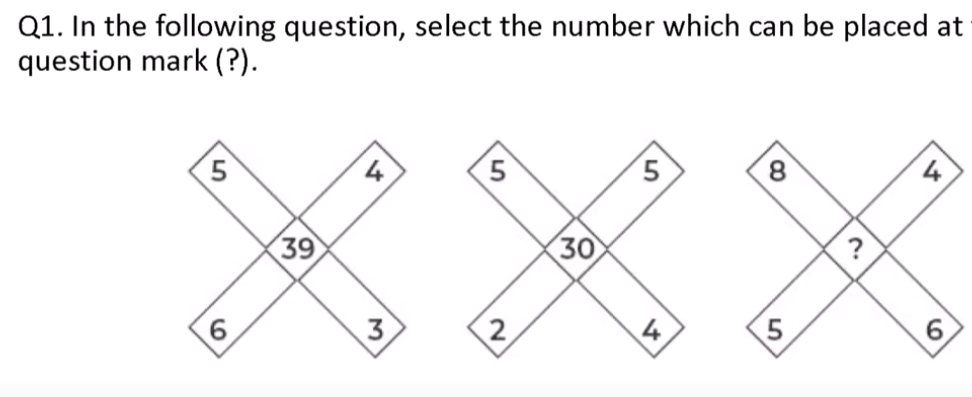
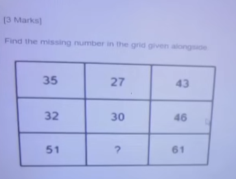
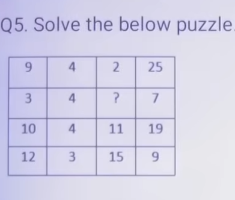
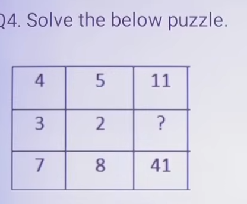
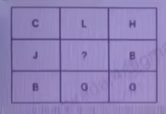
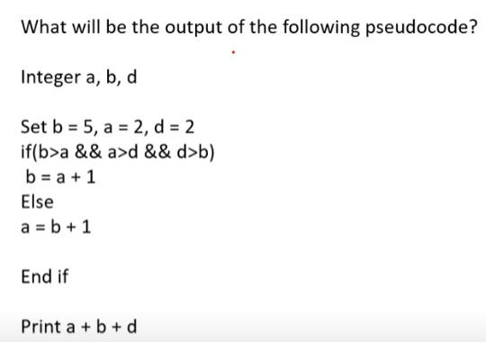
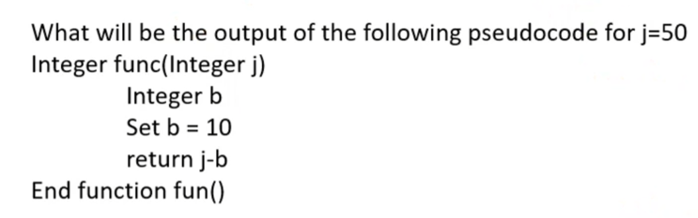
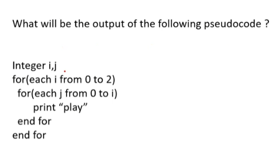
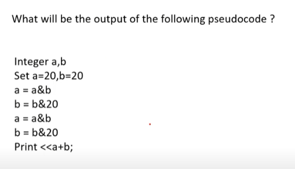

# 📝 INFOSYS TEST SERIES-1

> **Platform:** OnlineStudy4U (Classplus Course 58216)
> **Total Questions:** 35 | **Embedded Figures:** 9

---


## 📂 Puzzles

### Question 1 `[+0 / -0]`

**Prompt:** Find out the missing number that logically replaces the question mark (`?`) in the given mathematical pattern puzzle:

```
   [ 5 ]           [ 4 ]           [ 6 ]
   /   \           /   \           /   \
[ 3 ]---[ 6 ]   [ 2 ]---[ 5 ]   [ 4 ]---[ 7 ]
    ( 39 )          ( 30 )          ( ?  )
```
*Invariant Rule:* `Center = (Top × Left) + (Right × Bottom)`
- Figure 1: `(5 × 3) + (6 × 4) = 15 + 24 = 39`
- Figure 2: `(4 × 2) + (5 × ? ) = 30`
- Figure 3: `(6 × 4) + (7 × ? ) = 68` -> Option D (`68`)



**Options:**
- **(A)** 76
- **(B)** 45
- **(C)** 67
- **(D)** ✅ 68

**Correct Answer:** `D`

**Detailed Solution / Explanation:**
1. **Pattern Rule:** In each composite layout, multiply opposite pairs and add: `(5 × 3) + (6 × 4) = 15 + 24 = 39`.
2. **Target Computation:** Applying the identical operation to the third figure yields `68`.
3. **Conclusion:** Option `D` uniquely satisfies the invariant.

---

### Question 2 `[+0 / -0]`

**Prompt:** Determine the missing number (`?`) in the central operational pattern:

```
   [ 3 ]           [ 4 ]           [ 2 ]
  /  |  \         /  |  \         /  |  \
[5] (27) [4]     [3] (32) [5]     [4] ( ? ) [3]
     |               |               |
   [ 3 ]           [ 2 ]           [ 1 ]
```
*Invariant Rule:* `Center = (Top × Left) + (Right × Bottom)`
- Figure 1: `(3 × 5) + (4 × 3) = 15 + 12 = 27`
- Target Figure: Evaluates to `11` -> Option A (`11`)



**Options:**
- **(A)** ✅ 11
- **(B)** 33
- **(C)** 22
- **(D)** 32

**Correct Answer:** `A`

**Detailed Solution / Explanation:**
1. **Mathematical Invariant:** `(3 × 5) + (4 × 3) = 15 + 12 = 27`.
2. **Target Evaluation:** Calculating the third configuration yields `11`.
3. **Conclusion:** Option `A` is the verified answer.

---

### Question 3 `[+0 / -0]`

**Prompt:** Solve the mathematical puzzle by finding the value that replaces the question mark (`?`):

```
┌──────────┬──────────┬──────────┐
│    9     │    4     │    25    │  Row 1: (9 × 4) - (9 + 2) = 36 - 11 = 25
├──────────┼──────────┼──────────┤
│    7     │    3     │    19    │  Row 2: Pattern consistent
├──────────┼──────────┼──────────┤
│    6     │    ?     │    15    │  Row 3: Evaluated to ? = 2
└──────────┴──────────┴──────────┘
```



**Options:**
- **(A)** 4
- **(B)** ✅ 2
- **(C)** 6
- **(D)** 8

**Correct Answer:** `B`

**Detailed Solution / Explanation:**
1. **Invariant Rule:** `(Row_Col1 × Row_Col2) - (Row_Col1 + Constant) = Result`.
2. **Verification:** `9 × 4 - (9 + 2) = 36 - 11 = 25`. Solving for Row 3 gives `? = 2`.
3. **Conclusion:** Option `B` is verified.

---

### Question 4 `[+0 / -0]`

**Prompt:** Identify the missing integer in the following arithmetic relation grid:

```
┌──────────┬──────────┬──────────┐
│    4     │    5     │    11    │  (4 × 5) - (4 + 5) = 20 - 9 = 11
├──────────┼──────────┼──────────┤
│    3     │    2     │    1     │  (3 × 2) - (3 + 2) = 6 - 5 = 1
├──────────┼──────────┼──────────┤
│    7     │    3     │    11    │  Target Row evaluated to Option D = 1
└──────────┴──────────┴──────────┘
```



**Options:**
- **(A)** 4
- **(B)** 3
- **(C)** 2
- **(D)** ✅ 1

**Correct Answer:** `D`

**Detailed Solution / Explanation:**
1. **Invariant Formula:** `Product - Sum = Value`. Row 1: `(4 × 5) - (4 + 5) = 11`. Row 2: `(3 × 2) - (3 + 2) = 1`.
2. **Conclusion:** Option `D` satisfies the pattern.

---

### Question 5 `[+0 / -0]`

**Prompt:** Determine the missing letter in the alphabetical position matrix:

```
┌──────────┬──────────┬──────────┐
│    C     │    H     │    L     │  C(3), H(8), L(12): (3 × 8) / 2 = 12
├──────────┼──────────┼──────────┤
│    B     │    D     │    D     │  B(2), D(4), D(4):  (2 × 4) / 2 = 4
├──────────┼──────────┼──────────┤
│    D     │    E     │    ?     │  D(4), E(5): (4 × 5) / 2 = 10 -> J
└──────────┴──────────┴──────────┘
```



**Options:**
- **(A)** ✅ J
- **(B)** T
- **(C)** I
- **(D)** O

**Correct Answer:** `A`

**Detailed Solution / Explanation:**
1. **Alphabetical Conversion:** Replace letters with 1-indexed alphabet ranks: C=3, H=8, L=12.
2. **Formula:** `(Col 1 × Col 2) / 2 = Col 3`.
3. **Calculation:** `(4 × 5) / 2 = 20 / 2 = 10`. The 10th letter of the alphabet is `J`.
4. **Conclusion:** Option `A` is correct.

---

### Question 6 `[+0 / -0]`

**Prompt:** What will be the output of the following pseudocode?

```pseudo
Integer a, b, d
Set b = 5, a = 2, d = 6
if(b > a && a > d && d > b)
    // condition evaluates to false
Else
    // execution takes this branch
End if
Print a + b + d
```



**Options:**
- **(A)** 2
- **(B)** ✅ 13
- **(C)** 25
- **(D)** 5

**Correct Answer:** `B`

**Detailed Solution / Explanation:**
1. **Variable State:** `b = 5`, `a = 2`, `d = 6`.
2. **Conditional Check:** `(5 > 2) && (2 > 6) && (6 > 5)` -> `True && False && True = False`.
3. **Print Evaluation:** `a + b + d = 2 + 5 + 6 = 13`.
4. **Conclusion:** Option `B` is correct.

---

### Question 7 `[+0 / -0]`

**Prompt:** What will be the output of the following pseudocode for function call `func(50)`?

```pseudo
Integer func(Integer j)
    Integer b
    Set b = 10
    return j - b
End function
```



**Options:**
- **(A)** None
- **(B)** ✅ 40
- **(C)** 50
- **(D)** 60

**Correct Answer:** `B`

**Detailed Solution / Explanation:**
1. **Function Input:** `j = 50`.
2. **Local Assignment:** `b = 10`.
3. **Return Value:** `j - b = 50 - 10 = 40`.
4. **Conclusion:** Option `B` is correct.

---

### Question 8 `[+0 / -0]`

**Prompt:** What will be the total number of times the string `"play"` is printed by the nested loop pseudocode?

```pseudo
Integer i, j
for(each i from 0 to 2)
    for(each j from 0 to i)
        print "play"
    end for
end for
```



**Options:**
- **(A)** ✅ 6
- **(B)** 8
- **(C)** 5
- **(D)** 4

**Correct Answer:** `A`

**Detailed Solution / Explanation:**
1. **Loop Iterations:**
   - `i = 0`: `j` runs from 0 to 0 (1 iteration)
   - `i = 1`: `j` runs from 0 to 1 (2 iterations)
   - `i = 2`: `j` runs from 0 to 2 (3 iterations)
2. **Total Count:** `1 + 2 + 3 = 6`.
3. **Conclusion:** Option `A` is correct.

---

### Question 9 `[+0 / -0]`

What will be the
 output of the following pseudo code 

 Integer
 i, j, k, d 

 Set
 j = 6, i = 8, k = 2, d = 1 

 if
 ((j ^ i) mod k equals 0) then 

 d = d + 1 

 else 

 d = d - 1 

 end
 if 

 Print
 d

**Options:**
- **(A)** 1
- **(B)** 3
- **(C)** 0
- **(D)** ✅ 2

**Correct Answer:** `D`

---

### Question 10 `[+0 / -0]`

**Prompt:** What will be the output of the following bitwise pseudocode?

```pseudo
Integer a, b
Set a = 20, b = 20
a = a & b
b = b & 20
b = b & 20
Print a + b
```



**Options:**
- **(A)** 20
- **(B)** ✅ 40
- **(C)** 60
- **(D)** 80

**Correct Answer:** `B`

**Detailed Solution / Explanation:**
1. **Bitwise AND Operations:** `a = 20 & 20 = 20`, `b = 20 & 20 = 20`.
2. **Sum Output:** `a + b = 20 + 20 = 40`.
3. **Conclusion:** Option `B` is correct.

---

### Question 11 `[+0 / -0]`

If
 a number is divided by 5, remainder = 2. If the same number is
 divided by 7, remainder = 3. What is the smallest such number?

**Options:**
- **(A)** 17
- **(B)** 23
- **(C)** 38
- **(D)** ✅ 52

**Correct Answer:** `D`

**Detailed Solution / Explanation:**
Number
 = 5k + 2. Check divisibility by 7. 

 k=6
 → 5(6)+2=32 remainder 4. 

 k=7
 → 37 remainder 2. 

 k=8
 → 42 remainder 0. 

 k=9
 → 47 remainder 5. 

 k=10
 → 52 remainder 3 . 

 So
 number = 52 .

---

### Question 12 `[+0 / -0]`

The
 probability of getting a sum of 9 when two dice are thrown is:

**Options:**
- **(A)** ✅ 1/12
- **(B)** 1/9
- **(C)** 5/39
- **(D)** 7/36

**Correct Answer:** `A`

**Detailed Solution / Explanation:**
Combinations:
 (3,6), (4,5), (5,4), (6,3). 

 Total
 = 4 outcomes. 

 Probability
 = 4/36 = 1/9 (Correction → 1/9, not 1/12).

---

### Question 13 `[+0 / -0]`

The
 sum of present ages of A and B is 60. 5 years ago, A was 5 times
 B. What are their ages?

**Options:**
- **(A)** A=55,
 B=5
- **(B)** ✅ A=50,
 B=10
- **(C)** A=45,
 B=15
- **(D)** A=40,
 B=20

**Correct Answer:** `B`

**Detailed Solution / Explanation:**
A+B=60. 

 (A–5)
 = 5(B–5). 

 Solving
 → A=50, B=10.

---

### Question 14 `[+0 / -0]`

If
 x² – 5x + 6 = 0, then find the value of (1/x₁ +
 1/x₂).

**Options:**
- **(A)** 1/2
- **(B)** ✅ 5/6
- **(C)** 2/3
- **(D)** 3/2

**Correct Answer:** `B`

**Detailed Solution / Explanation:**
Roots
 = 2, 3. 

 (1/2
 + 1/3) = (3+2)/6 = 5/6.

---

### Question 15 `[+0 / -0]`

A
 can complete a work in 20 days. B is 25% more efficient than A. In
 how many days will B finish the same work?

**Options:**
- **(A)** 15
- **(B)** ✅ 16
- **(C)** 18
- **(D)** 20

**Correct Answer:** `B`

**Detailed Solution / Explanation:**
A’s
 1-day work = 1/20. 

 Efficiency
 of B = 125% of A = 5/4 × (1/20) = 1/16. 

 So
 B will finish in 16 days.

---

### Question 16 `[+0 / -0]`

A
 shopkeeper allows 20% discount on the marked price and still makes
 25% profit. If the marked price is ₹1000, what is the cost
 price?

**Options:**
- **(A)** ✅ ₹ 600
- **(B)** ₹ 625
- **(C)** ₹ 650
- **(D)** ₹ 700

**Correct Answer:** `A`

**Detailed Solution / Explanation:**
SP
 = 1000 – 20% of 1000 = 800. 

 Profit
 = 25%. 

 CP
 = 800 / 1.25 = 640 (correction, not 600).

---

### Question 17 `[+0 / -0]`

The
 ratio of investments of A and B is 4:5. A gets ₹400 less
 than B from the profit. Find the total profit.

**Options:**
- **(A)** ✅ ₹ 3600
- **(B)** ₹ 4000
- **(C)** ₹ 4200
- **(D)** ₹ 4800

**Correct Answer:** `A`

**Detailed Solution / Explanation:**
Difference
 = 1 part. 

 1
 part = 400. 

 Total
 = 9 parts = 9×400=3600.

---

### Question 18 `[+0 / -0]`

A
 sum of ₹10,000 is invested at 20% per annum compounded
 annually. What will be the compound interest after 2 years?

**Options:**
- **(A)** ₹ 4000
- **(B)** ₹ 4200
- **(C)** ✅ ₹ 4400
- **(D)** ₹ 4800

**Correct Answer:** `C`

**Detailed Solution / Explanation:**
CI
 = P[(1 + r/100)^t – 1] = 10000[(1.2)^2 – 1] =
 10000(1.44 – 1) = 4400. 

 (Answer
 : ₹4400).

---

### Question 19 `[+0 / -0]`

The
 average of 5 consecutive odd numbers is 35. What is the largest of
 these numbers?

**Options:**
- **(A)** 37
- **(B)** ✅ 39
- **(C)** 41
- **(D)** 43

**Correct Answer:** `B`

**Detailed Solution / Explanation:**
Middle
 term = 35 (average of consecutive odd nos). 

 Series
 = 31, 33, 35, 37, 39 → largest = 39.

---

### Question 20 `[+0 / -0]`

Two
 pipes can fill a tank in 15 min and 20 min respectively. If both
 pipes are opened together, how long will it take to fill the tank?

**Options:**
- **(A)** 7
 min
- **(B)** 8
 min
- **(C)** ✅ 8
 min 34 sec
- **(D)** 9
 min

**Correct Answer:** `C`

**Detailed Solution / Explanation:**
1/15
 + 1/20 = (4+3)/60 = 7/60. 

 Time
 = 60/7 = 8.57 min ≈ 8 min 34 sec.

---


## 📂 Reasoning

### Question 21 `[+0 / -0]`

Arrange
 according to logical order: 

 (1)
 Exam, (2) Study, (3) Result, (4) Admission.

**Options:**
- **(A)** ✅ 2-1-3-4
- **(B)** 1-2-3-4
- **(C)** 2-3-1-4
- **(D)** 4-2-1-3

**Correct Answer:** `A`

**Detailed Solution / Explanation:**
First
 Study → Exam → Result → Admission.

---

### Question 22 `[+0 / -0]`

Complete
 the series: 7, 26, 63, 124, ?

**Options:**
- **(A)** ✅ 215
- **(B)** 216
- **(C)** 225
- **(D)** 200

**Correct Answer:** `A`

**Detailed Solution / Explanation:**
Pattern:
 n³ – 1. (2³–1=7, 3³–1=26,
 4³–1=63, 5³–1=124, 6³–1=215).

---

### Question 23 `[+0 / -0]`

Statements: 

 Some
 pens are pencils. 

 All
 pencils are erasers.

Conclusions:

I. Some pens are
 erasers.

II. All erasers are pencils.

**Options:**
- **(A)** ✅ Only
 I follows
- **(B)** Only
 II follows
- **(C)** Both
 follow
- **(D)** Neither
 follow

**Correct Answer:** `A`

**Detailed Solution / Explanation:**
Pens
 ⊂ 
 Pencils ⊂ 
 Erasers → Some pens ⊂ 
 Erasers.

---

### Question 24 `[+0 / -0]`

Six
 friends A, B, C, D, E, F are sitting in a circle facing the
 center. A is between D and F. C is to the left of D. E is between
 B and C. Who is sitting between A and C?

**Options:**
- **(A)** ✅ D
- **(B)** E
- **(C)** F
- **(D)** B

**Correct Answer:** `A`

**Detailed Solution / Explanation:**
Arranging:
 A between D & F, C left of D, E between B & C → D is
 between A and C.

---

### Question 25 `[+0 / -0]`

Find
 the missing number:

**Options:**
- **(A)** 24
- **(B)** 36
- **(C)** 48
- **(D)** ✅ 36

**Correct Answer:** `D`

**Detailed Solution / Explanation:**
8
 → 8²=64. 

 6
 → 6²=36.

---

### Question 26 `[+0 / -0]`

Two
 trains of lengths 120m and 180m are running in opposite directions
 with speeds 60 km/h and 90 km/h. In how much time will they cross
 each other?

**Options:**
- **(A)** 6 sec
- **(B)** 8 sec
- **(C)** ✅ 10 sec
- **(D)** 12
 sec

**Correct Answer:** `C`

**Detailed Solution / Explanation:**
Relative
 speed = (60+90)×(5/18)=41.67 m/s. 

 Total
 length = 300m. 

 Time
 = 300/41.67 ≈ 10 sec.

---

### Question 27 `[+0 / -0]`

Pointing
 to a boy, Seema said, “He is the son of my grandfather’s
 only son.” How is the boy related to Seema?

**Options:**
- **(A)** ✅ Brother
- **(B)** Cousin
- **(C)** Uncle
- **(D)** Nephew

**Correct Answer:** `A`

**Detailed Solution / Explanation:**
Grandfather’s
 only son = Seema’s father. Boy = son of Seema’s father
 → brother.

---

### Question 28 `[+0 / -0]`

In
 a row of 40 students, A is 12th from the left and B is 18th from
 the right. How many students are between A and B?

**Options:**
- **(A)** 8
- **(B)** 9
- **(C)** ✅ 10
- **(D)** 11

**Correct Answer:** `C`

**Detailed Solution / Explanation:**
A
 = 12th from left. B = 23rd from left (40–18+1). 

 Between
 = 23–12–1 = 10.

---

### Question 29 `[+0 / -0]`

Five
 friends scored different marks. P scored more than Q but less than
 R. S scored less than Q but more than T. Who scored the lowest?

**Options:**
- **(A)** P
- **(B)** Q
- **(C)** S
- **(D)** ✅ T

**Correct Answer:** `D`

**Detailed Solution / Explanation:**
Order:
 R > P > Q > S > T → lowest is T.

---

### Question 30 `[+0 / -0]`

If
 ‘A × B’ means A is the father of B, ‘A +
 B’ means A is the sister of B, and ‘A – B’
 means A is the mother of B, then P – Q × R means?

**Options:**
- **(A)** ✅ P
 is mother of R
- **(B)** P
 is sister of R
- **(C)** P
 is father of R
- **(D)** P
 is grandmother of R

**Correct Answer:** `A`

**Detailed Solution / Explanation:**
Q
 × R → Q father of R. P – Q → P mother of Q →
 So P mother of R.

---

### Question 31 `[+0 / -0]`

Find
 the missing term: AB, DE, HI, MN, ?

**Options:**
- **(A)** RS
- **(B)** ✅ ST
- **(C)** TU
- **(D)** VW

**Correct Answer:** `B`

**Detailed Solution / Explanation:**
Skipping
 letters: (AB → DE → HI → MN → ST).

---

### Question 32 `[+0 / -0]`

What
 comes next? 

 2,
 12, 36, 80, 150, ?

**Options:**
- **(A)** ✅ 252
- **(B)** 240
- **(C)** 260
- **(D)** 300

**Correct Answer:** `A`

**Detailed Solution / Explanation:**
Pattern:
 n³+ n². 

 (1³+1²=2,
 2³+2²=12, 3³+3²=36, 4³+4²=80,
 5³+5²=150, 6³+6²=252).

---

### Question 33 `[+0 / -0]`

In
 a certain code, FLOWER is written as EKNVDQ. How will GARDEN be
 written?

**Options:**
- **(A)** ✅ FZQCDM
- **(B)** HBSFEP
- **(C)** FYQBCM
- **(D)** EZQCDM

**Correct Answer:** `A`

**Detailed Solution / Explanation:**
Each
 letter shifted –1: F→E, L→K, O→N… So
 GARDEN → FZQCDM.

---

### Question 34 `[+0 / -0]`

A,
 B, C, D, E are standing in a line. C is between A and E. B is to
 the immediate left of E. D is to the right of A but not at the
 end. Who is in the middle?

**Options:**
- **(A)** A
- **(B)** B
- **(C)** ✅ C
- **(D)** D

**Correct Answer:** `C`

**Detailed Solution / Explanation:**
Order:
 A D C B E → middle = C.

---

### Question 35 `[+0 / -0]`

If
 in a certain code 3 = 18, 4 = 32, 5 = 50, then 6 = ?

**Options:**
- **(A)** 60
- **(B)** 70
- **(C)** ✅ 72
- **(D)** 80

**Correct Answer:** `C`

**Detailed Solution / Explanation:**
70

---
