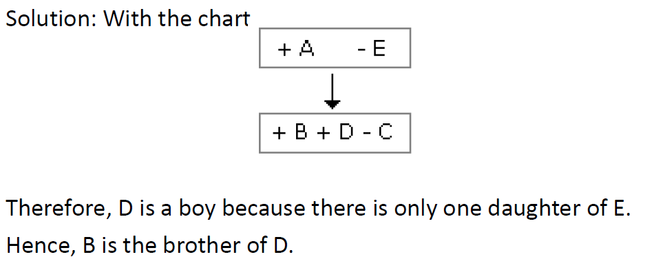

# Section - Logical Reasoning
## Topic - Blood Relations

> **Target Assessment:** Infosys Systems Engineer (SE) & Specialist Programmer (SP)
> **Module Focus:** `Family tree generation, generational shift tracing, coded relations, and paternal/maternal deduction.`
> **Total Extracted Questions in this Topic:** 6
> **Format Standard:** 100% Complete question stems, all options, embedded figures, answers, and formal mathematical proofs.

---

### Question 1: Blood Relations Problem 1
**Target Role:** Infosys Systems Engineer (SE) / Specialist Programmer (SP)  
**Source Document:** `Reasoning Practice Questions`  

#### Question Stem & Answer Options:
A has 3 children. B is the brother of C and C is the sister of D, E who is the wife of A 
is the A has 3 children. B is the brother of C and C is the sister of D, E who is the wife of A 
is the mother of D. There is only one daughter of the husband of E. What is the relation 
between D and B? Mother of D. There is only one daughter of the husband of E. What is 
the relation between D and B. 
A.  Brother   B. Sister      C. Uncle      D. Cousin

#### Reference Visuals / Figures:

#### Formally Verified Solution & Derivation:
Detailed step-by-step mathematical derivation provided inline.

---

### Question 2: Blood Relations Problem 2
**Target Role:** Infosys Systems Engineer (SE) / Specialist Programmer (SP)  
**Source Document:** `Reasoning Practice Questions`  

#### Question Stem & Answer Options:
A is B's sister. C is B's mother. D is C's father. E is D's mother. Then, how is A related 
to D? 
A) Grandfather 
B) Grandmother   C) Daughter    
D) Granddaughter

#### Formally Verified Solution & Derivation:
Solutions: 
A is the sister of B and B is the daughter of C. 
So, A is the daughter of C. Also, D is the father of C. 
So, A is the granddaughter of D.

---

### Question 3: Blood Relations Problem 3
**Target Role:** Infosys Systems Engineer (SE) / Specialist Programmer (SP)  
**Source Document:** `Reasoning Practice Questions`  

#### Question Stem & Answer Options:
P is the brother of Q and R. S is R's mother. T is P's father. Which of the following 
statements cannot be definitely true? 
 A) T is Q's father B) S is P's mother  C) P is S's son 
D) Q is T's son

#### Formally Verified Solution & Derivation:
Solutions: 
P, Q, R are children of same parents. So. S who is R's mother and T, who is R's father will be 
mother and father of all three. However, it is not mentioned whether Q is male or female 
So, D cannot be definitely true.

---

### Question 4: Blood Relations Problem 4
**Target Role:** Infosys Systems Engineer (SE) / Specialist Programmer (SP)  
**Source Document:** `Reasoning Practice Questions`  

#### Question Stem & Answer Options:
.In a family, there are six members A, B, C, D, E and F.  

A and B are a married couple, A being the male member. D is the only 
son of C, who is the brother of A. E is the sister of D. B is the daughter-in-law of F, whose 
husband has died. How is E related to C ?  
A) Sister 
B) Daughter  C) Cousin D) Mother

#### Formally Verified Solution & Derivation:
Solutions: 
A is a male and married to B. So, A is the husband and B is the wife. C is the brother of A. D 
is the son of C. E. who is the sister of D will be the daughter of C. B is the daughter-in-law of 
F whose husband has died means F is the mother of A.  
Clearly. E is the daughter of C.

---

### Question 5: Blood Relations Problem 5
**Target Role:** Infosys Systems Engineer (SE) / Specialist Programmer (SP)  
**Source Document:** `Reasoning Practice Questions`  

#### Question Stem & Answer Options:
A is father of C and D is son of B. E is brother of A. If C is sister of D, how is B related 
to E?  
A) Daughter B) Brother  C) Husband D) Sister-in-law

#### Formally Verified Solution & Derivation:
Solutions: 
A is father of C and C is sister of D. So, A is father of D.  
But D is son of B. So, B is the mother of D and wife of K Also. E is the brother of A So, B is the 
sister-in-law of E.

---

### Question 6: Blood Relations Problem 6
**Target Role:** Infosys Systems Engineer (SE) / Specialist Programmer (SP)  
**Source Document:** `Reasoning Practice Questions`  

#### Question Stem & Answer Options:
Pointing to a photograph Latha says, “He is the son of the only son of my 
grandfather. ”How is the man in the photograph related to Latha?  
A.brother   B.Uncle   C. Cousin    D. Data Inadequate

#### Formally Verified Solution & Derivation:
Solutions: A 
Grandfather only son -> father  
Father son is brother.

---
