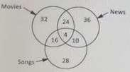

# Section - Logical Reasoning
## Topic - Data Sufficiency

> **Target Assessment:** Infosys Systems Engineer (SE) & Specialist Programmer (SP)
> **Module Focus:** `Statement sufficiency analysis, minimal condition sets, and recruitment decision criteria trees.`
> **Total Extracted Questions in this Topic:** 3
> **Format Standard:** 100% Complete question stems, all options, embedded figures, answers, and formal mathematical proofs.

---

### Question 1: Glacier Doubling & Decade Rates
**Target Role:** Infosys Systems Engineer (SE) / Specialist Programmer (SP)  
**Source Document:** `Aptitude PYQs Compendium`  

#### Question Stem & Answer Options:
Some scientists interpret satellite data to mean that glaciers are melting faster than 
in earlier centuries. In each decade since the Industrial revolution, the amount of glacier 
melt has doubled and some scientists predict that all the glaciers will have melted away 
by the year 2037. If Indeed this were true, in which year. would we have lost 50% of all 
the glaciers?   [TCS NQT 2020]

#### Formally Verified Solution & Derivation:
Solutions: 
1deacde = 10years 
2037- all glaciers will be melted (100% will be melted out) 
After every decade it melts doubled. 
i.e in 2027 it would have melted by 50% then only after a decade it will melt by 
100%.

---

### Question 2: Closet Socks and Hats Draw Probability
**Target Role:** Infosys Systems Engineer (SE) / Specialist Programmer (SP)  
**Source Document:** `Aptitude PYQs Compendium`  

#### Question Stem & Answer Options:
A lady had some socks and hats in her closet -17blue, 47 red, and 24 yellow. the light 
is out and it is totally dark in split of the darkness she can make out the difference 
between a hat and sock she takes out an items out of the closet only if she is sure that it is 
a sock how many socks must she take out to make sure she has two socks of each color?  
[TCS NQT 2020]

#### Formally Verified Solution & Derivation:
Solution: 
Ans :- 47+24+2=73 
Explanation :- Since she need pair of each color . Now taking the worst case ;suppose she 
have taken all the 47 of red , then 24 of yellow color . But now she still need glove of blue 
color . So she need to have 2 more so that she has pair of blue too.

---

### Question 3: HR Recruitment Decision Flowchart Criteria
**Target Role:** Infosys Systems Engineer (SE) / Specialist Programmer (SP)  
**Source Document:** `Official NQT 2021 Paper`  

#### Question Stem & Answer Options:
The present ages of three brothers are in the proportion 12:14 :17. The 
difference between the ages of elder and the eldest is 6 years. What will be the 
proportion of their ages after 4 years? 
1. 40:46:55 

OnlineStudy4U .. A Complete Placement Solution                       website: https://onlinestudy4u.in/ 
 
2. 14:16:19 
3. 42:41:15 
4. 14:16:18

#### Reference Visuals / Figures:

#### Formally Verified Solution & Derivation:
Solution:Option(b)  
Explanation 
14 - 17 = 3 parts = 6 years 
= 1 part is 2 year 
24, 28, 34 = present 
28,32,38 = After 4 years 
14:16:19

---
