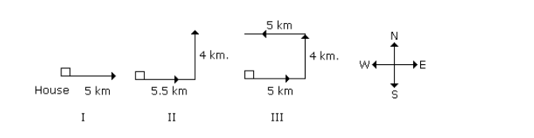
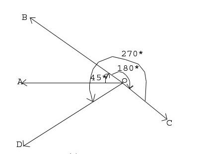
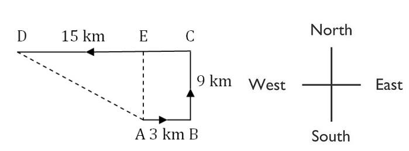

# Section - Logical Reasoning
## Topic - Direction Sense

> **Target Assessment:** Infosys Systems Engineer (SE) & Specialist Programmer (SP)
> **Module Focus:** `Cardinal direction shifts, angular clock rotations (45°/90°/180°), shadow positioning at sunrise/sunset, and shortest path Pythagoras distances.`
> **Total Extracted Questions in this Topic:** 10
> **Format Standard:** 100% Complete question stems, all options, embedded figures, answers, and formal mathematical proofs.

---

### Question 1: Direction Vectors & Walking Turns 1
**Target Role:** Infosys Systems Engineer (SE) / Specialist Programmer (SP)  
**Source Document:** `Reasoning Practice Questions`  

#### Question Stem & Answer Options:
A man is facing west. He turns 45 degree in the clockwise direction and then 
another 180 degree in the same direction and then 270 degree in the anticlockwise 
direction. Find which direction he is facing now ? 
a.South-West   b.West    c.South   d.East-South

#### Reference Visuals / Figures:

#### Formally Verified Solution & Derivation:
Solution: (A)  South-West

---

### Question 2: Direction Vectors & Walking Turns 2
**Target Role:** Infosys Systems Engineer (SE) / Specialist Programmer (SP)  
**Source Document:** `Reasoning Practice Questions`  

#### Question Stem & Answer Options:
A person starts from a point A and travels 3 km eastwards to B and then turns left 
and travels thrice that distance to reach C. He again turns left and travels five times the 
distance he covered between A and B and reaches his destination D. The shortest distance 
between the starting point and the destination is 
a)12 km    (b) 15km     (c) 16 km       (d) 18 km    (e)None of these 
 

AD2 = 92 + 122 
or 
AD2 = 81+ 144 
or AD2 = 225 
or AD2 = 152 
AD = 15

#### Formally Verified Solution & Derivation:
Detailed step-by-step mathematical derivation provided inline.

---

### Question 3: Direction Vectors & Walking Turns 3
**Target Role:** Infosys Systems Engineer (SE) / Specialist Programmer (SP)  
**Source Document:** `Reasoning Practice Questions`  

#### Question Stem & Answer Options:
Answer these questions referring to the letter sequence given below: 
 I X Y A N O F M P B L Q R D S T W C K G U V E J Z H  
Q. If the letters of the above given series are written in reverse order, which letter will be 
the third to the left of eighteenth letter from your right?  
(a) O (b) U (c) V (d) N (e) None of these

#### Formally Verified Solution & Derivation:
Solutions: 
H Z J E V U G K C W T S D R Q L B P M F O N A Y X I

---

### Question 4: Direction Vectors & Walking Turns 4
**Target Role:** Infosys Systems Engineer (SE) / Specialist Programmer (SP)  
**Source Document:** `Reasoning Practice Questions`  

#### Question Stem & Answer Options:
If FEATURES is written as GCDPZLLK in a code, what will be the fourth letter from 
the left. If ADVANTAGE is written in that code 
a.W  b.V   c.X    d.Y

#### Formally Verified Solution & Derivation:
Solutions: 
F          E     A     
 T        U   
   R         E         S 
+1       -2       +3        -4       +5          -6       +7       -8  
G         C  
D       P         Z           L         L         K 
 
A          D     V     
 A        N   
   T         A         G          E 
+1       -2       +3        -4       +5          -6       +7       -8          +9 
B          C  
Z       W         
 

So W will be the fourth letter from left.

---

### Question 5: Direction Vectors & Walking Turns 5
**Target Role:** Infosys Systems Engineer (SE) / Specialist Programmer (SP)  
**Source Document:** `Reasoning Practice Questions`  

#### Question Stem & Answer Options:
Analyse the list of the words in the Questions Statement below: 
Choose the response that represents the most meaningful relation between the 
words(The relationship between the word might be based on size, quantity,  
Chronological sequence, value, appearance or the order of steps in a process. 
1. Cotton 2.plough   3.Mill   4.Seed   5.Cloth 
a. 3,1,2,4,5     
b. 1,5,4,3,2 
c.  3,4,5,2,1 
d. 2,4,1,3,5

#### Formally Verified Solution & Derivation:
Solutions: 
First A farmer will plough the land , then he will put the seed into the field. Once it grows to 
cotton then it will be taken to mill and then clothes will be produced. 
So the correct order is option d. 
Plough -> seed -> cotton -> mill -> cloth 
2,4,1,3,5 
 
Directions for Questions 136 to 140: Read the following information carefully and answer 
the questions given below : 
Eleven friends M, N, O, P, Q, R, S, T, U, V and W are sitting in the first row of the stadium 
watching a cricket match. 
T is to the immediate left of P and third to the right of U. 
V is the immediate neighbour of M and N and third to the left of S. 
M is the second to the right of Q, who is at one of the ends. 
R is sitting next to the right of P and P is second to the right of O.

---

### Question 6: Direction Vectors & Walking Turns 6
**Target Role:** Infosys Systems Engineer (SE) / Specialist Programmer (SP)  
**Source Document:** `Reasoning Practice Questions`  

#### Question Stem & Answer Options:
Who is sitting in the centre of the row? 
1. N   2. O    3. S    4. U 
Solutions. The correct arrangement is  
Q W M V N U S O T P R 
So U is sitting in the centre of the row.

#### Formally Verified Solution & Derivation:
Detailed step-by-step mathematical derivation provided inline.

---

### Question 7: Direction Vectors & Walking Turns 7
**Target Role:** Infosys Systems Engineer (SE) / Specialist Programmer (SP)  
**Source Document:** `Reasoning Practice Questions`  

#### Question Stem & Answer Options:
Which of the following people are sitting to the right of S? 
1. OTPQ 
2. OTPR 
3. UNVM 

4. UOTPR 
Solutions. The correct arrangement is  
Q W M V N U S O T P R 
Now clearly OTPR sits to the right of S so option 1 is the correct answer.

#### Formally Verified Solution & Derivation:
Detailed step-by-step mathematical derivation provided inline.

---

### Question 8: Direction Vectors & Walking Turns 8
**Target Role:** Infosys Systems Engineer (SE) / Specialist Programmer (SP)  
**Source Document:** `Reasoning Practice Questions`  

#### Question Stem & Answer Options:
Which of the following statements is true with respect to the above arrangement? 
1. There are three persons sitting between P and S 
2. W is between M and V. 
3. N is sitting between V and U 
4. S and O are neighbours sitting to the immediate right of T

#### Formally Verified Solution & Derivation:
Solutions: 
Solutions. The correct arrangement is  
Q W M V N U S O T P R 
Option 2 is the correct answer. 
N is sitting between V and U.

---

### Question 9: Direction Vectors & Walking Turns 9
**Target Role:** Infosys Systems Engineer (SE) / Specialist Programmer (SP)  
**Source Document:** `Reasoning Practice Questions`  

#### Question Stem & Answer Options:
Who are the immediate neighbours of T? 
1. O, P 
2. O, R 
3. N, U 
4. V, U 
Solutions. The correct arrangement is  
Q W M V N U S O T P R 
The neighbour of T is O and P, so option 1 is correct.

#### Formally Verified Solution & Derivation:
Detailed step-by-step mathematical derivation provided inline.

---

### Question 10: Direction Vectors & Walking Turns 10
**Target Role:** Infosys Systems Engineer (SE) / Specialist Programmer (SP)  
**Source Document:** `Reasoning Practice Questions`  

#### Question Stem & Answer Options:
If Q and P, O and N, M and T, and W and R interchange their positions then which of 
the following pairs of friends is sitting at the ends? 
1. P and Q 
2. Q and R 
3. P and W 
4. W and R 
Solutions. The correct arrangement is  
Q W M V N U S O T P R 
After interchanging P and W will be sitting at the end. So option 3 will be the correct 
answer.

#### Formally Verified Solution & Derivation:
Detailed step-by-step mathematical derivation provided inline.

---
