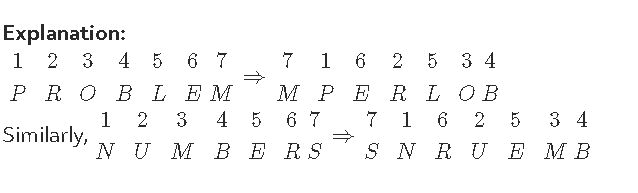

# Section - Logical Reasoning
## Topic - Letter Analogy & Coding Decoding

> **Target Assessment:** Infosys Systems Engineer (SE) & Specialist Programmer (SP)
> **Module Focus:** `Alphabetical offset shifts (+1, -1, reversing), numerical ASCII letter summations, and substitution cipher matrices.`
> **Total Extracted Questions in this Topic:** 6
> **Format Standard:** 100% Complete question stems, all options, embedded figures, answers, and formal mathematical proofs.

---

### Question 1: Coded Alphabet Mapping 1
**Target Role:** Infosys Systems Engineer (SE) / Specialist Programmer (SP)  
**Source Document:** `Reasoning Practice Questions`  

#### Question Stem & Answer Options:
In a certain code, MONKEY is written as XDJMNL. How is TIGER written in that code 
? 
A) SHFDQ 
B) HFDSQ       C) RSAFD     D) QDFHS

#### Formally Verified Solution & Derivation:
Solutions: 
The letter of the word are written in a reverse order and then each letter is moved one step 
backward to obtain the code.

---

### Question 2: Coded Alphabet Mapping 2
**Target Role:** Infosys Systems Engineer (SE) / Specialist Programmer (SP)  
**Source Document:** `Reasoning Practice Questions`  

#### Question Stem & Answer Options:
If Z = 52 and ACT = 48, then BAT will be equal to 
A) 39 B) 41  C) 44 D) 46

#### Formally Verified Solution & Derivation:
Solutions: 
In the given code, A = 2, B = 4, C = 6,.... , Z = 52. 
The position of every letter is multiplied by 2. 
So, ACT = 2 + 6 + 40 = 48 and 
BAT = 4 + 2 + 40 = 46

---

### Question 3: Coded Alphabet Mapping 3
**Target Role:** Infosys Systems Engineer (SE) / Specialist Programmer (SP)  
**Source Document:** `Reasoning Practice Questions`  

#### Question Stem & Answer Options:
In a certain code language, 
(A) ‘pit na som’ means ‘bring me water’ 
(B) ‘na jo tod’ means ‘water is life’ 

(C) ‘tub od pit’ means 'give me toy’ 
(D) ‘jo lin kot’ means ‘life and death’ 
Which of the following represents 'is' in that language? 
A) jo B) na       C) tod 
D) lin

#### Reference Visuals / Figures:

#### Formally Verified Solution & Derivation:
Solutions: 
In statements A and B, the common code word is 'na' and the common word is 'water'. 
So, 'na' means 'water'. 
In statements B and D, the common code word is 'jo' and the common word is 'life'. 
So, 'jo' means 'life'. 
Thus, in statements B, 'tod' represents 'is'.

---

### Question 4: Coded Alphabet Mapping 4
**Target Role:** Infosys Systems Engineer (SE) / Specialist Programmer (SP)  
**Source Document:** `Reasoning Practice Questions`  

#### Question Stem & Answer Options:
Acording to a military code, SYSTEM is SYSMET and NEARER is AENRER. What is the 
code for FRACTION? 
A) CARFTINO 
B) CARFTION      C) ARFCNOIT    D) CARFNOIT

#### Formally Verified Solution & Derivation:
Solutions: The letter is the first half and the letter half of the word are separately reversed 
to obtain the code.

---

### Question 5: Coded Alphabet Mapping 5
**Target Role:** Infosys Systems Engineer (SE) / Specialist Programmer (SP)  
**Source Document:** `Reasoning Practice Questions`  

#### Question Stem & Answer Options:
In a certain code language, 'PROBLEM' is written as MPERLOB. How will 'PROBLEM' 
is written as MPERLOB. How will 'NUMBERS' be written in that code? 
A) SNUREMB 
B) SNRUBME  C) SNRUEMB 
D) SNRUMEB

#### Formally Verified Solution & Derivation:
Solutions:

---

### Question 6: Coded Alphabet Mapping 6
**Target Role:** Infosys Systems Engineer (SE) / Specialist Programmer (SP)  
**Source Document:** `Reasoning Practice Questions`  

#### Question Stem & Answer Options:
In a certain code language ‘ROUTINE’ is written as 'VMRGFLI'. How will 'CRUELTY' 
be written in that code language? 
A) UPVCZLR B) VPCVZRL  C) CVCPZRL D) VCPCZLR

#### Formally Verified Solution & Derivation:
Solutions: 
ROUTINE IS 7 LETTER WORD.. (1st=R,2nd=O,3rd=U,4th=T,5th=I,6th=N,7th=E) 
1st and 3rd letter interchanging. (UORTINE) 
5th and 7th letter interchanging. (UORTENI) 
1st letter shifting one after that (VORTENI) 
2nd letter shifting two befor that (VMRTENI) 

3rd letter remains same (VMRTENI) 
4th letter 
(total alphabets - current)+1 
(26 - 20)+1= 7.(i.e) G (VMRGFNI) 
5th letter shifting one after that (VMRGFNI) 
6th letter shifting two befor that (VMRGFLI) 
7th letter remains same (VMRGFLI 
Like that, 
CRUELTY IS 7 LETTER WORD.. (1st=C,2nd=R,3rd=U,4th=E,5th=L,6th=T,7th=Y) 
1st and 3rd letter interchanging. (URCELTY) 
5th and 7th letter interchanging. (URCEYTL) 
1st letter shifting one after that (VRCEYTL) 
2nd letter shifting two befor that (VPCEYTL) 
3rd letter remains same (VPCEYTL) 
4th letter 
(total alphabets - current)+1 
(26 - 5)+1= 22.(i.e) V (VPCVYTL) 
5th letter shifting one after that (VPCVZTL) 
6th letter shifting two befor that (VPCVZRL) 
7th letter remains same (VPCVZRL).

---
