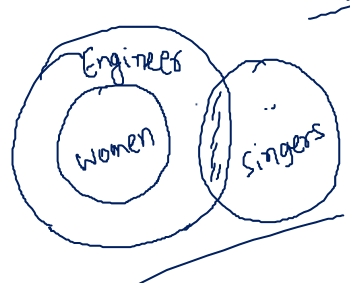
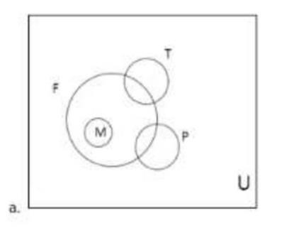
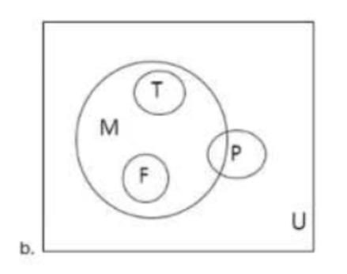
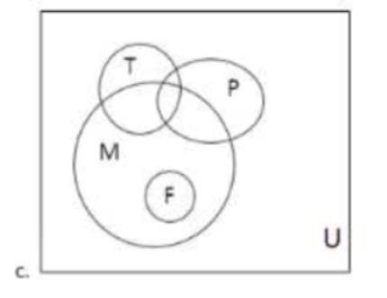
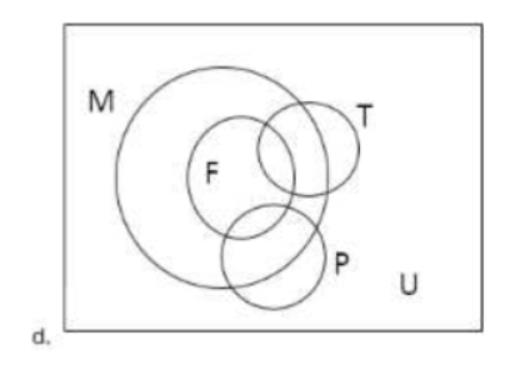

# Section - Logical Reasoning
## Topic - Syllogism

> **Target Assessment:** Infosys Systems Engineer (SE) & Specialist Programmer (SP)
> **Module Focus:** `Universal and particular propositions, Euler/Venn diagram validations, and strict deductive conclusion tests.`
> **Total Extracted Questions in this Topic:** 2
> **Format Standard:** 100% Complete question stems, all options, embedded figures, answers, and formal mathematical proofs.

---

### Question 1: Statements & Conclusions Syllogism
**Target Role:** Infosys Systems Engineer (SE) / Specialist Programmer (SP)  
**Source Document:** `Reasoning Practice Questions`  

#### Question Stem & Answer Options:
Statements:  
All women are engineers. 
Some singers are engineers. 
Conclusions: 
I. Some engineers are women. 
II. All women are singers. 
III. All Singers are women. 
(a) Only conclusion I and II follows  
(b) Only I follows  
(c) Only conclusion II and III follows  

(d) Only III follows

#### Reference Visuals / Figures:

#### Formally Verified Solution & Derivation:
Solutions : only two follows

---

### Question 2: Set Theory All Fathers Venn Diagram
**Target Role:** Infosys Systems Engineer (SE) / Specialist Programmer (SP)  
**Source Document:** `Aptitude PYQs Compendium`  

#### Question Stem & Answer Options:
Ques: The statement: 
“All fathers are men some are teachers or politicians but no teacher ¡s a politician” Can be 
represented in Venn diagram as (M- Men, F - Father. T = Teacher. P -Politician) which of 
the following options? [TCS NQT 2020]

#### Reference Visuals / Figures:

#### Formally Verified Solution & Derivation:
Ans: Option D

---
