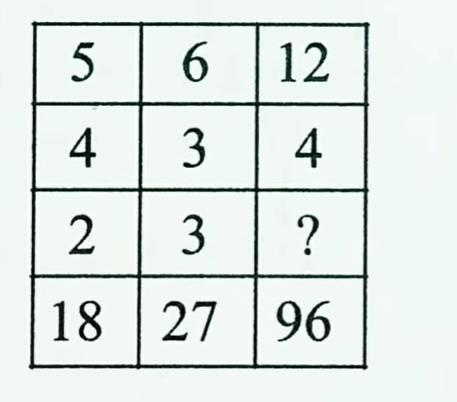
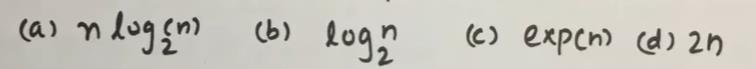

# Section - Puzzle Solving
## Topic - Missing Number Grid Puzzles

> **Target Assessment:** Infosys Systems Engineer (SE) & Specialist Programmer (SP)
> **Module Focus:** `Row-wise / column-wise mathematical operations, tabular function mappings, and grid cell pattern completions.`
> **Total Extracted Questions in this Topic:** 3
> **Format Standard:** 100% Complete question stems, all options, embedded figures, answers, and formal mathematical proofs.

---

### Question 1: 3x3 Matrix Missing Number Logic Puzzle
**Target Role:** Infosys Systems Engineer (SE) / Specialist Programmer (SP)  
**Source Document:** `Reasoning Practice Questions`  

#### Question Stem & Answer Options:
Find the missing number: 
 
a.4   b.5    c.6    d.3

#### Reference Visuals / Figures:

#### Formally Verified Solution & Derivation:
Solutions:  
5 + 4 * 2 =18 
6 + 3 * 3= 27 
12 + 4 * 6 =96

---

### Question 2: Tabular Function f(n) Transformation Grid
**Target Role:** Infosys Systems Engineer (SE) / Specialist Programmer (SP)  
**Source Document:** `Aptitude PYQs Compendium`  

#### Question Stem & Answer Options:
From the given table, the function f(n) is:             [TCS NQT 2020] 
 
 
n 
f(n)

#### Reference Visuals / Figures:

#### Formally Verified Solution & Derivation:
Solution: 
As we can analyze 
23 = 8  
25 = 32 
27 = 128 
29 = 512 
f(n) = logn base 2     option c will be giving the output.

---

### Question 3: Second & Third Digit Positional Number Formation
**Target Role:** Infosys Systems Engineer (SE) / Specialist Programmer (SP)  
**Source Document:** `Reasoning Practice Questions`  

#### Question Stem & Answer Options:
If it is possible to form a number with the second, the fifth and the eighth digits of 
the number 31549786, which is the perfect square of a two - digit even number, which of 
the following will be the second digit of that even number ? 
A) 1 B) 4 
C) 6 D) None of these

#### Formally Verified Solution & Derivation:
Solutions: 
The 2nd, 5th and 8th digits of the number 31549786 are 1, 9 and 6 respectively. 
The perfect square of a two - digit even number, formed using the digits 1, 9 and 6 is 196. 
And,  14 x 14 = 196  

So, the required even number is 14. Clearly, its second digit is 4. 
Hence, the answer is (b).

---
