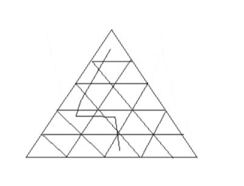

# Section - Puzzle Solving
## Topic - Number Patterns & Spatial Logic

> **Target Assessment:** Infosys Systems Engineer (SE) & Specialist Programmer (SP)
> **Module Focus:** `Positional digit conditions, units digit periodicities, physical equilibrium balancing, and geometric spatial layouts.`
> **Total Extracted Questions in this Topic:** 8
> **Format Standard:** 100% Complete question stems, all options, embedded figures, answers, and formal mathematical proofs.

---

### Question 1: Conditioned Sequence Count (Preceded by 7, Not by 3)
**Target Role:** Infosys Systems Engineer (SE) / Specialist Programmer (SP)  
**Source Document:** `Reasoning Practice Questions`  

#### Question Stem & Answer Options:
How many 4's are there preceded by 7 but not followed by 3? 
5  9  3  2  1  7  4  2  6  9  7  4  6  1  3  2  8  7  4  1  3  8  3  2  5  6  7  4  3  9  5  8  2  0  1  8  7  4  6  
A) Four 
B) Three 
C) Six            D) Five

#### Formally Verified Solution & Derivation:
Solutions: 
7  4  2 
7  4  6 
7  4  1 
7  4  6 
Only at these placees 4 is preceded by 7 but not followed by 3.

---

### Question 2: Digit Position Swapping (1st and 3rd Digits)
**Target Role:** Infosys Systems Engineer (SE) / Specialist Programmer (SP)  
**Source Document:** `Reasoning Practice Questions`  

#### Question Stem & Answer Options:
If the positions of the first and the third digit within each number are interchanged, 
which of the following will be the third digit of the second lowest number ? 
987, 514, 658, 487, 404, 269 
A) 8 B) 9 
C) 2 D) 4

#### Formally Verified Solution & Derivation:
Solutions: 
According to the question, after the position of the first and third digit interchanged new 
numbers are 
789, 415, 856, 784, 404, 962 
962, 856, 789, 784, 404, 415 
Here the second lowest number is 404 and the last digit of it is '4'.

---

### Question 3: 100 Buildings Street Numbering — Count of Digit 9
**Target Role:** Infosys Systems Engineer (SE) / Specialist Programmer (SP)  
**Source Document:** `Aptitude PYQs Compendium`  

#### Question Stem & Answer Options:
A very crowded street in t nagar contains 100 buildings . The buildings are numbered 
from 1 to 100. How many 9s are used by the Chennai corporation in numbering the 
buildings.    [TCS NQT 2020] 
a.21   b.19   c.20    d.9

#### Formally Verified Solution & Derivation:
Solution: 
Number of 9s between 1 to100. 
1-10  ---→ 1(9) 

11-20 ----→ 1(19) 
21-30 ------→ 1(29) 
31-40-------→1(39) 
41-50 ------→1(49) 
51-60-------→1(59) 
61-70------→1(69) 
71-80------→1(79) 
81-90------→2(89,90) 
90-100----→ 10(91,92,93,94,95,96,97,98,99) 
Total number of 9 = 1+1+1+1+1+1+1+1+2+10=20

---

### Question 4: Reversed Two-Digit Number Algebraic Proof
**Target Role:** Infosys Systems Engineer (SE) / Specialist Programmer (SP)  
**Source Document:** `Aptitude PYQs Compendium`  

#### Question Stem & Answer Options:
I have a two-digit number. The unit digit is twice as ten’s digit. If I reverse the 
number and subtract 36 from it, I get the initial number. What’s the number started with?    
Please write your answer as a numeral, without any leading or tailing space.                              
                                                                                        [TCS NQT 2020]

#### Formally Verified Solution & Derivation:
Solution: 
Two-digit number is xy. 
Y=2x (tens digit is twice the unit digit) 
Two-digit number in the form of unit digit and tens digit 10x+y. 
After reversing the number , 10y+x 
A/c to Questions. 
10y+x – 36 = 10x+y (initial number) 
9y-9x =36 
y-x=4 
2x-x=4 
X=4 
Now, y=2x => 2*4=8  
Answer is 48.

---

### Question 5: Units Digit Cyclicity: (234)^100 + (234)^101
**Target Role:** Infosys Systems Engineer (SE) / Specialist Programmer (SP)  
**Source Document:** `Practice Video Set 05`  

#### Question Stem & Answer Options:
**Topic:** Number Properties — Units Digit  
**Difficulty:** Easy  

#### Question Stem:
What is the digit in the units place of the resulting number from the expression:
$$(234)^{100} + (234)^{101}$$

#### Options:
- A. 6
- B. 4
- C. 2
- D. 0

#### Formally Proved Answer:
**D. 0**

#### Step-by-Step Mathematical Derivation:
1. **Analyze the cyclicity of the units digit of powers of 4:**
   - $4^1 = 4$ (odd power $\implies$ ends in 4)
   - $4^2 = 16$ (even power $\implies$ ends in 6)
   - $4^3 = 64$ (odd power $\implies$ ends in 4)
   - $4^4 = 256$ (even power $\implies$ ends in 6)
   - In general, for base ending in 4:
     $$4^{\text{even}} \equiv 6 \pmod{10}$$
     $$4^{\text{odd}} \equiv 4 \pmod{10}$$

2. **Evaluate each term:**
   - For $(234)^{100}$: The exponent $100$ is an even number.
     $$\text{Units digit of } (234)^{100} = 6$$
   - For $(234)^{101}$: The exponent $101$ is an odd number.
     $$\text{Units digit of } (234)^{101} = 4$$

3. **Sum the units digits:**
   $$\text{Units digit} = (6 + 4) \pmod{10} = 10 \pmod{10} = 0$$

Therefore, option **D** is the exact, correct answer.

---

#### Formally Verified Solution & Derivation:
Detailed step-by-step mathematical derivation provided inline.

---

### Question 6: Principle of Moments Center-Balance Weighting
**Target Role:** Infosys Systems Engineer (SE) / Specialist Programmer (SP)  
**Source Document:** `Aptitude PYQs Compendium`  

#### Question Stem & Answer Options:
Using principle of moments, one can weigh any item using a single weighing stone. 
In one such experiment, a food packet was kept hanging at a distance of 15 cm to the left 
of a rod's center. It was countered by a 50 gm weighing stone, kept at a distance of 45cm 
to the right of the center. What's the weight of food packet?                       [TCS NQT 2020]

#### Formally Verified Solution & Derivation:
Solutions: 
Torque1 = Torque2 
mg * 15 = 50g * 45 
m =150gm

---

### Question 7: Parabolic Curve Geometry f(x) = x^2
**Target Role:** Infosys Systems Engineer (SE) / Specialist Programmer (SP)  
**Source Document:** `Aptitude PYQs Compendium`  

#### Question Stem & Answer Options:
If t(x) — x^2 what is the shape of f(x)?    TCS NQT 2020 
a. Quadrilateral 
b. S-shaped 
c. Parabolic 

d. Circular

#### Formally Verified Solution & Derivation:
Solutions: its parabola.

---

### Question 8: Equilateral Triangle Side L Inscribed Geometric Region
**Target Role:** Infosys Systems Engineer (SE) / Specialist Programmer (SP)  
**Source Document:** `Aptitude PYQs Compendium`  

#### Question Stem & Answer Options:
Figure shows an equilateral triangle of side of length 5 which is divided into several 
unit triangles. A valid path is a path from the triangle in the top row to the middle triangle 
in the bottom row such that the adjacent triangles in our path share a common edge and 
the path never travels up (from a lower row to a higher row) or revisits a triangle. An 
example is given below. 
How many such valid paths are there? 
a) 120   b) 16    c) 23    d) 24

#### Reference Visuals / Figures:

#### Formally Verified Solution & Derivation:
Solutions: 
 
Solutions: 
Number of valid paths = (n-1) ! = (5-1)! = 24

---
