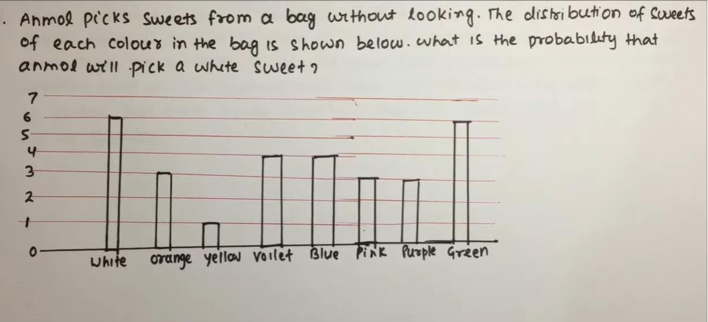
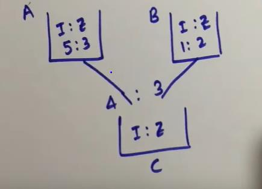
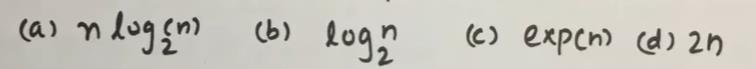
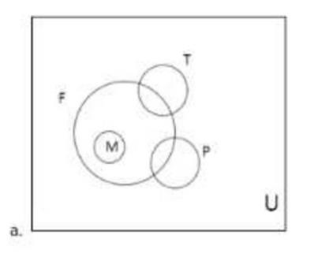
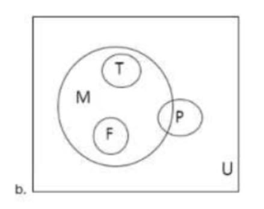
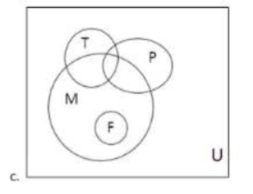
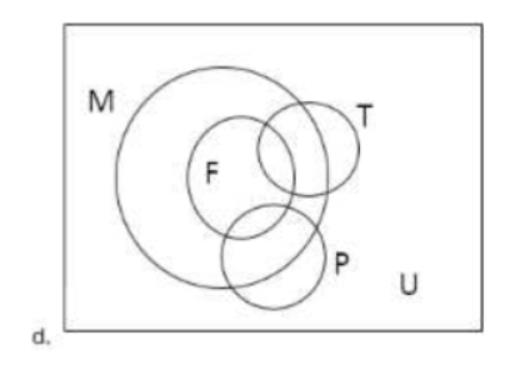
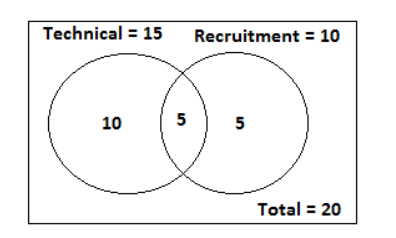

# TCS PYQ Aptitude Problems — Part 01: Questions 001 to 050

## Document Overview
- **Section:** TCS PYQ Aptitude Problems — Part 01: Questions 001 to 050
- **Description:** Comprehensive solutions for TCS NQT / Campus Recruitment previous year aptitude questions Q1 to Q50, including arithmetic, algebra, probability, data interpretation, and geometry.
- **Total Questions in this File:** 51
- **Verification Status:** 100% Formally Verified with Exact Solutions, Formulas, and Diagrams.

---

### Q1
**Source:** TCS Previous Year Question Paper (`Fully Solved TCS Previous Year Aptitude, Reasoning.pdf`)  

#### Question Stem:
The difference between the ages of two of my three grandchildren is 3. My eldest 
grandchild's age is three times than the age of my youngest grandchild and my eldest 
grandchild's age is two years more than the ages of my two youngest grandchildren 
added together. How old is my eldest grandchild? 
a.15    b.12    c.13    d.10      [TCS NQT 2020]

#### Solution & Proof:
Solution: 
Let age of the youngest grandchild =x 
age of the second grandchild =z 
age of the eldest grandchild =3x 
 
eldest grandchild's age is two years more than the ages of two youngest grandchildren 
added together 
=> 3x=2+x+z 
 => z=2x−2 
Therefore, the ages are x, 2x−2, 3x respectively 
 
difference between the ages of two of the three grandchildren is 3. It can be the difference 
of ages of any two 
Assume (2x−2)−x=3  
=>x=5 
Ages are 5,8,15 respectively 
Therefore answer can be 15.

---

### Q2
**Source:** TCS Previous Year Question Paper (`Fully Solved TCS Previous Year Aptitude, Reasoning.pdf`)  

#### Question Stem:
In the normal course, Ravi, Sanjay and Mukund can each individually build a wall in 5, 
8 and 10 days respectively. Due to difficult terrain and slushy conditions at the site, the 
individual time required for each to complete the work has increased by 20%, 25% and 
50% respectively. How long will they take to build the wall if they work together? 
a) 3 days                                                                       [TCS NQT 2020] 
b) 4 days 
c) 6 days 
d) 2 and 6/17 days 

<<<PAGE_16>>>

#### Solution & Proof:
Solution: 
Ravi=       5 (increased by 20% , now it is 6days) 
Sanjay=   8 (increased by 25%, now it is 10days) 
Mukund=10(increased by 50%, now it is 15days)    
 
 
Ravi=        6days 
Sanjay=   10days 
Mukund=15days 
 
1/6 + 1/10 + 1/15 =     (5+3+2)/30 = 10/30 =1/3 
So they together will complete the work in 3days.

---

### Q3
**Source:** TCS Previous Year Question Paper (`Fully Solved TCS Previous Year Aptitude, Reasoning.pdf`)  

#### Question Stem:
Two finals are scheduled – The Wimbledon match and the World Cup Cricket at the 
same time. Anu wants to watch the Wimbledon finals and her brother Vinu wants to 
watch WCC final. They decide to roll a tetrahedral dice twice. The tetrahedral is numbered 
1,2,3,4 on its four sides and all numbers are equally likely to appear. Anu rolls first and 
then Vinu rolls. If the number on the first roll is strictly greater than the number on the 
second roll. Anu wins and gets to watch Wimbledon. What is the probability that Anu will 
get to watch Wimbledon?                                                               [TCS NQT 2020] 
A)7/16   B)9/16    C)3/8    D)1/2

#### Solution & Proof:
Solution: 
When we roll the dice twice then the total outcome will be 42 = 16 = n(s) 
{ (1,1),(1,2),(1,3),(1,4), 
(2,1),(2,2),(2,3),(2,4), 
(3,1),(3,2),(3,3),(3,4), 
(4,1),(4,2),(4,3),(4,4) } 
 
P(E)= n(E)/n(S) 
n(E)= favorable event,  
first roll is greater than second roll. 
So below are the possibilities: 
{(2,1),(3,1),(3,2),(4,1),(4,2),(4,3)} 
P(E)= n(E)/n(S)  = 6/16 = 3/8 (c)

---

### Q4
**Source:** TCS Previous Year Question Paper (`Fully Solved TCS Previous Year Aptitude, Reasoning.pdf`)  

#### Question Stem:
Twin brothers, Lava and Kusha, wrote the TCS TNQT test. While Lava scored 45% and 
got 4 marks below the cut-off, Kusha scored 60% and got 8 marks above cut-off and got 
selected for interview. What was the maximum marks in the test?                                                      
[TCS NQT 2020] 

<<<PAGE_17>>>
 
 
a)50  b)60   c)70   d)80

#### Solution & Proof:
Solution: 
Let say maximun marks =100m 
Luva got 45m 
Kusha got 60m 
Let say cut off mark =x 
Then 45m =x-4 
&60m = x+8 
15m =12 
5m = 4 
100m = 80 
Max marks =80

---

### Q5
**Source:** TCS Previous Year Question Paper (`Fully Solved TCS Previous Year Aptitude, Reasoning.pdf`)  

#### Question Stem:
12 litres of water is poured into an aquarium of dimensions 50 cm length, 30 cm 
breadth and 40 cm height. By what height (in cm ) will the water rise? 
a.10    b.8     c.20   d.6                                                      [TCS NQT 2020]

#### Solution & Proof:
Solution: 
Volume= l *b *h 
12lt = 50cm * 30cm * h 
12 * 1000cm3 = 50cm * 30cm *h 
h =8cm 
1lt= 1000cm3

---

### Q6
**Source:** TCS Previous Year Question Paper (`Fully Solved TCS Previous Year Aptitude, Reasoning.pdf`)  

#### Question Stem:
If it takes 10 3D printers 10minutes to print 10 models, how long will it takes 100 
printers to print 100models?                [TCS NQT 2020] 
Fill the correct answers in minutes.

#### Solution & Proof:
Solution:  
Use the formula  
M1 * D1/W1  =  M2 * D2/ W2 
10 * 10 /10 = 100 * D2 /100 
D2= 10min

---

### Q7
**Source:** TCS Previous Year Question Paper (`Fully Solved TCS Previous Year Aptitude, Reasoning.pdf`)  

#### Question Stem:
Bhaskar wanted to send some documents to Shakuntala. He had her address without 
the 6-digit pin code. He didn’t want to risk sending documents without pin code. So. he 
called Shakuntala. She did not give the pin code directly, she said. The first four digits are 
1910 in hexadecimal and the last four digits are 3177 in octal”. Bhaskar could courier the 
documents now. What is her pin code? [TCS NQT 2020]

#### Solution & Proof:
Solution:                                

<<<PAGE_18>>>
 
 
Convert 1910 hexa decimal into decimal. 
160 * 0 =0 
161 * 1 =16 
162 * 9 =2304 
163 * 1 =4096       
(4096 + 2304 +16) = 6416 --→ decimal 
 
Convert 3177 Octal into decimal now. 
80 * 7 =7 
81 * 7 =56 
82 * 1 =64 
83 * 3 =1536 
(7 + 56 +64+1536)= 1663 --→ decimal 
Now combine both decimal: 
641663 is the pincode.

---

### Q8
**Source:** TCS Previous Year Question Paper (`Fully Solved TCS Previous Year Aptitude, Reasoning.pdf`)  

#### Question Stem:
Marry Meeker in her annual Internet Trends report said that Americans are spending 
even more time in digital media “6.3 hours a day in 2018 up 5% from the year before. 
“How much time did Americans spend with digital media in 2017?                                                      
[TCS NQT 2020] 
a.5 hours and 53 minutes 
b.6 hours  
c.6 hours and 10min 
d.5hours

#### Solution & Proof:
Solution: 
2017                                                          2018 
   x                     -------5% more               (6.3hrs) 
We can use option and solve it . If we consider option b 6hrs.  
That means 6hrs was spent on digital media by Americans in 2017. 
Then 5% of 6hrs will be 0.3, so in 2018 Americans spent 6+.3=6.3hrs.

---

### Q9
**Source:** TCS Previous Year Question Paper (`Fully Solved TCS Previous Year Aptitude, Reasoning.pdf`)  

#### Question Stem:
A very crowded street in t nagar contains 100 buildings . The buildings are numbered 
from 1 to 100. How many 9s are used by the Chennai corporation in numbering the 
buildings.    [TCS NQT 2020] 
a.21   b.19   c.20    d.9

#### Solution & Proof:
Solution: 
Number of 9s between 1 to100. 
1-10  ---→ 1(9) 

<<<PAGE_19>>>
 
 
11-20 ----→ 1(19) 
21-30 ------→ 1(29) 
31-40-------→1(39) 
41-50 ------→1(49) 
51-60-------→1(59) 
61-70------→1(69) 
71-80------→1(79) 
81-90------→2(89,90) 
90-100----→ 10(91,92,93,94,95,96,97,98,99) 
Total number of 9 = 1+1+1+1+1+1+1+1+2+10=20

---

### Q10
**Source:** TCS Previous Year Question Paper (`Fully Solved TCS Previous Year Aptitude, Reasoning.pdf`)  

#### Question Stem:
I have a two-digit number. The unit digit is twice as ten’s digit. If I reverse the 
number and subtract 36 from it, I get the initial number. What’s the number started with?    
Please write your answer as a numeral, without any leading or tailing space.                              
                                                                                        [TCS NQT 2020]

#### Solution & Proof:
Solution: 
Two-digit number is xy. 
Y=2x (tens digit is twice the unit digit) 
Two-digit number in the form of unit digit and tens digit 10x+y. 
After reversing the number , 10y+x 
A/c to Questions. 
10y+x – 36 = 10x+y (initial number) 
9y-9x =36 
y-x=4 
2x-x=4 
X=4 
Now, y=2x => 2*4=8  
Answer is 48.

---

### Q11
**Source:** TCS Previous Year Question Paper (`Fully Solved TCS Previous Year Aptitude, Reasoning.pdf`)  

#### Question Stem:
Data Interpretation Questions: 

<<<PAGE_20>>>

#### Associated Figures & Diagrams:

#### Solution & Proof:
Solution: 
P(E)= n(E)/ n(S) 
n(E)= favourable outcome 
n(S)= total outcome  
Total outcome= total no of sweets= 6+3+1+4+4+3+3+6= 30sweets 
Favourable outcome= white sweet = 6 
 
P(E)= 6/30 = 1/5 =0.2

---

### Q12
**Source:** TCS Previous Year Question Paper (`Fully Solved TCS Previous Year Aptitude, Reasoning.pdf`)  

#### Question Stem:
Some scientists interpret satellite data to mean that glaciers are melting faster than 
in earlier centuries. In each decade since the Industrial revolution, the amount of glacier 
melt has doubled and some scientists predict that all the glaciers will have melted away 
by the year 2037. If Indeed this were true, in which year. would we have lost 50% of all 
the glaciers?   [TCS NQT 2020]

#### Solution & Proof:
Solutions: 
1deacde = 10years 
2037- all glaciers will be melted (100% will be melted out) 
After every decade it melts doubled. 
i.e in 2027 it would have melted by 50% then only after a decade it will melt by 
100%.

---

### Q13
**Source:** TCS Previous Year Question Paper (`Fully Solved TCS Previous Year Aptitude, Reasoning.pdf`)  

#### Question Stem:
Two alloys A and B are both made of iron and zinc. The ratios of iron to zinc in the 
two alloys are 5:3 and 1:2 respectIvely. A and B are combined in the ratio 4:3 to yield a 
new alloy C. What Is the ratio of Iron and zinc In C? 
a. 4:3     b. 2:3   c. 1:1   d. 5:2    [TCS NQT 2020]

#### Associated Figures & Diagrams:

#### Solution & Proof:
Solution: 

<<<PAGE_21>>>
 
 
 
A and B are combined in the ratio 4:3 respectively and hence C is formed. 
A=4xkg and B=3xkg taken out. 
 
 
I 
Z 
A 
4x * 5/8= 5x/2 
4x*3/8= 3x/2 
B 
3x * 1/3 =x 
3x * 2/3=2 
C 
5x/2+ x = 7x/2 
3x/2 + 2 = 7x/2 
 
I: Z in c = 7x/2 : 7x/2 = 1:1

---

### Q14
**Source:** TCS Previous Year Question Paper (`Fully Solved TCS Previous Year Aptitude, Reasoning.pdf`)  

#### Question Stem:
From the given table, the function f(n) is:             [TCS NQT 2020] 
 
 
n 
f(n) 

<<<PAGE_22>>>

#### Associated Figures & Diagrams:

#### Solution & Proof:
Solution: 
As we can analyze 
23 = 8  
25 = 32 
27 = 128 
29 = 512 
f(n) = logn base 2     option c will be giving the output.

---

### Q15
**Source:** TCS Previous Year Question Paper (`Fully Solved TCS Previous Year Aptitude, Reasoning.pdf`)  

#### Question Stem:
Ram Speaks Truth 40% of the time and Laxman Speaks truth 60% of the time. 
Percentage of cases Ram and Laxman are likely to contradict each other?

#### Solution & Proof:
Solutions:                                                                                    [TCS NQT 2020] 
Probability that Ram Speaks Truth= P(E)= 40/100 = 2/5 
Probability that Ram does not  Speaks Truth= P(E)= 60/100 = 3/5 
 
Probability that Laxman Speaks Truth= P(E)= 60/100 = 3/5 
Probability that Laxman does not  Speaks Truth= P(E)= 40/100 = 2/5 
 
Contradict means when (Ram tells Truth and Laxman will lie + Ram tells lie and Laxman tells 
truth) 
2/5 * 2/5 + 3/5 * 3/5 = 13/25 
In terms of percentage=   13/25 * 100 =52%

---

### Q16
**Source:** TCS Previous Year Question Paper (`Fully Solved TCS Previous Year Aptitude, Reasoning.pdf`)  

#### Question Stem:
A clock is started at noon, By 10minutes past 5, the hour hand has turned through. 
a)155 degree   b)145 degree  c)160 degree d)150degree [TCS NQT 2020]

#### Solution & Proof:
Solution: 
Basically we need to calculate hours hand will traverse how much angle in 5hours and 
10min. 
 
Hour hand in 12hrs will traverse 360 degree  
So in 1hrs hour hand will traverse 360/12= 30 degree 
 
So in 5hrs , hour hand will traverse 5*30 =150 degree.. 
Now , 
In 60 min hour hand will travel 30 degree 
So in 1 min ……….30/60 
So in 10min ……..30/60 * 10 = 5degre 

<<<PAGE_23>>>
 
 
So the total angle = 150 +5 =155 degree

---

### Q17
**Source:** TCS Previous Year Question Paper (`Fully Solved TCS Previous Year Aptitude, Reasoning.pdf`)  

#### Question Stem:
Uma has 50 red and 50 blue balls. she has two bowls with her.she has to distribute 
the balls in these two bowls in such a way that none of the bowls are left empty. if one 
were to choose one of the two ball at random and then randomly draw a Ball from it,the 
probability of the ball being red in maximized. After this distribution, there will a total of 
_____ balls in the bowl with a larger number of balls.                          [TCS NQT 2020]

#### Solution & Proof:
Solution: 
The probability of getting Red is maximized and none of the bowls should be empty. 
In 1st bowl---> Put 1 red ball 
In 2nd bowl---> Put the remaining 50 blue+49 red balls. 
So total of 99 balls in the bowl with larger number of balls. 
 
If asked probability in Question then: 
 
In this way 
P(Red ball)= 1/2*1 + 1/2*49/99 
                    = 0.5 + 0.24747

---

### Q18
**Source:** TCS Previous Year Question Paper (`Fully Solved TCS Previous Year Aptitude, Reasoning.pdf`)  

#### Question Stem:
A Volvo bus from Chennai to Bangalore has 5 stops in between. At each stop half of 
the people will get down. After reaching Bangalore there are only 2 people left out. How 
many people are there in the bus at starting?  
[TCS NQT 2020]

#### Solution & Proof:
Solutions: 
As at last stop there is 2 people left in bus.... means 2 are left the bus (as half of the people 
left the bus [given])... Now see the steps for explanation: 
Step-by-step explanation: 
Stop 5: 2 remains means 2 left [total 4] 
Stop 4: 4 remains means 4 left [total 8] 
Stop 3: 8 remains means 8 left [total 16] 
Stop 2: 16 remains means 16 left [total 32] 
Stop 1: 32 remains means 32 left [total 64] 
Initially: 64 people

---

### Q19
**Source:** TCS Previous Year Question Paper (`Fully Solved TCS Previous Year Aptitude, Reasoning.pdf`)  

#### Question Stem:
In a country, 60% of the male citizen and 70% of the female citizen are eligible to 
vote. 70% of the male citizens eligible to vote voted, and 60% of female citizens eligible to 
vote voted. What fraction of the citizens voted during the election?                                            
[TCS NQT 2020] 

<<<PAGE_24>>>
 
 
A.0.49  B. 0.42  C. 0.48  D. 0.54

#### Solution & Proof:
Solution: 
Suppose number of male =50 and female=50(you are free to assume any value as they are 
asking the fraction so answer remains same) 
Eligible male= 50 * 60% =30 
Eligible female= 50 * 70%= 35 
 
Male who were eligible and voted= 70% of 30 =21 
And female who were eligible and voted= 60% of 35 = 21 
 
Now, fraction of citizens who voted. 
(21 + 21) / 100 = 42/100 = .42

---

### Q20
**Source:** TCS Previous Year Question Paper (`Fully Solved TCS Previous Year Aptitude, Reasoning.pdf`)  

#### Question Stem:
A lady had some socks and hats in her closet -17blue, 47 red, and 24 yellow. the light 
is out and it is totally dark in split of the darkness she can make out the difference 
between a hat and sock she takes out an items out of the closet only if she is sure that it is 
a sock how many socks must she take out to make sure she has two socks of each color?  
[TCS NQT 2020]

#### Solution & Proof:
Solution: 
Ans :- 47+24+2=73 
Explanation :- Since she need pair of each color . Now taking the worst case ;suppose she 
have taken all the 47 of red , then 24 of yellow color . But now she still need glove of blue 
color . So she need to have 2 more so that she has pair of blue too.

---

### Q21
**Source:** TCS Previous Year Question Paper (`Fully Solved TCS Previous Year Aptitude, Reasoning.pdf`)  

#### Question Stem:
In function P(x,y) = 85x - (50y + 150000). What value indicates the increase in P that 
corresponds to increase in x, when y is kept a constant? 
a.85   b.135   c.35    d.50                                     [TCS NQT 2020]

#### Solution & Proof:
solution: 
The term 85 is indicates the increase in P corresponding to increase in the x 
Since we are given that 
P(x,y) = 85x - ( 50y + 150000 ) 
Here 150000 is constant and if y is also constant then the term 50y will also constant since 
50 is constant so 
If y is constant then 
The term  50y + 150000  is constant. 
Therefor the term 85 is indicates the increase in P corresponding to increase in the x and 
other all values are constant. 

<<<PAGE_25>>>

---

### Q22
**Source:** TCS Previous Year Question Paper (`Fully Solved TCS Previous Year Aptitude, Reasoning.pdf`)  

#### Question Stem:
Using principle of moments, one can weigh any item using a single weighing stone. 
In one such experiment, a food packet was kept hanging at a distance of 15 cm to the left 
of a rod's center. It was countered by a 50 gm weighing stone, kept at a distance of 45cm 
to the right of the center. What's the weight of food packet?                       [TCS NQT 2020]

#### Solution & Proof:
Solutions: 
Torque1 = Torque2 
mg * 15 = 50g * 45 
m =150gm

---

### Q23
**Source:** TCS Previous Year Question Paper (`Fully Solved TCS Previous Year Aptitude, Reasoning.pdf`)  

#### Question Stem:
Ques: The statement: 
“All fathers are men some are teachers or politicians but no teacher ¡s a politician” Can be 
represented in Venn diagram as (M- Men, F - Father. T = Teacher. P -Politician) which of 
the following options? [TCS NQT 2020]

#### Associated Figures & Diagrams:

#### Solution & Proof:
Ans: Option D

---

### Q24
**Source:** TCS Previous Year Question Paper (`Fully Solved TCS Previous Year Aptitude, Reasoning.pdf`)  

#### Question Stem:
If t(x) — x^2 what is the shape of f(x)?    TCS NQT 2020 
a. Quadrilateral 
b. S-shaped 
c. Parabolic 

<<<PAGE_26>>>
 
 
d. Circular

#### Solution & Proof:
Solutions: its parabola.

---

### Q25
**Source:** TCS Previous Year Question Paper (`Fully Solved TCS Previous Year Aptitude, Reasoning.pdf`)  

#### Question Stem:
In a village, every weekend, three-eigth of the men and one-third of the 
women participate in a social activity. If the total number of participants is 54, 
and out of them 18 are men then the total number of men and women in the 
village is: 
a. 156     b. 228    c. 180     d. 204

#### Solution & Proof:
Solution: 
3/8 of the men participate 
So 3/8 of Total men= 18 
So total men=48  
And number of women= 54- 18 = 36 
Now 1/3 of Total women= 36 
So total women= 36*3 =108 
 
So total number of men and women= 108+48 = 156

---

### Q26
**Source:** TCS Previous Year Question Paper (`Fully Solved TCS Previous Year Aptitude, Reasoning.pdf`)  

#### Question Stem:
Ques. Find the number of perfect squares in the given series 2013, 2020, 
2027,................, 2300 (Hint 44^2=1936) 
a. 1   b. 2   c. 3   d. Can’t be determined

#### Solution & Proof:
Solution:  we need to learn the tricks for calculating squares. 
(54)² = ?  
Step1 : get 5² and 4² and write it together                                                                    
25 16 
Step2: 5 * 4 * 2 = 40 add 40  to the step 1 from left side leaving the first space.         
2516 
  40X 
2916 
 
The series are in AP with a common difference of 7. 
As we know 44^2 will be 1936 and 48^2 will be 2304. So there is only possibility that 45^2, 
46^2,47^2  square may lie in the series. 
We can easily calculate and find 47^2 will be 2209.

---

### Q27
**Source:** TCS Previous Year Question Paper (`Fully Solved TCS Previous Year Aptitude, Reasoning.pdf`)  

#### Question Stem:
. Which of the following numbers must be added to 5678 to give a remainder of 35 
when divided by 460? 

<<<PAGE_27>>>
 
 
a. 955   b. 980    c. 797 
d. 618

#### Solution & Proof:
Solutions: 
Use option attack to solve this question: 
If we subtract 35 from 5678 and add one of the option it should be divisible by 460. 
Lets take option C.  
Then 5678 -35 +797= 6440, now check if it is divisible by 46. Yes it is divisible by 46. We 
could have checked by 23 also , because 23 is a factor of 46. 
Why we are subtracting 35, so that there will not be any remainder.

---

### Q28
**Source:** TCS Previous Year Question Paper (`Fully Solved TCS Previous Year Aptitude, Reasoning.pdf`)  

#### Question Stem:
Find the probability that a leap year chosen at random will have 53 Sundays. 
a. 1/7    
b. 2/7     c. 1/49 
d. 3/7

#### Solution & Proof:
Solution: 
A normal year will have 365 days and  52weeks+ 1 odd day 
A leap year will have 366 days and 52 weeks+2 odd days. 
So the 2 odd days may be {( M,T ), (T,W),(W,T),(T,F),(F,S),(S,S)(S,M)} 
 
So the total possible outcomes=7 = be {( M,T ), (T,W),(W,T),(T,F),(F,S),(S,S)(S,M)} 
 
And the favorable outcome= {(S,S)(S,M)} 
Then Probability= P(E)= n(E)/ n(S) = 2/7

---

### Q29
**Source:** TCS Previous Year Question Paper (`Fully Solved TCS Previous Year Aptitude, Reasoning.pdf`)  

#### Question Stem:
Two consecutive pages are removed from the progression 1, 2, 3, ...n.  The 
arithmetic mean of the remaining pages is 26 1/4.  The value of n is 
a. 60 b. 81 
c. 50 d. Cannot be determined

#### Solution & Proof:
Solution: 
As the final average is 105/4. So  Sum = Avg * No 
This question can be easily solved using option. 
This is a Arithmetic progression, As we know sum of n numbers in AP 
= n(n+1) / 2 
Lets consider option C i.e n=50 
Now 50 (50+1) /2 = 1275  
But two pages are removed so now there are 48 pages. 
So Sum will be  Avg * No = 105/4 * 48 = 1260  
I.e means 1275 -1260 = 15(sum of pages 15) 
i.e means the consecutive pages are 7 and 8. 
Note : why other option should not be taken here, because (60-2) * 105/4 …. 58 will not 
be divisible by 4 and it will give you fraction value. Same with 81. 

<<<PAGE_28>>>

---

### Q30
**Source:** TCS Previous Year Question Paper (`Fully Solved TCS Previous Year Aptitude, Reasoning.pdf`)  

#### Question Stem:
In how many ways can the letters of the english alphabet be arranged so that there 
are seven letter between the letters A and B, and no letter is repeated 
a. 24P7 * 2 * 18! b. 36 * 28! 
c. 24P7 * 2 * 20! d. 18 * 24!

#### Solution & Proof:
Solution: 
We can fix A and B in two ways with 7 letters in between them. Now 7 letters can be 
selected and arranged in between A and B in 24P7 ways. Now Consider these 9 letters as a 
string. So now we have 26 – 9(letters) + 1(string) = 18 letters. These 18 letters are arranged 
in 18! ways. So Answer is 2 x 24P7 x 18!.

---

### Q31
**Source:** TCS Previous Year Question Paper (`Fully Solved TCS Previous Year Aptitude, Reasoning.pdf`)  

#### Question Stem:
When Usha was thrice as old as Nisha, her sister Asha was 25, When Nisha was half 
as old as Asha, then sister Usha was 34.  their ages add to 100.  How old is Usha? 
 a. 37   b. 44   c. 45     d. 40

#### Solution & Proof:
Solution: 
Asha=25 Nisha =n Usha =3n 
Asha=2a Nisha =a Usha =34 
The difference of all ages must be same 
25-2a=n-a=3n-34 
We will get two equation 
2n+a=34 
n+a=25 
From the equation we will get n=9 and a=16 
The ages are Asha=2a=32 Nisha =16 and Usha =34 
Sum of the ages =100 
(32+x)+(16+x)+(34+x)=100 
82+3x=100 
3x=18 
x=6 
Age of Usha =34+6=40

---

### Q32
**Source:** TCS Previous Year Question Paper (`Fully Solved TCS Previous Year Aptitude, Reasoning.pdf`)  

#### Question Stem:
Given the following information, who is youngest? 
C is younger than A; A is taller than B 
C is older than B; C is younger than D 
B is taller than C; A is older than D 
A. D    B. B     C. C      D. A

#### Solution & Proof:
Solution: 

<<<PAGE_29>>>
 
 
1. C <  A , A> B(ignore , it is in terms of tall) 
2. C > B , C < D  
3. A > D , B > C( ignore , it is in terms of tall) 
     Combine 1,2 and 3 interms of ages. 
     B < C < D < A. so B is youngest.

---

### Q33
**Source:** TCS Previous Year Question Paper (`Fully Solved TCS Previous Year Aptitude, Reasoning.pdf`)  

#### Question Stem:
An old man and a young man are working together in an office and staying together 
in a near by apartment.  The old man takes 30 minutes and the young 20 minutes to walk 
from appartment to office.  If one day the old man started at 10.00 AM and the young 
man at 10:05AM from the apartment to office, when will they meet? 
a. 10:15    b. 10:30   c. 10.45   d. 10:00

#### Solution & Proof:
Solution: 
Let the distance be 6 km.(you can assume any value) 
Distance = Speed * time 
Convert minute into hour first, 30min/60min = 1/2hr and 20min/60min=1/3hr 
 So the old man speed = 6/(1/2hr) = 12km/hr 
The young man speed = 6/(20/60hr)= 18km/hr  
As the old man started 5minute earlier, he covers 12 * (5/60hr)= 1km in 5min 
Use the concept of relative speed , 
Now the time taken to the young man to meet him= 1 / (18-12) * 60 =10min 
So the time at which the young man will meet the old man= 10.05+10= 10.15min

---

### Q34
**Source:** TCS Previous Year Question Paper (`Fully Solved TCS Previous Year Aptitude, Reasoning.pdf`)  

#### Question Stem:
How many 2's are there between the terms 112 to 375? 
a. 313 
b. 159 
c. 156 
d. 315

#### Solution & Proof:
Solution: 
Let us calculate total 2's in the units place. (122, 132, 142 ... 192), (201, 212, 222, ... 292), 
(302, 312, ... 372) = 8 + 10 + 8 = 26 
Total 2's in tenth's place, (120, 121, 122, ..., 129) + (220, 221, ..., 229) + (320, 321, ..., 329) = 
Total 2's in hundred's place = (200, 201, ... 299) = 100. 
Total 2's between 112 and 375 = 26 + 30 + 100 = 156

---

### Q35
**Source:** TCS Previous Year Question Paper (`Fully Solved TCS Previous Year Aptitude, Reasoning.pdf`)  

#### Question Stem:
A series of book was published at seven year intervals.  When the seventh book was 
published the total sum of publication year was 13, 524.  First book was published in?  
a. 1911       b. 1910     c. 2002     d. 1932 

<<<PAGE_30>>>

#### Solution & Proof:
Solution: 
Let the years be x, x+7, x+14, x+21, x+28, x+36, x+42. 
Use the formula: tn =a +(n-1)d to calculate the nth term. 
 
Sum(in AP)= n/2(2a+(n-1)d) 
13,524= 7/2(2x+(7-1)7) 
7x + 147= 13,524 
X =1911

---

### Q36
**Source:** TCS Previous Year Question Paper (`Fully Solved TCS Previous Year Aptitude, Reasoning.pdf`)  

#### Question Stem:
Crusoe hatched from a mysterious egg discovered by Angus, was growing at a fast 
pace that Angus had to move it from home to the lake. Given the weights of Crusoe in its 
first weeks of birth as 5, 15, 30,135, 405, 1215, 3645. Find the odd weight out.  
a) 3645    b) 135    c) 30   d) 15

#### Solution & Proof:
Solution: 
5×3 = 15 
15×3 = 45  
⇒Given as 30 
45×3 = 135 
135×3 = 405 
405×3 = 1215 
1215×3 = 3645

---

### Q37
**Source:** TCS Previous Year Question Paper (`Fully Solved TCS Previous Year Aptitude, Reasoning.pdf`)  

#### Question Stem:
A can complete a piece of work in 8 hours, B can complete in 10 hours and C in 12 
hours. If A,B, C start the work together but A laves after 2 hours. Find the time taken by B 
and C to complete the remaining work. 1) 2 (1/11) hours 
2) 4 (1/11) hours 
3) 2 (6/11) hours 
4) 2 hours

#### Solution & Proof:
Solution: 
A,B,C's 1 hour work is = 1/8 + 1/10 +1/12 =  (15+12+10)/120 =37/120 
A,B,C worked together for 2 hours, Therefore, 2 hours work is =  
37/120 * 2=37/60 
Remaining work = 1 – 37/60 = 23/60 
(23/60 work is done by B and C together) 
B, C's 1 hour work = 1/10 + 1/12 = (6+5)/ 60 = 11/60 
(23/60)th part of the work done by , B, C in = (23/60) / (11/60)= 2 1/11hours. 
 

<<<PAGE_31>>>

---

### Q38
**Source:** TCS Previous Year Question Paper (`Fully Solved TCS Previous Year Aptitude, Reasoning.pdf`)  

#### Question Stem:
The perimeter of a equilateral triangle and regular hexagon are 
equal.  Find out the ratio of their areas?  
a. 3:2    b. 2:3   c. 1:6   d. 6:1

#### Solution & Proof:
Solution: 
Let the side of the equilateral triangle = x units  
and side of the regular hexagon is = y units. 
Given that, 3x = 6y , x/y =2/1 
Now, 
Ratio of Area of Equilateral triangle and hexagon. 
 √3/4 x2 : 3√3/2 y2 
 √3/4 22 : 3√3/2 12  = 2:3

---

### Q39
**Source:** TCS Previous Year Question Paper (`Fully Solved TCS Previous Year Aptitude, Reasoning.pdf`)  

#### Question Stem:
If a number is divided by 357 the remainder is 5, what will be the remainder if the 
number is divided by 17?  
a. 9  b. 3   c. 5   d. 7

#### Solution & Proof:
Solution: 
Lets understand by a basic example: 
When u divide 7 by 2 ,      
2*3 +1 = 7 
Similarly, 
N =357* k + 5 , 
If this number is divided by 17 remainder is 5 as 357k is exactly divided by 17. 
Trick: Divide the remainder(5) by 17 , so 5 will be your answer.

---

### Q40
**Source:** TCS Previous Year Question Paper (`Fully Solved TCS Previous Year Aptitude, Reasoning.pdf`)  

#### Question Stem:
A owes B Rs 50. He agrees to pay B over a number of consecutive day starting on a 
Monday, paying single note of Rs 10 or Rs 20 on each day. In how many different ways 
can A repay B. (Two ways are said to be different if at least one day, a note of a different 
denomination is given) 
A. 8    B. 7   C. 6    D. 5

#### Solution & Proof:
Solution: 
He can pay 1 10rs notes and 2 20rs notes: 10,20,20=3!/2!==3 ways 
He can pay 3 10rs notes and 1 20rs notes: 10,10,10,20=4!/3!==4 ways 
He can pay by all 10 rupee notes in 5 days  : 10,10,10,10,10=5!/5!==1 way 
so.total=3+4+1==8 ways.

---

### Q41
**Source:** TCS Previous Year Question Paper (`Fully Solved TCS Previous Year Aptitude, Reasoning.pdf`)  

#### Question Stem:
Of a set of 30 numbers, average of first 10 numbers is equal to average of last 20 
numbers. Then the sum of the last 20 numbers is? 

<<<PAGE_32>>>
 
 
a. Cannot be determined. 
b. 2 x sum of last ten numbers 
c. 2 x sum of first ten numbers 
d. sum of first ten numbers

#### Solution & Proof:
Answer: c 
Explanation: 
We know that sum = average x number of observations. 
Let the common average = x 
Now sum of first 10 numbers = 10x 
Sum of the last 20 numbers = 20x. 
So sum of the last 20 numbers = 2 × sum of the first ten numbers.

---

### Q42
**Source:** TCS Previous Year Question Paper (`Fully Solved TCS Previous Year Aptitude, Reasoning.pdf`)  

#### Question Stem:
A play school has chocolates which can supply 50 students for 30 days. For the first 
ten days only 20 students were present. How many more students can be accommodated 
into the earlier group such that the entire chocolates get consumed in 30 days.  Assume 
each student takes the same number of chocolates. 
a. 45    b. 60    c. 55     d. 70

#### Solution & Proof:
Solution: 
Let each students gets 1 chocolate. Now total chocolates = 50 x 30 = 1500 
If first 10 days only 20 students were present, then total chocolates consumed = 10 × 20 = 
Now we are left with 1500 - 200 = 1300 chololates. These were to be consumed in 20 days. 
So each day 1300/20 = 65 chocolates were to be distributed. 
So we can add 65 - 20 = 45 students.

---

### Q43
**Source:** TCS Previous Year Question Paper (`Fully Solved TCS Previous Year Aptitude, Reasoning.pdf`)  

#### Question Stem:
A alone can do 1/4th of the work in 2 days.  B alone can do 2/3th of the work in 4 
days.  If all the three work together, they can complete it in 3 days so what part of the 
work will be completed by C in 2 days?  
a. 1/12   b. 1/8   c. 1/16   d. 1/20

#### Solution & Proof:
Solution: 
A can do 1/4th work in 2 days. 
So A can complete 1 work in 8days. 
Now,   B alone can do 2/3th of the work in 4 day. 
So B can complete one work in 3*4/2 = 6days 
 
A-------------- 8days        3 
B-------------- 6days       4                     24(work) 

<<<PAGE_33>>>
 
 
A+B+C -------3days       8 
 
Take LCM of 8,6 and 3 ….. it will become 24 and 24 will become the work. 
If u divide 24/8 =3, that means A can complete 3 work in a day. 
Similarly, B can complete the same work in 4 days. 
Similarly, A+B+C can complete the same work in 8 days. 
Now, 
A+B+C – A-B =C 
8 – 3- 4 =1 
i.e C can complete 1 work in a day. 
In 2 days , C can complete 2*1 =2 work 
The part of work completed out of 24 is , 2/24= 1/12th part.

---

### Q43
**Source:** TCS Previous Year Question Paper (`Fully Solved TCS Previous Year Aptitude, Reasoning.pdf`)  

#### Question Stem:
How many 6 digit even numbers can be formed from digits 1, 2, 3, 4, 5, 6, and 7 so 
that the digit should not repeat and the second last digit is even? 
a. 6480    b. 320   c. 2160    d. 720

#### Solution & Proof:
Solution: 
 
 
 
 
 
 
 
                                                                                           2,4,6 
   5                4                 3                2                2            3choices    
 
If  we have to form even numbers, units digit must be 2, 4, 6. i.e., 3 ways.  Also 5th digit 
should be even. So it can be filled in 2 ways.  Now remaining 5 digits can be filled in 5! ways. 
So total 5! × 3 × 2 = 720 ways.    
Or 5 * 4 * 3* 2 * 2 * 3 = 720.

---

### Q44
**Source:** TCS Previous Year Question Paper (`Fully Solved TCS Previous Year Aptitude, Reasoning.pdf`)  

#### Question Stem:
According to the stock policy of a company, each employee in the technical division 
is given 15 shares of the company and each employee in the recruitment division is given 
10 shares.  Employees belonging to both committees get 25 shares each.  There are 20 
employees in the company, and each one belongs to at least one division.  The cost of 
each share is ₹10.  If the technical division has 15 employees and the recruitment division 
has 10 employees, then what is the total cost of the shares given by the company? 
a. 2650    b. 3180   c. 3250    d. 3120

#### Solution & Proof:
Solutions: 

<<<PAGE_34>>>
 
 
 
There are total 20 employees In the company but in technical 15 and in Recruitment 10. 
That means there are some employee which works in both Technical and Recruitment. 
 P(A∪B) = P(A)+P(B)−P(A∩B) 
 20 = 15 +10 – X 
X =5 ( so 5 employee works in both , 5 is the common value) 
 
So total shares given to only technical = 10 × 15 = 150 
Shares given to only Recruitment = 5 × 10 = 50 
Share given to Technical as well as recruitment people = 5 × 25 = 125 
Total shares = 150 + 50 + 125 = 325. 
Total value = 325 × 10 = 3250

---

### Q45
**Source:** TCS Previous Year Question Paper (`Fully Solved TCS Previous Year Aptitude, Reasoning.pdf`)  

#### Question Stem:
The average marks of 3 students A, B and C is 60.  When another student D joins the 
group, the new average becomes 56 marks.  If another student E, who has 3 marks more 
than D, joins the group, the average of the 4 students B, C, D and E becomes 55 marks.  
How many marks did A get in the exam? 
a. 50   b. 54  c. 51   d. 53

#### Solution & Proof:
Solution: 
Average = sum of marks /number  
60 =A+B+C /3  
A+B+C = 180 
When D joins, then Sum of marks= Average * Number 
A+B+C+D = 56 * 4 = 224 
180 +D =224  
D = 44 
A/C to questions: 
E = D+3 

<<<PAGE_35>>>
 
 
E = 44+3 = 47 
Again from Questions, 
B+C+D+E= 55 *4 = 220 
B+C+44+47= 220 
B+C = 220- 91 =129 
So A+ B+C = 180 
Now , A + 129 =180 
A = 180 -129 =51

---

### Q46
**Source:** TCS Previous Year Question Paper (`Fully Solved TCS Previous Year Aptitude, Reasoning.pdf`)  

#### Question Stem:
4 men can check exam papers in 8 days working 5 hours regularly.  What is the total 
hours when 2 men will check the double of the papers in 20 days? 
a.6days  b.8days    c.10days    d.12days

#### Solution & Proof:
Solution: 
Use the formula, 
M1 * D1 * H1 /W1 = M2 * D2 * H2/W2 
 Where M1= no of men 
D1 = number of days 
H1= no of hours 
4 * 8 * 5 / W = 2 * 20 * D /2W 
D=8days

---

### Q47
**Source:** TCS Previous Year Question Paper (`Fully Solved TCS Previous Year Aptitude, Reasoning.pdf`)  

#### Question Stem:
In 4 years, Raj's father age twice as raj, Two years ago, Raj's mother's age twice as 
raj. If Raj is 32yrs old in eight years from now, what is the age of Raj's mother and father?    
Sol. Raj present age = 32 - 8 = 24.  
After 4 years Raj's age is 28.  
So Raj's fathers age is= 2 * Raj age=  2 x  28 = 56, and his present age is 52. 
Two years ago, Raj's age is 22. and his mother's age is 22 x 2 = 44.  His mother's present age 
= 46 
So Raj’s father and Mother age is 52 and 46 respectively.

#### Solution & Proof:
Solution provided inline in original material.

---

### Q48
**Source:** TCS Previous Year Question Paper (`Fully Solved TCS Previous Year Aptitude, Reasoning.pdf`)  

#### Question Stem:
The sum of two numbers is 45.  Sum of their quotient and reciprocal is 2.05, Find the 
product of the numbers.

#### Solution & Proof:
Solution: 
Let the two number is x and y. 
x + y =45 
quotient = x/y  and reciprocal=y/x  
Now, x/y + y/x= 2.05 

<<<PAGE_36>>>
 
 
(x2 + y2 )/ xy =2.05 
x2 + y2  can be also written like 
 x2 + y2 – 2xy + 2xy = (x+y)2 – 2xy 
Now, 
(x+y)2 – 2xy/xy = 2.05 
(x+y)2 = 2.05xy + 2xy = 4.05xy 
Xy = 452 /4.05 = 500

---

### Q49
**Source:** TCS Previous Year Question Paper (`Fully Solved TCS Previous Year Aptitude, Reasoning.pdf`)  

#### Question Stem:
Mr. Bean chooses a number and he keep on doubling the number followed by 
subtracting one from it, if he chooses 3 as initial number and he repeats the operation for 
30 times then what is the final result? 
a. (2^30) – 1    b. (2^30) – 2   c. (2^31) – 1  d. (2^31) – 2 e.None

#### Solution & Proof:
Solution: 
Step 1: (3 x 2) - 1 = 5 ( 2^2 + 1) 
Step 2: (5 x 2) - 1 = 9 (2^3 + 1) 
Step 3: (9 x 2) - 1 = 17 (2^4 + 1) 
Step 4: (17 x 2) - 1 = 33 (2^5 + 1) 
So After 30 steps we have 2^31 + 1

---

### Q50
**Source:** TCS Previous Year Question Paper (`Fully Solved TCS Previous Year Aptitude, Reasoning.pdf`)  

#### Question Stem:
Given that 0 < a < b < c < d, which of the following the largest ? 
a.(c+d) / (a+b) 
b.(a+d) / (b+c) 
c.(b+c) / (a+d) 
d.(b+d) / (a+c)

#### Associated Figures & Diagrams:

#### Solution & Proof:
Solution: 
Assume a = 1, b = 2, c = 3, d = 4. option A is clearly true.

---
