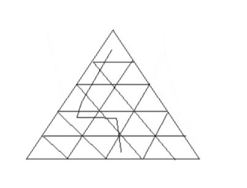

# TCS PYQ Aptitude Problems — Part 03: Questions 101 to 150

## Document Overview
- **Section:** TCS PYQ Aptitude Problems — Part 03
- **Description:** Comprehensive solutions for TCS NQT previous year aptitude questions Q101 to Q150, including advanced number theory, geometry, cryptarithmetic, logic deduction, time & work, series progression, and combinations.
- **Total Questions in this File:** 50
- **Verification Status:** 100% Formally Verified with Exact Solutions, Formulas, and Diagrams.

---

### Q101
**Source:** TCS Previous Year Question Paper (`Fully Solved TCS Previous Year Aptitude, Reasoning.pdf`)  

#### Question Stem:
A Police car starts chasing a fugitive in a BMW 2 hours after the BMW escapes from 
the scene of crime at 10AM . The BMW drives for 10km through the crowded roads of 
Shanghai and then drives into a highway, where the traffic allows vehicles to move twice 
as fast. After a while, the police car finally catches up with the BMW after a chase that 
lasted 5 hours. By this time the moon was up in the sky for 4 hours . if the average speed 
of the police car is 94 kmph then the average speed of the BMW is______ kmph.

#### Solution & Proof:
Solutions: 
The distance covered by Police car in 5hrs. (distance=speed *time) 
94km/hr * 5 =   470km 
The Fugitive covered the same distance in 5+2=7 hours. 
Let the speed of BMW car is xkm/hr. 
Distance covered by fugitive and the police car is same. 
470 = 7 * x  
X= 67.14km/hr.

---

### Q102
**Source:** TCS Previous Year Question Paper (`Fully Solved TCS Previous Year Aptitude, Reasoning.pdf`)  

#### Question Stem:
For the FIFA world cup, Paul the octopus has been predicting the winner of each 
match with amazing success. It is rumored that in a match between 2 teams A and B, Paul 
picks A with the same probability as A’s chances of winning. Let’s assume such rumors to 
be true and that in a match between Ghana and Bolivia, Ghana the stronger team has a 
probability of 2/3 of winning the game. What is the probability that Paul will correctly 
pick the winner of the Ghana-Bolivia game? 
a. 
4/9     b.2/3    c.1/9   d.5/9

#### Solution & Proof:
Solutions: 
Paul picks A with the same probability as A’s chances of winning 
So probability of picking a winner = prob picking of ghana * ghana winning + prob picking of 
bolivia * bollivia winning 
= 2/3 * 2/3 + 1/3 * 1/3 
= 5/9 

<<<PAGE_57>>>

---

### Q103
**Source:** TCS Previous Year Question Paper (`Fully Solved TCS Previous Year Aptitude, Reasoning.pdf`)  

#### Question Stem:
A result of global warming is that the ice of some glaciers is 
melting. 13 years after the ice disappears, tiny plants, called lichens, start to grow on the 
rocks. Each lichen grows approximately in the shape of a circle. The relationship between 
the diameter of this circle and the age of the lichen can be approximated with the 
formula: d =18* (t -13) for t >13, where d represents the diameter of the lichen in 
millimeters, and t represents the number of years after the ice has disappeared. Using the 
above formula, calculate the diameter of the lichen, 39 years after the ice has 
disappeared. 
a.702   b.468   c.13    d.689

#### Solution & Proof:
Solutions: 
d=18*(t-13) 
where, t=39 
d=18*(39-13) 
d=18*26 
d=468

---

### Q104
**Source:** TCS Previous Year Question Paper (`Fully Solved TCS Previous Year Aptitude, Reasoning.pdf`)  

#### Question Stem:
Alok is attending a workshop 'How to do more with less and today's theme is 
Working with fewer digits. The speakers discuss how a lot of miraculous mathematics can 
be achieved if mankind (as well as womankind) had only worked with fewer digits. The 
problem posed at the end of the workshop is 'How many 5 digit numbers can be formed 
using the digits 1, 2, 3, 4, 5 (but with repetition) that are divisible by 4?' Can you help Alok 
find the answer? 
a.625  b.725    c.750   d.125

#### Solution & Proof:
Solutions: 
 
 
 
 
 
 
Divisibility rule of 4: the last two digit should be divisible by 4. 
As the number is divisible by 4, the last two digit can be { (1,2) (2,4) (3,2)(4,4-repetition is 
allowed),(5,2) } 
The last two places can be filled with these any out of 5 choices.=5 
The first place can be filled with 5 choices 1,2,3,4,5=5 
The second place can be filled with 5 choices 1,2,3,4,5=5 
The third place can be filled with 5 choices 1,2,3,4,5=5 
So the total ways= 5*5*5*5 = 625 
 

<<<PAGE_58>>>

---

### Q105
**Source:** TCS Previous Year Question Paper (`Fully Solved TCS Previous Year Aptitude, Reasoning.pdf`)  

#### Question Stem:
Elephant competitions are of great entertainment value in south 
India. In one such competition held in Cochin, 200 elephants participated. Each elephants 
was given equal amount of milk to drink for a certain time period. Whichever elephant 
could drink the maximum would be the winner. One of the elephants named Garru could 
drink 1/3 of the amount of milk offered. Another elephant named Marta could drink only 
1/20 of the amount of milk offered, but it was better than Thorny which could drink 2/45 
of the amount of milk offered. Amazingly Darru could drink 6 litres more than 1/4 of the 
amount of milk offered, where as Malar could drink 2/15 of the amount of milk offered. If 
the amount of milk left over by the elephants Garru and Darru were same, then calculate 
the total amount of milk offered to each elephant. 
a.72L   b.73L   c.71L    d.70L

#### Solution & Proof:
Solutions: 
let each elephant was given 'x' litres of milk. 
now according to ques. 
garru drink = x/3L & darru drink = 6+(x/4)L = {(24+x)/4} 
it means milk left by, 
garru = [x-x/3] & darru = [x-{(24+x)/4}] 
again acc to ques. 
[x-x/3] = [x-{(24+x)/4}] 
2x/3 = (3x-24)/4 
8x =9x-72 
X=72 
on solving we get 'x' = 72L

---

### Q106
**Source:** TCS Previous Year Question Paper (`Fully Solved TCS Previous Year Aptitude, Reasoning.pdf`)  

#### Question Stem:
Planet Fourfe resides in 4-dimensional space and thus the currency used by its 
residents are 3- dimensional objects. The rupee notes are cubical in shape while their 
coins are spherical. However the coin minting machinery lays out some stipulations on 
the size of the coins. 
A. The diameter of the coins should be at least 16 mm and not exceed 64mm. 
B. given a coin the diameter of the next larger coin is at least 50% greater. 
C. the diameter of the coin must always be an integer.You are asked to design a set of 
coins of different diameters with their requirements and your goal is to design as many 
coins as possible. How many coins can you design? 
a.6   b.2   c.4   d.3

#### Solution & Proof:
Solutions: 
Ans is 4 coins. 
first coin would be of 16 diameter. 

<<<PAGE_59>>>
 
 
50%of 16 is 8, 8+16=24mm of diameter (second coin) 
50%of 24 is 12, 24+12=36mm (third coin) 
50%of 36 is 18, 36+18=54mm (fourth coin) 
now, 50%of 54 is 27, 27+54=81 > 64mm. hence it will not be included. 
therefore 16mm,24mm,36mm,54mm

---

### Q107
**Source:** TCS Previous Year Question Paper (`Fully Solved TCS Previous Year Aptitude, Reasoning.pdf`)  

#### Question Stem:
The citizens of planet Oz are 4 fingered and thus have developed a number system 
in base 4. A certain street in Oz contains 100 buildings numbered from 1 to 100. How 
many 1's are used in numbering these buildings? Express your answer in base 10. 
a.5   b.8   c.4    d.12

#### Solution & Proof:
Solutions: 
in the question they have mentioned it as "base 4", so we should take numbers from from 0 
to 4, so take the number series as: 
0,1,2,3,4, 
11,12,13,14, 
21,22,23,24, 
31,32,33,34, 
41,42,43,44, hence in abv series ter are 8 2s. 
(since the base is 4 consider the number series only till 40's. 
if base 8 then consider till 80's and so on........) 
Short tricks: 
or the question can also be solved by using formula.... 2*n ==> 2*4=8

---

### Q108
**Source:** TCS Previous Year Question Paper (`Fully Solved TCS Previous Year Aptitude, Reasoning.pdf`)  

#### Question Stem:
Mr. Beans visited a magic shop and bought some magical marbles of different 
colours along with other magical items. While returning home whenever he saw a 
coloured light, he took out marbles of similar colours and counted them. So he counted 
the pink coloured marbles and found that he has bought 25 of them. Then he counted 14 
green marbles and then 21 yellow marbles. He later counted 30 purple coloured marbles 
with him. But when he reached a crossing, he looked at a red light and started counting 
red marbles and found that he had bought 23 Red marbles. As soon as he finished 
counting, it started raining heavily and by the time he reached home he was drenched. 
After reaching home he found that the red, green and yellow marbles had magically 
changed colours and became white, while other marbles were unchanged. It will take 1 
day to regain its colours, but he needs to give atleast one pair of marbles to his wife now. 
So how many white marbles must be choose and give to his wife so as to ensure that 
there is atleast one pair of red, yellow and green marbles ?

#### Solution & Proof:
Solutions: 

<<<PAGE_60>>>
 
 
The problem is solved assuming worst case situation(all consecutive 
marbels of same colour) and here the numbers must be initiated from majority,ie 
23 for red 
next 21 for yellow 
remaining two for green 
total 23+21+2=46

---

### Q109
**Source:** TCS Previous Year Question Paper (`Fully Solved TCS Previous Year Aptitude, Reasoning.pdf`)  

#### Question Stem:
At the end of 1994, R was half as old as his grandmother. The sum of the years in 
which they were born is 3844. How old R was at the end of 1999 
a) 48   b) 55   c) 49   d) 53

#### Solution & Proof:
Solutions: 
In 1994, Assume the ages of GM and R = 2k, k 
then their birth years are 1994 - 2k, 1994 - k. 
But given that sum of these years is 3844. 
So 1994 - 2k + 1994 - k = 3844 
K = 48 
In 1999, the age of R is 48 + 5 = 53

---

### Q110
**Source:** TCS Previous Year Question Paper (`Fully Solved TCS Previous Year Aptitude, Reasoning.pdf`)  

#### Question Stem:
Anoop managed to draw 5 circles of equal radii with their centres on the diagonal 
of a square such that the two extreme circles touch two sides of the square and each 
middle circle touches two circles on either side.Find the ratio of the the side of the square 
to radius of the circles. You may assume that square root of 2 is 1.4 
A.2.2   B.3    C.8.9   D.7.6

#### Solution & Proof:
Solutions: 
Let the radius of circle be r 
let the side of square be a 
then diagonal of square= a*sqrt(2) 
This diagonal length = 8*r + 2r * sqrt(2) 
(because the extreme circle's radius is perpendicular to side of square.) 
Thus we get 
 
8*r+2r*sqrt(2)=a*sqrt(2) 
 
r(4*sqrt(2)+2)=a 
so a/r=(4*sqrt(2)+2)/1 
Thus ratio: a:r =(4*sqrt(2)+2)/1 
= 7.6 
Ans: 7.6 

<<<PAGE_61>>>

---

### Q111
**Source:** TCS Previous Year Question Paper (`Fully Solved TCS Previous Year Aptitude, Reasoning.pdf`)  

#### Question Stem:
Subha Patel is an olfactory scientist working for International Flavors and 
Fragrances. She specializes in finding new scents recorded and reconstituted from nature 
thanks to Living Flower Technology. She has extracted fragrance ingredients from 
different flowering plants into bottles labeled herbal, sweet, honey, anisic and rose. She 
has learned that a formula for a perfume is acceptable if and only if it does not violate any 
of the rules listed: If the perfume contains herbal, it must also contain honey and there 
must be twice as much honey as herbal. If the perfume contains sweet, it must also 
contain anisic, and the amount of anisic must equal the amount of sweet. honey cannot 
be used in combination with anisic. anisic cannot be used in combination with rose. If the 
perfume contains rose, the amount of rose must be greater than the total amount of the 
other essence or essences used. Which of the following could be added to an 
unacceptable perfume consisting of two parts honey and one part rose to make it 
acceptable? 
A.Two parts rose   B. One part herbal   C. Two parts honey  D. One part sweet

#### Solution & Proof:
Solutions: 
If you want to make this perfume consisting of two parts honey and one part rose to make 
it acceptable, then we need to consider below scenarios. 
When Rose is mixed, then the quantity of Rose has to be more than the quantity of other 
essence used. 
Already we have two parts of honey, then we need rose part is more. 
If we add two parts of Rose then the quantity of Rose will become more than the other 
essence used and hence it will become acceptable perfume.

---

### Q112
**Source:** TCS Previous Year Question Paper (`Fully Solved TCS Previous Year Aptitude, Reasoning.pdf`)  

#### Question Stem:
A circular dartboard of radius 2.0 foot is at a distance of 20 feet from you. You 
throw a dart at it and it hits the dartboard at some point Q in the circle. What is the 
probability that Q is closer to the center of the circle than the periphery? 
A .25       B. .75              C.1                 D.1.5

#### Solution & Proof:
Solutions: 
for the point to be closer to the center it should lie within the area of 1ft radius of the board 
so probability= p(E)  = n(E) /n(S) 
Total outcome = Area of circle = pi * r *r = pi * 2 *2 = pi * 4 
Now, within 1ft of radius, pi * 1 *1 = pi * 1 
= p(E)  = n(E) /n(S) = pi * 1 / pi * 4 = 1/4  =0.25 (option A)

---

### Q113
**Source:** TCS Previous Year Question Paper (`Fully Solved TCS Previous Year Aptitude, Reasoning.pdf`)  

#### Question Stem:
A hare and a tortoise have a race along a circle of 100 yards diameter. The tortoise 
goes in one direction and the hare in the other. The hare starts after the tortoise has 

<<<PAGE_62>>>
 
 
coverd 1/4 of its distance and that too leisurely. The hare and tortoise 
meet when the hare has covered only 1/8 of the distance.By what factor should the hare 
increse its speed so as to tie the race? 
A.25    B.35    C.22   D.37

#### Solution & Proof:
Solutions: 
Total circumfrance = pie*diameter 
tortoise has covered = 25pie 
remaining distance = 75 pie 
1/8th of total distance = 12.5 pie 
let the velocity of tortoise = u and that of hare =v 
on time comparison we get 
62.5 pie/u = 12.5 pie/v 
5v=u so v=u/5 
 
now for remaining journey time taken by tortoise = 12.5 pie/u 
so velocity of hare to make a tie = 7*12.5 pie u / 12.5 pie 
=7u 
so 7u/u/5 = 35 times answer

---

### Q114
**Source:** TCS Previous Year Question Paper (`Fully Solved TCS Previous Year Aptitude, Reasoning.pdf`)  

#### Question Stem:
Doller stores, the stores which sell all of their merchandise for $1, have long had a 
reputation for being down at the heels places to buy cheap, generic goods. While keeping 
their low prices, they are revamping their image and climbing the respectability ladder, in 
some cases to the fortune 500. One such dollar store which recently made an entry in the 
fortune list which has 2500 stores all over the United States said that they had a 2 percent 
increase in the number of transaction in 2008 compared with the previous year to 37 
million. The company made a profit of $20 million this year. What is the average profit 
per store? 
A.8000 $      B. 9000 $        C. 10000 $      D. 7000 $

#### Solution & Proof:
Solutions: 
Total store= 2500 
And total profit= 20 
Average= Sum/ No 
Average Profit Per store = 20/2500 million $ = 2/250 million $ = 0.008*1000000 $ = 8000 $ 
Solutions: 
answer is c  
 

<<<PAGE_63>>>

---

### Q115
**Source:** TCS Previous Year Question Paper (`Fully Solved TCS Previous Year Aptitude, Reasoning.pdf`)  

#### Question Stem:
For the King's revelry 254 barrels of beer have been ordered. 
However, it was found that one of them is poisoned. The poison takes effect even if 
consumed in the tiniest amount after 14 hours. You need to find, within 24 hours, the 
poisoned barrel and have at your disposal some beer guzzling mice. The smallest number 
of mice required to find the poisoned barrel is 
A. 9   B. 8   . 254  D. 7

#### Solution & Proof:
Solutions: 
If 1 is given in the option then the answer for these type of question will always be 1, 
because we can use 1 mouse to check whether the barrel is poisoned or not ---- u can solve 
it simply by naming barrels say A1,A2......A254 now inject beer from A1 to that mice and 
note the timing at which u r performing ur experiment say at 10pm and with difference of 1 
min....inject beer from all the barrels respectively as there are 254 barrels and now after 14 
hours note the death timings of mice suppose if it dies at 12pm next day the poison is in 
first barrel that is A1....if it dies at 12.01 hrs then the poison is in barrel A2.....n likewise for 
others!!.. 
 
But here 1 is not given in the option so we will use the formula :--- 2^n > no. of barrels , 
where n will be the number of mice. Note n should be the number with which the value of 
2^n becomes just greater than number of barrels, not far greater than no. of barrels, this is 
because we need an optimal solution.

---

### Q116
**Source:** TCS Previous Year Question Paper (`Fully Solved TCS Previous Year Aptitude, Reasoning.pdf`)  

#### Question Stem:
The IT giant Tirnop has recently crossed a head count of 150000 and earnings of $7 
billion. As one of the forerunners in the technology front, Tirnop continues to lead the 
way in products and services in India. At Tirnop, all programmers are equal in every 
respect. They receive identical salaries ans also write code at the same rate. Suppose 12 
such programmers take 12 minutes to write 12 lines of code in total. How many lines of 
code can be written by 72 programmers in 72 minutes? 
A. 72     B. 432    C. 14    D. 144

#### Solution & Proof:
Solutions: 
We know the time and work formula, 
M1 * D1 / W1 = M2 * D2 /W2   
M1 – no of men 
D1-  no of days/hours/min 
W1 = work 
12 * 12 /12 = 72 * 72 /W 
W = 12 * 6 * 6 = 432 
 

<<<PAGE_64>>>

---

### Q117
**Source:** TCS Previous Year Question Paper (`Fully Solved TCS Previous Year Aptitude, Reasoning.pdf`)  

#### Question Stem:
Ray writes a two digit number. He sees that the number exceeds 
times the sum of its digits  by 3. If the number is increased by 18, the result is the same as 
the number formed by reversing the digits. Find the number. 
a) 35    b) 42    c) 49    d) 57

#### Solution & Proof:
Solution: Let the two digit number be xy. 
A two digit number can also be represented as 10x+y. 
4(x + y) +3 = 10x + y .......(1) 
10x + y + 18 = 10 y + x ....(2) 
Solving 1st equation we get 2x - y = 1 .....(3) 
Solving 2nd equation we get y - x = 2 .....(4) 
Solving 3 and 4, we get x = 3 and y = 5 
Option A is the correct Answer. 
Notes: can be solved using option as well.

---

### Q118
**Source:** TCS Previous Year Question Paper (`Fully Solved TCS Previous Year Aptitude, Reasoning.pdf`)  

#### Question Stem:
If the word 'ddosszm' is changed to 'central' then what will be the change for 'rtjbl' 
? 
A.manual    B.quick     C.jump    D.life

#### Solution & Proof:
Solutions: 
Changes happening to letters in the pattern -1 +1 -1 ... 
So rtjbl will become quick ….

---

### Q119
**Source:** TCS Previous Year Question Paper (`Fully Solved TCS Previous Year Aptitude, Reasoning.pdf`)  

#### Question Stem:
The word unimpressive was given. They asked us to do change 1st & 2nd,3rd & 
4th,so on. Then they asked what will be 10th letter from right? 
A.L    B.M    C.N   D.O

#### Solution & Proof:
Solutions: 
After changing 1st & 2nd,3rd & 4th,so on we have , 
Numirpseisev  
Now the 10th letter from right is .. M.

---

### Q120
**Source:** TCS Previous Year Question Paper (`Fully Solved TCS Previous Year Aptitude, Reasoning.pdf`)  

#### Question Stem:
Complete the series : 5,6,7,8,10,11,14,..? 
A.17  B.15   C.14   D.17

#### Solution & Proof:
Solutions: 
There are two series here  
5, 7, 10, 14 
& 6, 8, 11, … then 15.

---

### Q121
**Source:** TCS Previous Year Question Paper (`Fully Solved TCS Previous Year Aptitude, Reasoning.pdf`)  

#### Question Stem:
If VXUPLVH is written as SURMISE, what is SHDVD ? 

<<<PAGE_65>>>
 
 
A.PEAFG    B.PEASA   C.CCASA   D.NMASA

#### Solution & Proof:
Solutions:B 
in the first word, the alphabets of the jumbled one is three alphabets after the 
corresponding alphabet in the word SURMISE. S = V-3, similarly find the one for SHDVD 
S-3 = P 
H-3 =E 
D-3= A 
V-3=S 
D-3=A

---

### Q122
**Source:** TCS Previous Year Question Paper (`Fully Solved TCS Previous Year Aptitude, Reasoning.pdf`)  

#### Question Stem:
If DDMUQZM is coded as CENTRAL then RBDJK can be coded as --------- 
A.QCEIO   B.FCEIL   C.QCEIL  D.QCESF

#### Solution & Proof:
Solutions: C 
Write both the jumbled and the coded word as a table, find the relation between the 
corresponding words, i.e C= D-1, E=D+1, N=M+1,  & so on 
Now the code for RBDJK is . 
R-1= Q 
B+1=C 
D+1=E 
J-1= I 
K+1=L

---

### Q123
**Source:** TCS Previous Year Question Paper (`Fully Solved TCS Previous Year Aptitude, Reasoning.pdf`)  

#### Question Stem:
In the word ECONOMETRICS, if the first and second , third and forth ,fourth and 
fifth, fifth and sixth words are interchanged up to the last letter, what would be the tenth 
letter from right? 
A.D     B.S    C.N    D.J

#### Solution & Proof:
Solutions: 
Word is CENOMOTEIRSC tenth word is N

---

### Q124
**Source:** TCS Previous Year Question Paper (`Fully Solved TCS Previous Year Aptitude, Reasoning.pdf`)  

#### Question Stem:
If f(0)=1 and f(n)= f(n-1)*n, find the value of f(4). 
A.25       B.24     C.23       D.22

#### Solution & Proof:
Solutions: 
f(4)=f(3)*4 
=f(2)*3*4 
=f(1)*2*3*4 
=f(0)*1*2*3*4 
=1*1*2*3*4 (since f(0)=1) 
=24 
 

<<<PAGE_66>>>

---

### Q125
**Source:** TCS Previous Year Question Paper (`Fully Solved TCS Previous Year Aptitude, Reasoning.pdf`)  

#### Question Stem:
The chairman of Tata Motors, Ratan Tata, had 300 engineers 
work for 5 years designing the world's lowest-cost car, convinced that cost-conscious 
Indian drivers could live without air-conditioning and cup holders. However, after the 
booking started they found that only 23 percent of initial 253850 orders for the car - the 
Nano - were for the no frills $2600 model. How much time (in days) would it have taken if 
there were 500 employees working for double the time? 
A.547.50    B.3041.67   C.1095.00  D.450.00

#### Solution & Proof:
Solutions: 
Note: Most of the data are irrelevant for this problem, this is a simple questions of Time and 
work. 
We know the time and work formula, 
M1 * D1 *H1 / W1 = M2 * D2 * H2 /W2   
M1 – no of men 
D1-  no of days 
H1 = no of hours 
W1 = work 
300 engineers -- x hours per day ---365 x 5 days 
500 engineers – 2x hours per day -- ? 
(300 * 5 *365* H ) / W =  (500 * D * 2H) /W 
D =  300 * 5 * 365 / 1000 
D = 547.5.

---

### Q126
**Source:** TCS Previous Year Question Paper (`Fully Solved TCS Previous Year Aptitude, Reasoning.pdf`)  

#### Question Stem:
A race horse starts chasing a wild pony 2 hours after the pony bolts the stable. The 
pony runs through the entire county of Alberton: Texas jumping over three streams and 
crossing four 10 meter roads. The race horse finally catches up with the pony after 5 
hours by which time the sun had set and the moon was up in the sky for 4 hours. If the 
average speed of the race horse is 84 kmph: then the average speed of the wild pony is 
…………………kmph. 
A.60    B.61    C.62   D.63

#### Solution & Proof:
Solutions: 
60 kmph 
Distance travelled by horse in 5 hours is equal to distance traveled by pony in 7 hours. 
If speed of pony is p. then 
7*p= 5*84 
p= 5*84/7= 60 kmph 
 

<<<PAGE_67>>>

---

### Q127
**Source:** TCS Previous Year Question Paper (`Fully Solved TCS Previous Year Aptitude, Reasoning.pdf`)  

#### Question Stem:
The difference between the ages of two of my three 
grandchildren is 3. My eldest grandchild is three times older than the age of my youngest 
grandchild and my eldest grandchild's age is two years more than the ages of my two 
youngest grandchildren added together. How old is my eldest grandchild? 
A.12    B.15    C.16   D.13

#### Solution & Proof:
Solutions: 
if u want to find out this solution using calculation it will be messed up. 
rather doing so go for logical thinking..... 
here eldest grandchild is thrice of youngest grandchild. E= 3Y  
so,the age of the eldest child should be divisible by 3.  
hence, 12 0r 15 (16 and 13 is ruled out, because it is not divisible by 3) 
Now considering 12 is not possible as youngest will be 4 then 
so middle may be 9 or 7(as difference is 3 so 12-9=3 or 7-4=3) but which does not satisfy the 
condition 
eldest=2+(other's sum of age) 
taking 15 is satisfying all the condition 
Eldest=15 = 3* youngest 
So youngest=5 years old 
Now Eldest=15 = 2+ (5+8) 
Why 8 because the difference is 3, 8-5=3 
option (b) is correct.

---

### Q128
**Source:** TCS Previous Year Question Paper (`Fully Solved TCS Previous Year Aptitude, Reasoning.pdf`)  

#### Question Stem:
When a man weighing 50 Kg runs at an average speed of 10 Km/hrr, his rate of 
energy dissipation is four times higher than when he runs at an average speed of 3 Km hr. 
However, when a 60 Kg man runs at 12 Km hr: his rate of energy dissipation is only three 
times higher than when he runs at an average speed of 6 km hr. If a man walks at 4 mph 
over a certain journey and jogs back over the same route at 6 mph at an altitude of 200 
meters. What is his average speed for the journey in mph? 
a.4.1   b.4.8    c.5.8    d.7

#### Solution & Proof:
Solutions: 
Average speed= 2* s1 * s2 / (s1 +s2) 
2 * 4 * 6 / (4+6) 
48 /10 = 4.8 m/hr

---

### Q129
**Source:** TCS Previous Year Question Paper (`Fully Solved TCS Previous Year Aptitude, Reasoning.pdf`)  

#### Question Stem:
A group of friends Tom, Tina, Dick, Diana, Harry, and Harriet go out to a fair three 
hundred meters from the McDonalds which is five KMs away. They see a weighing 
machine and decide to have some fun. However the girls refuse to step on the weighing 

<<<PAGE_68>>>
 
 
machine. So Tom, Dick and Harry, weigh themselves in a particular 
order. First Tom, Dick, and Harry weigh themselves individually and then Tom and Dick, 
Dick and Harry, Tom and Harry and then Tom, Dick and Harry together respectively. The 
recorded weight for the last measure is 161 kgs. The average of all the 7 measures is: 
A.45   B.88   C.92  D.63

#### Solution & Proof:
Solutions: 
let tom,dick and harry be a,b and c.. 
now there is totally 7 rounds of weight measure.. 
First Tom, Dick, and Harry weigh themselves individually and then Tom and Dick, Dick and 
Harry, Tom and Harry and then Tom, Dick and Harry together respectively. 
sum of total 7 rounds written as, 
a+b+c+(a+b)+(b+c)+(c+a)+(a+b+c) = 4(a+b+c) 
4*161=644 
average of 7 weighing is 644/7=92kg

---

### Q130
**Source:** TCS Previous Year Question Paper (`Fully Solved TCS Previous Year Aptitude, Reasoning.pdf`)  

#### Question Stem:
A lady has fine gloves and hats in her closet- 18 blue, 32 red, and 25 yellow. The 
lights are out and it is totally dark. In spite of the darkness, she can make out the 
difference between a hat and a glove. She takes out an item out of the closet only if she is 
sure that if it is a glove. How many gloves must she take out to make sure she has a pair 
of each color? 
A.44    B.59    C.76    D.60

#### Solution & Proof:
Solutions: 
Ans :- 32+25+2=59 
Explanation :- Since she need pair of each color . Now taking the worst case ;suppose she 
have taken all the 32 of red , then 25 of yellow color . But now she still need glove of blue 
color . So she need to have 2 more so that she has pair of blue too.

---

### Q131
**Source:** TCS Previous Year Question Paper (`Fully Solved TCS Previous Year Aptitude, Reasoning.pdf`)  

#### Question Stem:
Alok and Bhanu play the following mm-max game. Given the expression N = 16+ X + 
Y - Z, where X, Y and Z are variables representing single digits (0 to 9), Alok would like to 
maximize N while Bhanu would like to minimize it. Towards this end, Alok chooses a 
single digit number and Bhanu substitutes this for a variable of her choice (X, Y or Z). Alok 
then chooses the next value and Bhanu, the variable to substitute the value. Finally Alok 
proposes the value for the remaining variable. Assuming both play to their optimal 
strategies, the value of N at the end of the game would be 
A.22   B.25    C.26   D.27

#### Solution & Proof:
Solutions: 
Lets understand the situation here , 

<<<PAGE_69>>>
 
 
Alok has to maximize the value of N this means that he has to maximize 
the value of X and Y and minimize the value of Z, since N = X + Y - Z  
Now, the values Alok can assign range from 0 to 9 but to which variable the value is 
assigned is decided by Bhanu only 
1. If Alok selected 9 as the first number , and Bhanu put that number in Z 
Then Alok will consider the other two numbers as 9 and 9. 
So Sum = 16 + 9 +9 -9 = 25  
2. If Alok selected 8 as the first number , and Bhanu put that number in Z 
Then Alok will consider the other two numbers as 9 and 9. 
So Sum = 16 + 9 +9 -9 = 26 
3. If Alok selected 7 as the first number , and Bhanu put that number in Z 
Then Alok will consider the other two numbers as 9 and 9. 
So Sum = 16 + 9 +9 -7 = 27  
So 27 will be the final Value of N which is maximum.

---

### Q132
**Source:** TCS Previous Year Question Paper (`Fully Solved TCS Previous Year Aptitude, Reasoning.pdf`)  

#### Question Stem:
There are two boxes, one containing 32 red balls and the other containing 31 green 
balls. You are allowed to move the balls between the boxes so that when you choose a 
box at random and a ball at random from the chosen box, the probability of getting a red 
ball is maximized. This maximum probability is 
A.25   B.51    C.75    D.50

#### Solution & Proof:
Solutions: 
keeping one red ball in a box and move rest to the box containing red balls. 
So in 1 box we have 1 red ball and in other box we have 31red + 31 green=62balls 
So now selecting a red ball from the two box is as :- 
selecting black from first box =1/2*1C1=0.5  
selecting black from 2nd box=1/2*(31C1)/(62C1)=0.25 
therefore probability =0.5 +0.25=0.75

---

### Q133
**Source:** TCS Previous Year Question Paper (`Fully Solved TCS Previous Year Aptitude, Reasoning.pdf`)  

#### Question Stem:
The original price of a car was $23600. Because the car owner thought he could get 
more money for the car, he increased the price of the car to 160% of its original price. 
After a week, the car had not sold, so the owner then discounted the price by 20%, the car 
was finally sold. What price was the car sold for? 
A.30208 $   B.37760 $   C.23600 $   D.7552 $

#### Solution & Proof:
Solutions: 
1st condition:- 
160% increase: 
original price + 60% of original price 

<<<PAGE_70>>>
 
 
23600 + 23600x60/100 = 37760 
2nd condition:- 
discount 20%: 
37760 - 20% of 37760 = 30208 
So Ans = $30208

---

### Q134
**Source:** TCS Previous Year Question Paper (`Fully Solved TCS Previous Year Aptitude, Reasoning.pdf`)  

#### Question Stem:
Earl can stuff advertising circulars into envelops at the rate of 36 envelopes per 
minute and Ellen requires a minute and a half to stuff the same number of envelopes. 
Working together, how long will it take Earl and Ellen to stuff 360 envelopes? 
A.2   B.6   C.4   D.5

#### Solution & Proof:
Solutions: 
Earl takes 1 min. for 36 envelopes. 
ellen takes 3/2 mins for the same. so ellen can stuff ((36)/(3/2)) in 1 min. i.e., 24 envlpes a 
min. 
so both of them when work together can stuff 36+24=60 envelopes in 1 min. 
for 360 envelopes they will take 360/60 mins. i.e., 6 mins

---

### Q135
**Source:** TCS Previous Year Question Paper (`Fully Solved TCS Previous Year Aptitude, Reasoning.pdf`)  

#### Question Stem:
The number of bacteria in a colony was growing exponentially. At 4 pm yesterday 
the number of bacteria was 400 and at 6 pm yesterday it was 3600. How many bacteria 
were there in the colony at 7 pm yesterday? 
A.3600   B.10800    C.32400    D.14400

#### Solution & Proof:
Solutions: 
400*3=1200 at 5pm 
1200*3=3600 at 6pm 
 
so 3600*3=10800

---

### Q136
**Source:** TCS Previous Year Question Paper (`Fully Solved TCS Previous Year Aptitude, Reasoning.pdf`)  

#### Question Stem:
You're going to get grounded for a week if you don't get at least 80% in your 
science class. So far you have 237 of the total 300 points. The final test is worth 100 
points. What is the minimum score you need to get on the final test? Assume the teacher 
rounds properly. 
A.90    B.85      C.83    D.67

#### Solution & Proof:
Solutions: 
I have to get 80%... 
Total points=300+100=400 
so, 80% of 400 is 320 
 

<<<PAGE_71>>>
 
 
I've already got 237.. 
So I've to get (320-237)=83

---

### Q137
**Source:** TCS Previous Year Question Paper (`Fully Solved TCS Previous Year Aptitude, Reasoning.pdf`)  

#### Question Stem:
Achilles was the son of the nymph Thetis and Peleus, the king of the Myrmidons. 
Zeus and Poseidon had been rivals for the hand of Thetis until Prometheus, the fire-
bringer, warned Zeus of a prophecy that Thetis would bear a son greater than his father. 
For this reason, the two gods withdrew their pursuit, and had her wed Peleus. The 
following statement is another interesting prophecy about the ages of two childen of Zeus 
that would hold true at some time during the lifetime of the children. 4 years ago, 
Athena's age was twice Helen's age. 4 years hence, Athena's age will be 4/3 times the age 
of Helen. Find Athena's present age in binary numbers during the time that the statement 
holds true. 
A.100   B.1001   C.101   D.1100

#### Solution & Proof:
Solutions: 
let, 
age of athena be a. 
and age of helen be h. 
now, 
a-4=2(h-4)----eq1. 
a+4=4/3(h+4)----eq2. 
eq1 - eq2: 
a-4-a-4=2h-8-4/3h-16/3 
=>h=8. 
so, a=12. 
convert 12 in binary nos then it will be 1100. 
so,1100 is its ans. 
 
Note :Conversion of Decimal to Binary: 
12 / 2 = 6 with 0 remainder 
6 / 2 = 3 with 0 remainder 
3 / 2 = 1 with 1 remainder 
1 / 2 = 0 with 1 remainder

---

### Q138
**Source:** TCS Previous Year Question Paper (`Fully Solved TCS Previous Year Aptitude, Reasoning.pdf`)  

#### Question Stem:
a, b, c are non-negative integers such that 28a+30b+31c = 365.  
a + b + c = ? 
a) Greater than 14    b) less than or equal to 11 
c) 13     d) 12 

<<<PAGE_72>>>

#### Solution & Proof:
Solutions: 
In a calendar, 
Number of months having 28 days = 1 
Number of months having 30 days = 4 
Number of months having 31 days = 7 
28 x 1 + 30 x 4 + 31 x 7 = 365 
Here, a = 1, b = 4, c = 7. 
a+b+c = 12

---

### Q139
**Source:** TCS Previous Year Question Paper (`Fully Solved TCS Previous Year Aptitude, Reasoning.pdf`)  

#### Question Stem:
George can do a piece of work in 8 hours. Paul can do the same work in 10 hours, 
Hari can do  the same work in 12 hours. George, paul and hari start the same work at 9 
am, while George  stops at 11 am, the remaining two complete the work. What time will 
the work complete? 
a) 11.30 am     b) 12 noon          c) 12.30 pm       d) 1 pm

#### Solution & Proof:
Solutions: 
Let the total work = 120 units. 
As George completes this entire work in 8 hours, his capacity is 15 units /hour 
Similarly, the capacity of paul is 12 units / hour 
the capacity of Hari is 10 units / hour 
All 3 started at 9 am and worked upto 11 am. So total work done upto 11 am = 2 x (15 + 12 
+ 10) = 74 
Remaining work = 120 - 74 = 46 
Now this work is to be done by paul and hari. 46 / (12 + 10) = 2 hours (approx) 
So work gets completed at 1 pm

---

### Q140
**Source:** TCS Previous Year Question Paper (`Fully Solved TCS Previous Year Aptitude, Reasoning.pdf`)  

#### Question Stem:
3 mangoes and 4 apples costs Rs.85. 5 apples and 6 peaches costs 122. 6 mangoes 
and 2 peaches costs Rs.144. What is the combined price of 1 apple, 1 peach, and 1 mango. 
a) 37   b) 39   c) 35   d) 36 
Sol: Note: It is 114 not 144. 
3m + 4a = 85 ..(1) 
5a + 6p = 122 ..(2) 
6m + 2p = 114 ..(3) 
(1) x 2 => 6m + 8a = 170 
(3) => 6m + 2p = 114 
Solving we get 8a - 2p = 56 ..(4) 
(2) => 5a + 6p = 122 
3 x (4) = 24a - 6p = 168 
Solving we get a = 10, p = 12, m = 15 

<<<PAGE_73>>>
 
 
So a + p + m = 37

#### Solution & Proof:
Solution provided inline in original material.

---

### Q141
**Source:** TCS Previous Year Question Paper (`Fully Solved TCS Previous Year Aptitude, Reasoning.pdf`)  

#### Question Stem:
Figure shows an equilateral triangle of side of length 5 which is divided into several 
unit triangles. A valid path is a path from the triangle in the top row to the middle triangle 
in the bottom row such that the adjacent triangles in our path share a common edge and 
the path never travels up (from a lower row to a higher row) or revisits a triangle. An 
example is given below. 
How many such valid paths are there? 
a) 120   b) 16    c) 23    d) 24

#### Associated Figures & Diagrams:

#### Solution & Proof:
Solutions: 
 
Solutions: 
Number of valid paths = (n-1) ! = (5-1)! = 24

---

### Q142
**Source:** TCS Previous Year Question Paper (`Fully Solved TCS Previous Year Aptitude, Reasoning.pdf`)  

#### Question Stem:
The marked price of a coat was 40% less than the suggested retail price. Eesha 
purchased the coat for half the marked price at the fiftieth anniversary sale. What 
percentage less than the suggested retail price did Eesha pay? 
a) 60     b) 20    c) 70   d) 30

#### Solution & Proof:
Solutions: 
Let the retail price is Rs.100. then market price is (100-40) % of 100 = 60. Eesha purchased 
the coat for half of this price. ie., 30 only. which is 70 less than the retail price

---

### Q143
**Source:** TCS Previous Year Question Paper (`Fully Solved TCS Previous Year Aptitude, Reasoning.pdf`)  

#### Question Stem:
A and B are standing in a queue. A is 18th from the front and B is 11th from the 
back. If there are 5 persons standing between A and B, then how many persons are 
standing in the queue? 
a)34 b) 22 c) 28 d) Cannot be determined 

<<<PAGE_74>>>

#### Solution & Proof:
Solutions: 
----------------------→A(18th)  1 2 3 4 5    B(11th)------------------------------- 
So behind A there are 17 person and Behind B there are 10 person and 5 in between them 
and one A and one B. 
So total number of person = 17 + 1(A) + 5 + 1(B) + 10= 34

---

### Q144
**Source:** TCS Previous Year Question Paper (`Fully Solved TCS Previous Year Aptitude, Reasoning.pdf`)  

#### Question Stem:
A, B, C and D are seated in four adjacent seats. They make the following 
statements. 
A : I am not in the third position. 
B : I am in the second or third position. 
C : I am in the first position. 
D : I am in the fourth position. 
If three of them are speaking the truth and one of them is lying, who is in the fourth 
position?

#### Solution & Proof:
Solutions: 
Suppose D is in fourth position 
A might be false 
So C occupies 1st position 
B occupies 2nd position 
A occupies 3rd position(As A is false & says its not in 3rd so its in 3rd) 
D occupies 4th position 
Now all the conditions are satisfied

---

### Q145
**Source:** TCS Previous Year Question Paper (`Fully Solved TCS Previous Year Aptitude, Reasoning.pdf`)  

#### Question Stem:
Ashok, Eesha, Farookh, and Gowri ran a race. Ashok said, “I did not finish 1st or 4th 
“.  Eesha said, “I did not finish 4th ”. Farookh said, “I finished 1st ”. Gowri said, “I finished 
4th ”. There were no ties in the competition, and exactly three of the children told the 
truth. Who finished 4th? explain 
A. Farookh   B. Eesha 
C. Gowri   D. Ashok

#### Solution & Proof:
Solutions: 
Explanation: 
According to the qsn : 
exactly three of the children told the truth. 
then 4conditions may arise i.e. 
TTTF,TTFT,TFTT,FTTT 
 
For 1st condition : 

<<<PAGE_75>>>
 
 
Let Gowri lies that means she nver be in 4th Place and other 3 tell the 
truth then nobody will occupy 4th place then  
so from the above we conclude that Gowri finished at the 4th

---

### Q146
**Source:** TCS Previous Year Question Paper (`Fully Solved TCS Previous Year Aptitude, Reasoning.pdf`)  

#### Question Stem:
What is the next number of the following sequence 
3/7,5/21,7/43,9/73,11/111,.........

#### Solution & Proof:
Solutions:  
Numerator consequently odd no is coming  
so next odd no is 13 
in denominator, 21-7=14 
43-21=22 
73-43=30 
111-73=38,here difference is always increases by 8 
so next difference is 46 
so next no. is 111+46=157 
so ans is 13/157

---

### Q147
**Source:** TCS Previous Year Question Paper (`Fully Solved TCS Previous Year Aptitude, Reasoning.pdf`)  

#### Question Stem:
Question 1: 3 × ( 
 
a)1024 
 
b) 1025 
 
c) 1023 
 
d)1030

#### Solution & Proof:
Solution:  Answer is option (C) 1023 
In this bracket there is a geometric progression having first term 1 and common ratio 4 
having total terms 5 
The formula for sum of terms in GP is  
 
 
 
======> (1) 
Where a = first term=1 
And r= common ratio=4 
And n= no terms in the series= 5  
 Substituting the values in the above equation (1) we get the following equation 
S= 
 = 
 
The required answer is 
 = 1023

---

### Q148
**Source:** TCS Previous Year Question Paper (`Fully Solved TCS Previous Year Aptitude, Reasoning.pdf`)  

#### Question Stem:
Given that the interest is only earned on principal, if an investment of Rs. 1000.00/- 
amount to Rs. 1440.00/- in two years, then what is the rate of interest earned?  
a) 20% 
 
 
b) 21% 
 
c)22%  
 
d) 23%

#### Solution & Proof:
Solution:  Answer is option (C) 22%

---

### Q149
**Source:** TCS Previous Year Question Paper (`Fully Solved TCS Previous Year Aptitude, Reasoning.pdf`)  

#### Question Stem:
Parul is one fifth of the age of her mother was 15 years ago and Parul’s brother is 
three-fifth the age his mother was 10 years ago. If the sum of Parul and her brother’s age 
is 31. Then how old is Parul’s mother?  
58 years 
 
 
b) 47 years  
(c)50 years  
d) None

#### Solution & Proof:
Solution:  Answer is option © 50 years 
Let the Mother’s present age=M 
Parul’s present age = P 
Parul’s brother’s present age = B 
Then as per given conditions 
P+B= 31  
 
  
========➔ 
equation (a) 
P= (M-15)    
 
========➔ 
equation (b) 
B=  (M-10)   
 
 
========➔ 
equation (c) 
Substitute (b) and (c) in (a) 
 (M-15)  +   (M-10)  =31 
  (4M-45)  =31 
4M-45 =155 
4M = 200 
M =50 years 
 

<<<PAGE_77>>>

---

### Q150
**Source:** TCS Previous Year Question Paper (`Fully Solved TCS Previous Year Aptitude, Reasoning.pdf`)  

#### Question Stem:
Mayank is going on a holiday trip. He wants to pack 3 t-shirts 
from 5 t-shirts he has. In how many ways can he make his choice? 
a)12 ways  
 
b) 8 ways 
 
c)14 ways 
 
 
d) 10 ways

#### Solution & Proof:
Solution:  Answer is option (d) 10 ways 
There are total 5 t shirts and Mayank has to select 3 t shirts among them, so here the 
concept of combination will work so the solution will be 
 =
 
 
 
 
 
( as
 = 
 )and ! denotes the factorial of the 
number. 
So 
= 10 ways

---
