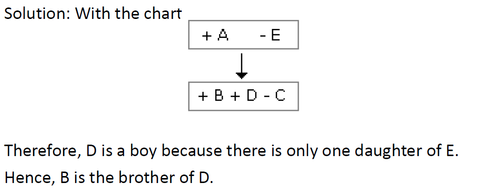
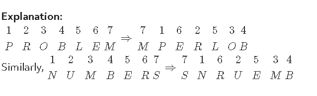
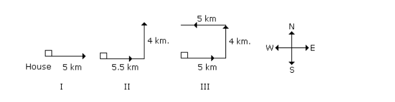
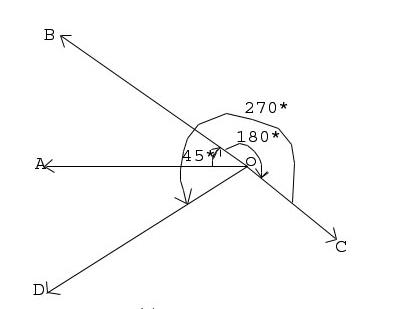
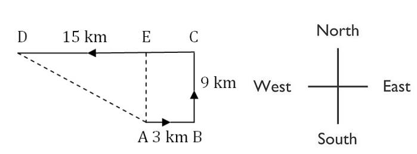
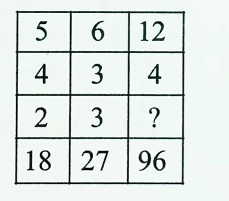
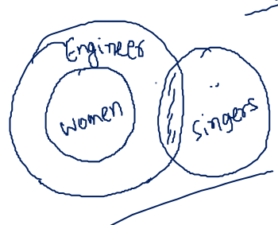

# TCS Practice Problems — Part 03: Reasoning Practice Questions 101 to 151

## Document Overview
- **Section:** TCS Practice Problems — Part 03: Reasoning Practice Questions 101 to 151
- **Description:** Comprehensive coverage of TCS reasoning questions 101 to 151 including Blood Relations, Coding & Decoding, Seating Arrangement & Order Ranking, Direction Sense, Missing Number Puzzles, and Syllogisms.
- **Total Questions in this File:** 52
- **Verification Status:** 100% Formally Verified with Exact Solutions, Formulas, and Diagrams.

---

### Practice Question 101
**Section:** TCS Practice Problems — Reasoning Ability  
**Source Document:** `Fully Solved TCS Previous Year Aptitude, Reasoning.pdf`  

#### Question Stem:
A has 3 children. B is the brother of C and C is the sister of D, E who is the wife of A 
is the A has 3 children. B is the brother of C and C is the sister of D, E who is the wife of A 
is the mother of D. There is only one daughter of the husband of E. What is the relation 
between D and B? Mother of D. There is only one daughter of the husband of E. What is 
the relation between D and B. 
A.  Brother   B. Sister      C. Uncle      D. Cousin

#### Associated Figures & Diagrams:

#### Solution & Proof:
Detailed step-by-step solution provided inline in source text.

---

### Practice Question 102
**Section:** TCS Practice Problems — Reasoning Ability  
**Source Document:** `Fully Solved TCS Previous Year Aptitude, Reasoning.pdf`  

#### Question Stem:
A is B's sister. C is B's mother. D is C's father. E is D's mother. Then, how is A related 
to D? 
A) Grandfather 
B) Grandmother   C) Daughter    
D) Granddaughter

#### Solution & Proof:
Solutions: 
A is the sister of B and B is the daughter of C. 
So, A is the daughter of C. Also, D is the father of C. 
So, A is the granddaughter of D.

---

### Practice Question 103
**Section:** TCS Practice Problems — Reasoning Ability  
**Source Document:** `Fully Solved TCS Previous Year Aptitude, Reasoning.pdf`  

#### Question Stem:
P is the brother of Q and R. S is R's mother. T is P's father. Which of the following 
statements cannot be definitely true? 
 A) T is Q's father B) S is P's mother  C) P is S's son 
D) Q is T's son

#### Solution & Proof:
Solutions: 
P, Q, R are children of same parents. So. S who is R's mother and T, who is R's father will be 
mother and father of all three. However, it is not mentioned whether Q is male or female 
So, D cannot be definitely true.

---

### Practice Question 104
**Section:** TCS Practice Problems — Reasoning Ability  
**Source Document:** `Fully Solved TCS Previous Year Aptitude, Reasoning.pdf`  

#### Question Stem:
.In a family, there are six members A, B, C, D, E and F.  

<<<PAGE_118>>>
 
 
A and B are a married couple, A being the male member. D is the only 
son of C, who is the brother of A. E is the sister of D. B is the daughter-in-law of F, whose 
husband has died. How is E related to C ?  
A) Sister 
B) Daughter  C) Cousin D) Mother

#### Solution & Proof:
Solutions: 
A is a male and married to B. So, A is the husband and B is the wife. C is the brother of A. D 
is the son of C. E. who is the sister of D will be the daughter of C. B is the daughter-in-law of 
F whose husband has died means F is the mother of A.  
Clearly. E is the daughter of C.

---

### Practice Question 105
**Section:** TCS Practice Problems — Reasoning Ability  
**Source Document:** `Fully Solved TCS Previous Year Aptitude, Reasoning.pdf`  

#### Question Stem:
A is father of C and D is son of B. E is brother of A. If C is sister of D, how is B related 
to E?  
A) Daughter B) Brother  C) Husband D) Sister-in-law

#### Solution & Proof:
Solutions: 
A is father of C and C is sister of D. So, A is father of D.  
But D is son of B. So, B is the mother of D and wife of K Also. E is the brother of A So, B is the 
sister-in-law of E.

---

### Practice Question 106
**Section:** TCS Practice Problems — Reasoning Ability  
**Source Document:** `Fully Solved TCS Previous Year Aptitude, Reasoning.pdf`  

#### Question Stem:
In a certain code, MONKEY is written as XDJMNL. How is TIGER written in that code 
? 
A) SHFDQ 
B) HFDSQ       C) RSAFD     D) QDFHS

#### Solution & Proof:
Solutions: 
The letter of the word are written in a reverse order and then each letter is moved one step 
backward to obtain the code.

---

### Practice Question 107
**Section:** TCS Practice Problems — Reasoning Ability  
**Source Document:** `Fully Solved TCS Previous Year Aptitude, Reasoning.pdf`  

#### Question Stem:
If Z = 52 and ACT = 48, then BAT will be equal to 
A) 39 B) 41  C) 44 D) 46

#### Solution & Proof:
Solutions: 
In the given code, A = 2, B = 4, C = 6,.... , Z = 52. 
The position of every letter is multiplied by 2. 
So, ACT = 2 + 6 + 40 = 48 and 
BAT = 4 + 2 + 40 = 46

---

### Practice Question 108
**Section:** TCS Practice Problems — Reasoning Ability  
**Source Document:** `Fully Solved TCS Previous Year Aptitude, Reasoning.pdf`  

#### Question Stem:
In a certain code language, 
(A) ‘pit na som’ means ‘bring me water’ 
(B) ‘na jo tod’ means ‘water is life’ 

<<<PAGE_119>>>
 
 
(C) ‘tub od pit’ means 'give me toy’ 
(D) ‘jo lin kot’ means ‘life and death’ 
Which of the following represents 'is' in that language? 
A) jo B) na       C) tod 
D) lin

#### Associated Figures & Diagrams:

#### Solution & Proof:
Solutions: 
In statements A and B, the common code word is 'na' and the common word is 'water'. 
So, 'na' means 'water'. 
In statements B and D, the common code word is 'jo' and the common word is 'life'. 
So, 'jo' means 'life'. 
Thus, in statements B, 'tod' represents 'is'.

---

### Practice Question 109
**Section:** TCS Practice Problems — Reasoning Ability  
**Source Document:** `Fully Solved TCS Previous Year Aptitude, Reasoning.pdf`  

#### Question Stem:
Acording to a military code, SYSTEM is SYSMET and NEARER is AENRER. What is the 
code for FRACTION? 
A) CARFTINO 
B) CARFTION      C) ARFCNOIT    D) CARFNOIT

#### Solution & Proof:
Solutions: The letter is the first half and the letter half of the word are separately reversed 
to obtain the code.

---

### Practice Question 110
**Section:** TCS Practice Problems — Reasoning Ability  
**Source Document:** `Fully Solved TCS Previous Year Aptitude, Reasoning.pdf`  

#### Question Stem:
In a certain code language, 'PROBLEM' is written as MPERLOB. How will 'PROBLEM' 
is written as MPERLOB. How will 'NUMBERS' be written in that code? 
A) SNUREMB 
B) SNRUBME  C) SNRUEMB 
D) SNRUMEB

#### Solution & Proof:
Solutions:

---

### Practice Question 111
**Section:** TCS Practice Problems — Reasoning Ability  
**Source Document:** `Fully Solved TCS Previous Year Aptitude, Reasoning.pdf`  

#### Question Stem:
In a certain code language ‘ROUTINE’ is written as 'VMRGFLI'. How will 'CRUELTY' 
be written in that code language? 
A) UPVCZLR B) VPCVZRL  C) CVCPZRL D) VCPCZLR

#### Solution & Proof:
Solutions: 
ROUTINE IS 7 LETTER WORD.. (1st=R,2nd=O,3rd=U,4th=T,5th=I,6th=N,7th=E) 
1st and 3rd letter interchanging. (UORTINE) 
5th and 7th letter interchanging. (UORTENI) 
1st letter shifting one after that (VORTENI) 
2nd letter shifting two befor that (VMRTENI) 

<<<PAGE_120>>>
 
 
3rd letter remains same (VMRTENI) 
4th letter 
(total alphabets - current)+1 
(26 - 20)+1= 7.(i.e) G (VMRGFNI) 
5th letter shifting one after that (VMRGFNI) 
6th letter shifting two befor that (VMRGFLI) 
7th letter remains same (VMRGFLI 
Like that, 
CRUELTY IS 7 LETTER WORD.. (1st=C,2nd=R,3rd=U,4th=E,5th=L,6th=T,7th=Y) 
1st and 3rd letter interchanging. (URCELTY) 
5th and 7th letter interchanging. (URCEYTL) 
1st letter shifting one after that (VRCEYTL) 
2nd letter shifting two befor that (VPCEYTL) 
3rd letter remains same (VPCEYTL) 
4th letter 
(total alphabets - current)+1 
(26 - 5)+1= 22.(i.e) V (VPCVYTL) 
5th letter shifting one after that (VPCVZTL) 
6th letter shifting two befor that (VPCVZRL) 
7th letter remains same (VPCVZRL).

---

### Practice Question 112
**Section:** TCS Practice Problems — Reasoning Ability  
**Source Document:** `Fully Solved TCS Previous Year Aptitude, Reasoning.pdf`  

#### Question Stem:
In a row of 25 children facing South, R is 16th from the right end and B is 18th from 
the left 
end. How many children are there between R and B? 
a) 2 b) 4 c)3 d) Data inadequate e) None

#### Solution & Proof:
Solution: 
Position of R from L.H.S = Total number of students + 1 – Position of R from R.H.S = 25 + 1 – 
16 = 10 
Number of students between R and B = 18 -10- 1 =7

---

### Practice Question 113
**Section:** TCS Practice Problems — Reasoning Ability  
**Source Document:** `Fully Solved TCS Previous Year Aptitude, Reasoning.pdf`  

#### Question Stem:
In a Class of 20students, Mridul’srank is 12th from the top and Veena’s rank is 17th 
from the bottom. If Rohan’s rank is exactly between Mriduland Veena’s rank, what is 
Rohan’s rank from the top? 
1.9th  2.8th  3.10th  4.7th

#### Solution & Proof:
Solution: 
Total Number of students: 20 
MridualRank for top =12th 

<<<PAGE_121>>>
 
 
Veena rank from top= (20+1) –17 = 4 
Rohan Rank is in between= 4+12 /2 =8th

---

### Practice Question 114
**Section:** TCS Practice Problems — Reasoning Ability  
**Source Document:** `Fully Solved TCS Previous Year Aptitude, Reasoning.pdf`  

#### Question Stem:
Adarsh is eleventh from the left end and Naveen is 20th from the right end in a row. 
If they interchange their positions, Adarsh becomes fifteenth from the left end. How 
many persons are there in the row? 
(a) 36(b) 35(c) 33(d) 34(e) None of these

#### Solution & Proof:
Solution: 
As Adarsh position from the left end is 11. 
And Naveen position from right end is 20 and after interchanging their positon will be 
interchanged i.e now Naveen is 11 from left end and Adarsh is 20 from right end and itis 
given that after interchange Adarsh is 15th from left end 
so total persons = (left + right)-1= 15+20-1= 34. 
---------------------------------11th(A)     N(20th)------------------------- 
------------------------------------------------A(15th)-------------------------

---

### Practice Question 115
**Section:** TCS Practice Problems — Reasoning Ability  
**Source Document:** `Fully Solved TCS Previous Year Aptitude, Reasoning.pdf`  

#### Question Stem:
Among P, Q, R, S and T, each of them is of different weights, Q is lighter than only T. 
P is heavier than only S. Who will be second heaviest among the following? 
(a)R   (b) S    (c) T     (d) Q

#### Solution & Proof:
Solution: 
1.<_<_<Q <T 
2.>_>_>_P>S 
 
T > Q > R > P > S

---

### Practice Question 116
**Section:** TCS Practice Problems — Reasoning Ability  
**Source Document:** `Fully Solved TCS Previous Year Aptitude, Reasoning.pdf`  

#### Question Stem:
Among A, B, C, D and E, A is taller than only B but shorter than C. C is taller than E. C 
is not the tallest. Who among them will be in the middle if they stand in the order of their 
height? 
(a) A  (b) C   (c) B 
(d) D(e) None of these

#### Solution & Proof:
Solution: 
1.D > C > E > A > B

---

### Practice Question 117
**Section:** TCS Practice Problems — Reasoning Ability  
**Source Document:** `Fully Solved TCS Previous Year Aptitude, Reasoning.pdf`  

#### Question Stem:
In a row of 25 children, Nayanis 14th from the right end. Arun is 3rd to the left of 
Nayanin the row. What is Arun's position from the left end of the row? 
a. 8thb. 9thc. 7thd. 10the. None of these

#### Solution & Proof:
Solution: 

<<<PAGE_122>>>
 
 
Total Children = 25 
Nayan is 14thfrom right end. 
Arun is 3rdleft means 17thfrom right end. 
Arun position from left = (25+1) –17 = 9th

---

### Practice Question 118
**Section:** TCS Practice Problems — Reasoning Ability  
**Source Document:** `Fully Solved TCS Previous Year Aptitude, Reasoning.pdf`  

#### Question Stem:
In a class of 180, where girls are twice the number of boys, Rupesh[a boy]  ranked 
34th from the top. If there are 18 girls ahead of Rupesh, how many boys are after him in 
rank? 
A) 45B) 44 C) 60D) can't be determined

#### Solution & Proof:
Solutions: 
No. of boys up to the 34th rank = 34-18 = 16 
Total no of boys = 180x1/(2+1) = 60 
number of boys after the rank of Rupesh = 60 -16 = 44

---

### Practice Question 119
**Section:** TCS Practice Problems — Reasoning Ability  
**Source Document:** `Fully Solved TCS Previous Year Aptitude, Reasoning.pdf`  

#### Question Stem:
DIRECTIONS for the question: Answer the question based on the information given. 
Many business offices are located in buildings having 2-8 floors. If a building has more 
than 3 floors, it has a lift. If the above statements are true, which of the following must be 
true? 
2nd floors do not have lifts     
7th floors have lifts     
Only floors above the 3rd floors have lifts 
All floors may be reached by lifts

#### Solution & Proof:
Solutions: 
The question states that if the building has more than three floors than it has lift. Then the 
buildings, which have say five floors they have a second floor also, thus first option is 
wrong. The 2nd is the right answer. The third option is wrong, using same logic as in case of 
the first option. The 4th cannot be definitely true, because had it been the case, then even 
the building with two floors would have had lifts.

---

### Practice Question 120
**Section:** TCS Practice Problems — Reasoning Ability  
**Source Document:** `Fully Solved TCS Previous Year Aptitude, Reasoning.pdf`  

#### Question Stem:
Statement/Conclusion: Chandigarh is a pleasant city. 
Which of the following, if true, would most strengthen the above conclusion?” 
I. There are many great galleries in Chandigarh. 
II. Patiala has many great restaurants.

#### Solution & Proof:
Solutions: 
Sometimes people are confused as to whether they have to consider if the options are true 
or not. You don’t have to do this. You can assume all the options are true. You don’t have to 
ask yourself whether it is actually true that Patiala has many great restaurants. It’s clear 

<<<PAGE_123>>>
 
 
that Option I would be the right answer, because it's the only answer 
that actually applies to Chandigarh.

---

### Practice Question 121
**Section:** TCS Practice Problems — Reasoning Ability  
**Source Document:** `Fully Solved TCS Previous Year Aptitude, Reasoning.pdf`  

#### Question Stem:
Directions:- In the following questions a fact or situation is given followed by two 
suggested courses. A course of action is a step of administrative decision taken for 
improvement or follow- up action. Read the situation and then decide which of the given 
courses of action follows. 
Give answer, 
(a) if only course of action I follows 
(b) if only course of action II follows 
(c) if both the course of action follow 
(d) if neither follows 
(e) If the data given is inadequate 
Statement: The officer in-charge of a company had a hunch that some money was missing 
from the safe. 
Courses of Action:  
I) He should get it recounted with the help of the staff and check it with the balance 
sheet  
II) He should inform the police

#### Solution & Proof:
Solutions: a 
Clearly, a suspicion first needs to be confirmed and only when it is confirmed 
, should an action be taken. So only course I follows.

---

### Practice Question 122
**Section:** TCS Practice Problems — Reasoning Ability  
**Source Document:** `Fully Solved TCS Previous Year Aptitude, Reasoning.pdf`  

#### Question Stem:
Directions: Below in each question are given two statements I and II. These 
statements may be either independent causes or may be effects of independent causes. 
One of these statements may be the effect of the other statement. Read both the 
statements and decide which of the following answer choices correctly depicts the 
relationship between these two statements. 
Marks answer: 
(a) if statement I is the cause and statement II is the effect. 
(b) if statement II is the cause and statement I is its effect. 
(c) if both the statements I and II are independent causes. 
(d) if both the statements I and II are effects of independent causes. 
(e) if both the statements are effects of some common cause. 
 
I. The prices of food grains and other essential commodities in the open market have risen 
sharply during the past three months. 

<<<PAGE_124>>>
 
 
II. The political party in opposition has given a call for general strike to 
protest against the government’s economic policy

#### Solution & Proof:
Solutions: 
Solutions: 
a.Since the prices of food grains and other essential commodities in the open market have 
been raised sharply during the past three months, so the political party in opposition has 
given a call for general strike to protest against the government's economic policy.

---

### Practice Question 123
**Section:** TCS Practice Problems — Reasoning Ability  
**Source Document:** `Fully Solved TCS Previous Year Aptitude, Reasoning.pdf`  

#### Question Stem:
Flow: River:: Stagnant : ? 
A. Rain    B. Stream   C. Pool   D. Canal

#### Solution & Proof:
Solutions:As Water of a River flows similarly water of Pool is Stagnant.

---

### Practice Question 124
**Section:** TCS Practice Problems — Reasoning Ability  
**Source Document:** `Fully Solved TCS Previous Year Aptitude, Reasoning.pdf`  

#### Question Stem:
Embarrassed is to humiliated as frightened is to 
A.terrified   B.agitated    C.courageous    D.reckless

#### Solution & Proof:
Solutions: 
If someone has been humiliated, they have been greatly embarrassed. If someone is 
terrified, they are extremely frightened. The answer is not choice b because an agitated 
person is not necessarily frightened. Choices c and d are incorrect because neither word 
expresses a state of being frightened.

---

### Practice Question 125
**Section:** TCS Practice Problems — Reasoning Ability  
**Source Document:** `Fully Solved TCS Previous Year Aptitude, Reasoning.pdf`  

#### Question Stem:
BCDE: PQRS :: WXYZ : ? 
(a) EFGH   (b) KLMN    (c) QJSP   (d) TSUV

#### Solution & Proof:
Solutions: 
A B C D E F G H I J K L M N O P Q R T U V W X Y Z. 
shifted by 14 letters.

---

### Practice Question 126
**Section:** TCS Practice Problems — Reasoning Ability  
**Source Document:** `Fully Solved TCS Previous Year Aptitude, Reasoning.pdf`  

#### Question Stem:
441 : 462 :: 841 : ? 
A 800    B 830    C 870    D 890

#### Solution & Proof:
Solutions: 
441 = 21^2 
462 = 441 + 21 
841 = 29^2 
870 = 841 + 29 
 

<<<PAGE_125>>>
 
 
Direction (127-129):Answer the following questions based on these 
conditions :T, Q, R, W and E are sitting in a straight line. T sits between Q and R.W do not sit 
in the middle and is the immediate left of E.Q and E occupy the extreme positions.

---

### Practice Question 127
**Section:** TCS Practice Problems — Reasoning Ability  
**Source Document:** `Fully Solved TCS Previous Year Aptitude, Reasoning.pdf`  

#### Question Stem:
Find the position of W with reference to R.  
a.Immediate Left  
b.Second Left   
c.Third Left  
d.Immediate Right   
e.None of the above

#### Solution & Proof:
Solution: d 
Q  T  R  W  E

---

### Practice Question 128
**Section:** TCS Practice Problems — Reasoning Ability  
**Source Document:** `Fully Solved TCS Previous Year Aptitude, Reasoning.pdf`  

#### Question Stem:
Find the person who sits on the second right to Q?  
a.R  
b.W   
c.E  
d.T or E   
e.None of the above

#### Solution & Proof:
Solution: a 
Q  T  R  W  E

---

### Practice Question 129
**Section:** TCS Practice Problems — Reasoning Ability  
**Source Document:** `Fully Solved TCS Previous Year Aptitude, Reasoning.pdf`  

#### Question Stem:
Find the neighbor of T?  
a.Q  
b.Q or R   
c.R or E  
d.E   
e.R or W

#### Solution & Proof:
Solutions: 
Solution: b 
Q  T  R  W  E

---

### Practice Question 130
**Section:** TCS Practice Problems — Reasoning Ability  
**Source Document:** `Fully Solved TCS Previous Year Aptitude, Reasoning.pdf`  

#### Question Stem:
Siva starting from his house, goes 5 km in the East, then he turns to his left and goes 
4 km. Finally he turns to his left and goes 5 km. Now how far is he from his house and in 
what direction? 
a.4km north    b.4km south   c.4km East   d.4km west 

<<<PAGE_126>>>

#### Solution & Proof:
Detailed step-by-step solution provided inline in source text.

---

### Practice Question 131
**Section:** TCS Practice Problems — Reasoning Ability  
**Source Document:** `Fully Solved TCS Previous Year Aptitude, Reasoning.pdf`  

#### Question Stem:
A man is facing west. He turns 45 degree in the clockwise direction and then 
another 180 degree in the same direction and then 270 degree in the anticlockwise 
direction. Find which direction he is facing now ? 
a.South-West   b.West    c.South   d.East-South

#### Associated Figures & Diagrams:

#### Solution & Proof:
Solution: (A)  South-West

---

### Practice Question 132
**Section:** TCS Practice Problems — Reasoning Ability  
**Source Document:** `Fully Solved TCS Previous Year Aptitude, Reasoning.pdf`  

#### Question Stem:
A person starts from a point A and travels 3 km eastwards to B and then turns left 
and travels thrice that distance to reach C. He again turns left and travels five times the 
distance he covered between A and B and reaches his destination D. The shortest distance 
between the starting point and the destination is 
a)12 km    (b) 15km     (c) 16 km       (d) 18 km    (e)None of these 
 

<<<PAGE_127>>>
 
 
AD2 = 92 + 122 
or 
AD2 = 81+ 144 
or AD2 = 225 
or AD2 = 152 
AD = 15

#### Solution & Proof:
Detailed step-by-step solution provided inline in source text.

---

### Practice Question 133
**Section:** TCS Practice Problems — Reasoning Ability  
**Source Document:** `Fully Solved TCS Previous Year Aptitude, Reasoning.pdf`  

#### Question Stem:
Answer these questions referring to the letter sequence given below: 
 I X Y A N O F M P B L Q R D S T W C K G U V E J Z H  
Q. If the letters of the above given series are written in reverse order, which letter will be 
the third to the left of eighteenth letter from your right?  
(a) O (b) U (c) V (d) N (e) None of these

#### Solution & Proof:
Solutions: 
H Z J E V U G K C W T S D R Q L B P M F O N A Y X I

---

### Practice Question 134
**Section:** TCS Practice Problems — Reasoning Ability  
**Source Document:** `Fully Solved TCS Previous Year Aptitude, Reasoning.pdf`  

#### Question Stem:
Answer these questions referring to the letter sequence given below:  
I X Y A N O F M P B L Q R D S T W C K G U V E J Z H Q10.  
What will come in place of question mark (?) in the following series? 
 XAO  FPL  QDT  ?  
a)LJM (b) LJE (c) WKG (d) WKU (e) None of these

#### Solution & Proof:
Solution: 
After QDT the next letter is W and then the alternate letters are K and U 
So WKU will be the next word.

---

### Practice Question 134
**Section:** TCS Practice Problems — Reasoning Ability  
**Source Document:** `Fully Solved TCS Previous Year Aptitude, Reasoning.pdf`  

#### Question Stem:
If FEATURES is written as GCDPZLLK in a code, what will be the fourth letter from 
the left. If ADVANTAGE is written in that code 
a.W  b.V   c.X    d.Y

#### Solution & Proof:
Solutions: 
F          E     A     
 T        U   
   R         E         S 
+1       -2       +3        -4       +5          -6       +7       -8  
G         C  
D       P         Z           L         L         K 
 
A          D     V     
 A        N   
   T         A         G          E 
+1       -2       +3        -4       +5          -6       +7       -8          +9 
B          C  
Z       W         
 

<<<PAGE_128>>>
 
 
So W will be the fourth letter from left.

---

### Practice Question 135
**Section:** TCS Practice Problems — Reasoning Ability  
**Source Document:** `Fully Solved TCS Previous Year Aptitude, Reasoning.pdf`  

#### Question Stem:
Analyse the list of the words in the Questions Statement below: 
Choose the response that represents the most meaningful relation between the 
words(The relationship between the word might be based on size, quantity,  
Chronological sequence, value, appearance or the order of steps in a process. 
1. Cotton 2.plough   3.Mill   4.Seed   5.Cloth 
a. 3,1,2,4,5     
b. 1,5,4,3,2 
c.  3,4,5,2,1 
d. 2,4,1,3,5

#### Solution & Proof:
Solutions: 
First A farmer will plough the land , then he will put the seed into the field. Once it grows to 
cotton then it will be taken to mill and then clothes will be produced. 
So the correct order is option d. 
Plough -> seed -> cotton -> mill -> cloth 
2,4,1,3,5 
 
Directions for Questions 136 to 140: Read the following information carefully and answer 
the questions given below : 
Eleven friends M, N, O, P, Q, R, S, T, U, V and W are sitting in the first row of the stadium 
watching a cricket match. 
T is to the immediate left of P and third to the right of U. 
V is the immediate neighbour of M and N and third to the left of S. 
M is the second to the right of Q, who is at one of the ends. 
R is sitting next to the right of P and P is second to the right of O.

---

### Practice Question 136
**Section:** TCS Practice Problems — Reasoning Ability  
**Source Document:** `Fully Solved TCS Previous Year Aptitude, Reasoning.pdf`  

#### Question Stem:
Who is sitting in the centre of the row? 
1. N   2. O    3. S    4. U 
Solutions. The correct arrangement is  
Q W M V N U S O T P R 
So U is sitting in the centre of the row.

#### Solution & Proof:
Detailed step-by-step solution provided inline in source text.

---

### Practice Question 137
**Section:** TCS Practice Problems — Reasoning Ability  
**Source Document:** `Fully Solved TCS Previous Year Aptitude, Reasoning.pdf`  

#### Question Stem:
Which of the following people are sitting to the right of S? 
1. OTPQ 
2. OTPR 
3. UNVM 

<<<PAGE_129>>>
 
 
4. UOTPR 
Solutions. The correct arrangement is  
Q W M V N U S O T P R 
Now clearly OTPR sits to the right of S so option 1 is the correct answer.

#### Solution & Proof:
Detailed step-by-step solution provided inline in source text.

---

### Practice Question 138
**Section:** TCS Practice Problems — Reasoning Ability  
**Source Document:** `Fully Solved TCS Previous Year Aptitude, Reasoning.pdf`  

#### Question Stem:
Which of the following statements is true with respect to the above arrangement? 
1. There are three persons sitting between P and S 
2. W is between M and V. 
3. N is sitting between V and U 
4. S and O are neighbours sitting to the immediate right of T

#### Solution & Proof:
Solutions: 
Solutions. The correct arrangement is  
Q W M V N U S O T P R 
Option 2 is the correct answer. 
N is sitting between V and U.

---

### Practice Question 139
**Section:** TCS Practice Problems — Reasoning Ability  
**Source Document:** `Fully Solved TCS Previous Year Aptitude, Reasoning.pdf`  

#### Question Stem:
Who are the immediate neighbours of T? 
1. O, P 
2. O, R 
3. N, U 
4. V, U 
Solutions. The correct arrangement is  
Q W M V N U S O T P R 
The neighbour of T is O and P, so option 1 is correct.

#### Solution & Proof:
Detailed step-by-step solution provided inline in source text.

---

### Practice Question 140
**Section:** TCS Practice Problems — Reasoning Ability  
**Source Document:** `Fully Solved TCS Previous Year Aptitude, Reasoning.pdf`  

#### Question Stem:
If Q and P, O and N, M and T, and W and R interchange their positions then which of 
the following pairs of friends is sitting at the ends? 
1. P and Q 
2. Q and R 
3. P and W 
4. W and R 
Solutions. The correct arrangement is  
Q W M V N U S O T P R 
After interchanging P and W will be sitting at the end. So option 3 will be the correct 
answer. 
 
 

<<<PAGE_130>>>

#### Solution & Proof:
Detailed step-by-step solution provided inline in source text.

---

### Practice Question 141
**Section:** TCS Practice Problems — Reasoning Ability  
**Source Document:** `Fully Solved TCS Previous Year Aptitude, Reasoning.pdf`  

#### Question Stem:
Find the missing number: 
 
a.4   b.5    c.6    d.3

#### Associated Figures & Diagrams:

#### Solution & Proof:
Solutions:  
5 + 4 * 2 =18 
6 + 3 * 3= 27 
12 + 4 * 6 =96

---

### Practice Question 142
**Section:** TCS Practice Problems — Reasoning Ability  
**Source Document:** `Fully Solved TCS Previous Year Aptitude, Reasoning.pdf`  

#### Question Stem:
Statements:  
All women are engineers. 
Some singers are engineers. 
Conclusions: 
I. Some engineers are women. 
II. All women are singers. 
III. All Singers are women. 
(a) Only conclusion I and II follows  
(b) Only I follows  
(c) Only conclusion II and III follows  

<<<PAGE_131>>>
 
 
(d) Only III follows

#### Associated Figures & Diagrams:

#### Solution & Proof:
Solutions : only two follows

---

### Practice Question 143
**Section:** TCS Practice Problems — Reasoning Ability  
**Source Document:** `Fully Solved TCS Previous Year Aptitude, Reasoning.pdf`  

#### Question Stem:
How many 4's are there preceded by 7 but not followed by 3? 
5  9  3  2  1  7  4  2  6  9  7  4  6  1  3  2  8  7  4  1  3  8  3  2  5  6  7  4  3  9  5  8  2  0  1  8  7  4  6  
A) Four 
B) Three 
C) Six            D) Five

#### Solution & Proof:
Solutions: 
7  4  2 
7  4  6 
7  4  1 
7  4  6 
Only at these placees 4 is preceded by 7 but not followed by 3.

---

### Practice Question 144
**Section:** TCS Practice Problems — Reasoning Ability  
**Source Document:** `Fully Solved TCS Previous Year Aptitude, Reasoning.pdf`  

#### Question Stem:
If the 30th january 2003 was thursday, what was the day day on 2nd march, 2003? 
A) sunday B) thursday 
C) tuesday D) Saturday

#### Solution & Proof:
Solutions: 
30th january, 2003 was thursday. 
So, 6th, 13th, 20th, 27th february were all thursdays. 
thus 2nd march, 2003 was 3 days after thursday, i.e. , sunday

---

### Practice Question 145
**Section:** TCS Practice Problems — Reasoning Ability  
**Source Document:** `Fully Solved TCS Previous Year Aptitude, Reasoning.pdf`  

#### Question Stem:
If the positions of the first and the third digit within each number are interchanged, 
which of the following will be the third digit of the second lowest number ? 
987, 514, 658, 487, 404, 269 
A) 8 B) 9 
C) 2 D) 4 

<<<PAGE_132>>>

#### Solution & Proof:
Solutions: 
According to the question, after the position of the first and third digit interchanged new 
numbers are 
789, 415, 856, 784, 404, 962 
962, 856, 789, 784, 404, 415 
Here the second lowest number is 404 and the last digit of it is '4'.

---

### Practice Question 146
**Section:** TCS Practice Problems — Reasoning Ability  
**Source Document:** `Fully Solved TCS Previous Year Aptitude, Reasoning.pdf`  

#### Question Stem:
There are five books of different thickness. A is thicker than C and B is thicker than 
D. E is not as thick as B, but is thicker than C. D is not as thick as C. Which is the thinnest 
book? 
A) E B) D 
C) B D) C

#### Solution & Proof:
Solutions: 
A > C  -----(i),   B > D  -----(ii),  E < B  --------(iii),  E > C  ---------(iv),  C > D  ---------(v) 
from (i) and (v),   we get    A > C > D   ---------(I) 
from (iii) and (iv), we get    B > E > C    --------(II) 
From (I) and (II) , it is clear that 'D' is the thinnest.

---

### Practice Question 147
**Section:** TCS Practice Problems — Reasoning Ability  
**Source Document:** `Fully Solved TCS Previous Year Aptitude, Reasoning.pdf`  

#### Question Stem:
The priest told the devotee, "The temple bell is rung at regular intervals of 45 
minutes. The last bell was rung five minutes ago. The Next bell is due to be rung at 
7:45am". At what time did the priest give this information to the devotee? 
A) 7.40 am B) 7.05 am 
C) 7.00 am D) 6.55 am

#### Solution & Proof:
Solutions: 
Clearly, the last bell rang 45 minutes before 7.45 am, i.e at 7.00 am. But it happened five 
minutes before the priest gave the information to the devotee. So, the information was 
given at 7.05 am

---

### Practice Question 148
**Section:** TCS Practice Problems — Reasoning Ability  
**Source Document:** `Fully Solved TCS Previous Year Aptitude, Reasoning.pdf`  

#### Question Stem:
If it is possible to form a number with the second, the fifth and the eighth digits of 
the number 31549786, which is the perfect square of a two - digit even number, which of 
the following will be the second digit of that even number ? 
A) 1 B) 4 
C) 6 D) None of these

#### Solution & Proof:
Solutions: 
The 2nd, 5th and 8th digits of the number 31549786 are 1, 9 and 6 respectively. 
The perfect square of a two - digit even number, formed using the digits 1, 9 and 6 is 196. 
And,  14 x 14 = 196  

<<<PAGE_133>>>
 
 
So, the required even number is 14. Clearly, its second digit is 4. 
Hence, the answer is (b).

---

### Practice Question 149
**Section:** TCS Practice Problems — Reasoning Ability  
**Source Document:** `Fully Solved TCS Previous Year Aptitude, Reasoning.pdf`  

#### Question Stem:
Nitin correctly remembers that Nidhi's birthday is before Friday but after Tuesday. 
Dheeraj correctly remembers that Nidhi's birthday is after Wednesday but before 
Saturday. On which of the following days does Nidhi's birthday definitely fall? 
A) Monday B) Tuesday 
C) Wednesday 
D) Thursday

#### Solution & Proof:
Solutions: 
According to Nitin, Nidhi's birthday falls on Wednesday or Thursday    ---------(i) 
According to Dheeraj , Nidhi's birthday falls on Thursday or Friday      ---------(ii) 
 
From (i) and (ii), Nidhi's birthday falls on Thursday.

---

### Practice Question 150
**Section:** TCS Practice Problems — Reasoning Ability  
**Source Document:** `Fully Solved TCS Previous Year Aptitude, Reasoning.pdf`  

#### Question Stem:
Six friends A, B, C, D, E and F joined an institute in the year 1993 but on different 
days. Only E has joined after C and D. C joined immediately before A and immediately 
after B. F is not the first or the last person to join. D will not be in any corner. 
Who is the first person joining the Institute? 
A) E B) D 
C) A D) B

#### Solution & Proof:
Solutions: 
The only possible way is BCAFDE 
As D & F is not in any corner and E is after C and D. C is after B and before A 
So the first person to join the institute is B

---

### Practice Question 151
**Section:** TCS Practice Problems — Reasoning Ability  
**Source Document:** `Fully Solved TCS Previous Year Aptitude, Reasoning.pdf`  

#### Question Stem:
Pointing to a photograph Latha says, “He is the son of the only son of my 
grandfather. ”How is the man in the photograph related to Latha?  
A.brother   B.Uncle   C. Cousin    D. Data Inadequate

#### Solution & Proof:
Solutions: A 
Grandfather only son -> father  
Father son is brother.

---
