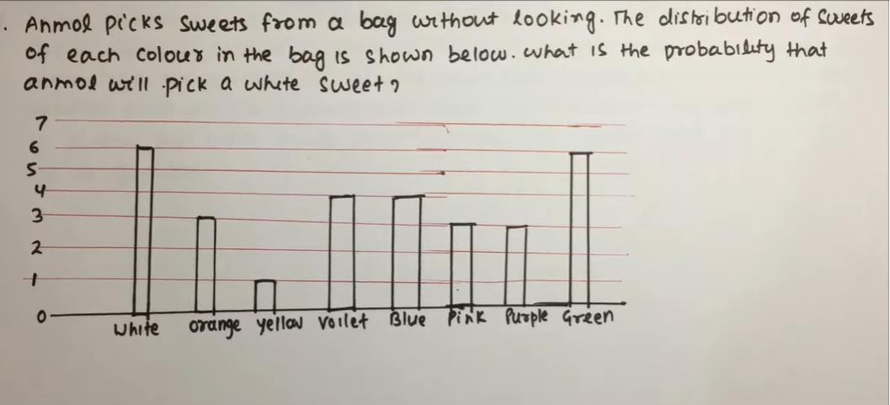

# Section - Mathematical Ability
## Topic - Data Interpretation

> **Target Assessment:** Infosys Systems Engineer (SE) & Specialist Programmer (SP)
> **Module Focus:** `Bar charts, tabular data distributions, statistical medians, weighted ratios, and probability deductions.`
> **Total Extracted Questions in this Topic:** 3
> **Format Standard:** 100% Complete question stems, all options, embedded figures, answers, and formal mathematical proofs.

---

### Question 1: Anmol Sweets Color Frequency Distribution Bar Chart
**Target Role:** Infosys Systems Engineer (SE) / Specialist Programmer (SP)  
**Source Document:** `Aptitude PYQs Compendium`  

#### Question Stem & Answer Options:
Data Interpretation Questions:

#### Reference Visuals / Figures:

#### Formally Verified Solution & Derivation:
Solution: 
P(E)= n(E)/ n(S) 
n(E)= favourable outcome 
n(S)= total outcome  
Total outcome= total no of sweets= 6+3+1+4+4+3+3+6= 30sweets 
Favourable outcome= white sweet = 6 
 
P(E)= 6/30 = 1/5 =0.2

---

### Question 2: Statistical Distribution & Median Evaluation 2
**Target Role:** Infosys Systems Engineer (SE) / Specialist Programmer (SP)  
**Source Document:** `Official Numerical Ability Paper`  

#### Question Stem & Answer Options:
The collection of numbers which comprise the data given below is 
arranged in ascending order. 
(3,7,9, N - 1,15,18,19,20) 
If the median of the data is 12.5, what is the value of N? 
1. 10.5 
2. 11.5 
3. 11 
4. 12

#### Formally Verified Solution & Derivation:
Solution: option(3) 
Median of the even data = (sum of middle terms) / 2 
= [(N - 1) + 15] / 2 = 12.5 
 N=11

---

### Question 3: Statistical Distribution & Median Evaluation 3
**Target Role:** Infosys Systems Engineer (SE) / Specialist Programmer (SP)  
**Source Document:** `Official Numerical Ability Paper`  

#### Question Stem & Answer Options:
How much percentage is (0.025% of 240% of 1.5) of 0.9? 
1. 10 
2. 0.01 
3. 0.1 
4. 1 

OnlineStudy4U .. A Complete Placement Solution                       website: https://onlinestudy4u.in/ 
 
5. None of these

#### Formally Verified Solution & Derivation:
Solution: option(5) 
=>  { (0.025% of 240% of 1.5)/0.9 }x 100 
=>  [ { (25/100000) x (240/100) x 15 } / 9 ] x 100 
=>  0.1

---
