# TCS Previous Year 30 Minutes Coding Questions & Solutions

## Document Overview
- **Source:** `Fully Solved TCS Previous Year Aptitude, Reasoning.pdf` (Pages 134 to 194)
- **Author/Instructors:** Shridhar Sir & Pratik Shrivastava (OnlineStudy4U)
- **Total Coding Challenges:** 50 Problems
- **Content Included:** Problem Statements, Constraint Specs, Sample Input/Output, Visual Diagrams/Flowcharts, and Complete Production Source Code in C / C++ / Java / Python.

---

### Problem 1
**Category:** TCS 30-Minute Coding Challenge  
**Exam Track:** TCS NQT / Digital / Ninja Recruitment  

#### Problem Specification & Reference Visuals:

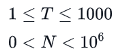

#### Problem Description & Implementation:
PROBLEM 1 
At the annual meeting of Board of Directors of Acme Inc, everyone starts shaking hands 
with everyone else in the room. Given the fact that any two persons shake hand exactly 
once, can you tell the total count of handshakes? 
Input Format 
The first line contains the number of test cases T, T lines follow. 
Each line then contains an integer N, the total number of Board of Directors of Acme. 
Output Format 
Print the number of handshakes for each test-case in a new line. 
Constraints 
1 <= T <= 1000 
0 < N < 106 
Sample Input 
2 
1 
2 
Sample Output 
0 
1 
Explanation 
Previous Year 30 MINUTES CODING QUESTIONS  for TCS NQT  

134 
 
Case 1 : The lonely board member shakes no hands, hence 0. 
Case 2 : There are 2 board members, 1 handshake takes place. 
SOLUTION 
#include "stdio.h" 
int main() 
{ 
    int n; //testcases 
    scanf("%d",&n); 
    int arr[n]; 
    for(int i=0; i<n; i++)    { 
        scanf("%d",&arr[i]); 
        printf("%d\n", arr[i]*(arr[i]-1)/2); 
    } 
    return 0; 
}

---

### Problem 2
**Category:** TCS 30-Minute Coding Challenge  
**Exam Track:** TCS NQT / Digital / Ninja Recruitment  

#### Problem Description & Implementation:
PROBLEM 2 
Jim is off to a party and is searching for a matching pair of socks. His drawer is filled with 
socks, each pair of a different color. In its worst case scenario, how many socks (x) should 
Jim remove from his drawer until he finds a matching pair? 
Input Format 
The first line contains the number of test cases T. 
Next T lines contains an integer N which indicates the total pairs of socks present in the 
drawer. 
Output Format 
Print the number of Draws (x) Jim makes in the worst case scenario. 
Constraints 
 
Sample Input 
2 
1 
2 
Sample Output 

135 
 
2 
3 
Explanation 
Case 1 : A pair of socks are present, hence exactly 2 draws for the socks to match. 
Case 2 : 2 pair of socks are present in the drawer. The first and the second draw might result 
in 2 socks of different color. The 3rd sock picked will definitely match one of previously 
picked socks. Hence, 3. 
SOLUTION 
#include "stdio.h" 
int main() 
{ 
    int n,a; //testcases 
    scanf("%d",&n); 
    for(int i=0; i<n; i++) { 
        scanf("%d",&a); 
        printf("%d\n",a+1); 
    } 
    return 0; 
}

---

### Problem 3
**Category:** TCS 30-Minute Coding Challenge  
**Exam Track:** TCS NQT / Digital / Ninja Recruitment  

#### Problem Specification & Reference Visuals:
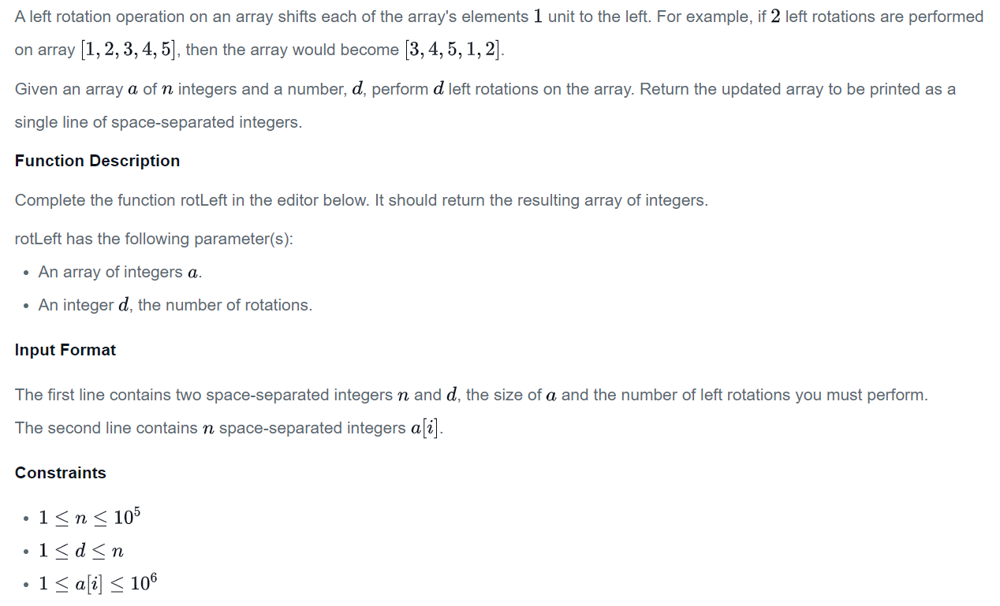
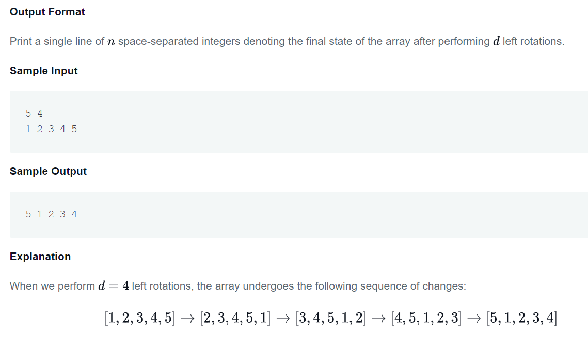

#### Problem Description & Implementation:
PROBLEM 3 

136 
 
 
 
SOLUTION 
#include "stdio.h" 
int main() 
{ 
    int n,d; 
    scanf("%d %d",&n,&d); 

137 
 
    int arr[n]; 
    for(int i=0; i<n; i++) 
        scanf("%d",&arr[(n-d+i)%n]); 
    for(int i=0; i<n; i++) 
        printf("%d ",arr[i]); 
    return 0; 
}

---

### Problem 4
**Category:** TCS 30-Minute Coding Challenge  
**Exam Track:** TCS NQT / Digital / Ninja Recruitment  

#### Problem Specification & Reference Visuals:
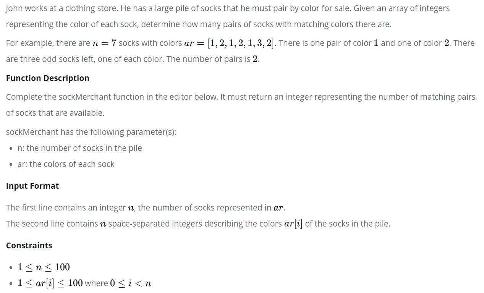
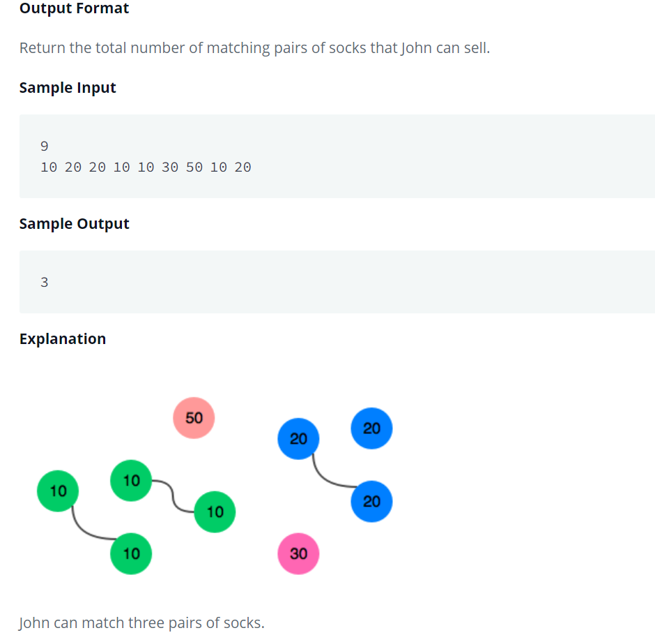

#### Problem Description & Implementation:
PROBLEM 4 
 
 

138 
 
       
 
 
SOLUTION 
#include "stdio.h" 
int main() 
{ 
    int n; 
    scanf("%d",&n); 
    int arr[n], freq[101]={ }; 
    for(int i=0; i<n; i++)     
{ 
        scanf("%d",&arr[i]); 
        freq[arr[i]]++; 
    } 
    int pairCount=0; 
    for(int i=0; i<=100; i++)      
  { 
        pairCount = pairCount + freq[i]/2; 

139 
 
    } 
    printf("%d",pairCount); 
    return 0; 
}

---

### Problem 5
**Category:** TCS 30-Minute Coding Challenge  
**Exam Track:** TCS NQT / Digital / Ninja Recruitment  

#### Problem Specification & Reference Visuals:
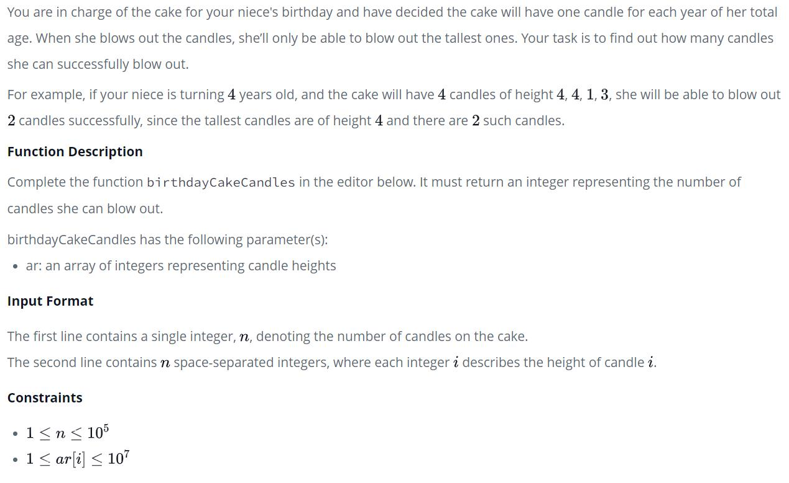
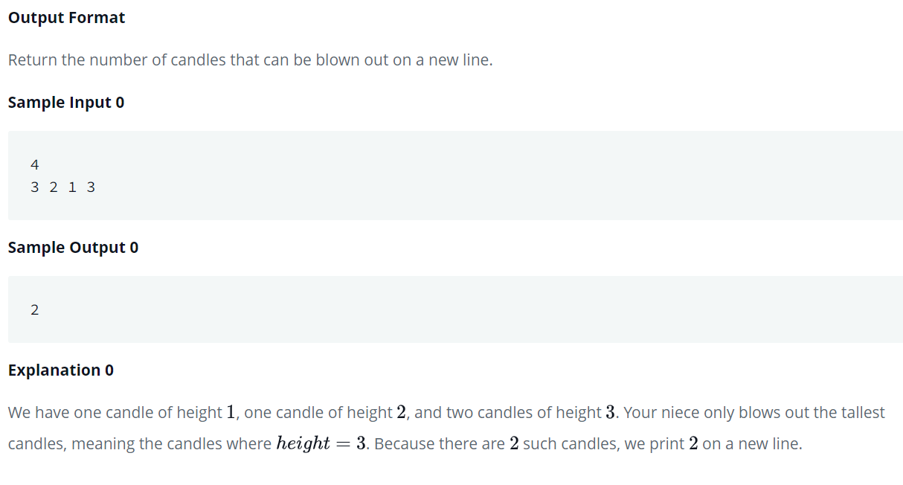

#### Problem Description & Implementation:
PROBLEM 5 
 
 
SOLUTION 

140 
 
#include "stdio.h" 
int main() 
{ 
    int n,max=0,count=0; //No of candles 
    scanf("%d",&n); 
    int arr[n]; 
    for(int i=0; i<n; i++) 
    { 
        scanf("%d",&arr[i]);  
    } 
    for(int i=0; i<n; i++) 
    { 
        if(max < arr[i]) 
        { 
            max=arr[i]; 
            count=1; 
        } 
        else if (max == arr[i])  
            count++; 
    } 
    printf("%d",count); 
    return 0; 
} 
 
 
 
 
 
 
 
 
 
 

141

---

### Problem 6
**Category:** TCS 30-Minute Coding Challenge  
**Exam Track:** TCS NQT / Digital / Ninja Recruitment  

#### Problem Specification & Reference Visuals:
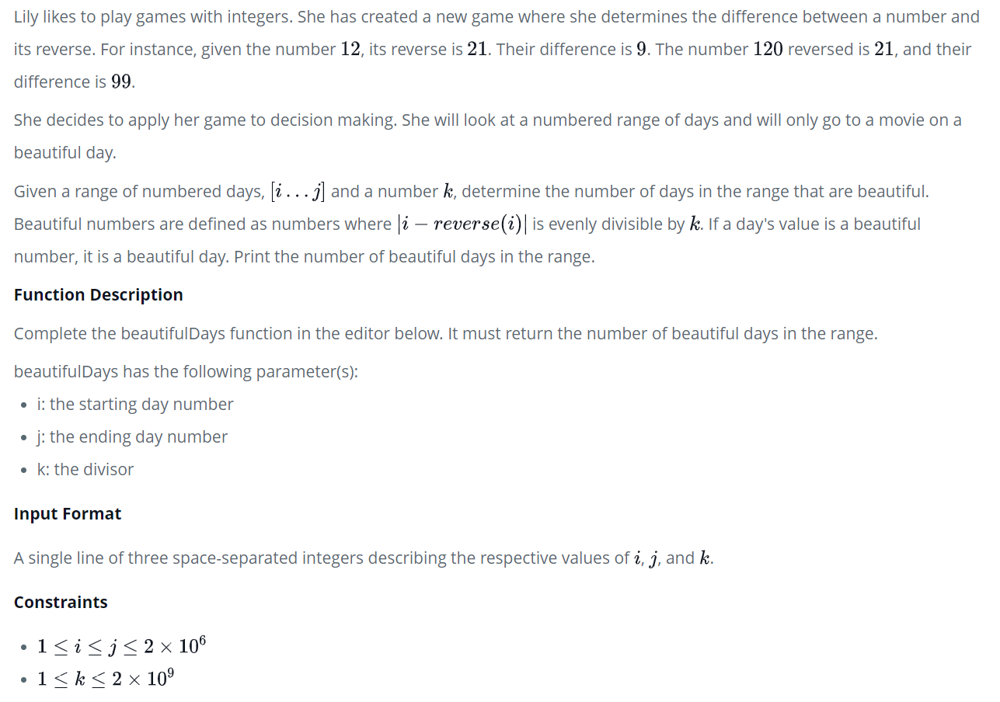
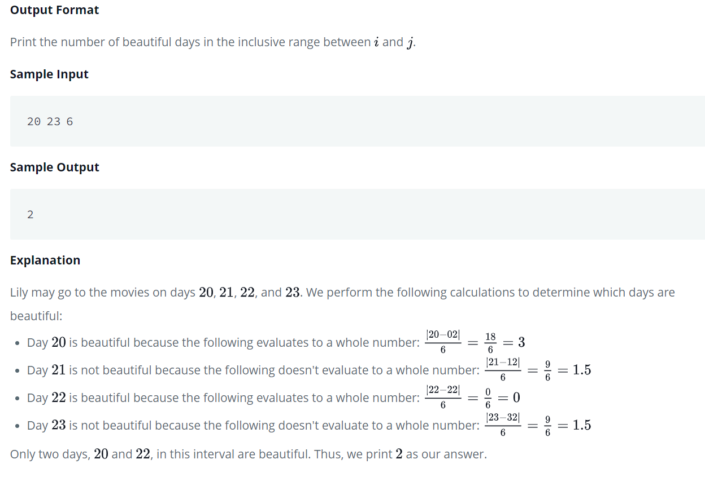

#### Problem Description & Implementation:
PROBLEM 6 
 
               
 

142 
 
 
SOLUTION 
#include "stdio.h" 
#include "math.h 
int revNum(int n) 
{ 
    int rev=0; 
    while(n!=0) 
    { 
        rev = rev*10 + (n%10); 
        n = n /10; 
    } 
    return rev; 
} 
int main() 
{ 
    int i,j,k,bCount=0; 
    scanf("%d%d%d",&i, &j, &k); 
    for(int temp=i; temp<=j; temp++) 
    { 
        if(abs(temp-revNum(temp))%k==0) 
            bCount++; 
    } 
    printf("%d",bCount); 
    return 0; 
} 
 
 
 
 
 
 
 

143

---

### Problem 7
**Category:** TCS 30-Minute Coding Challenge  
**Exam Track:** TCS NQT / Digital / Ninja Recruitment  

#### Problem Specification & Reference Visuals:
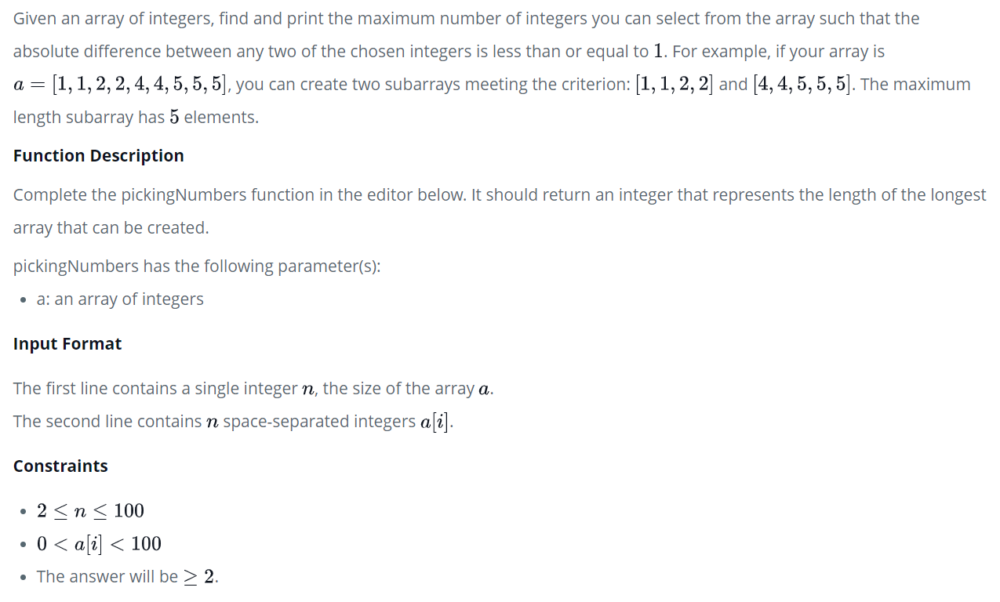
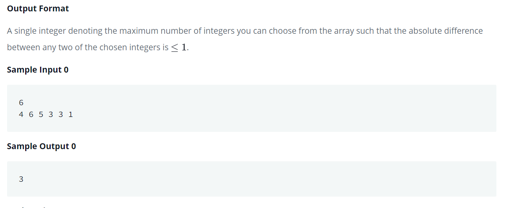

#### Problem Description & Implementation:
PROBLEM 7 
 
 

144 
 
 
SOLUTION 
#include "stdio.h" 
 
int main() 
{ 
    int n,k, max=0; 
    //Take n as input 
    scanf("%d",&n); 
    int arr[100] = {}; 
    for(int i=0; i<n; i++) 
    { 
        scanf("%d",&k); 
        arr[k]++; 
    } 
 
    //Find the maximum count/ length of the array 
    for(int i=0; i<n-1; i++) 
    { 
        if(arr[i] + arr[i+1] > max) 
            max = arr[i] + arr[i+1]; 

145 
 
    } 
    printf("%d",max); 
 
    return 0; 
}

---

### Problem 8
**Category:** TCS 30-Minute Coding Challenge  
**Exam Track:** TCS NQT / Digital / Ninja Recruitment  

#### Problem Specification & Reference Visuals:
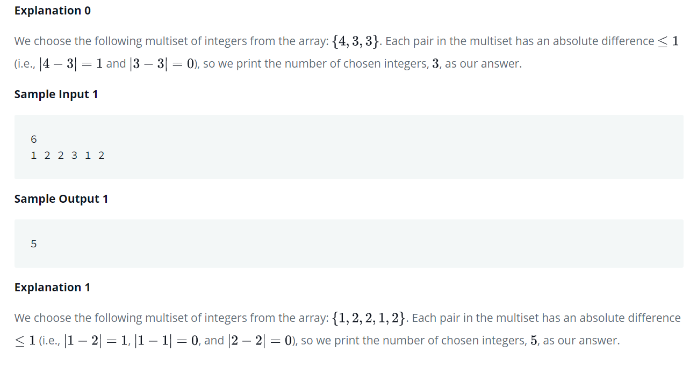
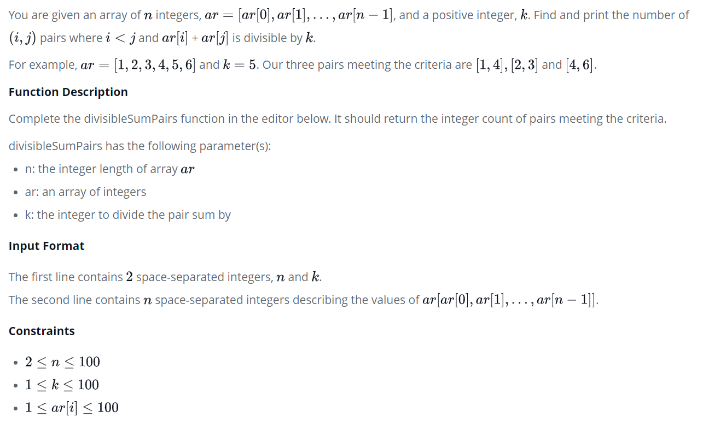

#### Problem Description & Implementation:
PROBLEM 8 
 

146 
 
 
SOLUTION 
#include "stdio.h" 
 
int main() 
{ 
    //Input n and k 
    int n, k, count = 0; 
    scanf("%d %d",&n, &k); 
 
    //Take the array as input and calculate the count 
    int arr[n]; 
    for(int i=0; i<n; i++) 
    { 
        scanf("%d",&arr[i]); 
        for(int j=0; j < i; j++) 
            count += ((arr[i]+arr[j])%k == 0); 
    } 

147 
 
     
    printf("%d",count); 
    return 0; 
}

---

### Problem 9
**Category:** TCS 30-Minute Coding Challenge  
**Exam Track:** TCS NQT / Digital / Ninja Recruitment  

#### Problem Specification & Reference Visuals:
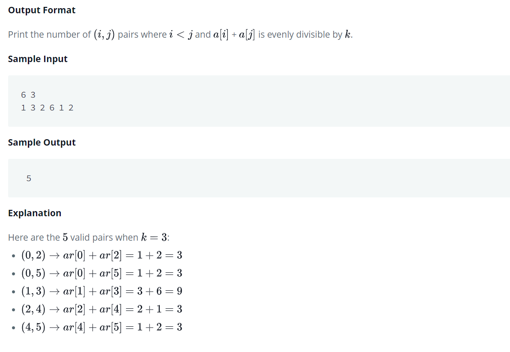
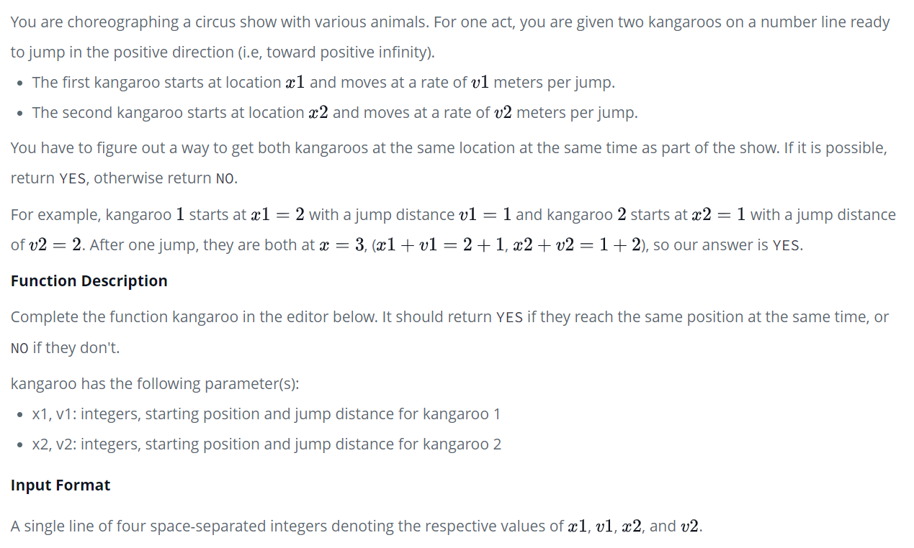
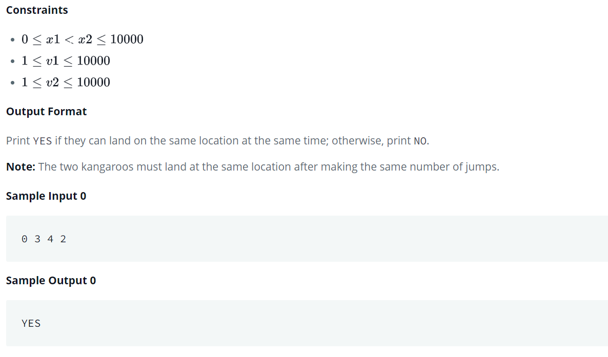

#### Problem Description & Implementation:
PROBLEM 9 
 
 

148 
 
 
 
SOLUTION 
#include "stdio.h" 
 
int main() 
{ 
    int x1,v1,x2,v2; 
 
    //Take the input 
    scanf("%d %d %d %d", &x1, &v1, &x2, &v2); 
 
    //Calculate 
    if(v1 > v2) 
    { 

149 
 
        if((x2 - x1) % (v1 - v2) == 0) 
            printf("YES"); 
        else 
            printf("NO"); 
    } 
    else 
        printf("NO"); 
 
    return 0; 
}

---

### Problem 10
**Category:** TCS 30-Minute Coding Challenge  
**Exam Track:** TCS NQT / Digital / Ninja Recruitment  

#### Problem Specification & Reference Visuals:
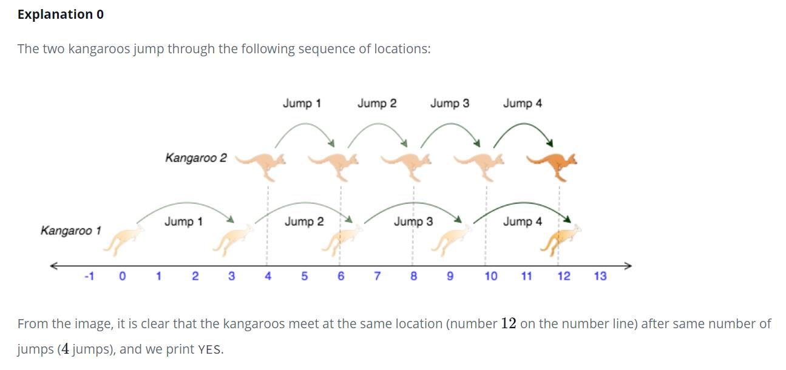
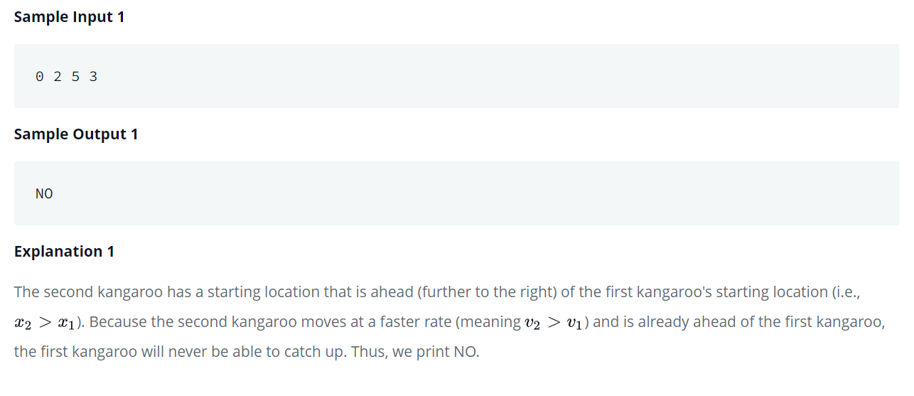
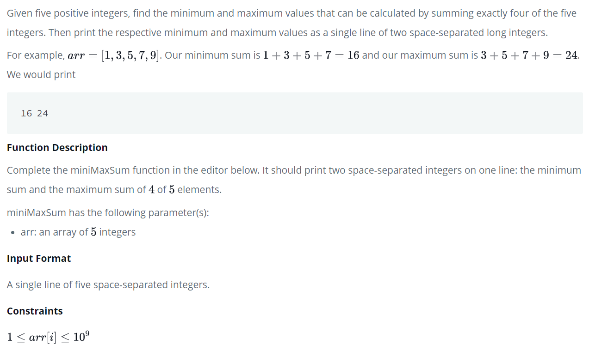
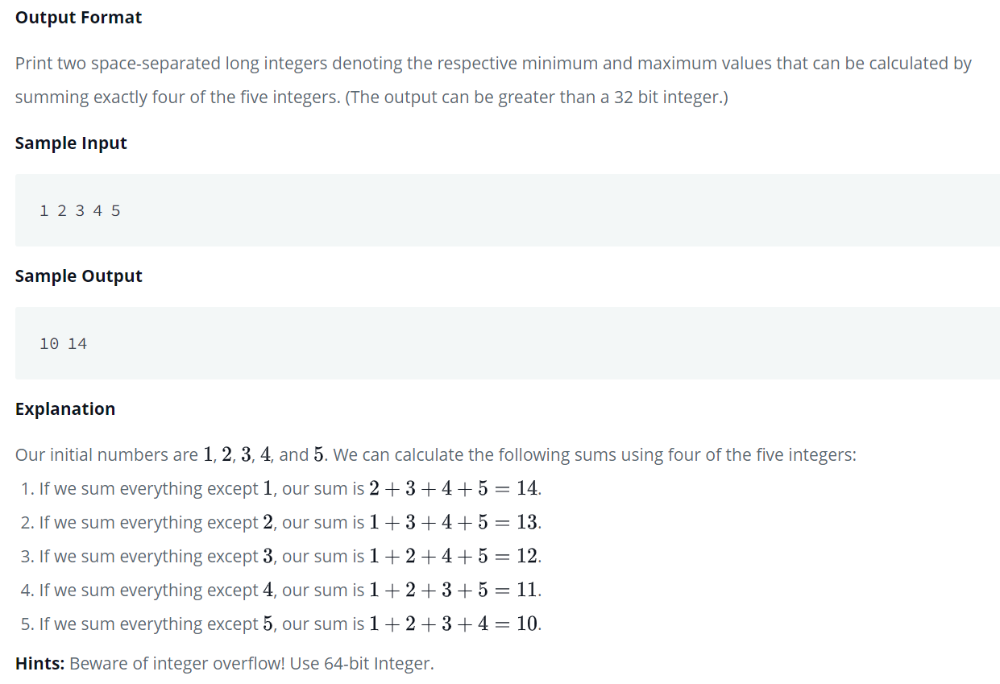

#### Problem Description & Implementation:
PROBLEM 10 
 

150 
 
 
SOLUTION 
#include<stdio.h> 
 
int main() 
{ 
    unsigned long long int arr[5], min, max, sum = 0; 
 
    //Take the array as input 
    for(int i=0; i<5; i++) 
        scanf("%lld",&arr[i]); 
 
    //Find the sum, min and max 
    min = max = arr[0]; 
    sum += arr[0]; 
 
    for(int i=1; i<5; i++) 
    { 

151 
 
        if(min > arr[i]) 
            min = arr[i]; 
         
        if(max < arr[i]) 
            max = arr[i]; 
 
        sum = sum + arr[i]; 
    } 
 
    //Print min sum and max sum 
    printf("%lld %lld",(sum-max), (sum-min)); 
 
    return 0; 
} 
 
 
 
 
 
 
 
 
 
 
 
 
 
 
 
 
 
 
 

152

---

### Problem 11
**Category:** TCS 30-Minute Coding Challenge  
**Exam Track:** TCS NQT / Digital / Ninja Recruitment  

#### Problem Specification & Reference Visuals:
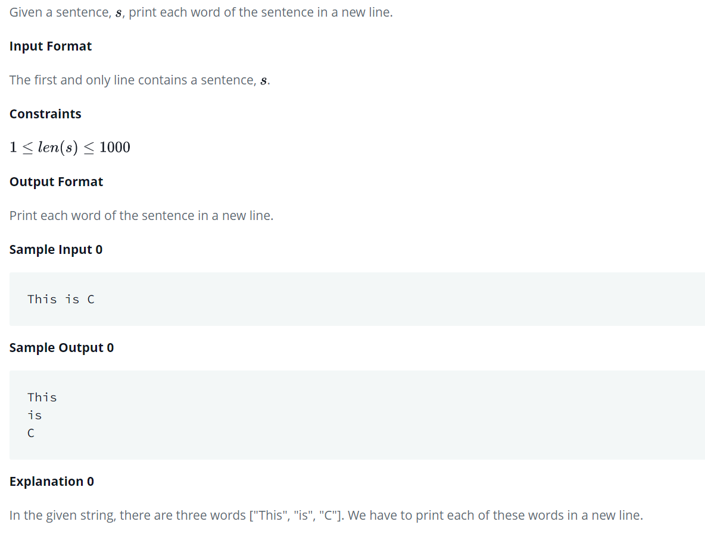
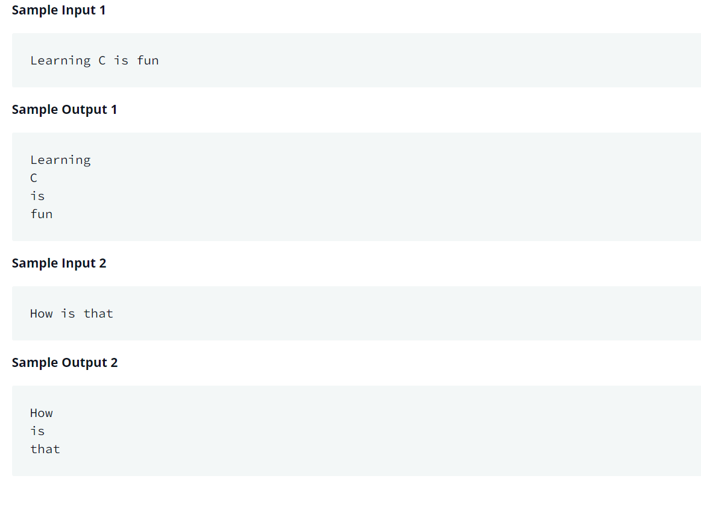

#### Problem Description & Implementation:
PROBLEM 11 
 

153 
 
 
SOLUTION 
#include "stdio.h" 
#include "string.h" 
 
int main() 
{ 
    char str[1001]; 
 
    //Read the string 
    scanf("%[^\n]%*c",str); 
 
    //Logic to print the tokens 
    for(int i=0; i<strlen(str); i++) 
    { 
        if(str[i] == ' ') 
            printf("\n"); 
        else 

154 
 
            printf("%c",str[i]); 
    } 
 
    return 0; 
}

---

### Problem 12
**Category:** TCS 30-Minute Coding Challenge  
**Exam Track:** TCS NQT / Digital / Ninja Recruitment  

#### Problem Specification & Reference Visuals:
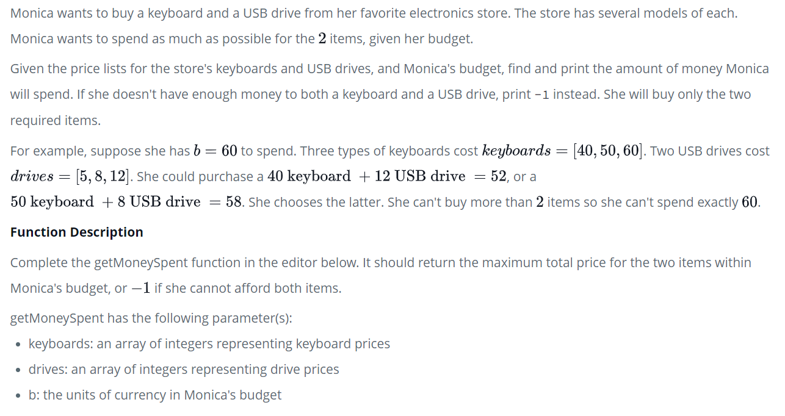
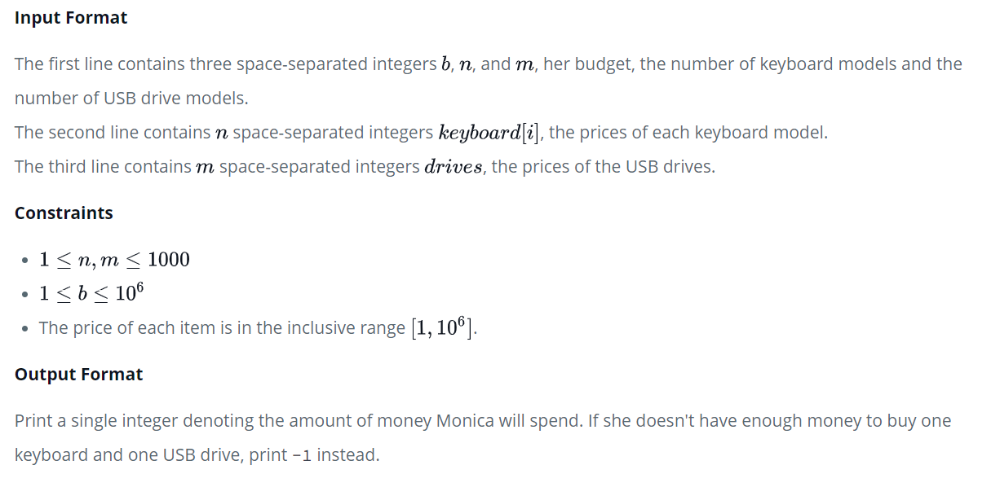
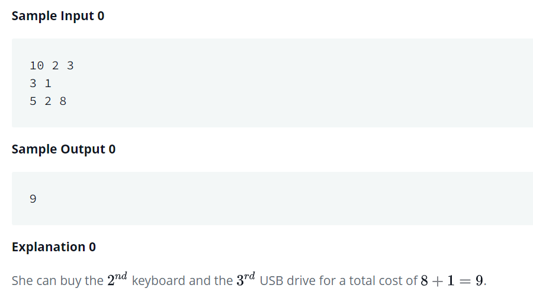
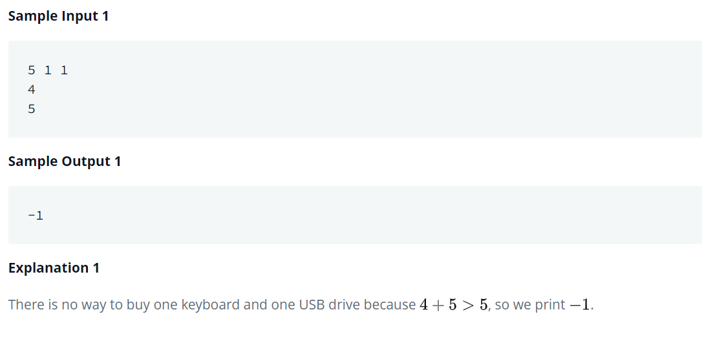

#### Problem Description & Implementation:
PROBLEM 12 
 
 

155 
 
 
 
SOLUTION 
#include "stdio.h" 
 
int main() 
{ 
    int budget, n, m; 
 
    //Input the budget, no of keyboards and no of drives 
    scanf("%d %d %d",&budget, &n, &m); 
 
    int keyboards[n],drives[m], result = -1; 
 
    //Take the keyboard an drive prices as input 
    for(int i=0; i<n; i++) 

156 
 
        scanf("%d",&keyboards[i]); 
 
    for(int i=0; i<m; i++) 
        scanf("%d",&drives[i]); 
 
    //Find the money that Monica will spend 
    for(int i=0; i<n; i++) 
    { 
        for(int j=0; j<m; j++) 
        { 
            if(keyboards[i]+ drives[j] <= budget) 
                result = result > keyboards[i] + drives[j] ? result : (keyboards[i] + drives[j]); 
        } 
    } 
 
    //Print the result 
    printf("%d",result); 
 
    return 0; 
} 
 
 
 
 
 
 
 
 
 
 
 
 
 

157

---

### Problem 13
**Category:** TCS 30-Minute Coding Challenge  
**Exam Track:** TCS NQT / Digital / Ninja Recruitment  

#### Problem Specification & Reference Visuals:
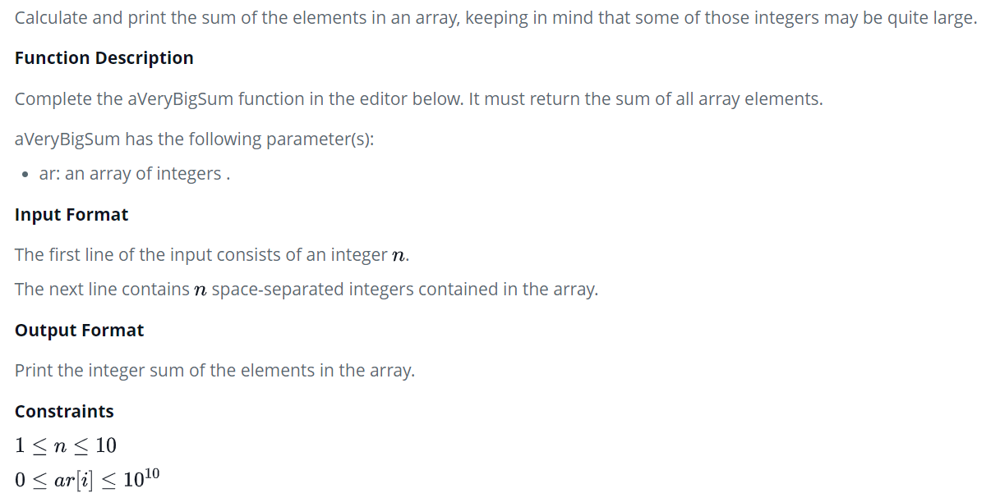
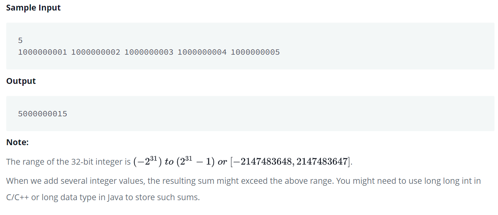
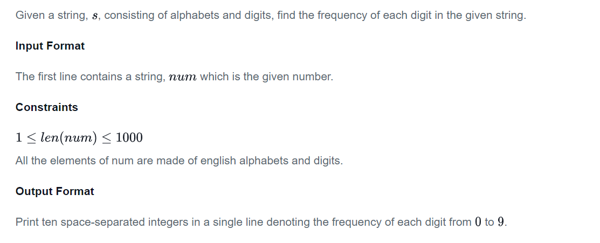

#### Problem Description & Implementation:
PROBLEM 13 
 
 
SOLUTION 
#include<stdio.h> 
 
int main() 
{ 
    int n; 
    scanf("%d",&n); 
 
    //Declare the array and sum variable 
    unsigned long long int ar[n], sum=0; 

158 
 
 
    //Input the array 
    for(int i=0; i<n; i++) 
    { 
        scanf("%lld",&ar[i]); 
        sum += ar[i]; 
    }    
 
    printf("%lld",sum); 
 
    return 0; 
}

---

### Problem 14
**Category:** TCS 30-Minute Coding Challenge  
**Exam Track:** TCS NQT / Digital / Ninja Recruitment  

#### Problem Specification & Reference Visuals:
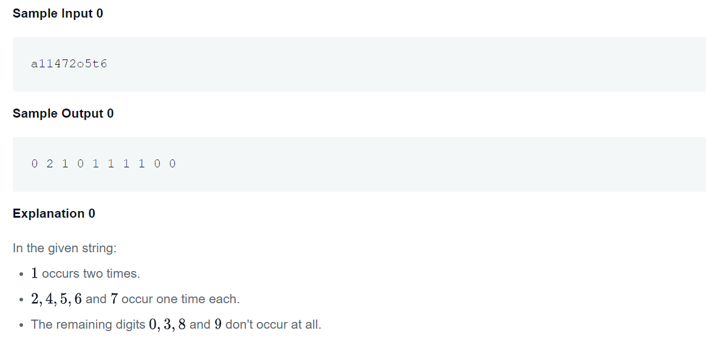
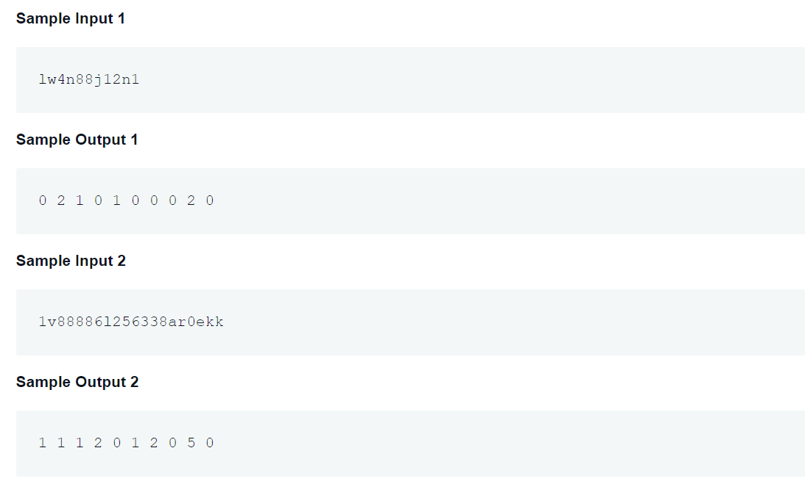

#### Problem Description & Implementation:
PROBLEM 14 
 

159 
 
 
 
SOLUTION 
#include <stdio.h> 
#include <string.h> 
 
int main() 
 { 
    char str[1001]; //Declare the string 
 

160 
 
    //Input the string 
    scanf("%s",str); 
 
    //Counting array 
    int count[10] = { }; 
 
    //Count the frequency of the digits 
    for(int i=0; i < strlen(str); i++) 
    { 
        if(str[i]>='0' && str[i]<='9') 
        { 
            count[str[i]-'0']++; 
        } 
    } 
 
    //Print the frequencies 
    for(int i=0; i<10; i++) 
        printf("%d ",count[i]); 
 
    return 0; 
}

---

### Problem 15
**Category:** TCS 30-Minute Coding Challenge  
**Exam Track:** TCS NQT / Digital / Ninja Recruitment  

#### Problem Description & Implementation:
PROBLEM 15 
Write a program to reverse a string given as input 
SOLUTION 
Two methods can be used. 
Method 1: 
#include <stdio.h> 
#include <string.h> 
int main() 
{ 
   char s[100]; 

161 
 
   printf("Enter a string to reverse\n"); 
  
 gets(s); 
   strrev(s); 
   printf("Reverse of the string: %s\n", s); 
   return 0; 
} 
Method 2: 
#include <stdio.h> 
int main() 
{ 
   char s[1000], r[1000]; 
   int begin, end, count = 0; 
   printf("Input a string\n"); 
   gets(s); 
   // Calculating string length 
   while (s[count] != '\0') 
      count++; 
   end = count - 1; 
   for (begin = 0; begin < count; begin++) { 
      r[begin] = s[end]; 
      end--; 
   } 
   r[begin] = '\0'; 
   printf("%s\n", r); 
   return 0; 
}

---

### Problem 16
**Category:** TCS 30-Minute Coding Challenge  
**Exam Track:** TCS NQT / Digital / Ninja Recruitment  

#### Problem Description & Implementation:
PROBLEM 16 

162 
 
Write a program to reverse a given integer number 
SOLUTION: 
This program takes an integer input from the user. Then the while loop is used until n != 0 is 
false (0). 
In each iteration of the loop, the remainder when n is divided by 10 is calculated and the 
value of n is reduced by 10 times. 
Inside the loop, the reversed number is computed using: 
rev = rev*10 + remainder; 
 
#include <stdio.h> 
int main() { 
    int n, rev = 0, remainder; 
    printf("Enter an integer: "); 
    scanf("%d", &n); 
    while (n != 0) { 
        remainder = n % 10; 
        rev = rev * 10 + remainder; 
        n /= 10; 
    } 
    printf("Reversed number = %d", rev); 
    return 0; 
}

---

### Problem 17
**Category:** TCS 30-Minute Coding Challenge  
**Exam Track:** TCS NQT / Digital / Ninja Recruitment  

#### Problem Description & Implementation:
PROBLEM 17 
 
Write a program to check if the given number is a palindrome or not. A Palindrome    
         number is something that remains the same when read backwards. Ex. 2002, 19191 etc. 
SOLUTION: 
#include<stdio.h> 
int main() 
{ 

163 
 
  int Number, Temp, Reminder, Reverse = 0; 
  printf("\nPlease Enter any number to Check for Palindrome\n"); 
  scanf("%d", &Number); 
  for(Temp = Number; Temp > 0; Temp =  Temp /10 ) 
  { 
     Reminder = Temp %10; 
     Reverse = Reverse *10+ Reminder; 
  } 
  printf("Reverse of entered number is = %d\n", Reverse); 
  if ( Number == Reverse ) 
     printf("\n%d is Palindrome Number.\n", Number); 
  else 
     printf("%d is not the Palindrome Number.\n", Number); 
  return 0; 
}

---

### Problem 18
**Category:** TCS 30-Minute Coding Challenge  
**Exam Track:** TCS NQT / Digital / Ninja Recruitment  

#### Problem Description & Implementation:
PROBLEM 18 
Write a program to find the prime numbers within a given range. 
SOLUTION: 
#include <stdio.h> 
int main() 
{ 
   int num1, num2, flag_var, i, j; 
   /* Ask user to input the from/to range 
    * like 1 to 100, 10 to 1000 etc. 
    */ 
   printf("Enter two range(input integer numbers only):"); 
   //Store the range in variables using scanf 

164 
 
   scanf("%d %d", &num1, &num2); 
  
   //Display prime numbers for input range 
   printf("Prime numbers from %d and %d are:\n", num1, num2); 
   for(i=num1+1; i<num2; ++i) 
   { 
      flag_var=0; 
      for(j=2; j<=i/2; ++j) 
      { 
         if(i%j==0) 
         { 
            flag_var=1; 
            break; 
         } 
      } 
      if(flag_var==0) 
         printf("%d\n",i); 
  } 
  return 0; 
}

---

### Problem 19
**Category:** TCS 30-Minute Coding Challenge  
**Exam Track:** TCS NQT / Digital / Ninja Recruitment  

#### Problem Description & Implementation:
PROBLEM 19 
Write a program to check whether a given year is leap year or not. 
SOLUTION: 
#include <stdio.h> 
int main() 
{ 
int year; 
printf("Enter a year to check if it is a leap yearn"); 

165 
 
scanf("%d", &year); 
if(year%400 == 0) 
printf("%d is a leap year.n", year); 
else if(year%100 == 0) 
printf("%d isn't a leap year.n", year); 
else if (year%4 == 0) 
printf("%d is a leap year.n", year); 
else 
printf("%d isn't a leap year.n", year); 
return 0; 
}

---

### Problem 20
**Category:** TCS 30-Minute Coding Challenge  
**Exam Track:** TCS NQT / Digital / Ninja Recruitment  

#### Problem Description & Implementation:
PROBLEM 20 
Write a program to find the greatest number among 10 given numbers. 
#include <stdio.h> 
  int main() { 
    int a[10]; 
    int i; 
    int greatest; 
    printf("Enter ten values:"); 
    //Store 10 numbers in an array 
    for (i = 0; i < 10; i++)  
{ 
    scanf("%d", &a[i]); 
} 
    greatest = a[0]; 
    for (i = 0; i < 10; i++)  
    { 
if (a[i] > greatest) 
{ 
greatest = a[i]; 
    } 
    } 
    printf("Greatest of ten numbers is %d", greatest); 
    return 0; 
  } 

166

---

### Problem 21
**Category:** TCS 30-Minute Coding Challenge  
**Exam Track:** TCS NQT / Digital / Ninja Recruitment  

#### Problem Description & Implementation:
PROBLEM 21 
Write a program to generate Fibonacci series upto a given limit. 
SOLUTION: 
#include<stdio.h> 
int main() 
{ 
   int n, first = 0, second = 1, next, c; 
   printf("Enter the number of terms\n"); 
   scanf("%d",&n); 
   printf("First %d terms of Fibonacci series are :-\n",n); 
   for ( c = 0 ; c < n ; c++ ) 
   { 
      if ( c <= 1 ) 
         next = c; 
      else 
      { 
         next = first + second; 
         first = second; 
         second = next; 
      } 
      printf("%d\n",next); 
   } 
   return 0; 
}

---

### Problem 22
**Category:** TCS 30-Minute Coding Challenge  
**Exam Track:** TCS NQT / Digital / Ninja Recruitment  

#### Problem Description & Implementation:
PROBLEM 22 
Write a program to find the HCF of two given numbers. 
SOLUTION: 
Step by step descriptive logic to find HCF. 

167 
 
1. Input two numbers from user. Store them in some variable 
say num1 and num2. 
2. Declare and initialize a variable to hold hcf i.e. hcf = 1. 
3. Find minimum between the given two numbers. Store the result in some variable 
say min = (num1<num2) ? num1 : num2;. 
4. Run a loop from 1 to min, increment loop by 1 in each iteration. The loop structure 
should look like for(i=1; i<=min; i++). 
5. Inside the loop check if i is a factor of two numbers i.e. if i exactly divides the given two 
numbers num1 and num2 then set i as HCF i.e. hcf = i. 
 
#include <stdio.h> 
int main() 
{ 
    int i, num1, num2, min, hcf=1; 
 
    /* Input two numbers from user */ 
    printf("Enter any two numbers to find HCF: "); 
    scanf("%d%d", &num1, &num2); 
 
    /* Find minimum between two numbers */ 
    min = (num1<num2) ? num1 : num2; 
 
    for(i=1; i<=min; i++) 
    { 
        /* If i is factor of both number */ 
        if(num1%i==0 && num2%i==0) 
        { 
            hcf = i; 
        } 
    } 

168 
 
    printf("HCF of %d and %d = %d\n", num1, num2, hcf); 
    return 0; 
}

---

### Problem 23
**Category:** TCS 30-Minute Coding Challenge  
**Exam Track:** TCS NQT / Digital / Ninja Recruitment  

#### Problem Description & Implementation:
PROBLEM 23 
Write a program to find the factorial of a given number. 
SOLUTION: 
#include <stdio.h> 
  
int main() 
{ 
    int num,i; 
    long int fact; 
   
    printf("Enter an integer number: "); 
    scanf("%d",&num); 
   
    /*product of numbers from num to 1*/ 
    fact=1; 
    for(i=num; i>=1; i--) 
        fact=fact*i; 
          
    printf("\nFactorial of %d is = %ld",num,fact); 
       
    return 0; 
} 
 
Using Recursion, we would do it as: 
 
#include<stido.h> 
//function for factorial 
long int factorial(int n) 

169 
 
{    
    if(n==1)    return 1; 
    return n*factorial(n-1); 
} 
int main() 
{ 
    int num; 
  
    printf("Enter an integer number :"); 
    scanf("%d",&num); 
  
    printf("\nFactorial of %d is = %ld",num,factorial(num)); 
      
    return 0; 
}

---

### Problem 24
**Category:** TCS 30-Minute Coding Challenge  
**Exam Track:** TCS NQT / Digital / Ninja Recruitment  

#### Problem Description & Implementation:
PROBLEM 24 
Write a program to check if the given number is odd or even. 
SOLUTION: 
 
#include<stdio.h> 
int main() 
{ 
  int number; 
 
  printf(" Enter an int value to check Even or Odd \n"); 
  scanf("%d", &number); 
   
  if ( number%2 == 0 ) //Check whether remainder is 0 or not 
     printf("Given number %d is EVEN NUMBER \n", number); 
 
  else 
    printf("Given number %d is ODD NUMBER \n", number); 

170 
 
 
  return 0; 
}

---

### Problem 25
**Category:** TCS 30-Minute Coding Challenge  
**Exam Track:** TCS NQT / Digital / Ninja Recruitment  

#### Problem Description & Implementation:
PROBLEM 25 
Write a program to find the square root of a number in C. 
SOLUTION: 
#include<stdio.h> 
#include<math.h> 
int main() 
{ 
   
double number, result; 
 
printf(" \n Please Enter any Number to find Square root : "); 
   
scanf("%lf", &number); 
   
result = sqrt(number); 
   
printf("\n Square Root a given number %.2lf  =  %.2lf", number, result); 
   
return 0; 
}

---

### Problem 26
**Category:** TCS 30-Minute Coding Challenge  
**Exam Track:** TCS NQT / Digital / Ninja Recruitment  

#### Problem Description & Implementation:
PROBLEM 26 
Write a program to convert a number from Binary to Decimal in C. 
SOLUTION: 
#include<stdio.h> 
#include<math.h> 
int main() 
{ 
 
long int i,n,x=0,a; 
 
printf("Enter any binary number: "); 
 
scanf("%ld",&n); 
 
printf("\nThe decimal conversion of %ld is ",n); 
 
 
 
for(i=0;n!=0;++i) 
 
{ 

171 
 
 
 
a=n%10; 
 
 
x=(a)*(pow(2,i))+x; 
 
 
n=n/10; 
 
} 
 
printf("%ld",x); 
 
return 0; 
 
}

---

### Problem 27
**Category:** TCS 30-Minute Coding Challenge  
**Exam Track:** TCS NQT / Digital / Ninja Recruitment  

#### Problem Description & Implementation:
PROBLEM 27 
Write a program to find the sum of the digits of a given number. 
SOLUTION: 
#include <stdio.h> 
void main() 
{ 
    long num, temp, digit, sum = 0; 
  
    printf("Enter the number \n"); 
    scanf("%ld", &num); 
    temp = num; 
    while (num > 0) 
    { 
        digit = num % 10; 
        sum  = sum + digit; 
        num /= 10; 
    } 
    printf("Given number = %ld\n", temp); 
    printf("Sum of the digits %ld = %ld\n", temp, sum); 
}

---

### Problem 28
**Category:** TCS 30-Minute Coding Challenge  
**Exam Track:** TCS NQT / Digital / Ninja Recruitment  

#### Problem Description & Implementation:
PROBLEM 28 
Write a program to find the average of two given numbers. 
SOLUTION: 
#include<stdio.h> 

172 
 
void main() 
{ 
 
int a, b, avg; 
 
printf(“Enter two numbers: ”); 
 
scanf(“%d %d”,&a, &b); 
 
avg = (a+b)/2; 
 
printf(“The average is = %d\n”,avg); 
}

---

### Problem 29
**Category:** TCS 30-Minute Coding Challenge  
**Exam Track:** TCS NQT / Digital / Ninja Recruitment  

#### Problem Description & Implementation:
PROBLEM 29 
Write a program to concatenate two strings in C. 
SOLUTION: 
#include <string.h> 
int main() 
{ 
    char s1[1000],s2[1000];   
    int i,j; 
  
    printf("Enter  string1: "); 
    gets(s1); 
    printf("Enter  string2: "); 
    gets(s2); 
    j=strlen(s1); 
     
    for(i=0;s2[i]!='\0';i++)   
    { 
     
s1[i+j]=s2[i]; 
 
} 
 
s1[i+j]='\0'; 
  
    printf("combined two strings ='%s'\n",s1); 
     
    return 0; 

173 
 
}

---

### Problem 30
**Category:** TCS 30-Minute Coding Challenge  
**Exam Track:** TCS NQT / Digital / Ninja Recruitment  

#### Problem Description & Implementation:
PROBLEM 30 
Write a program to find the LCM of two given numbers. 
SOLUTION: 
#include <stdio.h> 
int main() 
{ 
   int num1, num2, maxValue; 
 
   printf("Enter two numbers: "); 
   scanf("%d %d", &num1, &num2); 
   //largest integer among num1 and num2 is stored in maxValue 
   maxValue = (num1 > num2) ? num1 : num2; 
 
   while(1)  //always true 
   { 
      if ((maxValue % num1 == 0) && (maxValue % num2 == 0)) 
      { 
         printf("LCM: %d", maxValue); 
         break; 
      } 
      ++maxValue; 
   } 
   return 0; 
}

---

### Problem 31
**Category:** TCS 30-Minute Coding Challenge  
**Exam Track:** TCS NQT / Digital / Ninja Recruitment  

#### Problem Description & Implementation:
PROBLEM 31 
Write a program to find the area of triangle given base and height. 
SOLUTION: 
 
The area of a triangle is  = 
 
#include<stdio.h> 
int main() 

174 
 
{ 
   
float base, height, area; 
   
   
printf("\n Please Enter the Base of a Triangle  :  "); 
   
scanf("%f", &base); 
   
printf("\n Please Enter the Height of a Triangle  :  "); 
   
scanf("%f", &height); 
   
 
   
area = (base * height) / 2; 
   
printf("\n The Area of a Triangle using Base and Height = %.2f\n", area); 
  
   
return 0; 
}

---

### Problem 32
**Category:** TCS 30-Minute Coding Challenge  
**Exam Track:** TCS NQT / Digital / Ninja Recruitment  

#### Problem Description & Implementation:
PROBLEM 32 
Write a program to swap two numbers in C. 
SOLUTION: 
// C program to swap two variables  
#include <stdio.h>  
 
int main()  
{  
 
int x, y;  
 
printf("Enter Value of x ");  
 
scanf("%d", &x);  
 
printf("\nEnter Value of y ");  
 
scanf("%d", &y);  
 
 
int temp = x;  
 
x = y;  
 
y = temp;  
 
 
printf("\nAfter Swapping: x = %d, y = %d", x, y);  

175 
 
 
return 0;  
}

---

### Problem 33
**Category:** TCS 30-Minute Coding Challenge  
**Exam Track:** TCS NQT / Digital / Ninja Recruitment  

#### Problem Description & Implementation:
PROBLEM 33 
Writea program to check if the given number is Armstrong or not. 
SOLUTION: 
A positive integer is called an Armstrong number (of order n) if 
abcd... = an + bn + cn + dn +  
In the case of an Armstrong number of 3 digits, the sum of cubes of each digit is equal to 
the number itself. For example, 153 is an Armstrong number because 
153 = 1*1*1 + 5*5*5 + 3*3*3  
Checking Armstirng Number of 3 digits: 
#include <stdio.h> 
int main() { 
    int num, originalNum, remainder, result = 0; 
    printf("Enter a three-digit integer: "); 
    scanf("%d", &num); 
    originalNum = num; 
 
    while (originalNum != 0) { 
        // remainder contains the last digit 
        remainder = originalNum % 10; 
         
        result += remainder * remainder * remainder; 
         
        // removing last digit from the orignal number 
        originalNum /= 10; 
    } 
 
    if (result == num) 

176 
 
        printf("%d is an Armstrong number.", num); 
    else 
        printf("%d is not an Armstrong number.", num); 
 
    return 0; 
} 
 
 
Checking Armstring number of n digits: 
#include <math.h> 
#include <stdio.h> 
 
int main() { 
    int num, originalNum, remainder, n = 0, result = 0, power; 
    printf("Enter an integer: "); 
    scanf("%d", &num); 
 
    originalNum = num; 
 
    while (originalNum != 0) { 
        originalNum /= 10; 
        ++n; 
    } 
    originalNum = num; 
 
    while (originalNum != 0) { 
        remainder = originalNum % 10; 
 
        // pow() returns a double value 
        // round() return the equivalent int 

177 
 
        power = round(pow(remainder, n)); 
        result += power; 
        originalNum /= 10; 
    } 
 
    if (result == num) 
        printf("%d is an Armstrong number.", num); 
    else 
        printf("%d is not an Armstrong number.", num); 
    return 0; 
}

---

### Problem 34
**Category:** TCS 30-Minute Coding Challenge  
**Exam Track:** TCS NQT / Digital / Ninja Recruitment  

#### Problem Description & Implementation:
PROBLEM 34 
Write a program to convert a number from Decimal to Binary. 
SOLUTION: 
#include<stdio.h>     
#include<stdlib.h>   
int main(){   
int a[10],n,i;     
system ("cls");   
printf("Enter the number to convert: ");     
scanf("%d",&n);     
for(i=0;n>0;i++)     
{     
a[i]=n%2;     
n=n/2;     
}     
printf("\nBinary of Given Number is=");     
for(i=i-1;i>=0;i--)     
{     
printf("%d",a[i]);     

178 
 
}     
return 0;   
}

---

### Problem 35
**Category:** TCS 30-Minute Coding Challenge  
**Exam Track:** TCS NQT / Digital / Ninja Recruitment  

#### Problem Description & Implementation:
PROBLEM 35 
Write a program to convert a number from Binary to Octal.  
SOLUTION: 
#include <stdio.h> 
int main() 
{ 
    long int binarynum, octalnum = 0, j = 1, remainder; 
  
    printf("Enter the value for  binary number: "); 
    scanf("%ld", &binarynum); 
    while (binarynum != 0) 
    { 
        remainder = binarynum % 10; 
        octalnum = octalnum + remainder * j; 
        j = j * 2; 
        binarynum = binarynum / 10; 
    } 
    printf("Equivalent octal value: %lo", octalnum); 
    return 0; 
}

---

### Problem 36
**Category:** TCS 30-Minute Coding Challenge  
**Exam Track:** TCS NQT / Digital / Ninja Recruitment  

#### Problem Description & Implementation:
PROBLEM 36 
Write a program to convert a number from Decimal to Octal. 
SOLUTION: 
#include<stdio.h> 
int main() 
{ 
    long decimalnum, remainder, quotient; 
    int octalNumber[100], i = 1, j; 

179 
 
  
    printf("Enter the decimal number: "); 
    scanf("%ld", &decimalnum); 
    quotient = decimalnum; 
    while (quotient != 0) 
    { 
        octalNumber[i++] = quotient % 8; 
        quotient = quotient / 8; 
    } 
    printf("Equivalent octal value of decimal no %d: ", decimalnum); 
    for (j = i - 1; j > 0; j--) 
        printf("%d", octalNumber[j]); 
    return 0; 
}

---

### Problem 37
**Category:** TCS 30-Minute Coding Challenge  
**Exam Track:** TCS NQT / Digital / Ninja Recruitment  

#### Problem Description & Implementation:
PROBLEM 37 
Write a program to swap two numbers without using a third variable. 
SOLUTION: 
include<stdio.h>   
 int main()     
{     
int a=10, b=20;       
printf("Before swap a=%d b=%d",a,b);       
a=a+b;//a=30 (10+20)     
b=a-b;//b=10 (30-20)     
a=a-b;//a=20 (30-10)     
printf("\nAfter swap a=%d b=%d",a,b);     
return 0;   
}

---

### Problem 38
**Category:** TCS 30-Minute Coding Challenge  
**Exam Track:** TCS NQT / Digital / Ninja Recruitment  

#### Problem Specification & Reference Visuals:
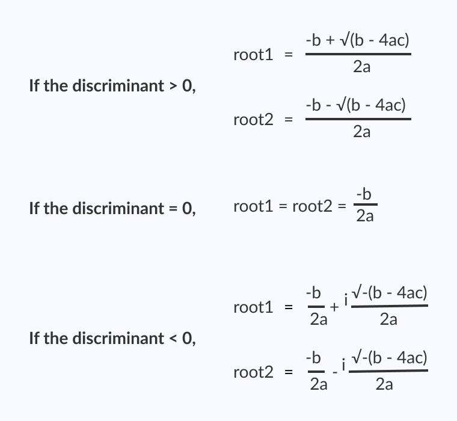
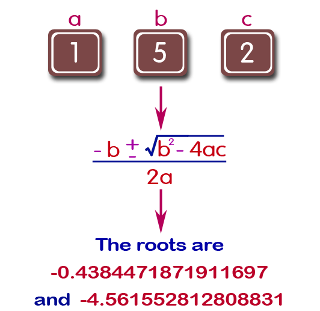

#### Problem Description & Implementation:
PROBLEM 38 
Write a program to print Hello World in C without using semicolon. 
SOLUTION: 

180 
 
#include<stdio.h>   
void main()     
{     
 if(printf("hello world")) 
{ 
}     
}

---

### Problem 39
**Category:** TCS 30-Minute Coding Challenge  
**Exam Track:** TCS NQT / Digital / Ninja Recruitment  

#### Problem Description & Implementation:
PROBLEM 39 
Write a program to multiply two matrices in C. 
SOLUTION: 
#include<stdio.h>     
#include<stdlib.h>   
int main() 
{   
int a[10][10],b[10][10],mul[10][10],r,c,i,j,k;     
system("cls");   
printf("enter the number of row=");     
scanf("%d",&r);     
printf("enter the number of column=");     
scanf("%d",&c);     
printf("enter the first matrix element=\n");     
for(i=0;i<r;i++)     
{     
for(j=0;j<c;j++)     
{     
scanf("%d",&a[i][j]);     
}     
}     
printf("enter the second matrix element=\n");     
for(i=0;i<r;i++)     
{     
for(j=0;j<c;j++)     

181 
 
{     
scanf("%d",&b[i][j]);     
}     
}     
     
printf("multiply of the matrix=\n");     
for(i=0;i<r;i++)     
{     
for(j=0;j<c;j++)     
{     
mul[i][j]=0;     
for(k=0;k<c;k++)     
{     
mul[i][j]+=a[i][k]*b[k][j];     
}     
}     
}     
//for printing result     
for(i=0;i<r;i++)     
{     
for(j=0;j<c;j++)     
{     
printf("%d\t",mul[i][j]);     
}     
printf("\n");     
}     
return 0;   
}

---

### Problem 40
**Category:** TCS 30-Minute Coding Challenge  
**Exam Track:** TCS NQT / Digital / Ninja Recruitment  

#### Problem Description & Implementation:
PROBLEM 40 
Write a C program without main() function. 
SOLUTION: 
#include<stdio.h>     

182 
 
#define start main     
void start()  
{     
   printf("Hello");     
}

---

### Problem 41
**Category:** TCS 30-Minute Coding Challenge  
**Exam Track:** TCS NQT / Digital / Ninja Recruitment  

#### Problem Description & Implementation:
PROBLEM 41 
Write a program to print Alphabet Triangles like this: 
     A 
    ABA 
   ABCBA 
  ABCDCBA 
 ABCDEDCBA 
SOLUTION: 
#include<stdio.h>     
#include<stdlib.h>   
int main(){   
  int ch=65;     
    int i,j,k,m;     
  system("cls");   
    for(i=1;i<=5;i++)     
    {     
        for(j=5;j>=i;j--)     
            printf(" ");     
        for(k=1;k<=i;k++)     
            printf("%c",ch++);     
            ch--;     
        for(m=1;m<i;m++)     
            printf("%c",--ch);     
        printf("\n");     
        ch=65;     
    }     
return 0;   
}

---

### Problem 42
**Category:** TCS 30-Minute Coding Challenge  
**Exam Track:** TCS NQT / Digital / Ninja Recruitment  

#### Problem Description & Implementation:
PROBLEM 42 
Write a program to print a number triangle of given range like this: 

183 
 
Range  = 7 
      1 
     121 
    12321 
   1234321 
  123454321 
 12345654321 
1234567654321  
SOLUTION: 
#include<stdio.h>     
#include<stdlib.h>   
int main() 
{   
int i,j,k,l,n;     
printf("enter the range=");     
scanf("%d",&n);     
for(i=1;i<=n;i++)     
{     
for(j=1;j<=n-i;j++)     
{     
printf(" ");     
}     
for(k=1;k<=i;k++)     
{     
printf("%d",k);     
}     
for(l=i-1;l>=1;l--)     
{     
printf("%d",l);     
}     
printf("\n");     
}     
return 0;   
}

---

### Problem 43
**Category:** TCS 30-Minute Coding Challenge  
**Exam Track:** TCS NQT / Digital / Ninja Recruitment  

#### Problem Description & Implementation:
PROBLEM 43 
Write a program to generate Fibonacci triangle upto given limit like this: 
Limit:9 
1 

184 
 
1 
1 
 
1 
1 
2 
 
1 
1 
2 
3 
 
1 
1 
2 
3 
5 
 
1 
1 
2 
3 
5 
8 
 
1 
1 
2 
3 
5 
8 
13 
 
1 
1 
2 
3 
5 
8 
13 
21 
 
1 
1 
2 
3 
5 
8 
13 
21 
34 
 
SOLUTION: 
#include<stdio.h>     
#include<stdlib.h>   
int main() 
{   
   int a=0,b=1,i,c,n,j;     
    printf("Enter the limit:");     
    scanf("%d",&n);     
    for(i=1;i<=n;i++)     
    {     
        a=0;     
        b=1;     
        printf("%d\t",b);     
        for(j=1;j<i;j++)     
        {     
            c=a+b;     
            printf("%d\t",c);     
            a=b;     
            b=c;     
     
        }     
        printf("\n");     
    }     
return 0;   
}

---

### Problem 44
**Category:** TCS 30-Minute Coding Challenge  
**Exam Track:** TCS NQT / Digital / Ninja Recruitment  

#### Problem Description & Implementation:
PROBLEM 44 
Write a program to print numbers in character like this: 
231 -> two thre one 

185 
 
5996 -> five nine nine six 
SOLUTION: 
#include<stdio.h>     
#include<stdlib.h>   
int main() 
{   
long int n,sum=0,r;     
printf("enter the number=");     
scanf("%ld",&n);     
while(n>0)     
{     
r=n%10;     
sum=sum*10+r;     
n=n/10;     
}     
n=sum;     
while(n>0)     
{     
r=n%10;     
switch(r)     
{     
case 1:     
printf("one ");     
break;     
case 2:     
printf("two ");     
break;     
case 3:     
printf("three ");     
break;     
case 4:     
printf("four ");     
break;     
case 5:     
printf("five ");     
break;     
case 6:     
printf("six ");     
break;     

186 
 
case 7:     
printf("seven ");     
break;     
case 8:     
printf("eight ");     
break;     
case 9:     
printf("nine ");     
break;     
case 0:     
printf("zero ");     
break;     
default:     
printf("tttt");     
break;     
}     
n=n/10;     
}     
return 0;   
}

---

### Problem 45
**Category:** TCS 30-Minute Coding Challenge  
**Exam Track:** TCS NQT / Digital / Ninja Recruitment  

#### Problem Description & Implementation:
PROBLEM 45 
Write a program to find the roots of a quadratic equation. 
SOLUTION: 
The standard form of a quadratic equation is: 
ax2 + bx + c = 0, where 
a, b and c are real numbers and 
a != 0 
The term b2-4ac is known as the discriminant of a quadratic equation. It tells the nature of 
the roots. 
• 
If the discriminant is greater than 0, the roots are real and different. 
• 
If the discriminant is equal to 0, the roots are real and equal. 
• 
If the discriminant is less than 0, the roots are complex and different. 

187 
 
        
 
#include <stdio.h> 
#include <math.h> 
 
void main() 
{ 
   int a,b,c,d; 
   float x1,x2; 
  
   printf("Input the value of a,b & c : "); 
   scanf("%d%d%d",&a,&b,&c); 
   d=b*b-4*a*c; 
   if(d==0) 
   { 
     printf("Both roots are equal.\n"); 
     x1=-b/(2.0*a); 
     x2=x1; 
     printf("First  Root Root1= %f\n",x1); 
     printf("Second Root Root2= %f\n",x2); 
   } 
   else if(d>0) 
 
{ 
 
   printf("Both roots are real and diff-2\n"); 
 
   x1=(-b+sqrt(d))/(2*a); 
 
   x2=(-b-sqrt(d))/(2*a); 
 
   printf("First  Root Root1= %f\n",x1); 
 
   printf("Second Root root2= %f\n",x2); 
 
} 

188 
 
 
else 
 
    printf("Root are imeainary;\nNo Solution. \n"); 
}

---

### Problem 46
**Category:** TCS 30-Minute Coding Challenge  
**Exam Track:** TCS NQT / Digital / Ninja Recruitment  

#### Problem Description & Implementation:
PROBLEM 46 
Write a program to find the sum of all prime numbers in a given range. 
SOLUTION: 
1. 
Input upper limit to find sum of prime from user. Store it in some variable say end. 
2. 
Initialize another variable sum = 0 to store sum of prime numbers. 
3. 
Run a loop from 2 to end, incrementing 1 in each iteration. The loop structure should 
look  like for(i=2; i<=end; i++). 
4. 
Inside the loop check if loop counter variable is prime or not. If i is prime then 
add i to sum i.e. sum = sum + i. 
5. 
Finally after loop print the resultant value of sum. 
 
#include <stdio.h> 
int main() 
{ 
    int i, j, start, end; 
    int isPrime, sum=0; 
 
    printf("Enter lower limit: "); 
    scanf("%d", &start); 
    printf("Enter upper limit: "); 
    scanf("%d", &end); 
 
    for(i=start; i<=end; i++) 
    { 
        isPrime = 1; 
        for(j=2; j<=i/2 ;j++) 
        { 
            if(i%j==0) 
            { 
                /* 'i' is not prime */ 
                isPrime = 0; 
                break; 
            } 
        } 
 

189 
 
        if(isPrime==1) 
        { 
            sum += i; 
        } 
    } 
 
    printf("Sum of all prime numbers between %d to %d = %d", start, end, sum); 
 
    return 0; 
} 
OUTPUT: 
Enter lower limit: 10 
Enter upper limit: 20 
Sum of all prime numbers between 10 to 20 = 60

---

### Problem 47
**Category:** TCS 30-Minute Coding Challenge  
**Exam Track:** TCS NQT / Digital / Ninja Recruitment  

#### Problem Description & Implementation:
PROBLEM 47 
Write a C program to print your name 10 times without using loop or goto statement. 
SOLUTION: 
We can use recursion to do this. 
#include <stdio.h> 
void printName(char* name,int count)  
{  
    printf("%03d : %s\n",count+1,name);  
    count+=1;  
    if(count<10)  
        printName(name,count);  
}  
int main()  
{  
    char name[50];   
    printf("\nEnter you name :");  
    scanf("%s",name);  
    printName(name,0);  
    return 0;  

190 
 
} 
OUTPUT: 
Enter you name :Ramesh  
001 : Ramesh  
002 : Ramesh  
003 : Ramesh  
004 : Ramesh  
005 : Ramesh  
006 : Ramesh  
007 : Ramesh  
008 : Ramesh  
009 : Ramesh  
010 : Ramesh

---

### Problem 48
**Category:** TCS 30-Minute Coding Challenge  
**Exam Track:** TCS NQT / Digital / Ninja Recruitment  

#### Problem Description & Implementation:
PROBLEM 48 
Write a C program to print the code of the current program that you are writing. 
SOLUTION: 
 Its a trick by which you can print your current source code file, use __FILE__ to specify 
current file name and read the file (using file handling) and print it on screen, that will your 
output. 
 
#include <stdio.h> 
int main(void) 
{ 
    FILE *fp; 
    char c; 
    fp = fopen(__FILE__, "r"); 
    do 
    { 
        c=fgetc(fp); 
        putchar(c); 

191 
 
    } 
    while(c!=EOF); 
    fclose(fp); 
    return 0; 
} 
 
The above same code will be printed in the output.

---

### Problem 49
**Category:** TCS 30-Minute Coding Challenge  
**Exam Track:** TCS NQT / Digital / Ninja Recruitment  

#### Problem Description & Implementation:
PROBLEM 49 
Write a C Program to check number is whether EVEN or ODD without using any arithmetic 
or relational operators 
SOLUTION: 
We can check whether an integer number is EVEN or ODD without using any Arithmetic or 
Relational operators. 
Here is a simple trick that we can use to check whether number is EVEN or ODD. Using 
Logical AND (&) operator we can check it, each EVEN number has 0th bit LOW (0) and ODD 
number has 0th bit HIGH (1). 
The statement (number & 0x01) will check that 0th bit is HIGH, if it is HIGH (1) number will 
be an ODD otherwise number will be an EVEN. 
#include <stdio.h> 
  
int main() 
{ 
    int number; 
      
    //input an integer number 
    printf("Please input an integer number: "); 
    scanf("%d",&number); 
          
    //check 0th bit of number is 1 or 0 
    (number & 0x01) ? printf("%d is an ODD Number.", number) :  printf("%d is an EVEN 
Number.",number) ; 
      
    printf("\n"); 

192 
 
    return 0;    
}

---

### Problem 50
**Category:** TCS 30-Minute Coding Challenge  
**Exam Track:** TCS NQT / Digital / Ninja Recruitment  

#### Problem Description & Implementation:
PROBLEM 50 
Write a C program to do binary addition and binary subtraction. 
SOLUTION: 
Binary addition/subtraction is similar to regular (daily life) addition/subtraction, but 
here addition/subtraction performs only two digits those are 0 and 1, these are binary digits 
hence such kind of addition/subtraction is called binary addition/subtraction. 
Example of Binary Addition: 
Take two numbers, suppose numbers are 10 and 20 their binaries are 1010 and 10100. 
In binary addition  
0+0 
= 
0 
0+1 
= 
1 
1+0 
= 
1 
1+1 
= 
0 
(1 carries out) 
Now add 10 and 20 
10 
= 
0 1 0 1 0 
20 
= 
1 0 1 0 0 
= 
1 1 1 1 0 
= 
30 
Example of Binary Subtraction: 
Take two numbers, suppose numbers are 20 and 10 their binaries 10100 and 1010. 
In binary subtraction  
0-0 
= 
0 
1-0 
= 
1 
0-1 
= 
1 
(1 borrows out) 
1-1 
= 
0 
 
Now sub 10 from 20 
20 
= 
1 0 1 0 0 
10 
= 
0 1 0 1 0 
= 
0 1 0 1 0 
= 
10 

193 
 
 
#include <stdio.h> 
  
//function for Binary Addition 
int binAddition(int a,int b)  
{ 
      int c; //carry 
      while (b != 0) { 
              //find carry and shift it left 
              c = (a & b) << 1; 
              //find the sum 
              a=a^b; 
              b=c; 
      } 
      return a;  
} 
  
//function for Binary Subtraction 
int binSubtracton(int a, int b)  
{ 
      int carry; 
      //get 2's compliment of b and add in a 
      b = binAddition(~b, 1); 
  
      while (b != 0) { 
              //find carry and shift it left     
              carry = (a & b) << 1; 
              //find the sum 
              a = a ^ b; 
              b = carry; 
      } 
      return a; 
} 
  
 
int main()  
{ 
    int number1,number2, binAdd, binSub; 
  
    printf("Input first integer value: ");

---
