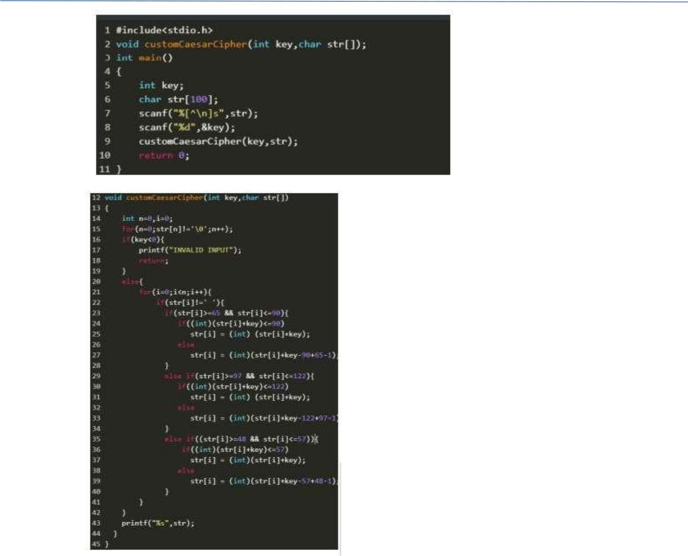

# TCS NQT 2021 Official Paper — Part 02: Coding & Technical Questions

## Document Overview
- **Source:** `Fully Solved TCS Previous Year Aptitude, Reasoning.pdf` (Pages 232 to 260)
- **Exam Paper:** TCS NQT 2021 Official Coding & Technical Section
- **Total Questions in this File:** 28 Questions
- **Content Included:** Candy Jar Machine, Caesar Cipher Variation, Washing Machine Logic, Vehicle Wheels Problem, Matrix/Series Problems, Technical MCQs, and Complete Implementation Code in C, C++, and Python.

---

### Coding question 1:
**Exam:** TCS NQT 2021 Official Examination  
**Track:** Hands-On Coding & Technical Competency  

#### Problem Statement, Test Cases & Implementation Code:
Coding question 1: 
There is a JAR full of candies for sale at a mall counter. JAR has the capacity N, 
that is JAR can contain maximum N candies when JAR is full. At any point of 
time. JAR can have M number of Candies where M<=N. Candies are served to 
the customers. JAR is never remain empty as when last k candies are left. JAR if 
refilled with new candies in such a way that JAR get full. Write a code to 
implement above scenario. Display JAR at counter with available number of 
candies. Input should be the number of candies one customer can order at 
point of time. Update the JAR after each purchase and display JAR at Counter. 
Output should give number of Candies sold and updated number of Candies in 
JAR. 
If Input is more than candies in JAR, return: INVALID    INPUT 
Given, 
N=10, where N is NUMBER OF CANDIES AVAILABLE 
K =< 5, where k is number of minimum candies that must be inside JAR ever. 
Example 1:(N = 10, k =< 5) 
Input Value 
3 
Output Value 
NUMBER OF CANDIES SOLD : 3 
NUMBER OF CANDIES AVAILABLE : 7 
Example : (N=10, k<=5) 
Input Value 
0 
Output 
INVALID INPUT 
NUMBER OF CANDIES LEFT : 10 
Solution using C: 
#include <stdio.h> 
 
int main() 
 
{ 
int n=10, k=5; 
 
int num; 
 
scanf("%d",&num); 
 

OnlineStudy4U .. A Complete Placement Solution                       website: https://onlinestudy4u.in/ 
 
 
if(num>=1 && num<=5) 
 
{ 
 
printf("NUMBER OF CANDIES SOLD : %d\n",num); 
 
printf("NUMBER OF CANDIES LEFT : %d",n-num); 
 
} 
 
else 
 
{ 
 
printf("INVALID INPUT\n"); 
 
printf("NUMBER OF CANDIES LEFT : %d",n); 
 
} 
 
return 0; 
 
} 
 
Solution in C++ 
 
#include <iostream.h> 
 
using namespace std; 
 
int main() 
 
{ 
int n=10, k=5; 
 
int num; 
 
cin>>num; 
if(num>=1 && num<=5) 
 
{ 
 
cout<<"NUMBER OF CANDIES SOLD : "<<num<<"\n"; 
 
cout<<"NUMBER OF CANDIES LEFT : "<<n-num; 
 
} 
 
else 
 

OnlineStudy4U .. A Complete Placement Solution                       website: https://onlinestudy4u.in/ 
 
 
{ 
 
cout<<"INVALID INPUT\n"; 
cout<<"NUMBER OF CANDIES LEFT : 
"<<n; 
 
} 
 
return 0; 
 
} 
 
 
 
Solution in Java 
 
import java.util.Scanner; 
 
class Main{ 
 
public static void main(String[] args) { 
 
int n = 10, k = 5; 
 
int num; 
 
Scanner sc = new Scanner(System.in); 
 
num = sc.nextInt(); 
 
if(num >= 1 && num <= 5) { 
 
System.out.println("NUMBER OF CANDIES SOLD : " + num); 
 
System.out.print("NUMBER OF CANDIES LEFT : " + (n-num)); 
 }  
else { 
System.out.println("INVALID INPUT");  
 
System.out.print("NUMBER OF CANDIES LEFT : " + 
n); 
} 
 
} 
 
} 
 
 
 

OnlineStudy4U .. A Complete Placement Solution                       website: https://onlinestudy4u.in/

---

### Coding question 2
**Exam:** TCS NQT 2021 Official Examination  
**Track:** Hands-On Coding & Technical Competency  

#### Problem Statement, Test Cases & Implementation Code:
Coding question 2 
 
Selection of MPCS exams include a fitness test which is conducted on ground. There 
will be a batch of 3 trainees, appearing for running test in track for 3 rounds. You need 
to record their oxygen level after every round. After trainee are finished with all rounds, 
calculate for each trainee his average oxygen level over the 3 rounds and select one 
with highest oxygen level as the most fit trainee. If more than one trainee attains the 
same highest average level, they all need to be selected. 
 
Display the most fit trainee (or trainees) and the highest average oxygen level. 
 
Note: 
 
1. The oxygen value entered should not be accepted if it is not in the range 
between 1 and 100. 
 
2. 
If the calculated maximum average oxygen value of trainees is below 70 then 
declare the trainees as unfit with meaningful message as All trainees are unfit‖ 
 
3. 
Average Oxygen Values should be rounded. 
 
Example 1: 
 
INPUT VALUES 
 
95 
 
92 
 
95 
 
92 
 
90 
 
92 
 
90 
 
92 
 
90 
 
OUTPUT VALUES 
 
Trainee Number : 1 
 
Trainee Number : 3 

OnlineStudy4U .. A Complete Placement Solution                       website: https://onlinestudy4u.in/ 
 
 
 
 
 
Note: 
 
Input should be 9 integer values representing oxygen levels entered in order as 
Round 1 
 
Oxygen value of trainee 1 
 
Oxygen value of trainee 2 
 
Oxygen value of trainee 3 
 
Round 2 
 
Oxygen value of trainee 1 
 
Oxygen value of trainee 2 
 
Oxygen value of trainee 3 
 
Round 3 
 
Oxygen value of trainee 1 
 
Oxygen value of trainee 2 
 
Oxygen value of trainee 3 
 
Output must be in given format as in above example. For any wrong input final 
output should display “INVALID INPUT”  
Solution in C: 
#include <stdio.h> 
 
int main() 
 
{ 
 
int tr[3][3]; 
 
int average[3] = {0}; 
 
int i, j, max=0; 
 
for(i=0; i<3; i++) 
 
{ 
 
for(j=0; j<3; j++) 

OnlineStudy4U .. A Complete Placement Solution                       website: https://onlinestudy4u.in/ 
 
 
 
{ 
 
scanf("%d", &tr[i][j]); 
 
if(tr[i][j]<1 || tr[i][j]>100) 
 
{ 
 
tr[i][j] = 0; 
 
} 
 
} 
 
} 
 
for(i=0; i<3; i++) 
 
{ 
 
for(j=0; j<3; j++) 
 
{ 
 
average[i] = average[i] + tr[j][i]; 
 
} 
 
average[i] = average[i] / 3; 
 
} 
 
for(i=0; i<3; i++) 
 
{ 
 
if(average[i]>max) 
 
{ 
 
max = average[i]; 
 
 
 
} 
 
} 
 
for(i=0; i<3; i++) 

OnlineStudy4U .. A Complete Placement Solution                       website: https://onlinestudy4u.in/ 
 
 
 
{ 
 
if(average[i]==max) 
 
{ 
 
printf("Trainee Number : %d\n",i+1); 
 
} 
 
if(average[i]<=70) 
 
{ 
 
printf("Trainee is Unfit"); 
 
} 
 
} 
 
return 0; 
 
} 
 
Solution in C++: 
 
#include <iostream> 
 
using namespace std; 
 
int main() 
 
{ 
 
int tr[3][3]; 
 
int average[3] = {0}; 
 
int i, j, max=0; 
 
for(i=0; i<3; i++) 
 
{ 
 
for(j=0; j<3; j++) 
 
{ 
 
cin>>tr[i][j];  

OnlineStudy4U .. A Complete Placement Solution                       website: https://onlinestudy4u.in/ 
 
 
if(tr[i][j]<1 ||tr[i][j]>100) 
 
{ 
 
tr[i][j] = 0; 
 
} 
 
} 
 
} 
 
for(i=0; i<3; i++) 
 
{ 
 
for(j=0; j<3; j++) 
 
{ 
 
average[i] 
= 
average[i]+tr[j][i]; 
 
                                         } 
 
average[i] = average[i] / 3; 
 
 
 
} 
 
for(i=0; i<3; i++) 
 
{ 
 
if(average[i]>max) 
 
{ 
 
max = average[i]; 
 
} 
 
} 
 
for(i=0; i<3; i++) 
 
{ 
 
if(average[i]==max) 
 

OnlineStudy4U .. A Complete Placement Solution                       website: https://onlinestudy4u.in/ 
 
 
{ 
 
cout<<"Trainee Number: "<<i+1<<"\n"; 
 
} 
 
if(average[i]<=70) 
 
{ 
 
cout<<"Trainee is Unfit"; 
 
} 
 
} 
 
return 0; 
 
} 
 
Solution in Java: 
 
import java.util.Scanner; 
 
class Main { 
 
public static void main(String[] args) {  
int[][] tr = new int[3][3];  
int[] average = new int[3]; 
 
int max = 0; 
 
Scanner sc = new Scanner(System.in);  
for(int i = 0; i < 3; i++) { 
for(int  j  =  0;  j  <  3;  j++)  {  
tri][j] = sc.nextInt(); 
if(tr[i][j] < 1 ||tr[i][j] > 100) { 
tr[i][j] = 0; 
 
} 
 
} 
 
} 
 
for(int i = 0; i < 3; i++) { 
 
for(int j = 0; j < 3; j++) { 

OnlineStudy4U .. A Complete Placement Solution                       website: https://onlinestudy4u.in/ 
 
 
 
 
 
average[i] =  average[i]+tr[j][i]; 
 
} 
 
average[i] = average[i] / 3; 
 
} 
 
for(int i = 0; i < 3; i++) {  
if(average[i] > max) { 
  
 
max = average[i]; 
} 
 
} 
 
for(int i = 0; i < 3; i++) {  
if(average[i] == max) { 
System.out.println("Trainee Number : " + (i + 1)); 
 
} 
 
if(average[i] <= 70) {  
System.out.print("Trainee is Unfit"); 
 
} 
 
} 
 
} 
 
}

---

### Coding question 3
**Exam:** TCS NQT 2021 Official Examination  
**Track:** Hands-On Coding & Technical Competency  

#### Problem Statement, Test Cases & Implementation Code:
Coding question 3 
Washing Machine works on the principle of a Fuzzy system, the weight of clothes put 
inside it for wash is uncertain. But based on weight measured by sensors, it decides 
time and water levels which can be changed by menus given on the machine control 
area. For low Water level, time estimate is 25 minutes, where approximate weight is 
2000 grams or any non-zero positive number below that. 
 
For Medium Water level, time estimated is 35minutes, where approximate weight is 
between 2001 grams and 4000 grams. For High Water level, time estimated is 45 
Minutes, where approximate weight is above 4000 grams. Assume the Capacity of 
the Machine is maximum 7000 grams. Where the approximate weight is zero, the 
time estimate is 0 minutes. Write a function which takes numeric weight in the range 
[0,7000] as input and produces estimated time as output; if input is more than 7000, 

OnlineStudy4U .. A Complete Placement Solution                       website: https://onlinestudy4u.in/ 
 
 
then output is: "OVERLOADED!", and for all other inputs, the output statement is 
"INVALID INPUT”. 
 
Input should be in the form of integer value  
 
Output must have the following format - TimeEstimated: Minutes 
 
Example 1 
 
Input Value 
 
2000 
 
Output Value 
 
Time Estimated: 25 Minutes 
 
Solution using C++ 
 
#include<iostream> 
using namespace std; 
int main(){ 
int w; 
cin>>w; 
if(w<0) 
cout<<"INVALID INPUT"; 
else if(w==0) 
cout<<"Time Estimated : 0 Minutes"; 
else if (w>0 && w<=2000) 
cout<<"Time Estimated: 25 Minutes"; 
 
else if(w>=2001 && w <= 4000) 
cout<<"Time Estimated: 35 Minutes"; 
 
else if(w>=4001 && w <= 7000) 
cout<<"Time Estimated: 45 Minutes"; 
 
else 
cout<<"OVERLOADED!"; 
 
return 0; 
 
} 
 
Solution using Python 
 
w = int(input()) 
if (w<0): 
    print("INVALID INPUT") 

OnlineStudy4U .. A Complete Placement Solution                       website: https://onlinestudy4u.in/ 
 
 
elif(w==0): 
    print("Time Estimated : 0 Minutes") 
elif (w>0 and w<=2000): 
    print("Time Estimated: 25 Minutes") 
 
elif(w>=2001 and w <= 4000): 
    print("Time Estimated: 35 Minutes") 
 
elif(w>=4001 and w <= 7000): 
    print("Time Estimated: 45 Minutes") 
 
else: 
    print("OVERLOADED!") 
 
 
 
Coding question – 4 
 Caesar Cipher The Caesar cipher is a type of substitution cipher in which each 
alphabet in the plaintext or message is shifted by a number of places down the 
alphabet.For example, with a shift of 1, P would be replaced by Q, Q would become 
R, and so on.To pass an encrypted message from one person to another, it is first 
necessary that both parties have the 'key' for the cipher, so that the sender may 
encrypt it and the receiver may decrypt it.The key is the number of OFFSETs to 
shift the cipher alphabet. Key can have basic shifts from 1 to 25 positions as there 
are 26 total alphabets. 
As we are designing custom Caesar Cipher, in addition to alphabets, we are 
considering numeric digits from 0 to 9. Digits can also be shifted by key places. 
For example, if given plain text contains any digit with value 5 and key = 2, then 5 will 
be replaced by 7. -(Minus sign) will remain as it is. Key value less than 0 should 
result into "INVALID INPUT" 
 
Example 1: 
 
Input: 
 
Enter your PlainText: All the Best 
 
Enter the Key: 1 
 
Output: 
 
The encrypted Text is: Bmm uif Cftu 
 
Write a function customCaesarCipher(int key, String message) which will accept 
plaintext and key as input parameters and returns its cipher text as output. 
 
Solution using C 
 

OnlineStudy4U .. A Complete Placement Solution                       website: https://onlinestudy4u.in/

---

### Coding question 5
**Exam:** TCS NQT 2021 Official Examination  
**Track:** Hands-On Coding & Technical Competency  

#### Problem Diagram & Memory Layout:

#### Problem Statement, Test Cases & Implementation Code:
Coding question 5 
We want to estimate the cost of painting a property.Interior wall painting cost is 
Rs.18 per sq.ft. and exterior wall painting cost is Rs.12 per sq.ft. 
Take input as 
 
1.       Number of Interior walls 
 
2. 
Number of Exterior walls 
 
3. 
Surface Area of each Interior Wall in units of square feet 
 
4. 
Surface Area of each Exterior Wall in units of square feet 
 

OnlineStudy4U .. A Complete Placement Solution                       website: https://onlinestudy4u.in/ 
 
 
If a user enters zero as the number of walls then skip Surface area values as User 
may don‘t want to paint that wall.Calculate and display the total cost of painting the 
property 
 
Example 1: 
 
6 
 
3 
 
12.3 
 
15.2 
 
12.3 
 
15.2 
 
12.3 
 
15.2 
 
10.10 
 
10.10 
 
10.00 
 
Total estimated Cost : 1847.4 INR 
 
Solution using C: 
 
#include<stdio.h> 
 
int main() 
 
{ 
 
int ni,ne,i=0; 
 
float int_p=18,ext_p=12,cost=0,temp; 
 
scanf("%d %d",&ni,&ne); 
 
if(ni<0 || ne<0 ) 
 
{ 
 
printf("INVALID INPUT"); 

OnlineStudy4U .. A Complete Placement Solution                       website: https://onlinestudy4u.in/ 
 
 
 
 
 
} 
 
else if(ni==0 && ne==0) 
 
{ 
 
printf("Total estimated Cost : 0.0"); 
 
} 
 
else 
 
{ 
 
for(i=0;i<ni;i++) 
 
{ 
 
scanf("%f",&temp); 
 
cost+= int_p*temp; 
 
} 
 
for(i=0;i<ne;i++) 
 
{ 
 
scanf("%f",&temp); 
 
cost+= ext_p*temp; 
 
} 
 
printf("Total estimated Cost : %.1f",cost); 
 
} 
 
return 0; 
 
} 
 
Solution in C++: 
 
#include<iostream> 
 
using namespace std; 

OnlineStudy4U .. A Complete Placement Solution                       website: https://onlinestudy4u.in/ 
 
 
 
int main() 
 
{ 
 
int ni,ne,i=0; 
 
float int_p=18,ext_p=12,cost=0,temp; 
 
scanf("%d %d",&ni,&ne); 
 
if(ni<0 || ne<0 ) 
 
{ 
 
cout<<"INVALID INPUT"; 
 
} 
 
else if(ni==0 && ne==0) 
 
{ 
 
cout<<"Total estimated Cost : 0.0"; 
 
} 
 
else 
 
{ 
 
for(i=0;i<ni;i++) 
 
{ 
 
cin>>temp; 
 
cost+= int_p*temp; 
 
} 
 
for(i=0;i<ne;i++) 
 
{ 
 
cin>>temp; 
 
 
 
cost+= ext_p*temp; 

OnlineStudy4U .. A Complete Placement Solution                       website: https://onlinestudy4u.in/ 
 
 
 
} 
 
cout<<"Total estimated Cost : "<<cost; 
 
} 
 
return 0; 
 
} 
 
Solution in Java: 
 
import java.util.Scanner; 
 
class Main { 
 
public static void main(String[] args) { 
 
int ni, ne, i = 0; 
 
float intP = 18, extP = 12, cost = 0, temp; 
 
Scanner sc = new Scanner(System.in); 
 
ni = sc.nextInt(); 
 
ne = sc.nextInt(); 
 
if(ni < 0 || ne < 0) { 
 
System.out.print("INVALID INPUT"); 
 
} else if(ni == 0 && ne == 0) 
 { 
 System.out.print("Total estimated Cost : 0.0"); 
}  
else { 
 
for(i = 0; i < ni; i++) { 
 
temp = sc.nextFloat(); 
 
cost += intP * temp; 
 
} 
 
for(i = 0; i < ne; i++) { 
 
temp = sc.nextFloat(); 

OnlineStudy4U .. A Complete Placement Solution                       website: https://onlinestudy4u.in/ 
 
 
 
cost += extP * temp; 
 
} 
 
System.out.printf("Total estimated Cost : %.1f", cost); 
 
} 
 
} 
 
} 
 
Solution in Python: 
 
interior_walls = int(input()) 
 
exterior_walls = int(input()) 
 
if interior_walls: 
 
int_walls = [] 
 
for i in range(interior_walls): 
 
int_walls.append(float(input())) 
 
if exterior_walls: 
 
ext_walls = [] 
 
for i in range(exterior_walls): 
 
ext_walls.append(float(input())) 
 
if exterior_walls < 0 or interior_walls < 0: 
 
print(“Invalid Input”) 
 
exit() 
 
 
 
if exterior_walls and interior_walls: 
 
print("Total estimated Cost : ",(sum(int_walls)*18+sum(ext_walls)*12),"INR") 
 
else: 
 
if exterior_walls: 

OnlineStudy4U .. A Complete Placement Solution                       website: https://onlinestudy4u.in/ 
 
 
 
print("Total estimated Cost : ",sum(ext_walls)*12,"INR") 
 
elif interior_walls: 
 
print("Total estimated Cost : ",sum(int_walls)*18,"INR") 
 
else: 
 
print("Total estimated Cost : 0.0 INR")

---

### Coding question 6
**Exam:** TCS NQT 2021 Official Examination  
**Track:** Hands-On Coding & Technical Competency  

#### Problem Statement, Test Cases & Implementation Code:
Coding question 6 
A City Bus is a Ring Route Bus which runs in circular fashion.That is, Bus once 
starts at the Source Bus Stop, halts at each Bus Stop in its Route and at the end it 
reaches the Source Bus Stop again. 
If there are n  number of Stops and if the bus starts at Bus Stop 1, then after nth Bus 
Stop, the next stop in the Route will be Bus Stop number 1 always. 
If there are n stops, there will be n paths.One path connects two stops. Distances (in 
meters) for all paths in Ring Route is given in array Path[] as given below: 
Path = [800, 600, 750, 900, 1400, 1200, 1100, 1500] 
Fare is determined based on the distance covered from source to destination stop 
as  Distance between Input Source and Destination Stops can be measured by 
looking at values in array Path[] and fare can be calculated as per following criteria: 
• 
If d =1000 metres, then fare=5 INR 
• 
(When calculating fare for others, the calculated fare containing any fraction 
value should be ceiled. For example, for distance 900n when fare initially 
calculated is 4.5 which must be ceiled to 5) 
Path is circular in function. Value at each index indicates distance till current stop 
from the previous one. And each index position can be mapped with values at same 
index in BusStops [] array, which is a string array holding abbreviation of names for 
all stops as- 
“THANERAILWAYSTN” = ”TH”, “GAONDEVI” = “GA”, “ICEFACTROY” = “IC”, 
“HARINIWASCIRCLE” = “HA”, “TEENHATHNAKA” = “TE”, “LUISWADI” = 
“LU”, “NITINCOMPANYJUNCTION” = “NI”, “CADBURRYJUNCTION” = “CA” 

OnlineStudy4U .. A Complete Placement Solution                       website: https://onlinestudy4u.in/ 
 
 
Given, n=8, where n is number of total BusStops. 
BusStops = [ “TH”, ”GA”, ”IC”, ”HA”, ”TE”, ”LU”, ”NI”,”CA” ] 
Write a code with function getFare(String Source, String Destination) which take 
Input as source and destination stops(in the format containing first two characters of 
the Name of the Bus Stop) and calculate and return travel fare. 
Example 1: 
Input Values 
ca 
Ca 
Output Values 
INVALID OUTPUT 
Example 2: 
Input Values 
NI 
HA 
Output Values 
23.0 INR 
Note: Input and Output should be in format given in example. 
Input should not be case sensitive and output should be in the format  INR 
 
 
Solution in Python: 
 
import math 
 
def getFare(source,destination): 
 
route=[ [ "TH", "GA", "IC", "HA", "TE", "LU", "NI", 
"CA"], [800,600,750,900,1400,1200,1100,1500] 
 
] 
 

OnlineStudy4U .. A Complete Placement Solution                       website: https://onlinestudy4u.in/ 
 
 
fare = 0.0 
 
if not (source in route[0] and destination in route[0]): 
 
print("Invalid Input") 
 
exit() 
 
if route[0].index(source) < route[0].index(destination): 
 
for i in range(route[0].index(source),route[0].index(destination)+1): 
 
fare+=route[1][i] 
 
 elif route[0].index(destination) < route[0].index(source): 
 
for i in range(route[0].index(source)+1,len(route[0])): 
 
fare+=route[1][i] 
 
for i in range(0,route[0].index(destination)+1): 
 
fare+=route[1][i] 
 
return float(math.ceil(fare*0.005)) 
 
s = input() 
 
dst = input() 
 
fare = getFare(s,dst) 
 
if fare == 0: 
 
print("Invalid Input") 
 
else: 
 
print(fare) 
 
Solution in C++: 
 
#include <bits/stdc++.h> 
 
using namespace std; 
 
int main() { 
 
string s , d; 
 

OnlineStudy4U .. A Complete Placement Solution                       website: https://onlinestudy4u.in/ 
 
 
cin>>s>>d; 
 
transform(s.begin(),s.end() , s.begin(),::toupper); 
transform(d.begin(),d.end() , d.begin(),::toupper); 
 
string arrs[8] = {"TH" , "GA", "IC" , "HA" , "TE", "LU" 
,"NI","CA"}; float 
arr[8]={800,600,750,900,1400,1200,1100,1500}; float res=0; 
 
int st ,ed; 
 
for(int i=0;i<8;i++) 
 
{ 
 
 
 
if(s==arrs[i]) 
 
st=i; 
 
if(d==arrs[i]) 
 
ed=i; 
 
} 
 
if(st==ed) 
 
{ 
 
cout<<" INVALID INPUT"; 
 
return 0; 
 
} 
 
else 
 
{ 
 
int i=st+1; 
 
cout<<i; 
 
while(i!=ed+1) 
 
{ 
 
res+=(arr[i]); 

OnlineStudy4U .. A Complete Placement Solution                       website: https://onlinestudy4u.in/ 
 
 
 
i=(i+1)%8; 
 
} 
 
cout<<(ceil)(res*0.005); 
 
return 0; 
 
} 
 
} 
 
Programming MCQ's:

---

### Q7.
**Exam:** TCS NQT 2021 Official Examination  
**Track:** Hands-On Coding & Technical Competency  

#### Problem Statement, Test Cases & Implementation Code:
Q7. What will be printed when the sample code is executed.   
 
class Main  
{  
public static void main(String args[])  
{  
int i,j,x=0;   
for(i=0;i<5;i++)  
for (j=0;j<5;j++){  
x=(i+j-1);   
System.out.print(x);   
break;  
}  
System.out.print(x);  
}  
}  
Answer- -101233

---

### Q8.
**Exam:** TCS NQT 2021 Official Examination  
**Track:** Hands-On Coding & Technical Competency  

#### Problem Statement, Test Cases & Implementation Code:
Q8. Which of the following options best suits for Memory Leak Occurred 
1. Resource allocation pending while debugging the code  
2. Program releases resources allocated in the memory  
3. Program does not free the memory which is allocated dynamically  
4. Occurs due to address assignment failure.  
Answer- Program does not free the memory which is allocated dynamically.

---

### Q9.
**Exam:** TCS NQT 2021 Official Examination  
**Track:** Hands-On Coding & Technical Competency  

#### Problem Statement, Test Cases & Implementation Code:
Q9.  What among the following is a server based paradigm  
1. Request for Information(RFI)  
2. Data Validation Routine  
3. Cloud computing  
4. Total cost of Ownership.  

OnlineStudy4U .. A Complete Placement Solution                       website: https://onlinestudy4u.in/ 
 
 
Answer- Request for information

---

### Q.10
**Exam:** TCS NQT 2021 Official Examination  
**Track:** Hands-On Coding & Technical Competency  

#### Problem Statement, Test Cases & Implementation Code:
Q.10 When we declare constant pointer to integer, we CANNOT change:  
1. Value pointed by pointer  
2. Either addressing pointer variable or value at that address  
3. Changes are not permitted  
4. Address in pointer variable. 
Answer- Address in the pointer variable.

---

### Q.11
**Exam:** TCS NQT 2021 Official Examination  
**Track:** Hands-On Coding & Technical Competency  

#### Problem Statement, Test Cases & Implementation Code:
Q.11 Write the name of library of functions which is used to perform  
arithmetic operations on BigInteger and BigDecimal  
Answer- MathContext

---

### Q.12
**Exam:** TCS NQT 2021 Official Examination  
**Track:** Hands-On Coding & Technical Competency  

#### Problem Statement, Test Cases & Implementation Code:
Q.12 Which argument is passed to fflush()?   
A.no parameters  
B.stdin   
C.stdout   
D.stderr  
Answer: Option B

---

### Q.13
**Exam:** TCS NQT 2021 Official Examination  
**Track:** Hands-On Coding & Technical Competency  

#### Problem Statement, Test Cases & Implementation Code:
Q.13 What will be the output for the below?                                                     
Enter your answer only as Numeral                
public Class Main {                                                                                          
public static void main(string[]) {                                                                                  
int x=1/2;                                                                              
if(x==0.5)                                                                                                                 
System.out.println(x+1);                                                                                       
else System.out.println(x*2);                                                                                      
} }  
Answer: 0

---

### Q.14
**Exam:** TCS NQT 2021 Official Examination  
**Track:** Hands-On Coding & Technical Competency  

#### Problem Statement, Test Cases & Implementation Code:
Q.14 Which argument is passed to fflush()?   
A.no parameters  
B.stdin   
C.stdout   
D.stderr  
Answer: Option B  

OnlineStudy4U .. A Complete Placement Solution                       website: https://onlinestudy4u.in/

---

### Q.16
**Exam:** TCS NQT 2021 Official Examination  
**Track:** Hands-On Coding & Technical Competency  

#### Problem Statement, Test Cases & Implementation Code:
Q.16 What is the name of the method that examines a particular data entity 
and  determines what data elements need to be associated? 
A. Entity relationship diagram  
B. Logic Data modeling  
C. Customer Entities  
D. Functional Primitive   
Answer: Option A

---

### Q.17
**Exam:** TCS NQT 2021 Official Examination  
**Track:** Hands-On Coding & Technical Competency  

#### Problem Statement, Test Cases & Implementation Code:
Q.17 What will be the output of the below code?   
public class Main { static int num=30;  
static class inner  
{  
void msg()  
{  
System.out.Println(‗Num: num++);  
}  
}  
public static void main(string args[])  
{  
Main.Inner tw=new Main.Inner();  
tw.msg()  
}  
}  
Answer: 30

---

### Q.18
**Exam:** TCS NQT 2021 Official Examination  
**Track:** Hands-On Coding & Technical Competency  

#### Problem Statement, Test Cases & Implementation Code:
Q.18 The function ____ obtains block of memory dynamically. 
a) calloc 
b) malloc 
c) Both calloc & malloc  
d) free 
Answer : Both calloc & malloc

---

### Q.19
**Exam:** TCS NQT 2021 Official Examination  
**Track:** Hands-On Coding & Technical Competency  

#### Problem Statement, Test Cases & Implementation Code:
Q.19 We cannot overload operator  
A. : :  
B. []  
C. ()  

OnlineStudy4U .. A Complete Placement Solution                       website: https://onlinestudy4u.in/ 
 
 
D. +  
Answer: Option A

---

### Q.20
**Exam:** TCS NQT 2021 Official Examination  
**Track:** Hands-On Coding & Technical Competency  

#### Problem Statement, Test Cases & Implementation Code:
Q.20 Which data structure is used to convert expression from one form to 
another  form?  
A. Graph  
B. Stack  
C. LinkedList  
D. Queue   
Answer: Option B

---

### Q.21
**Exam:** TCS NQT 2021 Official Examination  
**Track:** Hands-On Coding & Technical Competency  

#### Problem Statement, Test Cases & Implementation Code:
Q.21 What is the mathematical function used to round off 6.23 to 7?   
A. floor(6.23)  
B. ceil(6.23,7)  
C. floor(6.23,7)  
D. ceil(6.23)  
Answer: Option D

---

### Q.22
**Exam:** TCS NQT 2021 Official Examination  
**Track:** Hands-On Coding & Technical Competency  

#### Problem Statement, Test Cases & Implementation Code:
Q.22 Which combination of the integer variables a, b and c makes the variable 
m  get the value 4 in the following expression?  
m = (a > b) ? (( a > c ) ? a : c) : ((b > c ) ?  b : c )  
A. a=6, b=3, c=5  
B. a=6, b=5, c=3  
C. a=5, b=4, c=5  
D. a=3, b=4, c=2  
Answer: Option D

---

### Q.23
**Exam:** TCS NQT 2021 Official Examination  
**Track:** Hands-On Coding & Technical Competency  

#### Problem Statement, Test Cases & Implementation Code:
Q.23 Which of the following options best suits for Memory Leak Occurred 
A. Resource allocation pending while debugging the code  
B. Program releases resources allocated in the memory  
C. Program does not free the memory which is allocated dynamically  
D. Occurs due to address assignment failure.   
Answer- Option C

---

### Q.24
**Exam:** TCS NQT 2021 Official Examination  
**Track:** Hands-On Coding & Technical Competency  

#### Problem Statement, Test Cases & Implementation Code:
Q.24 Which of the following functions is used to accept strings with white 
spaces?   

OnlineStudy4U .. A Complete Placement Solution                       website: https://onlinestudy4u.in/ 
 
 
A.getWhiteSpaceString();  
B.scanf();  
C.gets();   
D.getstrings();   
Answer: Option C

---

### Q.25
**Exam:** TCS NQT 2021 Official Examination  
**Track:** Hands-On Coding & Technical Competency  

#### Problem Statement, Test Cases & Implementation Code:
Q.25  
What will be the output of the below code?   
import java.util.ArrayList;  
import java.util.Collections;   
import java.util.Iterator;   
class MainClass  
{  
public void sort()  
{  
ArrayList arrayList= new ArrayList();   
arrayList.add("mango");   
arrayList.add("grapes");  
Iterator iterator = arrayList.iterator();   
while(iterator.hasNext())  
{ System.out.print(iterator.next() +" ");  
}  
Collections.sort(arrayList);  
} 
}  
public class Main { public static void main(String[] args)  
{  
MainClass mainclass = new MainClass();   
mainclass.sort();  
}  
}  
A. mango grapes  
B. Compilation error  
C. Collection.sort() throws Concurrent Modification Exception  
D. Grapes mango   
Answer: Option A  
 

OnlineStudy4U .. A Complete Placement Solution                       website: https://onlinestudy4u.in/

---

### Q.26
**Exam:** TCS NQT 2021 Official Examination  
**Track:** Hands-On Coding & Technical Competency  

#### Problem Statement, Test Cases & Implementation Code:
Q.26 Memory allocation using malloc() is done in? 
a) Static area 
b) Stack area 
c) Heap area 
d) Both Stack & Heap area                                                                                                                     
Answer: Option C

---

### Q.27
**Exam:** TCS NQT 2021 Official Examination  
**Track:** Hands-On Coding & Technical Competency  

#### Problem Statement, Test Cases & Implementation Code:
Q.27 .What is the function used to describe the situation, when a function in 
base class is redefined in inherited class? 
a.Inheritance 
b.Overriding 
c.Overloading 
d.Encapsulation 
Answer:b

---

### Q.28
**Exam:** TCS NQT 2021 Official Examination  
**Track:** Hands-On Coding & Technical Competency  

#### Problem Statement, Test Cases & Implementation Code:
Q.28 What will be the output   
public class Main {  
public static void main(String[] args)  
{ 
int $ = 5;  
}  
}  
1. Nothing will print  
2. Symbol not found Error.  
3. Runtime Error  
4. Compile time error  
Answer- Nothing will print

---

### Q.29
**Exam:** TCS NQT 2021 Official Examination  
**Track:** Hands-On Coding & Technical Competency  

#### Problem Statement, Test Cases & Implementation Code:
Q.29 Given here is a scenario. Consider the graph algorithm and answer  the 
given question. John wants to go to different locations of the city in which he 
is. He has listed all of  them down. However he wants to visit one location 
before visiting some other  location. What application of graphs can he use to 
determine that location?  
1. DFS  
2. Dijsktra‘s  
3. BFS  
4. Topological Sorting  

OnlineStudy4U .. A Complete Placement Solution                       website: https://onlinestudy4u.in/ 
 
 
Answer- Dijkstra’s

---

### Q.30
**Exam:** TCS NQT 2021 Official Examination  
**Track:** Hands-On Coding & Technical Competency  

#### Problem Statement, Test Cases & Implementation Code:
Q.30 Which of the following correctly describes overloading of functions? 
a.Virtual polymorphism 
b.Transient polymorphism 
c.Ad-hoc polymorphism 
d.Pseudo polymorphism 
Answer: c

---
