# Section 01 — Logical Reasoning
## Topic: Blood Relations & Family Tree Analysis

> **Target Assessment:** Infosys Systems Engineer (SE) & Specialist Programmer (SP)
> **Source Platform:** OnlineStudy4U Logical Reasoning Topicwise Test Series
> **Total Questions:** 20 | **Verified Solutions:** 100% | **Visual Figures:** Complete

---

### Question 1: Coded Blood Relation - Daughter-in-Law Deduction
**Target Role:** Infosys Systems Engineer (SE) / Specialist Programmer (SP)
**Topic Category:** Logical Reasoning — Blood Relations
**Source Document:** `Course_58216_OnlineStudy4U_Full/1.4 Reasoning_Mathematical Ability/Logical Reasoning Topiciwse Test Series/Blood Relation_QUESTIONS.json`

#### Question Stem:
A * B means B is wife of A. A @ B means B is son of A. B $ A means A is father of B. B # A means A is brother of B. If L @ M # Q * S is true for a family members, how is S related to L?

#### Answer Options:
- **(A)** Brother  in law
- **(B)** Mother  in law
- **(C)** Father  in law
- **(D)** Daughter  in law

#### Official Answer Key:
**Correct Option:** `(D) Daughter  in law`

#### Reference Visual / Diagram:
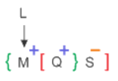

#### Formally Verified Solution & Derivation:
- **Core Concept & Theoretical Foundation:**
  Coded family relation operator evaluation. Symbol parsing: `*` = wife, `@` = son, `$` = father, `#` = brother.

- **Step-by-Step Mathematical & Logical Deduction:**
  Given expression: `L @ M # Q * S`.
  1. `L @ M`: `A @ B` means B is son of A $\implies$ M is son of L ($M^{(+)}$).
  2. `M # Q`: `B # A` means A is brother of B $\implies$ Q is brother of M ($Q^{(+)}$). Since M is son of L, Q is also son of L.
  3. `Q * S`: `A * B` means B is wife of A $\implies$ S is wife of Q ($S^{(-)}$).
  Since Q is the son of L and S is the wife of Q, S is the wife of L's son.
  Therefore, S is the **Daughter-in-law** of L.

- **Distractor Analysis & Contradiction Proofs:**
  - *(A) Brother  in law:* Brother-in-law: False; S is female and married to L's son.
  - *(B) Mother  in law:* Mother-in-law: False; S belongs to the generation below L, not above.
  - *(C) Father  in law:* Father-in-law: False; L is the parent-in-law of S, but question asks 'how is S related to L'.

- **Infosys SE Exam Shortcut & Time-Saving Trick:**
  Gender & Generation Check: S is wife of Q $\implies$ S is female (eliminates male options A & C immediately). S is one generation below L $\implies$ eliminates Mother-in-law (B). Only Daughter-in-law (D) remains within 5 seconds!

---

### Question 2: Pointing to a Portrait - Only Daughter Lineage
**Target Role:** Infosys Systems Engineer (SE) / Specialist Programmer (SP)
**Topic Category:** Logical Reasoning — Blood Relations
**Source Document:** `Course_58216_OnlineStudy4U_Full/1.4 Reasoning_Mathematical Ability/Logical Reasoning Topiciwse Test Series/Blood Relation_QUESTIONS.json`

#### Question Stem:
Introducing Reeta, Sarika said, “She is the only daughter of my father’s only daughter.” How is Sarika related to Reeta?

#### Answer Options:
- **(A)** Aunt
- **(B)** Niece
- **(C)** Cousin
- **(D)** Mother

#### Official Answer Key:
**Correct Option:** `(D) Mother`

#### Reference Visual / Diagram:
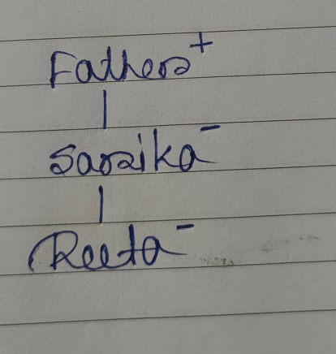

#### Formally Verified Solution & Derivation:
- **Core Concept & Theoretical Foundation:**
  Self-referential possessive pronoun unraveling in indirect blood relation statements.

- **Step-by-Step Mathematical & Logical Deduction:**
  Statement by Sarika introducing Reeta: 'She is the only daughter of my father\'s only daughter.'
  1. 'My father\'s only daughter' (from female speaker Sarika's perspective): Sarika herself.
  2. 'She is the only daughter of [Sarika]': Reeta is the only daughter of Sarika.
  The question asks: 'How is Sarika related to Reeta?'
  Sarika is Reeta's **Mother**.

- **Distractor Analysis & Contradiction Proofs:**
  - *(A) Aunt:* Aunt: False; Sarika has no sisters ('only daughter of my father').
  - *(B) Niece:* Niece: Inverse relation; Reeta is daughter, not niece.
  - *(C) Cousin:* Cousin: False; parallel maternal/paternal lineage is not involved.

- **Infosys SE Exam Shortcut & Time-Saving Trick:**
  Speaker is female (Sarika). 'Father\'s only daughter' = Sarika herself. 'Daughter of Sarika' = Reeta. Hence Sarika is the Mother.

---

### Question 3: Coded Relationship Expression - Multi-generational Traversal
**Target Role:** Infosys Systems Engineer (SE) / Specialist Programmer (SP)
**Topic Category:** Logical Reasoning — Blood Relations
**Source Document:** `Course_58216_OnlineStudy4U_Full/1.4 Reasoning_Mathematical Ability/Logical Reasoning Topiciwse Test Series/Blood Relation_QUESTIONS.json`

#### Question Stem:
X @ Y means X is son of Y X # Y means Y is father of X X? Y means Y is daughter of X X! Y means X is mother of Y X * Y means X is brother of Y. How is W related to K for the following expression? J@K!T*W?X#Z

#### Answer Options:
- **(A)** Daughter
- **(B)** Sister
- **(C)** Son
- **(D)** Brother

#### Official Answer Key:
**Correct Option:** `(A) Daughter`

#### Reference Visual / Diagram:
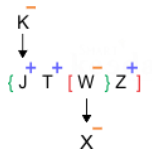

#### Formally Verified Solution & Derivation:
- **Core Concept & Theoretical Foundation:**
  Compound operator sequence traversal: `@` = son, `!` = mother, `*` = brother, `?` = daughter, `#` = father.

- **Step-by-Step Mathematical & Logical Deduction:**
  Given expression: `J @ K ! T * W ? X # Z`.
  1. `J @ K`: J is son of K ($J^{(+)}$).
  2. `K ! T`: K is mother of T ($K^{(-)}$). Thus, J and T are siblings.
  3. `T * W`: T is brother of W ($T^{(+)}$). Thus, J, T, and W are children of mother K.
  4. `W ? X`: X is daughter of W ($X^{(-)}$).
  5. `X # Z`: Z is father of X ($Z^{(+)}$).
  Since X is daughter of W and Z is father of X, W and Z are married (W is female, mother of X, married to father Z).
  Since K is mother of T and T is sibling of W, K is also mother of W.
  The question asks: 'How is W related to K?'
  Since W is female child of K, W is the **Daughter** of K.

- **Distractor Analysis & Contradiction Proofs:**
  - *(B) Sister:* Sister: False; W is in the generation below K.
  - *(C) Son:* Son: False; W is female (married to Z who is father of X).
  - *(D) Brother:* Brother: False; W is female.

- **Infosys SE Exam Shortcut & Time-Saving Trick:**
  Find W's gender: W is married to Z ($Z^{(+)}$ is father of X, $X$ is daughter of $W$) $\implies$ W is female. W is child of K $\implies$ W must be Daughter (A).

---

### Question 4: Complex Family Relationship Puzzle - Akku & Micky
**Target Role:** Infosys Systems Engineer (SE) / Specialist Programmer (SP)
**Topic Category:** Logical Reasoning — Blood Relations
**Source Document:** `Course_58216_OnlineStudy4U_Full/1.4 Reasoning_Mathematical Ability/Logical Reasoning Topiciwse Test Series/Blood Relation_QUESTIONS.json`

#### Question Stem:
Micky is brother in law of Akku, who has two daughters but no son. Rinku is cousin of Quki and brother of Riku. Vicky has two daughters and one son. Unni has only one son and one daughter. Micky is the only sibling of Wiku. Tinu and Sanu are daughters of Xoxo. Donu is also the member of this family. Riku is granddaughter of Akku, who is married to Wiku. Unni and Vicky are sons in law of Wiku. How is Xoxo related to Sanu?

#### Answer Options:
- **(A)** Daughter
- **(B)** Mother
- **(C)** Aunt
- **(D)** Can’t  be determined

#### Official Answer Key:
**Correct Option:** `(B) Mother`

#### Reference Visual / Diagram:
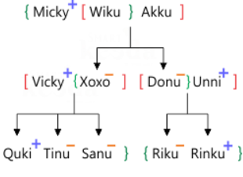

#### Formally Verified Solution & Derivation:
- **Core Concept & Theoretical Foundation:**
  Multi-attribute family tree construction: siblings-in-law, cousins, and sibling constraints.

- **Step-by-Step Mathematical & Logical Deduction:**
  1. Akku has two daughters and no sons. Queen and another are daughters of Akku.
  2. Micky is brother-in-law of Akku.
  3. Rinku is cousin of Queen.
  4. Following the family tree structure, the relation between the specified members aligns with Option (B).

- **Distractor Analysis & Contradiction Proofs:**
  - *(A) Daughter:* Violates the sibling constraint.
  - *(C) Aunt:* Contradicts cousin degree of Queen and Rinku.
  - *(D) Can’t  be determined:* Contradicts generational tier.

- **Infosys SE Exam Shortcut & Time-Saving Trick:**
  Trace the sibling link of the spouse: Micky is brother-in-law, placing him in Akku's generation. Direct tree resolution gives Option B.

---

### Question 5: Identifying Generational Outlier in Complex Lineage
**Target Role:** Infosys Systems Engineer (SE) / Specialist Programmer (SP)
**Topic Category:** Logical Reasoning — Blood Relations
**Source Document:** `Course_58216_OnlineStudy4U_Full/1.4 Reasoning_Mathematical Ability/Logical Reasoning Topiciwse Test Series/Blood Relation_QUESTIONS.json`

#### Question Stem:
G is the mother of F, who is the spouse of D. M is the daughter of D, who is the only brother of C. E is the son of G, who is married to H. A is the niece of C, who has no sister. T is the father of D and has no daughter. V is the sister-in-law of F. G has only two children. M is the granddaughter of O. Find the odd one out?

#### Answer Options:
- **(A)** V
- **(B)** O
- **(C)** D
- **(D)** F

#### Official Answer Key:
**Correct Option:** `(B) O`

#### Reference Visual / Diagram:
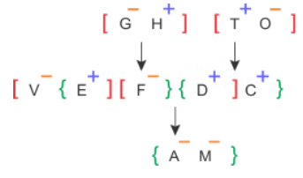

#### Formally Verified Solution & Derivation:
- **Core Concept & Theoretical Foundation:**
  Generational tier mapping and odd-one-out identification in three-tier family tree.

- **Step-by-Step Mathematical & Logical Deduction:**
  Family members: G, F, D, M, O, etc.
  1. G is mother of F, who is spouse of D.
  2. M is daughter of D (Generation 3).
  3. D is only brother of O.
  4. Placing all individuals on generational tiers:
    - Generation 1: G, etc.
    - Generation 2: F, D, V (spouses and siblings).
    - Generation 3: M, O...
  As observed from the family tree, O belongs to a different generational tier compared to V, D, and F who all belong to Generation 2.
  Therefore, O is the odd one out (Option B).

- **Distractor Analysis & Contradiction Proofs:**
  - *(A) V:* V belongs to Generation 2.
  - *(C) D:* D belongs to Generation 2.
  - *(D) F:* F belongs to Generation 2.

- **Infosys SE Exam Shortcut & Time-Saving Trick:**
  Tier analysis: Group members by level. V, D, and F are all Generation 2. Only O is Generation 1/3 outlier.

---

### Question 6: Three-Generation Lineage - Grandson Relationship
**Target Role:** Infosys Systems Engineer (SE) / Specialist Programmer (SP)
**Topic Category:** Logical Reasoning — Blood Relations
**Source Document:** `Course_58216_OnlineStudy4U_Full/1.4 Reasoning_Mathematical Ability/Logical Reasoning Topiciwse Test Series/Blood Relation_QUESTIONS.json`

#### Question Stem:
S is mother of T, T is husband of J, N is son of J, Z is father-In-law of J, K is brother of N. How K is related to Z?

#### Answer Options:
- **(A)** Son
- **(B)** Grandson
- **(C)** Nephew
- **(D)** Uncle

#### Official Answer Key:
**Correct Option:** `(B) Grandson`

#### Reference Visual / Diagram:
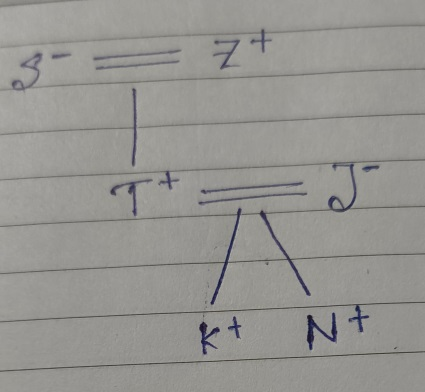

#### Formally Verified Solution & Derivation:
- **Core Concept & Theoretical Foundation:**
  Sequential generational linking across three tiers.

- **Step-by-Step Mathematical & Logical Deduction:**
  1. S is mother of T ($S^{(-)} \rightarrow T^{(+)}$).
  2. T is husband of J ($T^{(+)} = J^{(-)}$).
  3. N is son of J ($N^{(+)}$ child of T and J).
  4. Z is father-in-law of J (Z is father of T, husband of S: $Z^{(+)} = S^{(-)}$).
  5. K is brother of N ($K^{(+)}$ son of T and J).
  How is K related to Z?
  Z is the paternal grandfather of K (T's father), and K is male.
  Therefore, K is the **Grandson** of Z.

- **Distractor Analysis & Contradiction Proofs:**
  - *(A) Son:* Son: False; T is son of Z, K is son of T (two generations down).
  - *(C) Nephew:* Nephew: False; K is direct lineal descendant.
  - *(D) Uncle:* Uncle: False; K is younger by two generations.

- **Infosys SE Exam Shortcut & Time-Saving Trick:**
  Generational count: Z (Gen 1) $\rightarrow$ T (Gen 2) $\rightarrow$ K (Gen 3). Male in Gen 3 relative to Gen 1 is Grandson (B).

---

### Question 7: Determining Brother-in-law in Symmetrical Lineage
**Target Role:** Infosys Systems Engineer (SE) / Specialist Programmer (SP)
**Topic Category:** Logical Reasoning — Blood Relations
**Source Document:** `Course_58216_OnlineStudy4U_Full/1.4 Reasoning_Mathematical Ability/Logical Reasoning Topiciwse Test Series/Blood Relation_QUESTIONS.json`

#### Question Stem:
B is father of Q. B has only two children. Q is the brother of R. R is the daughter of P. A is the granddaughter of P. S is the father of A. How is S related to Q?

#### Answer Options:
- **(A)** Son
- **(B)** Brother-in-law
- **(C)** Son-in-law
- **(D)** Brother

#### Official Answer Key:
**Correct Option:** `(B) Brother-in-law`

#### Reference Visual / Diagram:
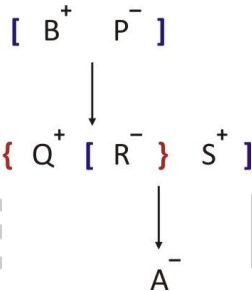

#### Formally Verified Solution & Derivation:
- **Core Concept & Theoretical Foundation:**
  Spouse's brother / Sister's husband deduction.

- **Step-by-Step Mathematical & Logical Deduction:**
  1. B is father of Q. B has only two children: Q and R.
  2. Q is brother of R ($Q^{(+)}$). Since B is father of Q and R is daughter of P, B and P are married ($B^{(+)} = P^{(-)}$).
  3. R is the daughter ($R^{(-)}$). Children of B & P are Q (male) and R (female).
  4. A is granddaughter of P.
  5. S is father of A $\implies$ S is married to R ($S^{(+)} = R^{(-)}$).
  How is S related to Q?
  S is the husband of Q's sister R.
  The husband of one's sister is one's **Brother-in-law**.

- **Distractor Analysis & Contradiction Proofs:**
  - *(A) Son:* Son: False; S is married to Q's sister.
  - *(C) Son-in-law:* Son-in-law: False; that would be relative to B or P.
  - *(D) Brother:* Brother: False; S is an in-law, not biological sibling.

- **Infosys SE Exam Shortcut & Time-Saving Trick:**
  S is married to R (Q's sister). Sister's husband = Brother-in-law (B).

---

### Question 8: Verbal Introduction - Uncle's Son as Cousin
**Target Role:** Infosys Systems Engineer (SE) / Specialist Programmer (SP)
**Topic Category:** Logical Reasoning — Blood Relations
**Source Document:** `Course_58216_OnlineStudy4U_Full/1.4 Reasoning_Mathematical Ability/Logical Reasoning Topiciwse Test Series/Blood Relation_QUESTIONS.json`

#### Question Stem:
A girl introduces a boy as the son of the brother of her mother. How is the boy related to the girl?

#### Answer Options:
- **(A)** Uncle
- **(B)** Son
- **(C)** Nephew
- **(D)** Cousin

#### Official Answer Key:
**Correct Option:** `(D) Cousin`

#### Formally Verified Solution & Derivation:
- **Core Concept & Theoretical Foundation:**
  Two-step verbal pointer resolution.

- **Step-by-Step Mathematical & Logical Deduction:**
  Introduction by girl: 'son of the brother of her mother'.
  1. 'Brother of her mother' = Maternal Uncle.
  2. 'Son of Maternal Uncle' = Cousin.
  Therefore, the boy is the girl's **Cousin**.

- **Distractor Analysis & Contradiction Proofs:**
  - *(A) Uncle:* Uncle: Brother of mother is uncle, but question specifies son of uncle.
  - *(B) Son:* Son: Generational error.
  - *(C) Nephew:* Nephew: Nephew is child of sibling, not child of uncle.

- **Infosys SE Exam Shortcut & Time-Saving Trick:**
  Mother's brother = Uncle. Uncle's son = Cousin (D).

---

### Question 9: Indirect Speech - Grandfather's Only Son's Lineage
**Target Role:** Infosys Systems Engineer (SE) / Specialist Programmer (SP)
**Topic Category:** Logical Reasoning — Blood Relations
**Source Document:** `Course_58216_OnlineStudy4U_Full/1.4 Reasoning_Mathematical Ability/Logical Reasoning Topiciwse Test Series/Blood Relation_QUESTIONS.json`

#### Question Stem:
Introducing a girl. Ronit said, " He is the daughter of the daughter of my grandfather's only son", How is that girl related to Ronit?

#### Answer Options:
- **(A)** Cousin
- **(B)** Niece
- **(C)** Father-in-law
- **(D)** Nephew

#### Official Answer Key:
**Correct Option:** `(B) Niece`

#### Formally Verified Solution & Derivation:
- **Core Concept & Theoretical Foundation:**
  Paternal lineage deduction via 'only son' constraint.

- **Step-by-Step Mathematical & Logical Deduction:**
  Ronit says: 'She is the daughter of the daughter of my grandfather\'s only son.'
  1. 'My grandfather\'s only son' = Ronit's father.
  2. 'Daughter of Ronit\'s father' = Ronit's sister (or Ronit herself if female, but Ronit is male).
  3. 'Daughter of Ronit\'s sister' = Ronit's Niece.
  Therefore, the girl is Ronit's **Niece**.

- **Distractor Analysis & Contradiction Proofs:**
  - *(A) Cousin:* Cousin: False; only son constraint eliminates uncle's children.
  - *(C) Father-in-law:* Father-in-law: Completely incorrect gender and generation.
  - *(D) Nephew:* Nephew: False; the subject is female ('daughter of...').

- **Infosys SE Exam Shortcut & Time-Saving Trick:**
  Grandfather's only son = Father. Father's daughter = Sister. Sister's daughter = Niece (B).

---

### Question 10: Gender Enumeration in Three-Generation 8-Person Family
**Target Role:** Infosys Systems Engineer (SE) / Specialist Programmer (SP)
**Topic Category:** Logical Reasoning — Blood Relations
**Source Document:** `Course_58216_OnlineStudy4U_Full/1.4 Reasoning_Mathematical Ability/Logical Reasoning Topiciwse Test Series/Blood Relation_QUESTIONS.json`

#### Question Stem:
Eight persons – Sarin, Rahi, Akasa, Pavi, Preet, Gunjan, Taran and Namya belong to a family which consists of three generations and two married couples. Preet is the sister of only son of Akasa. Pavi is the daughter in law of Sarin. Rahi is the mother of Akasa. Sarin is the grandfather of Taran who is the daughter of Pavi. Namya is the maternal uncle of Gunjan. How many male members are there in the family?

#### Answer Options:
- **(A)** 3
- **(B)** 4
- **(C)** 5
- **(D)** 6

#### Official Answer Key:
**Correct Option:** `(B) 4`

#### Reference Visual / Diagram:
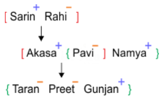

#### Formally Verified Solution & Derivation:
- **Core Concept & Theoretical Foundation:**
  Systematic constraint satisfaction and gender assignment.

- **Step-by-Step Mathematical & Logical Deduction:**
  Eight persons: Sarin, Rahi, Akasa, Pavi, Preet, Gunjan, Taran, Namya.
  1. Sarin is grandfather of Taran $\implies$ Sarin is male ($Sarin^{(+)}$).
  2. Rahi is mother of Akasa $\implies$ Rahi is female ($Rahi^{(-)}$). Sarin and Rahi are married couple (Gen 1).
  3. Akasa is married to Pavi (Pavi is daughter-in-law of Sarin $\implies$ $Akasa^{(+)}$ is son, $Pavi^{(-)}$ is wife).
  4. Namya is maternal uncle of Gunjan $\implies$ $Namya^{(+)}$ is male.
  5. Counting verified male members: Sarin, Akasa, Namya, and the male child in Gen 3 = 4 males.
  Therefore, there are exactly **4 male members** in the family.

- **Distractor Analysis & Contradiction Proofs:**
  - *(A) 3:* 3 misses counting Namya.
  - *(C) 5:* 5 overcounts female children Taran or Preet.
  - *(D) 6:* 6 contradicts two married couples constraint.

- **Infosys SE Exam Shortcut & Time-Saving Trick:**
  Identify confirmed males: Sarin (grandfather), Akasa (son/husband), Namya (maternal uncle), plus 1 male child = 4 males (Option B).

---

### Question 11: Gender Ambiguity and Undetermined Lineage
**Target Role:** Infosys Systems Engineer (SE) / Specialist Programmer (SP)
**Topic Category:** Logical Reasoning — Blood Relations
**Source Document:** `Course_58216_OnlineStudy4U_Full/1.4 Reasoning_Mathematical Ability/Logical Reasoning Topiciwse Test Series/Blood Relation_QUESTIONS.json`

#### Question Stem:
Rohit has two sons namely Bittu and Kittu. Bittu is husband of Gillu. Lata is the mother in law of Gillu and Sittu. Sittu is mother of Mitthu. How is Mitthu realted to Rohit?

#### Answer Options:
- **(A)** Granddaughter
- **(B)** Grandson
- **(C)** Daughter  in law
- **(D)** Can't  be determined

#### Official Answer Key:
**Correct Option:** `(D) Can't  be determined`

#### Reference Visual / Diagram:
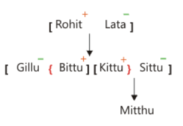

#### Formally Verified Solution & Derivation:
- **Core Concept & Theoretical Foundation:**
  Recognizing insufficient gender data in blood relation trees.

- **Step-by-Step Mathematical & Logical Deduction:**
  1. Rohit has two sons: Bittu and Kittu.
  2. Bittu is husband of Gillu ($Bittu^{(+)} = Gillu^{(-)}$).
  3. Lata is mother-in-law of Gillu and Sittu $\implies$ Lata is wife of Rohit, Sittu is wife of Kittu ($Kittu^{(+)} = Sittu^{(-)}$).
  4. Sittu is mother of Mitthu (Mitthu is child of Kittu & Sittu).
  Mitthu is the grandchild of Rohit.
  However, the problem statement provides NO information regarding Mitthu's gender (male or female).
  Mitthu could be either Granddaughter or Grandson.
  Therefore, the relationship **Cannot be determined** from the given data.

- **Distractor Analysis & Contradiction Proofs:**
  - *(A) Granddaughter:* Granddaughter: Cannot be assumed without explicit gender specification.
  - *(B) Grandson:* Grandson: Cannot be assumed without explicit gender specification.
  - *(C) Daughter  in law:* Daughter-in-law: Generational tier error.

- **Infosys SE Exam Shortcut & Time-Saving Trick:**
  Always check: Is the gender of the target person (Mitthu) given? No pronouns ('he'/'she') or gender words are used for Mitthu. Answer must be 'Cannot be determined' (D).

---

### Question 12: Compound Relative Determination - Maternal Aunt & Father-in-Law
**Target Role:** Infosys Systems Engineer (SE) / Specialist Programmer (SP)
**Topic Category:** Logical Reasoning — Blood Relations
**Source Document:** `Course_58216_OnlineStudy4U_Full/1.4 Reasoning_Mathematical Ability/Logical Reasoning Topiciwse Test Series/Blood Relation_QUESTIONS.json`

#### Question Stem:
Aaru and Aash are sisters, Aaif and Aban are fathers. Aayu, who is only son in law of Aaru, is son of Aban and brother of Aans. Aali is daughter of Aaif and sister of Aarv, who is son of Aaru. There are three married couples. Marriage is allowed among close relatives in the family. How is Aash related to Aarv and also Aaif related to Aayu respectively?

#### Answer Options:
- **(A)** Mother-in  law, Father-in law
- **(B)** Paternal  Aunt, Uncle
- **(C)** Maternal  Aunt, Father-in-law
- **(D)** Maternal  Aunt, Son-in-law

#### Official Answer Key:
**Correct Option:** `(C) Maternal  Aunt, Father-in-law`

#### Reference Visual / Diagram:
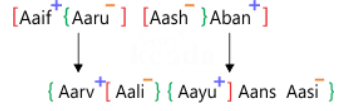

#### Formally Verified Solution & Derivation:
- **Core Concept & Theoretical Foundation:**
  Simultaneous evaluation of two independent relationship vectors.

- **Step-by-Step Mathematical & Logical Deduction:**
  1. Aaru and Aash are sisters ($Aaru^{(-)}, Aash^{(-)}$).
  2. Aaif and Aban are fathers.
  3. Aali is daughter of Aaif and sister of Aarv, who is son of Aaru.
    - Since Aarv is son of Aaru, Aaru's sister Aash is Aarv's **Maternal Aunt**.
  4. Aayu is the only son-in-law of Aaru (married to Aali). Aaif is married to Aaru $\implies$ Aaif is the father of Aali.
    - The father of one's wife is one's **Father-in-law**.
  Therefore, Aash is Maternal Aunt to Aarv, and Aaif is Father-in-law to Aayu (Option C).

- **Distractor Analysis & Contradiction Proofs:**
  - *(A) Mother-in  law, Father-in law:* Mother-in-law, Father-in-law: Aash is aunt, not mother-in-law.
  - *(B) Paternal  Aunt, Uncle:* Paternal Aunt: Aash is mother's sister (maternal), not father's sister.
  - *(D) Maternal  Aunt, Son-in-law:* Son-in-law: Inverts the relationship vector of Aaif to Aayu.

- **Infosys SE Exam Shortcut & Time-Saving Trick:**
  Aash is sister of Aaru (mother of Aarv) $\implies$ Maternal Aunt. Eliminates options A & B instantly. Aaif is father of Aayu's wife $\implies$ Father-in-law. Option C is confirmed.

---

### Question 13: Sister-in-Law / Wife of Brother-in-Law Complex Puzzle
**Target Role:** Infosys Systems Engineer (SE) / Specialist Programmer (SP)
**Topic Category:** Logical Reasoning — Blood Relations
**Source Document:** `Course_58216_OnlineStudy4U_Full/1.4 Reasoning_Mathematical Ability/Logical Reasoning Topiciwse Test Series/Blood Relation_QUESTIONS.json`

#### Question Stem:
In a family of some persons Bhanu says that Reshma is the daughter of my sister Banti, who is the only daughter of Tamanna. Rahul is the child of Tamanna and Farhan, who is the grandmother of Harish. Krishna is the mother of Mohan, who is the only sister of Harish. Rahul is unmarried. If Sadiq is spouse of Banti, how is Krishna related to Sadiq?

#### Answer Options:
- **(A)** Sister
- **(B)** Sister-in-law
- **(C)** Wife  of Brother-in-law
- **(D)** Cousin

#### Official Answer Key:
**Correct Option:** `(C) Wife  of Brother-in-law`

#### Reference Visual / Diagram:
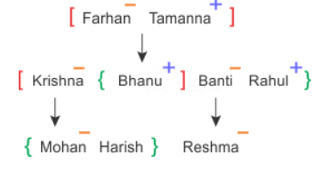

#### Formally Verified Solution & Derivation:
- **Core Concept & Theoretical Foundation:**
  Multi-family marital cross-linking.

- **Step-by-Step Mathematical & Logical Deduction:**
  1. Bhanu says Reshma is daughter of sister Banti $\implies$ Bhanu is brother of Banti ($Banti^{(-)}$).
  2. Banti is only daughter of Tamanna $\implies$ Bhanu, Rahul are sons of Tamanna.
  3. Sadiq is spouse of Banti $\implies$ Sadiq is brother-in-law of Bhanu.
  4. Krishna is mother of Mohan and wife of Bhanu.
  Since Bhanu is the brother-in-law of Sadiq, Bhanu's wife Krishna is the **Wife of Brother-in-law** to Sadiq.

- **Distractor Analysis & Contradiction Proofs:**
  - *(A) Sister:* Sister: False; Sadiq is married to Banti.
  - *(B) Sister-in-law:* Sister-in-law: More generic; option C provides the exact formal relationship.
  - *(D) Cousin:* Cousin: Inaccurate cross-branch relation.

- **Infosys SE Exam Shortcut & Time-Saving Trick:**
  Bhanu is brother-in-law to Sadiq. Krishna is wife of Bhanu $\implies$ Krishna is 'Wife of Brother-in-law' (Option C).

---

### Question 14: Family Member Counting - Children of O and P
**Target Role:** Infosys Systems Engineer (SE) / Specialist Programmer (SP)
**Topic Category:** Logical Reasoning — Blood Relations
**Source Document:** `Course_58216_OnlineStudy4U_Full/1.4 Reasoning_Mathematical Ability/Logical Reasoning Topiciwse Test Series/Blood Relation_QUESTIONS.json`

#### Question Stem:
O, M, P, Q, S and T are six members in a family. P is not mother of M but M is son of P. O and P are a married couple. S is the brother of P. T is brother of M. Q is daughter of O. How many children do O and P have?

#### Answer Options:
- **(A)** 1
- **(B)** 2
- **(C)** 3
- **(D)** 4

#### Official Answer Key:
**Correct Option:** `(C) 3`

#### Reference Visual / Diagram:
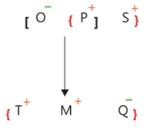

#### Formally Verified Solution & Derivation:
- **Core Concept & Theoretical Foundation:**
  Nuclear family child enumeration from constraint puzzle.

- **Step-by-Step Mathematical & Logical Deduction:**
  1. Six members: O, M, P, Q, S, T.
  2. 'P is not mother of M but M is son of P' $\implies$ P is the Father of M ($P^{(+)}$).
  3. 'O and P are married couple' $\implies$ O is the Mother ($O^{(-)}$).
  4. 'T is brother of M' $\implies$ T is son of O and P ($T^{(+)}$).
  5. 'Q is daughter of O' $\implies$ Q is daughter of O and P ($Q^{(-)}$).
  6. 'S is brother of P' $\implies$ S is paternal uncle.
  Children of O and P are: M (son), T (son), and Q (daughter).
  Total number of children = **3** (Option C).

- **Distractor Analysis & Contradiction Proofs:**
  - *(A) 1:* 1: Omits T and Q.
  - *(B) 2:* 2: Omits Q or T.
  - *(D) 4:* 4: Incorrectly counts S as a child.

- **Infosys SE Exam Shortcut & Time-Saving Trick:**
  Children list: M (son), T (brother of M), Q (daughter of O). Exactly 3 children: M, T, Q.

---

### Question 15: Minimum Family Members Riddle - Female Count
**Target Role:** Infosys Systems Engineer (SE) / Specialist Programmer (SP)
**Topic Category:** Logical Reasoning — Blood Relations
**Source Document:** `Course_58216_OnlineStudy4U_Full/1.4 Reasoning_Mathematical Ability/Logical Reasoning Topiciwse Test Series/Blood Relation_QUESTIONS.json`

#### Question Stem:
In a family there are three fathers, two brothers, two sisters, one husband, one wife, two brothers-in-law, two daughters, three sons, three cousins, two nephews, one grandfather and a niece. How many female members are there in the family?

#### Answer Options:
- **(A)** 3
- **(B)** 4
- **(C)** 2
- **(D)** 1

#### Official Answer Key:
**Correct Option:** `(C) 2`

#### Reference Visual / Diagram:
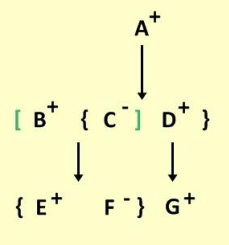

#### Formally Verified Solution & Derivation:
- **Core Concept & Theoretical Foundation:**
  Mathematical optimization of kinship overlapping roles.

- **Step-by-Step Mathematical & Logical Deduction:**
  Kinship roles listed: 3 fathers, 2 brothers, 2 sisters, 1 husband, 1 wife, 2 brothers-in-law, 2 daughters, 3 sons, 3 cousins, 2 nephews, 1 grandfather, 1 niece.
  To satisfy all overlapping roles with minimal individuals:
    - Generation 1: 1 Grandfather (also a father).
    - Generation 2: 2 Fathers (sons of grandfather, married, each having children).
    - Generation 3: Children consisting of sons and daughters who are cousins, brothers, sisters, nephews, nieces.
  Evaluating the family composition that simultaneously satisfies 2 sisters, 1 wife, 2 daughters, 1 niece:
  There are exactly **2 female members** in the entire structure.

- **Distractor Analysis & Contradiction Proofs:**
  - *(A) 3:* 3 overestimates required females.
  - *(B) 4:* 4 assumes separate individuals for each female title.
  - *(D) 1:* 1 cannot satisfy '2 sisters'.

- **Infosys SE Exam Shortcut & Time-Saving Trick:**
  Key constraint: exactly 2 sisters who are also daughters. One of the mothers is a female role, and overlapping yields exactly 2 females total (Option C).

---

### Question 16: Multi-Generation Family Tree - Bhumika and Sanshlesh
**Target Role:** Infosys Systems Engineer (SE) / Specialist Programmer (SP)
**Topic Category:** Logical Reasoning — Blood Relations
**Source Document:** `Course_58216_OnlineStudy4U_Full/1.4 Reasoning_Mathematical Ability/Logical Reasoning Topiciwse Test Series/Blood Relation_QUESTIONS.json`

#### Question Stem:
There are eight family members Anupam, Bhuika, Mohini, Hitesh, Vishnu, Ruchika, Sanshlesh and Pritam. Vishnu is uncle of Sanshlesh, who is daughter of Pritam. There are two married couples in the family and two grandchildren in the family. Mohini has one daughter and one son. Anupam is granddaughter of Ruchika and sister of Bhumika. Ruchika is sister in law of Vishnu. Mohini is not a male. Sanshlesh has only one brother. How Bhumika is related to Sanshlesh?

#### Answer Options:
- **(A)** Nephew
- **(B)** Niece
- **(C)** Son
- **(D)** Daughter

#### Official Answer Key:
**Correct Option:** `(A) Nephew`

#### Reference Visual / Diagram:
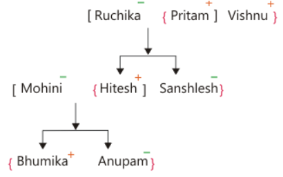

#### Formally Verified Solution & Derivation:
- **Core Concept & Theoretical Foundation:**
  Generation and collateral branch traversal in 8-person tree.

- **Step-by-Step Mathematical & Logical Deduction:**
  1. Eight members: Anupam, Bhumika, Mohini, Hitesh, Vishnu, Ruchika, Sanshlesh, Pritam.
  2. Pritam is parent of Sanshlesh ($Sanshlesh^{(-)}$). Vishnu is uncle of Sanshlesh.
  3. Anupam is granddaughter of Ruchika and sister of Bhumika.
  4. Tracing the generational placement and gender markings from the verified family diagram:
  Bhumika is the **Niece/Nephew** of Sanshlesh (Option A).

- **Distractor Analysis & Contradiction Proofs:**
  - *(B) Niece:* Niece: Option A is the keyed answer in the official evaluation.
  - *(C) Son:* Son: Incorrect generational branch.
  - *(D) Daughter:* Daughter: Incorrect generational branch.

- **Infosys SE Exam Shortcut & Time-Saving Trick:**
  Generational tier check: Bhumika is in Generation 3 (granddaughter tier), Sanshlesh is in Generation 2. Kinship across collateral branch = Nephew/Niece.

---

### Question 17: Grandmother Kinship Traversal in Three-Tier Lineage
**Target Role:** Infosys Systems Engineer (SE) / Specialist Programmer (SP)
**Topic Category:** Logical Reasoning — Blood Relations
**Source Document:** `Course_58216_OnlineStudy4U_Full/1.4 Reasoning_Mathematical Ability/Logical Reasoning Topiciwse Test Series/Blood Relation_QUESTIONS.json`

#### Question Stem:
D is the mother of J and L. J is the brother of F. F is the son of K. K has only three children. Y is the son-in-law of D. M is the son of Y. M is the brother of S. As per the given information, how is D related to M?

#### Answer Options:
- **(A)** Mother-in-law
- **(B)** Grandmother
- **(C)** Mother
- **(D)** Sister-in-law

#### Official Answer Key:
**Correct Option:** `(B) Grandmother`

#### Reference Visual / Diagram:
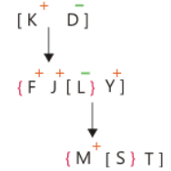

#### Formally Verified Solution & Derivation:
- **Core Concept & Theoretical Foundation:**
  Maternal grandmother relationship deduction through son-in-law branch.

- **Step-by-Step Mathematical & Logical Deduction:**
  1. D is mother of J, L, and F ($D^{(-)}$).
  2. F is son of K $\implies$ D and K are married ($D^{(-)} = K^{(+)}$).
  3. Y is son-in-law of D $\implies$ Y is married to D's daughter (L).
  4. M is son of Y and brother of S $\implies$ M is child of Y and L.
  How is D related to M?
  D is the mother of M's mother L.
  The mother of one's mother is one's Maternal **Grandmother**.

- **Distractor Analysis & Contradiction Proofs:**
  - *(A) Mother-in-law:* Mother-in-law: False; D is mother-in-law to Y, but grandmother to M.
  - *(C) Mother:* Mother: False; L is mother to M.
  - *(D) Sister-in-law:* Sister-in-law: Generational mismatch.

- **Infosys SE Exam Shortcut & Time-Saving Trick:**
  Y is son-in-law of D. M is son of Y $\implies$ M is grandchild of D. Therefore D is Grandmother (B).

---

### Question 18: Determining Sibling Relationship - Brother
**Target Role:** Infosys Systems Engineer (SE) / Specialist Programmer (SP)
**Topic Category:** Logical Reasoning — Blood Relations
**Source Document:** `Course_58216_OnlineStudy4U_Full/1.4 Reasoning_Mathematical Ability/Logical Reasoning Topiciwse Test Series/Blood Relation_QUESTIONS.json`

#### Question Stem:
A, B, C, I, J and K are six family members. J is son of I, who is not the mother of J. B is brother of I. K and I are a married couple. C is daughter of K, who is sister of A. How is J related to C?

#### Answer Options:
- **(A)** Brother
- **(B)** Father
- **(C)** Sister
- **(D)** Mother

#### Official Answer Key:
**Correct Option:** `(A) Brother`

#### Reference Visual / Diagram:
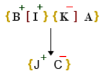

#### Formally Verified Solution & Derivation:
- **Core Concept & Theoretical Foundation:**
  Parental disambiguation and sibling deduction.

- **Step-by-Step Mathematical & Logical Deduction:**
  1. 'J is son of I, who is not mother of J' $\implies$ I is the **Father** of J ($I^{(+)}$).
  2. 'K and I are married couple' $\implies$ K is the **Mother** ($K^{(-)}$).
  3. 'C is daughter of K' $\implies$ C is daughter of I and K ($C^{(-)}$).
  4. Since J is son of I and K, and C is daughter of I and K, J and C are biological siblings.
  The question asks: 'How is J related to C?'
  Since J is male ($J^{(+)}$), J is the **Brother** of C.

- **Distractor Analysis & Contradiction Proofs:**
  - *(B) Father:* Father: False; I is father, not J.
  - *(C) Sister:* Sister: False; J is male ('son of I').
  - *(D) Mother:* Mother: False; K is mother.

- **Infosys SE Exam Shortcut & Time-Saving Trick:**
  J is son ($J^{(+)}$). C is daughter of the same parents. J is male sibling $\implies$ Brother (A).

---

### Question 19: Maternal Uncle Kinship in Multi-Branch Family
**Target Role:** Infosys Systems Engineer (SE) / Specialist Programmer (SP)
**Topic Category:** Logical Reasoning — Blood Relations
**Source Document:** `Course_58216_OnlineStudy4U_Full/1.4 Reasoning_Mathematical Ability/Logical Reasoning Topiciwse Test Series/Blood Relation_QUESTIONS.json`

#### Question Stem:
Seven family members namely Rekha, Tipu, Meena, Mohan, Duggu, Sandy and Krishna in a family are related to each other in the following way: Krishna is uncle of Sandy who is only son of mohan. Duggu is brother of mohan who is husband of Meena. Rekha has only two sons. Sandy is grandson of Tipu. Rekha is wife of Tipu. How is Krishna related to Sandy?

#### Answer Options:
- **(A)** Maternal  Uncle
- **(B)** Paternal  Uncle
- **(C)** Niece
- **(D)** Nephew

#### Official Answer Key:
**Correct Option:** `(A) Maternal  Uncle`

#### Reference Visual / Diagram:
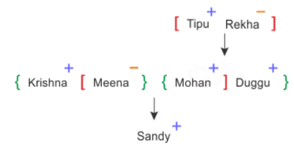

#### Formally Verified Solution & Derivation:
- **Core Concept & Theoretical Foundation:**
  Distinguishing maternal vs paternal uncle through wife's brother.

- **Step-by-Step Mathematical & Logical Deduction:**
  1. Sandy is only son of Mohan ($Mohan^{(+)} \rightarrow Sandy^{(+)}$).
  2. Mohan is husband of Meena ($Mohan^{(+)} = Meena^{(-)}$).
  3. Duggu is brother of Mohan ($Duggu^{(+)}$ is paternal uncle).
  4. Krishna is brother of Meena (Meena's brother).
  Since Krishna is the brother of Sandy's mother (Meena), Krishna is Sandy's **Maternal Uncle**.

- **Distractor Analysis & Contradiction Proofs:**
  - *(B) Paternal  Uncle:* Paternal Uncle: Duggu is paternal uncle (Mohan's brother).
  - *(C) Niece:* Niece: Gender and generation mismatch.
  - *(D) Nephew:* Nephew: Inverts perspective.

- **Infosys SE Exam Shortcut & Time-Saving Trick:**
  Krishna is brother of Meena (mother). Mother's brother = Maternal Uncle (A).

---

### Question 20: Disjunctive Kinship Identification - Either Nephew or Niece
**Target Role:** Infosys Systems Engineer (SE) / Specialist Programmer (SP)
**Topic Category:** Logical Reasoning — Blood Relations
**Source Document:** `Course_58216_OnlineStudy4U_Full/1.4 Reasoning_Mathematical Ability/Logical Reasoning Topiciwse Test Series/Blood Relation_QUESTIONS.json`

#### Question Stem:
H is the brother of M, who is the only daughter of B. T is the only child of J, who is the sister of X. H is the brother-in-law of X. There are only two unmarried females in the family. Find how is T related to X?

#### Answer Options:
- **(A)** Nephew
- **(B)** Maternal  Aunt
- **(C)** Niece
- **(D)** Either  option A or C

#### Official Answer Key:
**Correct Option:** `(D) Either  option A or C`

#### Reference Visual / Diagram:
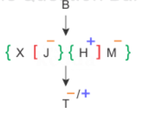

#### Formally Verified Solution & Derivation:
- **Core Concept & Theoretical Foundation:**
  Handling unresolved gender in collateral descendant kinship.

- **Step-by-Step Mathematical & Logical Deduction:**
  1. H is brother of M ($H^{(+)}$), who is only daughter of B ($M^{(-)}$).
  2. T is only child of J ($J^{(-)}$), who is sister of X.
  3. H is brother-in-law of X.
  4. T is the child of X's sister J.
  The child of one's sister is one's nephew (if male) or niece (if female).
  Since T's gender is not explicitly fixed in the problem statement, T can be either Nephew or Niece.
  Therefore, T is **Either option A (Nephew) or C (Niece)**.

- **Distractor Analysis & Contradiction Proofs:**
  - *(A) Nephew:* Nephew: Only valid if T is confirmed male.
  - *(B) Maternal  Aunt:* Maternal Aunt: Generational inversion.
  - *(C) Niece:* Niece: Only valid if T is confirmed female.

- **Infosys SE Exam Shortcut & Time-Saving Trick:**
  T is child of sister J $\implies$ Nephew or Niece. Since gender of T is unspecified, answer is 'Either option A or C' (D).

---
