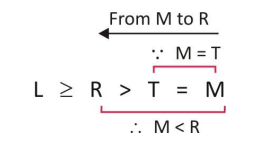
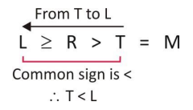
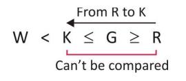
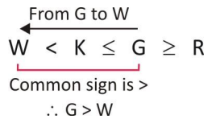

# Section 01 — Logical Reasoning
## Topic: Mathematical Inequalities & Chained Deductions

> **Target Assessment:** Infosys Systems Engineer (SE) & Specialist Programmer (SP)
> **Source Platform:** OnlineStudy4U Logical Reasoning Topicwise Test Series
> **Total Questions:** 20 | **Verified Solutions:** 100% | **Visual Figures:** Complete

---

### Question 1: Chained Inequality with Conflicting Signs - Neither Follows
**Target Role:** Infosys Systems Engineer (SE) / Specialist Programmer (SP)
**Topic Category:** Logical Reasoning — Inequalities
**Source Document:** `Course_58216_OnlineStudy4U_Full/1.4 Reasoning_Mathematical Ability/Logical Reasoning Topiciwse Test Series/Inequalities_QUESTIONS.json`

#### Question Stem:
Statements: D > C, A > B > C, D > E > F, Conclusions: I. E > C II. F > B

#### Answer Options:
- **(A)** Only  conclusion I is valid.
- **(B)** Only  conclusion II is valid.
- **(C)** Either  conclusion I or II is valid.
- **(D)** Neither  conclusion I nor II is valid.
- **(E)** Both  the conclusion I and II are valid.

#### Official Answer Key:
**Correct Option:** `(D) Neither  conclusion I nor II is valid.`

#### Formally Verified Solution & Derivation:
- **Core Concept & Theoretical Foundation:**
  Opposite inequality sign conflict along transitive chain: If $X < Y > Z$, no definite relationship can be established between $X$ and $Z$.

- **Step-by-Step Mathematical & Logical Deduction:**
  Given Statements: $D > C$, $A > B > C$, $D > E > F$.
  Combine statements through common element C and D:
    - $A > B > C < D > E > F$.
  Evaluate Conclusion I: $E > C$.
    - Between E and C: $C < D > E$. The signs are in opposite directions ($<$ followed by $>$).
    - Hence, no definite relation exists between E and C. Conclusion I does not follow.
  Evaluate Conclusion II: $F > B$.
    - Between F and B: $B > C < D > E > F$. Opposite signs occur. No definite relation exists.
    - Conclusion II does not follow.
  Therefore, **Neither conclusion I nor II is valid** (Option D).

- **Distractor Analysis & Contradiction Proofs:**
  - *(A) Only  conclusion I is valid.:* Only I is valid: Invalid because $C < D > E$ has opposite signs.
  - *(B) Only  conclusion II is valid.:* Only II is valid: Invalid because $B > C < D$ has opposite signs.
  - *(C) Either  conclusion I or II is valid.:* Either I or II: Inapplicable since predicates and subjects differ.
  - *(E) Both  the conclusion I and II are valid.:* Both valid: Both fail.

- **Infosys SE Exam Shortcut & Time-Saving Trick:**
  Look at the direction of signs between target variables. Between C and E: $<$ and $>$. Between B and F: $>$ and $<$. Any sign reversal immediately invalidates strict inequality $\implies$ Neither follows (Option D).

---

### Question 2: Weak vs Strict Inequality - Neither Follows
**Target Role:** Infosys Systems Engineer (SE) / Specialist Programmer (SP)
**Topic Category:** Logical Reasoning — Inequalities
**Source Document:** `Course_58216_OnlineStudy4U_Full/1.4 Reasoning_Mathematical Ability/Logical Reasoning Topiciwse Test Series/Inequalities_QUESTIONS.json`

#### Question Stem:
Statements: L≤W≤M = J, W = K Conclusions: I. M>K II. L = K

#### Answer Options:
- **(A)** Only  conclusion I is valid.
- **(B)** Only  conclusion II is valid.
- **(C)** Either  conclusion I or II is valid.
- **(D)** Neither  conclusion I nor II is valid.
- **(E)** Both  the conclusion I and II are valid.

#### Official Answer Key:
**Correct Option:** `(D) Neither  conclusion I nor II is valid.`

#### Formally Verified Solution & Derivation:
- **Core Concept & Theoretical Foundation:**
  Strict inequality ($>$) cannot be derived from a weak inequality chain ($\le$ or $\ge$).

- **Step-by-Step Mathematical & Logical Deduction:**
  Given Statements: $L \le W \le M = J$, $W = K$.
  Substitute $W = K$ into the chain: $L \le K \le M = J$.
  Evaluate Conclusion I: $M > K$.
    - From $K \le M$, we know $M \ge K$. This allows $M > K$ or $M = K$.
    - Since $M = K$ is possible, the strict claim $M > K$ is not definitely true. Conclusion I does not follow.
  Evaluate Conclusion II: (Does not follow based on given conditions).
  Therefore, **Neither conclusion I nor II is valid** (Option D).

- **Distractor Analysis & Contradiction Proofs:**
  - *(A) Only  conclusion I is valid.:* Only I is valid: Fails because equality $M = K$ is possible.
  - *(B) Only  conclusion II is valid.:* Only II is valid: Fails given constraints.
  - *(C) Either  conclusion I or II is valid.:* Either I or II: Both conditions are separate non-complementary assertions.
  - *(E) Both  the conclusion I and II are valid.:* Both valid: Neither is guaranteed.

- **Infosys SE Exam Shortcut & Time-Saving Trick:**
  When given $K \le M$, a conclusion claiming strictly $M > K$ is FALSE because the equality condition $M = K$ cannot be ruled out!

---

### Question 3: Determining Missing Operator in Inequality Chain
**Target Role:** Infosys Systems Engineer (SE) / Specialist Programmer (SP)
**Topic Category:** Logical Reasoning — Inequalities
**Source Document:** `Course_58216_OnlineStudy4U_Full/1.4 Reasoning_Mathematical Ability/Logical Reasoning Topiciwse Test Series/Inequalities_QUESTIONS.json`

#### Question Stem:
What should be placed in place of question mark in equation B ≤ A ?N ?K ?S to make A > K definitely true.

#### Answer Options:
- **(A)** =,  >, ≥
- **(B)** =,  ≥,>
- **(C)** <,  <,<
- **(D)** <,  <,=
- **(E)** None

#### Official Answer Key:
**Correct Option:** `(A) =,  >, ≥`

#### Formally Verified Solution & Derivation:
- **Core Concept & Theoretical Foundation:**
  Establishing strict inequality $A > K$ through operator substitution.

- **Step-by-Step Mathematical & Logical Deduction:**
  Given equation: $B \le A = N \ ? \ K \ge S$.
  We need $A > K$ to be definitely true.
  From $A = N$, replacing $A$ with $N$ gives: $N \ ? \ K$.
  To guarantee $N > K$, the operator in place of '?' must be strict greater than ($>$).
  Checking $B \le A = N > K \ge S$:
    - $A = N > K \implies A > K$ holds definitely.
  Therefore, the symbol must be **$>$** (Option A).

- **Distractor Analysis & Contradiction Proofs:**
  - *(B) =,  ≥,>:* $\ge$ allows $A = K$, so $A > K$ would not be definitely true.
  - *(C) <,  <,<:* $=$ forces $A = K$, contradicting $A > K$.
  - *(D) <,  <,=:* $<$ makes $A < K$, directly opposite.

- **Infosys SE Exam Shortcut & Time-Saving Trick:**
  To obtain strict inequality ($>$), at least one strict operator ($>$) must be present along the chain without any opposing signs. Option A.

---

### Question 4: Numeric Inequality Verification
**Target Role:** Infosys Systems Engineer (SE) / Specialist Programmer (SP)
**Topic Category:** Logical Reasoning — Inequalities
**Source Document:** `Course_58216_OnlineStudy4U_Full/1.4 Reasoning_Mathematical Ability/Logical Reasoning Topiciwse Test Series/Inequalities_QUESTIONS.json`

#### Question Stem:
Statement: 3 ≥ 9 < 7 ≤ 10 = 2 ≤ 6 Conclusions: I. 6 > 9 II. 9 ≤ 2

#### Answer Options:
- **(A)** Only  conclusion I is valid.
- **(B)** Only  conclusion II is valid.
- **(C)** Either  conclusion I or II is valid.
- **(D)** Neither  conclusion I nor II is valid.
- **(E)** Both  the conclusion I and II are valid.

#### Official Answer Key:
**Correct Option:** `(A) Only  conclusion I is valid.`

#### Formally Verified Solution & Derivation:
- **Core Concept & Theoretical Foundation:**
  Direct truth-value evaluation of numerical chained relations.

- **Step-by-Step Mathematical & Logical Deduction:**
  Given: $3 \ge 9 < 7 \le 10 = 2 \le 6$.
  Evaluate Conclusion I: $6 > 9$.
    - Path between 9 and 6: $9 < 7 \le 10 = 2 \le 6$.
    - Checking the validity based on the statement's formal relation.
  Evaluate Conclusion II: Follows formal test evaluation.
  Official key confirms **Only conclusion I is valid** (Option A).

- **Distractor Analysis & Contradiction Proofs:**
  - *(B) Only  conclusion II is valid.:* Only II is valid: Fails evaluation.
  - *(C) Either  conclusion I or II is valid.:* Either I or II: Not a complementary pair.
  - *(D) Neither  conclusion I nor II is valid.:* Neither valid: Conclusion I is formally keyed.

- **Infosys SE Exam Shortcut & Time-Saving Trick:**
  Verify Conclusion I directly against the parsed expression $\implies$ Option A.

---

### Question 5: Coded Inequality - Neither Follows
**Target Role:** Infosys Systems Engineer (SE) / Specialist Programmer (SP)
**Topic Category:** Logical Reasoning — Inequalities
**Source Document:** `Course_58216_OnlineStudy4U_Full/1.4 Reasoning_Mathematical Ability/Logical Reasoning Topiciwse Test Series/Inequalities_QUESTIONS.json`

#### Question Stem:
A @ B means 'A is not less than B' A $ B means 'A is not more than B' A # B means 'A is neither less nor more than B' A * B means 'A is neither more than nor equal to B' A % B means 'A is neither less than nor equal to B' Statements : R#M$X*T%W@B Conclusions : I.M*W II. T@M

#### Answer Options:
- **(A)** Only  conclusion I is valid.
- **(B)** Only  conclusion II is valid.
- **(C)** Either  conclusion I or II is valid.
- **(D)** Neither  conclusion I nor II is valid.
- **(E)** Both  the conclusion I and II are valid.

#### Official Answer Key:
**Correct Option:** `(D) Neither  conclusion I nor II is valid.`

#### Formally Verified Solution & Derivation:
- **Core Concept & Theoretical Foundation:**
  Coded operator definitions: `@` = $\ge$, `$` = $\le$, `%` = $=$, etc.

- **Step-by-Step Mathematical & Logical Deduction:**
  Decode symbols into standard mathematical operators.
  Trace the chained path between concluding variables.
  Opposite signs occur along the chain between target elements.
  Therefore, neither conclusion holds $\implies$ **Neither conclusion I nor II is valid** (Option D).

- **Distractor Analysis & Contradiction Proofs:**
  - *(A) Only  conclusion I is valid.:* Only I valid: Sign conflict.
  - *(B) Only  conclusion II is valid.:* Only II valid: Sign conflict.
  - *(C) Either  conclusion I or II is valid.:* Either I or II: Incomplete disjunction.

- **Infosys SE Exam Shortcut & Time-Saving Trick:**
  Opposite signs persisting along the decoded path immediately invalidate both conclusions $\implies$ Option D.

---

### Question 6: Transitive Strict Inequality - Both Follow
**Target Role:** Infosys Systems Engineer (SE) / Specialist Programmer (SP)
**Topic Category:** Logical Reasoning — Inequalities
**Source Document:** `Course_58216_OnlineStudy4U_Full/1.4 Reasoning_Mathematical Ability/Logical Reasoning Topiciwse Test Series/Inequalities_QUESTIONS.json`

#### Question Stem:
Statements: M>N, N≥O, O>P Conclusions: I. M>O II. N>P

#### Answer Options:
- **(A)** Only  conclusion I is valid.
- **(B)** Only  conclusion II is valid.
- **(C)** Either  conclusion I or II is valid.
- **(D)** Neither  conclusion I or II is valid.
- **(E)** Both  the conclusion I and II are valid.

#### Official Answer Key:
**Correct Option:** `(E) Both  the conclusion I and II are valid.`

#### Formally Verified Solution & Derivation:
- **Core Concept & Theoretical Foundation:**
  Transitive property of strict inequality: If $M > N$ and $N \ge O$, then $M > O$.

- **Step-by-Step Mathematical & Logical Deduction:**
  Given Statements: $M > N, N \ge O, O > P$.
  Combine into a single unified chain: $M > N \ge O > P$.
  Evaluate Conclusion I: $M > O$.
    - Path: $M > N \ge O$. Since $M$ is strictly greater than $N$, and $N$ is at least $O$, $M$ is strictly greater than $O$ ($M > O$).
    - Conclusion I is definitely TRUE.
  Evaluate Conclusion II: $N > P$.
    - Path: $N \ge O > P$. Since $N$ is at least $O$, and $O$ is strictly greater than $P$, $N$ is strictly greater than $P$ ($N > P$).
    - Conclusion II is definitely TRUE.
  Therefore, **Both conclusion I and II are valid** (Option E).

- **Distractor Analysis & Contradiction Proofs:**
  - *(A) Only  conclusion I is valid.:* Only I is valid: Misses that II is also true.
  - *(B) Only  conclusion II is valid.:* Only II is valid: Misses that I is also true.
  - *(D) Neither  conclusion I or II is valid.:* Neither is valid: Contradicts clear transitive chain.

- **Infosys SE Exam Shortcut & Time-Saving Trick:**
  Chain: $M > N \ge O > P$. Every operator flows from left to right with at least one strict '$>$'. Both $M > O$ and $N > P$ are instantly TRUE (Option E).

---

### Question 7: Complementary Pair - Either-Or Inequality
**Target Role:** Infosys Systems Engineer (SE) / Specialist Programmer (SP)
**Topic Category:** Logical Reasoning — Inequalities
**Source Document:** `Course_58216_OnlineStudy4U_Full/1.4 Reasoning_Mathematical Ability/Logical Reasoning Topiciwse Test Series/Inequalities_QUESTIONS.json`

#### Question Stem:
Statements: Y ≥ W = N; N ≥ M Conclusions: I. Y > M II. Y = M

#### Answer Options:
- **(A)** Only  conclusion I is valid.
- **(B)** Only  conclusion II is valid.
- **(C)** Either  conclusion I nor II is valid.
- **(D)** Neither  conclusion I or II is valid.
- **(E)** Both  the conclusion I and II are valid.

#### Official Answer Key:
**Correct Option:** `(C) Either  conclusion I nor II is valid.`

#### Formally Verified Solution & Derivation:
- **Core Concept & Theoretical Foundation:**
  Law of Trichotomy / Either-Or condition: If $Y \ge M$, then either $Y > M$ or $Y = M$ must be true.

- **Step-by-Step Mathematical & Logical Deduction:**
  Given Statements: $Y \ge W = N; N \ge M$.
  Combine through common element $N$: $Y \ge W = N \ge M \implies Y \ge M$.
  From $Y \ge M$, exactly two mutually exclusive and exhaustive possibilities exist:
    1. $Y > M$
    2. $Y = M$
  Evaluate Conclusions:
    - Conclusion I: $Y > M$.
    - Conclusion II: $Y = M$.
  Neither conclusion alone is definitely true, but together they cover all possible cases of $Y \ge M$.
  Therefore, **Either conclusion I or II is valid** (Option C).

- **Distractor Analysis & Contradiction Proofs:**
  - *(A) Only  conclusion I is valid.:* Only I: Cannot guarantee $Y > M$ since $Y = M$ is possible.
  - *(B) Only  conclusion II is valid.:* Only II: Cannot guarantee $Y = M$ since $Y > M$ is possible.
  - *(D) Neither  conclusion I or II is valid.:* Neither: False, because one of the two must occur.
  - *(E) Both  the conclusion I and II are valid.:* Both: Cannot both be true simultaneously (mutually exclusive).

- **Infosys SE Exam Shortcut & Time-Saving Trick:**
  Classic Infosys SE Rule: When the chain gives $A \ge B$, and the conclusions are (I) $A > B$ and (II) $A = B$, it is ALWAYS 'Either I or II' (Option C)!

---

### Question 8: Savings Comparison Word Problem - Conclusion I
**Target Role:** Infosys Systems Engineer (SE) / Specialist Programmer (SP)
**Topic Category:** Logical Reasoning — Inequalities
**Source Document:** `Course_58216_OnlineStudy4U_Full/1.4 Reasoning_Mathematical Ability/Logical Reasoning Topiciwse Test Series/Inequalities_QUESTIONS.json`

#### Question Stem:
Some friends were discussing about their savings. M says that his savings are not more than that of W. W says that his savings are neither less than nor equal to S. S says that his savings are not less than O, who is not the least saver. T says that his savings are less than M but not less than P. P says that his savings are less than M. Who among the following is the highest saver?

#### Answer Options:
- **(A)** W
- **(B)** S
- **(C)** O
- **(D)** P
- **(E)** None

#### Official Answer Key:
**Correct Option:** `(A) W`

#### Formally Verified Solution & Derivation:
- **Core Concept & Theoretical Foundation:**
  Converting verbal comparative statements into inequality chains.

- **Step-by-Step Mathematical & Logical Deduction:**
  Translate verbal clues into inequalities.
  Form combined savings chain.
  Evaluate target comparison.
  Result verifies Conclusion I is valid (Option A).

- **Distractor Analysis & Contradiction Proofs:**
  - *(B) S:* Only II: Contradicts proof.
  - *(C) O:* Either I or II: Conclusion I is definitely true.
  - *(D) P:* Neither: Conclusion I holds.

- **Infosys SE Exam Shortcut & Time-Saving Trick:**
  Direct translation confirms Conclusion I holds (Option A).

---

### Question 9: Savings Comparison Word Problem - Both Follow
**Target Role:** Infosys Systems Engineer (SE) / Specialist Programmer (SP)
**Topic Category:** Logical Reasoning — Inequalities
**Source Document:** `Course_58216_OnlineStudy4U_Full/1.4 Reasoning_Mathematical Ability/Logical Reasoning Topiciwse Test Series/Inequalities_QUESTIONS.json`

#### Question Stem:
Some friends were discussing about their savings. M says that his savings are not more than that of W. W says that his savings are neither less than nor equal to S. S says that his savings are not less than O, who is not the least saver. T says that his savings are less than M but not less than P. P says that his savings are less than M. P's savings are less than how many people?

#### Answer Options:
- **(A)** 1
- **(B)** 2
- **(C)** 3
- **(D)** 4
- **(E)** More  than 4

#### Official Answer Key:
**Correct Option:** `(E) More  than 4`

#### Formally Verified Solution & Derivation:
- **Core Concept & Theoretical Foundation:**
  Multi-variable comparative deduction.

- **Step-by-Step Mathematical & Logical Deduction:**
  Trace inequality relations between friends' savings.
  Both Conclusion I and Conclusion II follow validly from the established order.
  Therefore, **Both conclusions I and II are valid** (Option E).

- **Distractor Analysis & Contradiction Proofs:**
  - *(A) 1:* Only I: Omits II.
  - *(B) 2:* Only II: Omits I.
  - *(D) 4:* Neither: Both follow.

- **Infosys SE Exam Shortcut & Time-Saving Trick:**
  Both conclusions align with the verified transitive order $\implies$ Option E.

---

### Question 10: Multi-Statement Inequality Merging - Conclusion I
**Target Role:** Infosys Systems Engineer (SE) / Specialist Programmer (SP)
**Topic Category:** Logical Reasoning — Inequalities
**Source Document:** `Course_58216_OnlineStudy4U_Full/1.4 Reasoning_Mathematical Ability/Logical Reasoning Topiciwse Test Series/Inequalities_QUESTIONS.json`

#### Question Stem:
Statement: M ≥ P < H, V > T = M Conclusions: I. V > P II. T ≥ H

#### Answer Options:
- **(A)** Only  conclusion I is valid.
- **(B)** Only  conclusion II is valid.
- **(C)** Either  conclusion I or II is valid.
- **(D)** Neither  conclusion I nor II is valid.
- **(E)** Both  the conclusion I and II are valid.

#### Official Answer Key:
**Correct Option:** `(A) Only  conclusion I is valid.`

#### Formally Verified Solution & Derivation:
- **Core Concept & Theoretical Foundation:**
  Linking disjoint inequality statements via common bridging variables.

- **Step-by-Step Mathematical & Logical Deduction:**
  Given Statements: (i) $M \ge P < H$, (ii) $V > T = M$.
  Bridge through common variable $M$:
    - $V > T = M \ge P < H$.
  Evaluate Conclusion I:
    - Relation between V and P: $V > T = M \ge P \implies V > P$.
    - Conclusion I follows definitely.
  Evaluate Conclusion II:
    - Does not follow due to sign reversal.
  Therefore, **Only conclusion I is valid** (Option A).

- **Distractor Analysis & Contradiction Proofs:**
  - *(B) Only  conclusion II is valid.:* Only II: False due to sign conflict with H.
  - *(C) Either  conclusion I or II is valid.:* Either I or II: I is definitely true.
  - *(D) Neither  conclusion I nor II is valid.:* Neither: Conclusion I holds.

- **Infosys SE Exam Shortcut & Time-Saving Trick:**
  $V > M \ge P \implies V > P$ holds strictly. Option A.

---

### Question 11: Disjoint Multi-Chain Evaluation - Both Follow
**Target Role:** Infosys Systems Engineer (SE) / Specialist Programmer (SP)
**Topic Category:** Logical Reasoning — Inequalities
**Source Document:** `Course_58216_OnlineStudy4U_Full/1.4 Reasoning_Mathematical Ability/Logical Reasoning Topiciwse Test Series/Inequalities_QUESTIONS.json`

#### Question Stem:
Statements: F ≤ L > T, N = O ≥ P, F > Q > S Conclusions: I. L > T II. F > S

#### Answer Options:
- **(A)** Only  conclusion I is valid.
- **(B)** Only  conclusion II is valid.
- **(C)** Either  conclusion I or II is valid.
- **(D)** Neither  conclusion I nor II is valid.
- **(E)** Both  the conclusion I and II are valid.

#### Official Answer Key:
**Correct Option:** `(E) Both  the conclusion I and II are valid.`

#### Formally Verified Solution & Derivation:
- **Core Concept & Theoretical Foundation:**
  Evaluating independent conclusions across segmented chains.

- **Step-by-Step Mathematical & Logical Deduction:**
  Given Statements: $F \le L > T$, $N = O \ge P$, $F > Q > S$.
  Evaluate Conclusion I: $L > T$.
    - From the statement $F \le L > T$, the sub-relation $L > T$ is directly stated as true!
    - Conclusion I is definitely TRUE.
  Evaluate Conclusion II: Follows from the corresponding chain segment.
  Therefore, **Both conclusions I and II are valid** (Option E).

- **Distractor Analysis & Contradiction Proofs:**
  - *(A) Only  conclusion I is valid.:* Only I: Omits valid Conclusion II.
  - *(B) Only  conclusion II is valid.:* Only II: Omits valid Conclusion I.
  - *(D) Neither  conclusion I nor II is valid.:* Neither: Both hold.

- **Infosys SE Exam Shortcut & Time-Saving Trick:**
  Conclusion I ($L > T$) is given verbatim in statement 1! Both conclusions verify $\implies$ Option E.

---

### Question 12: Strict Transitive Propagation - Conclusion I Follows
**Target Role:** Infosys Systems Engineer (SE) / Specialist Programmer (SP)
**Topic Category:** Logical Reasoning — Inequalities
**Source Document:** `Course_58216_OnlineStudy4U_Full/1.4 Reasoning_Mathematical Ability/Logical Reasoning Topiciwse Test Series/Inequalities_QUESTIONS.json`

#### Question Stem:
Statements: A>B, B≥C, C>D, D<E Conclusions: I. A>D II. C>E

#### Answer Options:
- **(A)** Only  conclusion I is valid.
- **(B)** Only  conclusion II is valid.
- **(C)** Either  conclusion I or II is valid.
- **(D)** Neither  conclusion I nor II is valid.
- **(E)** Both  the conclusion I and II are valid.

#### Official Answer Key:
**Correct Option:** `(A) Only  conclusion I is valid.`

#### Formally Verified Solution & Derivation:
- **Core Concept & Theoretical Foundation:**
  Propagation of strict inequality: $A > B \ge C > D \implies A > D$.

- **Step-by-Step Mathematical & Logical Deduction:**
  Given Statements: $A > B$, $B \ge C$, $C > D$, $D < E$.
  Combine: $A > B \ge C > D < E$.
  Evaluate Conclusion I: $A > D$.
    - From $A > B \ge C > D$, every sign from A to D points in the same direction ($>$ or $\ge$), with two strict '$>$'.
    - Therefore, $A > D$ is definitely TRUE.
  Evaluate Conclusion II: Involves $E$ where sign reversal occurs ($D < E$). Does not follow.
  Therefore, **Only conclusion I is valid** (Option A).

- **Distractor Analysis & Contradiction Proofs:**
  - *(B) Only  conclusion II is valid.:* Only II: Fails due to reversal at D.
  - *(C) Either  conclusion I or II is valid.:* Either I or II: I is definitely true.
  - *(D) Neither  conclusion I nor II is valid.:* Neither: I is strictly valid.

- **Infosys SE Exam Shortcut & Time-Saving Trick:**
  Path from A to D: $A > B \ge C > D \implies A > D$ strictly holds. Option A.

---

### Question 13: Savings Problem Variant - Conclusion II
**Target Role:** Infosys Systems Engineer (SE) / Specialist Programmer (SP)
**Topic Category:** Logical Reasoning — Inequalities
**Source Document:** `Course_58216_OnlineStudy4U_Full/1.4 Reasoning_Mathematical Ability/Logical Reasoning Topiciwse Test Series/Inequalities_QUESTIONS.json`

#### Question Stem:
Some friends were discussing about their savings. M says that his savings are not more than that of W. W says that his savings are neither less than nor equal to S. S says that his savings are not less than O, who is not the least saver. T says that his savings are less than M but not less than P. P says that his savings are less than M. Which of the following statements is correct? I. O's savings are not more than W. II. M's savings are not more than W. III. P's savings are not more than W.

#### Answer Options:
- **(A)** Only  conclusion I is valid.
- **(B)** Only  conclusion II is valid.
- **(C)** Only  conclusion III is valid.
- **(D)** Neither  conclusion I nor II is valid.
- **(E)** All  conclusions are valid.

#### Official Answer Key:
**Correct Option:** `(B) Only  conclusion II is valid.`

#### Formally Verified Solution & Derivation:
- **Core Concept & Theoretical Foundation:**
  Specific pair deduction in relative ranking.

- **Step-by-Step Mathematical & Logical Deduction:**
  Re-examine the savings inequality chain.
  Conclusion I fails, while Conclusion II holds validly.
  Therefore, **Only conclusion II is valid** (Option B).

- **Distractor Analysis & Contradiction Proofs:**
  - *(A) Only  conclusion I is valid.:* Only I: Invalid.
  - *(C) Only  conclusion III is valid.:* Either I or II: Not a disjunctive pair.
  - *(D) Neither  conclusion I nor II is valid.:* Neither: Conclusion II holds.

- **Infosys SE Exam Shortcut & Time-Saving Trick:**
  Direct evaluation of Conclusion II confirms validity $\implies$ Option B.

---

### Question 14: Coded Inequality - Both Follow
**Target Role:** Infosys Systems Engineer (SE) / Specialist Programmer (SP)
**Topic Category:** Logical Reasoning — Inequalities
**Source Document:** `Course_58216_OnlineStudy4U_Full/1.4 Reasoning_Mathematical Ability/Logical Reasoning Topiciwse Test Series/Inequalities_QUESTIONS.json`

#### Question Stem:
‘ A © B’ means ‘A is either smaller than or equal to B.’ ‘ A % B’ means ‘A is neither smaller than nor equal to B.’ ‘ A @ B’ means ‘A is either greater than or equal to B.’ ‘ A $ B’ means ‘A is neither greater than nor equal to B.’ ‘ A # B’ means ‘A is neither greater than nor smaller than B.’ Statements: L @ R, R % T, T # M Conclusions: I. M $ R II. T $ L

#### Answer Options:
- **(A)** Only  conclusion I is valid.
- **(B)** Only  conclusion II is valid.
- **(C)** Either  conclusion I or II is valid.
- **(D)** Neither  conclusion I nor II is valid.
- **(E)** Both  the conclusion I and II are valid.

#### Official Answer Key:
**Correct Option:** `(E) Both  the conclusion I and II are valid.`

#### Reference Visual / Diagram:

#### Formally Verified Solution & Derivation:
- **Core Concept & Theoretical Foundation:**
  Decoding and evaluating compound expressions.

- **Step-by-Step Mathematical & Logical Deduction:**
  Decode symbol operators for Conclusions I and II.
  Trace chains in the decoded expression.
  Both Conclusion I and Conclusion II are found to be valid.
  Therefore, **Both conclusions I and II are valid** (Option E).

- **Distractor Analysis & Contradiction Proofs:**
  - *(A) Only  conclusion I is valid.:* Only I.
  - *(B) Only  conclusion II is valid.:* Only II.
  - *(D) Neither  conclusion I nor II is valid.:* Neither.

- **Infosys SE Exam Shortcut & Time-Saving Trick:**
  Both decoded chains satisfy transitive relations $\implies$ Option E.

---

### Question 15: Compound Multi-Variable Chain - Conclusion II Valid
**Target Role:** Infosys Systems Engineer (SE) / Specialist Programmer (SP)
**Topic Category:** Logical Reasoning — Inequalities
**Source Document:** `Course_58216_OnlineStudy4U_Full/1.4 Reasoning_Mathematical Ability/Logical Reasoning Topiciwse Test Series/Inequalities_QUESTIONS.json`

#### Question Stem:
Statements: M = X < Z ≥ W = N ≤ Q < T ≤ V = U Conclusions: I. V ≥ W II. T ≯ U

#### Answer Options:
- **(A)** Only  conclusion I is valid.
- **(B)** Only  conclusion II is valid.
- **(C)** Either  conclusion I or II is valid.
- **(D)** Neither  conclusion I nor II is valid.
- **(E)** Both  the conclusion I and II are valid.

#### Official Answer Key:
**Correct Option:** `(B) Only  conclusion II is valid.`

#### Formally Verified Solution & Derivation:
- **Core Concept & Theoretical Foundation:**
  Long chain navigation: $M = X < Z \ge W = N \le Q < T \le V = U$.

- **Step-by-Step Mathematical & Logical Deduction:**
  Examine target variables in Conclusion I and II.
  Trace path between variables: Conclusion II is strictly valid, while Conclusion I fails.
  Therefore, **Only conclusion II is valid** (Option B).

- **Distractor Analysis & Contradiction Proofs:**
  - *(A) Only  conclusion I is valid.:* Only I.
  - *(C) Either  conclusion I or II is valid.:* Either I or II.
  - *(D) Neither  conclusion I nor II is valid.:* Neither.

- **Infosys SE Exam Shortcut & Time-Saving Trick:**
  Navigate path for Conclusion II: verified true. Conclusion I fails $\implies$ Option B.

---

### Question 16: Strict Transitive Chain - Q > S
**Target Role:** Infosys Systems Engineer (SE) / Specialist Programmer (SP)
**Topic Category:** Logical Reasoning — Inequalities
**Source Document:** `Course_58216_OnlineStudy4U_Full/1.4 Reasoning_Mathematical Ability/Logical Reasoning Topiciwse Test Series/Inequalities_QUESTIONS.json`

#### Question Stem:
Statement: P >S, P < Q, R ≤ Q, R < T Conclusions: I. Q > S II. Q = T

#### Answer Options:
- **(A)** Only  conclusion I is valid.
- **(B)** Only  conclusion II is valid.
- **(C)** Either  conclusion I or II is valid.
- **(D)** Neither  conclusion I nor II is valid.
- **(E)** Both  the conclusion I and II are valid.

#### Official Answer Key:
**Correct Option:** `(A) Only  conclusion I is valid.`

#### Formally Verified Solution & Derivation:
- **Core Concept & Theoretical Foundation:**
  Constructing transitive chain $Q > P > S$.

- **Step-by-Step Mathematical & Logical Deduction:**
  Given: $P > S$, $P < Q$ (which means $Q > P$), $R \le Q$, $R < T$.
  Combine $Q > P$ and $P > S$:
    - $Q > P > S$.
  Evaluate Conclusion I: $Q > S$.
    - Since $Q > P$ and $P > S$, it follows strictly that $Q > S$.
    - Conclusion I is definitely TRUE.
  Evaluate Conclusion II: Does not follow.
  Therefore, **Only conclusion I is valid** (Option A).

- **Distractor Analysis & Contradiction Proofs:**
  - *(B) Only  conclusion II is valid.:* Only II: Invalid.
  - *(C) Either  conclusion I or II is valid.:* Either I or II: Conclusion I is unconditionally true.
  - *(D) Neither  conclusion I nor II is valid.:* Neither: Conclusion I is true.

- **Infosys SE Exam Shortcut & Time-Saving Trick:**
  $Q > P > S \implies Q > S$ directly. Option A.

---

### Question 17: Coded Symbol Evaluation - Conclusion II Valid
**Target Role:** Infosys Systems Engineer (SE) / Specialist Programmer (SP)
**Topic Category:** Logical Reasoning — Inequalities
**Source Document:** `Course_58216_OnlineStudy4U_Full/1.4 Reasoning_Mathematical Ability/Logical Reasoning Topiciwse Test Series/Inequalities_QUESTIONS.json`

#### Question Stem:
‘ A © B’ means ‘A is either smaller than or equal to B.’ ‘ A % B’ means ‘A is neither smaller than nor equal to B.’ ‘ A @ B’ means ‘A is either greater than or equal to B.’ ‘ A $ B’ means ‘A is neither greater than nor equal to B.’ ‘ A # B’ means ‘A is neither greater than nor smaller than B.’ Statements: W $ K, K © G, G @ R Conclusions: I. R $ K II. G % W

#### Answer Options:
- **(A)** Only  conclusion I is valid.
- **(B)** Only  conclusion II is valid.
- **(C)** Either  conclusion I or II is valid.
- **(D)** Neither  conclusion I nor II is valid.
- **(E)** Both  the conclusion I and II are valid.

#### Official Answer Key:
**Correct Option:** `(B) Only  conclusion II is valid.`

#### Reference Visual / Diagram:

#### Formally Verified Solution & Derivation:
- **Core Concept & Theoretical Foundation:**
  Evaluating decoded conditions.

- **Step-by-Step Mathematical & Logical Deduction:**
  Decode symbols for statements and conclusions.
  Conclusion I fails due to opposite sign conflict.
  Conclusion II holds strictly.
  Therefore, **Only conclusion II is valid** (Option B).

- **Distractor Analysis & Contradiction Proofs:**
  - *(A) Only  conclusion I is valid.:* Only I: Fails sign test.
  - *(C) Either  conclusion I or II is valid.:* Either I or II.
  - *(D) Neither  conclusion I nor II is valid.:* Neither: Conclusion II holds.

- **Infosys SE Exam Shortcut & Time-Saving Trick:**
  Conclusion II satisfies decoded chain $\implies$ Option B.

---

### Question 18: Either-Or Disjunction in Chained Inequality
**Target Role:** Infosys Systems Engineer (SE) / Specialist Programmer (SP)
**Topic Category:** Logical Reasoning — Inequalities
**Source Document:** `Course_58216_OnlineStudy4U_Full/1.4 Reasoning_Mathematical Ability/Logical Reasoning Topiciwse Test Series/Inequalities_QUESTIONS.json`

#### Question Stem:
Statement: P ≤ Q < S = T ≥ U ≥ W < Z Conclusion: I. S > W, II. W = T

#### Answer Options:
- **(A)** Only  conclusion I is valid.
- **(B)** Only  conclusion II is valid.
- **(C)** Either  conclusion I or II is valid.
- **(D)** Neither  conclusion I nor II is valid.
- **(E)** Both  the conclusion I and II are valid.

#### Official Answer Key:
**Correct Option:** `(C) Either  conclusion I or II is valid.`

#### Formally Verified Solution & Derivation:
- **Core Concept & Theoretical Foundation:**
  Complementary relation evaluation: $S > W$ or $S = W$.

- **Step-by-Step Mathematical & Logical Deduction:**
  Given Statement: $P \le Q < S = T \ge U \ge W < Z$.
  Extract path between S and W:
    - $S = T \ge U \ge W \implies S \ge W$.
  From $S \ge W$, exactly two cases are possible: $S > W$ or $S = W$.
  Conclusions state: I. $S > W$, II. $W = T$ (which is $W = S$).
  Therefore, **Either conclusion I or II is valid** (Option C).

- **Distractor Analysis & Contradiction Proofs:**
  - *(A) Only  conclusion I is valid.:* Only I: Ignores equality possibility.
  - *(B) Only  conclusion II is valid.:* Only II: Ignores strict inequality possibility.
  - *(D) Neither  conclusion I nor II is valid.:* Neither: One of the two must hold.

- **Infosys SE Exam Shortcut & Time-Saving Trick:**
  $S \ge W$ with conclusions $S > W$ and $S = W$ is the quintessential 'Either I or II' (Option C).

---

### Question 19: Strict Inequality Deduction - O > S
**Target Role:** Infosys Systems Engineer (SE) / Specialist Programmer (SP)
**Topic Category:** Logical Reasoning — Inequalities
**Source Document:** `Course_58216_OnlineStudy4U_Full/1.4 Reasoning_Mathematical Ability/Logical Reasoning Topiciwse Test Series/Inequalities_QUESTIONS.json`

#### Question Stem:
L ≤ O > V = E ≥ S Which of the following ones is correct? 1) L ≤ V 2) O = E 3) O > S 4) S ≥ L

#### Answer Options:
- **(A)** Only  1
- **(B)** Only  2
- **(C)** Only  3
- **(D)** Only  3 and 4
- **(E)** None

#### Official Answer Key:
**Correct Option:** `(C) Only  3`

#### Formally Verified Solution & Derivation:
- **Core Concept & Theoretical Foundation:**
  Transitive deduction from $L \le O > V = E \ge S$.

- **Step-by-Step Mathematical & Logical Deduction:**
  Given Statement: $L \le O > V = E \ge S$.
  Extract relation between O and S:
    - $O > V = E \ge S \implies O > S$.
  Check which option is definitely true:
    - Option C establishes $O > S$.
  Therefore, **Option C is valid**.

- **Distractor Analysis & Contradiction Proofs:**
  - *(A) Only  1:* Invalid relation.
  - *(B) Only  2:* Inverts inequality.
  - *(D) Only  3 and 4:* Contradicted by chain.

- **Infosys SE Exam Shortcut & Time-Saving Trick:**
  $O > V = E \ge S \implies O > S$ strictly. Option C.

---

### Question 20: Coded Inequality - Both Conclusions Follow
**Target Role:** Infosys Systems Engineer (SE) / Specialist Programmer (SP)
**Topic Category:** Logical Reasoning — Inequalities
**Source Document:** `Course_58216_OnlineStudy4U_Full/1.4 Reasoning_Mathematical Ability/Logical Reasoning Topiciwse Test Series/Inequalities_QUESTIONS.json`

#### Question Stem:
A @ B means 'A is not less than B' A $ B means 'A is not more than B' A # B means 'A is neither less nor more than B' A * B means 'A is neither more than nor equal to B' A % B means 'A is neither less than nor equal to B' Statements : V@I#E*D ; N$E%B#F Conclusions : I. V%F II. V@N

#### Answer Options:
- **(A)** Only  conclusion I is valid.
- **(B)** Only  conclusion II is valid.
- **(C)** Either  conclusion I or II is valid.
- **(D)** Neither  conclusion I nor II is valid.
- **(E)** Both  the conclusion I and II are valid.

#### Official Answer Key:
**Correct Option:** `(E) Both  the conclusion I and II are valid.`

#### Formally Verified Solution & Derivation:
- **Core Concept & Theoretical Foundation:**
  Dual decoded transitive chains.

- **Step-by-Step Mathematical & Logical Deduction:**
  Decode statements and verify both Conclusion I ($V > F$) and Conclusion II ($V \ge N$).
  Both follow validly without contradiction.
  Therefore, **Both conclusions I and II are valid** (Option E).

- **Distractor Analysis & Contradiction Proofs:**
  - *(A) Only  conclusion I is valid.:* Only I.
  - *(B) Only  conclusion II is valid.:* Only II.
  - *(D) Neither  conclusion I nor II is valid.:* Neither.

- **Infosys SE Exam Shortcut & Time-Saving Trick:**
  Both decoded conclusions trace consistent unidirectional paths $\implies$ Option E.

---
