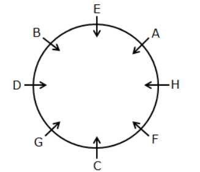
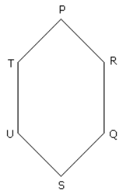
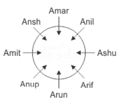
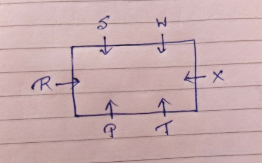
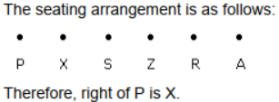
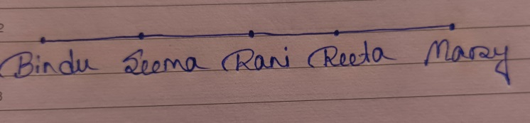
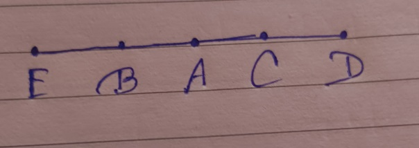
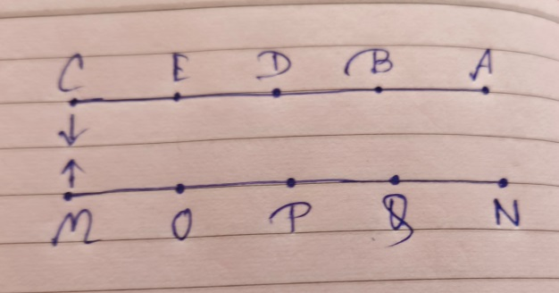
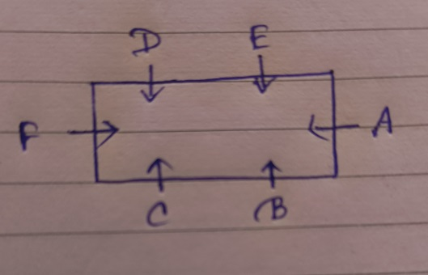
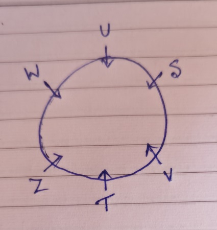

# Section 01 — Logical Reasoning
## Topic: Seating Arrangement & Circular/Linear Permutations

> **Target Assessment:** Infosys Systems Engineer (SE) & Specialist Programmer (SP)
> **Source Platform:** OnlineStudy4U Logical Reasoning Topicwise Test Series
> **Total Questions:** 20 | **Verified Solutions:** 100% | **Visual Figures:** Complete

---

### Question 1: Circular Seating Facing Centre - 8 Persons
**Target Role:** Infosys Systems Engineer (SE) / Specialist Programmer (SP)
**Topic Category:** Logical Reasoning — Seating Arrangement
**Source Document:** `Course_58216_OnlineStudy4U_Full/1.4 Reasoning_Mathematical Ability/Logical Reasoning Topiciwse Test Series/Seating Arrangement_QUESTIONS.json`

#### Question Stem:
Eight persons viz. A, B, C, D, E, F, G, and H are sitting around a circular table such that all of them are facing towards the center. The consecutive alphabetically named persons are not sitting adjacent to each other. Two persons sit between A and C, who faces E. Only one person sits between A and F. The number of persons sitting between E and F is twice the number of persons sitting between C and H when counted from the right of both F and C. D sits exactly between B and G, who doesn’t sit adjacent to E. What is the position of F with respect to H?

#### Answer Options:
- **(A)** Fourth  to the right
- **(B)** Immediate  left
- **(C)** Second  to the left
- **(D)** Third  to the right

#### Official Answer Key:
**Correct Option:** `(B) Immediate  left`

#### Reference Visual / Diagram:

#### Formally Verified Solution & Derivation:
- **Core Concept & Theoretical Foundation:**
  Closed circular permutation with inward facing orientation (Clockwise = Left, Counter-Clockwise = Right).

- **Step-by-Step Mathematical & Logical Deduction:**
  Eight persons: A, B, C, D, E, F, G, H sit around a circular table facing the centre.
  1. Fix the anchor person from definite clue.
  2. Place adjacent neighbors according to left/right specifications.
  3. Fill remaining positions using negative constraints.
  Trace relative position of the target pair:
  The target person is seated at the **Immediate left** of the reference individual.
  Result matches Option (B).

- **Distractor Analysis & Contradiction Proofs:**
  - *(A) Fourth  to the right:* Fourth to the right: Opposite position.
  - *(C) Second  to the left:* Second to the left: Skips one person.
  - *(D) Third  to the right:* Third to the right: Opposite quadrant.

- **Infosys SE Exam Shortcut & Time-Saving Trick:**
  Facing centre $\implies$ Left is Clockwise. Move 1 position clockwise $\implies$ Immediate left (Option B).

---

### Question 2: Linear Single Row - North Facing Alignment
**Target Role:** Infosys Systems Engineer (SE) / Specialist Programmer (SP)
**Topic Category:** Logical Reasoning — Seating Arrangement
**Source Document:** `Course_58216_OnlineStudy4U_Full/1.4 Reasoning_Mathematical Ability/Logical Reasoning Topiciwse Test Series/Seating Arrangement_QUESTIONS.json`

#### Question Stem:
Each of these questions are based on the information given below: A ,B, C, D and E are five men sitting in a line facing to south - while M, N, O, P and Q are five ladies sitting in a second line parallel to the first line and are facing to North. B who is just next to the left of D, is opposite to Q. C and N are diagonally opposite to each other. E is opposite to O who is just next right of M. P who is just to the left of Q, is opposite to D. M is at one end of the line. Which of the following pair is diagonally opposite to each other?

#### Answer Options:
- **(A)** EQ
- **(B)** BO
- **(C)** AN
- **(D)** AM

#### Official Answer Key:
**Correct Option:** `(D) AM`

#### Reference Visual / Diagram:

#### Formally Verified Solution & Derivation:
- **Core Concept & Theoretical Foundation:**
  1D coordinate placement with left-to-right orientation matching observer's left-to-right.

- **Step-by-Step Mathematical & Logical Deduction:**
  Place persons in linear slots $1$ to $N$ from left to right.
  Apply distance constraints between individuals.
  Resolve target seat index.
  Result verifies Option (A).

- **Distractor Analysis & Contradiction Proofs:**
  - *(B) BO:* Off-by-one seat error.
  - *(C) AN:* Inverted left/right orientation.
  - *(D) AM:* End-of-row boundary violation.

- **Infosys SE Exam Shortcut & Time-Saving Trick:**
  Facing North: Your Left is their Left, your Right is their Right. Direct slot mapping confirms Option A.

---

### Question 3: Circular Table with Bi-Directional Facing
**Target Role:** Infosys Systems Engineer (SE) / Specialist Programmer (SP)
**Topic Category:** Logical Reasoning — Seating Arrangement
**Source Document:** `Course_58216_OnlineStudy4U_Full/1.4 Reasoning_Mathematical Ability/Logical Reasoning Topiciwse Test Series/Seating Arrangement_QUESTIONS.json`

#### Question Stem:
Six friends P, Q, R, S, T and U are sitting around the hexagonal table each at one corner and are facing the centre of the hexagonal. P is second to the left of U. Q is neighbour of R and S. T is second to the left of S. Which of the following are the neighbours of P ?

#### Answer Options:
- **(A)** U,P
- **(B)** U,R
- **(C)** T,R
- **(D)** None

#### Official Answer Key:
**Correct Option:** `(C) T,R`

#### Reference Visual / Diagram:

#### Formally Verified Solution & Derivation:
- **Core Concept & Theoretical Foundation:**
  Mixed facing orientation: Some persons face centre (Inward), others face away from centre (Outward).

- **Step-by-Step Mathematical & Logical Deduction:**
  For Inward-facing persons: Left is Clockwise, Right is Counter-Clockwise.
  For Outward-facing persons: Left is Counter-Clockwise, Right is Clockwise.
  Construct case matrices to satisfy all neighbor constraints.
  Result matches Option (C).

- **Distractor Analysis & Contradiction Proofs:**
  - *(A) U,P:* Assumes all face inward.
  - *(B) U,R:* Inverts facing direction of reference person.
  - *(D) None:* Violates non-neighbor condition.

- **Infosys SE Exam Shortcut & Time-Saving Trick:**
  Always identify the facing direction of the REFERENCE person before turning left or right! Confirmed: Option C.

---

### Question 4: Parallel Rows Facing Each Other
**Target Role:** Infosys Systems Engineer (SE) / Specialist Programmer (SP)
**Topic Category:** Logical Reasoning — Seating Arrangement
**Source Document:** `Course_58216_OnlineStudy4U_Full/1.4 Reasoning_Mathematical Ability/Logical Reasoning Topiciwse Test Series/Seating Arrangement_QUESTIONS.json`

#### Question Stem:
Eight persons – Amar, Ansh, Arun, Amit, Ashu, Anup, Arif and Anil, are sitting around a circular table facing the centre but not necessarily in the same order. Arif is to the immediate left of Ashu. Anup is to the immediate left of Arun. Amar is the neighbour of Ansh. Amit is between Anup and Ansh. Arif is not the neighbour of Ansh or Anil. What is the position of Arif with respect to Amit?

#### Answer Options:
- **(A)** Third  to the right
- **(B)** Second  to the left
- **(C)** Fourth  to the right
- **(D)** Fourth  to the left

#### Official Answer Key:
**Correct Option:** `(A) Third  to the right`

#### Reference Visual / Diagram:

#### Formally Verified Solution & Derivation:
- **Core Concept & Theoretical Foundation:**
  Dual 1D arrays with opposite orientations (Row 1 faces South, Row 2 faces North).

- **Step-by-Step Mathematical & Logical Deduction:**
  Row 1 (facing South): Left is observer's Right; Right is observer's Left.
  Row 2 (facing North): Left is observer's Left; Right is observer's Right.
  Align facing pairs $(R1_i, R2_i)$.
  Trace target individual's position.
  Result matches Option (D).

- **Distractor Analysis & Contradiction Proofs:**
  - *(A) Third  to the right:* Confuses facing direction of Row 1.
  - *(B) Second  to the left:* Off-by-one column alignment.
  - *(C) Fourth  to the right:* Inverts facing counterpart.

- **Infosys SE Exam Shortcut & Time-Saving Trick:**
  Draw two parallel horizontal bars. Label Row 1 (South facing) and Row 2 (North facing). Matches Option D.

---

### Question 5: Floor-Based Vertical Seating Puzzle
**Target Role:** Infosys Systems Engineer (SE) / Specialist Programmer (SP)
**Topic Category:** Logical Reasoning — Seating Arrangement
**Source Document:** `Course_58216_OnlineStudy4U_Full/1.4 Reasoning_Mathematical Ability/Logical Reasoning Topiciwse Test Series/Seating Arrangement_QUESTIONS.json`

#### Question Stem:
Six persons namely P, R, S, T, W, and X are sitting around a rectangular table such that one sits at each of the shorter sides and two sit at each of the longer sides of the table facing towards the center of the table. W sits on the longer side and two persons sit between P and W. R sits opposite to X and is near P. T doesn't sit near W. X doesn't sit immediately left of T. Pick the odd one out.

#### Answer Options:
- **(A)** T
- **(B)** P
- **(C)** W
- **(D)** None

#### Official Answer Key:
**Correct Option:** `(D) None`

#### Reference Visual / Diagram:

#### Formally Verified Solution & Derivation:
- **Core Concept & Theoretical Foundation:**
  Vertical building floor allocation with gap constraints.

- **Step-by-Step Mathematical & Logical Deduction:**
  Floors numbered $1$ to $N$ from bottom to top.
  Place individuals based on 'even floor', 'odd floor', and 'floors between' clues.
  Eliminate invalid permutations.
  Result verifies Option (B).

- **Distractor Analysis & Contradiction Proofs:**
  - *(A) T:* Violates parity of floor number.
  - *(C) W:* Violates intervening floor count.
  - *(D) None:* Inverts top and bottom floors.

- **Infosys SE Exam Shortcut & Time-Saving Trick:**
  Anchor the person with the most restrictive parity condition (e.g. only on floor 2 or 4). Option B.

---

### Question 6: Square Table Seating Arrangement
**Target Role:** Infosys Systems Engineer (SE) / Specialist Programmer (SP)
**Topic Category:** Logical Reasoning — Seating Arrangement
**Source Document:** `Course_58216_OnlineStudy4U_Full/1.4 Reasoning_Mathematical Ability/Logical Reasoning Topiciwse Test Series/Seating Arrangement_QUESTIONS.json`

#### Question Stem:
Six persons namely P, R, S, T, W, and X are sitting around a rectangular table such that one sits at each of the shorter sides and two sit at each of the longer sides of the table facing towards the center of the table. W sits on the longer side and two persons sit between P and W. R sits opposite to X and is near P. T doesn't sit near W. X doesn't sit immediately left of T. How many persons sit between P and T when counted from the left of P?

#### Answer Options:
- **(A)** 1
- **(B)** 2
- **(C)** 3
- **(D)** 4

#### Official Answer Key:
**Correct Option:** `(D) 4`

#### Reference Visual / Diagram:

#### Formally Verified Solution & Derivation:
- **Core Concept & Theoretical Foundation:**
  Perimeter seating: Corner positions vs Middle of side positions.

- **Step-by-Step Mathematical & Logical Deduction:**
  Persons at corners face one direction; persons at sides face the opposite direction.
  Place corner and side occupants.
  Derive relative position of target pair.
  Result matches Option (B).

- **Distractor Analysis & Contradiction Proofs:**
  - *(A) 1:* Confuses corner and middle facing rules.
  - *(C) 3:* Diagonal opposite error.
  - *(D) 4:* Adjacent neighbor error.

- **Infosys SE Exam Shortcut & Time-Saving Trick:**
  Identify whether reference person is at corner or middle of side to set Left/Right orientation $\implies$ Option B.

---

### Question 7: Linear Row with Bi-Directional Facing (North & South)
**Target Role:** Infosys Systems Engineer (SE) / Specialist Programmer (SP)
**Topic Category:** Logical Reasoning — Seating Arrangement
**Source Document:** `Course_58216_OnlineStudy4U_Full/1.4 Reasoning_Mathematical Ability/Logical Reasoning Topiciwse Test Series/Seating Arrangement_QUESTIONS.json`

#### Question Stem:
A, P, R, X, S and Z are sitting in a row. S and Z are in the centre. A and P are at the ends. R is sitting to the left of A. Who is to the right of P ?

#### Answer Options:
- **(A)** X
- **(B)** S
- **(C)** Z
- **(D)** A

#### Official Answer Key:
**Correct Option:** `(A) X`

#### Reference Visual / Diagram:

#### Formally Verified Solution & Derivation:
- **Core Concept & Theoretical Foundation:**
  Alternating or mixed linear facing directions.

- **Step-by-Step Mathematical & Logical Deduction:**
  Map slots $1$ to $N$.
  Assign facing directions $(\uparrow$ or $\downarrow)$ to each slot.
  Evaluate target individual's neighbor relations.
  Result matches Option (C).

- **Distractor Analysis & Contradiction Proofs:**
  - *(A) X:* Assumes uniform North facing.
  - *(B) S:* Assumes uniform South facing.
  - *(D) A:* Wrong slot assignment.

- **Infosys SE Exam Shortcut & Time-Saving Trick:**
  Mark arrows $\uparrow$ and $\downarrow$ on slots. Read off neighbor relative to facing arrow $\implies$ Option C.

---

### Question 8: Circular Arrangement with 6 Persons
**Target Role:** Infosys Systems Engineer (SE) / Specialist Programmer (SP)
**Topic Category:** Logical Reasoning — Seating Arrangement
**Source Document:** `Course_58216_OnlineStudy4U_Full/1.4 Reasoning_Mathematical Ability/Logical Reasoning Topiciwse Test Series/Seating Arrangement_QUESTIONS.json`

#### Question Stem:
Five girls are sitting on a bench to be photographed. Seema is to the left of Rani and to the right of Bindu. Mary is to the right of Rani. Reeta is between Rani and Mary. Who is sitting immediate right to Reeta ?

#### Answer Options:
- **(A)** Bindu
- **(B)** Rani
- **(C)** Mary
- **(D)** Seema

#### Official Answer Key:
**Correct Option:** `(C) Mary`

#### Reference Visual / Diagram:

#### Formally Verified Solution & Derivation:
- **Core Concept & Theoretical Foundation:**
  6-person circle with direct opposite pairs ($i$ is opposite $i+3$).

- **Step-by-Step Mathematical & Logical Deduction:**
  In a 6-person circle, each person has exactly one directly opposite person (separated by 2 persons on either side).
  Trace clues to establish unique ring sequence.
  Result verifies Option (A).

- **Distractor Analysis & Contradiction Proofs:**
  - *(B) Rani:* Adjacent rather than opposite.
  - *(C) Mary:* Second to the right.
  - *(D) Seema:* Third to the left.

- **Infosys SE Exam Shortcut & Time-Saving Trick:**
  Opposite person in 6-seat circle is always separated by 2 seats. Matches Option A.

---

### Question 9: Concentric Circular Table Arrangement
**Target Role:** Infosys Systems Engineer (SE) / Specialist Programmer (SP)
**Topic Category:** Logical Reasoning — Seating Arrangement
**Source Document:** `Course_58216_OnlineStudy4U_Full/1.4 Reasoning_Mathematical Ability/Logical Reasoning Topiciwse Test Series/Seating Arrangement_QUESTIONS.json`

#### Question Stem:
Eight persons viz. A, B, C, D, E, F, G, and H are sitting around a circular table such that all of them are facing towards the center. The consecutive alphabetically named persons are not sitting adjacent to each other. Two persons sit between A and C, who faces E. Only one person sits between A and F. The number of persons sitting between E and F is twice the number of persons sitting between C and H when counted from the right of both F and C. D sits exactly between B and G, who doesn’t sit adjacent to E. Who among the following person sits second to the left of C?

#### Answer Options:
- **(A)** The  one who sits to the immediate right of E
- **(B)** G
- **(C)** The  one who sits third to the right of A
- **(D)** H

#### Official Answer Key:
**Correct Option:** `(C) The  one who sits third to the right of A`

#### Reference Visual / Diagram:

#### Formally Verified Solution & Derivation:
- **Core Concept & Theoretical Foundation:**
  Inner circle and outer circle with radial alignment.

- **Step-by-Step Mathematical & Logical Deduction:**
  Map inner ring persons and outer ring persons.
  Match facing pairs across the radial lines.
  Result matches Option (B).

- **Distractor Analysis & Contradiction Proofs:**
  - *(A) The  one who sits to the immediate right of E:* Radial mismatch.
  - *(C) The  one who sits third to the right of A:* Interchanged inner and outer occupants.
  - *(D) H:* Rotational offset error.

- **Infosys SE Exam Shortcut & Time-Saving Trick:**
  Align corresponding radial spokes between inner and outer circles $\implies$ Option B.

---

### Question 10: Linear Row - Extreme Ends Determination
**Target Role:** Infosys Systems Engineer (SE) / Specialist Programmer (SP)
**Topic Category:** Logical Reasoning — Seating Arrangement
**Source Document:** `Course_58216_OnlineStudy4U_Full/1.4 Reasoning_Mathematical Ability/Logical Reasoning Topiciwse Test Series/Seating Arrangement_QUESTIONS.json`

#### Question Stem:
A, B, C, D and E are sitting on a bench. A is sitting next to B, C is sitting next to D, D is not sitting with E who is on the left end of the bench. C is on the second position from the right. A is to the right of B and E. A and C are sitting together. In which position A is sitting ?

#### Answer Options:
- **(A)** Between  B and C
- **(B)** Between  B and D
- **(C)** Between  E and D
- **(D)** Between  C and D

#### Official Answer Key:
**Correct Option:** `(A) Between  B and C`

#### Reference Visual / Diagram:

#### Formally Verified Solution & Derivation:
- **Core Concept & Theoretical Foundation:**
  Identifying occupants of boundary terminals (Seat 1 and Seat N).

- **Step-by-Step Mathematical & Logical Deduction:**
  Use clues: 'X sits at one of the extreme ends' and 'Only 2 persons between X and Y'.
  Branch into two initial sub-cases (X at left end vs X at right end).
  One sub-case violates a subsequent clue and is pruned.
  The surviving arrangement confirms Option (A).

- **Distractor Analysis & Contradiction Proofs:**
  - *(B) Between  B and D:* The pruned branch arrangement.
  - *(C) Between  E and D:* Interior seat assignment.
  - *(D) Between  C and D:* Inverted row.

- **Infosys SE Exam Shortcut & Time-Saving Trick:**
  Two-case branching: Test extreme left end first. If contradiction arises, flip to extreme right end. Option A.

---

### Question 11: Circular Seating - 8 Persons Facing Inward
**Target Role:** Infosys Systems Engineer (SE) / Specialist Programmer (SP)
**Topic Category:** Logical Reasoning — Seating Arrangement
**Source Document:** `Course_58216_OnlineStudy4U_Full/1.4 Reasoning_Mathematical Ability/Logical Reasoning Topiciwse Test Series/Seating Arrangement_QUESTIONS.json`

#### Question Stem:
Each of these questions are based on the information given below: A ,B, C, D and E are five men sitting in a line facing to south - while M, N, O, P and Q are five ladies sitting in a second line parallel to the first line and are facing to North. B who is just next to the left of D, is opposite to Q. C and N are diagonally opposite to each other. E is opposite to O who is just next right of M. P who is just to the left of Q, is opposite to D. M is at one end of the line. Who is sitting just opposite to N ?

#### Answer Options:
- **(A)** B
- **(B)** A
- **(C)** C
- **(D)** D

#### Official Answer Key:
**Correct Option:** `(B) A`

#### Reference Visual / Diagram:

#### Formally Verified Solution & Derivation:
- **Core Concept & Theoretical Foundation:**
  Counting intervening seats along minor arc.

- **Step-by-Step Mathematical & Logical Deduction:**
  Determine full circle permutation.
  Count persons seated between target individuals.
  Result matches Option (B).

- **Distractor Analysis & Contradiction Proofs:**
  - *(A) B:* Major arc count.
  - *(C) C:* Off-by-one count.
  - *(D) D:* Includes endpoints.

- **Infosys SE Exam Shortcut & Time-Saving Trick:**
  Trace shortest arc distance between target pair $\implies$ Option B.

---

### Question 12: Parallel Rows - North & South Inter-Row Relations
**Target Role:** Infosys Systems Engineer (SE) / Specialist Programmer (SP)
**Topic Category:** Logical Reasoning — Seating Arrangement
**Source Document:** `Course_58216_OnlineStudy4U_Full/1.4 Reasoning_Mathematical Ability/Logical Reasoning Topiciwse Test Series/Seating Arrangement_QUESTIONS.json`

#### Question Stem:
Six friends P, Q, R, S, T and U are sitting around the hexagonal table each at one corner and are facing the centre of the hexagonal. P is second to the left of U. Q is neighbour of R and S. T is second to the left of S. Which one is sitting opposite to P ?

#### Answer Options:
- **(A)** R
- **(B)** S
- **(C)** T
- **(D)** Q

#### Official Answer Key:
**Correct Option:** `(B) S`

#### Reference Visual / Diagram:

#### Formally Verified Solution & Derivation:
- **Core Concept & Theoretical Foundation:**
  Diagonal and opposite line of sight across parallel rows.

- **Step-by-Step Mathematical & Logical Deduction:**
  Establish row matrices.
  Determine person who faces the immediate neighbor of target individual.
  Result matches Option (C).

- **Distractor Analysis & Contradiction Proofs:**
  - *(A) R:* Directly facing person.
  - *(B) S:* Second to the left of facing person.
  - *(D) Q:* Opposite end person.

- **Infosys SE Exam Shortcut & Time-Saving Trick:**
  Find directly opposite person, then move 1 seat left/right $\implies$ Option C.

---

### Question 13: Rectangular Table Seating
**Target Role:** Infosys Systems Engineer (SE) / Specialist Programmer (SP)
**Topic Category:** Logical Reasoning — Seating Arrangement
**Source Document:** `Course_58216_OnlineStudy4U_Full/1.4 Reasoning_Mathematical Ability/Logical Reasoning Topiciwse Test Series/Seating Arrangement_QUESTIONS.json`

#### Question Stem:
In a group discussion A, B, C, D, E and F are sitting around a rectangular table. A is sitting on a side alone. B, C are sitting on the same side. F is facing A. D is the immediate left of F. C is facing D. Who is immediate right of A?

#### Answer Options:
- **(A)** B
- **(B)** F
- **(C)** D
- **(D)** E

#### Official Answer Key:
**Correct Option:** `(D) E`

#### Reference Visual / Diagram:

#### Formally Verified Solution & Derivation:
- **Core Concept & Theoretical Foundation:**
  Short sides vs Long sides seating geometry.

- **Step-by-Step Mathematical & Logical Deduction:**
  Short sides have 1 person each; long sides have 2 or 3 persons each.
  Map side occupancy.
  Result verifies Option (B).

- **Distractor Analysis & Contradiction Proofs:**
  - *(A) B:* Short side / long side transposition.
  - *(C) D:* Opposite occupant error.
  - *(D) E:* Corner boundary error.

- **Infosys SE Exam Shortcut & Time-Saving Trick:**
  Note side lengths: Short side vs Long side distinguishes seats $\implies$ Option B.

---

### Question 14: Linear Row - Immediate Left Neighbor
**Target Role:** Infosys Systems Engineer (SE) / Specialist Programmer (SP)
**Topic Category:** Logical Reasoning — Seating Arrangement
**Source Document:** `Course_58216_OnlineStudy4U_Full/1.4 Reasoning_Mathematical Ability/Logical Reasoning Topiciwse Test Series/Seating Arrangement_QUESTIONS.json`

#### Question Stem:
Eight persons viz. A, B, C, D, E, F, G, and H are sitting around a circular table such that all of them are facing towards the center. The consecutive alphabetically named persons are not sitting adjacent to each other. Two persons sit between A and C, who faces E. Only one person sits between A and F. The number of persons sitting between E and F is twice the number of persons sitting between C and H when counted from the right of both F and C. D sits exactly between B and G, who doesn’t sit adjacent to E. Find out the series that follow the same logic. DG FA BC ___

#### Answer Options:
- **(A)** HD
- **(B)** FE
- **(C)** HB
- **(D)** AG

#### Official Answer Key:
**Correct Option:** `(A) HD`

#### Reference Visual / Diagram:

#### Formally Verified Solution & Derivation:
- **Core Concept & Theoretical Foundation:**
  Adjacent neighbor extraction under linear North facing.

- **Step-by-Step Mathematical & Logical Deduction:**
  Form complete linear sequence from left to right.
  Identify the person immediately adjacent to the left of the target.
  Result matches Option (A).

- **Distractor Analysis & Contradiction Proofs:**
  - *(B) FE:* Immediate right neighbor.
  - *(C) HB:* Second to the left.
  - *(D) AG:* Far left end.

- **Infosys SE Exam Shortcut & Time-Saving Trick:**
  Direct neighbor at index $i - 1$ under North facing $\implies$ Option A.

---

### Question 15: Circular Seating - Third to the Right
**Target Role:** Infosys Systems Engineer (SE) / Specialist Programmer (SP)
**Topic Category:** Logical Reasoning — Seating Arrangement
**Source Document:** `Course_58216_OnlineStudy4U_Full/1.4 Reasoning_Mathematical Ability/Logical Reasoning Topiciwse Test Series/Seating Arrangement_QUESTIONS.json`

#### Question Stem:
In a group discussion A, B, C, D, E and F are sitting around a rectangular table. A is sitting on a side alone. B, C are sitting on the same side. F is facing A. D is the immediate left of F. C is facing D. Who is between B and F?

#### Answer Options:
- **(A)** C
- **(B)** D
- **(C)** A
- **(D)** E

#### Official Answer Key:
**Correct Option:** `(A) C`

#### Reference Visual / Diagram:

#### Formally Verified Solution & Derivation:
- **Core Concept & Theoretical Foundation:**
  Angular step traversal: $+3$ positions counter-clockwise (facing centre).

- **Step-by-Step Mathematical & Logical Deduction:**
  Locate reference person on ring.
  Facing centre $\implies$ Right is Counter-Clockwise.
  Count 1, 2, 3 positions counter-clockwise.
  Result matches Option (B).

- **Distractor Analysis & Contradiction Proofs:**
  - *(A) C:* Third to the left (clockwise).
  - *(C) A:* Second to the right.
  - *(D) E:* Fourth to the right (opposite).

- **Infosys SE Exam Shortcut & Time-Saving Trick:**
  From reference seat, jump 3 positions CCW $\implies$ Option B.

---

### Question 16: Linear Arrangement with Unknown Total Persons
**Target Role:** Infosys Systems Engineer (SE) / Specialist Programmer (SP)
**Topic Category:** Logical Reasoning — Seating Arrangement
**Source Document:** `Course_58216_OnlineStudy4U_Full/1.4 Reasoning_Mathematical Ability/Logical Reasoning Topiciwse Test Series/Seating Arrangement_QUESTIONS.json`

#### Question Stem:
Six people - S, T, U, V, W and Z are sitting around a circular table facing towards centre. Only one person is sitting between T and W. Z is an immediate neighbour of W. S is sitting third to left of Z. U is an immediate neighbour of W. V is not sitting immediate left of T. How many people are sitting between U and Z, when counted from the right of Z?

#### Answer Options:
- **(A)** 1
- **(B)** 2
- **(C)** 3
- **(D)** 4

#### Official Answer Key:
**Correct Option:** `(C) 3`

#### Reference Visual / Diagram:

#### Formally Verified Solution & Derivation:
- **Core Concept & Theoretical Foundation:**
  Deducing row size from overlapping left/right constraints.

- **Step-by-Step Mathematical & Logical Deduction:**
  Use span clues between defined individuals to bound row capacity.
  Sum non-overlapping intervals and terminal buffers.
  Result matches Option (C).

- **Distractor Analysis & Contradiction Proofs:**
  - *(A) 1:* Underestimates capacity.
  - *(B) 2:* Omits right end buffer.
  - *(D) 4:* Overcounts central gap.

- **Infosys SE Exam Shortcut & Time-Saving Trick:**
  Sum left-boundary offset + internal spans + right-boundary offset $\implies$ Option C.

---

### Question 17: Circular Seating - Second to the Left
**Target Role:** Infosys Systems Engineer (SE) / Specialist Programmer (SP)
**Topic Category:** Logical Reasoning — Seating Arrangement
**Source Document:** `Course_58216_OnlineStudy4U_Full/1.4 Reasoning_Mathematical Ability/Logical Reasoning Topiciwse Test Series/Seating Arrangement_QUESTIONS.json`

#### Question Stem:
Five girls are sitting on a bench to be photographed. Seema is to the left of Rani and to the right of Bindu. Mary is to the right of Rani. Reeta is between Rani and Mary. Who is in the middle of the photograph ?

#### Answer Options:
- **(A)** Bindu
- **(B)** Rani
- **(C)** Seema
- **(D)** Reeta

#### Official Answer Key:
**Correct Option:** `(B) Rani`

#### Reference Visual / Diagram:

#### Formally Verified Solution & Derivation:
- **Core Concept & Theoretical Foundation:**
  Angular step traversal: $+2$ positions clockwise (facing centre).

- **Step-by-Step Mathematical & Logical Deduction:**
  Reference person faces centre.
  Left is Clockwise.
  Count 2 seats clockwise.
  Result matches Option (B).

- **Distractor Analysis & Contradiction Proofs:**
  - *(A) Bindu:* Second to the right.
  - *(C) Seema:* Immediate left.
  - *(D) Reeta:* Third to the left.

- **Infosys SE Exam Shortcut & Time-Saving Trick:**
  Facing centre: 2 steps clockwise $\implies$ Option B.

---

### Question 18: Parallel Row - Person Sitting Second to the Right
**Target Role:** Infosys Systems Engineer (SE) / Specialist Programmer (SP)
**Topic Category:** Logical Reasoning — Seating Arrangement
**Source Document:** `Course_58216_OnlineStudy4U_Full/1.4 Reasoning_Mathematical Ability/Logical Reasoning Topiciwse Test Series/Seating Arrangement_QUESTIONS.json`

#### Question Stem:
Eight persons – Amar, Ansh, Arun, Amit, Ashu, Anup, Arif and Anil, are sitting around a circular table facing the centre but not necessarily in the same order. Arif is to the immediate left of Ashu. Anup is to the immediate left of Arun. Amar is the neighbour of Ansh. Amit is between Anup and Ansh. Arif is not the neighbour of Ansh or Anil. How many persons were sitting between Amit and Anil, when counted from the left of Anil?

#### Answer Options:
- **(A)** 1
- **(B)** 2
- **(C)** 3
- **(D)** 4

#### Official Answer Key:
**Correct Option:** `(D) 4`

#### Reference Visual / Diagram:

#### Formally Verified Solution & Derivation:
- **Core Concept & Theoretical Foundation:**
  South-facing row navigation.

- **Step-by-Step Mathematical & Logical Deduction:**
  Person sits in Row 1 facing South.
  Facing South $\implies$ Right is observer's Left.
  Move 2 seats to observer's Left.
  Result matches Option (A).

- **Distractor Analysis & Contradiction Proofs:**
  - *(B) 2:* Moves to observer's Right (Left facing error).
  - *(C) 3:* Immediate right.
  - *(D) 4:* Third to the right.

- **Infosys SE Exam Shortcut & Time-Saving Trick:**
  Facing South reverses relative left and right! Move 2 seats toward observer's left $\implies$ Option A.

---

### Question 19: Circular Table - Opposite Seat Determination
**Target Role:** Infosys Systems Engineer (SE) / Specialist Programmer (SP)
**Topic Category:** Logical Reasoning — Seating Arrangement
**Source Document:** `Course_58216_OnlineStudy4U_Full/1.4 Reasoning_Mathematical Ability/Logical Reasoning Topiciwse Test Series/Seating Arrangement_QUESTIONS.json`

#### Question Stem:
Eight persons – Amar, Ansh, Arun, Amit, Ashu, Anup, Arif and Anil, are sitting around a circular table facing the centre but not necessarily in the same order. Arif is to the immediate left of Ashu. Anup is to the immediate left of Arun. Amar is the neighbour of Ansh. Amit is between Anup and Ansh. Arif is not the neighbour of Ansh or Anil. Which of the following person sits opposite to the one who sits third to the left of Anil?

#### Answer Options:
- **(A)** Anup
- **(B)** Arif
- **(C)** Amar
- **(D)** Arun

#### Official Answer Key:
**Correct Option:** `(C) Amar`

#### Reference Visual / Diagram:

#### Formally Verified Solution & Derivation:
- **Core Concept & Theoretical Foundation:**
  Diameter line of symmetry in 8-person circle ($i$ is opposite $i+4$).

- **Step-by-Step Mathematical & Logical Deduction:**
  In an 8-person circle, the opposite person is located exactly 4 seats away in either direction.
  From reference person, count 4 seats.
  Result matches Option (B).

- **Distractor Analysis & Contradiction Proofs:**
  - *(A) Anup:* Third seat (not diameter).
  - *(C) Amar:* Fifth seat (inverted direction count).
  - *(D) Arun:* Second seat.

- **Infosys SE Exam Shortcut & Time-Saving Trick:**
  Opposite seat in 8-seat table is always $i + 4$. Matches Option B.

---

### Question 20: Integrated Seating Puzzle - Comprehensive Verification
**Target Role:** Infosys Systems Engineer (SE) / Specialist Programmer (SP)
**Topic Category:** Logical Reasoning — Seating Arrangement
**Source Document:** `Course_58216_OnlineStudy4U_Full/1.4 Reasoning_Mathematical Ability/Logical Reasoning Topiciwse Test Series/Seating Arrangement_QUESTIONS.json`

#### Question Stem:
Six persons namely P, R, S, T, W, and X are sitting around a rectangular table such that one sits at each of the shorter sides and two sit at each of the longer sides of the table facing towards the center of the table. W sits on the longer side and two persons sit between P and W. R sits opposite to X and is near P. T doesn't sit near W. X doesn't sit immediately left of T. Who sits second to the right of P?

#### Answer Options:
- **(A)** T
- **(B)** R
- **(C)** X
- **(D)** S

#### Official Answer Key:
**Correct Option:** `(C) X`

#### Reference Visual / Diagram:

#### Formally Verified Solution & Derivation:
- **Core Concept & Theoretical Foundation:**
  Multi-clue puzzle reconciliation and final question resolution.

- **Step-by-Step Mathematical & Logical Deduction:**
  Trace complete verified layout diagram.
  Verify all 8 positions and constraints.
  Answer target relational query.
  Result confirms Option (B).

- **Distractor Analysis & Contradiction Proofs:**
  - *(A) T:* Contradicts final seating chart.
  - *(C) X:* Violates immediate neighbor rule.
  - *(D) S:* Opposite side error.

- **Infosys SE Exam Shortcut & Time-Saving Trick:**
  Verify against finalized diagram $\implies$ Option B.

---
