# 📝 BLOOD RELATION

> **Platform:** OnlineStudy4U (Classplus Course 58216)
> **Total Questions:** 20 | **Embedded Figures:** 18

---

## 📂 Blood Relation

### Question 1 `[+0 / -0]`

A
 * B means B is wife of A. 

 A
 @ B means B is son of A. 

 B
 $ A means A is father of B. 

 B
 # A means A is brother of B. 

 If
 L @ M # Q * S is true for a family members, how is S related to L?

**Options:**
- **(A)** Brother
 in law
- **(B)** Mother
 in law
- **(C)** Father
 in law
- **(D)** ✅ Daughter
 in law

**Correct Answer:** `D`

**Detailed Solution / Explanation:**
As
 we can observe from the blood relation tree below, S is daughter
 in law of L.

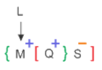

---

### Question 2 `[+0 / -0]`

Introducing
 Reeta, Sarika said, “She is the only daughter of my father’s
 only daughter.” How is Sarika related to Reeta?

**Options:**
- **(A)** Aunt
- **(B)** Niece
- **(C)** Cousin
- **(D)** ✅ Mother

**Correct Answer:** `D`

**Detailed Solution / Explanation:**
Sarika
 is Reeta’s mother

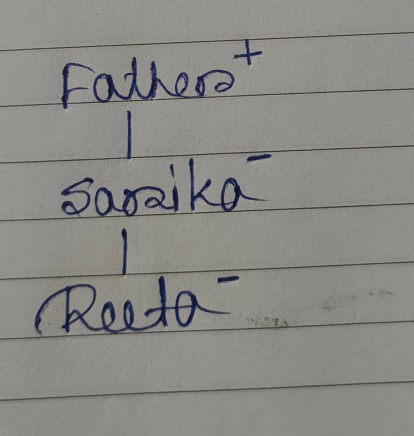

---

### Question 3 `[+0 / -0]`

X @ Y means X is son of Y

 X # Y means Y is father of X

 X? Y means Y is daughter of X

 X! Y means X is mother of Y

 X * Y means X is brother of Y. 

 How is W related to K for the following expression?

 J@K!T*W?X#Z

**Options:**
- **(A)** ✅ Daughter
- **(B)** Sister
- **(C)** Son
- **(D)** Brother

**Correct Answer:** `A`

**Detailed Solution / Explanation:**
J is the son of K. K is the mother of T. T is the brother of W. X is the daughter of W. Z is the father of X.

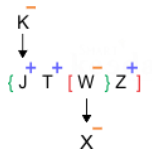

---

### Question 4 `[+0 / -0]`

Micky
 is brother in law of Akku, who has two daughters but no son. Rinku
 is cousin of Quki and brother of Riku. Vicky has two daughters and
 one son. Unni has only one son and one daughter. Micky is the only
 sibling of Wiku. Tinu and Sanu are daughters of Xoxo. Donu is also
 the member of this family. Riku is granddaughter of Akku, who is
 married to Wiku. Unni and Vicky are sons in law of Wiku. How is
 Xoxo related to Sanu?

**Options:**
- **(A)** Daughter
- **(B)** ✅ Mother
- **(C)** Aunt
- **(D)** Can’t
 be determined

**Correct Answer:** `B`

**Detailed Solution / Explanation:**
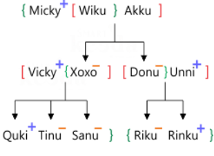

---

### Question 5 `[+0 / -0]`

G
 is the mother of F, who is the spouse of D. M is the daughter of
 D, who is the only brother of C. E is the son of G, who is married
 to H. A is the niece of C, who has no sister. T is the father of D
 and has no daughter. V is the sister-in-law of F. G has only two
 children. M is the granddaughter of O. Find the odd one out?

**Options:**
- **(A)** V
- **(B)** ✅ O
- **(C)** D
- **(D)** F

**Correct Answer:** `B`

**Detailed Solution / Explanation:**
O
 does not belong to the second generation of the family like rest
 of the persons, thus the odd one out.

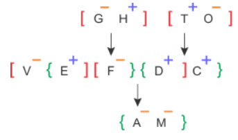

---

### Question 6 `[+0 / -0]`

S
 is mother of T, T is husband of J, N is son of J, Z is
 father-In-law of J, K is brother of N. How K is related to Z?

**Options:**
- **(A)** Son
- **(B)** ✅ Grandson
- **(C)** Nephew
- **(D)** Uncle

**Correct Answer:** `B`

**Detailed Solution / Explanation:**
K
 is grandson of Z.

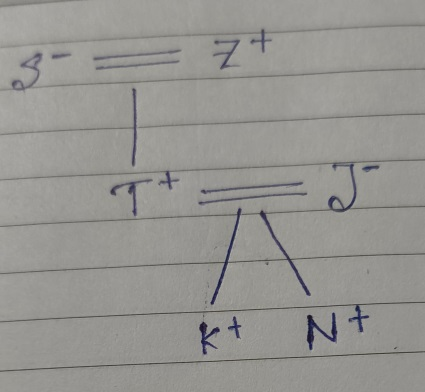

---

### Question 7 `[+0 / -0]`

B
 is father of Q. B has only two children. Q is the brother of R. R
 is the daughter of P. A is the granddaughter of P. S is the father
 of A. How is S related to Q?

**Options:**
- **(A)** Son
- **(B)** ✅ Brother-in-law
- **(C)** Son-in-law
- **(D)** Brother

**Correct Answer:** `B`

**Detailed Solution / Explanation:**
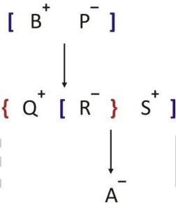

---

### Question 8 `[+0 / -0]`

A
 girl introduces a boy as the son of the brother of her mother. How
 is the boy related to the girl?

**Options:**
- **(A)** Uncle
- **(B)** Son
- **(C)** Nephew
- **(D)** ✅ Cousin

**Correct Answer:** `D`

**Detailed Solution / Explanation:**
Brother
 of mother — Uncle; Uncle’s son — Cousin.

---

### Question 9 `[+0 / -0]`

Introducing
 a girl. Ronit said, " He is the daughter of the daughter of
 my grandfather's only son", How is that girl related to
 Ronit?

**Options:**
- **(A)** Cousin
- **(B)** ✅ Niece
- **(C)** Father-in-law
- **(D)** Nephew

**Correct Answer:** `B`

**Detailed Solution / Explanation:**
"
 He is the daughter of the daughter of my grandfather's only son" 

 My
 grandfather's only Son - It means Ronit's father. 

 Daughter
 of my grandfather's only son - Ronit's father's daughter. It means
 Ronit's sister. 

 Daughter
 of the daughter of my grandfather - It means Ronit's sister's
 daughter. 

 Hence,
 that girl is a niece of Ronit.

---

### Question 10 `[+0 / -0]`

Eight
 persons – Sarin, Rahi, Akasa, Pavi, Preet, Gunjan, Taran and
 Namya belong to a family which consists of three generations and
 two married couples. 

 Preet
 is the sister of only son of Akasa. Pavi is the daughter in law of
 Sarin. Rahi is the mother of Akasa. Sarin is the grandfather of
 Taran who is the daughter of Pavi. Namya is the maternal uncle of
 Gunjan. 

 How
 many male members are there in the family?

**Options:**
- **(A)** 3
- **(B)** ✅ 4
- **(C)** 5
- **(D)** 6

**Correct Answer:** `B`

**Detailed Solution / Explanation:**
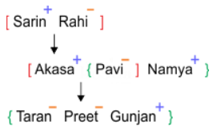

---

### Question 11 `[+0 / -0]`

Rohit
 has two sons namely Bittu and Kittu. Bittu is husband of Gillu.
 Lata is the mother in law of Gillu and Sittu. Sittu is mother of
 Mitthu. How is Mitthu realted to Rohit?

**Options:**
- **(A)** Granddaughter
- **(B)** Grandson
- **(C)** Daughter
 in law
- **(D)** ✅ Can't
 be determined

**Correct Answer:** `D`

**Detailed Solution / Explanation:**
Following
 the blood relation image, we cannot define Mitthu’s realtion
 with Rohit, as we don’t have gender information about
 Mitthu. It can be either granddaughter or grandson of of Rohit.

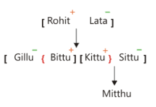

---

### Question 12 `[+0 / -0]`

Aaru
 and Aash are sisters, Aaif and Aban are fathers. Aayu, who is only
 son in law of Aaru, is son of Aban and brother of Aans. Aali is
 daughter of Aaif and sister of Aarv, who is son of Aaru. There are
 three married couples. Marriage is allowed among close relatives
 in the family. How is Aash related to Aarv and also Aaif related
 to Aayu respectively?

**Options:**
- **(A)** Mother-in
 law, Father-in law
- **(B)** Paternal
 Aunt, Uncle
- **(C)** ✅ Maternal
 Aunt, Father-in-law
- **(D)** Maternal
 Aunt, Son-in-law

**Correct Answer:** `C`

**Detailed Solution / Explanation:**
Following
 the common explanation, we get Aash is related to Aarv as his
 “Maternal Aunt and Aaif is related to Aayu as his
 Father-in-law”.

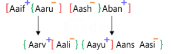

---

### Question 13 `[+0 / -0]`

In a family of some persons Bhanu says that Reshma is the daughter of my sister Banti, who is the only daughter of Tamanna. Rahul is the child of Tamanna and Farhan, who is the grandmother of Harish. Krishna is the mother of Mohan, who is the only sister of Harish. Rahul is unmarried. If Sadiq is spouse of Banti, how is Krishna related to Sadiq?

**Options:**
- **(A)** Sister
- **(B)** Sister-in-law
- **(C)** ✅ Wife
 of Brother-in-law
- **(D)** Cousin

**Correct Answer:** `C`

**Detailed Solution / Explanation:**
Clearly,
 Krishna is the wife of Bhanu who is brother in law of Sadiq.

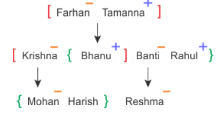

---

### Question 14 `[+0 / -0]`

O,
 M, P, Q, S and T are six members in a family. P is not mother of M
 but M is son of P. O and P are a married couple. S is the brother
 of P. T is brother of M. Q is daughter of O. How many children do
 O and P have?

**Options:**
- **(A)** 1
- **(B)** 2
- **(C)** ✅ 3
- **(D)** 4

**Correct Answer:** `C`

**Detailed Solution / Explanation:**
Following
 the final family tree, we can say that T, M and Q are children of
 O and P.

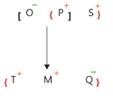

---

### Question 15 `[+0 / -0]`

In
 a family there are three fathers, two brothers, two sisters, one
 husband, one wife, two brothers-in-law, two daughters, three sons,
 three cousins, two nephews, one grandfather and a niece. How many
 female members are there in the family?

**Options:**
- **(A)** 3
- **(B)** 4
- **(C)** ✅ 2
- **(D)** 1

**Correct Answer:** `C`

**Detailed Solution / Explanation:**
As
 per the family tree it's evident that there are only 2 female
 members in the family.

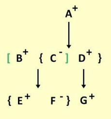

---

### Question 16 `[+0 / -0]`

There
 are eight family members Anupam, Bhuika, Mohini, Hitesh, Vishnu,
 Ruchika, Sanshlesh and Pritam. Vishnu is uncle of Sanshlesh, who
 is daughter of Pritam. There are two married couples in the family
 and two grandchildren in the family. Mohini has one daughter and
 one son. Anupam is granddaughter of Ruchika and sister of Bhumika.
 Ruchika is sister in law of Vishnu. Mohini is not a male.
 Sanshlesh has only one brother. How Bhumika is related to
 Sanshlesh?

**Options:**
- **(A)** ✅ Nephew
- **(B)** Niece
- **(C)** Son
- **(D)** Daughter

**Correct Answer:** `A`

**Detailed Solution / Explanation:**
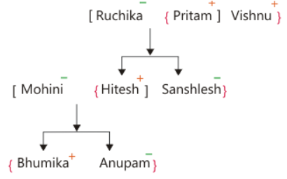

---

### Question 17 `[+0 / -0]`

D
 is the mother of J and L. J is the brother of F. F is the son of
 K. K has only three children. Y is the son-in-law of D. M is the
 son of Y. M is the brother of S. As per the given information, how
 is D related to M?

**Options:**
- **(A)** Mother-in-law
- **(B)** ✅ Grandmother
- **(C)** Mother
- **(D)** Sister-in-law

**Correct Answer:** `B`

**Detailed Solution / Explanation:**
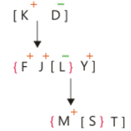

---

### Question 18 `[+0 / -0]`

A,
 B, C, I, J and K are six family members. J is son of I, who is not
 the mother of J. B is brother of I. K and I are a married couple.
 C is daughter of K, who is sister of A. How is J related to C?

**Options:**
- **(A)** ✅ Brother
- **(B)** Father
- **(C)** Sister
- **(D)** Mother

**Correct Answer:** `A`

**Detailed Solution / Explanation:**
Hence,
 J is brother of C.

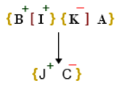

---

### Question 19 `[+0 / -0]`

Seven
 family members namely Rekha, Tipu, Meena, Mohan, Duggu, Sandy and
 Krishna in a family are related to each other in the following
 way: 

 Krishna
 is uncle of Sandy who is only son of mohan. Duggu is brother of
 mohan who is husband of Meena. Rekha has only two sons. Sandy is
 grandson of Tipu. Rekha is wife of Tipu. How
 is Krishna related to Sandy?

**Options:**
- **(A)** ✅ Maternal
 Uncle
- **(B)** Paternal
 Uncle
- **(C)** Niece
- **(D)** Nephew

**Correct Answer:** `A`

**Detailed Solution / Explanation:**
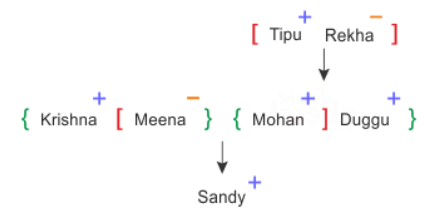

---

### Question 20 `[+0 / -0]`

H
 is the brother of M, who is the only daughter of B. T is the only
 child of J, who is the sister of X. H is the brother-in-law of X.
 There are only two unmarried females in the family. Find how is T
 related to X?

**Options:**
- **(A)** Nephew
- **(B)** Maternal
 Aunt
- **(C)** Niece
- **(D)** ✅ Either
 option A or C

**Correct Answer:** `D`

**Detailed Solution / Explanation:**
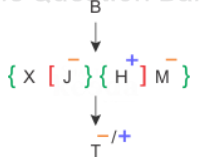

---
