# 📝 CODING DECODING

> **Platform:** OnlineStudy4U (Classplus Course 58216)
> **Total Questions:** 20 | **Embedded Figures:** 11

---

## 📂 Coging Decoding

### Question 1 `[+0 / -0]`

In
 a certain language ‘GUST’ is coded ‘@7$2’
 and ‘SNIP’ is coded ‘$59#’. How will
 ‘SING’ be coded in the same code?

**Options:**
- **(A)** 9$7#
- **(B)** 59#$
- **(C)** ✅ $95@
- **(D)** 7$@9

**Correct Answer:** `C`

**Detailed Solution / Explanation:**
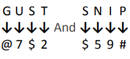

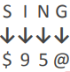

---

### Question 2 `[+0 / -0]`

If
 "APPLE" is coded as "ELPPA", how is "ORANGE"
 coded?

**Options:**
- **(A)** EGNORA
- **(B)** ✅ EGNARO
- **(C)** EGNARA
- **(D)** EGNROA

**Correct Answer:** `B`

**Detailed Solution / Explanation:**
The
 word is written in reverse order. APPLE → ELPPA, so ORANGE →
 EGNARO

---

### Question 3 `[+0 / -0]`

If
 "ENERGY" is coded as "257185145", how is
 "HOCKEY" coded?

**Options:**
- **(A)** ✅ 255113158
- **(B)** 815311525
- **(C)** 255311158
- **(D)** 253115815

**Correct Answer:** `A`

**Detailed Solution / Explanation:**
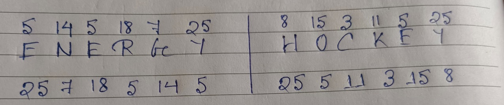

---

### Question 4 `[+0 / -0]`

If
 ‘MOUSE’ is coded as ‘KPSTC’, what is the
 code for ‘LIGHT’?

**Options:**
- **(A)** JJERI
- **(B)** JEJRI
- **(C)** JJREI
- **(D)** ✅ JJEIR

**Correct Answer:** `D`

**Detailed Solution / Explanation:**
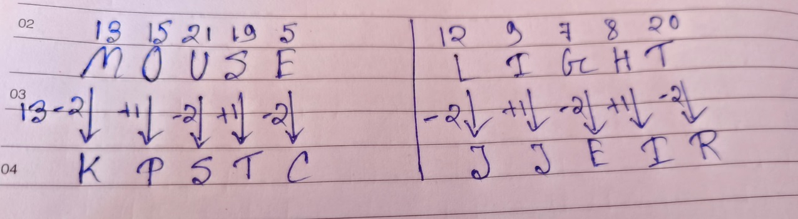

---

### Question 5 `[+0 / -0]`

If
 ‘ARCHERY’ is coded as ‘DSBGZSF’, what is
 the code for ‘TERMITE’?

**Options:**
- **(A)** SFULFJU
- **(B)** SFULJUF
- **(C)** ✅ SFULFUJ
- **(D)** SFULUJF

**Correct Answer:** `C`

**Detailed Solution / Explanation:**
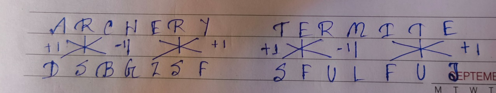

---

### Question 6 `[+0 / -0]`

In
 a certain code language, 'SUN' is coded as 26 and 'GPL' is coded
 as 11. How will 'SKT' be coded in that language?

**Options:**
- **(A)** ✅ 10
- **(B)** 15
- **(C)** 20
- **(D)** 25

**Correct Answer:** `A`

**Detailed Solution / Explanation:**
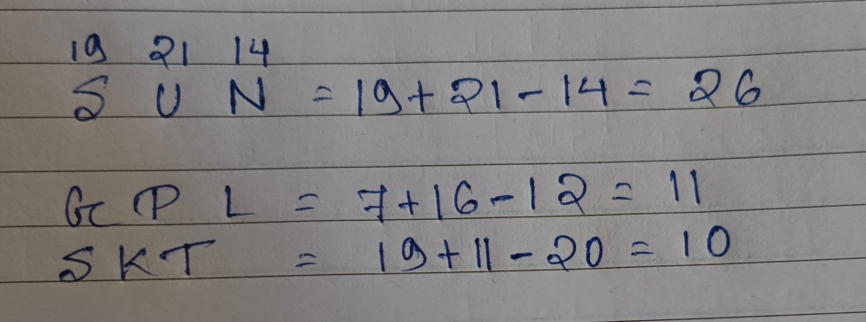

---

### Question 7 `[+0 / -0]`

In
 a certain language ‘branches have leafs’ is coded
 ‘673’, ‘trees have branches’ is coded
 ‘746’ and ‘mangoes all trees’ is coded
 ‘491’. How will ‘tree’ be coded in the
 same code?

**Options:**
- **(A)** 9
- **(B)** 1
- **(C)** ✅ 4
- **(D)** 7

**Correct Answer:** `C`

**Detailed Solution / Explanation:**
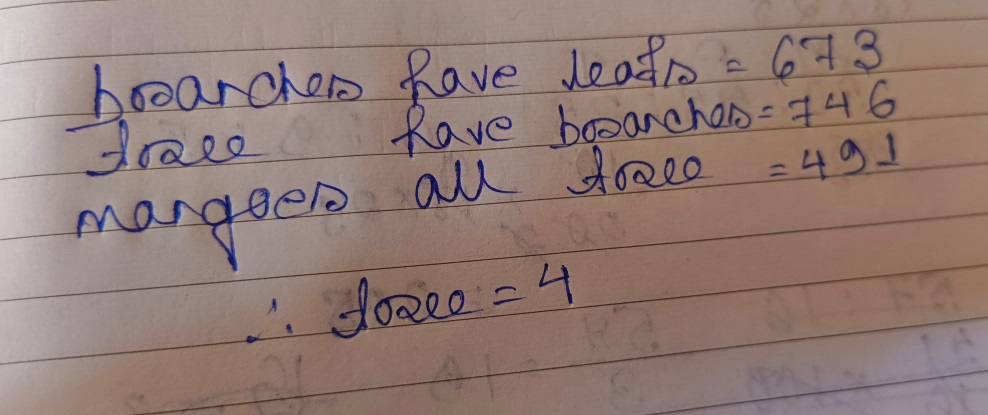

---

### Question 8 `[+0 / -0]`

If
 "JUNGLE" is coded as "KVOIMF", how is "FOREST"
 coded?

**Options:**
- **(A)** GPQTFV
- **(B)** GPQTFW
- **(C)** GPQTFX
- **(D)** ✅ GPQTFU

**Correct Answer:** `D`

**Detailed Solution / Explanation:**
Each
 letter is shifted forward by 1 position: 

 J→K,
 U→V, N→O, G→H, L→M, E→F. 

 Similarly,

 FOREST
 → F→G, O→P, R→S, E→F, S→T, T→U
 → GPQTFU.

---

### Question 9 `[+0 / -0]`

If
 A = 1, B = 4, C = 9, D = 16, then what is E?

**Options:**
- **(A)** 27
- **(B)** 23
- **(C)** ✅ 25
- **(D)** 21

**Correct Answer:** `C`

**Detailed Solution / Explanation:**
The
 code follows the square of the position in the alphabet. 

 A
 = 1², B = 2², C = 3², D = 4² 

 E
 = 5² = 25

---

### Question 10 `[+0 / -0]`

If
 ‘PENCIL’ is coded as ‘TIRGOK’, what is the
 code for ‘ERASER’?

**Options:**
- **(A)** IVWXIW
- **(B)** IVFXIW
- **(C)** ✅ IVEWIV
- **(D)** IVEXIV

**Correct Answer:** `C`

**Detailed Solution / Explanation:**
Each
 letter is shifted forward by 4 places. 

 P
 → T, E → I, N → R, C → G, I → O, L →
 K 

 Similarly,
 E → I, R → V, A → E, S → W, E → I, R →V

---

### Question 11 `[+0 / -0]`

In
 a certain code language, 'OM' is coded as 56 and 'GOT' is coded as
 126. How will 'CARD' be coded in that language?

**Options:**
- **(A)** 104
- **(B)** ✅ 144
- **(C)** 140
- **(D)** 142

**Correct Answer:** `B`

**Detailed Solution / Explanation:**
OM = (15+13)*2 = 56 

 GOT = (7+15+20)*3 = 126 

 CARD = (3+1+18+14) * 4 = 144

---

### Question 12 `[+0 / -0]`

If
 ‘NOSTALGIA’ is coded as ‘81’, what is the
 code for ‘FRICTION’?

**Options:**
- **(A)** 54
- **(B)** ✅ 64
- **(C)** 68
- **(D)** 72

**Correct Answer:** `B`

**Detailed Solution / Explanation:**
NOSTALGIA
 = 9 letters 

 9 2 =81 

 FRICTION
 = 8 letters 

 8 2 =64

---

### Question 13 `[+0 / -0]`

In
 a code language, if SEND is written as 168, then how will PURSE be
 written in the same language?

**Options:**
- **(A)** 225
- **(B)** ✅ 395
- **(C)** 185
- **(D)** 415

**Correct Answer:** `B`

**Detailed Solution / Explanation:**
SEND = (19+5+14+4)*4=168 

 PURSE = (16+21+18+19+5)*5=395

---

### Question 14 `[+0 / -0]`

If
 "GARDEN" is coded as "FZQCDM", how is "FLOWER"
 coded?

**Options:**
- **(A)** ✅ EKNVDQ
- **(B)** EKNVQD
- **(C)** EKNQVD
- **(D)** EKNDVQ

**Correct Answer:** `A`

**Detailed Solution / Explanation:**
Each
 letter is shifted backward by 1 position in the alphabet: 

 G→F,
 A→Z, R→Q, D→C, E→D, N→M. 

 Similarly,
 FLOWER → EKNVDQ

---

### Question 15 `[+0 / -0]`

If
 "CAT" is coded as "91400", how is "DOG"
 coded?

**Options:**
- **(A)** 2251649
- **(B)** 4922516
- **(C)** ✅ 1622549
- **(D)** 1649225

**Correct Answer:** `C`

**Detailed Solution / Explanation:**
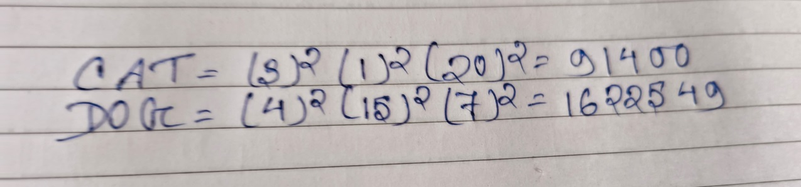

---

### Question 16 `[+0 / -0]`

If "PENCIL" is coded as "RGPEKN", how is "PAPER" coded?

**Options:**
- **(A)** ✅ RCRGT
- **(B)** RCRGS
- **(C)** RCRGU
- **(D)** RCRGV

**Correct Answer:** `A`

**Detailed Solution / Explanation:**
Each
 letter is shifted forward by 2 positions in the alphabet. P→R,
 A→C, P→R, E→G, R→T.

---

### Question 17 `[+0 / -0]`

If
 "JUNE" is coded as "5531", how is "JULY"
 coded?

**Options:**
- **(A)** 6631
- **(B)** 7731
- **(C)** 7332
- **(D)** ✅ 7331

**Correct Answer:** `D`

**Detailed Solution / Explanation:**
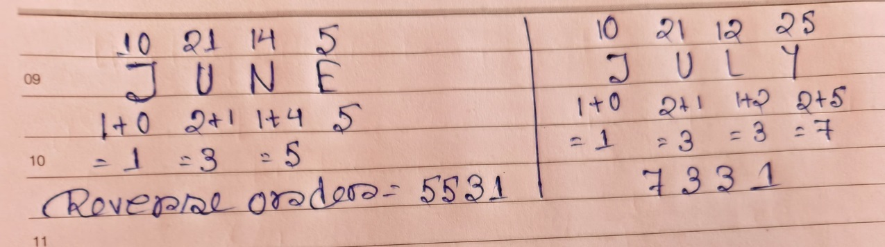

---

### Question 18 `[+0 / -0]`

If
 in a code language "EXAMINATION" is written as "125"
 then how will “HARDWORK” be written in that language?

**Options:**
- **(A)** 68
- **(B)** 86
- **(C)** 89
- **(D)** ✅ 98

**Correct Answer:** `D`

**Detailed Solution / Explanation:**
The
 logic followed here is: 

 Logic:
 Sum of the positional value of letter. 

 For, 

 "EXAMINATION"
 is written as "125" 5+24+1+13+9+14+1+20+9+15+14 = 125 

 Similarly,
 HARDWORK = 8+1+18+4+23+15+18+11 = 98.

---

### Question 19 `[+0 / -0]`

In
 a certain code language, 'LEMON' is written as 'ELMNO'. How will
 'CLUSTER' be written in that language?

**Options:**
- **(A)** CLESRUT
- **(B)** ✅ CELRSTU
- **(C)** LUCETRS
- **(D)** LCUTESR

**Correct Answer:** `B`

**Detailed Solution / Explanation:**
Ascending order.

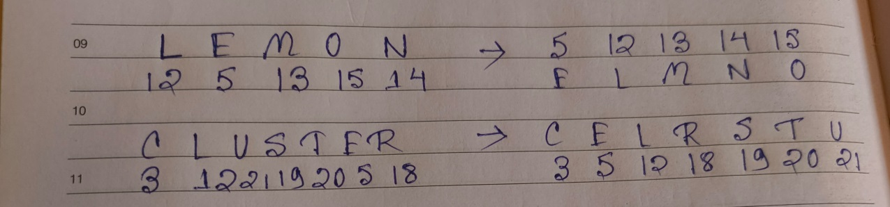

---

### Question 20 `[+0 / -0]`

If
 ‘BEAN’ is coded as ‘ABNE’, ‘SALE’
 is coded as ‘LSEA’, what is the code for ‘NEWS’?

**Options:**
- **(A)** ✅ WNSE
- **(B)** SWNE
- **(C)** WSNE
- **(D)** WNES

**Correct Answer:** `A`

**Detailed Solution / Explanation:**
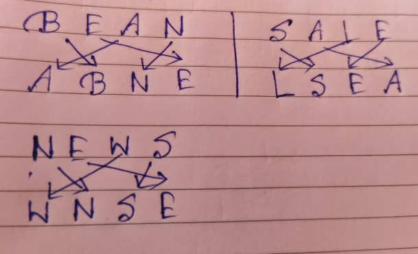

---
