# 📝 DIRECTION SENSE

> **Platform:** OnlineStudy4U (Classplus Course 58216)
> **Total Questions:** 20 | **Embedded Figures:** 20

---

## 📂 Direction Sense

### Question 1 `[+0 / -0]`

A
 located to the West of B. C is located at North in between A and
 B. D is exactly to the South of B and also in line with B. In
 which direction of C is D located?

**Options:**
- **(A)** North and South
- **(B)** ✅ South and East
- **(C)** North and West
- **(D)** South and West

**Correct Answer:** `B`

**Detailed Solution / Explanation:**
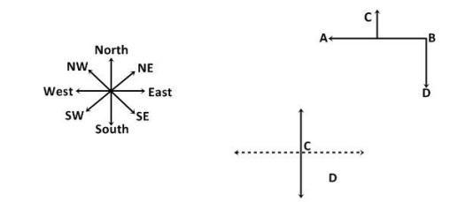

---

### Question 2 `[+0 / -0]`

Point
 B is 7 km to the west of Point A. Point C is 12 km to the south of
 Point E. Point A is 5km to the east of Point C. Point D is 8 km to
 the north of Point C. Point G is 6 km to the west of Point D.
 Point H is 14 km to the south of Point G. If Siya is standing 6 km
 to the east of Point H and takes 1 hour to complete 9km distance
 then in what possible time she would reach Point E, if taken the
 shortest route?

**Options:**
- **(A)** 35
 min
- **(B)** 60
 min
- **(C)** 180
 min
- **(D)** ✅ 120
 min

**Correct Answer:** `D`

**Detailed Solution / Explanation:**
In
 such a case, the minimum distance between Siya and Point E is 18
 km, so SIya will take 2 hours or 120 minutes to reach point E.

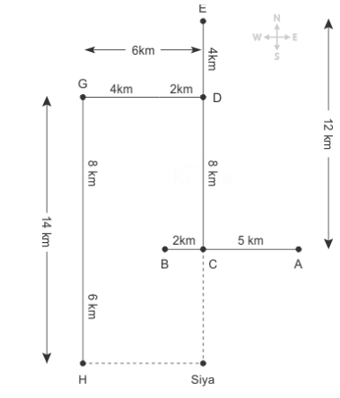

---

### Question 3 `[+0 / -0]`

Virendra’s
 house is 30 m to the left of the Shani Dev Temple, which is 40 m
 to the north of the Church. One day, Virendra takes the road which
 is parallel to the temple-Church road and walks for 50 m before
 turning to his right. He further walks for 20 m and reaches the
 Gym. 

 If
 Virendra reaches the church taking the temple-church road and then
 turns 45 degrees thrice in the clock-wise direction, which
 direction would he be facing?

**Options:**
- **(A)** Towards
 the Gym
- **(B)** ✅ Towards
 to the House
- **(C)** Towards
 the Temple
- **(D)** North-East
 direction

**Correct Answer:** `B`

**Detailed Solution / Explanation:**
From
 the final figure we can deduce the fact that Virendra must be
 facing his house.

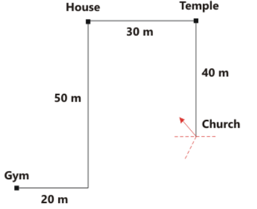

---

### Question 4 `[+0 / -0]`

Read
 the given information carefully and answer the questions given
 beside. 

 P
 + Q states that P is 2 m East Of Q 

 P
 ^ Q states that P is 2 m South Of Q 

 P
 & Q states that P is 4 m East Of Q 

 P
 - Q states that P is 2 m West Of Q 

 P
 / Q states that P is 2 m North Of Q 

 A
 – B ^ C & D + E, F + B 

 F
 is in which direction with respect to E?

**Options:**
- **(A)** North
- **(B)** South
- **(C)** Northwest
- **(D)** ✅ Southeast

**Correct Answer:** `D`

**Detailed Solution / Explanation:**
We
 can see from the figure that F is in South East of E.

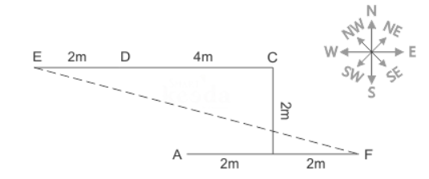

---

### Question 5 `[+0 / -0]`

Some
 chairs were placed in a park as per the manner described here.
 Chair B was 24m to the west of Chair A, which is 12m to the south
 of Chair E. Chair D was 10m to the east of Chair H. Chair C was 7m
 to the north of Chair H. Chair L was 15m to the north of Chair B,
 which is towards the south of Chair D. Chair F was 7m to the north
 of Chair E. Chair D and Chair E were placed in a straight
 horizontal line. 

 Chair
 C is how much far (shortest) and in which direction from Chair F?

**Options:**
- **(A)** 30m,
 North-West
- **(B)** 27m,
 East
- **(C)** ✅ 34m,
 West
- **(D)** 24m,
 East

**Correct Answer:** `C`

**Detailed Solution / Explanation:**
Chair
 C is 34m to the west of Chair F.

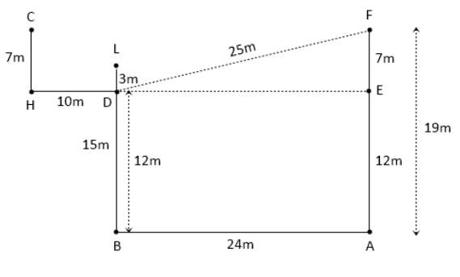

---

### Question 6 `[+0 / -0]`

Car
 X starts from point A and travels in a straight line towards north
 for 8 km and takes a right turn and travels for 12 km then turns
 towards left and travels for 6 km before taking a right turn it
 travels for 10 km and takes a right turn and travels for 15 km and
 reaches a point B which is 8 km towards west of the point C where
 car Y stands. What is the position of Car Y with respect to
 initial position of car X?

**Options:**
- **(A)** East
- **(B)** Southwest
- **(C)** ✅ Southeast
- **(D)** South

**Correct Answer:** `C`

**Detailed Solution / Explanation:**
Following
 the final solution, we can say that Car Y is southeast direction
 with respect to initial position of car X.

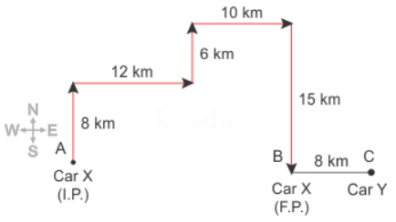

---

### Question 7 `[+0 / -0]`

Rudra
 started walking from his home in east direction and after walking
 for 80 m he took a turn of 135° towards his left and walked 22
 m after that took a turn of 90° towards his right and walked
 30 m and stopped. In which direction Ram is facing now?

**Options:**
- **(A)** North
- **(B)** ✅ Northeast
- **(C)** Southwest
- **(D)** East

**Correct Answer:** `B`

**Detailed Solution / Explanation:**
Here
 we can say that ram is facing in Northeast direction.

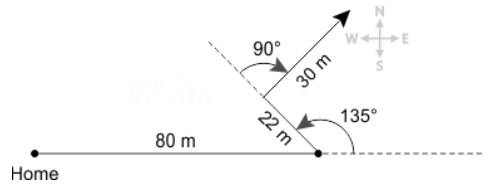

---

### Question 8 `[+0 / -0]`

Bonny
 moves 30 meters towards south then turns to his right and starts
 moving straight till he completes another 30 meters. Then turning
 to his left he moves for 20 meters. He again then turns to his
 left and moves for 30 meters. How far is he from his initial
 position?

**Options:**
- **(A)** 30
 m
- **(B)** ✅ 50
 m
- **(C)** 60
 m
- **(D)** 10
 m

**Correct Answer:** `B`

**Detailed Solution / Explanation:**
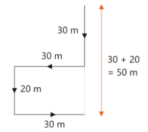

---

### Question 9 `[+0 / -0]`

Point
 L is 2m towards north of point C. Point N is 7m towards east of
 point L. Point O is 8m towards south of point N. Point T is 12m
 towards west of point O. What is the direction of point C with
 respect to point T?

**Options:**
- **(A)** ✅ Northeast
- **(B)** Southwest
- **(C)** North
- **(D)** Southeast

**Correct Answer:** `A`

**Detailed Solution / Explanation:**
After
 observing the above figure, we can say that point C is in
 northeast direction with respect to point T.

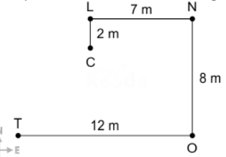

---

### Question 10 `[+0 / -0]`

Box
 B is in the north of Box C, which is in the north-east of Box D.
 Box E is in the east of Box D. Box A is in the west of Box F,
 which is in the northeast of Box B. Box E is in the middle of Box
 F and Box G. Find Box A is in which direction from Box D?

**Options:**
- **(A)** North
- **(B)** Northeast
- **(C)** South
- **(D)** ✅ Can’t
 determine

**Correct Answer:** `D`

**Detailed Solution / Explanation:**
We
 cannot determine whether A is in north or north-east or north-west
 of D.

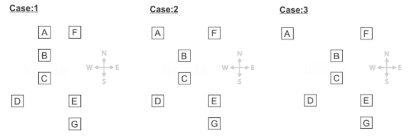

---

### Question 11 `[+0 / -0]`

The
 distance between N and P is 50 m and that between Q and R is 40m.
 Q is to the west of R, which is to the east of N at a distance of
 70m. P is to the west or northwest or north of Q. If Q is to the
 south of P, what is the distance between P and Q?

**Options:**
- **(A)** ✅ 40
 m
- **(B)** 35
 m
- **(C)** 80
 m
- **(D)** 20
 m

**Correct Answer:** `A`

**Detailed Solution / Explanation:**
From
 Formula 

 NP 2 
 = NQ + PQ2 

 ∴
 NP
 = NP 2 
 – NQ 2 

 =
 √ 
 (50)2 – (30)2 

 =
 √ 2500
 – 900 

 =
 √ 1600
 = 40m

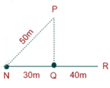

---

### Question 12 `[+0 / -0]`

The
 door of B’s house faces east. From the back side of his
 house, B walks straight 50 m. Again he walks 25m after turning to
 his left, then he turns to his right and walks 50m. Finally he
 turns towards north and walks 25m and stops. 

 Which
 directions does B stand in at the end with respect to his house?

**Options:**
- **(A)** North
- **(B)** South
- **(C)** ✅ West
- **(D)** East

**Correct Answer:** `C`

**Detailed Solution / Explanation:**
We
 can clearly observe from the figure that at the end point B stand
 in the west direction with respect to starting point.

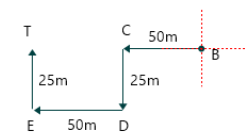

---

### Question 13 `[+0 / -0]`

Some
 chairs were placed in a park as per the manner described here.
 Chair B was 24m to the west of Chair A, which is 12m to the south
 of Chair E. Chair D was 10m to the east of Chair H. Chair C was 7m
 to the north of Chair H. Chair L was 15m to the north of Chair B,
 which is towards the south of Chair D. Chair F was 7m to the north
 of Chair E. Chair D and Chair E were placed in a straight
 horizontal line. 

 Find
 the odd one out?

**Options:**
- **(A)** ✅ F-B
- **(B)** B-D
- **(C)** D-L
- **(D)** H-C

**Correct Answer:** `A`

**Detailed Solution / Explanation:**
F-B
 is the odd one out because the common thing among rest chairs is
 that the second chair is in the North of the first chair.

---

### Question 14 `[+0 / -0]`

Falyaz
 is standing to the north of Hiran. Hiran is standing 15m to the
 west of Mitul. Sahil is 15m to the north of Mitul and forms a
 straight horizontal line with Falyaz. Vihaan is equidistant from
 all of them. Vihaan is in which direction with respect to Mitul?

**Options:**
- **(A)** ✅ North-West
- **(B)** North-East
- **(C)** South-West
- **(D)** South-East

**Correct Answer:** `A`

**Detailed Solution / Explanation:**
Hiran
 is standing 15m to the west of Mitul. 

 Sahil
 is 15m to the north of Mitul and forms a straight horizontal line
 with Falyaz. 

 Falyaz
 is standing to the north of Hiran. 

 Vihaan
 is equidistant from all of them. 

 Note:
 As per statement, Vihaan is exactly in the mid-point of all 4 of
 them. To make exact midpoint, then the distance between Falyaz and
 Hiran should be 15m and also the distance between Falyaz and Sahil
 is 15m as shown in diagram. 

 Vihaan
 is in North-West direction with respect to Mitul.

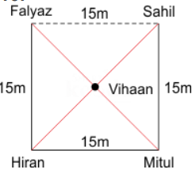

---

### Question 15 `[+0 / -0]`

Kundan
 travels 15 km towards south and then takes a left turn and travels
 10 km further again he takes a left turn and travels 15 km
 further. How far is he from his original position?

**Options:**
- **(A)** 40km
- **(B)** 25km
- **(C)** ✅ 10km
- **(D)** 15km

**Correct Answer:** `C`

**Detailed Solution / Explanation:**
∵
 AD
 = BC = 10 Km 

 Therefore
 he is 10 km away from the original position.

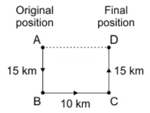

---

### Question 16 `[+0 / -0]`

Shahrukh
 starts driving from point A and drives 12 km towards north. He
 takes a right turn and drive 20 km. He now drives 8 km after
 taking a left turn. Finally he takes a left turn; and drives 20 km
 and stops at point B. How far is point A with respect to point B?

**Options:**
- **(A)** 18
 km
- **(B)** ✅ 20
 km
- **(C)** 35
 km
- **(D)** 25
 km

**Correct Answer:** `B`

**Detailed Solution / Explanation:**
AB
 = AP + PB = 12 + 8 = 20 km

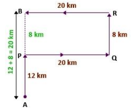

---

### Question 17 `[+0 / -0]`

Abhay
 walks 20 m south from Point A to reach Point B. Then he turns to
 his right and walks 14 m to reach Point C. Again, he turns to his
 right and walks 20 m to reach Point D. Finally he turns to his
 left and walks 14 m to reach Point E. What is the distance between
 A and E and in which direction is Point E from Point A.

**Options:**
- **(A)** 20
 m, South
- **(B)** 26
 m, North
- **(C)** ✅ 28
 m, West
- **(D)** 34
 m, East

**Correct Answer:** `C`

**Detailed Solution / Explanation:**
The
 distance between Point A and Point E = 14 + 14 = 28 m 

 Following
 the image we can say that Point E is in west direction with
 respect to A

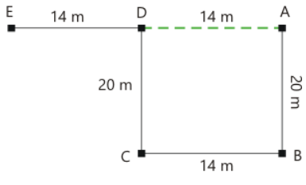

---

### Question 18 `[+0 / -0]`

Point
 B is 25 m south of point A. Point C is 30 m east of point B. Point
 D is 15 m north of point C. Point E is 10 m west of point D. 

 If
 point X is 30 m east of Point A, then Point D is how far and in
 which direction from point X?

**Options:**
- **(A)** 10
 m, North
- **(B)** 5
 m, North
- **(C)** 15
 m, South
- **(D)** ✅ 10
 m, South

**Correct Answer:** `D`

**Detailed Solution / Explanation:**
Following
 the common explanation we can say point D is 10 m away and towards
 south of point X.

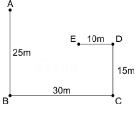

---

### Question 19 `[+0 / -0]`

Lihaan
 walks 8m towards south from his office to reach park. Then take
 left and walks 15m to reach traffic signal. Then he turns 90
 degree anti-clock wise direction and walks 8m to reach coffee
 shop. From the coffee shop he takes left and walks 8m to reach
 home. What is the shortest distance between Lihaan's office and
 Traffic signal?

**Options:**
- **(A)** 30
 m
- **(B)** 25
 m
- **(C)** ✅ 17
 m
- **(D)** 15
 m

**Correct Answer:** `C`

**Detailed Solution / Explanation:**
Shortest
 distance between Lihaan's office and Traffic signal = 

 √ 8 2 
 + 15 2 
 = √64+225 = √289 =17m

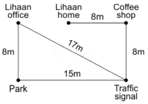

---

### Question 20 `[+0 / -0]`

Point
 A is 10m to the south of Point B, which is 8m to the west of Point
 C. Point D is 14m to the north of Point C. Point E is 4m to the
 east of Point F, which is 5m to the south of Point D. Point E is
 8m to the west of Point G. Point H is 19m to the south of Point G.
 Point H is 12m to the east of Point I. Find the shortest distance
 between Points D and G?

**Options:**
- **(A)** ✅ 10
 m
- **(B)** 13
 m
- **(C)** 12
 m
- **(D)** 20
 m

**Correct Answer:** `A`

**Detailed Solution / Explanation:**
The
 shortest distance between D and G is 13m.

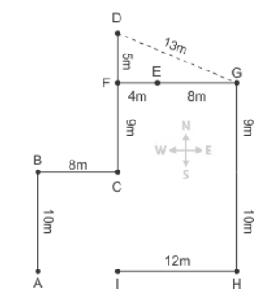

---
