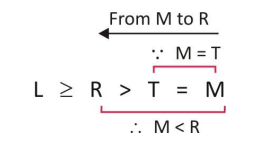
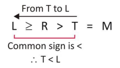
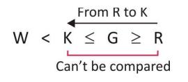
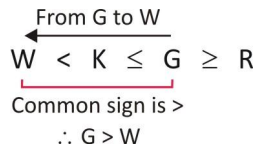

# 📝 INEQUALITIES

> **Platform:** OnlineStudy4U (Classplus Course 58216)
> **Total Questions:** 20 | **Embedded Figures:** 4

---

## 📂 Inequalities

### Question 1 `[+0 / -0]`

Statements: 

 D
 > C, A > B > C, D > E > F, 

 Conclusions: 

 I.
 E > C 

 II.
 F > B

**Options:**
- **(A)** Only
 conclusion I is valid.
- **(B)** Only
 conclusion II is valid.
- **(C)** Either
 conclusion I or II is valid.
- **(D)** ✅ Neither
 conclusion I nor II is valid.
- **(E)** Both
 the conclusion I and II are valid.

**Correct Answer:** `D`

**Detailed Solution / Explanation:**
A
 > B > C < D > E > F 

 I.
 Not follow 

 II.
 Not follow

---

### Question 2 `[+0 / -0]`

Statements:
 L≤W≤M = J, W = K 

 Conclusions: 

 I.
 M>K 

 II.
 L = K

**Options:**
- **(A)** Only
 conclusion I is valid.
- **(B)** Only
 conclusion II is valid.
- **(C)** Either
 conclusion I or II is valid.
- **(D)** ✅ Neither
 conclusion I nor II is valid.
- **(E)** Both
 the conclusion I and II are valid.

**Correct Answer:** `D`

**Detailed Solution / Explanation:**
Conclusion
 I: M>K (False) → Given W=K and W≤M, we get K≤M, but
 M could be equal to K, not necessarily greater. 

 Conclusion
 II: L=K (False) → Given L≤W and W=K, we get L≤K, but L
 could be less than K, not necessarily equal.

---

### Question 3 `[+0 / -0]`

What
 should be placed in place of question mark in equation B ≤ A ?N
 ?K ?S to make A > K definitely true.

**Options:**
- **(A)** ✅ =,
 >, ≥
- **(B)** =,
 ≥,>
- **(C)** <,
 <,<
- **(D)** <,
 <,=
- **(E)** None

**Correct Answer:** `A`

**Detailed Solution / Explanation:**
B≤A=N>K≥S 

 Since
 A=N and N>K, we get A>K, which is definitely true. 

 Thus,
 option (a) is correct.

---

### Question 4 `[+0 / -0]`

Statement:
 3 ≥ 9 < 7 ≤ 10 = 2 ≤ 6 

 Conclusions:

 I.
 6 > 9 

 II.
 9 ≤ 2

**Options:**
- **(A)** ✅ Only
 conclusion I is valid.
- **(B)** Only
 conclusion II is valid.
- **(C)** Either
 conclusion I or II is valid.
- **(D)** Neither
 conclusion I nor II is valid.
- **(E)** Both
 the conclusion I and II are valid.

**Correct Answer:** `A`

**Detailed Solution / Explanation:**
Checking
 conclusion I: 6 > 9 

 From
 the given statement, we get: 

 While
 moving from 6 towards 9, the common sign of inequalities is '>'
 and the given conclusions is also '6 > 9'. Clearly, C1 follows. 

 Checking
 conclusion II: 9 ≤ 2 

 In
 the statement 9 < 7 ≤ 10 = 2, the common sign of
 inequalities between 9 and 2 is '<' whereas the given
 conclusion is '9 ≤ 2'. Therefore, C2 doesn't follow.

---

### Question 5 `[+0 / -0]`

A
 @ B means 'A is not less than B' 

 A
 $ B means 'A is not more than B' 

 A
 # B means 'A is neither less nor more than B' 

 A
 * B means 'A is neither more than nor equal to B' 

 A
 % B means 'A is neither less than nor equal to B' 

 Statements
 : R#M$X*T%W@B 

 Conclusions
 : 

 I.M*W

 II.
 T@M

**Options:**
- **(A)** Only
 conclusion I is valid.
- **(B)** Only
 conclusion II is valid.
- **(C)** Either
 conclusion I or II is valid.
- **(D)** ✅ Neither
 conclusion I nor II is valid.
- **(E)** Both
 the conclusion I and II are valid.

**Correct Answer:** `D`

**Detailed Solution / Explanation:**
For
 conclusion I: 

 We
 can clearly see the opposite sign persisting between M and W ,
 thus no relationship between them can be established. 

 Hence
 conclusion I does not follow. 

 For
 conclusion II: 

 The
 common sign between M and T is '<', thus M < T or T > M
 is the actual relationship. 

 Hence
 conclusion II does not follow

---

### Question 6 `[+0 / -0]`

Statements: 

 M>N,
 N≥O, O>P 

 Conclusions: 

 I.
 M>O 

 II.
 N>P

**Options:**
- **(A)** Only
 conclusion I is valid.
- **(B)** Only
 conclusion II is valid.
- **(C)** Either
 conclusion I or II is valid.
- **(D)** Neither
 conclusion I or II is valid.
- **(E)** ✅ Both
 the conclusion I and II are valid.

**Correct Answer:** `E`

**Detailed Solution / Explanation:**
Since
 M>N and N≥O, we can conclude M>O, so Conclusion I is
 true. 

 Also,
 since N≥O and O>P, we get N>P, so Conclusion II is true.

---

### Question 7 `[+0 / -0]`

Statements: 

 Y
 ≥ W = N; N ≥ M 

 Conclusions: 

 I.
 Y > M 

 II.
 Y = M

**Options:**
- **(A)** Only
 conclusion I is valid.
- **(B)** Only
 conclusion II is valid.
- **(C)** ✅ Either
 conclusion I nor II is valid.
- **(D)** Neither
 conclusion I or II is valid.
- **(E)** Both
 the conclusion I and II are valid.

**Correct Answer:** `C`

**Detailed Solution / Explanation:**
Y
 ≥ W = N; N ≥ M 

 I.
 Y > M 

 II.
 Y = M 

 So
 either conclusion I or II is follow

---

### Question 8 `[+0 / -0]`

Some
 friends were discussing about their savings. 

 M
 says that his savings are not more than that of W. 

 W
 says that his savings are neither less than nor equal to S. 

 S
 says that his savings are not less than O, who is not the least
 saver. 

 T
 says that his savings are less than M but not less than P. 

 P
 says that his savings are less than M. 

 Who
 among the following is the highest saver?

**Options:**
- **(A)** ✅ W
- **(B)** S
- **(C)** O
- **(D)** P
- **(E)** None

**Correct Answer:** `A`

**Detailed Solution / Explanation:**
The
 following equation can be drawn from the given hints. 

 P
 ≤ T < M ≤ W > S ≥ O

---

### Question 9 `[+0 / -0]`

Some
 friends were discussing about their savings. 

 M
 says that his savings are not more than that of W. 

 W
 says that his savings are neither less than nor equal to S. 

 S
 says that his savings are not less than O, who is not the least
 saver. 

 T
 says that his savings are less than M but not less than P. 

 P
 says that his savings are less than M. 

 P's
 savings are less than how many people?

**Options:**
- **(A)** 1
- **(B)** 2
- **(C)** 3
- **(D)** 4
- **(E)** ✅ More
 than 4

**Correct Answer:** `E`

**Detailed Solution / Explanation:**
The
 following equation can be drawn from the given hints. 

 P
 ≤ T < M ≤ W > S ≥ O

---

### Question 10 `[+0 / -0]`

Statement:
 M ≥ P < H, V > T = M 

 Conclusions:

 I.
 V > P 

 II.
 T ≥ H

**Options:**
- **(A)** ✅ Only
 conclusion I is valid.
- **(B)** Only
 conclusion II is valid.
- **(C)** Either
 conclusion I or II is valid.
- **(D)** Neither
 conclusion I nor II is valid.
- **(E)** Both
 the conclusion I and II are valid.

**Correct Answer:** `A`

**Detailed Solution / Explanation:**
M
 ≥ P < H ...... (i) 

 V
 > T = M ...... (ii) 

 Combining
 all statements, we get 

 V
 > T = M ≥ P < H 

 Thus,
 V > P is true. 

 Again,
 T ≥ H is not true.

---

### Question 11 `[+0 / -0]`

Statements:
 F ≤ L > T, N = O ≥ P, F > Q > S 

 Conclusions:

 I.
 L > T 

 II.
 F > S

**Options:**
- **(A)** Only
 conclusion I is valid.
- **(B)** Only
 conclusion II is valid.
- **(C)** Either
 conclusion I or II is valid.
- **(D)** Neither
 conclusion I nor II is valid.
- **(E)** ✅ Both
 the conclusion I and II are valid.

**Correct Answer:** `E`

**Detailed Solution / Explanation:**
Conclusion
 I: L>T (True) → Given L>T, this is directly true. 

 Conclusion
 II: F>S (True) → Given F>Q>S, we get F>S.

---

### Question 12 `[+0 / -0]`

Statements: 

 A>B,
 B≥C, C>D, D<E 

 Conclusions: 

 I.
 A>D 

 II.
 C>E

**Options:**
- **(A)** ✅ Only
 conclusion I is valid.
- **(B)** Only
 conclusion II is valid.
- **(C)** Either
 conclusion I or II is valid.
- **(D)** Neither
 conclusion I nor II is valid.
- **(E)** Both
 the conclusion I and II are valid.

**Correct Answer:** `A`

**Detailed Solution / Explanation:**
From
 A>B and B≥C, we get A>C. 

 From
 C>D, we get A>D, so Conclusion I is true. 

 However,
 we cannot compare C and E directly, so Conclusion II is false.

---

### Question 13 `[+0 / -0]`

Some
 friends were discussing about their savings. 

 M
 says that his savings are not more than that of W. 

 W
 says that his savings are neither less than nor equal to S. 

 S
 says that his savings are not less than O, who is not the least
 saver. 

 T
 says that his savings are less than M but not less than P. 

 P
 says that his savings are less than M. 

 Which
 of the following statements is correct? 

 I.
 O's savings are not more than W. 

 II.
 M's savings are not more than W. 

 III.
 P's savings are not more than W.

**Options:**
- **(A)** Only
 conclusion I is valid.
- **(B)** ✅ Only
 conclusion II is valid.
- **(C)** Only
 conclusion III is valid.
- **(D)** Neither
 conclusion I nor II is valid.
- **(E)** All
 conclusions are valid.

**Correct Answer:** `B`

**Detailed Solution / Explanation:**
The
 following equation can be drawn from the given hints. 

 P
 ≤ T < M ≤ W > S ≥ O

---

### Question 14 `[+0 / -0]`

‘ A
 © B’ means ‘A is either smaller than or equal to
 B.’ 

 ‘ A
 % B’ means ‘A is neither smaller than nor equal to B.’ 

 ‘ A
 @ B’ means ‘A is either greater than or equal to B.’ 

 ‘ A
 $ B’ means ‘A is neither greater than nor equal to B.’ 

 ‘ A
 # B’ means ‘A is neither greater than nor smaller than
 B.’ 

 Statements:
 L @ R, R % T, T # M 

 Conclusions:
 I. M $ R II. T $ L

**Options:**
- **(A)** Only
 conclusion I is valid.
- **(B)** Only
 conclusion II is valid.
- **(C)** Either
 conclusion I or II is valid.
- **(D)** Neither
 conclusion I nor II is valid.
- **(E)** ✅ Both
 the conclusion I and II are valid.

**Correct Answer:** `E`

**Detailed Solution / Explanation:**
Conclusion
 I : 

 Conclusion
 II : 

 Hence,
 both Conclusions I and II are true.

---

### Question 15 `[+0 / -0]`

Statements: M = X < Z ≥ W = N ≤ Q < T ≤ V = U 

 Conclusions: 

 I. V ≥ W 

 II. T ≯ U

**Options:**
- **(A)** Only
 conclusion I is valid.
- **(B)** ✅ Only
 conclusion II is valid.
- **(C)** Either
 conclusion I or II is valid.
- **(D)** Neither
 conclusion I nor II is valid.
- **(E)** Both
 the conclusion I and II are valid.

**Correct Answer:** `B`

**Detailed Solution / Explanation:**
Conclusion I: V ≥ W → True because W≤Q<T≤V, so V≥W. 

 Conclusion II: T ≯ U → True because T≤V and V=U, so  T≤U, meaning T is not greater than U.

---

### Question 16 `[+0 / -0]`

Statement: 

 P
 >S, P < Q, R ≤ Q, R < T 

 Conclusions: 

 I.
 Q > S 

 II.
 Q = T

**Options:**
- **(A)** ✅ Only
 conclusion I is valid.
- **(B)** Only
 conclusion II is valid.
- **(C)** Either
 conclusion I or II is valid.
- **(D)** Neither
 conclusion I nor II is valid.
- **(E)** Both
 the conclusion I and II are valid.

**Correct Answer:** `A`

**Detailed Solution / Explanation:**
Conclusion
 I: Q>S Given P>S and P<Q, we can infer: Q>P>S So,
 Q>S is true 

 Conclusion
 II: Q=T Given R≤Q and R<T, we can infer: Q≥R<T 

 This
 does not guarantee Q=T, so Conclusion II is false

---

### Question 17 `[+0 / -0]`

‘ A
 © B’ means ‘A is either smaller than or equal to
 B.’ 

 ‘ A
 % B’ means ‘A is neither smaller than nor equal to B.’ 

 ‘ A
 @ B’ means ‘A is either greater than or equal to B.’ 

 ‘ A
 $ B’ means ‘A is neither greater than nor equal to B.’ 

 ‘ A
 # B’ means ‘A is neither greater than nor smaller than
 B.’ 

 Statements:
 W $ K, K © G, G @ R 

 Conclusions:

 I.
 R $ K 

 II.
 G % W

**Options:**
- **(A)** Only
 conclusion I is valid.
- **(B)** ✅ Only
 conclusion II is valid.
- **(C)** Either
 conclusion I or II is valid.
- **(D)** Neither
 conclusion I nor II is valid.
- **(E)** Both
 the conclusion I and II are valid.

**Correct Answer:** `B`

**Detailed Solution / Explanation:**
Conclusion
 I: 

 Conclusion
 II: 

 Hence,
 only Conclusion II is true.

---

### Question 18 `[+0 / -0]`

Statement:
 P ≤ Q < S = T ≥ U ≥ W < Z 

 Conclusion:

 I.
 S > W, 

 II.
 W = T

**Options:**
- **(A)** Only
 conclusion I is valid.
- **(B)** Only
 conclusion II is valid.
- **(C)** ✅ Either
 conclusion I or II is valid.
- **(D)** Neither
 conclusion I nor II is valid.
- **(E)** Both
 the conclusion I and II are valid.

**Correct Answer:** `C`

**Detailed Solution / Explanation:**
For
 conclusion I and II: S > W and W = T 

 From
 the given statement, we get: 

 S
 = T ≥ U ≥ W 

 Here,
 the common sign between S and W is ‘≥’ and the
 given conclusions are S > W and W = S. 

 Moreover,
 we are aware that 'S = T' which means we can replace T with S in
 conclusion 2. 

 Hence,
 either conclusion I or conclusion II follows.

---

### Question 19 `[+0 / -0]`

L
 ≤ O > V = E ≥ S 

 Which
 of the following ones is correct? 

 1)
 L ≤ V 2) O = E 3) O > S 4) S ≥ L

**Options:**
- **(A)** Only
 1
- **(B)** Only
 2
- **(C)** ✅ Only
 3
- **(D)** Only
 3 and 4
- **(E)** None

**Correct Answer:** `C`

**Detailed Solution / Explanation:**
L
 ≤ O > V = E ≥ S 

 We
 can compare O and S. which shows that the option 3rd is correct
 because the common symbol between O and S is ‘>’.

---

### Question 20 `[+0 / -0]`

A
 @ B means 'A is not less than B' 

 A
 $ B means 'A is not more than B' 

 A
 # B means 'A is neither less nor more than B' 

 A
 * B means 'A is neither more than nor equal to B' 

 A
 % B means 'A is neither less than nor equal to B' 

 Statements
 : V@I#E*D ; N$E%B#F 

 Conclusions
 : 

 I.
 V%F 

 II.
 V@N

**Options:**
- **(A)** Only
 conclusion I is valid.
- **(B)** Only
 conclusion II is valid.
- **(C)** Either
 conclusion I or II is valid.
- **(D)** Neither
 conclusion I nor II is valid.
- **(E)** ✅ Both
 the conclusion I and II are valid.

**Correct Answer:** `E`

**Detailed Solution / Explanation:**
Conclusions:
 I. V > F II. V ≥ N 

 For
 conclusion I: 

 From
 both the statements we get: 

 V
 ≥ I = E > B = F 

 The
 common sign between V and F is '>', thus V > F is true. 

 Hence
 conclusion I follows. 

 For
 conclusion II: 

 From
 both the statements we get: 

 V
 ≥ I = E ≥ N 

 The
 common sign between V and N is '≥', thus V ≥ N is the actual
 relationship. 

 Hence
 conclusion II follows.

---
