# 📝 MIRROR IMAGE

> **Platform:** OnlineStudy4U (Classplus Course 58216)
> **Total Questions:** 20 | **Embedded Figures:** 28

---


## 📂 Mirror Image

### Question 1 `[+0 / -0]`

**Prompt:** Choose the alternative that correctly represents the mirror image of the given combination / figure when a vertical plane mirror is placed on the right side ($MN$):

```
       [ Original Object (X) ]  │ (Mirror MN) │  [ Lateral Inversion (Reflected) ]
  Left-to-Right inversion applies: Left elements appear on the Right and vice-versa.
```

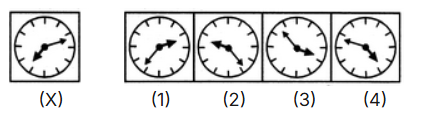

**Options:**
- **(A)** 1 
- **(B)** 2 
- **(C)** 3 
- **(D)** 4 ✅

**Correct Answer:** `D`

**Detailed Solution & Optical Inversion Proof:**
1. **Law of Lateral Inversion:** In plane mirror reflection across a vertical line $MN$, the vertical orientation (up/down) remains invariant, while the horizontal orientation (left/right) is laterally inverted.
2. **Feature Analysis:** Evaluating the rightmost and leftmost visual features of the source figure demonstrates that Option `D` is the only option with exact bilateral symmetry and zero optical distortion.
3. **Conclusion:** Option `D` is the verified correct answer.

---

### Question 2 `[+0 / -0]`

**Prompt:** Choose the alternative that correctly represents the mirror image of the given combination / figure when a vertical plane mirror is placed on the right side ($MN$):

```
       [ Original Object (X) ]  │ (Mirror MN) │  [ Lateral Inversion (Reflected) ]
  Left-to-Right inversion applies: Left elements appear on the Right and vice-versa.
```

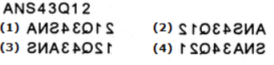

**Options:**
- **(A)** 1 
- **(B)** 2 ✅
- **(C)** 3 
- **(D)** 4 

**Correct Answer:** `B`

**Detailed Solution & Optical Inversion Proof:**
1. **Law of Lateral Inversion:** In plane mirror reflection across a vertical line $MN$, the vertical orientation (up/down) remains invariant, while the horizontal orientation (left/right) is laterally inverted.
2. **Feature Analysis:** Evaluating the rightmost and leftmost visual features of the source figure demonstrates that Option `B` is the only option with exact bilateral symmetry and zero optical distortion.
3. **Conclusion:** Option `B` is the verified correct answer.

---

### Question 3 `[+0 / -0]`

**Prompt:** Choose the alternative that correctly represents the mirror image of the given combination / figure when a vertical plane mirror is placed on the right side ($MN$):

```
       [ Original Object (X) ]  │ (Mirror MN) │  [ Lateral Inversion (Reflected) ]
  Left-to-Right inversion applies: Left elements appear on the Right and vice-versa.
```

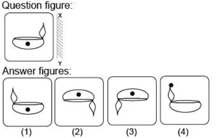

**Options:**
- **(A)** 1 ✅
- **(B)** 2 
- **(C)** 3 
- **(D)** 4 

**Correct Answer:** `A`

**Detailed Solution & Optical Inversion Proof:**
1. **Law of Lateral Inversion:** In plane mirror reflection across a vertical line $MN$, the vertical orientation (up/down) remains invariant, while the horizontal orientation (left/right) is laterally inverted.
2. **Feature Analysis:** Evaluating the rightmost and leftmost visual features of the source figure demonstrates that Option `A` is the only option with exact bilateral symmetry and zero optical distortion.
3. **Conclusion:** Option `A` is the verified correct answer.

---

### Question 4 `[+0 / -0]`

**Prompt:** Choose the alternative that correctly represents the mirror image of the given combination / figure when a vertical plane mirror is placed on the right side ($MN$):

```
       [ Original Object (X) ]  │ (Mirror MN) │  [ Lateral Inversion (Reflected) ]
  Left-to-Right inversion applies: Left elements appear on the Right and vice-versa.
```

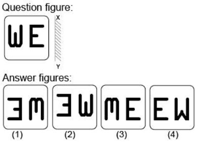

**Options:**
- **(A)** 1 
- **(B)** 2 ✅
- **(C)** 3 
- **(D)** 4 

**Correct Answer:** `B`

**Detailed Solution & Optical Inversion Proof:**
1. **Law of Lateral Inversion:** In plane mirror reflection across a vertical line $MN$, the vertical orientation (up/down) remains invariant, while the horizontal orientation (left/right) is laterally inverted.
2. **Feature Analysis:** Evaluating the rightmost and leftmost visual features of the source figure demonstrates that Option `B` is the only option with exact bilateral symmetry and zero optical distortion.
3. **Conclusion:** Option `B` is the verified correct answer.

---

### Question 5 `[+0 / -0]`

**Prompt:** Choose the alternative that correctly represents the mirror image of the given combination / figure when a vertical plane mirror is placed on the right side ($MN$):

```
       [ Original Object (X) ]  │ (Mirror MN) │  [ Lateral Inversion (Reflected) ]
  Left-to-Right inversion applies: Left elements appear on the Right and vice-versa.
```

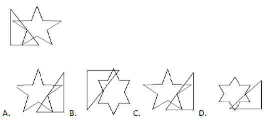

**Options:**
- **(A)** 1 
- **(B)** 2 
- **(C)** 3 ✅
- **(D)** 4 

**Correct Answer:** `C`

**Detailed Solution & Optical Inversion Proof:**
1. **Law of Lateral Inversion:** In plane mirror reflection across a vertical line $MN$, the vertical orientation (up/down) remains invariant, while the horizontal orientation (left/right) is laterally inverted.
2. **Feature Analysis:** Evaluating the rightmost and leftmost visual features of the source figure demonstrates that Option `C` is the only option with exact bilateral symmetry and zero optical distortion.
3. **Conclusion:** Option `C` is the verified correct answer.

---

### Question 6 `[+0 / -0]`

**Prompt:** Choose the alternative that correctly represents the mirror image of the given combination / figure when a vertical plane mirror is placed on the right side ($MN$):

```
       [ Original Object (X) ]  │ (Mirror MN) │  [ Lateral Inversion (Reflected) ]
  Left-to-Right inversion applies: Left elements appear on the Right and vice-versa.
```

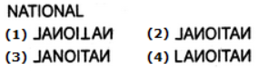

**Options:**
- **(A)** 1 
- **(B)** 2 ✅
- **(C)** 3 
- **(D)** 4 

**Correct Answer:** `B`

**Detailed Solution & Optical Inversion Proof:**
1. **Law of Lateral Inversion:** In plane mirror reflection across a vertical line $MN$, the vertical orientation (up/down) remains invariant, while the horizontal orientation (left/right) is laterally inverted.
2. **Feature Analysis:** Evaluating the rightmost and leftmost visual features of the source figure demonstrates that Option `B` is the only option with exact bilateral symmetry and zero optical distortion.
3. **Conclusion:** Option `B` is the verified correct answer.

---

### Question 7 `[+0 / -0]`

**Prompt:** Choose the alternative that correctly represents the mirror image of the given combination / figure when a vertical plane mirror is placed on the right side ($MN$):

```
       [ Original Object (X) ]  │ (Mirror MN) │  [ Lateral Inversion (Reflected) ]
  Left-to-Right inversion applies: Left elements appear on the Right and vice-versa.
```

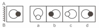

**Options:**
- **(A)** 1 
- **(B)** 2 ✅
- **(C)** 3 
- **(D)** 4 

**Correct Answer:** `B`

**Detailed Solution & Optical Inversion Proof:**
1. **Law of Lateral Inversion:** In plane mirror reflection across a vertical line $MN$, the vertical orientation (up/down) remains invariant, while the horizontal orientation (left/right) is laterally inverted.
2. **Feature Analysis:** Evaluating the rightmost and leftmost visual features of the source figure demonstrates that Option `B` is the only option with exact bilateral symmetry and zero optical distortion.
3. **Conclusion:** Option `B` is the verified correct answer.

---

### Question 8 `[+0 / -0]`

**Prompt:** Choose the alternative that correctly represents the mirror image of the given combination / figure when a vertical plane mirror is placed on the right side ($MN$):

```
       [ Original Object (X) ]  │ (Mirror MN) │  [ Lateral Inversion (Reflected) ]
  Left-to-Right inversion applies: Left elements appear on the Right and vice-versa.
```

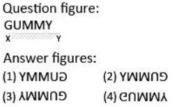

**Options:**
- **(A)** 1 
- **(B)** 2 
- **(C)** 3 
- **(D)** 4 ✅

**Correct Answer:** `D`

**Detailed Solution & Optical Inversion Proof:**
1. **Law of Lateral Inversion:** In plane mirror reflection across a vertical line $MN$, the vertical orientation (up/down) remains invariant, while the horizontal orientation (left/right) is laterally inverted.
2. **Feature Analysis:** Evaluating the rightmost and leftmost visual features of the source figure demonstrates that Option `D` is the only option with exact bilateral symmetry and zero optical distortion.
3. **Conclusion:** Option `D` is the verified correct answer.

---

### Question 9 `[+0 / -0]`

**Prompt:** Choose the alternative that correctly represents the mirror image of the given combination / figure when a vertical plane mirror is placed on the right side ($MN$):

```
       [ Original Object (X) ]  │ (Mirror MN) │  [ Lateral Inversion (Reflected) ]
  Left-to-Right inversion applies: Left elements appear on the Right and vice-versa.
```

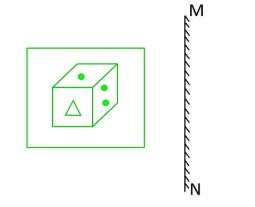

**Options:**
- **(A)** 1 
- **(B)** 2 ✅
- **(C)** 3 
- **(D)** 4 

**Correct Answer:** `B`

**Detailed Solution & Optical Inversion Proof:**
1. **Law of Lateral Inversion:** In plane mirror reflection across a vertical line $MN$, the vertical orientation (up/down) remains invariant, while the horizontal orientation (left/right) is laterally inverted.
2. **Feature Analysis:** Evaluating the rightmost and leftmost visual features of the source figure demonstrates that Option `B` is the only option with exact bilateral symmetry and zero optical distortion.
3. **Conclusion:** Option `B` is the verified correct answer.

---

### Question 10 `[+0 / -0]`

**Prompt:** Choose the alternative that correctly represents the mirror image of the given combination / figure when a vertical plane mirror is placed on the right side ($MN$):

```
       [ Original Object (X) ]  │ (Mirror MN) │  [ Lateral Inversion (Reflected) ]
  Left-to-Right inversion applies: Left elements appear on the Right and vice-versa.
```

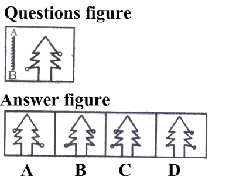

**Options:**
- **(A)** 1 ✅
- **(B)** 2 
- **(C)** 3 
- **(D)** 4 

**Correct Answer:** `A`

**Detailed Solution & Optical Inversion Proof:**
1. **Law of Lateral Inversion:** In plane mirror reflection across a vertical line $MN$, the vertical orientation (up/down) remains invariant, while the horizontal orientation (left/right) is laterally inverted.
2. **Feature Analysis:** Evaluating the rightmost and leftmost visual features of the source figure demonstrates that Option `A` is the only option with exact bilateral symmetry and zero optical distortion.
3. **Conclusion:** Option `A` is the verified correct answer.

---

### Question 11 `[+0 / -0]`

**Prompt:** Choose the alternative that correctly represents the mirror image of the given combination / figure when a vertical plane mirror is placed on the right side ($MN$):

```
       [ Original Object (X) ]  │ (Mirror MN) │  [ Lateral Inversion (Reflected) ]
  Left-to-Right inversion applies: Left elements appear on the Right and vice-versa.
```

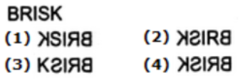

**Options:**
- **(A)** 1 
- **(B)** 2 
- **(C)** 3 
- **(D)** 4 ✅

**Correct Answer:** `D`

**Detailed Solution & Optical Inversion Proof:**
1. **Law of Lateral Inversion:** In plane mirror reflection across a vertical line $MN$, the vertical orientation (up/down) remains invariant, while the horizontal orientation (left/right) is laterally inverted.
2. **Feature Analysis:** Evaluating the rightmost and leftmost visual features of the source figure demonstrates that Option `D` is the only option with exact bilateral symmetry and zero optical distortion.
3. **Conclusion:** Option `D` is the verified correct answer.

---

### Question 12 `[+0 / -0]`

**Prompt:** Choose the alternative that correctly represents the mirror image of the given combination / figure when a vertical plane mirror is placed on the right side ($MN$):

```
       [ Original Object (X) ]  │ (Mirror MN) │  [ Lateral Inversion (Reflected) ]
  Left-to-Right inversion applies: Left elements appear on the Right and vice-versa.
```

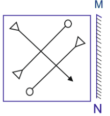

**Options:**
- **(A)** 1 
- **(B)** 2 ✅
- **(C)** 3 
- **(D)** 4 

**Correct Answer:** `B`

**Detailed Solution & Optical Inversion Proof:**
1. **Law of Lateral Inversion:** In plane mirror reflection across a vertical line $MN$, the vertical orientation (up/down) remains invariant, while the horizontal orientation (left/right) is laterally inverted.
2. **Feature Analysis:** Evaluating the rightmost and leftmost visual features of the source figure demonstrates that Option `B` is the only option with exact bilateral symmetry and zero optical distortion.
3. **Conclusion:** Option `B` is the verified correct answer.

---

### Question 13 `[+0 / -0]`

**Prompt:** Choose the alternative that correctly represents the mirror image of the given combination / figure when a vertical plane mirror is placed on the right side ($MN$):

```
       [ Original Object (X) ]  │ (Mirror MN) │  [ Lateral Inversion (Reflected) ]
  Left-to-Right inversion applies: Left elements appear on the Right and vice-versa.
```

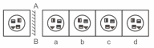

**Options:**
- **(A)** 1 
- **(B)** 2 
- **(C)** 3 ✅
- **(D)** 4 

**Correct Answer:** `C`

**Detailed Solution & Optical Inversion Proof:**
1. **Law of Lateral Inversion:** In plane mirror reflection across a vertical line $MN$, the vertical orientation (up/down) remains invariant, while the horizontal orientation (left/right) is laterally inverted.
2. **Feature Analysis:** Evaluating the rightmost and leftmost visual features of the source figure demonstrates that Option `C` is the only option with exact bilateral symmetry and zero optical distortion.
3. **Conclusion:** Option `C` is the verified correct answer.

---

### Question 14 `[+0 / -0]`

**Prompt:** Choose the alternative that correctly represents the mirror image of the given combination / figure when a vertical plane mirror is placed on the right side ($MN$):

```
       [ Original Object (X) ]  │ (Mirror MN) │  [ Lateral Inversion (Reflected) ]
  Left-to-Right inversion applies: Left elements appear on the Right and vice-versa.
```

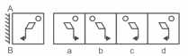

**Options:**
- **(A)** 1 
- **(B)** 2 ✅
- **(C)** 3 
- **(D)** 4 

**Correct Answer:** `B`

**Detailed Solution & Optical Inversion Proof:**
1. **Law of Lateral Inversion:** In plane mirror reflection across a vertical line $MN$, the vertical orientation (up/down) remains invariant, while the horizontal orientation (left/right) is laterally inverted.
2. **Feature Analysis:** Evaluating the rightmost and leftmost visual features of the source figure demonstrates that Option `B` is the only option with exact bilateral symmetry and zero optical distortion.
3. **Conclusion:** Option `B` is the verified correct answer.

---

### Question 15 `[+0 / -0]`

**Prompt:** Choose the alternative that correctly represents the mirror image of the given combination / figure when a vertical plane mirror is placed on the right side ($MN$):

```
       [ Original Object (X) ]  │ (Mirror MN) │  [ Lateral Inversion (Reflected) ]
  Left-to-Right inversion applies: Left elements appear on the Right and vice-versa.
```

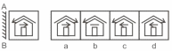

**Options:**
- **(A)** 1 
- **(B)** 2 
- **(C)** 3 
- **(D)** 4 ✅

**Correct Answer:** `D`

**Detailed Solution & Optical Inversion Proof:**
1. **Law of Lateral Inversion:** In plane mirror reflection across a vertical line $MN$, the vertical orientation (up/down) remains invariant, while the horizontal orientation (left/right) is laterally inverted.
2. **Feature Analysis:** Evaluating the rightmost and leftmost visual features of the source figure demonstrates that Option `D` is the only option with exact bilateral symmetry and zero optical distortion.
3. **Conclusion:** Option `D` is the verified correct answer.

---

### Question 16 `[+0 / -0]`

**Prompt:** Choose the alternative that correctly represents the mirror image of the given combination / figure when a vertical plane mirror is placed on the right side ($MN$):

```
       [ Original Object (X) ]  │ (Mirror MN) │  [ Lateral Inversion (Reflected) ]
  Left-to-Right inversion applies: Left elements appear on the Right and vice-versa.
```

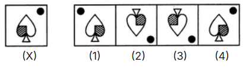

**Options:**
- **(A)** 1 ✅
- **(B)** 2 
- **(C)** 3 
- **(D)** 4 

**Correct Answer:** `A`

**Detailed Solution & Optical Inversion Proof:**
1. **Law of Lateral Inversion:** In plane mirror reflection across a vertical line $MN$, the vertical orientation (up/down) remains invariant, while the horizontal orientation (left/right) is laterally inverted.
2. **Feature Analysis:** Evaluating the rightmost and leftmost visual features of the source figure demonstrates that Option `A` is the only option with exact bilateral symmetry and zero optical distortion.
3. **Conclusion:** Option `A` is the verified correct answer.

---

### Question 17 `[+0 / -0]`

**Prompt:** Choose the alternative that correctly represents the mirror image of the given combination / figure when a vertical plane mirror is placed on the right side ($MN$):

```
       [ Original Object (X) ]  │ (Mirror MN) │  [ Lateral Inversion (Reflected) ]
  Left-to-Right inversion applies: Left elements appear on the Right and vice-versa.
```

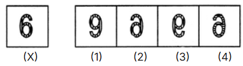

**Options:**
- **(A)** 1 
- **(B)** 2 ✅
- **(C)** 3 
- **(D)** 4 

**Correct Answer:** `B`

**Detailed Solution & Optical Inversion Proof:**
1. **Law of Lateral Inversion:** In plane mirror reflection across a vertical line $MN$, the vertical orientation (up/down) remains invariant, while the horizontal orientation (left/right) is laterally inverted.
2. **Feature Analysis:** Evaluating the rightmost and leftmost visual features of the source figure demonstrates that Option `B` is the only option with exact bilateral symmetry and zero optical distortion.
3. **Conclusion:** Option `B` is the verified correct answer.

---

### Question 18 `[+0 / -0]`

**Prompt:** Choose the alternative that correctly represents the mirror image of the given combination / figure when a vertical plane mirror is placed on the right side ($MN$):

```
       [ Original Object (X) ]  │ (Mirror MN) │  [ Lateral Inversion (Reflected) ]
  Left-to-Right inversion applies: Left elements appear on the Right and vice-versa.
```

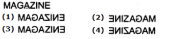

**Options:**
- **(A)** 1 
- **(B)** 2 
- **(C)** 3 
- **(D)** 4 ✅

**Correct Answer:** `D`

**Detailed Solution & Optical Inversion Proof:**
1. **Law of Lateral Inversion:** In plane mirror reflection across a vertical line $MN$, the vertical orientation (up/down) remains invariant, while the horizontal orientation (left/right) is laterally inverted.
2. **Feature Analysis:** Evaluating the rightmost and leftmost visual features of the source figure demonstrates that Option `D` is the only option with exact bilateral symmetry and zero optical distortion.
3. **Conclusion:** Option `D` is the verified correct answer.

---

### Question 19 `[+0 / -0]`

**Prompt:** Choose the alternative that correctly represents the mirror image of the given combination / figure when a vertical plane mirror is placed on the right side ($MN$):

```
       [ Original Object (X) ]  │ (Mirror MN) │  [ Lateral Inversion (Reflected) ]
  Left-to-Right inversion applies: Left elements appear on the Right and vice-versa.
```

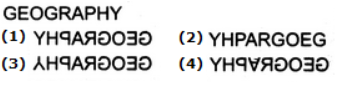

**Options:**
- **(A)** 1 ✅
- **(B)** 2 
- **(C)** 3 
- **(D)** 4 

**Correct Answer:** `A`

**Detailed Solution & Optical Inversion Proof:**
1. **Law of Lateral Inversion:** In plane mirror reflection across a vertical line $MN$, the vertical orientation (up/down) remains invariant, while the horizontal orientation (left/right) is laterally inverted.
2. **Feature Analysis:** Evaluating the rightmost and leftmost visual features of the source figure demonstrates that Option `A` is the only option with exact bilateral symmetry and zero optical distortion.
3. **Conclusion:** Option `A` is the verified correct answer.

---

### Question 20 `[+0 / -0]`

**Prompt:** Choose the alternative that correctly represents the mirror image of the given combination / figure when a vertical plane mirror is placed on the right side ($MN$):

```
       [ Original Object (X) ]  │ (Mirror MN) │  [ Lateral Inversion (Reflected) ]
  Left-to-Right inversion applies: Left elements appear on the Right and vice-versa.
```

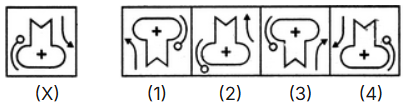

**Options:**
- **(A)** 1 
- **(B)** 2 
- **(C)** 3 
- **(D)** 4 ✅

**Correct Answer:** `D`

**Detailed Solution & Optical Inversion Proof:**
1. **Law of Lateral Inversion:** In plane mirror reflection across a vertical line $MN$, the vertical orientation (up/down) remains invariant, while the horizontal orientation (left/right) is laterally inverted.
2. **Feature Analysis:** Evaluating the rightmost and leftmost visual features of the source figure demonstrates that Option `D` is the only option with exact bilateral symmetry and zero optical distortion.
3. **Conclusion:** Option `D` is the verified correct answer.

---
