# 📝 MIRROR IMAGE

> **Platform:** OnlineStudy4U (Classplus Course 58216)
> **Total Questions:** 20 | **Embedded Figures:** 28

---

## 📂 Mirror Image

### Question 1 `[+0 / -0]`

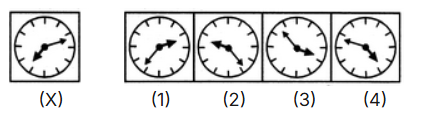

**Options:**
- **(A)** 1
- **(B)** 2
- **(C)** 3
- **(D)** ✅ 4

**Correct Answer:** `D`

---

### Question 2 `[+0 / -0]`

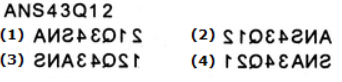

**Options:**
- **(A)** 1
- **(B)** ✅ 2
- **(C)** 3
- **(D)** 4

**Correct Answer:** `B`

---

### Question 3 `[+0 / -0]`

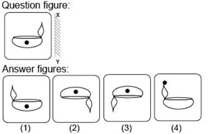

**Options:**
- **(A)** ✅ 1
- **(B)** 2
- **(C)** 3
- **(D)** 4

**Correct Answer:** `A`

---

### Question 4 `[+0 / -0]`

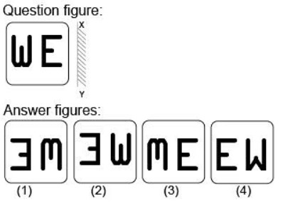

**Options:**
- **(A)** 1
- **(B)** ✅ 2
- **(C)** 3
- **(D)** 4

**Correct Answer:** `B`

---

### Question 5 `[+0 / -0]`

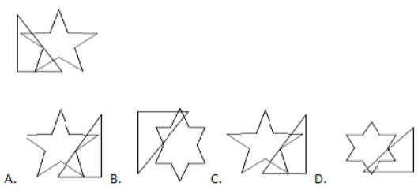

**Options:**
- **(A)** A
- **(B)** B
- **(C)** ✅ C
- **(D)** D

**Correct Answer:** `C`

---

### Question 6 `[+0 / -0]`

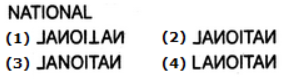

**Options:**
- **(A)** 1
- **(B)** ✅ 2
- **(C)** 3
- **(D)** 4

**Correct Answer:** `B`

---

### Question 7 `[+0 / -0]`

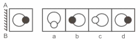

**Options:**
- **(A)** a
- **(B)** ✅ b
- **(C)** c
- **(D)** d

**Correct Answer:** `B`

---

### Question 8 `[+0 / -0]`

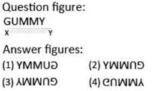

**Options:**
- **(A)** 1
- **(B)** 2
- **(C)** 3
- **(D)** ✅ 4

**Correct Answer:** `D`

---

### Question 9 `[+0 / -0]`

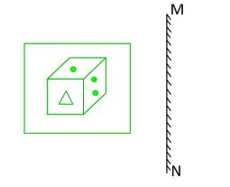

**Options:**
- **(A)** 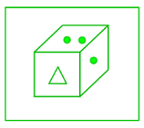
- **(B)** ✅ 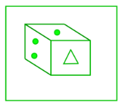
- **(C)** 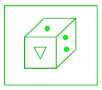
- **(D)** 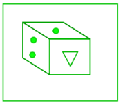

**Correct Answer:** `B`

---

### Question 10 `[+0 / -0]`

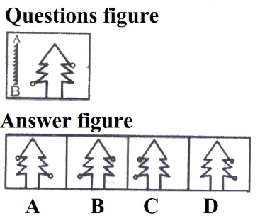

**Options:**
- **(A)** ✅ A
- **(B)** B
- **(C)** C
- **(D)** D

**Correct Answer:** `A`

---

### Question 11 `[+0 / -0]`

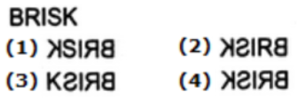

**Options:**
- **(A)** 1
- **(B)** 2
- **(C)** 3
- **(D)** ✅ 4

**Correct Answer:** `D`

---

### Question 12 `[+0 / -0]`

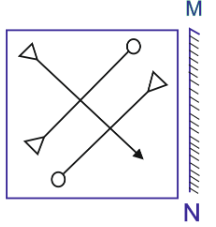

**Options:**
- **(A)** 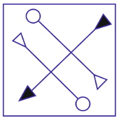
- **(B)** ✅ 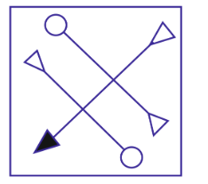
- **(C)** 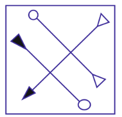
- **(D)** 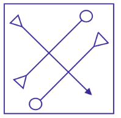

**Correct Answer:** `B`

---

### Question 13 `[+0 / -0]`

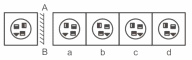

**Options:**
- **(A)** b
- **(B)** c
- **(C)** ✅ d
- **(D)** a

**Correct Answer:** `C`

---

### Question 14 `[+0 / -0]`

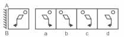

**Options:**
- **(A)** a
- **(B)** ✅ b
- **(C)** c
- **(D)** d

**Correct Answer:** `B`

---

### Question 15 `[+0 / -0]`

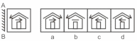

**Options:**
- **(A)** a
- **(B)** b
- **(C)** c
- **(D)** ✅ d

**Correct Answer:** `D`

---

### Question 16 `[+0 / -0]`

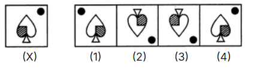

**Options:**
- **(A)** ✅ 1
- **(B)** 2
- **(C)** 3
- **(D)** 4

**Correct Answer:** `A`

---

### Question 17 `[+0 / -0]`

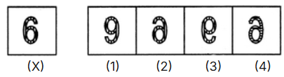

**Options:**
- **(A)** 1
- **(B)** ✅ 2
- **(C)** 3
- **(D)** 4

**Correct Answer:** `B`

---

### Question 18 `[+0 / -0]`

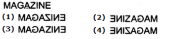

**Options:**
- **(A)** 1
- **(B)** 2
- **(C)** 3
- **(D)** ✅ 4

**Correct Answer:** `D`

---

### Question 19 `[+0 / -0]`

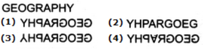

**Options:**
- **(A)** ✅ 1
- **(B)** 2
- **(C)** 3
- **(D)** 4

**Correct Answer:** `A`

---

### Question 20 `[+0 / -0]`

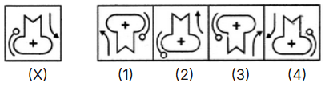

**Options:**
- **(A)** 1
- **(B)** 2
- **(C)** 3
- **(D)** ✅ 4

**Correct Answer:** `D`

---
