# 📝 NUMBER SERIES

> **Platform:** OnlineStudy4U (Classplus Course 58216)
> **Total Questions:** 20 | **Embedded Figures:** 20

---

## 📂 Number Series

### Question 1 `[+0 / -0]`

Find
 the missing element in the given series: 

 48
 ? 36 90 315 1417.5

**Options:**
- **(A)** 16
- **(B)** 30
- **(C)** 45
- **(D)** ✅ 24

**Correct Answer:** `D`

**Detailed Solution / Explanation:**
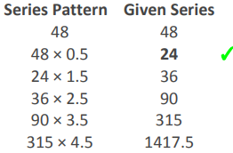

---

### Question 2 `[+0 / -0]`

Find
 the wrong term in the given series: 

 10
 12 18 42 162 ?

**Options:**
- **(A)** ✅ 882
- **(B)** 828
- **(C)** 456
- **(D)** 768

**Correct Answer:** `A`

**Detailed Solution / Explanation:**
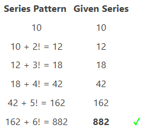

---

### Question 3 `[+0 / -0]`

Find
 the missing element in the given series: 

 529
 ? 729 841 961 1089

**Options:**
- **(A)** ✅ 625
- **(B)** 675
- **(C)** 575
- **(D)** 525

**Correct Answer:** `A`

**Detailed Solution / Explanation:**
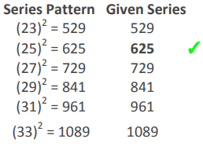

---

### Question 4 `[+0 / -0]`

Find
 the wrong term in the given series: 

 143
 151 158 172 182 ?

**Options:**
- **(A)** 192
- **(B)** 192
- **(C)** 190
- **(D)** ✅ 193

**Correct Answer:** `D`

**Detailed Solution / Explanation:**
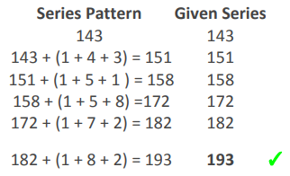

---

### Question 5 `[+0 / -0]`

Find
 the wrong term in the given series: 

 1,
 3, 9, 31, 128, 651, 3913

**Options:**
- **(A)** 651
- **(B)** ✅ 128
- **(C)** 31
- **(D)** 9

**Correct Answer:** `B`

**Detailed Solution / Explanation:**
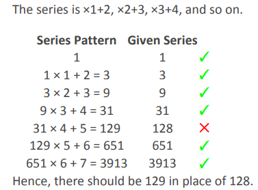

---

### Question 6 `[+0 / -0]`

Find
 the wrong term in the given series: 

 12
 24 48 144 915 13200

**Options:**
- **(A)** 48
- **(B)** 144
- **(C)** 13200
- **(D)** ✅ 915

**Correct Answer:** `D`

**Detailed Solution / Explanation:**
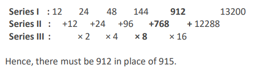

---

### Question 7 `[+0 / -0]`

Find
 the missing element in the given series: 

 379
 390 412 445 ? 544

**Options:**
- **(A)** 462
- **(B)** 511
- **(C)** ✅ 489
- **(D)** 538

**Correct Answer:** `C`

**Detailed Solution / Explanation:**
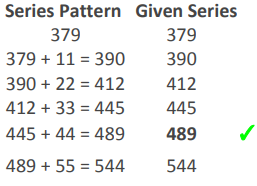

---

### Question 8 `[+0 / -0]`

Find
 the wrong term in the given series: 

 10
 16 34 70 130 ?

**Options:**
- **(A)** 116
- **(B)** ✅ 220
- **(C)** 312
- **(D)** 224

**Correct Answer:** `B`

**Detailed Solution / Explanation:**
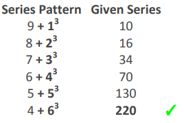

---

### Question 9 `[+0 / -0]`

Find
 the missing element in the given series: 

 35,
 37, 47, 77, 145, ?

**Options:**
- **(A)** 157
- **(B)** 213
- **(C)** ✅ 275
- **(D)** 195

**Correct Answer:** `C`

**Detailed Solution / Explanation:**
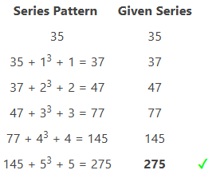

---

### Question 10 `[+0 / -0]`

Find
 the missing element in the given series: 

 240
 122 64 36 23 ?

**Options:**
- **(A)** 11
- **(B)** 19.5
- **(C)** ✅ 17.5
- **(D)** 8

**Correct Answer:** `C`

**Detailed Solution / Explanation:**
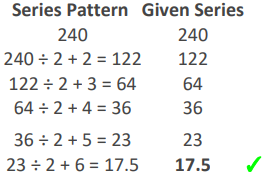

---

### Question 11 `[+0 / -0]`

Find
 the missing element in the given series: 

 4
 ? 8 27 104 525

**Options:**
- **(A)** 6
- **(B)** ✅ 5
- **(C)** 7
- **(D)** 5.5

**Correct Answer:** `B`

**Detailed Solution / Explanation:**
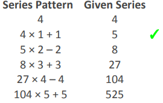

---

### Question 12 `[+0 / -0]`

Find
 the missing element in the given series: 

 0
 6 24 60 120 ?

**Options:**
- **(A)** ✅ 210
- **(B)** 272
- **(C)** 255
- **(D)** 312

**Correct Answer:** `A`

**Detailed Solution / Explanation:**
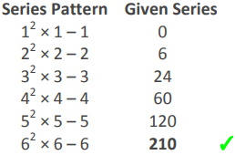

---

### Question 13 `[+0 / -0]`

Find
 the wrong term in the given series: 

 7,
 9, 16, 25, 41, 68, 107, 173

**Options:**
- **(A)** 107
- **(B)** 16
- **(C)** 25
- **(D)** ✅ 68

**Correct Answer:** `D`

**Detailed Solution / Explanation:**
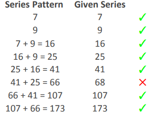

---

### Question 14 `[+0 / -0]`

Find
 the wrong term in the given series: 

 19
 20.5 42.5 129 517.5 2590 15535.5

**Options:**
- **(A)** 128
- **(B)** 20.5
- **(C)** ✅ 2590
- **(D)** 19

**Correct Answer:** `C`

**Detailed Solution / Explanation:**
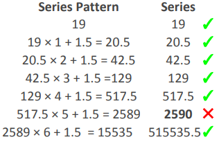

---

### Question 15 `[+0 / -0]`

Find
 the wrong term in the given series: 

 243
 81 54 54 72 ?

**Options:**
- **(A)** 110
- **(B)** 115
- **(C)** ✅ 120
- **(D)** 125

**Correct Answer:** `C`

**Detailed Solution / Explanation:**
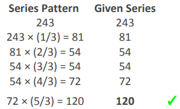

---

### Question 16 `[+0 / -0]`

Find
 the missing element in the given series: 

 132
 156 182 210 240 ?

**Options:**
- **(A)** ✅ 272
- **(B)** 284
- **(C)** 296
- **(D)** 302

**Correct Answer:** `A`

**Detailed Solution / Explanation:**
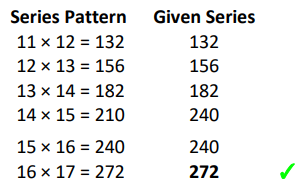

---

### Question 17 `[+0 / -0]`

Find
 the missing element in the given series: 

 19
 40 67 101 143 ?

**Options:**
- **(A)** 164
- **(B)** 174
- **(C)** ✅ 194
- **(D)** 184

**Correct Answer:** `C`

**Detailed Solution / Explanation:**
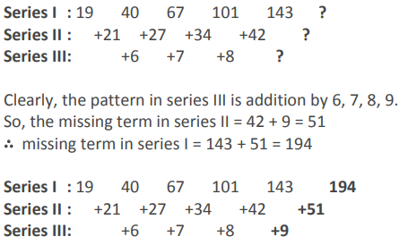

---

### Question 18 `[+0 / -0]`

Find
 the wrong term in the given series: 

 200
 220 484 1597.2 7027.68 ?

**Options:**
- **(A)** 28650.24
- **(B)** ✅ 38652.24
- **(C)** 32452.24
- **(D)** 40552.24

**Correct Answer:** `B`

**Detailed Solution / Explanation:**
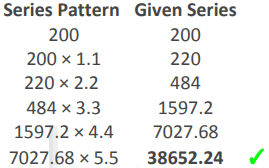

---

### Question 19 `[+0 / -0]`

Find
 the missing element in the given series: 

 90,
 30, 30, 30, 60, ?

**Options:**
- **(A)** 30
- **(B)** 60
- **(C)** 90
- **(D)** ✅ 100

**Correct Answer:** `D`

**Detailed Solution / Explanation:**
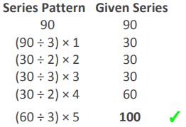

---

### Question 20 `[+0 / -0]`

Find
 the missing element in the given series: 

 7,
 13, ?, 49, 97

**Options:**
- **(A)** 27
- **(B)** ✅ 25
- **(C)** 23
- **(D)** 29

**Correct Answer:** `B`

**Detailed Solution / Explanation:**
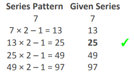

---
