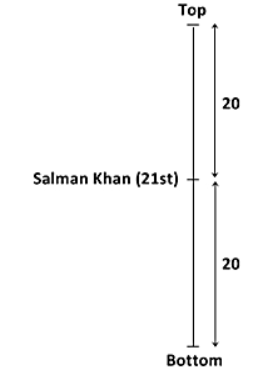
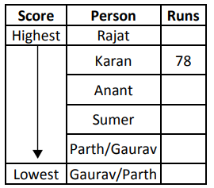
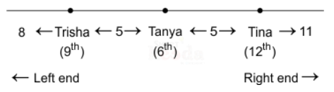
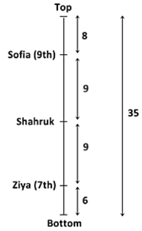

# 📝 RANKING TEST

> **Platform:** OnlineStudy4U (Classplus Course 58216)
> **Total Questions:** 20 | **Embedded Figures:** 4

---

## 📂 Ranking Test

### Question 1 `[+0 / -0]`

In
 a line of people, Rohit is ranked 12th from the top, and Ankit is
 ranked 20th from the bottom. If there are 30 people in the line,
 how many people are between Rohit and Ankit?

**Options:**
- **(A)** 5
- **(B)** 7
- **(C)** ✅ 0
- **(D)** 9

**Correct Answer:** `C`

**Detailed Solution / Explanation:**
Rohit position from bottom = (30-12)+1 = 19 

 Ankit position from bottom = 20 

 Number of people between Rohit and Ankit = 0

---

### Question 2 `[+0 / -0]`

Arjun
 is older than Sumit but younger than Rahul. Vikas is younger than
 Rahul but older than Arjun. Ramesh is the oldest among them. Who
 is the third oldest?

**Options:**
- **(A)** Sumit
- **(B)** Arjun
- **(C)** Rahul
- **(D)** ✅ Vikas

**Correct Answer:** `D`

**Detailed Solution / Explanation:**
From
 the given conditions: 

 Arjun
 > Sumit, but Arjun < Rahul. 

 → Rahul
 > Arjun > Sumit. 

 Vikas
 is younger than Rahul but older than Arjun. 

 → Rahul
 > Vikas > Arjun > Sumit. 

 Ramesh
 is the oldest. 

 Final
 order: Ramesh > Rahul > Vikas > Arjun > Sumit. 

 The
 third oldest is Vikas.

---

### Question 3 `[+0 / -0]`

Six
 people—P, Q, R, S, T, and U—are standing in a line
 from left to right. P is taller than S but shorter than Q. R is
 taller than Q but shorter than U. T is the tallest. Who is the
 fourth tallest?

**Options:**
- **(A)** P
- **(B)** ✅ Q
- **(C)** R
- **(D)** S

**Correct Answer:** `B`

**Detailed Solution / Explanation:**
From
 the given conditions: 

 P
 > S, but P < Q → Q > P > S. 

 R
 > Q, but R < U → U > R > Q. 

 T
 is the tallest. 

 Final
 order: T > U > R > Q > P > S. 

 The
 fourth tallest person is Q.

---

### Question 4 `[+0 / -0]`

Shreya
 is taller than Meena but shorter than Ritu. Kajal is shorter than
 Ritu but taller than Meena. Payal is the shortest among all. Who
 is the third tallest?

**Options:**
- **(A)** Shreya
- **(B)** Ritu
- **(C)** Meena
- **(D)** ✅ Kajal

**Correct Answer:** `D`

**Detailed Solution / Explanation:**
From
 the given conditions: 

 Shreya
 > Meena but Shreya < Ritu. 

 → Ritu
 > Shreya > Meena. 

 Kajal
 is shorter than Ritu but taller than Meena. 

 → Ritu
 > Kajal > Meena. 

 Payal
 is the shortest. 

 Arranging
 all: Ritu > Shreya > Kajal > Meena > Payal. 

 The
 third tallest person is Kajal.

---

### Question 5 `[+0 / -0]`

In
 a row of students, Raj is 15th from the left end and 12th from the
 right end. How many students are there in the row?

**Options:**
- **(A)** ✅ 26
- **(B)** 28
- **(C)** 25
- **(D)** 30

**Correct Answer:** `A`

**Detailed Solution / Explanation:**
Total
 students in the row = (Position from Left) + (Position from Right)
 – 1 = 15 + 12 - 1 = 26

---

### Question 6 `[+0 / -0]`

During
 assembly the students are standing in a line. Salman Khan is 21st
 in order from both the ends. How many boys are there in the class?

**Options:**
- **(A)** 30
- **(B)** 40
- **(C)** 31
- **(D)** ✅ 41

**Correct Answer:** `D`

**Detailed Solution / Explanation:**
Therefore,
 total number of students = 20 + Salman Khan + 20 = 41

---

### Question 7 `[+0 / -0]`

In
 a row of 45 students, Aditi is ranked 18th from the left. Priya is
 24th from the right. If there are 5 students between Aditi and
 Priya, how many students are there in the row?

**Options:**
- **(A)** 45
- **(B)** ✅ 47
- **(C)** 50
- **(D)** 53

**Correct Answer:** `B`

**Detailed Solution / Explanation:**
Total
 students in the row = (Aditi’s rank from the left) +
 (Priya’s rank from the right) + (Students between them) 

 =
 18 + 24 + 5 

 =
 47

---

### Question 8 `[+0 / -0]`

Rahul
 is heavier than Suresh but lighter than Mohan. Kunal is lighter
 than Rahul but heavier than Suresh. Deepak is heavier than all
 except Mohan. Who is the second lightest?

**Options:**
- **(A)** Rahul
- **(B)** ✅ Kunal
- **(C)** Suresh
- **(D)** Mohan

**Correct Answer:** `B`

**Detailed Solution / Explanation:**
Rahul
 is heavier than Suresh but lighter than Mohan. → Mohan >
 Rahul > Suresh 

 Kunal
 is lighter than Rahul but heavier than Suresh. → Mohan >
 Rahul > Kunal > Suresh 

 Deepak
 is heavier than all except Mohan. → Mohan > Deepak >
 Rahul > Kunal > Suresh 

 Solution: 

 The
 second lightest is Kunal.

---

### Question 9 `[+0 / -0]`

In
 a north-facing row of 45 students, Neha is 13th from the left, and
 Priya is 15th from the right. There are 4 students between Priya
 and Rani, who is equidistant to Neha. What is Rani’s
 position from the right?

**Options:**
- **(A)** 25
- **(B)** ✅ 20
- **(C)** 30
- **(D)** 32

**Correct Answer:** `B`

**Detailed Solution / Explanation:**
Priya’s position from the left = 45−15+1=31. 

 Rani’s position from the left (5 places ahead of Priya) = 31−5=26. 

 Check equidistance: ∣26−13∣=13 (same as Neha's position).  

 Rani’s position from the right = 45−26+1=20.

---

### Question 10 `[+0 / -0]`

Five
 students—Amit, Bhavesh, Chetan, Dinesh, and Esha—took
 an exam. Amit scored higher than Chetan but lower than Bhavesh.
 Dinesh scored more than Amit but less than Esha. Esha scored the
 highest. Who got the second highest marks?

**Options:**
- **(A)** ✅ Dinesh
- **(B)** Chetan
- **(C)** Amit
- **(D)** Esha

**Correct Answer:** `A`

**Detailed Solution / Explanation:**
From
 the given conditions: 

 Amit
 > Chetan, but Amit < Bhavesh. 

 → Bhavesh
 > Amit > Chetan. 

 Dinesh
 > Amit but Dinesh < Esha. 

 → Esha
 > Dinesh > Amit. 

 Esha
 scored the highest. 

 Final
 order: Esha > Dinesh > Bhavesh > Amit > Chetan. 

 The
 second highest scorer is Dinesh.

---

### Question 11 `[+0 / -0]`

In
 a class of 50 students, Priya ranks 14th from the top. What is her
 rank from the bottom?

**Options:**
- **(A)** 35
- **(B)** ✅ 37
- **(C)** 40
- **(D)** 45

**Correct Answer:** `B`

**Detailed Solution / Explanation:**
Rank
 from the bottom = Total students - Rank from the top + 1 

 =
 50 - 14 + 1 

 =
 37

---

### Question 12 `[+0 / -0]`

If
 the rank of Rohan is 7th from the top in a group of 50 candidates
 and 2 new candidates are added just before and after him, what
 will be his new rank from bottom?

**Options:**
- **(A)** 44
- **(B)** 45
- **(C)** ✅ 46
- **(D)** 48

**Correct Answer:** `C`

**Detailed Solution / Explanation:**
Adding
 of candidates just before Rohan will not change his rank from
 bottom. Before addition, the rank of Rohan from bottom is = (50 -
 7) + 1 = 44 

 Now
 adding 2 candidates just after Rohan will increase his rank by 2
 positions. Hence; the new rank of Rohan from bottom will be = 44 +
 2 = 46

---

### Question 13 `[+0 / -0]`

Neha
 is heavier than Rina but lighter than Simran. Aisha is lighter
 than Neha but heavier than Rina. Jaya is heavier than all except
 Simran. Who is the third heaviest?

**Options:**
- **(A)** Rina
- **(B)** Simran
- **(C)** ✅ Neha
- **(D)** Jaya

**Correct Answer:** `C`

**Detailed Solution / Explanation:**
From
 the given conditions: 

 Neha
 > Rina, but Neha < Simran → Simran > Neha > Rina. 

 Aisha
 is lighter than Neha but heavier than Rina → Simran > Neha
 > Aisha > Rina. 

 Jaya
 is heavier than all except Simran → Simran > Jaya >
 Neha > Aisha > Rina. 

 The
 third heaviest person is Neha.

---

### Question 14 `[+0 / -0]`

Six
 persons – Sumer, Anant, Parth, Rajat, Karan and Gaurav,
 played in a cricket match and scored different number of runs.
 Sumer scored more runs than only Parth and Gaurav. Anant scored
 less runs than Karan, who was not highest scorer. The Second
 highest person scored 78 runs. How many person(s) scored more runs
 than Parth?

**Options:**
- **(A)** 1
- **(B)** 2
- **(C)** 3
- **(D)** ✅ More
 than 3

**Correct Answer:** `D`

**Detailed Solution / Explanation:**
Following
 the final solution we can say that either 4 or 5 persons scored
 more runs than Parth.

---

### Question 15 `[+0 / -0]`

In
 a line of 60 people, Sam is ranked 21st from the top. How many
 people are ahead of him and how many are behind him?

**Options:**
- **(A)** ✅ 20,
 39
- **(B)** 20,40
- **(C)** 22,39
- **(D)** 22,40

**Correct Answer:** `A`

**Detailed Solution / Explanation:**
People
 ahead of Sam = Sam’s rank - 1 = 21 - 1 = 20 

 People
 behind Sam = Total - Sam’s rank = 60 - 21 = 39

---

### Question 16 `[+0 / -0]`

In
 a nursery, I saw a group of small rose trees arranged in a row.
 However, one rose tree caught my attention very much. I started
 counting its rank from the left hand side and found out to be 12.
 When I started counting from right hand side, it was again 12!!
 What is the total number of rose trees that were arranged in that
 row?

**Options:**
- **(A)** 21
- **(B)** 25
- **(C)** 32
- **(D)** ✅ 23

**Correct Answer:** `D`

**Detailed Solution / Explanation:**
As
 the rank of the tree is same from either side, the total number of
 trees will be 

 12
 + 12 – 1 = 23

---

### Question 17 `[+0 / -0]`

In
 a north facing row of NCC Cadets, Trisha is 9th from the left end
 and Tina is 12th from the right end. There are 5 cadets between
 Trisha and Tanya who is equidstant to Tina. Find how many cadets
 are there in the row?

**Options:**
- **(A)** 34
- **(B)** 31
- **(C)** ✅ 32
- **(D)** 33

**Correct Answer:** `C`

**Detailed Solution / Explanation:**
Adding
 all the persons in the above image, we get: 

 8
 + 1(Trisha) + 5 + 1(Tanya) + 5 + 1(Tina) + 11 = 32 

 Thus
 there are 32 cadets in the row.

---

### Question 18 `[+0 / -0]`

In
 a north-facing row of students, Ajay is 18th from the left and
 Vijay is 22nd from the right. If there are 10 students between
 them, find the total number of students in the row.

**Options:**
- **(A)** 40
- **(B)** 45
- **(C)** ✅ 50
- **(D)** 55

**Correct Answer:** `C`

**Detailed Solution / Explanation:**
Total
 students = Ajay’s position from left + Vijay’s
 position from right + students between them = 18 + 22 + 10 = 50

---

### Question 19 `[+0 / -0]`

Aman
 is standing in a queue at the 10th position from the front. If he
 is 15th from the back, how many people are in the queue?

**Options:**
- **(A)** 30
- **(B)** 75
- **(C)** 50
- **(D)** ✅ 24

**Correct Answer:** `D`

**Detailed Solution / Explanation:**
Total
 people in the queue = (Position from Front) + (Position from Back)
 - 1 

 =
 10 + 15 - 1 

 =
 24

---

### Question 20 `[+0 / -0]`

In
 a class of 35 students, Ziya is placed 7th from the bottom where
 as Sofia is placed 9th from the top. Shahruk is placed in between
 the two. What is Ziya's position from Shahruk?

**Options:**
- **(A)** ✅ 10
- **(B)** 15
- **(C)** 19
- **(D)** 21

**Correct Answer:** `A`

**Detailed Solution / Explanation:**
As
 seen in the figure, Shahruk is between Sofia and Ziya. It's given
 that Ziya is 7th from the bottom and Sofia is 9th from the top. 

 Therefore,
 number of persons between Sofia and Ziya = 35-(9+7) = 19 

 Sharuk's
 position between Sofia and Ziya = 19-1/2 = 10. 

 Hence,
 Shahruk is at the middle ie. at 10th position from both. Ziya,
 therefore, is at the 10th position from Shahruk

---
