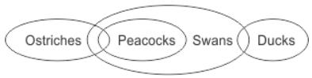
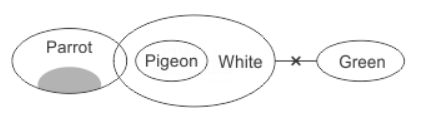
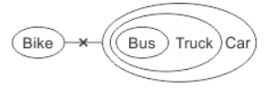
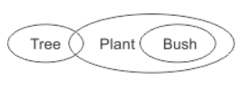
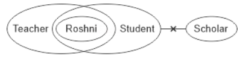
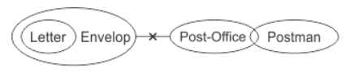
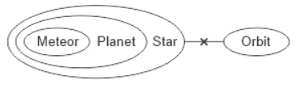
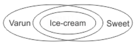
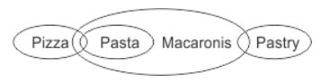
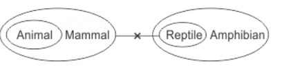

# 📝 SYLLOGISM

> **Platform:** OnlineStudy4U (Classplus Course 58216)
> **Total Questions:** 20 | **Embedded Figures:** 18

---

## 📂 Syllogism

### Question 1 `[+0 / -0]`

Statements:

 A
 few Ostriches are Peacocks. 

 All
 Peacocks are Swans. 

 Some
 Swans are Ducks. 

 Conclusions:

 I.
 A few Swans are Ostriches. 

 II.
 Some Ducks are Peacocks.

**Options:**
- **(A)** ✅ If
 only conclusion I follows
- **(B)** If
 only conclusion II follows
- **(C)** If
 either conclusion I or II follows
- **(D)** If
 neither conclusion I nor II follows

**Correct Answer:** `A`

**Detailed Solution / Explanation:**

---

### Question 2 `[+0 / -0]`

Statements:

 A
 few parrots are not pigeons. 

 All
 pigeons are white. 

 No
 white is green. 

 Conclusions:

 I.
 No green is a pigeon. 

 II.
 No parrot is green. 

 III.
 Some pigeons are not parrots.

**Options:**
- **(A)** ✅ If
 only conclusion I follows
- **(B)** If
 either conclusion I or II follows
- **(C)** If
 conclusion II or III follows
- **(D)** All
 follows

**Correct Answer:** `A`

**Detailed Solution / Explanation:**

---

### Question 3 `[+0 / -0]`

Statements:

 No
 crab is star fish. 

 No
 octopus is crab. 

 Conclusions:

 I.
 No star fish is octopus. 

 II.
 All octopus are star fish.

**Options:**
- **(A)** If
 only conclusion I follows
- **(B)** If
 only conclusion II follows
- **(C)** If
 either conclusion I or II follows
- **(D)** ✅ If
 neither conclusion I nor II follows

**Correct Answer:** `D`

**Detailed Solution / Explanation:**

---

### Question 4 `[+0 / -0]`

Statements: 

 No
 bike is a bus. 

 All
 buses are trucks. 

 All
 trucks are cars. 

 Conclusions: 

 I.
 All buses are cars. 

 II.
 At least some cars are trucks.

**Options:**
- **(A)** If
 only conclusion I follows
- **(B)** If
 only conclusion II follows
- **(C)** If
 either conclusion I or II follows
- **(D)** ✅ If
 both conclusion I and II follows

**Correct Answer:** `D`

**Detailed Solution / Explanation:**

---

### Question 5 `[+0 / -0]`

Statements:

 Only
 a few spoons are bottles. 

 All
 bottles are clocks. 

 No
 clock is a stool. 

 Conclusions:

 I.
 At least some spoons are clocks. 

 II.
 All spoons can never be stools

**Options:**
- **(A)** If
 only conclusion I follows
- **(B)** If
 only conclusion II follows
- **(C)** If
 either conclusion I or II follows
- **(D)** ✅ If
 both conclusion I and II follows

**Correct Answer:** `D`

**Detailed Solution / Explanation:**
Only
 a few spoons are bottles (I) + All Bottles are clocks (A) 

 I
 + A = I 

 Some
 spoons are clocks (I). 

 Hence
 conclusion I follows. 

 Again,
 some spoons are clock (I) + No clock is a stool (E) 

 I
 + E = O 

 Some
 spoons are not stools. 

 Hence
 conclusion II follows

---

### Question 6 `[+0 / -0]`

Statements:

 Some
 girls are young. 

 No
 young is a woman. 

 Conclusions:

 I.
 Some women are not girls. 

 II.
 All women being girls is a possibility.

**Options:**
- **(A)** If
 only conclusion I follows
- **(B)** ✅ If
 only conclusion II follows
- **(C)** If
 either conclusion I or II follows
- **(D)** If
 neither conclusion I nor II follows

**Correct Answer:** `B`

**Detailed Solution / Explanation:**

---

### Question 7 `[+0 / -0]`

Statements:

 A
 graduate is a man. 

 This
 thief is a graduate. 

 Conclusions:

 I.
 This thief is a man. 

 II.
 Some men are thieves.

**Options:**
- **(A)** If
 only conclusion I follows
- **(B)** If
 only conclusion II follows
- **(C)** ✅ If
 either conclusion I or II follows
- **(D)** If
 both conclusion I and II follows

**Correct Answer:** `C`

**Detailed Solution / Explanation:**
Checking
 I: This thief is a man. 

 Using
 S2 and S1, we get 

 This
 thief is a graduate (A) + A graduate is a man (A) ⇒ 
 This thief is a man. Hence, C1 follows. 

 Checking
 II: Some men are thieves. 

 Converse
 of the conclusion derived above ⇒ 
 Some men are thieves. Hence, C2 follows as well.

---

### Question 8 `[+0 / -0]`

Statements: 

 Some chairs are desks. 

 No desk is a bench. 

 Some Tables are Chairs. 

 Conclusions: 

 I. All benches being tables possibility. 

 II. At least some desks are tables

**Options:**
- **(A)** If
 only conclusion I follows
- **(B)** If
 only conclusion II follows
- **(C)** If
 either conclusion I or II follows
- **(D)** ✅ If
 neither conclusion I nor II follows

**Correct Answer:** `D`

**Detailed Solution / Explanation:**

---

### Question 9 `[+0 / -0]`

Statements: 

 Some
 trees are plants. 

 All
 bushes are plants. 

 Conclusions: 

 I.
 At least some trees are bushes. 

 II.
 Some trees are definitely not bushes.

**Options:**
- **(A)** If
 only conclusion I follows
- **(B)** If
 only conclusion II follows
- **(C)** ✅ If
 either conclusion I or II follows
- **(D)** If
 neither conclusion I nor II follows

**Correct Answer:** `C`

**Detailed Solution / Explanation:**

---

### Question 10 `[+0 / -0]`

Statements: 

 Roshni
 is a teacher. 

 Roshni
 is a student. 

 No
 student is a scholar. 

 Conclusions: 

 I.
 Some students are teachers. 

 II.
 Roshni is not a scholar

**Options:**
- **(A)** If
 only conclusion I follows
- **(B)** If
 only conclusion II follows
- **(C)** If
 either conclusion I or II follows
- **(D)** ✅ Both
 conclusion I and II follows

**Correct Answer:** `D`

**Detailed Solution / Explanation:**

---

### Question 11 `[+0 / -0]`

Statements: 

 Some
 questions are answers. 

 Some
 answers are explanations. 

 All
 explanations are lengthy. 

 No
 lengthy is a summary. 

 Conclusions: 

 I.
 No explanation is summary. 

 II.
 Some lengthy are answers. 

 III.
 Some answers are not summary.

**Options:**
- **(A)** If
 only conclusion I follows
- **(B)** If
 only conclusion II follows
- **(C)** If
 either conclusion I or II follows
- **(D)** ✅ All
 conclusion follows

**Correct Answer:** `D`

**Detailed Solution / Explanation:**

---

### Question 12 `[+0 / -0]`

Statements: 

 All
 letters are envelopes. 

 No
 envelope is post office. 

 Some
 post offices are postmen. 

 Conclusions: 

 I.
 Some postmen are letters. 

 II.
 No postman is letter.

**Options:**
- **(A)** If
 only conclusion I follows
- **(B)** If
 only conclusion II follows
- **(C)** ✅ If
 either conclusion I or II follows
- **(D)** If
 neither conclusion I nor II follows

**Correct Answer:** `C`

**Detailed Solution / Explanation:**

---

### Question 13 `[+0 / -0]`

Statements:

 Only
 a few teachers are doctors. 

 0%
 teachers are lawyers. 

 Conclusions:

 I.
 All lawyers are teachers. 

 II.
 Some doctors are not lawyers.

**Options:**
- **(A)** If
 only conclusion I follows
- **(B)** ✅ If
 only conclusion II follows
- **(C)** If
 either conclusion I or II follows
- **(D)** If
 neither conclusion I nor II follows

**Correct Answer:** `B`

**Detailed Solution / Explanation:**

---

### Question 14 `[+0 / -0]`

Statements:
 All clerks are professors. 

 No
 professor is a doctor. 

 All
 doctors are managers. 

 Conclusions:
 I. No manager is a clerk. 

 II.
 All professors being managers is a possibility.

**Options:**
- **(A)** If
 only conclusion I follows
- **(B)** If
 only conclusion II follows
- **(C)** If
 either conclusion I or II follows
- **(D)** ✅ If
 neither conclusion I nor II follows

**Correct Answer:** `D`

**Detailed Solution / Explanation:**

---

### Question 15 `[+0 / -0]`

Statements: 

 All
 planets are stars. 

 All
 meteors are planets. 

 No
 orbit is a star. 

 Conclusions: 

 I.
 All meteors are stars. 

 II.
 No planet is an orbit.

**Options:**
- **(A)** If
 only conclusion I follows
- **(B)** If
 only conclusion II follows
- **(C)** If
 either conclusion I or II follows
- **(D)** ✅ Both
 conclusion I and II follows

**Correct Answer:** `D`

**Detailed Solution / Explanation:**

---

### Question 16 `[+0 / -0]`

Statements:

 Varun
 likes Ice-creams. 

 All
 ice-creams are sweet in taste. 

 Conclusions:

 I.
 All sweet in taste things being ice-creams is a possibility. 

 II.
 Varun doesn't like things that are sour in taste.

**Options:**
- **(A)** ✅ If
 only conclusion I follows
- **(B)** If
 only conclusion II follows
- **(C)** If
 either conclusion I or II follows
- **(D)** If
 neither conclusion I nor II follows

**Correct Answer:** `A`

**Detailed Solution / Explanation:**

---

### Question 17 `[+0 / -0]`

Statements:
 No tea is sugar. 

 No
 milk is tea. 

 Conclusions:
 I. No sugar is milk. 

 II.
 All milk are sugar.

**Options:**
- **(A)** If
 only conclusion I follows
- **(B)** If
 only conclusion II follows
- **(C)** If
 either conclusion I or II follows
- **(D)** ✅ If
 neither conclusion I nor II follows

**Correct Answer:** `D`

**Detailed Solution / Explanation:**

---

### Question 18 `[+0 / -0]`

Statement:

 Some
 pizzas are pasta. 

 All
 pastas are macaronis. 

 Some
 macaronis are pastries. 

 Conclusions:

 I.
 All pizzas being macaronis is a possibility. 

 II.
 All pastas are pizzas.

**Options:**
- **(A)** ✅ If
 only conclusion I follows
- **(B)** If
 only conclusion II follows
- **(C)** If
 either conclusion I or II follows
- **(D)** If
 neither conclusion I nor II follows

**Correct Answer:** `A`

**Detailed Solution / Explanation:**

---

### Question 19 `[+0 / -0]`

Statements: 

 All
 animals are mammals. 

 No
 mammal is reptile. 

 All
 reptiles are amphibians. 

 Conclusions: 

 I.
 All animals are amphibians. 

 II.
 Some amphibians are mammals

**Options:**
- **(A)** If
 only conclusion I follows
- **(B)** If
 only conclusion II follows
- **(C)** If
 either conclusion I or II follows
- **(D)** ✅ If
 neither conclusion I nor II follows

**Correct Answer:** `D`

**Detailed Solution / Explanation:**

---

### Question 20 `[+0 / -0]`

Statements: 

 At
 least some Europeans are British. 

 Every
 European is an American. 

 No
 American is an African. 

 Conclusions: 

 All
 Americans being British is a possibility. 

 Some
 Europeans can be Africans as well. 

 No
 African is a British.

**Options:**
- **(A)** If
 only conclusion I follows
- **(B)** If
 conclusion I and III follows
- **(C)** If
 conclusion I or II follows
- **(D)** ✅ None follows

**Correct Answer:** `D`

**Detailed Solution / Explanation:**

---
