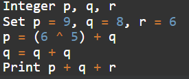
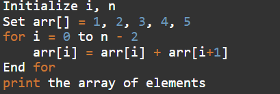
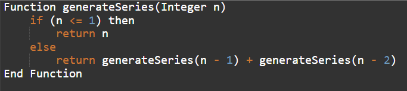
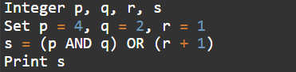
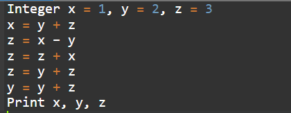
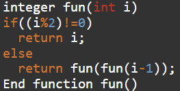
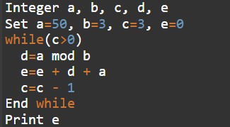
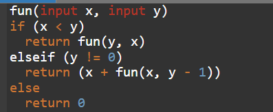
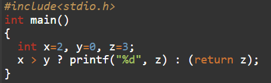

# Section 03 — Technical Ability: Pseudo Code Assessment
## Topic 09: Infosys Official Previous Year Questions (PYQ) Set 01
**Target Exam:** Infosys Systems Engineer (SE) & Specialist Programmer (SP)  
**Total Questions:** 9  
**Source Document:** `Infosys Pseudo Code PYQ-1.pdf`  
**Question IDs:** `INFOSYS_PSEUDO_PYQ1_Q01` to `INFOSYS_PSEUDO_PYQ1_Q09`  
**Coverage:** Bitwise XOR Addition, Array In-Place Modification, Recursive Fibonacci, Logical Gate Operations, Sequential Reassignment, Nested Recursion, While Loop Modulo Accumulator, Recursive Multiplication, C Syntax & Ternary Operator Constraints  

---

### Question 1 (ID: INFOSYS_PSEUDO_PYQ1_Q01)
**Target Exam:** Infosys Systems Engineer (SE) & Specialist Programmer (SP)  
**Cognitive Category:** Section 03 - Technical Ability (Pseudocode Assessment)  
**Topic Domain:** Bitwise XOR Operations & Linear Integer Updates  

#### Problem Statement:
What will be the output of the following pseudocode?



```pseudocode
Integer p, q, r
Set p = 9, q = 8, r = 6
p = (6 ^ 5) + q
q = q + q
Print p + q + r
```

#### Answer Options:
- **(A)** `22`
- **(B)** `29`
- **(C)** `33`
- **(D)** `46`

#### Official Answer Key:
**Correct Option:** `(C) 33`

#### Formally Verified Solution & Derivation:
- **Core Concept & Theoretical Foundations:**
  Bitwise XOR (`^`) outputs `1` when input bits differ and `0` when identical. Precedence dictates evaluating parenthesized bitwise expressions prior to addition.
  - Binary representations:
    $$6_{10} = 0110_2$$
    $$5_{10} = 0101_2$$
    $$6 \oplus 5 = 0011_2 = 3_{10}$$

- **Step-by-Step Analytical Trace & Execution State:**
  1. Initialize state: $p = 9$, $q = 8$, $r = 6$.
  2. Compute $p = (6 \oplus 5) + q = 3 + 8 = 11$.
  3. Update $q = q + q = 8 + 8 = 16$.
  4. Evaluate expression $p + q + r = 11 + 16 + 6 = 33$.
  5. Print outputs `33`.

- **Distractor Elimination & Error Proofs:**
  - *(A) `22`:* Incorrect. Occurs if the student forgets $r=6$ and omits updating $q$.
  - *(B) `29`:* Incorrect. Results from mistaking $6 \oplus 5 = 1$ instead of $3$.
  - *(C) `33`:* **Correct.** Matches bitwise calculation and cumulative summation.
  - *(D) `46`:* Incorrect. Arises from using initial $p=9$ instead of recomputed $p=11$, plus double-counting $q$.

- **Infosys SE Exam Shortcut & Time-Saving Trick:**
  Always calculate the small bitwise XOR first: adjacent integers $2k$ and $2k+1$ always XOR to $1$ or $3$. Here $6 \oplus 5 = 3$. Then simple mental math: $3 + 8 = 11$, $11 + 16 + 6 = 33$. Solved in 8 seconds!

---

### Question 2 (ID: INFOSYS_PSEUDO_PYQ1_Q02)
**Target Exam:** Infosys Systems Engineer (SE) & Specialist Programmer (SP)  
**Cognitive Category:** Section 03 - Technical Ability (Pseudocode Assessment)  
**Topic Domain:** Array In-Place Suffix Sum Shift  

#### Problem Statement:
What will be the output of the following pseudocode?



```pseudocode
Initialize i, n
Set arr[] = 1, 2, 3, 4, 5
for i = 0 to n - 2
    arr[i] = arr[i] + arr[i+1]
End for
print the array of elements
```

#### Answer Options:
- **(A)** `3 3 4 9 5`
- **(B)** `4 3 7 5 2`
- **(C)** `3 5 7 9 5`
- **(D)** `1 2 3 4 5`

#### Official Answer Key:
**Correct Option:** `(C) 3 5 7 9 5`

#### Formally Verified Solution & Derivation:
- **Core Concept & Theoretical Foundations:**
  Array traversal modifies elements sequentially. Notice that $arr[i]$ is updated using $arr[i+1]$, which has NOT yet been modified in subsequent iterations.
  - Length of array $n = 5$.
  - Upper loop limit: $n - 2 = 5 - 2 = 3$.
  - Index range: $i \in [0, 3]$. The last element $arr[4]$ remains untouched.

- **Step-by-Step Analytical Trace & Execution State:**
  - Initial array: `[1, 2, 3, 4, 5]`
  - Iteration $i = 0$: $arr[0] = arr[0] + arr[1] = 1 + 2 = 3$. Array: `[3, 2, 3, 4, 5]`
  - Iteration $i = 1$: $arr[1] = arr[1] + arr[2] = 2 + 3 = 5$. Array: `[3, 5, 3, 4, 5]`
  - Iteration $i = 2$: $arr[2] = arr[2] + arr[3] = 3 + 4 = 7$. Array: `[3, 5, 7, 4, 5]`
  - Iteration $i = 3$: $arr[3] = arr[3] + arr[4] = 4 + 5 = 9$. Array: `[3, 5, 7, 9, 5]`
  - Loop terminates since $i$ reaches $n-2 = 3$.
  - Final elements: `3 5 7 9 5`.

- **Distractor Elimination & Error Proofs:**
  - *(A) `3 3 4 9 5`:* Incorrect. Arithmetic calculation error at indices 1 and 2.
  - *(B) `4 3 7 5 2`:* Incorrect. Arises from reverse or misaligned indexing.
  - *(C) `3 5 7 9 5`:* **Correct.** Exact step-by-step element mutation.
  - *(D) `1 2 3 4 5`:* Incorrect. Unmodified original array.

- **Infosys SE Exam Shortcut & Time-Saving Trick:**
  The last element ($5$) is at index $n-1=4$. Since loop stops at $n-2=3$, the last element CANNOT change! In the options, look at the last number: only (A), (C), and (D) end in $5$. First element is $1+2=3$. Checking just the first and last numbers isolates (C) instantly!

---

### Question 3 (ID: INFOSYS_PSEUDO_PYQ1_Q03)
**Target Exam:** Infosys Systems Engineer (SE) & Specialist Programmer (SP)  
**Cognitive Category:** Section 03 - Technical Ability (Pseudocode Assessment)  
**Topic Domain:** Classic Recursive Fibonacci Sequence  

#### Problem Statement:
What will be the output of the following pseudocode?  
**Input:** `n = 8`



```pseudocode
Function generateSeries(Integer n)
    if (n <= 1) then
        return n
    else
        return generateSeries(n - 1) + generateSeries(n - 2)
End Function
```

#### Answer Options:
- **(A)** `21`
- **(B)** `34`
- **(C)** `13`
- **(D)** `55`

#### Official Answer Key:
**Correct Option:** `(A) 21`

#### Formally Verified Solution & Derivation:
- **Core Concept & Theoretical Foundations:**
  The pseudocode implements the standard definition of the Fibonacci recurrence relation:
  $$F(0) = 0, \quad F(1) = 1, \quad F(n) = F(n-1) + F(n-2) \quad \text{for } n \ge 2$$

- **Step-by-Step Analytical Trace & Execution State:**
  - $F(0) = 0$
  - $F(1) = 1$
  - $F(2) = 0 + 1 = 1$
  - $F(3) = 1 + 1 = 2$
  - $F(4) = 1 + 2 = 3$
  - $F(5) = 2 + 3 = 5$
  - $F(6) = 3 + 5 = 8$
  - $F(7) = 5 + 8 = 13$
  - $F(8) = 8 + 13 = 21$
  - Function call `generateSeries(8)` evaluates to `21`.

- **Distractor Elimination & Error Proofs:**
  - *(A) `21`:* **Correct.** Exact 8th Fibonacci term $F(8)$.
  - *(B) `34`:* Incorrect. Off-by-one term representing $F(9)$.
  - *(C) `13`:* Incorrect. Off-by-one term representing $F(7)$.
  - *(D) `55`:* Incorrect. Represents $F(10)$.

- **Infosys SE Exam Shortcut & Time-Saving Trick:**
  Memorize the first 10 Fibonacci numbers for Infosys exams: `0, 1, 1, 2, 3, 5, 8, 13, 21, 34, 55`. For $n=8$, write terms up to index 8 directly: $F(8) = 21$.

---

### Question 4 (ID: INFOSYS_PSEUDO_PYQ1_Q04)
**Target Exam:** Infosys Systems Engineer (SE) & Specialist Programmer (SP)  
**Cognitive Category:** Section 03 - Technical Ability (Pseudocode Assessment)  
**Topic Domain:** Bitwise AND, Bitwise OR & Arithmetic Precedence  

#### Problem Statement:
What will be the output of the following pseudocode?



```pseudocode
Integer p, q, r, s
Set p = 4, q = 2, r = 1
s = (p AND q) OR (r + 1)
Print s
```

#### Answer Options:
- **(A)** `1`
- **(B)** `2`
- **(C)** `3`
- **(D)** `5`

#### Official Answer Key:
**Correct Option:** `(B) 2`

#### Formally Verified Solution & Derivation:
- **Core Concept & Theoretical Foundations:**
  - Bitwise AND (`AND`): yields 1 only where both bits are 1.
  - Bitwise OR (`OR`): yields 1 where at least one bit is 1.
  - Arithmetic addition (`+`) inside parentheses executes before outer bitwise operations.

- **Step-by-Step Analytical Trace & Execution State:**
  1. $p = 4 = 100_2$
  2. $q = 2 = 010_2$
  3. $p \text{ AND } q = 100_2 \ \& \ 010_2 = 000_2 = 0$
  4. $r + 1 = 1 + 1 = 2 = 010_2$
  5. $s = (0) \text{ OR } (2) = 000_2 \ | \ 010_2 = 010_2 = 2$
  6. `Print s` displays `2`.

- **Distractor Elimination & Error Proofs:**
  - *(A) `1`:* Incorrect. Results from mistaking $(r+1)$ as $r=1$ and evaluating $0 \text{ OR } 1 = 1$.
  - *(B) `2`:* **Correct.** $0 \text{ OR } 2 = 2$.
  - *(C) `3`:* Incorrect. Results from confusing $4 \text{ AND } 2 = 1$ followed by $1 \text{ OR } 2 = 3$.
  - *(D) `5`:* Incorrect. Occurs if arithmetic addition is applied across terms without evaluating bitwise logic.

- **Infosys SE Exam Shortcut & Time-Saving Trick:**
  Powers of 2 ($4 = 2^2$ and $2 = 2^1$) have no overlapping bits, so their bitwise AND is ALWAYS $0$. Thus $s = 0 \text{ OR } (1+1) = 2$ in 3 seconds!

---

### Question 5 (ID: INFOSYS_PSEUDO_PYQ1_Q05)
**Target Exam:** Infosys Systems Engineer (SE) & Specialist Programmer (SP)  
**Cognitive Category:** Section 03 - Technical Ability (Pseudocode Assessment)  
**Topic Domain:** Sequential Variable Mutations & Arithmetic Reassignment  

#### Problem Statement:
What will be the output of the following pseudocode?



```pseudocode
Integer x = 1, y = 2, z = 3
x = y + z
z = x - y
z = z + x
z = y + z
y = y + z
Print x, y, z
```

#### Answer Options:
- **(A)** `1 2 3`
- **(B)** `4 6 8`
- **(C)** `5 12 10`
- **(D)** `8 6 10`

#### Official Answer Key:
**Correct Option:** `(C) 5 12 10`

#### Formally Verified Solution & Derivation:
- **Core Concept & Theoretical Foundations:**
  Strict sequential assignment tracing. Each assignment immediately overwrites the variable in memory.

- **Step-by-Step Analytical Trace & Execution State:**
  - Initial state: $x = 1, y = 2, z = 3$.
  - Step 1: $x = y + z = 2 + 3 = 5$. Current state: $\{x: 5, y: 2, z: 3\}$
  - Step 2: $z = x - y = 5 - 2 = 3$. Current state: $\{x: 5, y: 2, z: 3\}$
  - Step 3: $z = z + x = 3 + 5 = 8$. Current state: $\{x: 5, y: 2, z: 8\}$
  - Step 4: $z = y + z = 2 + 8 = 10$. Current state: $\{x: 5, y: 2, z: 10\}$
  - Step 5: $y = y + z = 2 + 10 = 12$. Current state: $\{x: 5, y: 12, z: 10\}$
  - Output printed: `x, y, z` $\rightarrow$ `5, 12, 10`.

- **Distractor Elimination & Error Proofs:**
  - *(A) `1 2 3`:* Incorrect. Original unchanged variables.
  - *(B) `4 6 8`:* Incorrect. Miscalculation during arithmetic substitution.
  - *(C) `5 12 10`:* **Correct.** Exact mathematical trace.
  - *(D) `8 6 10`:* Incorrect. Scrambled values of intermediate state $z$.

- **Infosys SE Exam Shortcut & Time-Saving Trick:**
  Notice $x$ is only modified once in line 2: $x = y + z = 2 + 3 = 5$. After that, $x$ is NEVER changed! Look at the options: only option (C) starts with `5`. Done in 5 seconds!

---

### Question 6 (ID: INFOSYS_PSEUDO_PYQ1_Q06)
**Target Exam:** Infosys Systems Engineer (SE) & Specialist Programmer (SP)  
**Cognitive Category:** Section 03 - Technical Ability (Pseudocode Assessment)  
**Topic Domain:** Nested Recursion & Base Case Branching  

#### Problem Statement:
What will be the output of the following pseudocode for `n = 2`?



```pseudocode
integer fun(int i)
if((i%2)!=0)
    return i;
else
    return fun(fun(i-1));
End function fun()
```

#### Answer Options:
- **(A)** `1`
- **(B)** `2`
- **(C)** `3`
- **(D)** `Error`

#### Official Answer Key:
**Correct Option:** `(A) 1`

#### Formally Verified Solution & Derivation:
- **Core Concept & Theoretical Foundations:**
  Nested recursive call evaluation: $fun(fun(i-1))$. The inner call must evaluate to a scalar return value before the outer call executes.

- **Step-by-Step Analytical Trace & Execution State:**
  1. Call $fun(2)$:
     - Test condition: $(2 \pmod 2) \ne 0 \implies 0 \ne 0$ is **False**.
     - Executes `else` branch: `return fun(fun(2 - 1))` $\implies$ `return fun(fun(1))`.
  2. Evaluate inner call $fun(1)$:
     - Test condition: $(1 \pmod 2) \ne 0 \implies 1 \ne 0$ is **True**.
     - Executes `if` branch: returns `1`.
  3. Substitute inner result into outer call:
     - Outer call becomes $fun(1)$.
     - As evaluated, $fun(1)$ returns `1`.
  4. Final return value is `1`.

- **Distractor Elimination & Error Proofs:**
  - *(A) `1`:* **Correct.** Verified recursive reduction.
  - *(B) `2`:* Incorrect. Assuming no transformation occurred.
  - *(C) `3`:* Incorrect. Off-by-one arithmetic error.
  - *(D) `Error`:* Incorrect. The recursion has a well-defined base case and terminates cleanly without stack overflow.

- **Infosys SE Exam Shortcut & Time-Saving Trick:**
  Whenever an odd number is passed into $fun$, it immediately returns that odd number. For an even number $2k$, it passes $2k-1$ (which is odd) into the inner function, returning $2k-1$, and then passes that odd number into the outer function, returning $2k-1$. Thus for $i=2$, it returns $1$ instantly!

---

### Question 7 (ID: INFOSYS_PSEUDO_PYQ1_Q07)
**Target Exam:** Infosys Systems Engineer (SE) & Specialist Programmer (SP)  
**Cognitive Category:** Section 03 - Technical Ability (Pseudocode Assessment)  
**Topic Domain:** While Loop Accumulator & Invariant Modulo Operation  

#### Problem Statement:
What will be the output of the following pseudocode?



```pseudocode
Integer a, b, c, d, e
Set a=50, b=3, c=3, e=0
while(c>0)
    d=a mod b
    e=e + d + a
    c=c - 1
End while
Print e
```

#### Answer Options:
- **(A)** `165`
- **(B)** `160`
- **(C)** `156`
- **(D)** `Error`

#### Official Answer Key:
**Correct Option:** `(C) 156`

#### Formally Verified Solution & Derivation:
- **Core Concept & Theoretical Foundations:**
  Loop invariant analysis: In every iteration, neither $a$ nor $b$ is modified. Therefore, $d = a \pmod b = 50 \pmod 3 = 2$ is a constant loop invariant.

- **Step-by-Step Analytical Trace & Execution State:**
  - Initial: $a = 50, b = 3, c = 3, e = 0$.
  - Invariant term: $d = 50 \pmod 3 = 2$.
  - Increment per iteration: $d + a = 2 + 50 = 52$.
  - Loop iterations: $c = 3, 2, 1$ (exactly $3$ iterations).
  - Iteration 1: $e = 0 + 52 = 52, c = 2$.
  - Iteration 2: $e = 52 + 52 = 104, c = 1$.
  - Iteration 3: $e = 104 + 52 = 156, c = 0$.
  - Condition $c > 0$ ($0 > 0$) is False. Loop terminates.
  - Final value: $e = 156$.

- **Distractor Elimination & Error Proofs:**
  - *(A) `165`:* Incorrect. Occurs if $d$ is mistakenly computed as $5$ instead of $2$ ($55 \times 3 = 165$).
  - *(B) `160`:* Incorrect. Computation error.
  - *(C) `156`:* **Correct.** $3 \times 52 = 156$.
  - *(D) `Error`:* Incorrect. Valid pseudocode loop.

- **Infosys SE Exam Shortcut & Time-Saving Trick:**
  Factor out the loop: $c$ is a simple countdown from 3 to 0. Total added to $e = 3 \times (50 \pmod 3 + 50) = 3 \times (2 + 50) = 3 \times 52 = 156$. Solved in 5 seconds!

---

### Question 8 (ID: INFOSYS_PSEUDO_PYQ1_Q08)
**Target Exam:** Infosys Systems Engineer (SE) & Specialist Programmer (SP)  
**Cognitive Category:** Section 03 - Technical Ability (Pseudocode Assessment)  
**Topic Domain:** Recursive Multiplication by Repeated Addition  

#### Problem Statement:
What will be the output of the following pseudocode for `x = 9, y = 9`?



```pseudocode
fun(input x, input y)
if (x < y)
    return fun(y, x)
elseif (y != 0)
    return (x + fun(x, y - 1))
else
    return 0
```

#### Answer Options:
- **(A)** `76`
- **(B)** `56`
- **(C)** `81`
- **(D)** `68`

#### Official Answer Key:
**Correct Option:** `(C) 81`

#### Formally Verified Solution & Derivation:
- **Core Concept & Theoretical Foundations:**
  This function implements the classical recursive algorithm for Russian Peasant / repeated-addition integer multiplication:
  $$fun(x, y) = x \times y$$
  - Base case: $y = 0 \implies 0$.
  - Recursive step: $fun(x, y) = x + fun(x, y-1)$.

- **Step-by-Step Analytical Trace & Execution State:**
  - Input: $x = 9, y = 9$.
  - Test $x < y$: $9 < 9$ is False.
  - Test $y \ne 0$: $9 \ne 0$ is True $\implies 9 + fun(9, 8)$.
  - Expanding recursively:
    $$fun(9, 9) = \underbrace{9 + 9 + 9 + 9 + 9 + 9 + 9 + 9 + 9}_{9 \text{ times}} + 0 = 9 \times 9 = 81$$
  - Final return value is `81`.

- **Distractor Elimination & Error Proofs:**
  - *(A) `76`:* Incorrect. Off-by-one addition error.
  - *(B) `56`:* Incorrect. Corresponds to $7 \times 8$.
  - *(C) `81`:* **Correct.** $9 \times 9 = 81$.
  - *(D) `68`:* Incorrect. Calculation error.

- **Infosys SE Exam Shortcut & Time-Saving Trick:**
  Recognize the pattern: $x + fun(x, y-1)$ with base case 0 is the mathematical definition of multiplication $x \times y$. Immediately compute $9 \times 9 = 81$! Zero recursion tracing needed.

---

### Question 9 (ID: INFOSYS_PSEUDO_PYQ1_Q09)
**Target Exam:** Infosys Systems Engineer (SE) & Specialist Programmer (SP)  
**Cognitive Category:** Section 03 - Technical Ability (Pseudocode Assessment)  
**Topic Domain:** C Programming Grammar & Ternary Operator Constraints  

#### Problem Statement:
What will be the output of the following pseudocode?



```c
#include<stdio.h>
int main()
{
    int x=2, y=0, z=3;
    x > y ? printf("%d", z) : (return z);
}
```

#### Answer Options:
- **(A)** `2`
- **(B)** `3`
- **(C)** `Error`
- **(D)** `11`

#### Official Answer Key:
**Correct Option:** `(C) Error`

#### Formally Verified Solution & Derivation:
- **Core Concept & Theoretical Foundations:**
  In C (ISO/IEC 9899 standard, §6.5.15 Conditional operator):
  - Syntax: `conditional-expression : logical-OR-expression ? expression : conditional-expression`
  - The second and third operands MUST be valid expressions that yield a value.
  - `return z` is a **jump statement**, NOT an expression. In C, statements cannot be nested within an expression.
  - Therefore, attempting to compile `(return z)` inside a ternary operator produces a compile-time syntax error: `error: expected expression before 'return'`.

- **Step-by-Step Analytical Trace & Execution State:**
  1. Lexer and Parser parse `x > y ? printf("%d", z) : (return z);`.
  2. Parser encounters `return` token inside parentheses of ternary operand.
  3. Syntax violation triggered. Compilation fails with `Compilation Error`.

- **Distractor Elimination & Error Proofs:**
  - *(A) `2`:* Incorrect. Value of $x$, not printed.
  - *(B) `3`:* Incorrect. Value of $z$. A student might think $x > y$ ($2 > 0$) is true so `printf` runs and prints 3, but compilation FAILS before execution can ever start.
  - *(C) `Error`:* **Correct.** Syntax error due to statement in ternary expression.
  - *(D) `11`:* Incorrect. Distractor.

- **Infosys SE Exam Shortcut & Time-Saving Trick:**
  Golden Rule of Infosys C MCQ Traps: **Statements like `return`, `break`, `continue`, `goto` CANNOT be placed inside ternary `? :` expressions.** Whenever you see `? ... : return ...`, mark `Error` immediately!

---
