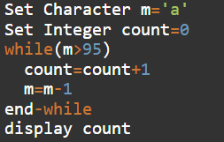
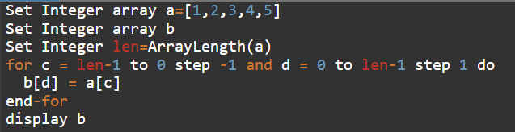
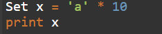
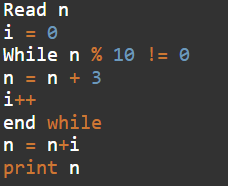
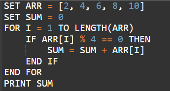
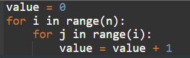
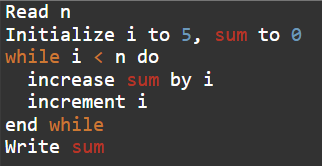
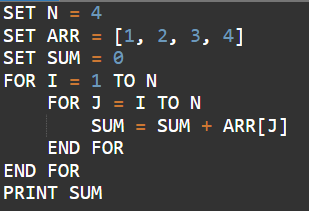
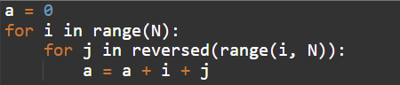

# Section 03 — Technical Ability: Pseudo Code Assessment
## Topic 10: Infosys Latest Exam Questions — Part 1
**Target Exam:** Infosys Systems Engineer (SE) & Specialist Programmer (SP)  
**Total Questions:** 9  
**Source Document:** `Infosys Pseudo code Latest - Part1.pdf`  
**Question IDs:** `INFOSYS_PSEUDO_LATEST_P1_Q01` to `INFOSYS_PSEUDO_LATEST_P1_Q09`  
**Coverage:** ASCII Character Arithmetic & While Loops, Parallel Reverse Array Copy, String Replication, Modulo-10 Convergence Loops, Array Filtered Sums, Triangular Loop Time Complexities, Arithmetic Progression Accumulators, Nested Range Analysis  

---

### Question 1 (ID: INFOSYS_PSEUDO_LATEST_P1_Q01)
**Target Exam:** Infosys Systems Engineer (SE) & Specialist Programmer (SP)  
**Cognitive Category:** Section 03 - Technical Ability (Pseudocode Assessment)  
**Topic Domain:** ASCII Character Arithmetic & While Loop Countdown  

#### Problem Statement:
What will be the output of the following pseudocode?



```pseudocode
Set Character m='a'
Set Integer count=0
while(m>95)
    count=count+1
    m=m-1
end-while
display count
```

#### Answer Options:
- **(A)** `0`
- **(B)** `1`
- **(C)** `2`
- **(D)** `3`

#### Official Answer Key:
**Correct Option:** `(C) 2`

#### Formally Verified Solution & Derivation:
- **Core Concept & Theoretical Foundations:**
  In computing standards, character constants correspond to their decimal ASCII values. The character `'a'` has ASCII value `97`.
  Arithmetic operations on character variables decrement their underlying ASCII code point.

- **Step-by-Step Analytical Trace & Execution State:**
  - Initial state: $m = 'a' = 97$, $count = 0$.
  - Iteration 1:
    - Check condition: $97 > 95 \implies$ **True**.
    - $count = 0 + 1 = 1$.
    - $m = 97 - 1 = 96$ (ASCII `'`').
  - Iteration 2:
    - Check condition: $96 > 95 \implies$ **True**.
    - $count = 1 + 1 = 2$.
    - $m = 96 - 1 = 95$ (ASCII `_`).
  - Iteration 3:
    - Check condition: $95 > 95 \implies$ **False**.
    - Loop terminates.
  - Final statement: `display count` outputs `2`.

- **Distractor Elimination & Error Proofs:**
  - *(A) `0`:* Incorrect. Loop executes twice; count is updated.
  - *(B) `1`:* Incorrect. Premature termination after first decrement.
  - *(C) `2`:* **Correct.** Executed for $m=97$ and $m=96$.
  - *(D) `3`:* Incorrect. Off-by-one trap from mistakenly assuming $95 \ge 95$.

- **Infosys SE Exam Shortcut & Time-Saving Trick:**
  Convert character to ASCII immediately: $'a' = 97$. The loop condition is $m > 95$, which means integers $97$ and $96$. Exactly 2 iterations, so count is 2.

---

### Question 2 (ID: INFOSYS_PSEUDO_LATEST_P1_Q02)
**Target Exam:** Infosys Systems Engineer (SE) & Specialist Programmer (SP)  
**Cognitive Category:** Section 03 - Technical Ability (Pseudocode Assessment)  
**Topic Domain:** Parallel Two-Pointer Array Reversal  

#### Problem Statement:
What will be the output of the following pseudocode?



```pseudocode
Set Integer array a=[1,2,3,4,5]
Set Integer array b
Set Integer len=ArrayLength(a)
for c = len-1 to 0 step -1 and d = 0 to len-1 step 1 do
    b[d] = a[c]
end-for
display b
```

#### Answer Options:
- **(A)** `[4, 5, 1, 2, 3]`
- **(B)** `[3, 4, 5, 2, 1]`
- **(C)** `[5, 4, 3, 2, 1]`
- **(D)** `[1, 5, 2, 3, 4]`

#### Official Answer Key:
**Correct Option:** `(C) [5, 4, 3, 2, 1]`

#### Formally Verified Solution & Derivation:
- **Core Concept & Theoretical Foundations:**
  Simultaneous dual-index loop iteration: index $c$ steps backwards from $len-1$ down to $0$, while index $d$ steps forwards from $0$ up to $len-1$. This creates an exact reverse copy of array $a$ into array $b$.

- **Step-by-Step Analytical Trace & Execution State:**
  - $len = 5$.
  - $c$ steps: $4, 3, 2, 1, 0$.
  - $d$ steps: $0, 1, 2, 3, 4$.
  - Mapping:
    - $b[0] = a[4] = 5$
    - $b[1] = a[3] = 4$
    - $b[2] = a[2] = 3$
    - $b[3] = a[1] = 2$
    - $b[4] = a[0] = 1$
  - Resulting array $b = [5, 4, 3, 2, 1]$.

- **Distractor Elimination & Error Proofs:**
  - *(A) `[4, 5, 1, 2, 3]`:* Incorrect. Rotated array distractor.
  - *(B) `[3, 4, 5, 2, 1]`:* Incorrect. Partial reversal distractor.
  - *(C) `[5, 4, 3, 2, 1]`:* **Correct.** Complete reversal of original elements.
  - *(D) `[1, 5, 2, 3, 4]`:* Incorrect. Scrambled array distractor.

- **Infosys SE Exam Shortcut & Time-Saving Trick:**
  Whenever you see `c = len-1 to 0 step -1` paired with `d = 0 to len-1 step 1`, this is the standard pseudocode pattern for reversing an array. Answer is reversed array `[5, 4, 3, 2, 1]` in 2 seconds!

---

### Question 3 (ID: INFOSYS_PSEUDO_LATEST_P1_Q03)
**Target Exam:** Infosys Systems Engineer (SE) & Specialist Programmer (SP)  
**Cognitive Category:** Section 03 - Technical Ability (Pseudocode Assessment)  
**Topic Domain:** String Replication Syntax & Type Semantics  

#### Problem Statement:
What will be the output of the following pseudocode?



```pseudocode
Set x = 'a' * 10
print x
```

#### Answer Options:
- **(A)** `97`
- **(B)** `970`
- **(C)** `'a' repeated 10 times`
- **(D)** `Error`

#### Official Answer Key:
**Correct Option:** `(C) 'a' repeated 10 times`

#### Formally Verified Solution & Derivation:
- **Core Concept & Theoretical Foundations:**
  In modern high-level pseudocode (and Pythonic conventions used by Infosys assessment vendors such as Mettl/CoCubes), the multiplication operator `*` applied between a string/character literal and an integer $n$ denotes string repetition / concatenation $n$ times.

- **Step-by-Step Analytical Trace & Execution State:**
  - Left operand: `'a'` (String/Character literal).
  - Operator: `*` (Repetition operator).
  - Right operand: `10` (Integer).
  - Evaluation produces the string `"aaaaaaaaaa"` (`'a'` repeated 10 times).
  - Printing outputs `'a' repeated 10 times`.

- **Distractor Elimination & Error Proofs:**
  - *(A) `97`:* Incorrect. ASCII value of single character `'a'`.
  - *(B) `970`:* Incorrect. Arises if one assumes implicit integer conversion $97 \times 10 = 970$ (C-style arithmetic), but the question tests pseudocode string multiplication semantics.
  - *(C) `'a' repeated 10 times`:* **Correct.** Standard pseudocode string replication output.
  - *(D) `Error`:* Incorrect. Valid string operator in this pseudocode dialect.

- **Infosys SE Exam Shortcut & Time-Saving Trick:**
  In Infosys Pseudocode, `string * integer` always denotes string duplication (e.g. `'x' * 5 = 'xxxxx'`).

---

### Question 4 (ID: INFOSYS_PSEUDO_LATEST_P1_Q04)
**Target Exam:** Infosys Systems Engineer (SE) & Specialist Programmer (SP)  
**Cognitive Category:** Section 03 - Technical Ability (Pseudocode Assessment)  
**Topic Domain:** Modular Arithmetic Convergence Loop  

#### Problem Statement:
What will be the output of the following pseudocode for `n = 35`?



```pseudocode
Read n
i = 0
While n % 10 != 0
    n = n + 3
    i++
end while
n = n + i
print n
```

#### Answer Options:
- **(A)** `55.0`
- **(B)** `45.0`
- **(C)** `50.0`
- **(D)** `43.0`

#### Official Answer Key:
**Correct Option:** `(A) 55.0`

#### Formally Verified Solution & Derivation:
- **Core Concept & Theoretical Foundations:**
  The while loop increments $n$ by $3$ repeatedly until its last digit becomes $0$ ($n \equiv 0 \pmod{10}$). The loop counter $i$ tracks the total number of iterations.

- **Step-by-Step Analytical Trace & Execution State:**
  - Initial input: $n = 35$, $i = 0$.
  - Iteration 1: $35 \pmod{10} = 5 \ne 0 \implies n = 35 + 3 = 38$, $i = 1$.
  - Iteration 2: $38 \pmod{10} = 8 \ne 0 \implies n = 38 + 3 = 41$, $i = 2$.
  - Iteration 3: $41 \pmod{10} = 1 \ne 0 \implies n = 41 + 3 = 44$, $i = 3$.
  - Iteration 4: $44 \pmod{10} = 4 \ne 0 \implies n = 44 + 3 = 47$, $i = 4$.
  - Iteration 5: $47 \pmod{10} = 7 \ne 0 \implies n = 47 + 3 = 50$, $i = 5$.
  - Condition check: $50 \pmod{10} = 0 \ne 0$ is **False**. Loop terminates!
  - Final computation: $n = n + i = 50 + 5 = 55$ (represented as `55.0` in output options).

- **Distractor Elimination & Error Proofs:**
  - *(A) `55.0`:* **Correct.** $50 + 5 = 55.0$.
  - *(B) `45.0`:* Incorrect. Calculation error.
  - *(C) `50.0`:* Incorrect. Value of $n$ before adding iteration count $i$.
  - *(D) `43.0`:* Incorrect. Off-by-iterations error.

- **Infosys SE Exam Shortcut & Time-Saving Trick:**
  We need $(35 + 3k) \pmod{10} = 0 \implies 3k \equiv 5 \pmod{10}$. The smallest positive integer $k$ is $5$ ($3 \times 5 = 15$, $35 + 15 = 50$). Thus $i = 5$, and final answer $= 50 + 5 = 55$ in 5 seconds!

---

### Question 5 (ID: INFOSYS_PSEUDO_LATEST_P1_Q05)
**Target Exam:** Infosys Systems Engineer (SE) & Specialist Programmer (SP)  
**Cognitive Category:** Section 03 - Technical Ability (Pseudocode Assessment)  
**Topic Domain:** Array Filtering & Modulo Condition Summation  

#### Problem Statement:
What will be the output of the following pseudocode?



```pseudocode
SET ARR = [2, 4, 6, 8, 10]
SET SUM = 0
FOR I = 1 TO LENGTH(ARR)
    IF ARR[I] % 4 == 0 THEN
        SUM = SUM + ARR[I]
    END IF
END FOR
PRINT SUM
```

#### Answer Options:
- **(A)** `14`
- **(B)** `12`
- **(C)** `18`
- **(D)** `20`

#### Official Answer Key:
**Correct Option:** `(B) 12`

#### Formally Verified Solution & Derivation:
- **Core Concept & Theoretical Foundations:**
  Iterates over array elements and selectively accumulates only those divisible by $4$ ($ARR[I] \equiv 0 \pmod 4$).

- **Step-by-Step Analytical Trace & Execution State:**
  - Array elements: $2, 4, 6, 8, 10$.
  - Test $I=1$: $ARR[1] = 2 \pmod 4 = 2 \ne 0$ (Skip).
  - Test $I=2$: $ARR[2] = 4 \pmod 4 = 0$ (Match) $\implies SUM = 0 + 4 = 4$.
  - Test $I=3$: $ARR[3] = 6 \pmod 4 = 2 \ne 0$ (Skip).
  - Test $I=4$: $ARR[4] = 8 \pmod 4 = 0$ (Match) $\implies SUM = 4 + 8 = 12$.
  - Test $I=5$: $ARR[5] = 10 \pmod 4 = 2 \ne 0$ (Skip).
  - Final sum: $SUM = 12$.

- **Distractor Elimination & Error Proofs:**
  - *(A) `14`:* Incorrect. Sum of elements with indices divisible by 2.
  - *(B) `12`:* **Correct.** Sum of multiples of 4: $4 + 8 = 12$.
  - *(C) `18`:* Incorrect. Sum of elements not divisible by 4.
  - *(D) `20`:* Incorrect. Sum of all even numbers except 10.

- **Infosys SE Exam Shortcut & Time-Saving Trick:**
  Scan the list for multiples of 4: only $4$ and $8$. $4 + 8 = 12$. Solved in 2 seconds!

---

### Question 6 (ID: INFOSYS_PSEUDO_LATEST_P1_Q06)
**Target Exam:** Infosys Systems Engineer (SE) & Specialist Programmer (SP)  
**Cognitive Category:** Section 03 - Technical Ability (Pseudocode Assessment)  
**Topic Domain:** Triangular Nested Loop Exact Step Count & Time Complexity  

#### Problem Statement:
What will be the time complexity of the following code?



```python
value = 0
for i in range(n):
    for j in range(i):
        value = value + 1
```

#### Answer Options:
- **(A)** `n`
- **(B)** `(n + 1)`
- **(C)** `n(n - 1)/2`
- **(D)** `n(n + 1)`

#### Official Answer Key:
**Correct Option:** `(C) n(n - 1)/2`

#### Formally Verified Solution & Derivation:
- **Core Concept & Theoretical Foundations:**
  Sum of arithmetic progression for triangular iteration:
  - The outer loop runs for $i = 0, 1, 2, \dots, n-1$.
  - For a given $i$, the inner loop `range(i)` executes exactly $i$ times (for $j = 0, \dots, i-1$).
  - Total executions of `value = value + 1`:
    $$T(n) = \sum_{i=0}^{n-1} i = 0 + 1 + 2 + \dots + (n-1) = \frac{(n-1)n}{2} = \frac{n(n-1)}{2}$$

- **Step-by-Step Analytical Trace & Execution State:**
  - For $i=0$: inner loop runs 0 times.
  - For $i=1$: inner loop runs 1 time.
  - For $i=2$: inner loop runs 2 times.
  - $\dots$
  - For $i=n-1$: inner loop runs $n-1$ times.
  - Total iterations $= \frac{n(n-1)}{2}$.

- **Distractor Elimination & Error Proofs:**
  - *(A) `n`:* Incorrect. Linear complexity.
  - *(B) `(n + 1)`:* Incorrect.
  - *(C) `n(n - 1)/2`:* **Correct.** Standard sum of first $n-1$ integers.
  - *(D) `n(n + 1)`:* Incorrect. Off-by-two factor.

- **Infosys SE Exam Shortcut & Time-Saving Trick:**
  `range(i)` means inner loop runs $0 + 1 + \dots + (n-1) = \frac{n(n-1)}{2}$.

---

### Question 7 (ID: INFOSYS_PSEUDO_LATEST_P1_Q07)
**Target Exam:** Infosys Systems Engineer (SE) & Specialist Programmer (SP)  
**Cognitive Category:** Section 03 - Technical Ability (Pseudocode Assessment)  
**Topic Domain:** While Loop Arithmetic Series Summation  

#### Problem Statement:
What will be the output of the following pseudocode for `n = 10`?



```pseudocode
Read n
Initialize i to 5, sum to 0
while i < n do
    increase sum by i
    increment i
end while
Write sum
```

#### Answer Options:
- **(A)** `35.0`
- **(B)** `25.0`
- **(C)** `45.0`
- **(D)** `55.0`

#### Official Answer Key:
**Correct Option:** `(A) 35.0`

#### Formally Verified Solution & Derivation:
- **Core Concept & Theoretical Foundations:**
  Arithmetic progression sum from $i = 5$ to $n - 1 = 9$.

- **Step-by-Step Analytical Trace & Execution State:**
  - Given $n = 10, i = 5, sum = 0$.
  - Loop condition: $i < 10$.
  - $i = 5: sum = 0 + 5 = 5$
  - $i = 6: sum = 5 + 6 = 11$
  - $i = 7: sum = 11 + 7 = 18$
  - $i = 8: sum = 18 + 8 = 26$
  - $i = 9: sum = 26 + 9 = 35$
  - $i = 10$: $10 < 10$ is False. Loop terminates.
  - `Write sum` displays `35.0`.

- **Distractor Elimination & Error Proofs:**
  - *(A) `35.0`:* **Correct.** $5 + 6 + 7 + 8 + 9 = 35$.
  - *(B) `25.0`:* Incorrect.
  - *(C) `45.0`:* Incorrect. Sum including $10$ ($35 + 10 = 45$).
  - *(D) `55.0`:* Incorrect. Sum of first 10 integers ($1$ to $10$).

- **Infosys SE Exam Shortcut & Time-Saving Trick:**
  Sum $= \frac{5 + 9}{2} \times 5 = 7 \times 5 = 35$. Solved in 3 seconds!

---

### Question 8 (ID: INFOSYS_PSEUDO_LATEST_P1_Q08)
**Target Exam:** Infosys Systems Engineer (SE) & Specialist Programmer (SP)  
**Cognitive Category:** Section 03 - Technical Ability (Pseudocode Assessment)  
**Topic Domain:** Nested Triangular Suffix Sub-Array Summation  

#### Problem Statement:
What will be the output of the following pseudocode?



```pseudocode
SET N = 4
SET ARR = [1, 2, 3, 4]
SET SUM = 0
FOR I = 1 TO N
    FOR J = I TO N
        SUM = SUM + ARR[J]
    END FOR
END FOR
PRINT SUM
```

#### Answer Options:
- **(A)** `20`
- **(B)** `25`
- **(C)** `30`
- **(D)** `35`

#### Official Answer Key:
**Correct Option:** `(C) 30`

#### Formally Verified Solution & Derivation:
- **Core Concept & Theoretical Foundations:**
  Nested loops accumulate all suffix sums of array `ARR`. Each element $ARR[k]$ is included in the summation exactly $k$ times (under 1-based indexing).

- **Step-by-Step Analytical Trace & Execution State:**
  - Array: $ARR[1]=1, ARR[2]=2, ARR[3]=3, ARR[4]=4$.
  - Outer $I=1$: $J \in [1, 4] \implies 1 + 2 + 3 + 4 = 10$.
  - Outer $I=2$: $J \in [2, 4] \implies 2 + 3 + 4 = 9$.
  - Outer $I=3$: $J \in [3, 4] \implies 3 + 4 = 7$.
  - Outer $I=4$: $J \in [4, 4] \implies 4 = 4$.
  - Total $SUM = 10 + 9 + 7 + 4 = 30$.

- **Distractor Elimination & Error Proofs:**
  - *(A) `20`:* Incorrect.
  - *(B) `25`:* Incorrect.
  - *(C) `30`:* **Correct.** Sum of all suffix ranges.
  - *(D) `35`:* Incorrect.

- **Infosys SE Exam Shortcut & Time-Saving Trick:**
  Element contribution formula: $ARR[k]$ appears in inner loop for all $I \le k$. Therefore, it is added exactly $k$ times!
  $$SUM = \sum_{k=1}^N k \times ARR[k] = (1 \times 1) + (2 \times 2) + (3 \times 3) + (4 \times 4) = 1 + 4 + 9 + 16 = 30$$
  Sum of squares up to 4 is 30! Solved instantly without tracing loops!

---

### Question 9 (ID: INFOSYS_PSEUDO_LATEST_P1_Q09)
**Target Exam:** Infosys Systems Engineer (SE) & Specialist Programmer (SP)  
**Cognitive Category:** Section 03 - Technical Ability (Pseudocode Assessment)  
**Topic Domain:** Reversed Nested Range Time Complexity Analysis  

#### Problem Statement:
What is the time complexity of the following code?



```python
a = 0
for i in range(N):
    for j in reversed(range(i, N)):
        a = a + i + j
```

#### Answer Options:
- **(A)** `O(N)`
- **(B)** `O(N * log(N))`
- **(C)** `O(N * √N)`
- **(D)** `O(N * N)`

#### Official Answer Key:
**Correct Option:** `(D) O(N * N)`

#### Formally Verified Solution & Derivation:
- **Core Concept & Theoretical Foundations:**
  Asymptotic analysis of nested loops. The function `reversed(range(i, N))` iterates over exactly $N - i$ values in reverse order. Reversing a sequence does not alter the number of iterations performed.

- **Step-by-Step Analytical Trace & Execution State:**
  - Outer loop runs for $i = 0, 1, 2, \dots, N-1$ ($N$ times).
  - For a given $i$, the inner range $[i, N)$ has length $N - i$.
  - Total iterations:
    $$\sum_{i=0}^{N-1} (N - i) = N + (N-1) + (N-2) + \dots + 1 = \frac{N(N+1)}{2} = \frac{1}{2}N^2 + \frac{1}{2}N = \mathcal{O}(N^2)$$
  - Expressed as `O(N * N)`.

- **Distractor Elimination & Error Proofs:**
  - *(A) `O(N)`:* Incorrect. Fails to account for nested iterations.
  - *(B) `O(N * log(N))`:* Incorrect. No divide-and-conquer logarithmic step exists.
  - *(C) `O(N * √N)`:* Incorrect. Step size is 1, not root-based.
  - *(D) `O(N * N)`:* **Correct.** Quadratic asymptotic bound $\mathcal{O}(N^2)$.

- **Infosys SE Exam Shortcut & Time-Saving Trick:**
  Whenever you see nested loops of size $N$ and $(N-i)$, it is always quadratic $\mathcal{O}(N^2) = \mathcal{O}(N \times N)$.

---
