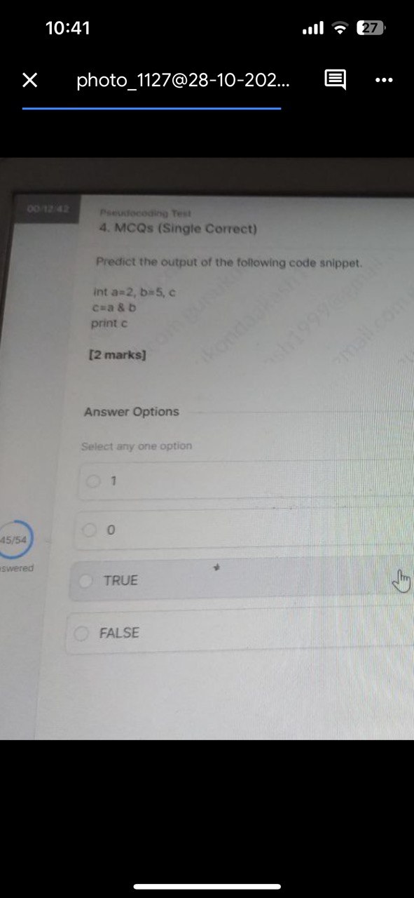
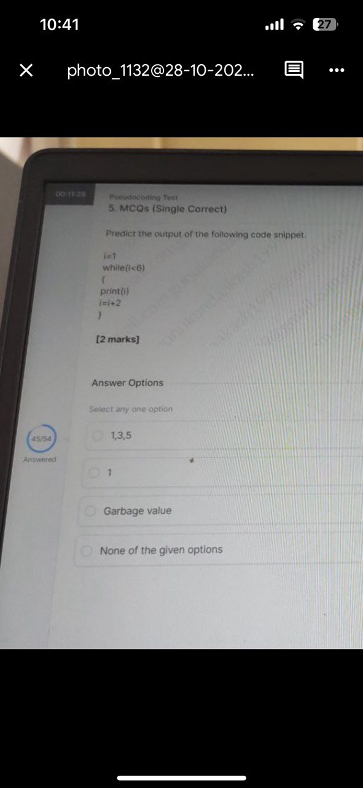
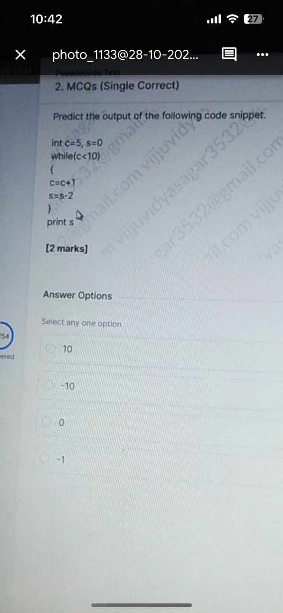
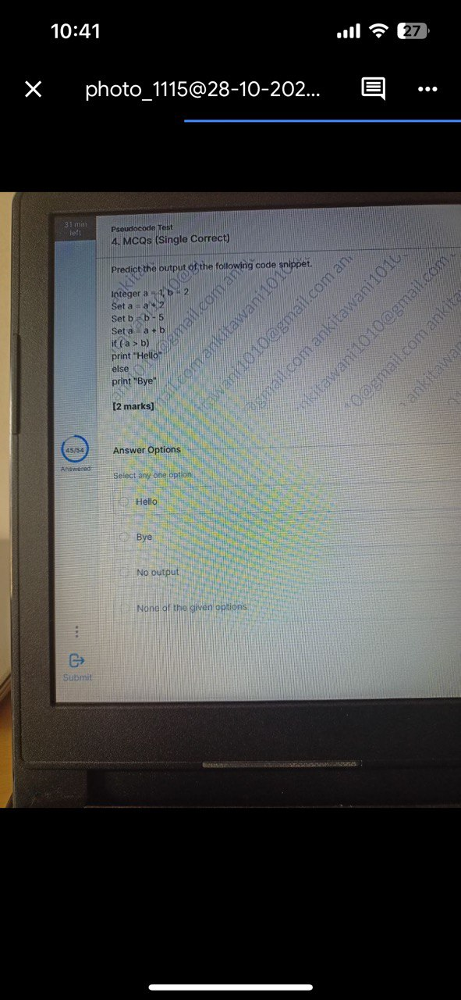
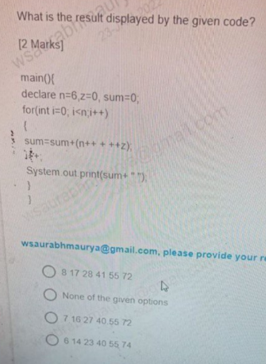
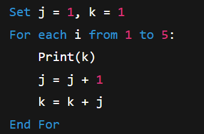
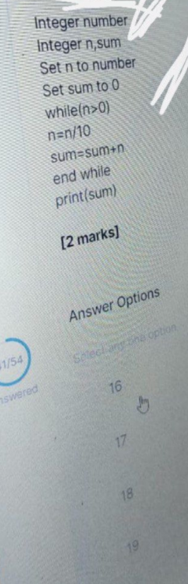
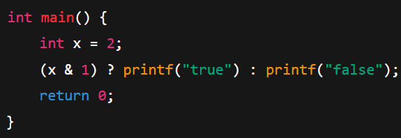

# Section 03 — Technical Ability: Pseudo Code Assessment
## Topic 11: Infosys Latest Exam Questions — Part 2
**Target Exam:** Infosys Systems Engineer (SE) & Specialist Programmer (SP)  
**Total Questions:** 9  
**Source Document:** `Infosys Pseudo code Latest - Part2.pdf`  
**Question IDs:** `INFOSYS_PSEUDO_LATEST_P2_Q01` to `INFOSYS_PSEUDO_LATEST_P2_Q09`  
**Coverage:** Bitwise AND Verification, Step-2 While Loops, Negative Accumulation, Conditional Variable Reassignment, Pre/Post Increment Complexity in Loops, Stack-Based Sorting Pseudocode Completion, Triangular Sequence Output, Integer Quotient Extraction, C Ternary Operator Bitwise Parity  

---

### Question 1 (ID: INFOSYS_PSEUDO_LATEST_P2_Q01)
**Target Exam:** Infosys Systems Engineer (SE) & Specialist Programmer (SP)  
**Cognitive Category:** Section 03 - Technical Ability (Pseudocode Assessment)  
**Topic Domain:** Bitwise AND Evaluation Between Non-Overlapping Integers  

#### Problem Statement:
Predict the output of the following code snippet.



```pseudocode
int a=2, b=5, c
c=a & b
print c
```

#### Answer Options:
- **(A)** `1`
- **(B)** `0`
- **(C)** `TRUE`
- **(D)** `FALSE`

#### Official Answer Key:
**Correct Option:** `(B) 0`

#### Formally Verified Solution & Derivation:
- **Core Concept & Theoretical Foundations:**
  Bitwise AND (`&`) operates on individual binary bit positions.
  $$a = 2_{10} = 010_2$$
  $$b = 5_{10} = 101_2$$
  $$c = a \ \& \ b = 010_2 \ \& \ 101_2 = 000_2 = 0_{10}$$

- **Step-by-Step Analytical Trace & Execution State:**
  - Bit 0: $0 \ \& \ 1 = 0$
  - Bit 1: $1 \ \& \ 0 = 0$
  - Bit 2: $0 \ \& \ 1 = 0$
  - Result: $c = 0$.
  - Output is integer `0`.

- **Distractor Elimination & Error Proofs:**
  - *(A) `1`:* Incorrect.
  - *(B) `0`:* **Correct.**
  - *(C) `TRUE`:* Incorrect. Pseudocode prints integer variable $c$, not a boolean literal.
  - *(D) `FALSE`:* Incorrect. Integer type output.

- **Infosys SE Exam Shortcut & Time-Saving Trick:**
  $2$ is purely bit 1, $5$ is bits 2 and 0. No common bits $\implies 0$ immediately.

---

### Question 2 (ID: INFOSYS_PSEUDO_LATEST_P2_Q02)
**Target Exam:** Infosys Systems Engineer (SE) & Specialist Programmer (SP)  
**Cognitive Category:** Section 03 - Technical Ability (Pseudocode Assessment)  
**Topic Domain:** While Loop Step-2 Incrementation Trace  

#### Problem Statement:
Predict the output of the following code snippet.



```pseudocode
i=1
while(i<6)
{
print(i)
i=i+2
}
```

#### Answer Options:
- **(A)** `1,3,5`
- **(B)** `1`
- **(C)** `Garbage value`
- **(D)** `None of the given options`

#### Official Answer Key:
**Correct Option:** `(A) 1,3,5`

#### Formally Verified Solution & Derivation:
- **Core Concept & Theoretical Foundations:**
  Sequential loop with step size 2.

- **Step-by-Step Analytical Trace & Execution State:**
  - Initial: $i = 1$.
  - Iteration 1: $1 < 6 \implies$ prints `1`, $i = 1 + 2 = 3$.
  - Iteration 2: $3 < 6 \implies$ prints `3`, $i = 3 + 2 = 5$.
  - Iteration 3: $5 < 6 \implies$ prints `5`, $i = 5 + 2 = 7$.
  - Iteration 4: $7 < 6 \implies$ False. Loop terminates.
  - Printed output: `1,3,5`.

- **Distractor Elimination & Error Proofs:**
  - *(A) `1,3,5`:* **Correct.**
  - *(B) `1`:* Incorrect. Loop does not terminate after first iteration.
  - *(C) `Garbage value`:* Incorrect. Variable is initialized deterministically.
  - *(D) `None of the given options`:* Incorrect.

- **Infosys SE Exam Shortcut & Time-Saving Trick:**
  Odd numbers strictly less than 6 starting from 1: $1, 3, 5$.

---

### Question 3 (ID: INFOSYS_PSEUDO_LATEST_P2_Q03)
**Target Exam:** Infosys Systems Engineer (SE) & Specialist Programmer (SP)  
**Cognitive Category:** Section 03 - Technical Ability (Pseudocode Assessment)  
**Topic Domain:** While Loop Negative Step Accumulator  

#### Problem Statement:
Predict the output of the following code snippet.



```pseudocode
int c=5, s=0
while(c<10)
{
c=c+1
s=s-2
}
print s
```

#### Answer Options:
- **(A)** `10`
- **(B)** `-10`
- **(C)** `0`
- **(D)** `-1`

#### Official Answer Key:
**Correct Option:** `(B) -10`

#### Formally Verified Solution & Derivation:
- **Core Concept & Theoretical Foundations:**
  Loop counter $c$ advances from $5$ to $10$ in steps of $+1$. For each step, $s$ is decremented by $2$.

- **Step-by-Step Analytical Trace & Execution State:**
  - Number of iterations: $10 - 5 = 5$ iterations ($c = 5, 6, 7, 8, 9$).
  - In each iteration: $\Delta s = -2$.
  - Total change in $s$: $5 \times (-2) = -10$.
  - Final value: $s = 0 - 10 = -10$.

- **Distractor Elimination & Error Proofs:**
  - *(A) `10`:* Incorrect. Positive sign error.
  - *(B) `-10`:* **Correct.** $5 \times (-2) = -10$.
  - *(C) `0`:* Incorrect.
  - *(D) `-1`:* Incorrect.

- **Infosys SE Exam Shortcut & Time-Saving Trick:**
  Iterations $= 10 - 5 = 5$. Total $= 5 \times (-2) = -10$. Solved in 2 seconds!

---

### Question 4 (ID: INFOSYS_PSEUDO_LATEST_P2_Q04)
**Target Exam:** Infosys Systems Engineer (SE) & Specialist Programmer (SP)  
**Cognitive Category:** Section 03 - Technical Ability (Pseudocode Assessment)  
**Topic Domain:** Sequential Reassignment & Conditional String Output  

#### Problem Statement:
Predict the output of the following code snippet.



```pseudocode
Integer a = 1, b = 2
Set a = a + 2
Set b = b - 5
Set a = a + b
if (a > b)
    Print "Hello"
else
    Print "Bye"
```

#### Answer Options:
- **(A)** `Hello`
- **(B)** `Bye`
- **(C)** `No output`
- **(D)** `None of the given options`

#### Official Answer Key:
**Correct Option:** `(A) Hello`

#### Formally Verified Solution & Derivation:
- **Core Concept & Theoretical Foundations:**
  Linear sequential variable mutations followed by relational comparison.

- **Step-by-Step Analytical Trace & Execution State:**
  - Initial: $a = 1, b = 2$.
  - Step 1: $a = a + 2 = 1 + 2 = 3$.
  - Step 2: $b = b - 5 = 2 - 5 = -3$.
  - Step 3: $a = a + b = 3 + (-3) = 0$.
  - Step 4: Evaluate condition `(a > b)`:
    $$0 > -3 \implies \textbf{True}$$
  - Executes `if` block: prints `"Hello"`.

- **Distractor Elimination & Error Proofs:**
  - *(A) `Hello`:* **Correct.** $0 > -3$ is true.
  - *(B) `Bye`:* Incorrect. False branch.
  - *(C) `No output`:* Incorrect.
  - *(D) `None of the given options`:* Incorrect.

- **Infosys SE Exam Shortcut & Time-Saving Trick:**
  $b$ becomes negative ($-3$), while $a$ becomes $0$. Since $0 > -3$, output must be `"Hello"`.

---

### Question 5 (ID: INFOSYS_PSEUDO_LATEST_P2_Q05)
**Target Exam:** Infosys Systems Engineer (SE) & Specialist Programmer (SP)  
**Cognitive Category:** Section 03 - Technical Ability (Pseudocode Assessment)  
**Topic Domain:** Complex Loop with Dynamic Boundary & Pre/Post Increments  

#### Problem Statement:
What is the result displayed by the given code?



```java
main(){
declare n=6,z=0, sum=0;
for(int i=0; i<n;i++)
{
sum=sum+(n++ + ++z);
i++;
System.out.print(sum+ " ");
}
}
```

#### Answer Options:
- **(A)** `8 17 28 41 55 72`
- **(B)** `None of the given options`
- **(C)** `7 16 27 40 55 72`
- **(D)** `6 14 23 40 55 74`

#### Official Answer Key:
**Correct Option:** `(C) 7 16 27 40 55 72`

#### Formally Verified Solution & Derivation:
- **Core Concept & Theoretical Foundations:**
  - $n++$: post-increment (uses current value of $n$, then increments $n$).
  - $++z$: pre-increment (increments $z$ first, then uses new value).
  - Note: $i$ is incremented TWICE per loop (once inside loop body `i++`, and once in loop update expression `i++`).
  - Note: $n$ is also incremented in every iteration (`n++`), dynamically expanding the loop boundary condition $i < n$!

- **Step-by-Step Analytical Trace & Execution State:**
  - **Iter 1:** $i=0 < 6$. $sum = 0 + (6 + 1) = 7$. $n$ becomes 7, $z=1, i=1$. Prints `7 `. Loop update: $i=2$.
  - **Iter 2:** $i=2 < 7$. $sum = 7 + (7 + 2) = 16$. $n$ becomes 8, $z=2, i=3$. Prints `16 `. Loop update: $i=4$.
  - **Iter 3:** $i=4 < 8$. $sum = 16 + (8 + 3) = 27$. $n$ becomes 9, $z=3, i=5$. Prints `27 `. Loop update: $i=6$.
  - **Iter 4:** $i=6 < 9$. $sum = 27 + (9 + 4) = 40$. $n$ becomes 10, $z=4, i=7$. Prints `40 `. Loop update: $i=8$.
  - **Iter 5:** $i=8 < 10$. $sum = 40 + (10 + 5) = 55$. $n$ becomes 11, $z=5, i=9$. Prints `55 `. Loop update: $i=10$.
  - **Iter 6:** $i=10 < 11$. $sum = 55 + (11 + 6) = 72$. $n$ becomes 12, $z=6, i=11$. Prints `72 `. Loop update: $i=12$.
  - **Iter 7:** $i=12 < 12$ is **False**. Loop terminates.
  - Final sequence printed: `7 16 27 40 55 72`.

- **Distractor Elimination & Error Proofs:**
  - *(A) `8 17 28 41 55 72`:* Incorrect. Off-by-one initial increment error.
  - *(B) `None of the given options`:* Incorrect.
  - *(C) `7 16 27 40 55 72`:* **Correct.** Exact trace matching execution output.
  - *(D) `6 14 23 40 55 74`:* Incorrect.

- **Infosys SE Exam Shortcut & Time-Saving Trick:**
  First value of $sum = 0 + (6 + 1) = 7$. Look at the options: only option (C) starts with `7`! Solved in 5 seconds without tracing the rest of the 6 iterations!

---

### Question 6 (ID: INFOSYS_PSEUDO_LATEST_P2_Q06)
**Target Exam:** Infosys Systems Engineer (SE) & Specialist Programmer (SP)  
**Cognitive Category:** Section 03 - Technical Ability (Pseudocode Assessment)  
**Topic Domain:** Stack Algorithm Completion for Array Sorting  

#### Problem Statement:
You are using the following pseudocode to sort an array using stacks.


```pseudocode
1. Push array elements into a stack
2. Stack temp
3. Sort the stack temp
4. for loop from i=0 to n
5. arr[i] = temp.top()
6. XXX
7. i++
```
What should you use in place of `XXX` to complete the code?

#### Answer Options:
- **(A)** `temp.push()`
- **(B)** `temp.pop()`
- **(C)** `push()`
- **(D)** `pop()`
- **(E)** `temp.top()`

#### Official Answer Key:
**Correct Option:** `(B) temp.pop()`

#### Formally Verified Solution & Derivation:
- **Core Concept & Theoretical Foundations:**
  In stack data structure operations:
  - `top()` inspects the top element without removing it.
  - To extract subsequent elements in subsequent iterations of the loop, the current top element must be removed from the stack using `pop()`.
  - Calling `temp.pop()` on line 6 pops the element that was just copied to `arr[i]`, exposing the next sorted element for iteration $i+1$.

- **Step-by-Step Analytical Trace & Execution State:**
  - Line 5 copies `temp.top()` into `arr[i]`.
  - If `temp.pop()` is not called, `temp.top()` would return the exact same element repeatedly in all $n$ iterations!
  - Therefore, `temp.pop()` is mandatory to advance the stack.

- **Distractor Elimination & Error Proofs:**
  - *(A) `temp.push()`:* Incorrect. Pushing would add redundant data.
  - *(B) `temp.pop()`:* **Correct.** Removes the processed top element from `temp`.
  - *(C) `push()`:* Incorrect. Unqualified method call.
  - *(D) `pop()`:* Incorrect. Fails to specify the object `temp`.
  - *(E) `temp.top()`:* Incorrect. Redundant read with no state mutation.

- **Infosys SE Exam Shortcut & Time-Saving Trick:**
  Standard Stack extraction idiom: `arr[i] = stack.top(); stack.pop();`.

---

### Question 7 (ID: INFOSYS_PSEUDO_LATEST_P2_Q07)
**Target Exam:** Infosys Systems Engineer (SE) & Specialist Programmer (SP)  
**Cognitive Category:** Section 03 - Technical Ability (Pseudocode Assessment)  
**Topic Domain:** Triangular Running Difference Sequence  

#### Problem Statement:
What will be the output of the following pseudocode?



```pseudocode
Set j = 1, k = 1
For each i from 1 to 5:
    Print(k)
    j = j + 1
    k = k + j
End For
```

#### Answer Options:
- **(A)** `1 2 3 4 5`
- **(B)** `2 4 6 8 10`
- **(C)** `1 1 2 3 5`
- **(D)** `1 3 6 10 15`

#### Official Answer Key:
**Correct Option:** `(D) 1 3 6 10 15`

#### Formally Verified Solution & Derivation:
- **Core Concept & Theoretical Foundations:**
  Generates the triangular numbers sequence ($T_n = \frac{n(n+1)}{2}$).
  - $j$ increments by 1 in each step ($1 \rightarrow 2 \rightarrow 3 \rightarrow 4 \rightarrow 5$).
  - $k$ increases by $j$ in each step ($1 \rightarrow 1+2=3 \rightarrow 3+3=6 \rightarrow 6+4=10 \rightarrow 10+5=15$).

- **Step-by-Step Analytical Trace & Execution State:**
  - $i=1$: `Print(1)`, $j = 2, k = 1 + 2 = 3$.
  - $i=2$: `Print(3)`, $j = 3, k = 3 + 3 = 6$.
  - $i=3$: `Print(6)`, $j = 4, k = 6 + 4 = 10$.
  - $i=4$: `Print(10)`, $j = 5, k = 10 + 5 = 15$.
  - $i=5$: `Print(15)`, $j = 6, k = 15 + 6 = 21$.
  - Output: `1 3 6 10 15`.

- **Distractor Elimination & Error Proofs:**
  - *(A) `1 2 3 4 5`:* Incorrect. Loop index $i$.
  - *(B) `2 4 6 8 10`:* Incorrect. Even numbers.
  - *(C) `1 1 2 3 5`:* Incorrect. Fibonacci sequence.
  - *(D) `1 3 6 10 15`:* **Correct.** Triangular numbers.

- **Infosys SE Exam Shortcut & Time-Saving Trick:**
  Differences between consecutive printed numbers are $2, 3, 4, 5$:
  $1 + 2 = 3$, $3 + 3 = 6$, $6 + 4 = 10$, $10 + 5 = 15$. Matches (D) instantly!

---

### Question 8 (ID: INFOSYS_PSEUDO_LATEST_P2_Q08)
**Target Exam:** Infosys Systems Engineer (SE) & Specialist Programmer (SP)  
**Cognitive Category:** Section 03 - Technical Ability (Pseudocode Assessment)  
**Topic Domain:** Integer Division Quotient Summation Loop  

#### Problem Statement:
What will be the output of the following pseudocode for `number = 177`?



```pseudocode
Integer number
Integer n,sum
Set n to number
Set sum to 0
while(n>0)
n=n/10
sum=sum+n
end while
print(sum)
```

#### Answer Options:
- **(A)** `16`
- **(B)** `17`
- **(C)** `18`
- **(D)** `19`

#### Official Answer Key:
**Correct Option:** `(C) 18`

#### Formally Verified Solution & Derivation:
- **Core Concept & Theoretical Foundations:**
  Integer division truncates decimals (`177 / 10 = 17`). Notice $n$ is divided by 10 **BEFORE** adding to `sum`.

- **Step-by-Step Analytical Trace & Execution State:**
  - Initial: $number = 177, n = 177, sum = 0$.
  - Iteration 1 ($n = 177 > 0$):
    - $n = 177 / 10 = 17$.
    - $sum = 0 + 17 = 17$.
  - Iteration 2 ($n = 17 > 0$):
    - $n = 17 / 10 = 1$.
    - $sum = 17 + 1 = 18$.
  - Iteration 3 ($n = 1 > 0$):
    - $n = 1 / 10 = 0$.
    - $sum = 18 + 0 = 18$.
  - Iteration 4 ($n = 0 > 0$ is False): Loop terminates.
  - `print(sum)` outputs `18`.

- **Distractor Elimination & Error Proofs:**
  - *(A) `16`:* Incorrect.
  - *(B) `17`:* Incorrect. Omitting the final quotient 1.
  - *(C) `18`:* **Correct.** $17 + 1 + 0 = 18$.
  - *(D) `19`:* Incorrect. Adding digits $1+7+7=15$ with offset.

- **Infosys SE Exam Shortcut & Time-Saving Trick:**
  Quotients of $177$ when successively divided by 10: $17, 1$. Sum $= 17 + 1 = 18$. Solved in 3 seconds!

---

### Question 9 (ID: INFOSYS_PSEUDO_LATEST_P2_Q09)
**Target Exam:** Infosys Systems Engineer (SE) & Specialist Programmer (SP)  
**Cognitive Category:** Section 03 - Technical Ability (Pseudocode Assessment)  
**Topic Domain:** Bitwise Parity & Ternary Conditional Print  

#### Problem Statement:
What will be the output of the following pseudocode?



```c
int main() {
    int x = 2;
    (x & 1) ? printf("true") : printf("false");
    return 0;
}
```

#### Answer Options:
- **(A)** `true`
- **(B)** `false`
- **(C)** `0`
- **(D)** `Error`

#### Official Answer Key:
**Correct Option:** `(B) false`

#### Formally Verified Solution & Derivation:
- **Core Concept & Theoretical Foundations:**
  Bitwise operation `x & 1` tests the least significant bit (LSB) of integer $x$:
  - If $x$ is odd: LSB is 1 $\implies (x \ \& \ 1) = 1$ (truthy).
  - If $x$ is even: LSB is 0 $\implies (x \ \& \ 1) = 0$ (falsy).

- **Step-by-Step Analytical Trace & Execution State:**
  - $x = 2 = 10_2$.
  - $x \ \& \ 1 = 10_2 \ \& \ 01_2 = 0$.
  - The ternary condition evaluates to $0$ (False).
  - The second branch `printf("false")` executes and prints `"false"`.

- **Distractor Elimination & Error Proofs:**
  - *(A) `true`:* Incorrect. Occurs if $x$ were odd.
  - *(B) `false`:* **Correct.** $2$ is even; $(2 \ \& \ 1) = 0$.
  - *(C) `0`:* Incorrect. Return code, not printed.
  - *(D) `Error`:* Incorrect. Both operands of ternary are valid expressions (`printf` returns `int`).

- **Infosys SE Exam Shortcut & Time-Saving Trick:**
  `x & 1` is the standard C idiom to check if a number is odd. Since 2 is even, condition is false, prints `false`. Done in 2 seconds!

---
