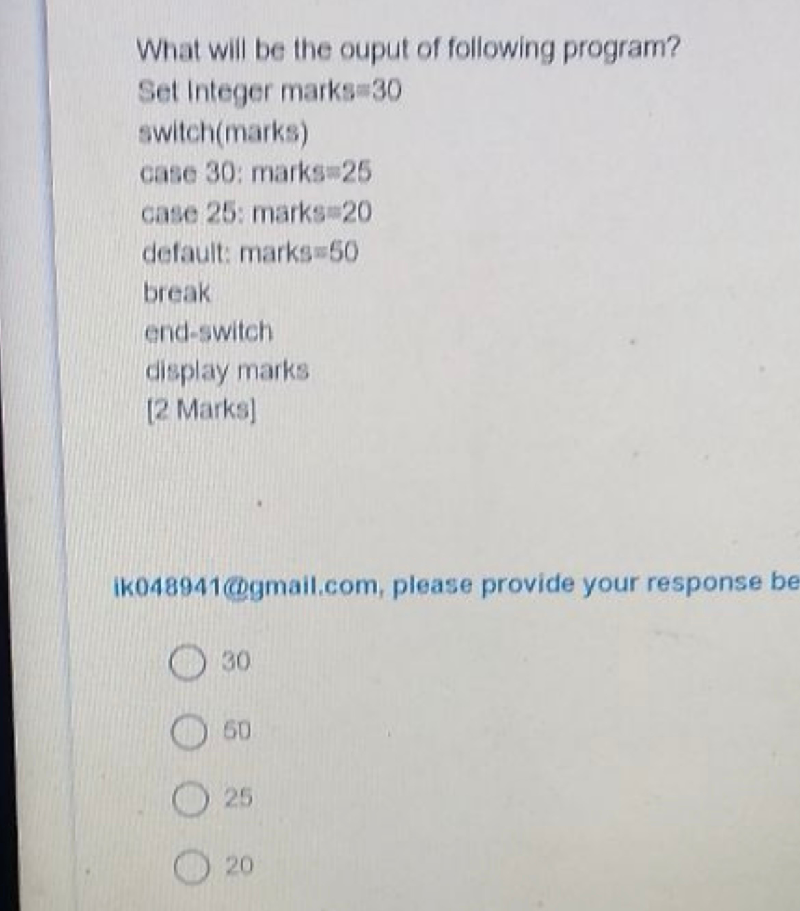
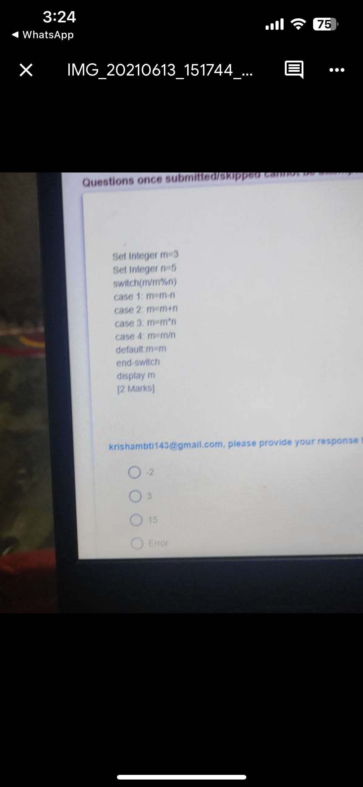
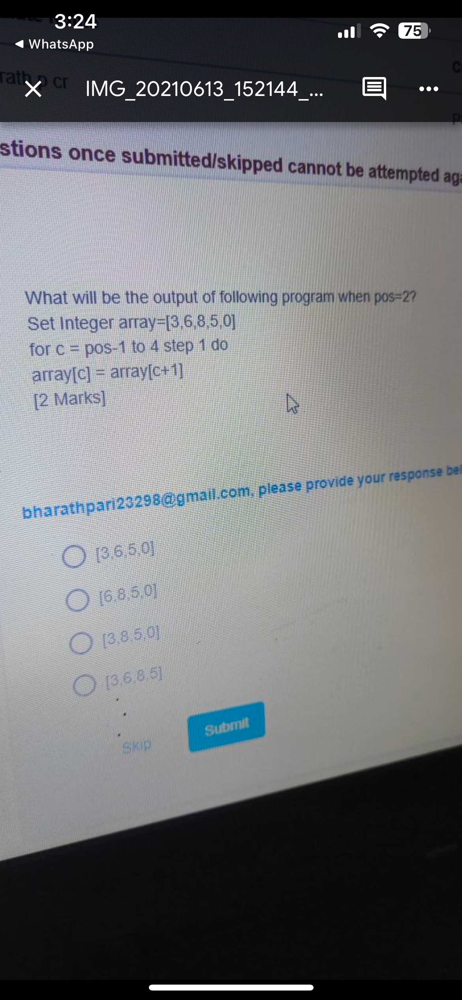
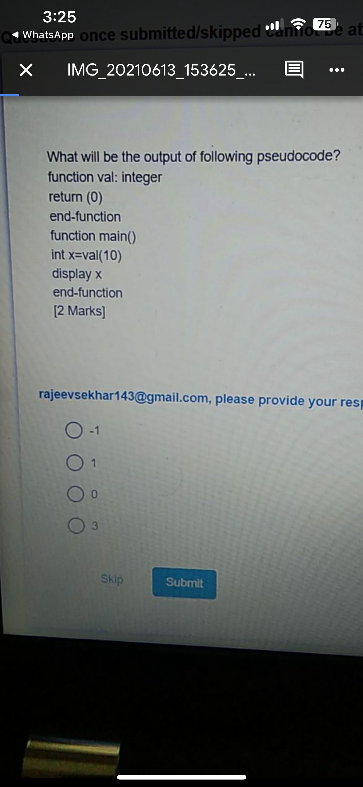
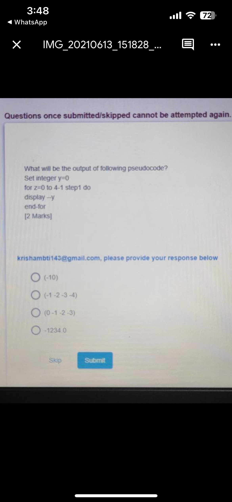
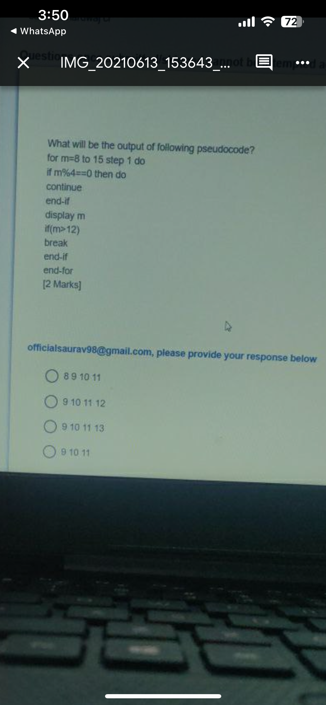
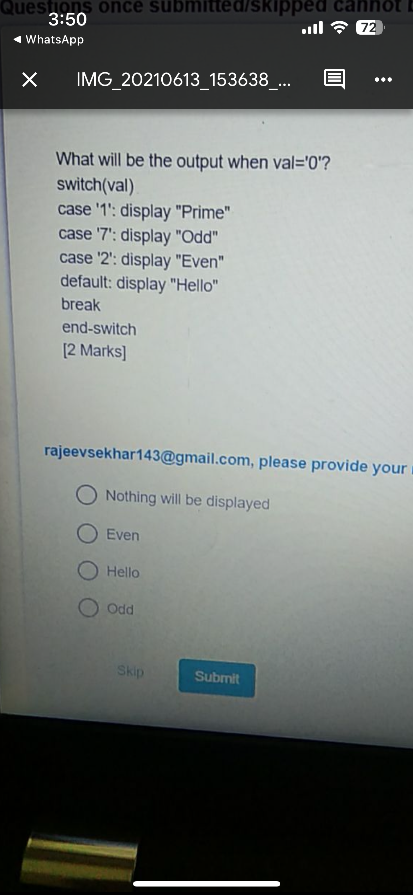
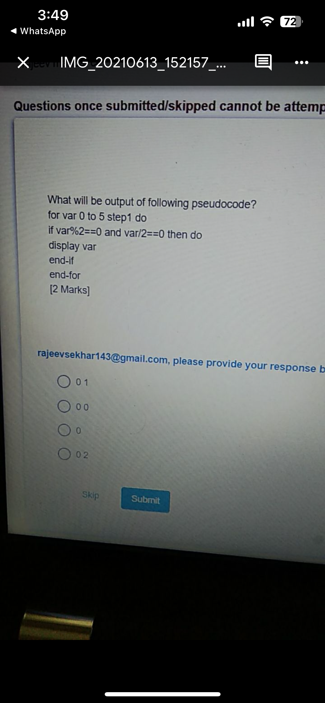

# Section 03 — Technical Ability: Pseudo Code Assessment
## Topic 12: Infosys Latest Exam Questions — Part 3
**Target Exam:** Infosys Systems Engineer (SE) & Specialist Programmer (SP)  
**Total Questions:** 10  
**Source Document:** `Infosys Pseudo code Latest - Part3.pdf`  
**Question IDs:** `INFOSYS_PSEUDO_LATEST_P3_Q01` to `INFOSYS_PSEUDO_LATEST_P3_Q10`  
**Coverage:** Switch-Case Fall-Through without Break, Precedence of Arithmetic Operators in Switch Expressions, In-Place Array Shifting & Deletion, Functions with Inactive Arguments, Pre-Decrement Loop Displays, Infinite Do-While Loops, Continue vs Break Interaction in Loops, Character Switch Fallback to Default, Combined Modulo/Division Logic, Pre/Post Increment Self-Identity Traps  

---

### Question 1 (ID: INFOSYS_PSEUDO_LATEST_P3_Q01)
**Target Exam:** Infosys Systems Engineer (SE) & Specialist Programmer (SP)  
**Cognitive Category:** Section 03 - Technical Ability (Pseudocode Assessment)  
**Topic Domain:** Switch-Case Fall-Through Semantics Without Break  

#### Problem Statement:
What will be the output of following program?



```pseudocode
Set Integer marks=30
switch(marks)
case 30: marks=25
case 25: marks=20
default: marks=50
break
end-switch
display marks
```

#### Answer Options:
- **(A)** `30`
- **(B)** `50`
- **(C)** `25`
- **(D)** `20`

#### Official Answer Key:
**Correct Option:** `(B) 50`

#### Formally Verified Solution & Derivation:
- **Core Concept & Theoretical Foundations:**
  In C/C++ and standard procedural pseudocode, `switch` statements exhibit **fall-through** behavior unless explicitly terminated by a `break` statement. Once a matching `case` is entered, control flows unconditionally through all subsequent cases and the `default` block until a `break` is encountered.

- **Step-by-Step Analytical Trace & Execution State:**
  - Initial state: $marks = 30$.
  - `switch(marks)` tests $30$:
    - Matches `case 30`: $marks = 25$.
    - **No break!** Falls through to `case 25`.
    - Executes `case 25`: $marks = 20$.
    - **No break!** Falls through to `default`.
    - Executes `default`: $marks = 50$.
    - `break` encountered! Exits `end-switch`.
  - `display marks` outputs `50`.

- **Distractor Elimination & Error Proofs:**
  - *(A) `30`:* Incorrect. Original value of $marks$.
  - *(B) `50`:* **Correct.** Result of fall-through to `default`.
  - *(C) `25`:* Incorrect. Value assigned in `case 30` if one assumes automatic break.
  - *(D) `20`:* Incorrect. Value assigned in `case 25` if fall-through stopped before `default`.

- **Infosys SE Exam Shortcut & Time-Saving Trick:**
  Scan for the word `break`. If there is NO `break` until `default`, the execution will fall all the way into `default: marks = 50`. Answer is 50 in 3 seconds!

---

### Question 2 (ID: INFOSYS_PSEUDO_LATEST_P3_Q02)
**Target Exam:** Infosys Systems Engineer (SE) & Specialist Programmer (SP)  
**Cognitive Category:** Section 03 - Technical Ability (Pseudocode Assessment)  
**Topic Domain:** Operator Precedence in Switch Expression & Unbounded Fall-Through  

#### Problem Statement:
What will be the output of following pseudocode?



```pseudocode
Set Integer m=3
Set Integer n=5
switch(m/m%n)
case 1: m=m-n
case 2: m=m+n
case 3: m=m*n
case 4: m=m/n
default: m=m
end-switch
display m
```

#### Answer Options:
- **(A)** `-2`
- **(B)** `3`
- **(C)** `15`
- **(D)** `Error`

#### Official Answer Key:
**Correct Option:** `(B) 3`

#### Formally Verified Solution & Derivation:
- **Core Concept & Theoretical Foundations:**
  1. Operator precedence: `/` (division) and `%` (modulo) share identical precedence and associate **left-to-right**.
     $$(m / m) \pmod n = (3 / 3) \pmod 5 = 1 \pmod 5 = 1$$
  2. Notice that **NO cases have break statements**. Once `case 1` matches, every subsequent case executes sequentially!

- **Step-by-Step Analytical Trace & Execution State:**
  - Switch expression evaluates to $1$.
  - Matches `case 1`: $m = m - n = 3 - 5 = -2$.
  - Falls through to `case 2`: $m = m + n = -2 + 5 = 3$.
  - Falls through to `case 3`: $m = m \times n = 3 \times 5 = 15$.
  - Falls through to `case 4`: $m = m / n = 15 / 5 = 3$.
  - Falls through to `default`: $m = m = 3$.
  - Exits switch.
  - `display m` prints `3`.

- **Distractor Elimination & Error Proofs:**
  - *(A) `-2`:* Incorrect. Value after `case 1` if break was present.
  - *(B) `3`:* **Correct.** Cumulative result of full fall-through sequence.
  - *(C) `15`:* Incorrect. Value after `case 3`.
  - *(D) `Error`:* Incorrect. Valid integer arithmetic.

- **Infosys SE Exam Shortcut & Time-Saving Trick:**
  Follow the full chain: $3 \xrightarrow{-5} -2 \xrightarrow{+5} 3 \xrightarrow{\times 5} 15 \xrightarrow{/ 5} 3$. Result is 3!

---

### Question 3 (ID: INFOSYS_PSEUDO_LATEST_P3_Q03)
**Target Exam:** Infosys Systems Engineer (SE) & Specialist Programmer (SP)  
**Cognitive Category:** Section 03 - Technical Ability (Pseudocode Assessment)  
**Topic Domain:** Array Element Shift & Deletion  

#### Problem Statement:
What will be the output of following program when `pos = 2`?



```pseudocode
Set Integer array=[3,6,8,5,0]
for c = pos-1 to 4 step 1 do
    array[c] = array[c+1]
```

#### Answer Options:
- **(A)** `[3,6,5,0]`
- **(B)** `[6,8,5,0]`
- **(C)** `[3,8,5,0]`
- **(D)** `[3,6,8,5]`

#### Official Answer Key:
**Correct Option:** `(C) [3,8,5,0]`

#### Formally Verified Solution & Derivation:
- **Core Concept & Theoretical Foundations:**
  This algorithm implements the standard deletion operation from an array at 1-based position `pos = 2` (0-based index $1$).
  All elements to the right of index $pos-1=1$ shift left by one position.

- **Step-by-Step Analytical Trace & Execution State:**
  - Initial array: `[3, 6, 8, 5, 0]` (indices $0, 1, 2, 3, 4$).
  - $pos = 2 \implies c$ starts at $pos - 1 = 1$.
  - $c = 1: array[1] = array[2] = 8$. Array: `[3, 8, 8, 5, 0]`.
  - $c = 2: array[2] = array[3] = 5$. Array: `[3, 8, 5, 5, 0]`.
  - $c = 3: array[3] = array[4] = 0$. Array: `[3, 8, 5, 0, 0]`.
  - The shifted valid sub-array of length 4 is `[3, 8, 5, 0]`.

- **Distractor Elimination & Error Proofs:**
  - *(A) `[3,6,5,0]`:* Incorrect. Deleted index 2 instead of index 1.
  - *(B) `[6,8,5,0]`:* Incorrect. Deleted index 0.
  - *(C) `[3,8,5,0]`:* **Correct.** Element at position 2 ($6$) deleted, elements shifted left.
  - *(D) `[3,6,8,5]`:* Incorrect. Deleted last element.

- **Infosys SE Exam Shortcut & Time-Saving Trick:**
  Position 2 in `[3, 6, 8, 5, 0]` is the number `6`. Deleting `6` leaves `[3, 8, 5, 0]`. Matches (C) in 2 seconds!

---

### Question 4 (ID: INFOSYS_PSEUDO_LATEST_P3_Q04)
**Target Exam:** Infosys Systems Engineer (SE) & Specialist Programmer (SP)  
**Cognitive Category:** Section 03 - Technical Ability (Pseudocode Assessment)  
**Topic Domain:** Function Return Invariance & Unused Parameters  

#### Problem Statement:
What will be the output of following pseudocode?



```pseudocode
function val: integer
return (0)
end-function
function main()
int x=val(10)
display x
end-function
```

#### Answer Options:
- **(A)** `-1`
- **(B)** `1`
- **(C)** `0`
- **(D)** `3`

#### Official Answer Key:
**Correct Option:** `(C) 0`

#### Formally Verified Solution & Derivation:
- **Core Concept & Theoretical Foundations:**
  Function `val` returns constant literal `(0)` unconditionally, regardless of any arguments passed to it.

- **Step-by-Step Analytical Trace & Execution State:**
  - `main()` calls `val(10)`.
  - `val` executes `return (0)`.
  - Variable $x$ receives `0`.
  - `display x` prints `0`.

- **Distractor Elimination & Error Proofs:**
  - *(A) `-1`:* Incorrect.
  - *(B) `1`:* Incorrect.
  - *(C) `0`:* **Correct.** Unconditional return value of `val`.
  - *(D) `3`:* Incorrect.

- **Infosys SE Exam Shortcut & Time-Saving Trick:**
  Function body is simply `return (0)`. Whatever you pass into it, it always returns 0!

---

### Question 5 (ID: INFOSYS_PSEUDO_LATEST_P3_Q05)
**Target Exam:** Infosys Systems Engineer (SE) & Specialist Programmer (SP)  
**Cognitive Category:** Section 03 - Technical Ability (Pseudocode Assessment)  
**Topic Domain:** Pre-Decrement Operator & Loop Display  

#### Problem Statement:
What will be the output of following pseudocode?



```pseudocode
Set integer y=0
for z=0 to 4-1 step1 do
    display --y
end-for
```

#### Answer Options:
- **(A)** `(-10)`
- **(B)** `(-1 -2 -3 -4)`
- **(C)** `(0 -1 -2 -3)`
- **(D)** `-1234.0`

#### Official Answer Key:
**Correct Option:** `(B) (-1 -2 -3 -4)`

#### Formally Verified Solution & Derivation:
- **Core Concept & Theoretical Foundations:**
  The pre-decrement operator `--y` decrements $y$ by 1 **before** yielding its value for display.
  The loop runs for $z = 0, 1, 2, 3$ (total 4 iterations).

- **Step-by-Step Analytical Trace & Execution State:**
  - $z = 0: y$ becomes $-1 \implies$ displays `-1`.
  - $z = 1: y$ becomes $-2 \implies$ displays `-2`.
  - $z = 2: y$ becomes $-3 \implies$ displays `-3`.
  - $z = 3: y$ becomes $-4 \implies$ displays `-4`.
  - Total sequence displayed: `(-1 -2 -3 -4)`.

- **Distractor Elimination & Error Proofs:**
  - *(A) `(-10)`:* Incorrect. Sum of decrements distractor.
  - *(B) `(-1 -2 -3 -4)`:* **Correct.** Pre-decrement sequence across 4 iterations.
  - *(C) `(0 -1 -2 -3)`:* Incorrect. Post-decrement `y--` distractor.
  - *(D) `-1234.0`:* Incorrect.

- **Infosys SE Exam Shortcut & Time-Saving Trick:**
  Pre-decrement `--y` starting from 0 MUST start displaying at `-1` (not 0). Only option (B) starts at `-1`!

---

### Question 6 (ID: INFOSYS_PSEUDO_LATEST_P3_Q06)
**Target Exam:** Infosys Systems Engineer (SE) & Specialist Programmer (SP)  
**Cognitive Category:** Section 03 - Technical Ability (Pseudocode Assessment)  
**Topic Domain:** Infinite Loop Detection in Nested Do-While Constructs  

#### Problem Statement:
How many times the value of 'j' will get displayed?


```pseudocode
set integer j
do
for a=0 to 1 step 1 do
j=0
display j
end-for
while j<10
end do-while
```

#### Answer Options:
- **(A)** `1 times`
- **(B)** `Infinite times`
- **(C)** `5 times`
- **(D)** `10 times`

#### Official Answer Key:
**Correct Option:** `(B) Infinite times`

#### Formally Verified Solution & Derivation:
- **Core Concept & Theoretical Foundations:**
  Loop termination criteria analysis. A `do-while` loop continues executing as long as its condition evaluates to true.

- **Step-by-Step Analytical Trace & Execution State:**
  1. Inside the `do-while`, the `for` loop executes for $a = 0, 1$.
  2. In every iteration of the `for` loop, $j$ is explicitly reset: `j = 0`, and `display j` executes.
  3. At no point in the code is $j$ ever incremented!
  4. At the end of the `do-while` body, the condition `while j < 10` is checked.
  5. Since $j = 0$, the condition $0 < 10$ is **ALWAYS TRUE**.
  6. The `do-while` loop repeats endlessly without ever terminating.
  7. Value of $j$ is displayed an infinite number of times.

- **Distractor Elimination & Error Proofs:**
  - *(A) `1 times`:* Incorrect.
  - *(B) `Infinite times`:* **Correct.** $j$ remains 0 indefinitely, satisfying $j < 10$.
  - *(C) `5 times`:* Incorrect.
  - *(D) `10 times`:* Incorrect. Assumes $j$ increments by 1.

- **Infosys SE Exam Shortcut & Time-Saving Trick:**
  Look at $j$: it is set to 0 and never incremented. Condition is $j < 10$. Since $0 < 10$ forever, it is an infinite loop!

---

### Question 7 (ID: INFOSYS_PSEUDO_LATEST_P3_Q07)
**Target Exam:** Infosys Systems Engineer (SE) & Specialist Programmer (SP)  
**Cognitive Category:** Section 03 - Technical Ability (Pseudocode Assessment)  
**Topic Domain:** Loop Continue vs Break Boundary Precedence  

#### Problem Statement:
What will be the output of following pseudocode?



```pseudocode
for m=8 to 15 step 1 do
if m%4==0 then do
continue
end-if
display m
if(m>12)
break
end-if
end-for
```

#### Answer Options:
- **(A)** `8 9 10 11`
- **(B)** `9 10 11 12`
- **(C)** `9 10 11 13`
- **(D)** `9 10 11`

#### Official Answer Key:
**Correct Option:** `(C) 9 10 11 13`

#### Formally Verified Solution & Derivation:
- **Core Concept & Theoretical Foundations:**
  - `continue` skips the rest of the current iteration immediately and advances to the next value of $m$.
  - `break` permanently terminates the loop.

- **Step-by-Step Analytical Trace & Execution State:**
  - $m = 8: 8 \pmod 4 == 0 \implies$ `continue` (skips display and break).
  - $m = 9: 9 \pmod 4 \ne 0 \implies$ displays `9`. $9 > 12$ is False.
  - $m = 10: 10 \pmod 4 \ne 0 \implies$ displays `10`. $10 > 12$ is False.
  - $m = 11: 11 \pmod 4 \ne 0 \implies$ displays `11`. $11 > 12$ is False.
  - $m = 12: 12 \pmod 4 == 0 \implies$ `continue` (skips display AND skips the `m > 12` break check!).
  - $m = 13: 13 \pmod 4 \ne 0 \implies$ displays `13`.
    - Check $m > 12$: $13 > 12$ is **True** $\implies$ `break` terminates the loop!
  - Final printed sequence: `9 10 11 13`.

- **Distractor Elimination & Error Proofs:**
  - *(A) `8 9 10 11`:* Incorrect. Includes 8, which is skipped by continue.
  - *(B) `9 10 11 12`:* Incorrect. Includes 12, which is skipped by continue.
  - *(C) `9 10 11 13`:* **Correct.** Accounts for 12 being skipped and 13 triggering the break.
  - *(D) `9 10 11`:* Incorrect. Assumes loop broke at 12 without considering continue.

- **Infosys SE Exam Shortcut & Time-Saving Trick:**
  Notice $m=12$: $12 \pmod 4 = 0$ hits `continue`, so $12$ CANNOT be printed! This immediately eliminates (B). Since $8$ is also skipped, (A) is eliminated. $m=13$ is printed before breaking on $13 > 12$, confirming (C)!

---

### Question 8 (ID: INFOSYS_PSEUDO_LATEST_P3_Q08)
**Target Exam:** Infosys Systems Engineer (SE) & Specialist Programmer (SP)  
**Cognitive Category:** Section 03 - Technical Ability (Pseudocode Assessment)  
**Topic Domain:** Switch Statement Unmatched Character Default Fallback  

#### Problem Statement:
What will be the output when `val = '0'`?



```pseudocode
switch(val)
case '1': display "Prime"
case '7': display "Odd"
case '2': display "Even"
default: display "Hello"
break
end-switch
```

#### Answer Options:
- **(A)** `Nothing will be displayed`
- **(B)** `Even`
- **(C)** `Hello`
- **(D)** `Odd`

#### Official Answer Key:
**Correct Option:** `(C) Hello`

#### Formally Verified Solution & Derivation:
- **Core Concept & Theoretical Foundations:**
  In a `switch` statement, if the selector value does not match any of the explicitly defined `case` constants, control jumps directly to the `default` label.

- **Step-by-Step Analytical Trace & Execution State:**
  - Selector value: $val = '0'$.
  - Compare with `case '1'`: No match.
  - Compare with `case '7'`: No match.
  - Compare with `case '2'`: No match.
  - Jumps to `default`: executes `display "Hello"`.
  - Encounters `break` and terminates `end-switch`.
  - Printed output: `"Hello"`.

- **Distractor Elimination & Error Proofs:**
  - *(A) `Nothing will be displayed`:* Incorrect. The `default` branch executes when no case matches.
  - *(B) `Even`:* Incorrect.
  - *(C) `Hello`:* **Correct.** Executed via `default`.
  - *(D) `Odd`:* Incorrect.

- **Infosys SE Exam Shortcut & Time-Saving Trick:**
  `val = '0'` does not match `'1'`, `'7'`, or `'2'`. Directly falls to `default` $\implies$ `"Hello"`. Solved in 1 second!

---

### Question 9 (ID: INFOSYS_PSEUDO_LATEST_P3_Q09)
**Target Exam:** Infosys Systems Engineer (SE) & Specialist Programmer (SP)  
**Cognitive Category:** Section 03 - Technical Ability (Pseudocode Assessment)  
**Topic Domain:** Dual Modulo & Integer Quotient Filter  

#### Problem Statement:
What will be output of following pseudocode?



```pseudocode
for var 0 to 5 step1 do
if var%2==0 and var/2==0 then do
display var
end-if
end-for
```

#### Answer Options:
- **(A)** `0 1`
- **(B)** `0 0`
- **(C)** `0`
- **(D)** `0 2`

#### Official Answer Key:
**Correct Option:** `(C) 0`

#### Formally Verified Solution & Derivation:
- **Core Concept & Theoretical Foundations:**
  Tests two simultaneous mathematical conditions for integers $var \in [0, 5]$:
  1. $var \pmod 2 == 0$ ($var$ is an even integer).
  2. $var / 2 == 0$ (Integer division quotient equals 0, meaning $0 \le var < 2$).

- **Step-by-Step Analytical Trace & Execution State:**
  - $var = 0$: $0 \pmod 2 = 0$ (True) AND $0 / 2 = 0$ (True) $\implies$ **Displays 0**.
  - $var = 1$: $1 \pmod 2 = 1 \ne 0$ (False) $\implies$ Skipped.
  - $var = 2$: $2 \pmod 2 = 0$ (True), BUT $2 / 2 = 1 \ne 0$ (False) $\implies$ Skipped.
  - $var = 3$: $3 \pmod 2 = 1 \ne 0$ (False) $\implies$ Skipped.
  - $var = 4$: $4 / 2 = 2 \ne 0$ (False) $\implies$ Skipped.
  - $var = 5$: $5 \pmod 2 = 1 \ne 0$ (False) $\implies$ Skipped.
  - Only $var = 0$ satisfies both conditions.
  - Output printed: `0`.

- **Distractor Elimination & Error Proofs:**
  - *(A) `0 1`:* Incorrect. 1 fails modulo 2.
  - *(B) `0 0`:* Incorrect. Loop only prints once for 0.
  - *(C) `0`:* **Correct.** Only 0 satisfies both even parity and quotient 0.
  - *(D) `0 2`:* Incorrect. 2 fails $var/2 == 0$.

- **Infosys SE Exam Shortcut & Time-Saving Trick:**
  $var / 2 == 0$ for non-negative integers only holds when $var \in \{0, 1\}$. Of these two, only $0$ is divisible by 2. Thus only $0$ can print!

---

### Question 10 (ID: INFOSYS_PSEUDO_LATEST_P3_Q10)
**Target Exam:** Infosys Systems Engineer (SE) & Specialist Programmer (SP)  
**Cognitive Category:** Section 03 - Technical Ability (Pseudocode Assessment)  
**Topic Domain:** Complex Pre/Post Increment Self-Identity Trap  

#### Problem Statement:
What will be the output of following pseudocode?


```pseudocode
for i=0 to 4 step 1 do
if i==i++ + --i then do
display i
end-if
end-for
```

#### Answer Options:
- **(A)** `2`
- **(B)** `0`
- **(C)** `3`
- **(D)** `1`

#### Official Answer Key:
**Correct Option:** `(B) 0`

#### Formally Verified Solution & Derivation:
- **Core Concept & Theoretical Foundations:**
  Evaluating expression `i == i++ + --i`:
  - In sequential expression evaluation, `i++` yields the current value of $i$, then increments $i$.
  - `--i` immediately decrements $i$ back to its original value and yields that original value.
  - Sum $= i_{\text{orig}} + i_{\text{orig}} = 2 \times i_{\text{orig}}$.
  - The equation $i == 2i$ is satisfied if and only if $i = 0$!

- **Step-by-Step Analytical Trace & Execution State:**
  - For $i = 0$:
    - Left side: $0$.
    - Right side: `i++` yields $0$ ($i$ becomes 1); `--i` decrements $i$ to $0$ and yields $0$. Sum $= 0 + 0 = 0$.
    - $0 == 0$ is **True**! `display i` outputs `0`.
  - For $i = 1$:
    - Left side: $1$.
    - Right side yields $1 + 1 = 2$. $1 == 2$ is **False**.
  - For $i \ge 1$: $i == 2i$ is always **False**.
  - Loop completes with only `0` displayed.

- **Distractor Elimination & Error Proofs:**
  - *(A) `2`:* Incorrect.
  - *(B) `0`:* **Correct.** Unique mathematical root of $i = 2i$.
  - *(C) `3`:* Incorrect.
  - *(D) `1`:* Incorrect.

- **Infosys SE Exam Shortcut & Time-Saving Trick:**
  Simplify algebraically: `i++ + --i` evaluates to $2i$. The condition is $i == 2i \implies i = 0$. Only $0$ matches!

---
