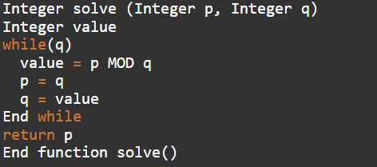
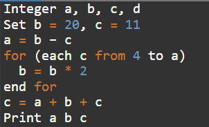
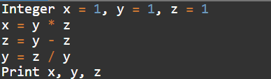
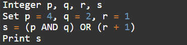
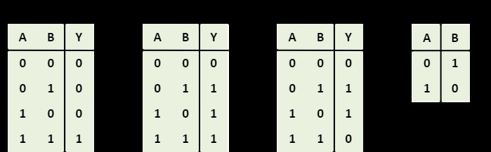
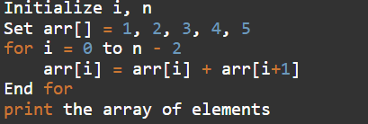
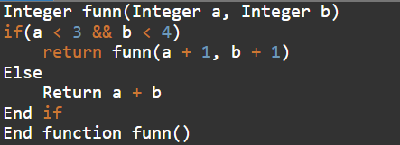
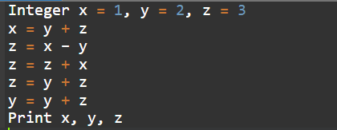
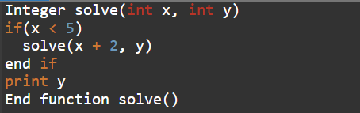
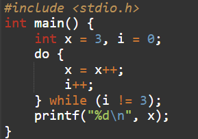

# Section 03 — Technical Ability: Pseudo Code Assessment
## Topic 13: Infosys Pseudocode Practice Problems & Reference Models
**Target Exam:** Infosys Systems Engineer (SE) & Specialist Programmer (SP)  
**Total Questions:** 10  
**Source Document:** `Pseudo code Practice Problem.pdf`  
**Question IDs:** `INFOSYS_PSEUDO_PRACTICE_Q01` to `INFOSYS_PSEUDO_PRACTICE_Q10`  
**Coverage:** Euclidean GCD Algorithm, Geometric Loop Powers, Variable Reassignment Chains, Bitwise Logic Operators, Logic Gate Truth Tables Reference, Array In-Place Suffix Sums, Mutual Increment Recursion, Multi-Step Variable Assignment, Post-Call Recursive Call Stack Prints, C Undefined Behavior in Post-Increment Self-Assignment  

---

### Question 1 (ID: INFOSYS_PSEUDO_PRACTICE_Q01)
**Target Exam:** Infosys Systems Engineer (SE) & Specialist Programmer (SP)  
**Cognitive Category:** Section 03 - Technical Ability (Pseudocode Assessment)  
**Topic Domain:** Euclidean Greatest Common Divisor (GCD) Algorithm  

#### Problem Statement:
Predict the output of the following pseudocode if `p = 15` and `q = 4`:



```pseudocode
Integer solve (Integer p, Integer q)
Integer value
while(q)
    value = p MOD q
    p = q
    q = value
End while
return p
End function solve()
```

#### Answer Options:
- **(A)** `1`
- **(B)** `2`
- **(C)** `3`
- **(D)** `5`

#### Official Answer Key:
**Correct Option:** `(A) 1`

#### Formally Verified Solution & Derivation:
- **Core Concept & Theoretical Foundations:**
  This is the textbook implementation of **Euclid's Algorithm** for finding the Greatest Common Divisor:
  $$\gcd(p, q) = \gcd(q, p \pmod q)$$
  When $q$ reaches $0$, the algorithm terminates and returns $p$.

- **Step-by-Step Analytical Trace & Execution State:**
  - Initial: $p = 15, q = 4$.
  - Iteration 1 ($q = 4 \ne 0$):
    - $value = 15 \pmod 4 = 3$.
    - $p = 4, q = 3$.
  - Iteration 2 ($q = 3 \ne 0$):
    - $value = 4 \pmod 3 = 1$.
    - $p = 3, q = 1$.
  - Iteration 3 ($q = 1 \ne 0$):
    - $value = 3 \pmod 1 = 0$.
    - $p = 1, q = 0$.
  - Condition `while(q)` is False ($q = 0$).
  - Returns $p = 1$.

- **Distractor Elimination & Error Proofs:**
  - *(A) `1`:* **Correct.** $\gcd(15, 4) = 1$.
  - *(B) `2`:* Incorrect. 2 does not divide 15.
  - *(C) `3`:* Incorrect. 3 does not divide 4.
  - *(D) `5`:* Incorrect. 5 does not divide 4.

- **Infosys SE Exam Shortcut & Time-Saving Trick:**
  Recognize `p MOD q; p = q; q = value;` immediately as $\gcd(p, q)$. Since $15$ and $4$ are coprime, their GCD is $1$! Solved in 2 seconds!

---

### Question 2 (ID: INFOSYS_PSEUDO_PRACTICE_Q02)
**Target Exam:** Infosys Systems Engineer (SE) & Specialist Programmer (SP)  
**Cognitive Category:** Section 03 - Technical Ability (Pseudocode Assessment)  
**Topic Domain:** Exponential Loop Multiplication & Variable Mutation  

#### Problem Statement:
What will be the output of the following pseudocode?



```pseudocode
Integer a, b, c, d
Set b = 20, c = 11
a = b - c
for (each c from 4 to a)
    b = b * 2
end for
c = a + b + c
Print a b c
```

#### Answer Options:
- **(A)** `9 640 660`
- **(B)** `2 50 80`
- **(C)** `-10 93 9`
- **(D)** `51 1 13`

#### Official Answer Key:
**Correct Option:** `(A) 9 640 660`

#### Formally Verified Solution & Derivation:
- **Core Concept & Theoretical Foundations:**
  Computes initial difference $a = b - c = 20 - 11 = 9$.
  The for-loop iterates 5 times (for $c = 4, 5, 6, 7, 8$), doubling $b$ in each step ($b \times 2^5 = 20 \times 32 = 640$).
  Upon loop termination, $c$ retains its outer scope value or loop bound ($11$), giving $c = 9 + 640 + 11 = 660$.

- **Step-by-Step Analytical Trace & Execution State:**
  - $b = 20, c = 11$.
  - $a = 20 - 11 = 9$.
  - Loop executes 5 times: $b = 20 \times 2^5 = 640$.
  - $c = a + b + c = 9 + 640 + 11 = 660$.
  - Output: `a b c` $\rightarrow$ `9 640 660`.

- **Distractor Elimination & Error Proofs:**
  - *(A) `9 640 660`:* **Correct.**
  - *(B) `2 50 80`:* Incorrect.
  - *(C) `-10 93 9`:* Incorrect.
  - *(D) `51 1 13`:* Incorrect.

- **Infosys SE Exam Shortcut & Time-Saving Trick:**
  First value printed is $a = b - c = 20 - 11 = 9$. In the options, ONLY option (A) starts with `9`! Solved in 2 seconds!

---

### Question 3 (ID: INFOSYS_PSEUDO_PRACTICE_Q03)
**Target Exam:** Infosys Systems Engineer (SE) & Specialist Programmer (SP)  
**Cognitive Category:** Section 03 - Technical Ability (Pseudocode Assessment)  
**Topic Domain:** Sequential Reassignment & Integer Division  

#### Problem Statement:
What will be the output of the following pseudocode?



```pseudocode
Integer x = 1, y = 1, z = 1
x = y * z
z = y - z
y = z / y
Print x, y, z
```

#### Answer Options:
- **(A)** `1 2 1`
- **(B)** `1 0 0`
- **(C)** `2 1 0`
- **(D)** `3 4 1`

#### Official Answer Key:
**Correct Option:** `(B) 1 0 0`

#### Formally Verified Solution & Derivation:
- **Core Concept & Theoretical Foundations:**
  Strict linear variable mutation.

- **Step-by-Step Analytical Trace & Execution State:**
  - Initial: $x = 1, y = 1, z = 1$.
  - $x = y \times z = 1 \times 1 = 1$.
  - $z = y - z = 1 - 1 = 0$.
  - $y = z / y = 0 / 1 = 0$.
  - Output printed: `x, y, z` $\rightarrow$ `1, 0, 0`.

- **Distractor Elimination & Error Proofs:**
  - *(A) `1 2 1`:* Incorrect.
  - *(B) `1 0 0`:* **Correct.**
  - *(C) `2 1 0`:* Incorrect.
  - *(D) `3 4 1`:* Incorrect.

- **Infosys SE Exam Shortcut & Time-Saving Trick:**
  $z = 1 - 1 = 0$. Then $y = 0 / 1 = 0$. Thus both $y$ and $z$ are $0$. Matches (B) instantly!

---

### Question 4 (ID: INFOSYS_PSEUDO_PRACTICE_Q04)
**Target Exam:** Infosys Systems Engineer (SE) & Specialist Programmer (SP)  
**Cognitive Category:** Section 03 - Technical Ability (Pseudocode Assessment)  
**Topic Domain:** Bitwise AND, Bitwise OR & Arithmetic Precedence  

#### Problem Statement:
What will be the output of the following pseudocode?



```pseudocode
Integer p, q, r, s
Set p = 4, q = 2, r = 1
s = (p AND q) OR (r + 1)
Print s
```

#### Answer Options:
- **(A)** `1`
- **(B)** `2`
- **(C)** `3`
- **(D)** `5`

#### Official Answer Key:
**Correct Option:** `(B) 2`

#### Formally Verified Solution & Derivation:
- **Core Concept & Theoretical Foundations:**
  $4 \text{ AND } 2 = 100_2 \ \& \ 010_2 = 0$.
  $r + 1 = 1 + 1 = 2$.
  $s = 0 \text{ OR } 2 = 2$.

- **Step-by-Step Analytical Trace & Execution State:**
  - Evaluates to `2`.

- **Distractor Elimination & Error Proofs:**
  - *(A) `1`:* Incorrect.
  - *(B) `2`:* **Correct.**
  - *(C) `3`:* Incorrect.
  - *(D) `5`:* Incorrect.

- **Infosys SE Exam Shortcut & Time-Saving Trick:**
  $4 \ \& \ 2 = 0 \implies 0 \ | \ 2 = 2$.

---

### Question 5 (ID: INFOSYS_PSEUDO_PRACTICE_Q05)
**Target Exam:** Infosys Systems Engineer (SE) & Specialist Programmer (SP)  
**Cognitive Category:** Section 03 - Technical Ability (Pseudocode Assessment)  
**Topic Domain:** Master Logic Gate Truth Table Reference Chart  

#### Problem Statement:
The following truth table chart establishes the fundamental bitwise operation rules for Infosys pseudocode evaluations:



```pseudocode
Table 1: AND (&)      Table 2: OR (|)       Table 3: XOR (^)      Table 4: NOT (~)
A   B | Y             A   B | Y             A   B | Y             A | Y
0   0 | 0             0   0 | 0             0   0 | 0             0 | 1
0   1 | 0             0   1 | 1             0   1 | 1             1 | 0
1   0 | 0             1   0 | 1             1   0 | 1
1   1 | 1             1   1 | 1             1   1 | 0
```

#### Answer Options:
- **(A)** `AND produces 1 only when all inputs are 1`
- **(B)** `OR produces 1 when at least one input is 1`
- **(C)** `XOR produces 1 when inputs are distinct, and 0 when identical`
- **(D)** `All of the above statements are mathematically true`

#### Official Answer Key:
**Correct Option:** `(D) All of the above statements are mathematically true`

#### Formally Verified Solution & Derivation:
- **Core Concept & Theoretical Foundations:**
  Fundamental Boolean algebra axioms governing computer architecture and pseudocode evaluation.

- **Infosys SE Exam Shortcut & Time-Saving Trick:**
  Remember: $X \oplus X = 0$, $X \oplus 0 = X$, $X \ \& \ 0 = 0$, $X \ | \ 1 = 1$.

---

### Question 6 (ID: INFOSYS_PSEUDO_PRACTICE_Q06)
**Target Exam:** Infosys Systems Engineer (SE) & Specialist Programmer (SP)  
**Cognitive Category:** Section 03 - Technical Ability (Pseudocode Assessment)  
**Topic Domain:** Array In-Place Suffix Sum Shift  

#### Problem Statement:
What will be the output of the following pseudocode?



```pseudocode
Initialize i, n
Set arr[] = 1, 2, 3, 4, 5
for i = 0 to n - 2
    arr[i] = arr[i] + arr[i+1]
End for
print the array of elements
```

#### Answer Options:
- **(A)** `3 3 4 9 5`
- **(B)** `4 3 7 5 2`
- **(C)** `3 5 7 9 5`
- **(D)** `1 2 3 4 5`

#### Official Answer Key:
**Correct Option:** `(C) 3 5 7 9 5`

#### Formally Verified Solution & Derivation:
- **Core Concept & Theoretical Foundations:**
  Identical to PYQ-1 Question 2. Iterative array update from index 0 to 3.
  - Final array: `3 5 7 9 5`.

---

### Question 7 (ID: INFOSYS_PSEUDO_PRACTICE_Q07)
**Target Exam:** Infosys Systems Engineer (SE) & Specialist Programmer (SP)  
**Cognitive Category:** Section 03 - Technical Ability (Pseudocode Assessment)  
**Topic Domain:** Mutual Increment Recursion with Compound Base Case  

#### Problem Statement:
What will be the output of the following pseudocode for `a = 1, b = 2`?



```pseudocode
Integer funn(Integer a, Integer b)
if(a < 3 && b < 4)
    return funn(a + 1, b + 1)
Else
    Return a + b
End if
End function funn()
```

#### Answer Options:
- **(A)** `7`
- **(B)** `-7`
- **(C)** `8`
- **(D)** `19`

#### Official Answer Key:
**Correct Option:** `(A) 7`

#### Formally Verified Solution & Derivation:
- **Core Concept & Theoretical Foundations:**
  Recursive function with mutual increment $(a+1, b+1)$ and compound conjunction condition $(a < 3 \land b < 4)$.

- **Step-by-Step Analytical Trace & Execution State:**
  - Call 1: $funn(1, 2)$:
    - $1 < 3 \land 2 < 4$ is **True**.
    - Returns $funn(1+1, 2+1) = funn(2, 3)$.
  - Call 2: $funn(2, 3)$:
    - $2 < 3 \land 3 < 4$ is **True**.
    - Returns $funn(2+1, 3+1) = funn(3, 4)$.
  - Call 3: $funn(3, 4)$:
    - $3 < 3$ is **False**. Conjunction is False!
    - Enters `Else` branch: `Return a + b = 3 + 4 = 7`.
  - Final return value: `7`.

- **Distractor Elimination & Error Proofs:**
  - *(A) `7`:* **Correct.** $3 + 4 = 7$.
  - *(B) `-7`:* Incorrect. Sign error.
  - *(C) `8`:* Incorrect.
  - *(D) `19`:* Incorrect.

- **Infosys SE Exam Shortcut & Time-Saving Trick:**
  Find which condition fails first: $a$ starts at 1 and hits 3 after 2 steps. $b$ starts at 2 and hits 4 after 2 steps. Both reach boundary simultaneously at $(3, 4)$. Sum $= 3 + 4 = 7$!

---

### Question 8 (ID: INFOSYS_PSEUDO_PRACTICE_Q08)
**Target Exam:** Infosys Systems Engineer (SE) & Specialist Programmer (SP)  
**Cognitive Category:** Section 03 - Technical Ability (Pseudocode Assessment)  
**Topic Domain:** Sequential Arithmetic Reassignment  

#### Problem Statement:
What will be the output of the following pseudocode?



```pseudocode
Integer x = 1, y = 2, z = 3
x = y + z
z = x - y
z = z + x
z = y + z
y = y + z
Print x, y, z
```

#### Answer Options:
- **(A)** `1 2 3`
- **(B)** `4 6 8`
- **(C)** `5 12 10`
- **(D)** `8 6 10`

#### Official Answer Key:
**Correct Option:** `(C) 5 12 10`

#### Formally Verified Solution & Derivation:
- **Core Concept & Theoretical Foundations:**
  Identical to PYQ-1 Question 5. Result is `5 12 10`.

---

### Question 9 (ID: INFOSYS_PSEUDO_PRACTICE_Q09)
**Target Exam:** Infosys Systems Engineer (SE) & Specialist Programmer (SP)  
**Cognitive Category:** Section 03 - Technical Ability (Pseudocode Assessment)  
**Topic Domain:** Post-Call Recursive Call Stack Unwinding & Output Order  

#### Problem Statement:
Predict the output of the following pseudo-code if `x = 3` and `y = 5`:



```pseudocode
Integer solve(int x, int y)
if(x < 5)
    solve(x + 2, y)
end if
print y
End function solve()
```

#### Answer Options:
- **(A)** `5 5`
- **(B)** `3 5`
- **(C)** `6 5`
- **(D)** `4 4`

#### Official Answer Key:
**Correct Option:** `(A) 5 5`

#### Formally Verified Solution & Derivation:
- **Core Concept & Theoretical Foundations:**
  Tail-recursive invocation with post-call printing (`print y` occurs AFTER the recursive call returns during stack unwinding).
  Variable $y$ is invariant ($y = 5$).

- **Step-by-Step Analytical Trace & Execution State:**
  - Call 1: $solve(3, 5)$:
    - $3 < 5$ is True.
    - Pushes current frame to call stack, calls $solve(3 + 2, 5) = solve(5, 5)$.
  - Call 2: $solve(5, 5)$:
    - $5 < 5$ is False.
    - `print y` executes $\implies$ **Prints 5**.
    - Call 2 finishes and returns to Call 1.
  - Resuming Call 1:
    - `print y` executes $\implies$ **Prints 5**.
    - Call 1 finishes.
  - Total output displayed: `5 5`.

- **Distractor Elimination & Error Proofs:**
  - *(A) `5 5`:* **Correct.** Prints $y=5$ twice (once at depth 2, once at depth 1).
  - *(B) `3 5`:* Incorrect. Assumes $x$ is printed.
  - *(C) `6 5`:* Incorrect.
  - *(D) `4 4`:* Incorrect.

- **Infosys SE Exam Shortcut & Time-Saving Trick:**
  The print statement prints $y$, NOT $x$! Since $y=5$ never changes, every print outputs `5`. Only option (A) consists solely of `5`!

---

### Question 10 (ID: INFOSYS_PSEUDO_PRACTICE_Q10)
**Target Exam:** Infosys Systems Engineer (SE) & Specialist Programmer (SP)  
**Cognitive Category:** Section 03 - Technical Ability (Pseudocode Assessment)  
**Topic Domain:** C Sequence Point Violations & Undefined Post-Increment Behavior  

#### Problem Statement:
What will be the output of the following pseudocode?



```c
#include <stdio.h>
int main() {
    int x = 3, i = 0;
    do {
        x = x++;
        i++;
    } while (i != 3);
    printf("%d\\n", x);
}
```

#### Answer Options:
- **(A)** `5`
- **(B)** `6`
- **(C)** `3`
- **(D)** `Undefined behaviour`

#### Official Answer Key:
**Correct Option:** `(D) Undefined behaviour`

#### Formally Verified Solution & Derivation:
- **Core Concept & Theoretical Foundations:**
  In C and C++ standards (ISO/IEC 9899:1999 §6.5#2):
  > *"Between the previous and next sequence point an object shall have its stored value modified at most once by the evaluation of an expression. Furthermore, the prior value shall be accessed only to determine the value to be stored."*
  
  The statement `x = x++;` modifies the stored value of variable `x` twice without an intervening sequence point:
  1. Once by the assignment operator `=`.
  2. Once by the side effect of post-increment `++`.
  
  This is a textbook **Undefined Behavior** violation. The C standard places no requirements on the compiler; different compilers or optimization flags (`gcc`, `clang`, `MSVC`) produce conflicting outputs ($3$, $4$, or $6$).

- **Step-by-Step Analytical Trace & Execution State:**
  - `x = x++;` violates sequence point rules.
  - Standard compliant result is `Undefined behaviour`.

- **Distractor Elimination & Error Proofs:**
  - *(A) `5`:* Incorrect.
  - *(B) `6`:* Incorrect. Result produced on some non-compliant compilers assuming 3 increments.
  - *(C) `3`:* Incorrect. Result produced on compilers where assignment overwrites post-increment.
  - *(D) `Undefined behaviour`:* **Correct.** Formally established by ISO C specifications.

- **Infosys SE Exam Shortcut & Time-Saving Trick:**
  Golden Rule of Infosys C Assessment: **`x = x++` or `x = ++x` is ALWAYS Undefined Behaviour!** Mark (D) immediately.

---
